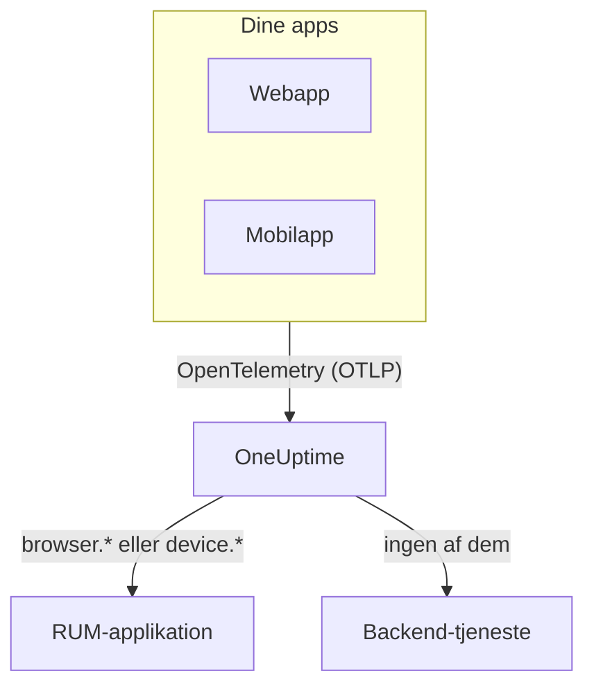

# RUM – Oversigt

Real User Monitoring (RUM) viser, hvad rigtige brugere oplever i dine web- og mobilapps: sideindlæsninger, forespørgsler, fejl og Core Web Vitals, rapporteret af appen selv i stedet for af en probe. OneUptime samler den telemetri i en RUM-applikation, som du kan vise i grafer, søge i og overvåge med alarmer.

:::cards
- [Sådan virker det](#sådan-virker-det): Én OpenTelemetry-pipeline, klassificeret som RUM ved ankomst.
- [Sådan genkender OneUptime RUM](#sådan-genkender-oneuptime-rum): De ressourceattributter, der afgør det.
- [Det får du](#det-får-du): Oversigten, vitals, explorerne og afspilningerne.
- [Kom i gang](#kom-i-gang): Fra en indtagelsesnøgle til din første sideindlæsning.
:::

## Sådan virker det

RUM bruger den samme OpenTelemetry-pipeline som resten af OneUptime. Der er ingen RUM-agent og intet eget overførselsformat: Du peger et OpenTelemetry-SDK til browser eller mobil på OneUptime, og telemetrien klassificeres som RUM, når den ankommer.

- **Én applikation pr. app.** Dens identitet er den `service.name`, dit SDK rapporterer, og OneUptime opretter applikationen ved første batch telemetri.
- **Aldrig talt to gange.** Klienttelemetri hører kun til sin RUM-applikation; den vises ikke også som backend-tjeneste.
- **Session Replay er et separat, valgfrit lag.** Det har sit eget snippet og sine egne privatlivsindstillinger: se [Sessionsafspilning](/docs/telemetry/session-replay).

## Hvor du finder det

Åbn **Produkter → Ressourcer → Overvågning af reelle brugere**. **Alle applikationer** viser dine applikationer med **Klienttype**, **Status** og **Sidst set**. To andre sektioner i sidemenuen er foldet sammen fra start:

- **Indstillinger**: **Ejerregler**, **Etiketregler** og projektets fælles **Session Replay**-kontakt.
- **Avanceret**: **Arkiveret**, de applikationer, du har arkiveret.

En applikations egen sidemenu grupperer dens sider sådan; **Indstillinger**, **Udvikler** og **Avanceret** er foldet sammen fra start:

| Sektion | Sider |
| --- | --- |
| **Grundlæggende** | **Oversigt**, **Recommendations**, **Dokumentation** |
| **Observabilitet** | **Metrikker**, **Protokoller**, **Spor**, **Klienter** |
| **Session Replay** | **Session Replay**, **User Flows**, **Replay Users**, **Health**, **Replay Policy**, **Replay Access Log**, **Dokumentation** |
| **Indstillinger** | **Indstillinger** |
| **Udvikler** | **Terraform**, **API**, **AI-assistenter** |
| **Avanceret** | **Slet applikation** |

## Sådan genkender OneUptime RUM

De fleste spørgsmål af typen "min app dukker ikke op" ender her. OneUptime afgør for hver batch telemetri ved ankomst ud fra dens **ressourceattributter**:

1. En batch, hvis ressource har `browser.platform`, `browser.language` eller et ikke-tomt `browser.brands`, er **browser**-RUM.
2. Ellers er en batch med `device.id` eller `device.model.identifier` **mobil**-RUM.
3. Ellers er en batch med `device.manufacturer` og uden værtsidentitet (`host.name`, `host.id` eller `k8s.node.name`) også **mobil**-RUM.
4. Alt andet er en backend-tjeneste.

Backend-SDK'er sætter aldrig `browser.*`, `device.id` eller `device.model.identifier`, så det er tydelige signaler. `device.manufacturer` er undtagelsen: En værts inventar rapporterer også en maskines producent med den, så den tæller kun på en ressource uden værtsidentitet. Se [Inventarattributter](/docs/telemetry/host-otel-collector#inventarattributter-ip-mac-serienummer-fabrikat-model-firmware).

| Attribut | Påkrævet | Hvad den gør |
| --- | --- | --- |
| `service.name` | **Ja** | Applikationens identitet, for eksempel `storefront-web`. Uden den oprettes ingen RUM-applikation. |
| `browser.platform`, `browser.language`, `browser.brands` | En af dem, på nettet | Markerer batchen som browser-RUM. `browser.platform` udfylder også siden **Klienter**. |
| `device.id`, `device.model.identifier` | En af dem, på mobil | Markerer batchen som mobil-RUM. `device.model.identifier` udfylder også siden **Klienter**. |
| `device.manufacturer` | Nej | Markerer kun batchen som mobil-RUM, når ressourcen ikke har nogen værtsidentitet. |
| `telemetry.sdk.language` | Nej | Vises i oversigten, for eksempel `webjs` eller `swift`. |
| `telemetry.sdk.version` | Nej | Vises som SDK-version; mangler den, læses `oneuptime.agent.version`. |
| `oneuptime.label.<name>` | Nej | Tilføjer projektetiketten `<name>:<value>` til applikationen. |

OneUptime finder applikationen ud fra `service.name` uden hensyn til store og små bogstaver og opretter den, når projektet ikke har en. En ny `service.name` starter en ny applikation, så hold den stabil, og skeln mellem miljøer med en etiket i stedet for et nyt navn. [Administrer applikationer](/docs/rum/applications) gennemgår navne, etiketter, ejere og opbevaring.

> [!IMPORTANT]
> OpenTelemetry-browser-SDK'et tilføjer ingen `browser.*`-attributter, medmindre du tilføjer browserens ressourcedetektor eller selv sætter dem. Med kun `service.name` bliver telemetrien en backend-tjeneste, ikke en RUM-applikation. [Browseropsætning](/docs/rum/browser-setup) viser begge måder.

## Det får du

| Hvor | Hvad det viser |
| --- | --- |
| **Oversigt** | Felter for **Page loads**, **Page load time (p95)**, **Begivenheder**, **Fejlrate**, **Event duration (p95)**, **Undtagelser**, **Klienter** og **Sessions recorded**, og trendgrafer over det tidsrum, du vælger. |
| **Core Web Vitals** | Et kort i oversigten med LCP, INP, CLS, FCP og TTFB, hver vurderet efter Googles grænser, og INP for hver rute i en single-page-app. Se [Core Web Vitals](/docs/rum/web-vitals) og [Single-page-apps](/docs/rum/web-vitals#single-page-apps). |
| **Metrikker**, **Protokoller**, **Spor** | Telemetri-explorerne, begrænset til denne applikation. |
| **Klienter** | De browserplatforme og enhedsmodeller, applikationen er blevet brugt på: en kort liste pr. platform, aldrig en række pr. bruger. |
| **Session Replay** | Optagelser af rigtige sessioner ved siden af deres fejl, spor og logs: se [Sessionsafspilning](/docs/telemetry/session-replay). |
| **Recommendations** | Færdige monitorer til applikationen: dårlige Core Web Vitals, mislykkede forespørgsler, browserundtagelser og, så snart den optager, budgetter for Session Replay. |

Tallene kommer fra de spans, din instrumentering sender. **Page loads** tæller det `documentLoad`-span, som sideindlæsningsinstrumenteringen registrerer ved hver fuld indlæsning, så et ruteskift i en single-page-app er ikke en sideindlæsning.

En applikation viser **Forbundet**, så længe der kommer telemetri, og **Afbrudt** efter 15 minutter uden. Tid, hvor OneUptime selv var nede eller var ved at indhente sin indtagelseskø, tæller ikke med i de 15 minutter.

## Kom i gang

:::steps
### Opret en indtagelsesnøgle

Åbn **Projektindstillinger → Telemetri og APM → Indtagelsesnøgler**, og klik på **Opret ingestion-nøgle**. En webapp skal bruge en **Browser**-nøgle, som kun virker fra de oprindelser, du angiver. En mobilapp skal bruge en **Server**-nøgle, fordi et mobil-SDK ikke sender en `Origin`-header.

### Instrumenter din app

Følg [Browseropsætning](/docs/rum/browser-setup) for en webapp eller [Mobilopsætning](/docs/rum/mobile-setup) for Android, iOS, React Native og andre platforme.

### Åbn en side

Indlæs en side på dit websted, eller start din app. Applikationen vises under **Produkter → Ressourcer → Overvågning af reelle brugere** ved sin første batch telemetri, navngivet efter sin `service.name`. Du behøver ikke oprette den først.

### Tilføj vitals og afspilninger

Når det grundlæggende kommer ind, så send [Core Web Vitals](/docs/rum/web-vitals), og tilføj [Sessionsafspilning](/docs/telemetry/session-replay). Begge dele er valgfrie.
:::

Hvis intet dukker op, gennemgår [RUM-fejlfinding](/docs/rum/troubleshooting) årsagerne i den rækkefølge, de typisk opstår.

## Næste skridt

:::cards
- [Browseropsætning](/docs/rum/browser-setup): Instrumenter en webapp med OpenTelemetry-browser-SDK'et.
- [Mobilopsætning](/docs/rum/mobile-setup): Android, iOS, React Native og ethvert andet OpenTelemetry-SDK.
- [Core Web Vitals](/docs/rum/web-vitals): Send LCP, INP, CLS, FCP og TTFB, og læs INP rute for rute.
- [Sessionsafspilning](/docs/telemetry/session-replay): Se, hvad brugeren så, ved siden af brugerens fejl og spor.
:::
