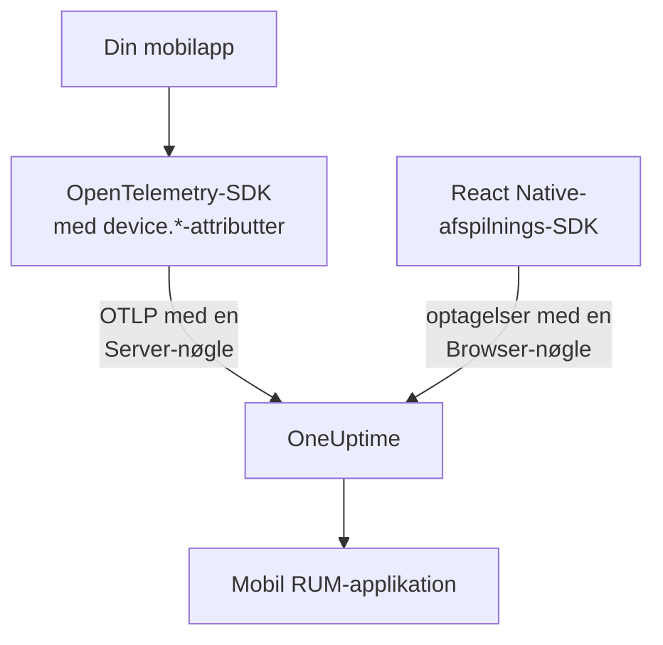

# Mobilopsætning

Instrumenter en Android-, iOS- eller React Native-app med OpenTelemetry, så den rapporterer til OneUptime som en mobil RUM-applikation. Enhver anden platform med et OpenTelemetry-SDK fungerer på samme måde.

:::cards
- [Hvad OneUptime har brug for](#hvad-oneuptime-har-brug-for): To ressourceattributter, sendt med en Server-nøgle.
- [Sæt din platform op](#sæt-din-platform-op): Android, iOS, React Native og resten.
- [Tjek, at det kommer frem](#tjek-at-det-kommer-frem): Test nøglen, og find så appen.
- [Session Replay på mobil](#session-replay-på-mobil): Optagelser til React Native-apps.
:::

## Sådan virker det

Din app eksporterer OTLP direkte til OneUptime med en **Server**-indtagelsesnøgle. Det er `device.*`-attributterne på dens ressource, der klassificerer den som mobil-RUM frem for en backend-tjeneste.



## Hvad OneUptime har brug for

To ressourceattributter, på hver batch, din app eksporterer:

| Attribut | Hvad den er |
| --- | --- |
| `service.name` | Applikationens identitet, for eksempel `storefront-android`. |
| `device.id` eller `device.model.identifier` | Markerer telemetrien som mobil-RUM. `device.model.identifier` udfylder også siden **Klienter**. |

Uden en enhedsattribut kommer telemetrien stadig frem, og du kan forespørge på den, men den arkiveres som en backend-tjeneste i stedet for en RUM-applikation.

`device.manufacturer` markerer også en batch som mobil, men kun på en ressource uden værtsidentitet, fordi en værts inventar rapporterer en maskines producent med den. Sæt også `device.id` eller `device.model.identifier`, som hver opskrift nedenfor gør, så betyder det aldrig noget.

Gør `device.id` til et id pr. installation, aldrig et reklame-id eller noget andet, der identificerer en person. OneUptime læser det kun for at genkende mobiltelemetri.

## Før du begynder

- En app med et OpenTelemetry-SDK: OpenTelemetry Java SDK eller OpenTelemetry Android, opentelemetry-swift eller OpenTelemetry JavaScript SDK til React Native.
- En **Server**-indtagelsesnøgle, oprettet under **Projektindstillinger → Telemetri og APM → Indtagelsesnøgler** med **Opret ingestion-nøgle**. En **Browser**-nøgle afvises fra en mobilapp: Den tjekkes mod headeren `Origin`, som mobil-SDK'er ikke sender.
- Disse OTLP-indstillinger. Hvis du selv hoster OneUptime, så erstat `https://oneuptime.com` med din egen vært.

| Indstilling | Værdi |
| --- | --- |
| OTLP-endpoint | `https://oneuptime.com/otlp` |
| Header | `x-oneuptime-token: YOUR_TELEMETRY_INGESTION_TOKEN` |
| Spor | `POST https://oneuptime.com/otlp/v1/traces` |
| Metrikker | `POST https://oneuptime.com/otlp/v1/metrics` |
| Logs | `POST https://oneuptime.com/otlp/v1/logs` |

> [!WARNING]
> Nøglen følger med i din app, og en app kan pakkes ud, så gå ud fra, at nogen kopierer den. Sæt et **Pinned Service Name** på nøglens side, så en kopi ikke kan skrive under dine backend-tjenesters navne, tilføj en **Requests Per Minute Limit** og en dato under **Udløber den**, og udskift nøglen med dine udgivelser.

## Sæt din platform op

Snippets viser formen på opsætningen. Mobil-SDK'erne til OpenTelemetry ændrer deres API'er mellem udgivelser, så tjek metodenavnene mod den version, du låser fast. Det, OneUptime har brug for, ændrer sig aldrig: endpointet, headeren, `service.name` og én `device.*`-attribut.

:::tabs
@tab Android
Brug OpenTelemetry Java SDK og dets OTLP-eksportør, som kører på Android:

```kotlin title="app/build.gradle.kts"
dependencies {
    implementation(platform("io.opentelemetry:opentelemetry-bom:<latest>"))
    implementation("io.opentelemetry:opentelemetry-sdk")
    implementation("io.opentelemetry:opentelemetry-exporter-otlp")
}
```

```kotlin title="StorefrontApplication.kt"
import android.app.Application
import android.os.Build
import io.opentelemetry.exporter.otlp.http.trace.OtlpHttpSpanExporter
import io.opentelemetry.sdk.OpenTelemetrySdk
import io.opentelemetry.sdk.resources.Resource
import io.opentelemetry.sdk.trace.SdkTracerProvider
import io.opentelemetry.sdk.trace.export.BatchSpanProcessor

class StorefrontApplication : Application() {
    override fun onCreate() {
        super.onCreate()

        val resource = Resource.getDefault().toBuilder()
            .put("service.name", "storefront-android")
            .put("device.manufacturer", Build.MANUFACTURER)
            .put("device.model.identifier", Build.MODEL)
            .build()

        val exporter = OtlpHttpSpanExporter.builder()
            .setEndpoint("https://oneuptime.com/otlp/v1/traces")
            .addHeader("x-oneuptime-token", BuildConfig.ONEUPTIME_TOKEN)
            .build()

        OpenTelemetrySdk.builder()
            .setTracerProvider(
                SdkTracerProvider.builder()
                    .setResource(resource)
                    .addSpanProcessor(BatchSpanProcessor.builder(exporter).build())
                    .build()
            )
            .buildAndRegisterGlobal()
    }
}
```

Agenten [OpenTelemetry Android](https://github.com/open-telemetry/opentelemetry-android) lægger automatisk instrumentering ovenpå og sætter enhedsattributter på sin egen ressource. Hvis du bruger den, så peg dens eksportør på samme endpoint og header, og tjek, at `device.model.identifier` når ressourcen i din version.
@tab iOS
Brug [opentelemetry-swift](https://github.com/open-telemetry/opentelemetry-swift), og sæt selv enhedsattributterne: Den ressource, hver version tilføjer af sig selv, har ændret sig mellem udgivelser.

```swift
let resource = Resource(attributes: [
    "service.name": .string("storefront-ios"),
    "device.model.identifier": .string(UIDevice.current.model),
    "device.manufacturer": .string("Apple"),
    "telemetry.sdk.language": .string("swift"),
])

let exporter = OtlpHttpTraceExporter(
    endpoint: URL(string: "https://oneuptime.com/otlp/v1/traces")!,
    config: OtlpConfiguration(
        headers: [("x-oneuptime-token", oneUptimeToken)]
    )
)

OpenTelemetry.registerTracerProvider(
    tracerProvider: TracerProviderBuilder()
        .with(resource: resource)
        .add(spanProcessor: BatchSpanProcessor(spanExporter: exporter))
        .build()
)
```

`UIDevice.current.model` giver et kort navn som `iPhone`, hvilket holder siden **Klienter** på én række pr. enhedstype.
@tab React Native
React Native kører OpenTelemetry JavaScript SDK, så byg provideren, OTLP-eksportøren og batch-processoren som i [Browseropsætning](/docs/rum/browser-setup), med tre ændringer: Send med en **Server**-nøgle, udelad `browserDetector` og `DocumentLoadInstrumentation`, og sæt selv enhedsattributterne.

```ts
import { Platform } from "react-native";
import * as Device from "expo-device"; // or react-native-device-info
import {
  defaultResource,
  resourceFromAttributes,
} from "@opentelemetry/resources";

const resource = defaultResource().merge(
  resourceFromAttributes({
    "service.name": "storefront-mobile",
    "device.manufacturer": Device.manufacturer ?? Platform.OS,
    "device.model.identifier":
      Device.modelId ?? Device.modelName ?? "unknown",
    "telemetry.sdk.language": "webjs",
  }),
);
```

`Device.modelId` sættes kun på iOS, så Android falder tilbage på `Device.modelName`.
@tab Andre platforme
Flutter, Unity, .NET MAUI, en indlejret klient eller din egen OTLP-skriver virker alle, så længe ressourcen bærer `service.name` og én `device.*`-attribut. Et SDK, der læser OpenTelemetrys standard-miljøvariabler, tager disse, som de er:

```bash
OTEL_EXPORTER_OTLP_ENDPOINT="https://oneuptime.com/otlp"
OTEL_EXPORTER_OTLP_HEADERS="x-oneuptime-token=YOUR_TELEMETRY_INGESTION_TOKEN"
OTEL_RESOURCE_ATTRIBUTES="service.name=storefront-mobile,device.manufacturer=Acme,device.model.identifier=AC-100"
```

SDK'et føjer selv `/v1/traces`, `/v1/metrics` og `/v1/logs` til endpointet.
:::

## Tjek, at det kommer frem

:::steps
### Test nøglen

Før du gennemgår SDK'ets indstillinger, så spørg OneUptime, om den accepterer nøglen:

```bash
curl -i https://oneuptime.com/otlp/v1/validate \
  -H "x-oneuptime-token: YOUR_TELEMETRY_INGESTION_TOKEN"
```

`200` med `"valid": true` betyder, at nøglen accepteres. En Browser-nøgle svarer også `200`, men dens besked siger, at den kun virker fra en browser: En mobilapp skal bruge en Server-nøgle. `401` betyder, at nøglen er ukendt, tilbagekaldt, slået fra eller udløbet, og ingen SDK-indstilling løser det.

### Start appen

Kør appen, og brug den et øjeblik. Den vises under **Produkter → Ressourcer → Overvågning af reelle brugere** ved sin første batch telemetri, navngivet efter sin `service.name`.

### Åbn siden Klienter

Åbn applikationens side **Klienter**: Hver enhedsmodel fra `device.model.identifier` har en række. Hvis siden forbliver tom, mens **Spor** fyldes, når enhedsattributterne ikke frem til ressourcen.
:::

## Session Replay på mobil

React Native-apps kan optage sessioner med `@oneuptime/react-native-replay`. Den optager det native visningstræ som en trådramme, aldrig skærmbilleder eller teksten på skærmen, og dens optagelser åbner i samme afspiller som webapps. Den sender med en **Browser**-nøgle, hvis **Allowed Origins** angiver din app som `app://` efterfulgt af dens Android-applikations-id eller iOS-bundle-id: en anden nøgle end den Server-nøgle, dit OpenTelemetry-SDK bruger. [Installer i React Native](/docs/telemetry/session-replay#install-in-react-native) guider dig igennem.

Native Android- og iOS-apps og de andre platforme har ingen sessionsoptager: Deres side **Session Replay** forbliver tom, mens spor, logs, metrikker, undtagelser og siden **Klienter** virker som normalt.

## Fejlfinding

:::details Nøgletjekket returnerer 401, eller nøglen afvises
En `401` betyder, at nøglen er ukendt, tilbagekaldt, slået fra eller udløbet: Opret en Server-nøgle, og byg appen igen med den.

En Browser-nøgle består tjekket, men hver eksport fra en mobilapp afvises med en `422`, der lyder `This request did not send an Origin header, so it cannot be checked against the allowed origins of this browser ingestion key. Use a server ingestion key for requests that are not sent by a browser.` Brug en **Server**-nøgle.
:::

:::details Appen vises under Tjenester i stedet for Overvågning af reelle brugere
Ressourcen har hverken `device.id` eller `device.model.identifier`, så telemetrien blev arkiveret som en backend-tjeneste. Sæt dem som i [Sæt din platform op](#sæt-din-platform-op).

Den tjeneste, der allerede blev oprettet, bliver ikke til en RUM-applikation, så slet den under **Produkter → Tjenester**, når RUM-telemetrien kommer ind.
:::

:::details Siden Klienter er tom
Klientrækker kommer kun fra `device.model.identifier`. Et SDK, der kun sætter `device.id` eller `device.manufacturer`, arkiverer appen som mobil-RUM, men viser ingen klienter: Sæt også `device.model.identifier`.
:::

:::details Status siger Afbrudt, mens folk bruger appen
Status skifter til **Afbrudt** efter 15 minutter uden telemetri. Hvis folk bruger appen:

- En sampler smider måske alt væk: Kig efter en always-off-sampler eller en meget lav rate.
- Appen sender måske kun telemetri for handlinger, som ingen udførte i den tid.
- Nøglen kan være blevet tilbagekaldt eller være udløbet siden udgivelsen: Test den som i [Tjek, at det kommer frem](#tjek-at-det-kommer-frem).
:::

## Næste skridt

:::cards
- [Sessionsafspilning](/docs/telemetry/session-replay): Optag React Native-sessioner ved siden af deres spor.
- [Administrer applikationer](/docs/rum/applications): Navne, etiketter, ejere og opbevaring.
- [OpenTelemetry](/docs/telemetry/open-telemetry): OTLP-endpoints, grænser og fejl i detaljer.
- [RUM-fejlfinding](/docs/rum/troubleshooting): Hvert tjek, i den rækkefølge problemer typisk opstår.
:::
