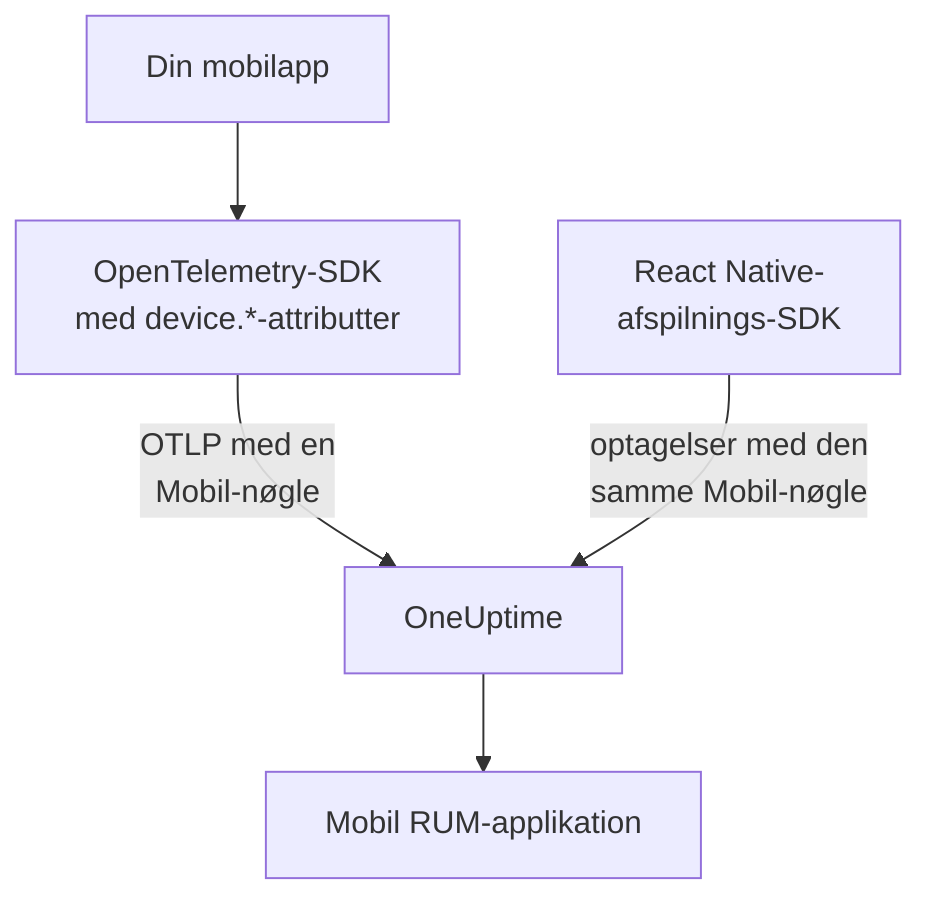

# Mobilopsætning

Instrumenter en Android-, iOS- eller React Native-app med OpenTelemetry, så den rapporterer til OneUptime som en mobil RUM-applikation. Enhver anden platform med et OpenTelemetry-SDK fungerer på samme måde.

:::cards
- [Hvad OneUptime har brug for](#hvad-oneuptime-har-brug-for): To ressourceattributter, sendt med en Mobil-nøgle.
- [Sæt din platform op](#sæt-din-platform-op): Android, iOS, React Native og resten.
- [Nedbrud og hæng på iOS](#nedbrud-og-hæng-på-ios): Rapporter fra MetricKit og KSCrash i Undtagelser, navngivet ud fra dine dSYM'er.
- [Tjek, at det kommer frem](#tjek-at-det-kommer-frem): Test nøglen, og find så appen.
- [Session Replay på mobil](#session-replay-på-mobil): Optagelser til React Native-apps.
:::

## Sådan virker det

Din app eksporterer OTLP direkte til OneUptime med en **Mobil**-indtagelsesnøgle, fastgjort til appen, så alt, hvad den sender, arkiveres som den mobile RUM-applikation. Med enhver anden nøgle er det `device.*`-attributterne på dens ressource, der klassificerer den som mobil-RUM frem for en backend-tjeneste.



## Hvad OneUptime har brug for

To ressourceattributter, på hver batch, din app eksporterer:

| Attribut | Hvad den er |
| --- | --- |
| `service.name` | Applikationens identitet, for eksempel `storefront-android`. |
| `device.id` eller `device.model.identifier` | Markerer telemetrien som mobil-RUM. `device.model.identifier` udfylder også siden **Klienter**. |

Sendt med en anden nøgle kommer telemetri uden en enhedsattribut stadig frem, og du kan forespørge på den, men den arkiveres som en backend-tjeneste i stedet for en RUM-applikation.

`device.manufacturer` markerer også en batch som mobil, men kun på en ressource uden værtsidentitet, fordi en værts inventar rapporterer en maskines producent med den. Sæt også `device.id` eller `device.model.identifier`, som hver opskrift nedenfor gør, så betyder det aldrig noget.

Gør `device.id` til et id pr. installation, aldrig et reklame-id eller noget andet, der identificerer en person. OneUptime læser det kun for at genkende mobiltelemetri.

## Før du begynder

- En app med et OpenTelemetry-SDK: OpenTelemetry Java SDK eller OpenTelemetry Android, opentelemetry-swift eller OpenTelemetry JavaScript SDK til React Native.
- En **Mobil**-indtagelsesnøgle, oprettet under **Projektindstillinger → Telemetri og APM → Indtagelsesnøgler** med **Opret indtagelsesnøgle**, med din apps `service.name` som **Fastgjort tjenestenavn**. En **Browser**-nøgle afvises fra en mobilapp: Den tjekkes mod headeren `Origin`, som mobil-SDK'er ikke sender. Send aldrig en **Server**-nøgle med i en app.
- Disse OTLP-indstillinger. Hvis du selv hoster OneUptime, så erstat `https://oneuptime.com` med din egen vært.

| Indstilling | Værdi |
| --- | --- |
| OTLP-endpoint | `https://oneuptime.com/otlp` |
| Header | `x-oneuptime-token: YOUR_TELEMETRY_INGESTION_TOKEN` |
| Spor | `POST https://oneuptime.com/otlp/v1/traces` |
| Metrikker | `POST https://oneuptime.com/otlp/v1/metrics` |
| Logs | `POST https://oneuptime.com/otlp/v1/logs` |

> [!WARNING]
> Nøglen følger med i din app, og en app kan pakkes ud, så gå ud fra, at nogen kopierer den. En kopi af en Mobil-nøgle kan kun sende denne apps spor, logs, metrikker og sessionsafspilninger, arkiveret under dens **Fastgjort tjenestenavn**, og aldrig fra en webside. Den kan stadig sende opdigtede data for denne app, op til nøglens **Grænse for anmodninger pr. minut**, så tilføj en dato under **Udløber den**, og udskift nøglen med dine udgivelser.

## Sæt din platform op

Snippets viser formen på opsætningen. Mobil-SDK'erne til OpenTelemetry ændrer deres API'er mellem udgivelser, så tjek metodenavnene mod den version, du låser fast. Det, OneUptime har brug for, ændrer sig aldrig: endpointet, headeren, `service.name` og én `device.*`-attribut.

:::tabs
@tab Android
Brug OpenTelemetry Java SDK og dets OTLP-eksportør, som kører på Android:

```kotlin title="app/build.gradle.kts"
dependencies {
    implementation(platform("io.opentelemetry:opentelemetry-bom:<latest>"))
    implementation("io.opentelemetry:opentelemetry-sdk")
    implementation("io.opentelemetry:opentelemetry-exporter-otlp")
}
```

```kotlin title="StorefrontApplication.kt"
import android.app.Application
import android.os.Build
import io.opentelemetry.exporter.otlp.http.trace.OtlpHttpSpanExporter
import io.opentelemetry.sdk.OpenTelemetrySdk
import io.opentelemetry.sdk.resources.Resource
import io.opentelemetry.sdk.trace.SdkTracerProvider
import io.opentelemetry.sdk.trace.export.BatchSpanProcessor

class StorefrontApplication : Application() {
    override fun onCreate() {
        super.onCreate()

        val resource = Resource.getDefault().toBuilder()
            .put("service.name", "storefront-android")
            .put("device.manufacturer", Build.MANUFACTURER)
            .put("device.model.identifier", Build.MODEL)
            .build()

        val exporter = OtlpHttpSpanExporter.builder()
            .setEndpoint("https://oneuptime.com/otlp/v1/traces")
            .addHeader("x-oneuptime-token", BuildConfig.ONEUPTIME_TOKEN)
            .build()

        OpenTelemetrySdk.builder()
            .setTracerProvider(
                SdkTracerProvider.builder()
                    .setResource(resource)
                    .addSpanProcessor(BatchSpanProcessor.builder(exporter).build())
                    .build()
            )
            .buildAndRegisterGlobal()
    }
}
```

Agenten [OpenTelemetry Android](https://github.com/open-telemetry/opentelemetry-android) lægger nedbrud, ANR'er, langsomme og frosne frames og appstarter ovenpå og sætter `device.model.identifier` og `device.manufacturer` på sin egen ressource. [Android-opsætning](/docs/rum/android-setup) sætter den op i stedet for koden ovenfor.
@tab iOS
Brug [opentelemetry-swift](https://github.com/open-telemetry/opentelemetry-swift), og sæt selv enhedsattributterne: Den ressource, hver version tilføjer af sig selv, har ændret sig mellem udgivelser.

```swift
let resource = Resource(attributes: [
    "service.name": .string("storefront-ios"),
    "device.model.identifier": .string(UIDevice.current.model),
    "device.manufacturer": .string("Apple"),
    "device.id": .string(UIDevice.current.identifierForVendor?.uuidString ?? ""),
    "telemetry.sdk.language": .string("swift"),
])

let exporter = OtlpHttpTraceExporter(
    endpoint: URL(string: "https://oneuptime.com/otlp/v1/traces")!,
    config: OtlpConfiguration(
        headers: [("x-oneuptime-token", oneUptimeToken)]
    )
)

OpenTelemetry.registerTracerProvider(
    tracerProvider: TracerProviderBuilder()
        .with(resource: resource)
        .add(spanProcessor: BatchSpanProcessor(spanExporter: exporter))
        .build()
)
```

`UIDevice.current.model` giver et kort navn som `iPhone`, hvilket holder siden **Klienter** på én række pr. enhedstype. `identifierForVendor` er den installation, OneUptime tæller installationer uden nedbrud efter, som [Registrér sessioner](#registrér-sessioner) beskriver.
@tab React Native
React Native kører OpenTelemetry JavaScript SDK, så byg provideren, OTLP-eksportøren og batch-processoren som i [Browseropsætning](/docs/rum/browser-setup), med tre ændringer: Send med en **Mobil**-nøgle, udelad `browserDetector` og `DocumentLoadInstrumentation`, og sæt selv enhedsattributterne.

```ts
import { Platform } from "react-native";
import * as Device from "expo-device"; // or react-native-device-info
import {
  defaultResource,
  resourceFromAttributes,
} from "@opentelemetry/resources";

const resource = defaultResource().merge(
  resourceFromAttributes({
    "service.name": "storefront-mobile",
    "device.manufacturer": Device.manufacturer ?? Platform.OS,
    "device.model.identifier":
      Device.modelId ?? Device.modelName ?? "unknown",
    "telemetry.sdk.language": "webjs",
  }),
);
```

`Device.modelId` sættes kun på iOS, så Android falder tilbage på `Device.modelName`.
@tab Andre platforme
Flutter, Unity, .NET MAUI, en indlejret klient eller din egen OTLP-skriver virker alle, så længe ressourcen bærer `service.name` og én `device.*`-attribut. Et SDK, der læser OpenTelemetrys standard-miljøvariabler, tager disse, som de er:

```bash
OTEL_EXPORTER_OTLP_ENDPOINT="https://oneuptime.com/otlp"
OTEL_EXPORTER_OTLP_HEADERS="x-oneuptime-token=YOUR_TELEMETRY_INGESTION_TOKEN"
OTEL_RESOURCE_ATTRIBUTES="service.name=storefront-mobile,device.manufacturer=Acme,device.model.identifier=AC-100"
```

SDK'et føjer selv `/v1/traces`, `/v1/metrics` og `/v1/logs` til endpointet.
:::

## Nedbrud og hæng på iOS

opentelemetry-swift 2.3 og nyere rapporterer en iOS-apps nedbrud og hæng gennem sin MetricKit-instrumentering, som giver hver af Apples diagnosticeringer videre til OpenTelemetry som en logpost. OneUptime arkiverer dem, som det arkiverer OpenTelemetry Androids nedbrud og ANR'er, så de vises i **Undtagelser** og på applikationens side **Oversigt**:

| Apples diagnosticering | Hændelsesnavn | I Undtagelser |
| --- | --- | --- |
| Et nedbrud | `metrickit.diagnostic.crash` | En ikke-håndteret undtagelse med typen af det, der afsluttede appen: Objective-C-undtagelsen på iOS 17 og nyere, ellers Mach-undtagelsen (`EXC_BAD_ACCESS`), ellers signalet (`SIGSEGV`) |
| Et hæng | `metrickit.diagnostic.hang` | En ikke-håndteret undtagelse af typen **Hang**, iOS' modstykke til en ANR, som gemmer, hvor længe hænget varede |

Oversigtens felt **Nedbrud** tæller nedbruddene, og dens felt **ANR'er** tæller hængene sammen med Androids ANR'er. Hvert stack trace tegnes som trådene i en nedbrudsrapport, med den tråd, der gik ned eller hang, først. En frame i din apps kode navngives efter sin funktion, fx `CartViewController.checkout()`, når dens builds dSYM er uploadet, som i [Upload dine dSYM'er](#upload-dine-dsymer). Alle andre frames nævner deres binære fil, og hvor langt inde i den koden lå, og **Binary Images** viser hver binær fils UUID, som fortæller, hvilket builds dSYM der navngiver den.

Nedbrud og hæng grupperes efter din apps frames på den tråd, der gik ned eller hang: efter deres funktioner, hvor et dSYM navngav dem, så et nedbrud forbliver én undtagelse fra den ene udgivelse til den næste, og efter deres offsets i den binære fil, hvor intet dSYM gjorde det, og de offsets ændrer sig med hvert build. En rapport navngives, når den ankommer, så upload et builds dSYM'er, før du udgiver det: Et nedbrud, der ankom før sit dSYM, beholder sine offsets.

:::steps
### Eksportér logs ud over spans

MetricKit rapporterer diagnosticeringer som logposter, så registrér en logger provider ved siden af tracer provider, med samme ressource, endpoint og header:

```swift
let logExporter = OtlpHttpLogExporter(
    endpoint: URL(string: "https://oneuptime.com/otlp/v1/logs")!,
    config: OtlpConfiguration(
        headers: [("x-oneuptime-token", oneUptimeToken)]
    )
)

OpenTelemetry.registerLoggerProvider(
    loggerProvider: LoggerProviderBuilder()
        .with(resource: resource)
        .with(processors: [
            BatchLogRecordProcessor(logRecordExporter: logExporter),
        ])
        .build()
)
```

### Registrér MetricKit-instrumenteringen

Tilføj produktet `MetricKitInstrumentation` fra opentelemetry-swift, og registrér det hos MetricKit, når logger provider er registreret:

```swift
import MetricKit
import MetricKitInstrumentation

// MXMetricManager keeps only a weak reference: hold this for the app's lifetime.
let metricKitInstrumentation = MetricKitInstrumentation()
MXMetricManager.shared.add(metricKitInstrumentation)
```

### Registrér sessioner

Felterne **Sessioner** og **Sessioner uden nedbrud** tæller det `session.id`, der er på dine spans. Produktet `Sessions` fra opentelemetry-swift sætter det: tilføj `SessionSpanProcessor` til tracer provider, og pak logprocessoren ind i `SessionLogRecordProcessor`, så diagnosticeringer også bærer en session.

Linjen under **Sessioner uden nedbrud** viser andelen af installationer, der ikke gik ned, og **Daily Crash Rate** og **Daily ANR Rate** advarer ud fra andelen, der gjorde. En installation er `device.id` i ressourcen ovenfor, appens identifikator for leverandøren: én pr. enhed for alle dine apps, som bevares, så længe en af dem forbliver installeret, så geninstallation af din eneste app giver en ny installation, mens geninstallation af én ud af to ikke gør. En udgivelse af opentelemetry-swift, der sætter `app.installation.id`, tælles i stedet efter den.

### Upload dine dSYM'er

Xcode skriver et dSYM for hver af din apps binære filer, når det arkiverer appen, og App Store Connect giver dem tilbage under **Download dSYMs**. Upload dem efter hver arkivering, fra CI eller en build-fase i Xcode, med [OneUptime-CLI'en](/docs/cli/index) og en Server-nøgle, der hører til dit build: En nøgle med et **Fastgjort tjenestenavn**, som den, din app udgives med, afvises, fordi et dSYM navngiver frames i hver app i projektet, der udgives med dets binære fil.

```bash
oneuptime dsym upload "$ARCHIVE_PATH/dSYMs" --app storefront-ios --url https://oneuptime.com --ingestion-key YOUR_TELEMETRY_INGESTION_TOKEN
```

CLI'en læser `.dSYM`-bundter, mapper og zip-filer med dem samt DWARF-filer, hvor de ligger, og sender kun hver binær fils UUID, arkitektur og funktionsnavne: En stor apps dSYM'er fylder hundredvis af megabyte, deres navne nogle få. Uden CLI'en sender du DWARF-filen fra et dSYM eller en zip-fil med `.dSYM`-bundter, som den er, op til 50 MB pr. fil:

```bash
curl --fail -X POST "https://oneuptime.com/dsyms/v1/upload" \
  -H "x-oneuptime-token: YOUR_TELEMETRY_INGESTION_TOKEN" \
  -F "appName=storefront-ios" \
  -F "dsym=@MyApp.app.dSYM/Contents/Resources/DWARF/MyApp"
```

Hver binær fil gemmes efter sin UUID i 400 dage, så en udgivelse, der stadig er på folks telefoner måneder senere, stadig navngives, og når et build uploades igen, erstatter det, hvad der var gemt for det. Et dSYM hører til projektet, ikke til én app: Et framework, som to af dine apps indlejrer, navngives i begge.
:::

> [!NOTE]
> Apple leverer først MetricKits diagnosticeringer til appen ved en senere start, med det samme på iOS 15 og nyere og én gang om dagen før det, så et nedbrud eller et hæng kan ankomme minutter eller en dag efter, at det skete, og tælles, når det ankommer. «0 nedbrud i den seneste time» på en iOS-apps oversigt er altså endnu ikke gode nyheder. En diagnosticering bærer den session, der rapporterede den, ikke den, den afsluttede.

opentelemetry-swift registrerer intet span, når appen starter, så felterne **Appstarter** og **Koldstart (p95)** forbliver tomme, indtil din app selv registrerer et: et span med navnet `AppStart`, med `start.type` sat til `cold`, `warm` eller `hot`, fra processen starter, til den første skærm er klar.

### Når KSCrash også rapporterer et nedbrud

opentelemetry-swift kan også rapportere nedbrud gennem KSCrash, som sender sin rapport som en logpost `device.crash`, næste gang appen åbnes, med tidspunktet, hvor appen gik ned. En app, der registrerer begge, rapporterer hvert nedbrud to gange: KSCrash ved næste start, MetricKit ved næste start eller op til en dag senere. OneUptime tæller et sådant nedbrud én gang: Den første rapport, der ankommer, er forekomsten, og den anden gemmes ved siden af den, i den samme undtagelse, som bevis på det samme nedbrud og tælles ikke i noget felt, diagram eller nogen monitor. Under undtagelsens **Forekomster** står der **Rapporteret to gange** ved forekomsten.

To rapporter regnes kun for ét nedbrud, når alt dette gælder:

- De kommer fra de to rapportører, KSCrash og MetricKit. Ingen af dem rapporterer ét nedbrud to gange, så to rapporter fra den samme er to nedbrud.
- De kommer fra den samme installation: det samme `app.installation.id` eller `device.id`.
- De ligger højst 26 timer fra hinanden: MetricKit stempler et nedbrud med slutningen af den dag, det rapporterer om, KSCrash med øjeblikket for nedbruddet.
- De stemmer overens om signalet, Mach-undtagelsen og Objective-C-undtagelsen, hvor end begge nævner en.
- De tråde, der gik ned, stemmer overens frame for frame fra der, hvor tråden startede, og indad, efter binær fil og offset, over hver frame i din apps kode, som en af dem nævner. Et nedbrud helt i Apples kode skal stemme overens i mindst tre frames, og i dem alle.

Hver rapport parres én gang, med den nærmeste i tid, så to nedbrud fra den samme fejl på én installation med minutters mellemrum er to forekomster, hver med sin anden rapport. Når OneUptime ikke kan sammenligne en rapport med sin installations andre, tæller det den, så et nedbrud i værste fald tælles to gange, men aldrig går tabt.

## Tjek, at det kommer frem

:::steps
### Test nøglen

Før du gennemgår SDK'ets indstillinger, så spørg OneUptime, om den accepterer nøglen:

```bash
curl -i https://oneuptime.com/otlp/v1/validate \
  -H "x-oneuptime-token: YOUR_TELEMETRY_INGESTION_TOKEN"
```

`200` med `"valid": true` betyder, at nøglen accepteres. En Browser-nøgle svarer også `200`, men dens besked siger, at den kun virker fra en browser: En mobilapp skal bruge en Mobil-nøgle. `401` betyder, at nøglen er ukendt, tilbagekaldt, slået fra eller udløbet, og ingen SDK-indstilling løser det.

### Start appen

Kør appen, og brug den et øjeblik. Den vises under **Produkter → Ressourcer → Overvågning af reelle brugere** ved sin første batch telemetri, navngivet efter sin `service.name`.

### Åbn siden Klienter

Åbn applikationens side **Klienter**: Hver enhedsmodel fra `device.model.identifier` har en række. Hvis siden forbliver tom, mens **Spor** fyldes, når enhedsattributterne ikke frem til ressourcen.
:::

## Session Replay på mobil

React Native-apps kan optage sessioner med `@oneuptime/react-native-replay`. Den optager det native visningstræ som en trådramme, aldrig skærmbilleder eller teksten på skærmen, og dens optagelser åbner i samme afspiller som webapps. Den sender med den samme **Mobil**-nøgle som dit OpenTelemetry-SDK, med nøglens **Fastgjort tjenestenavn** som `appIdentifier`, så appen kun har én nøgle med. En **Browser**-nøgle, hvis **Tilladte oprindelser** angiver din app som `app://` efterfulgt af dens Android-applikations-id eller iOS-bundle-id, virker også. [Installer i React Native](/docs/telemetry/session-replay#installation-i-react-native) guider dig igennem.

Native Android- og iOS-apps og de andre platforme har ingen sessionsoptager: Deres side **Sessionsafspilning** forbliver tom, mens spor, logs, metrikker, undtagelser og siden **Klienter** virker som normalt.

## Fejlfinding

:::details Nøgletjekket returnerer 401, eller nøglen afvises
En `401` betyder, at nøglen er ukendt, tilbagekaldt, slået fra eller udløbet: Opret en Mobil-nøgle, og byg appen igen med den.

En Browser-nøgle består tjekket, men hver eksport fra en mobilapp afvises med en `422`, der lyder `This request did not send an Origin header, so it cannot be checked against the allowed origins of this browser ingestion key. Use a mobile ingestion key in a mobile app, and a server ingestion key on a server.` Brug en **Mobil**-nøgle. En Mobil-nøgle afvises også med en `422` over gRPC, fra en webside og for en sessionsafspilning, hvis `appIdentifier` ikke er dens **Fastgjort tjenestenavn**: Eksportér over OTLP/HTTP, og giv afspilnings-SDK'et nøglens fastgjorte navn.
:::

:::details Appen vises under Tjenester i stedet for Overvågning af reelle brugere
Telemetrien blev sendt med en anden nøgle end en Mobil-nøgle, og dens ressource har hverken `device.id` eller `device.model.identifier`, så den blev arkiveret som en backend-tjeneste. Send med en Mobil-nøgle, eller sæt dem som i [Sæt din platform op](#sæt-din-platform-op).

Den tjeneste, der allerede blev oprettet, bliver ikke til en RUM-applikation, så slet den under **Produkter → Tjenester**, når RUM-telemetrien kommer ind.
:::

:::details Siden Klienter er tom
Klientrækker kommer kun fra `device.model.identifier`. Et SDK, der kun sætter `device.id` eller `device.manufacturer`, arkiverer appen som mobil-RUM, men viser ingen klienter: Sæt også `device.model.identifier`.
:::

:::details Status siger Ingen nylig trafik, mens folk bruger appen
Status skifter til **Ingen nylig trafik** efter 15 minutter uden telemetri. Hvis folk bruger appen:

- En sampler smider måske alt væk: Kig efter en always-off-sampler eller en meget lav rate.
- Appen sender måske kun telemetri for handlinger, som ingen udførte i den tid.
- Nøglen kan være blevet tilbagekaldt eller være udløbet siden udgivelsen: Test den som i [Tjek, at det kommer frem](#tjek-at-det-kommer-frem).
:::

## Næste skridt

:::cards
- [Sessionsafspilning](/docs/telemetry/session-replay): Optag React Native-sessioner ved siden af deres spor.
- [Administrer applikationer](/docs/rum/applications): Navne, etiketter, ejere og opbevaring.
- [OpenTelemetry](/docs/telemetry/open-telemetry): OTLP-endpoints, grænser og fejl i detaljer.
- [RUM-fejlfinding](/docs/rum/troubleshooting): Hvert tjek, i den rækkefølge problemer typisk opstår.
:::
