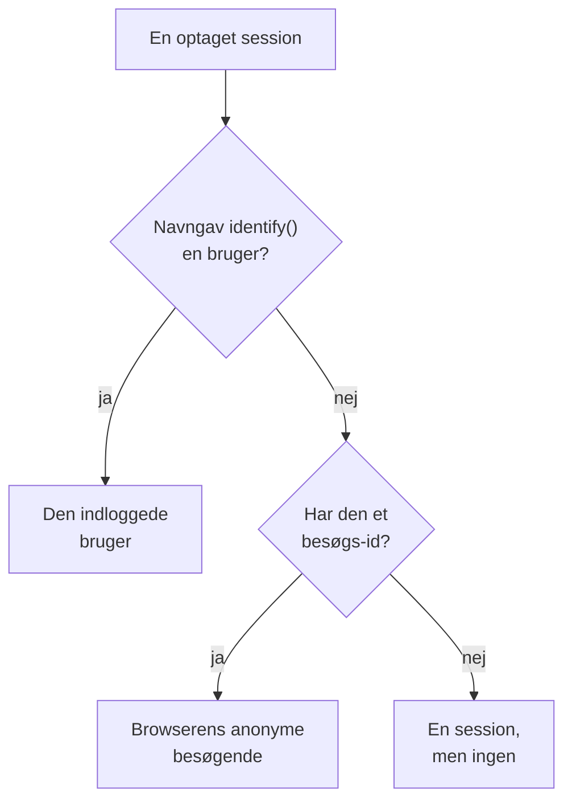

# Produktanalyse

Produktanalyse tæller de mennesker, der bruger en RUM-applikation, hvordan deres sessioner forløber, og hvad de gør: aktive, nye, tilbagevendende, indloggede og inaktive brugere, sessioner efter enhed, browser, land og side samt de begivenheder, din app sender, som tendenser, tragte og fastholdelse. Den tæller de sessioner, som [Sessionsafspilning](/docs/telemetry/session-replay) optager, og de begivenheder, dens optager sender, så den behøver intet eget snippet, og den gemmer sine tal i 13 måneder, længe efter at optagelserne er udløbet.

:::cards
- [Brugere](#brugere): Aktive, nye, tilbagevendende, indloggede, alle og inaktive brugere.
- [Sessioner](#sessioner): Hvor mange, hvor længe, og efter enhed, browser, land og side.
- [Send begivenheder og metrikker](#send-begivenheder-og-metrikker): Hvad folk gør, og de tal, din side måler.
- [Begivenheder](#begivenheder): Hvor ofte noget skete, hvem der gjorde det, og hvor.
- [Tragte](#tragte): Hvem der gik videre, trin for trin, og hvor lang tid det tog.
- [Fastholdelse af brugere](#fastholdelse-af-brugere): Hvem der kom tilbage, kohorte for kohorte.
:::

## Hvordan personer tælles

En applikations sidemenu har en sektion **Produktanalyse**: **Brugere**, **Sessioner**, **Begivenheder**, **Tragte**, **Fastholdelse af brugere**, **Brugerforløb** og **Analyseindstillinger**. **Brugere** og **Sessioner** tæller de sessioner, som Sessionsafspilning optager, så de begynder, når applikationens optager gør, og en session, som afspilningspolitikken ikke optager, tælles ikke. Hver session tæller for én person eller for ingen:



- **En indlogget bruger tælles én gang**, på hver browser og enhed, vedkommende bruger: brugeren kendes på envejs-hashen af den reference, din side gav `identify()` (se [Identificer dine brugere](/docs/telemetry/session-replay#identificer-dine-brugere)).
- **En anonym browser tælles én gang**, via sit [anonyme besøgs-id](/docs/telemetry/session-replay#anonyme-besøgende). To browsere er to besøgende, og de sessioner, en browser havde, før nogen loggede ind på den, forbliver dens besøgendes.
- **En session fra en ældre optager**, som ikke sendte et besøgs-id, tæller som en session, men ikke som en person.

**Begivenheder**, **Tragte** og **Fastholdelse af brugere** tæller personer på samme måde, ud fra de begivenheder, optageren sender fra hver session, optaget eller ej (se [Send begivenheder og metrikker](#send-begivenheder-og-metrikker)).

Dage tælles i din egen tidszone.

## Brugere

**Brugere** tæller personerne i det interval, du vælger:

| Felt | Hvad det tæller |
| --- | --- |
| **Aktive brugere** | Alle, der kom i intervallet: hver indlogget bruger én gang og hver anonym browser én gang. |
| **Nye brugere** | Aktive brugere, hvis første besøg var i intervallet. |
| **Tilbagevendende brugere** | Aktive brugere, der var kommet, før intervallet begyndte. |
| **Indloggede brugere** | Aktive brugere, som din app loggede ind med `identify()`, og deres andel af alle aktive brugere. |
| **Brugere i alt** | Alle, som applikationen har set i de seneste 13 måneder. |
| **Inaktive brugere** | Personer, der kom før, men ikke i de seneste 30 dage, eller i de 7, 14, 60 eller 90 dage, du vælger. |

De første tre viser også, hvordan de ændrede sig i forhold til perioden før. Under felterne tegner **Aktive brugere** for hver dag de personer, der kom den dag, dem, der kom i de 7 dage op til den, og dem, der kom i de 30 dage op til den, og **Nye og tilbagevendende brugere** deler hver dags personer i to.

**Personer** viser alle, som felterne tæller, én række pr. person, de senest sete først, og dens filter viser ét felts personer, de anonyme besøgende eller alle. Åbn en person for at se første og seneste besøg og hver af vedkommendes sessioner fra de seneste 13 måneder, med **Se** på hver, hvis optagelse stadig gemmes.

## Sessioner

**Sessioner** tæller de sessioner, der begyndte i intervallet: **Sessioner**, **Indloggede sessioner**, **Median sessionsvarighed**, **Sider pr. session**, **Sessioner med fejl** og **Frustrerede sessioner**. Under felterne:

- **Sessioner efter enhed** tegner hver dags sessioner fra computere, telefoner og tablets. En mobilapps session på en skærm, hvis korte side er 600 punkter eller mere, tæller som en tablets.
- **Sessionsvarighed** inddeler de afsluttede sessioner efter, hvor længe de varede, fra under 10 sekunder til over 30 minutter. En session, der stadig optages, har endnu ingen varighed.
- **Opdeling** rangerer brugere og sessioner efter enhedstype, browser, styresystem, land, appversion, indgangsside eller side, flest brugere først.

## Send begivenheder og metrikker

Begivenheder sendes, mens **Send produktanalysebegivenheder** er slået til på applikationens side **Analyseindstillinger**. Den er slået til fra start for en ny applikation og slået fra for en applikation, der blev oprettet, før den fandtes, så slå den til der. Sessionsafspilning skal også være slået til for applikationen, da det er dens optager, der sender begivenhederne; React Native-optageren sender endnu ingen.

Hver session, browseroptageren kører i, sender selv sin start og hver side, den viser, inklusive en single-page-apps ruteskift, uanset om afspilningens stikprøve og politik optager sessionen eller ej. Dine egne begivenheder og tal kommer fra din sides kode:

```js
OneUptimeReplay.track("Signed up", { plan: "pro" });
OneUptimeReplay.metric("cart.value", 42.5, { currency: "EUR" });
```

| Kald | Hvad det sender |
| --- | --- |
| `track(name, properties?)` | En begivenhed, som **Begivenheder**, **Tragte** og **Fastholdelse af brugere** tæller, og en markør på afspilningens tidslinje, når sessionen optages. `name` ≤ 64 tegn; ≤ 20 egenskaber med streng-, tal- eller booleske værdier, nøgle ≤ 40 tegn, værdi ≤ 200 tegn. |
| `metric(name, value, attributes?)` | Et tal, din side har målt, som et punkt i en af applikationens metrikker (se [Dashboards og alarmer](#dashboards-og-alarmer)). `name` ≤ 100 tegn af bogstaver, cifre, `_`, `.`, `-` og `/`, der begynder med et bogstav og ikke med `oneuptime.`; `value` et endeligt tal; `attributes` som egenskaberne for `track()`. |

Før optageren er indlæst, skal du lægge de samme kald i `window.OneUptimeReplayQueue` som `["track", name, properties]` og `["metric", name, value, attributes]` (se [JavaScript-API](/docs/telemetry/session-replay#javascript-api)).

- **Hver session, optaget eller ej.** Afspilningens stikprøve og uploadpolitik afgør, hvilke sessioner der optages, ikke hvilke der tælles. Intet sendes under Do Not Track eller Global Privacy Control, og intet gemmes fra en oprindelse, applikationen ikke tillader. Når politikken kræver samtykke, venter begivenhederne på `grantConsent()`, højst 500 af dem, og `revokeConsent()` kasserer dem.
- **Maskeret som optagelsen.** Under _Mask all text_ maskeres værdierne af egenskaber og attributter, før de forlader siden, så en opdeling efter en af dem viser pladsholdere og ikke dine værdier; begivenhedsnavne, egenskabsnøgler og metrikværdier sendes, som de er skrevet. En værdi, du skal kunne læse i den tilstand, hører hjemme i et sessionstag (`setTags()`), som aldrig maskeres, så hold personoplysninger ude af det. Tags vises på sessionen og i en søgning med `tag:key=value` i sessionslisten, ikke i disse siders opdelinger. En side sendes som sin sti, uden forespørgsel og fragment.
- **I små portioner**, hvert 5. sekund og når fanen skjules. En begivenhed, der når OneUptime mere end 3 dage efter, at den skete, kasseres, og et projekt må sende 60.000 begivenheder og metrikpunkter i minuttet, alle dets applikationer tilsammen; derudover venter optageren og sender dem igen.

`metric()` sender intet, mens begivenhederne er slået fra, og `getDiagnostics().productAnalytics` siger, om de er slået til (se [`getDiagnostics()`](/docs/telemetry/session-replay#getdiagnostics)).

### Brugeregenskaber

For at opdele og segmentere begivenheder efter, hvem der udførte dem, skal du angive nøgler for egenskaber fra `identify()` under **Brugeregenskaber til analyse** på **Analyseindstillinger**, f.eks. `["plan", "role"]`, højst 20, sammenlignet præcis som de er skrevet. Hver begivenhed bærer så disse egenskaber for den indloggede bruger, som din side gav dem til `identify()`. De andre egenskaber forlader aldrig siden, og ingen gør det, mens **Registrér slutbrugerens identitet** er slået fra. Angiv ikke egenskaber, der indeholder persondata, f.eks. en e-mailadresse.

## Begivenheder

**Begivenheder** viser én begivenhed ad gangen: din apps hyppigste begivenhed, indtil du vælger en anden, eller den mest viste side, så længe appen ikke sender nogen. Vælgeren viser også **Session startet** og hver vist side, og **Alle begivenheder** nedenfor viser hver begivenhed i intervallet med, hvor mange gange den skete, og hvor mange personer der udførte den; vælg én for at se den ovenfor.

- Felterne tæller begivenhedens **Begivenheder**, med hvor mange hver person i gennemsnit udførte, dens **Brugere** og dens **Sessioner**.
- **Begivenheder og brugere** tegner for hver dag, hvor mange gange begivenheden skete, og hvor mange personer der udførte den den dag.
- **Opdeling** rangerer begivenheden efter enhedstype, browser, styresystem, land, appversion, side, begivenhedsegenskab eller brugeregenskab, med hver værdis begivenheder, brugere og andel. Vælg en værdi for kun at vise den.

**Segment** afgrænser siden til de begivenheder, hvis felter har de værdier, du vælger: **Tilføj filter**, derefter et felt og en værdi, sammenlignet præcist. Et segment rummer højst 5 filtre, og en begivenhed skal matche dem alle. Sidens adresse beholder begivenheden, intervallet, segmentet og opdelingen, så et link åbner den samme visning.

## Tragte

**Tragte** følger personer gennem 2 til 6 trin i rækkefølge, hvert trin en begivenhed, som **Begivenheder** viser dem. Af de personer, der udførte første trin i intervallet, tæller den, hvor mange der derefter udførte det andet, så det tredje, alle inden for den tid, du vælger fra deres første trin: **Inden for 1 time**, **Inden for 1 dag**, **Inden for 7 dage**, **Inden for 14 dage** eller **Inden for 30 dage**. **Tilføj trin** tilføjer ét.

Under **Konvertering** står andelen af personer, der udførte hvert trin, og for hvert trin hvor mange personer der nåede det, hvor stor en andel af første trins personer det er, hvor mange der faldt fra siden trinnet før, og den mediane tid, de brugte fra det. En, der prøvede mere end én gang, tæller én gang, med det forsøg, der nåede længst.

Segmentet for en tragt, og for en fastholdelsestabel, bruger de felter, hver begivenhed bærer, og brugeregenskaber, ikke en begivenheds egne egenskaber, da dens trin er forskellige begivenheder.

## Fastholdelse af brugere

**Fastholdelse af brugere** grupperer personer efter den dag, uge eller måned i intervallet, hvor de første gang udførte én begivenhed, **Personer, der udførte**, og viser, hvor stor en andel af hver gruppe der udførte en anden, **Og kom tilbage for at udføre**, i den periode og i hver periode efter. Begge er **Session startet**, indtil du vælger andre.

**Kohorter** fastsætter perioden: **Pr. dag**, **Pr. uge** eller **Pr. måned**. Når intervallet rummer flere perioder, end én tabel viser, 32 dage, 26 uger eller 13 måneder, gør siden kohorterne længere og siger det.

Hver række er en kohorte og antallet af personer i den, og hver celle andelen af dem, der kom tilbage i den periode, mørkere jo flere der gjorde det. En periode, der endnu ikke er begyndt, står tom.

**Alle kohorter**, over dem, tæller kohorterne som én: i hver periode de personer, der kom tilbage, ud af personerne i de kohorter, der har nået den, så en kohorte på 200 personer vejer fire gange så meget som en på 50. Den vises, så snart to kohorter rummer nogen.

## Gemte tragte og fastholdelsestabeller

**Gemte tragte**, på siden **Tragte**, og **Gemte fastholdelsestabeller**, på **Fastholdelse af brugere**, viser, hvad dit team har gemt for applikationen, så det kan åbnes igen eller vises på et dashboard. En gemt tragt gemmer sine trin, sin tid til at gennemføre dem og sit segment, og en gemt fastholdelsestabel sine to begivenheder, sin periode og sit segment. Ingen af dem gemmer tidsintervallet: siden beholder sit eget, og et dashboard læser sit eget.

- **+ Gem tragt** eller **+ Gem fastholdelsestabel** gemmer det, siden viser, under et navn. En applikation gemmer højst 100 af hver.
- Vælg en for at åbne den. Sidens adresse nævner den, så et link åbner den for alle, der må se den. Når du ændrer det, den viser, siger dens navn det, og **Opdater** gemmer ændringen.
- **Rediger** omdøber en, og **Slet** sletter den for alle. **Ryd visning** lukker den, der er åben, og beholder det, siden viser.
- Et link til en, der er slettet, eller som du ikke må se, siger det, og siden åbner uden den.

## Dashboards og alarmer

Hver begivenhed tælles også, minut for minut, som en af applikationens metrikker, og hvert kald til `metric()` er et punkt i en metrik for sig, under det navn, kaldet angiver. Vis dem i diagrammer på applikationens side **Metrikker**, føj dem til et dashboard, eller lad en Metrik-monitor give alarm på dem; **Åbn Metrikker** under **Alle begivenheder** åbner siden.

| Metrik | Hvad den tæller | Efter |
| --- | --- | --- |
| `oneuptime.rum.product.events` | Dine `track()`-begivenheder, pr. minut | `event.name` |
| `oneuptime.rum.product.sessions` | Sessioner, der startede, pr. minut | `device.type` |
| `oneuptime.rum.product.page.views` | Viste sider, pr. minut | `device.type` |

Disse tre faktureres ikke, og `metric()` afviser et navn, der begynder med `oneuptime.`, så intet, din side sender, kan forveksles med dem. Dine `metric()`-punkter gemmes og faktureres som applikationens andre metrikker.

En gemt tragt eller fastholdelsestabel kan også komme på et dashboard: widgetsene **Tragt** og **Fastholdelse af brugere**, i widgetkatalogets gruppe **Produktanalyse**, viser en i dashboardets tidsinterval, og **Åbn i Tragte** eller **Åbn i Fastholdelse af brugere** åbner den på dens side (se [Dashboard-widgets](/docs/dashboards/widgets#produktanalyse)).

## Privatliv og opbevaring

- **13 måneder.** En måneds tal fjernes den første dag i den 13. måned efter den, så de seneste 12 hele måneder altid er der, uanset optagelsernes egen opbevaring (7 dage som standard). Begivenheder gemmes på samme måde.
- **Ingen navne gemt.** Tallene gemmer en indlogget brugers envejsnøgle og en browsers besøgs-id, aldrig referencen eller en IP-adresse, og af egenskaberne kun de brugeregenskaber, du angiver. En række navngiver kun en indlogget bruger, så længe en af brugerens optagelser stadig gemmes, og kun for en rolle, der må læse identitet; ellers står der **Indlogget bruger** eller **Anonym besøgende** og starten af id'et.
- **Slettet efter anmodning.** En sletteanmodning fjerner også de tilsvarende tal og begivenheder her (se [Slet sessioner](/docs/telemetry/session-replay#slet-sessioner)).

## Hvem kan se det

At læse disse sider kræver det samme som at læse sessionslisten: `ReadRumSessionReplay` (_List Session Replays_) eller `ReadRumSessionReplayPayload` (_Watch Session Replays_), som projektejere og administratorer har. At se, hvem en indlogget bruger er, og søge personer efter navn, kræver `ReadRumSessionReplayPayload` (_Watch Session Replays_), som [Hvem kan se en optagelse](/docs/telemetry/session-replay#hvem-kan-se-en-optagelse) beskriver.

At gemme, omdøbe og slette gemte tragte og fastholdelsestabeller kræver de samme tilladelser som at læse disse sider, og en dashboard-widget viser en kun for en læser, der har dem.

At slå begivenhederne til eller fra kræver `EditRumApplication` (_Edit RUM Application_) eller rollen som projektejer, administrator eller medlem. At angive brugeregenskaber kræver `EditRumApplication` eller rollen som ejer eller administrator, da det afgør, hvad der gemmes om indloggede personer.

## Næste skridt

:::cards
- [Sessionsafspilning](/docs/telemetry/session-replay): Optag de sessioner, disse sider tæller, og se dem.
- [Administrer applikationer](/docs/rum/applications): Navne, etiketter, ejere og opbevaring.
- [RUM – Oversigt](/docs/rum/index): Hvad en RUM-applikation ellers viser.
:::
