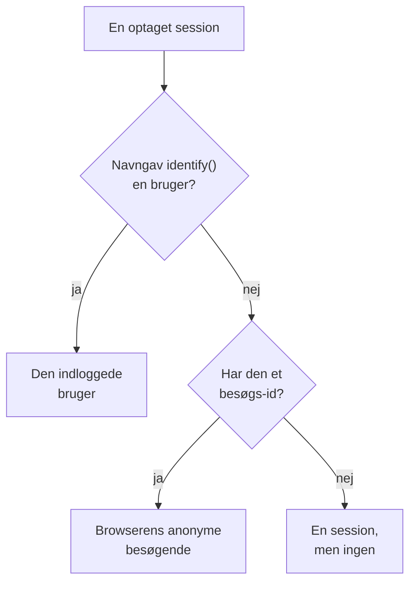

# Produktanalyse

Produktanalyse tæller de mennesker, der bruger en RUM-applikation, og hvordan deres sessioner forløber: aktive, nye, tilbagevendende, indloggede og inaktive brugere samt sessioner efter enhed, browser, land og side. Den tæller de sessioner, som [Sessionsafspilning](/docs/telemetry/session-replay) optager, så den behøver intet eget snippet, og den gemmer sine tal i 13 måneder, længe efter at optagelserne er udløbet.

:::cards
- [Hvordan personer tælles](#hvordan-personer-tælles): En indlogget bruger én gang, en anonym browser én gang.
- [Brugere](#brugere): Aktive, nye, tilbagevendende, indloggede, alle og inaktive brugere.
- [Sessioner](#sessioner): Hvor mange, hvor længe, og efter enhed, browser, land og side.
- [Privatliv og opbevaring](#privatliv-og-opbevaring): 13 måneder, ingen navne gemt, slettet efter anmodning.
:::

## Hvordan personer tælles

En applikations sidemenu har en sektion **Produktanalyse** med to sider, **Brugere** og **Sessioner**. Begge tæller de sessioner, som Sessionsafspilning optager, så de begynder, når applikationens optager gør, og en session, som afspilningspolitikken ikke optager, tælles ikke. Hver session tæller for én person eller for ingen:

- **En indlogget bruger tælles én gang**, på hver browser og enhed, vedkommende bruger: brugeren kendes på envejs-hashen af den reference, din side gav `identify()` (se [Identificer dine brugere](/docs/telemetry/session-replay#identificer-dine-brugere)).
- **En anonym browser tælles én gang**, via sit [anonyme besøgs-id](/docs/telemetry/session-replay#anonyme-besøgende). To browsere er to besøgende, og de sessioner, en browser havde, før nogen loggede ind på den, forbliver dens besøgendes.
- **En session fra en ældre optager**, som ikke sendte et besøgs-id, tæller som en session, men ikke som en person.

Dage tælles i din egen tidszone.

## Brugere

**Brugere** tæller personerne i det interval, du vælger:

| Felt | Hvad det tæller |
| --- | --- |
| **Aktive brugere** | Alle, der kom i intervallet: hver indlogget bruger én gang og hver anonym browser én gang. |
| **Nye brugere** | Aktive brugere, hvis første besøg var i intervallet. |
| **Tilbagevendende brugere** | Aktive brugere, der var kommet, før intervallet begyndte. |
| **Indloggede brugere** | Aktive brugere, som din app loggede ind med `identify()`, og deres andel af alle aktive brugere. |
| **Brugere i alt** | Alle, som applikationen har set i de seneste 13 måneder. |
| **Inaktive brugere** | Personer, der kom før, men ikke i de seneste 30 dage, eller i de 7, 14, 60 eller 90 dage, du vælger. |

De første tre viser også, hvordan de ændrede sig i forhold til perioden før. Under felterne tegner **Aktive brugere** for hver dag de personer, der kom den dag, dem, der kom i de 7 dage op til den, og dem, der kom i de 30 dage op til den, og **Nye og tilbagevendende brugere** deler hver dags personer i to.

**Personer** viser alle, som felterne tæller, én række pr. person, de senest sete først, og dens filter viser ét felts personer, de anonyme besøgende eller alle. Åbn en person for at se første og seneste besøg og hver af vedkommendes sessioner fra de seneste 13 måneder, med **Se** på hver, hvis optagelse stadig gemmes.

## Sessioner

**Sessioner** tæller de sessioner, der begyndte i intervallet: **Sessioner**, **Indloggede sessioner**, **Median sessionsvarighed**, **Sider pr. session**, **Sessioner med fejl** og **Frustrerede sessioner**. Under felterne:

- **Sessioner efter enhed** tegner hver dags sessioner fra computere, telefoner og tablets. En mobilapps session på en skærm, hvis korte side er 600 punkter eller mere, tæller som en tablets.
- **Sessionsvarighed** inddeler de afsluttede sessioner efter, hvor længe de varede, fra under 10 sekunder til over 30 minutter. En session, der stadig optages, har endnu ingen varighed.
- **Opdeling** rangerer brugere og sessioner efter enhedstype, browser, styresystem, land, appversion, indgangsside eller side, flest brugere først.

## Privatliv og opbevaring

- **13 måneder.** En måneds tal fjernes den første dag i den 13. måned efter den, så de seneste 12 hele måneder altid er der, uanset optagelsernes egen opbevaring (7 dage som standard).
- **Ingen navne gemt.** Tallene gemmer en indlogget brugers envejsnøgle og en browsers besøgs-id, aldrig referencen, egenskaberne eller en IP-adresse. En række navngiver kun en indlogget bruger, så længe en af brugerens optagelser stadig gemmes, og kun for en rolle, der må læse identitet; ellers står der **Indlogget bruger** eller **Anonym besøgende** og starten af id'et.
- **Slettet efter anmodning.** En sletteanmodning fjerner også de tilsvarende tal her (se [Slet sessioner](/docs/telemetry/session-replay#slet-sessioner)).

## Hvem kan se det

At læse de to sider kræver det samme som at læse sessionslisten: `ReadRumSessionReplay` (_List Session Replays_) eller `ReadRumSessionReplayPayload` (_Watch Session Replays_), som projektejere og administratorer har. At se, hvem en indlogget bruger er, og søge personer efter navn, kræver den identitetstilladelse, som [Hvem kan se en optagelse](/docs/telemetry/session-replay#hvem-kan-se-en-optagelse) beskriver.

## Næste skridt

:::cards
- [Sessionsafspilning](/docs/telemetry/session-replay): Optag de sessioner, disse sider tæller, og se dem.
- [Administrer applikationer](/docs/rum/applications): Navne, etiketter, ejere og opbevaring.
- [RUM – Oversigt](/docs/rum/index): Hvad en RUM-applikation ellers viser.
:::
