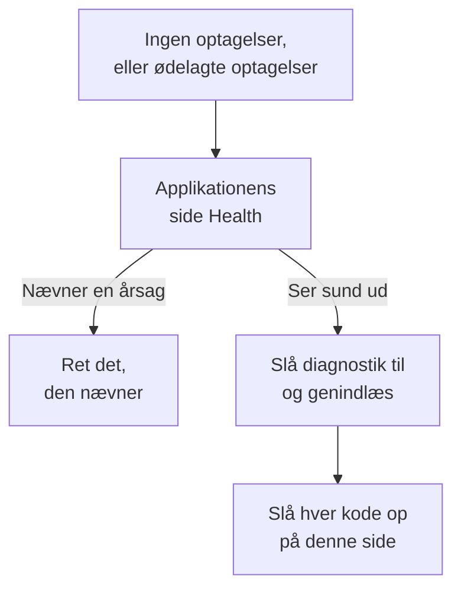

# Fejlfinding af sessionsafspilning

Når ingen optagelser kommer ind, eller de kommer ind i stykker, finder denne side årsagen. Sessionsafspilning optager som standard hver session og uploader den, mens den foregår, så en sund side sender en chunk omtrent hvert 15. sekund, mens brugeren foretager sig noget. En inaktiv fane producerer ingen hændelser og sender intet, og efter fem minutter uden input sætter optageren helt på pause (`recording-paused-idle`), så bevæg musen eller klik, før du vurderer en installation ud fra fanen Netværk. Hvis du så stadig ikke ser nogen forespørgsel til OneUptime, er en af årsagerne nedenfor grunden.

:::cards
- [Slå diagnostik til](#slå-diagnostik-til): Få optageren til at forklare hver beslutning i konsollen.
- [Koder](#koder): Hver linje, optageren udskriver, og hvad du gør ved den.
- [En firewall foran OneUptime afviser chunks](#en-firewall-foran-oneuptime-afviser-chunks): Regler, der skal tjekkes, og undtagelser, der skal tilføjes.
- [Billeder, ikoner eller typografi mangler i afspilningen](#billeder-ikoner-eller-typografi-mangler-i-afspilningen): Optagelser, der afspilles, men ikke som din bruger så dem.
:::



Den eneste indstilling, hvor stilhed er normalt, er upload ved _On error or frustration_ (`OnErrorOrFrustration`): optageren holder så en ringbuffer i hukommelsen og uploader kun, når noget går galt, hvilket ligner en ødelagt installation på en prik, indtil en udløser går af. Tjek, hvilken du bruger, før du leder efter noget andet: linjen `config-accepted` nedenfor udskriver det.

Start på serversiden, hvis du kan. Applikationens side **Sundhed**, i sektionen **Sessionsafspilning** i dens sidemenu, nævner årsagen, når intet kommer ind: optageren blev aldrig indlæst, blev indlæst, men uploadede intet og hvorfor, uploads bliver afvist og af hvilken grund, eller budgettet er brugt op. Se [Optagelsesstatus](/docs/telemetry/session-replay#optagelsesstatus). Det følgende er browsersiden: slå diagnostik til, genindlæs én gang, og læs konsollen.

Kommer optagelser ind, men afspilles med ødelagte billeder, manglende ikoner eller områder uden typografi? Det er et afspilningsspørgsmål, som besvares i [Billeder, ikoner eller typografi mangler i afspilningen](#billeder-ikoner-eller-typografi-mangler-i-afspilningen).

## Slå diagnostik til

Vælg den kontakt, du har ved hånden. De gør alle det samme.

:::tabs
@tab I browseren
I den browser, hvor det går galt. Kræver ingen ny udrulning, virker i produktion og overlever genindlæsninger:

```js
localStorage.setItem("oneuptime.sessionReplay.debug", "true");
// then reload the page
```

Slå det fra igen med:

```js
localStorage.removeItem("oneuptime.sessionReplay.debug");
```
@tab Med et link
Til en, der ikke er teknisk, eller en side, hvor du ikke kan åbne en konsol, skal du tilføje `oneuptime_debug=1` til URL'en. Det virker også i fragmentet, som overlever en server, der fjerner forespørgselsparametre, den ikke kender:

```text
https://your-app.example.com/checkout?oneuptime_debug=1
https://your-app.example.com/checkout#oneuptime_debug=1
```
@tab På script-tagget
Til et stagingmiljø, hvor du vil have det slået til for alle:

```html
<script
  src="https://oneuptime.com/telemetry/session-replay/v1/recorder.js"
  data-oneuptime-token="YOUR_TELEMETRY_INGESTION_KEY"
  data-oneuptime-app-identifier="YOUR_RUM_APP_IDENTIFIER"
  data-oneuptime-debug="true"
  crossorigin="anonymous"
  async
></script>
```
@tab I init-globalen
Hvis du konfigurerer optageren med init-globalen:

```js
window.__ONEUPTIME_SESSION_REPLAY__ = {
  host: "https://oneuptime.com",
  token: "YOUR_TELEMETRY_INGESTION_KEY",
  appIdentifier: "YOUR_RUM_APP_IDENTIFIER",
  debug: true,
};
```
@tab På deploymentet
På OneUptime-deploymentet, den eneste kontakt, der ikke kræver nogen ved den browser, hvor det går galt. Sæt `SESSION_REPLAY_DEBUG=true`, og genstart. Hver optager, som denne instans leverer, logger så på hver side, den kører på, så slå det til, indsaml én genindlæsning, og slå det fra igen. Det ændrer ingen politik: hverken sampling, maskering eller samtykke. Se [Noter om selvhosting](/docs/telemetry/session-replay#noter-om-selvhosting) for deploymentets øvrige indstillinger.
@tab Under kørsel
Når optageren er indlæst:

```js
OneUptimeReplay.setDebug(true);
```
:::

Outputtet ser sådan ud:

```text
[OneUptime Session Replay] loader-start: Loader running.
[OneUptime Session Replay] init-options-read: Init options read. {host: "https://oneuptime.com", appIdentifier: "checkout-web", …}
[OneUptime Session Replay] config-fetch-start: Requesting the policy. {url: "https://oneuptime.com/telemetry/session-replay/v1/config", …}
[OneUptime Session Replay] config-accepted: Policy accepted. {captureTrigger: "Always", samplePercentage: 100, …}
[OneUptime Session Replay] recording: Recording and uploading …
```

## Få tidslinjen uden at slå noget til først

Optageren gemmer sine seneste 250 beslutninger, uanset om diagnostik er slået til eller ej. Hvis problemet allerede er sket, behøver du ikke at genskabe det med logning slået til — bed i stedet om dette:

```js
copy(JSON.stringify(OneUptimeReplay.getDiagnostics(), null, 2));
```

Det returnerer optagerens version, sessions-id'et, dens `state` (`recording`, `uploading`, `not-sampled`, `stopped`…), hvorfor den stoppede, hvis den gjorde, `bootstrapDecision`, hver gates svar i `decisions` (samplet eller ej, samtykkestatus, om uploads er tilladt, og hvad der blokerer dem, serverens seneste direktiv), optagerens `capabilities` og hele listen over poster — inklusive dem fra loaderen, som kører, før optagerens artefakt findes, og hvor de fleste tilbagetrækninger afgøres. Den indeholder qua sin opbygning intet sideindhold; se [Hvad diagnostikken aldrig indeholder](#hvad-diagnostikken-aldrig-indeholder). Felterne er beskrevet i [`getDiagnostics()`](/docs/telemetry/session-replay#getdiagnostics).

**Hvis du får `OneUptimeReplay is not defined`**, blev optagerens artefakt aldrig indlæst — hvilket i sig selv er svaret på en stor del af koderne nedenfor, og netop når du har mest brug for tidslinjen. Posterne er der stadig, på en global, som loaderen skriver til, før artefaktet findes:

```js
copy(JSON.stringify(window.__ONEUPTIME_SESSION_REPLAY_DEBUG__.records, null, 2));
```

Indsæt et af dem i din supportsag — eller i **Ask the browser** på applikationens side **Sundhed**, som forklarer hver kode i det. Ofte er det nok i sig selv.

## Når stilhed er normalt: den fejlstyrede politik

Dette afsnit gælder kun, hvis `config-accepted` udskrev `captureTrigger: "OnErrorOrFrustration"`. Med standardpolitikken `Always` sender optageren, mens den optager, og stilhed på en side, som brugeren interagerer med, betyder, at noget virkelig er galt — læs så videre efter dette afsnit.

Hvis konsollen siger dette:

```text
[OneUptime Session Replay] recording: Recording into memory. Nothing uploads until a trigger fires - call OneUptimeReplay.captureSession() to force one.
```

…så virker optageren. Med en fejlstyret politik foretager en sund side præcis én forespørgsel til OneUptime pr. sideindlæsning (hentningen af konfigurationen) og sender intet andet, før der opstår en fejl, en 5xx, et frustrationssignal eller en overskridelse af et ydelsesbudget.

For at teste hele vejen fra ende til anden skal du tvinge en upload:

```js
OneUptimeReplay.captureSession("installation test");
```

Du bør straks se en `POST /telemetry/session-replay/v1/chunk` på fanen Netværk og en linje `chunk-accepted` i konsollen. Gør du det, er installationen korrekt, og afspilningen vises i dashboardet inden for cirka et minut, med din årsag markeret på dens tidslinje.

En `202` med `chunk-accepted` er det, du leder efter. En `204` logger i stedet `chunk-not-recorded`: forespørgslen var korrekt, og serveren besluttede ikke at gemme den — budgettet er overskredet, ikke samplet eller applikationen deaktiveret. Det er et svar fra politikken, ikke en installationsfejl, og linjen `server-directive` ved siden af siger hvilket.

For at optage hver session igen skal du sætte **Hvornår en optagelse skal uploades** til _Always_ og **Stikprøveprocent** over 0 på applikationens side **Replay Policy**. Det er fabriksstandarden.

## Koder

Hver linje bærer en stabil `code`. Slå din op her.

### Opstart

| code | hvad det betyder |
| --- | --- |
| `loader-start` | Optagerens script kørte. Hvis du ikke ser dette, mens diagnostik er slået til, kørte selve scriptet aldrig — tjek `<script>`-forespørgslen på fanen Netværk og `script-src` i din CSP. |
| `init-options-read` | Indstillinger fundet. Tjek `host` og `appIdentifier` i detaljen: `appIdentifier` skal svare præcis til RUM-applikationen, og `host` skal være din OneUptime-oprindelse, ikke din egen apps. |
| `init-options-incomplete` | En påkrævet indstilling mangler. Detaljen siger, hvilken af `hasHost` / `hasToken` / `hasAppIdentifier` der er false. Hvis `hasHost` er false, har script-tagget ingen `src` at udlede værten fra — tilføj `data-oneuptime-host`. |
| `privacy-signal` | Browseren sender Do Not Track eller Global Privacy Control, og det bliver respekteret — af siden (intet på script-tagget siger andet) eller af serverens politik. Intet optages; med `stage: "before-config-fetch"` foretages der heller ingen konfigurationsforespørgsel. Ikke en fejl. Sæt kun `data-oneuptime-respect-do-not-track="false"`, hvis dit retsgrundlag virkelig ikke afhænger af signalet. |
| `init-options-missing` | Der er intet at læse på siden: hverken et `script[data-oneuptime-token]`-tag eller `window.__ONEUPTIME_SESSION_REPLAY__`. Markørattributten er stavet forkert, snippetten er havnet i et andet dokument, eller en tag manager har fjernet den. |
| `loader-threw` | En fejl i selve optageren, ikke i din konfiguration. Rapportér den med diagnostikkens output. |

### Politik

| code | hvad det betyder |
| --- | --- |
| `config-fetch-start` | Er ved at bede om politikken. `url` i detaljen er den præcise URL — tjek, at den svarer fra en browser. |
| `config-fetch-rejected` | Endpointet svarede med noget andet end 2xx. Se [Statusser for hentning af konfigurationen](#statusser-for-hentning-af-konfigurationen) nedenfor. |
| `config-fetch-failed` | Forespørgslen blev aldrig fuldført: `connect-src` i CSP'en, en annonceblokering, DNS, TLS, ingen forbindelse eller en timeout på 5 sekunder. Browseren logger normalt sin egen linje ved siden af denne. |
| `config-body-unparseable` | Endpointet svarede 2xx med en body, der slet ikke er JSON. Anderledes end `config-fetch-failed`: forespørgslen *blev* fuldført, så noget på vejen — en proxy, en captive portal, en SSO-mellemside — svarede i stedet for OneUptime. |
| `config-unparseable` | Bodyen *var* gyldig JSON, men ikke et objekt — `null`, en streng, et array. En omskrivende proxy eller en server, der svarer på en anden sti. |
| `config-disabled` | Serveren siger, at afspilning er slået fra her. `disabledReason` i detaljen er svaret: se [disabledReason](#disabledreason) nedenfor. |
| `config-recorder-version-invalid` | Politikken nævnte ikke præcis `latest` med små bogstaver, så der kunne ikke bygges nogen artefakt-URL. En omskrivende proxy eller et manipuleret svar — et deployment uden build rapporterer i stedet `config-disabled` med `recorder-not-built`. |
| `config-accepted` | Politik accepteret. Detaljen er hele politikken — `captureTrigger`, `samplePercentage`, `consentMode`, `maskingMode`. |
| `config-field-defaulted` | Serveren sendte ingen værdi for et felt i politikken (nævnt i detaljen), så denne optager brugte produktets standard. Informativt: normalt en server, der er ældre end optageren. Hvis dashboardet viser en anden værdi for det felt, så opdatér OneUptime. |
| `config-value-unrecognised` | Serveren sendte en værdi, som dette build af optageren ikke kender, så den faldt tilbage til den sikreste — som måske ikke er den, dit dashboard viser. Normalt en side, der stadig kører en optager fra et tidligere deployment. |
| `directive-stop` | Serveren bad denne optager om at trække sig. Tjek applikationens optagelsesstatus for et budget, en hastighedsgrænse eller en kill switch. |

#### Statusser for hentning af konfigurationen

| status | løsning |
| --- | --- |
| `401` | Indtagelsestokenet er forkert, tilbagekaldt, udløbet eller fra et andet projekt. Opret et under **Projektindstillinger → Telemetri og APM → Indtagelsesnøgler**, og bekræft det med `GET /session-replay/v1/validate` — send nøglen, som optageren gør, og tilføj headeren `x-oneuptime-app-identifier`, så bærer svaret også `isSessionReplayEnabled` for den applikation, `sessionReplayDisabledDetail`, der nævner den slukkede kontakt, når det ikke er slået til, `isIngestEnabledOnThisInstance` og `keyType`. |
| `400` | `data-oneuptime-app-identifier` mangler. |
| `403` | Sidens oprindelse er ikke i indtagelsesnøglens **Tilladte oprindelser**. Tilføj den, eller brug en nøgle, hvis liste over tilladte oprindelser dækker denne side. |
| `404` | Stien blev ikke fundet på OneUptime-oprindelsen. Næsten altid en forkert `data-oneuptime-host` — eller en reverse proxy foran OneUptime, der ikke videresender `/telemetry/*`. |
| `5xx` | En fejl på serversiden; tjek OneUptime-appens logs. |

#### disabledReason

| værdi | hvad du gør |
| --- | --- |
| `not-enabled-for-application` | Sessionsafspilning er slået fra for denne RUM-applikation, identifikatoren matcher ingen, eller projektet har ikke lov til afspilning. `disabledDetail` siger hvilken: `application-not-enabled` (denne applikations kontakt), `project-not-allowed` (kontakten for hele projektet, under **Overvågning af reelle brugere → Indstillinger → Sessionsafspilning**), `application-unknown` (ingen applikation har denne `appIdentifier` — tjek stavningen på applikationens side **Replay Policy**) eller `project-killed` (en kill switch fra operatøren på dette deployment). |
| `budget-exhausted` | Projektets daglige bytebudget eller applikationens månedlige budget er allerede brugt op, så optagerne får besked på ikke at optage i stedet for at uploade chunks, der ville blive afvist. `disabledDetail` er `project-daily-budget-exhausted` eller `app-monthly-budget-exhausted`, og `budgetResetsAt` siger, hvornår det bliver frigivet. Hæv budgettet på siden **Replay Policy**, eller vent på nulstillingen. |
| `recorder-not-built` | **Deploymentet har intet optagerartefakt.** Intet på kundens side kan rette det. Det build, der producerer `packages/App/FeatureSet/BrowserRecorder/public/dist/manifest.json`, kørte ikke, eller dets resultat nåede ikke det kørende image. Byg og udrul OneUptime-appen igen. Det er det typiske svar på en selvhostet installation, hvor afspilning aldrig har virket. |
| `disabled-by-default` | `SESSION_REPLAY_ENABLED_BY_DEFAULT=false` på dette deployment. Sæt det til `true` — og sæt først `SESSION_REPLAY_MAX_BYTES_PER_PROJECT_PER_DAY`, hvis du selv hoster, fordi afspilning er den tungeste tabel, du har. |
| `ingest-disabled` | `SESSION_REPLAY_INGEST_ENABLED=false` på dette deployment. |
| `policy-unavailable` | Serveren kunne ikke afgøre politikken — normalt Redis eller Postgres. Fejler lukket med vilje. Tjek OneUptime-appens logs. |
| `not-reported` | Serveren er ældre end dette felt. Brug i stedet panelet **Test your installation** i dashboardet, på siden **Replay Policy**. |

### Artefaktet

| code | hvad det betyder |
| --- | --- |
| `artifact-requested` | Den nyeste optagerpakke bliver indsat. `url` er den præcise. |
| `artifact-load-failed` | Den blev ikke indlæst. I rækkefølge efter sandsynlighed: en `script-src` i CSP'en, der ikke tillader din OneUptime-oprindelse, en SRI-uoverensstemmelse (en proxy, der omskriver pakken) eller en 404, fordi dette deployment ikke byggede optageren. |
| `artifact-url-invalid` | Politikken nævnte ikke præcis `latest` med små bogstaver, så der blev ikke bygget nogen URL. Et manipuleret eller proxy-ændret konfigurationssvar. |
| `artifact-api-missing` | Pakken blev indlæst, men publicerede ikke `window.OneUptimeReplay` — et andet script på siden overskrev den. |
| `bootstrap` | Optagerens artefakt starter op. |
| `bootstrap-already-started` | To kopier af snippetten på én side. Fjern den ene. |
| `bootstrap-already-running` | `bootstrap()` blev kaldt igen, mens en optager allerede kørte. Harmløst; normalt en dobbelt integration. |
| `bootstrap-cancelled` | En `revokeConsent()` eller `stop()` i køen `window.OneUptimeReplayQueue` kørte, før optageren startede, så denne session optages ikke. Korrekt, hvis dit banner allerede var afvist. |
| `prerender-wait` | Browseren har forhåndsgengivet denne side, sådan som Chrome gør med en side, den forventer bliver åbnet som den næste, og ingen har åbnet den endnu. Optageren starter, når den besøgende åbner siden, så en side, der aldrig åbnes, optager intet; kald, som din side foretager i mellemtiden, anvendes da. |
| `start-stopped` | `start()` fik ingen brugbar politik på stien for den selvstændige pakke. Den præcise årsag står i `config-*`-linjen lige ovenover. |
| `rrweb-did-not-start` | DOM-optageren nægtede at starte. Rapportér det. |
| `rrweb-error` | DOM-optageren fik en intern fejl på denne side (fejlens navn står i detaljen; den logges én gang). Optagelsen kan springe over eller fryse omkring det punkt, og efter tre sådanne fejl bærer sessionen en troværdighedsmeddelelse, der siger det. Rapportér det med sidens framework og fejlens navn. |

### Optagelse og upload

| code | hvad det betyder |
| --- | --- |
| `not-sampled` | Denne session tabte samplingslodtrækningen, så intet bliver optaget overhovedet. Sampling er deterministisk ud fra sessions-id'et, så genindlæsning hjælper ikke denne session. Hæv samplingsprocenten. |
| `recording` | Optager. Læs detaljen: `uploading: true` er den normale tilstand med standardudløseren `Always`. `uploading: false` med `captureTrigger: "OnErrorOrFrustration"` er den anden sunde tilstand, uden forespørgsler. |
| `same-origin-propagation` | Logges én gang, når optageren starter: om den tilføjer sporingskontekst (`traceparent` og en `tracestate`, der bærer sessions-id'et) til forespørgsler til sidens egen oprindelse. `enabled: true` med `reason: "on"` er standard. `reason: "policy-off"` betyder, at **Sporvideregivelse fra samme oprindelse** er slået fra på applikationens side **Replay Policy**; `reason: "opaque-origin"` betyder, at siden ikke har sin egen oprindelse (en sandboxet iframe, `about:blank`, `srcdoc` eller `file:`), så intet tæller som samme oprindelse. Selv når det er slået til, kommer headerne kun på forespørgsler, der foretages, mens sessionen uploader, og aldrig på en `POST` til en sti, der ender på `/v1/traces`, `/v1/logs` eller `/v1/metrics` (sidens egne OpenTelemetry-eksporter). Logges én gang mere, med `reason: "agent-stand-down"` og et felt `agent` (`DD_RUM`, `NREUM` eller `elasticApm`), første gang i en sideindlæsning, at optageren overlader en forespørgsel til samme oprindelses `traceparent` til den agent, fordi den er konfigureret til at spore forespørgslen (Datadog RUM kun i en session, den sporer); forespørgslen får stadig `tracestate`-medlemmet, og den kædes kun sammen, hvis agenten faktisk sender en `traceparent`, hvilket Datadog kun gør i en sporet Datadog-session, der er samplet til spor. New Relic (`NREUM`) sender sin egen `tracestate` i stedet for medlemmet, så dens forespørgsler kædes kun sammen via sporings-id (se [fanerne Logs og Traces er tomme](#afspillerens-faner-logs-og-traces-er-tomme)). Se [Korrelér med resten af din telemetri](/docs/telemetry/session-replay#korrelér-med-resten-af-din-telemetri). |
| `same-origin-propagation-tripped` | En forespørgsel, som optageren havde tilføjet sporingskontekst til, fejlede på netværksniveau, normalt en forespørgsel til samme oprindelse, der blev omdirigeret til en anden oprindelse, som ikke tillader `traceparent` og `tracestate`. Optageren holdt op med at tilføje dem resten af denne sideindlæsning. `retried: true` betyder, at det var en `fetch` `GET` eller `HEAD` uden body, og at den blev sendt én gang til, præcis som din side gjorde det; `false` betyder, at den ikke kunne prøves igen og fejlede: intet andet end en `fetch` `GET` eller `HEAD` uden body (ingen XHR, ingen anden metode, ingen forespørgsel med body) bliver prøvet igen. Din egen sides annulleringer og timeouts udløser den ikke, og det gør en fejl, mens browseren melder sig offline, heller ikke; den næste sideindlæsning starter forfra. Se [Downloads eller omdirigeringer fejler, efter at sessionsafspilning er slået til](#downloads-eller-omdirigeringer-fejler-efter-at-sessionsafspilning-er-slået-til). |
| `trigger` | Der skete noget, der er værd at gemme. `reason` er en af `error`, `frustration`, `performance`, `sampled` eller `manual`. |
| `upload-started` | Bufferens pre-roll bliver tømt. Chunk-POST'erne begynder her. |
| `upload-blocked-consent` | En udløser gik af, og intet blev uploadet, fordi der aldrig blev givet samtykke. Med samtykketilstanden `RequireExplicit` skal din side kalde `OneUptimeReplay.grantConsent()`, når dit banner bliver accepteret. |
| `chunk-discarded-consent` | Den samme årsag, et lag længere nede: en færdig chunk blev smidt væk. |
| `chunk-accepted` | En chunk ankom og blev gemt. Installationen virker. |
| `chunk-not-recorded` | Serveren accepterede forespørgslen og besluttede bevidst ikke at optage den — budgettet er overskredet, ikke samplet, applikationen deaktiveret eller grænsen for chunks pr. session. Linjen `server-directive` ved siden af bærer årsagen. Installationen er korrekt; politikken eller budgettet er ikke, hvad du forventer. |
| `chunk-post-failed` | POST'en nåede aldrig serveren, før denne side havde uploadet noget med succes. `connect-src` i CSP'en, en annonceblokering eller CORS på indtagelsesoprindelsen — eller en side, der mistede forbindelsen før sin første upload. Tæller med i afbryderen. |
| `chunk-held-offline` | Offlinetilstand: enheden har ingen forbindelse (browseren melder sig offline, eller en forespørgsel nåede aldrig en server, der havde svaret før). Optagelsen fortsætter, og chunken venter; `queueDepth` er, hvor mange der venter, og `retryInMs`, hvornår næste forsøg er. Tæller ikke som en fejl, og intet går tabt. |
| `back-online` | Den første forespørgsel efter et udfald nåede serveren. Chunks i køen bliver uploadet, fra ældst til nyest. |
| `browser-offline` | Browseren udsendte sin hændelse `offline`. Optagelsen fortsætter; optageren åbner sit offlinelager, så chunks fra en fane, der lukkes nu, bliver bevaret. |
| `browser-online` | Browseren udsendte sin hændelse `online`, og `queuedChunks` bliver uploadet nu i stedet for af timeren for nye forsøg. |
| `offline-queue-full` | Udfaldet varede længere, end uploadkøen kan rumme (240 chunks eller 4 MB): de ældste `dropped` chunks blev smidt væk for at beholde de nyeste. Sessionen viser et hul, hvor de var. |
| `offline-flush-stored` | Siden blev skjult eller lukket, mens den var offline, så dens sidste chunks blev skrevet til browserens IndexedDB i stedet for at blive sendt. `storeOpen: false` betyder, at lageret ikke var færdigt med at åbne, og at en fane, der lukker, stadig kan miste dem. Appens næste side uploader dem. |
| `final-flush-deferred` | Den afsluttende forespørgsel kunne ikke bære alle chunks, og resten (`kept`) blev skrevet til IndexedDB til den næste side i stedet for at blive smidt væk. |
| `offline-chunks-restored` | Denne side fandt `chunks`, som en tidligere side optog offline og ikke kunne sende, og uploader dem før sine egne. |
| `offline-chunk-claimed-elsewhere` | En anden fane i samme app havde allerede uploadet en chunk, som denne fane havde gemt, så denne fane sprang den over. Intet mangler. |
| `chunk-post-server-error` | Serveren svarede 5xx. Optageren prøver igen; `consecutiveFailures` over for `maxFlushFailures` i detaljen viser, hvor tæt den er på at give op. |
| `chunk-retry-scheduled` | En fejl, der kan prøves igen (netværk, 5xx eller en begrænsning fra serveren), satte chunken i køen til nye forsøg; `inMs` i detaljen er pausen før næste forsøg, og `queueDepth`, hvor mange chunks der venter. Intet er gået tabt endnu. |
| `chunk-retry` | Pausen er slut, og chunks i køen bliver sendt igen. |
| `chunk-abandoned` | En chunk fejlede for mange gange og blev smidt væk; upload fortsætter med den næste. Sessionen viser et hul, hvor den var. Se den tidligere `chunk-post-*`-linje for årsagen. |
| `final-chunk-carried-queue` | Siden blev skjult eller lukket, mens der stadig lå chunks i køen til nye forsøg, og de gik med som ekstra frames i sidens ene forespørgsel ved skjulning: `frames` er, hvor mange forespørgslen bar, `bytes` dens samlede størrelse. Intet gik tabt — det, der ikke kunne være der, rapporteres af `final-flush-partial`. |
| `final-flush-truncated` | Da siden gik, var der mere i bufferen, end en keepalive-forespørgsel kan bære, så de ældste hændelser i den afsluttende chunk blev smidt væk for at få den til at passe; `droppedEvents` siger hvor mange. Slutningen af sessionen — den del, du som regel leder efter — er det, der overlever. |
| `final-flush-partial` | Den afsluttende forespørgsel kunne ikke bære alle de chunks, den fik: `sent` frames gik af sted, og `dropped` gjorde ikke. Den forseglende chunk vælges først, så det, der går tabt, er ældre chunks i køen, og sessionen viser et hul, hvor de var. |
| `chunk-too-large` | En chunk var stadig over grænsen pr. forespørgsel efter komprimering — et udeleligt snapshot af en hel side fra et meget stort DOM. Kun dens angivne størrelse sendes, serveren svarer 422, og sessionen bærer en troværdighedsmeddelelse i stedet for det snapshot i stedet for at fejle. |
| `envelope-trimmed` | Chunkens header-JSON var over serverens envelope-grænse på 8 KB, så valgfrie felter blev fjernet i denne rækkefølge, indtil den passede: sporings-id'er, ruter, egenskaber, tags, troværdighedsmeddelelser (`shed` angiver, hvad der røg). Optagelsen er ikke berørt; sessionen kan mangle nogle korrelations- eller tagdata. Normalt 20 tags og 20 egenskaber i maksimal længde i samme session. |
| `final-chunk-too-large` | En chunk, der blev sendt, da siden gik, var over de 56 KB, som optageren tillader sig selv ved tømning, når siden skjules — bevidst under browserens samlede keepalive-kvote på 64 KB. Med `sealed: true` var det den sidste chunk: dens hændelser blev smidt væk, så optagelsen slutter et par sekunder tidligere, og en tom sidste chunk går af sted i stedet, så sessionen stadig slutter med fanen, og chunk-sekvensen ikke har huller. Med `sealed: false` var det ikke en sidste chunk: den blev smidt helt væk, intet blev forseglet, og sessionen forbliver åben med et hul, hvor chunken var. I begge tilfælde er det chunkens hændelser, der går tabt; en chunk i køen, der ikke kunne komme med i samme forespørgsel, rapporteres separat af `final-flush-partial`. |
| `upload-blocked-transport` | En udløser gik af, da upload allerede var slået fra for denne side. Linjen `transport-disabled` ovenover siger hvorfor. |
| `chunk-rejected-terminal` | Upload er stoppet for godt. `status: 401` er et forkert token; `status: 403` er en oprindelse, der ikke er på applikationens eller nøglens liste over tilladte oprindelser; `status: 404` er en forkert vært. Ret det, og genindlæs — optageren prøver ikke selv igen. Læs `answeredBy` først: `"not-oneuptime"` betyder, at afvisningen slet ikke kom fra OneUptime — en webapplikationsfirewall, et CDN eller en proxy foran den svarede, eller værten er ikke OneUptime. Se [En firewall foran OneUptime afviser chunks](#en-firewall-foran-oneuptime-afviser-chunks). |
| `chunk-refused` | En chunk blev afvist (for stor eller ulæselig), og optagelsen fortsatte uden den. |
| `chunk-refused-terminal` | Upload stoppede, fordi serveren vil afvise hver chunk fra denne optager: enten er `error` i detaljen en, som serveren altid svarer ens på (`unsupported-wire-version` — en optager, som serveren ikke længere accepterer; `app-identifier-mismatch` eller `missing-app-identifier` — chunken nævner en anden applikation end den, politikken blev hentet for; `malformed-body` / `malformed-envelope` / `missing-envelope` — en proxy, der omskriver forespørgslen), eller også blev hver nylig chunk afvist som misdannet. Opdatér OneUptime, så den publicerede optager passer til serveren, og rapportér det med diagnostikken, hvis det fortsætter. |
| `chunk-throttled` | Hastighedsbegrænset. Uploads holder pause og genoptages af sig selv. |
| `transport-disabled` | Afbryderen slog fra efter gentagne fejl. `reason` siger hvilken. |
| `server-directive` | Serveren ændrede, hvad optageren skal gøre midt i sessionen. `reason` kommer fra et lukket ordforråd — se [Statusser for chunk-POST](#statusser-for-chunk-post) nedenfor. |
| `recorder-stopped-by-server` | Serveren bad optageren om at stoppe. Normalt det daglige bytebudget. |
| `recorder-throttled-by-server` | Serveren bad optageren om at sætte farten ned. Uploads genoptages af sig selv; der er intet at gøre. |
| `recorder-stopped-transport` | Upload fejlede permanent, så optagelsen stoppede, og bufferen blev frigivet. `reason` er den samme, som `transport-disabled` rapporterede. |
| `recorder-stopped` | Optagelsen sluttede med sessionens totaler: `droppedEvents`, `droppedChunks`, `flushFailures`. Alle tre bør være 0 i en sund session. |
| `session-ended-idle` | Der skete intet på siden i 30 minutter, så sessionen sluttede — med datoen for den seneste aktivitet, ikke for det tidspunkt, hvor optageren opdagede det (`idleForMs` siger, hvor længe siden det var). Intet mere uploades, og forespørgsler til din egen oprindelse bærer intet sessions-id, før brugeren vender tilbage; en åben fane uden nogen foran starter ikke en ny session hver halve time. |
| `recording-paused-idle` | Ingen trykkede på en tast, klikkede, bevægede musen, rullede eller rørte siden i 5 minutter, så optagelsen satte på pause (`idleForMs` siger, hvor længe det havde været). Intet bliver fanget eller uploadet, og forespørgsler til din egen oprindelse bærer intet sessions-id, før det næste input genoptager den samme session — se [Inaktiv tid](/docs/telemetry/session-replay#inaktiv-tid). Normalt på enhver fane, der efterlades alene. |
| `recording-resumed` | Brugeren vendte tilbage, mens optagelsen var på pause, så den blev genoptaget i den samme session på et nyt snapshot (`pausedForMs` siger, hvor længe den var på pause). Afspilleren springer strækningen imellem over. |
| `session-rotated` | En ny session begyndte (brugeren vendte tilbage efter 30 minutters inaktivitet, sessionen nåede 4 timer, `identify()` nævnte en anden bruger end sessionens — `rotationReason: "identity-change"` — eller en anden fane fra den samme besøgende startede en først — `rotationReason: "adopted"`). Optagelsen fortsætter med et nyt id, lyttere på `onSessionChange` får besked, og fra da af bærer forespørgsler til din egen oprindelse det nye id. |
| `command-queue-not-an-array` | `window.OneUptimeReplayQueue` er ikke et array, så alle kommandoer i køen blev ignoreret. Det skal være et array af `[command, ...arguments]`-elementer. |
| `command-queue-unknown-command` | Navnet på en kommando i køen blev ikke genkendt — tjek stavningen mod [JavaScript-API'et](/docs/telemetry/session-replay#javascript-api). |
| `command-queue-command-failed` | En kommando i køen kastede en fejl, da den blev anvendt — `command` og fejlens `name` står i detaljen. Resten af køen kørte alligevel. Normalt et argument med den forkerte form (en streng, hvor der forventes et objekt med egenskaber). |

#### Statusser for chunk-POST

Det, indtagelsesendpointet svarer på en chunks `POST`, som du ville se det på fanen Netværk. Kun andre 4xx end 429 betyder, at installationen er forkert.

| status | hvad det betyder |
| --- | --- |
| `202` | Accepteret og sat i kø til lagring. Hvis den også bærer `directive: "stop"` med årsagen `session-chunk-cap`, er de chunks i denne forespørgsel, der var under grænsen pr. session, kommet ind, og intet efter dem vil nogensinde komme — en fane, der har været åben længe, og som når grænsen for, hvad én session kan rumme, ikke en fejl. |
| `204` | Modtaget og bevidst ikke gemt. En 204 har ingen body, så direktivet rejser i headere: `x-oneuptime-replay-directive` er `stop`, når optageren skal trække sig (afspilning slået fra, ikke samplet, budget overskredet, ved grænsen), eller `continue`, når kun denne forespørgsel blev afvist, og `x-oneuptime-replay-reason` bærer årsagen. `consent-required` er den, der kommer tilbage med `continue`: samtykketilstanden er _Require explicit_, og siden har endnu ikke kaldt `grantConsent()`, så optageren bliver ved med at optage og prøver igen. Ordforrådet for årsager er `ingest-disabled`, `instance-not-offering-replay`, `policy-unavailable`, `not-enabled`, `origin-not-allowed`, `session-chunk-cap`, `not-sampled`, `rate-limited`, `rate-counter-unavailable`, `budget-exhausted`, `budget-counter-unavailable`, `app-monthly-budget-exhausted` og `consent-required`, og siden **Sundhed** tæller dem ved navn. |
| `400` | Framen kunne ikke behandles, og det kunne den næste fra samme build heller ikke, så bodyen bærer `directive: "stop"` og en stabil `error`-kode: `empty-body`, `missing-envelope`, `envelope-too-large`, `malformed-envelope`, `malformed-body`, `unsupported-wire-version`, `truncated-payload`, `too-many-frames`, `app-identifier-mismatch`, `missing-app-identifier` eller `chunk-index-malformed` (et `chunkIndex`, der mangler, er negativt, brøkdels eller absurd). Seks af dem — `unsupported-wire-version`, `app-identifier-mismatch`, `missing-app-identifier`, `malformed-body`, `malformed-envelope`, `missing-envelope` — stopper upload med det samme (`chunk-refused-terminal`); enhver anden 400 tilgives én gang og stopper upload efter tre i træk. Næsten altid en proxy, der omskriver forespørgslen, eller en optager og en server i forskellige versioner. |
| `401` | Indtagelsesnøglen er forkert, tilbagekaldt, udløbet eller fra et andet projekt. |
| `403` | Sidens oprindelse er ikke på indtagelsesnøglens eller applikationens liste over tilladte oprindelser. Endeligt — optageren prøver ikke igen. En 403, hvis body er en HTML-side eller er tom, kom ikke fra OneUptime: en webapplikationsfirewall afviste forespørgslen — se [En firewall foran OneUptime afviser chunks](#en-firewall-foran-oneuptime-afviser-chunks). |
| `413` | Bodyen var over grænsen pr. forespørgsel. Optageren deler chunks et godt stykke under den, så det er en proxy, der har pakket en komprimeret body ud igen. Den chunk smides væk; sessionen fortsætter. |
| `422` | `snapshot-too-large`: en frame angav en payload over grænsen — et udeleligt snapshot af en hel side, der ikke kan være der. Pr. chunk, ikke endeligt: sessionen overlever med en troværdighedsmeddelelse om, at det snapshot mangler, og afspilningen fortsætter ved det næste. Gør DOM'et lettere, eller forvent et hul ved den sideindlæsning. |
| `429` | Hastighedsbegrænset. `Retry-After` siger hvor længe; uploads holder pause og genoptages af sig selv. |
| `503` | Chunk-lageret kunne ikke nås. Optageren prøver igen. |

### Kald, som din side foretog

Disse registrerer, hvad din egen kode bad optageren om. De er til for at bekræfte, at et samtykkebanner eller en manuel optagelse faktisk nåede optageren, og hvornår.

| code | hvad det betyder |
| --- | --- |
| `api-capture-session` | `captureSession()` blev kaldt. `hasReason` siger, om den bar en årsag til tidslinjen. |
| `api-grant-consent` | `grantConsent()` blev kaldt. |
| `api-revoke-consent` | `revokeConsent()` blev kaldt. Alt i bufferen blev smidt væk, og upload stoppede; optageren kører videre kun i hukommelsen, så en senere `grantConsent()` fortsætter med en ny session. |
| `api-stop` | `stop()` blev kaldt. Den sidste chunk blev uploadet, og sessionen blev forseglet; intet optages resten af sidens levetid. |
| `api-no-recorder` | Et af kaldene ovenfor kørte uden nogen aktiv optager — normalt fordi det kørte, før optagerens artefakt blev indlæst. Læg i stedet `[command, ...arguments]`-elementer i `window.OneUptimeReplayQueue`, så anvendes de, så snart den ankommer. |

## Ingen forespørgsel på fanen Netværk

Gå denne liste igennem; den er sorteret efter, hvor ofte hver årsag er svaret.

1. **Filtrér på `session-replay`, ikke på applikationens identifikator.** Konfigurationsforespørgslen er en `GET`, og det er den eneste forespørgsel, en sund session uden udløser foretager.
2. **Er der en `GET .../session-replay/v1/config`?**
   - **Nej, og heller ingen `loader-start` i konsollen** → scriptet kørte aldrig. Tjek, at `<script>`-elementet er i DOM'et, at dets forespørgsel lykkedes, og `script-src` i din CSP.
   - **Nej, men `privacy-signal` står i konsollen** → Do Not Track eller GPC. Virker som tilsigtet.
   - **Ja, ikke 2xx** → se [Statusser for hentning af konfigurationen](#statusser-for-hentning-af-konfigurationen).
3. **Ingen chunk-`POST`?** Interagér med siden først — en inaktiv fane har intet at sende. Læs derefter linjen `recording`. Med standardudløseren `Always` bør `uploading` være `true`, og chunks bør gå af sted omtrent hvert 15. sekunds aktivitet; `uploading: false` med `OnErrorOrFrustration` er normalt — kald `OneUptimeReplay.captureSession()` for at tvinge en og bekræfte, at vejen virker.
4. **Stadig intet efter `captureSession()`?** Kig efter `upload-blocked-consent` (kald `grantConsent()`), `not-sampled` eller `transport-disabled`.

## En firewall foran OneUptime afviser chunks

Hvis optageren når OneUptime gennem din egen edge — en webapplikationsfirewall som Azure Front Door eller Application Gateway, Cloudflare eller en ModSecurity- eller Coraza-proxy — inspicerer den firewall hver chunk, før OneUptime ser den. Når den afviser en, ser du:

- chunk-`POST`'er, der svarer `403` (nogle gange `400` eller `406`) med en HTML-side eller en tom body i stedet for OneUptimes JSON;
- `chunk-rejected-terminal` i konsollen med `answeredBy: "not-oneuptime"`, og upload stoppet resten af siden;
- i firewallens log et regel-id som `920420` (_Request content type is not allowed by policy_), `921110` (_HTTP Request Smuggling Attack_) og derefter `949110` (_Inbound Anomaly Score Exceeded_).

Det hurtigste tjek er, hvor forespørgslerne går hen. Hvis optagerens vært er dit eget domæne (for eksempel `https://app.example.com/telemetry/...`, videresendt til OneUptime), ligger din firewall på vejen. At indlæse optageren direkte fra din OneUptime-vært tager din firewall helt ud af vejen.

### Hvad optageren sender

Skriv enhver undtagelse præcis til dette, og intet bredere:

| Hvad | Sådan ser det ud |
| --- | --- |
| Forespørgsler | `GET /telemetry/session-replay/v1/config`, `POST /telemetry/session-replay/v1/chunk` og browserens CORS-preflight `OPTIONS` for hver af dem. De samme stier uden præfikset `/telemetry` er også aktive. |
| `Content-Type` | `application/octet-stream`. Optagere, der er bygget før denne ændring, sendte `application/vnd.oneuptime.session-replay.v1`, som regel 920420 afviser. |
| Headere | `x-oneuptime-token` og `x-oneuptime-app-identifier` på begge forespørgsler; `x-oneuptime-user-ref` på konfigurationsforespørgslen, når din side har identificeret en bruger. Ingen `Content-Encoding`. |
| Body | Hverken JSON, formular eller XML: en eller flere frames af `<envelope JSON>` efterfulgt af optagelsen, normalt komprimeret med gzip. En firewall læser den som uigennemsigtige bytes. |

Ud over dette tilføjer optageren headerne `traceparent` og `tracestate` til din sides forespørgsler til dens egen oprindelse (se [Korrelér med resten af din telemetri](/docs/telemetry/session-replay#korrelér-med-resten-af-din-telemetri)). De går til din backend, ikke til OneUptime, så de betyder kun noget her, hvis firewallen foran dit eget site afviser eller fjerner ukendte headere.

### OWASP Core Rule Set 3.3 og Azure DRS 2.x

Der er intet at konfigurere. `application/octet-stream` er på regelsættets standardliste over tilladte indholdstyper, så 920420 lader den passere, og en body af den type bliver aldrig delt op i argumenter, så injektionsreglerne ser aldrig de side-URL'er eller egenskabsværdier, den indeholder. Den eneste regel, der læser den rå body, 921110, leder efter tekst formet som en HTTP-forespørgselslinje: et metodenavn som `get`, mellemrum og derefter et linjeskift eller `HTTP/1.1`. Optageren skriver hver chunk, så det mønster ikke kan opstå — `%`, `&` og `http/` går ud som JSON-escapes, hvilket ikke efterlader noget, som firewallens URL- og entitetsafkodning kan gøre til et linjeskift, og hver frames eget linjeskift har et mellemrum foran. OneUptime læser chunken præcis som før.

Azure Front Doors DRS 2.1 og 2.2 er baseret på CRS 3.3.2 og 3.3.4, så de er også dækket af dette.

Hvis en side stadig kører en optager fra før denne ændring — en fane, der har været åben længe, eller et build af en mobilapp, der ikke er blevet opdateret — bærer dens chunks den gamle indholdstype og bliver afvist, indtil den genindlæses eller opdateres. For at dække den periode på Azure Front Door skal du tilføje en brugerdefineret regel, der matcher `RequestUri`, der indeholder `/session-replay/v1/chunk`, og forespørgselsheaderen `Content-Type` lig med `application/vnd.oneuptime.session-replay.v1`, med handlingen _Allow_. Fjern den, når de klienter er væk.

### OWASP Core Rule Set 4

CRS 4 fjernede `application/octet-stream` fra sin standardliste over tilladte typer, så 920420 afviser chunks, indtil du tillader den type — kun for chunk-stien, ikke for hele sitet:

```apache
# REQUEST-900-EXCLUSION-RULES-BEFORE-CRS.conf
SecRule REQUEST_FILENAME "@endsWith /session-replay/v1/chunk" \
    "id:1000100,phase:1,pass,nolog,ctl:ruleRemoveById=920420"
```

Chunkens body har ikke brug for mere: den samme kodning holder også 921110 stille under CRS 4.

### Dine OpenTelemetry-forespørgsler bliver også blokeret

OTLP/HTTP-exporteren i OpenTelemetry-browser-SDK'et sender `application/json`, som en firewall parser — og så er hver span-attribut et argument for injektionsreglerne. En `http.url` på et span med en forespørgselsstreng er nok til at udløse en; en linje i firewallens log, der nævner `JsonValue:resourceSpans.scopeSpans.spans.attributes.value.stringValue`, er dette tilfælde. OneUptime kan ikke ændre, hvad det SDK sender, så løsningen ligger i firewallen: undtag værdierne i OTLP-payloaden fra inspektion kun på OTLP-stierne (`/otlp/v1/traces`, `/otlp/v1/logs`, `/otlp/v1/metrics`). På Azure Front Door skal du knytte en separat WAF-politik til den rute, der betjener de stier, og tilføje undtagelser for administrerede regler i den med matchvariablen _Request body JSON arg names_, operatoren _Starts with_ og selektorerne `resourceSpans`, `resourceLogs` og `resourceMetrics`, afgrænset til de regler eller regelgrupper, som din log viser udløses.

## Sessionslisten siger «N chunks missing», eller afspilleren tegner huller

En optagelse uploades som en nummereret sekvens af chunks pr. fane. Finalizeren rapporterer hvert indeks, der aldrig ankom, som en manglende chunk, listen viser sessionen som **Delvis** med de manglende sekunder, og afspilleren tegner et mærket hul, hvor sekvensen springer, og springer over det — med vilje, fordi alternativet ville være at afspille mutationer hen over et hul og vise et DOM, som brugeren aldrig så.

Så tallet fortæller altid sandheden. Hvad det betyder, afhænger af, hvor hullet er:

- **Et hul helt til sidst** er det almindelige, harmløse tilfælde: browseren lukkede eller gik til en anden side midt i en tømning. Kig efter `final-flush-partial` eller `final-chunk-carried-queue` i konsollen. En `final-chunk-too-large` med `sealed: true` mister de sidste sekunder uden at efterlade et hul i chunk-sekvensen.
- **Et hul i midten** er en chunk, som serveren afviste eller aldrig modtog. `chunk-refused`, `chunk-abandoned`, `chunk-post-failed`, `chunk-not-recorded` og `final-chunk-too-large` med `sealed: false` i konsollen nævner hver sin årsag, og linjen `server-directive` ved siden af bærer serverens årsag.
- **Det samme hul samme sted i hver session, på en side med et stort DOM**, var en fejl i gamle optagere, rettet i den optager, som denne version af OneUptime publicerer. De builds delte et rrweb-snapshot af en hel side, der var større end tømningstærsklen på 256 KB, i stykker mærket `snapshotPart`, som intet på modtagersiden nogensinde satte sammen igen, så snapshottet — og hvert chunk-indeks, det optog — blev smidt væk ved hver sideindlæsning, og intet på kundens side kunne undgå det. Den nuværende optager deler aldrig et snapshot. Serveren tæller det, den afviser, så en gammel optager vises på siden **Sundhed** som bortkastede chunks med årsagen `snapshot-fragment-unsupported`. Genindlæs den berørte side for at få `latest` uden browserens cache; optagelser, der allerede er lavet, forbliver, som de er.

Huller er ikke det samme som inaktive strækninger: en inaktiv strækning er optagelse, hvor intet skete, tegnet med gråt på tidslinjen og mulig at springe over; et hul er optagelse, der aldrig ankom, tegnet med ravgult.

## Afspilleren siger Buffering, eller et segment kunne ikke indlæses

Afspilleren henter optagelsen i segmenter på 15 sekunder, efterhånden som afspilningshovedet nærmer sig dem. _Buffering_ betyder, at det næste segment ikke er ankommet endnu; efter otte sekunder tilbyder den **Prøv igen**. Et segment, der fejler for godt, viser en fejl med **Prøv igen** og **Copy diagnostic** — sidstnævnte bærer sessions-id'et, fanen, segmentet og generationen, som er det, support har brug for. En session, hvis optagelse er udløbet, viser en forklaring i stedet for scenen, mens fanerne Logs, Traces og Errors bliver ved med at virke på din telemetri.

## Billeder, ikoner eller typografi mangler i afspilningen

En optagelse gemmer adressen på hvert billede, og på hvert typografiark, som optageren ikke kunne læse, i stedet for selve filen, og afspilleren indlæser dem fra de adresser i din browser, mens du ser; se [Billeder, typografi og skrifttyper under afspilning](/docs/telemetry/session-replay#billeder-typografi-og-skrifttyper-under-afspilning). Når en ikke indlæses, ser afspilningen anderledes ud end det, din bruger så:

- ikoner for ødelagte billeder, nogle gange med billedets alternative tekst ved siden af, som «web» eller «close»;
- et manglende logo eller produktfoto;
- områder, der har mistet deres typografi: ren tekst, stablede layouts, kontrolelementer med browserens standardudseende;
- et banner eller en dialogboks, som dit site normalt skjuler, og som dukker op, fordi den regel, der skjuler det, ligger i et typografiark, der ikke blev indlæst. Bjælken _You're offline. This is a read only version of the page._ i en Power Pages-portal er en af dem: den er på hver side i portalen, skjult af et typografiark fra `content.powerapps.com`. Det er et element i selve portalen, ikke OneUptimes [offlinetilstand](/docs/telemetry/session-replay#offlinetilstand), og siger intet om din brugers forbindelse;
- tekst i en anden skrifttype, hvilket kan flytte linjeskift;
- ikonskrifttyper tegnet som tomme firkanter eller som de ord, de står for.

### Tjek dette først

1. **Læs optagelsesnoterne under afspilleren.** Når billeder eller typografiark ikke kunne indlæses i din browser, siger den første note det — for eksempel _2 images didn't load in this replay_ — og nævner de sites, de kom fra. Den dækker hver fane, afspilleren har afspillet, siden du åbnede sessionen. **Sessionsdetaljer** (`I`) → **Fidelity** → **Missing assets** viser hver adresse, op til de første 200. Webskrifttyper, CSS-baggrundsbilleder og billeder, som din side har oprettet i browseren (`blob:`-adresser), er ikke på den liste; kig efter dem i DevTools (nedenfor).
2. **Tjek maskeringstilstanden.** En session, der er optaget med _Mask all text_, indlæser hverken sine billeder eller sine webskrifttyper, med vilje (et billede, som siden havde som `data:`-URL, er en del af optagelsen og vises stadig), og dens optagelsesnoter siger _Images and web fonts are not loaded_. Det samme gælder en session, hvis maskeringstilstand ikke blev rapporteret, eller som ikke er en, dashboardet genkender. Typografiark indlæses stadig i begge tilfælde. **Sessionsdetaljer** → **Privatliv** viser den tilstand, sessionen rapporterer, som er tilstanden for dens seneste sideindlæsning.
3. **Tjek, om det også fejlede for din bruger.** Åbn hændelsespanelets fane **Fejl** på det tidspunkt: en række _Resource failed to load_ for den samme fil betyder, at den også var ødelagt på din brugers skærm, og at afspilningen viser det trofast.

### Find årsagen i DevTools

Åbn browserens udviklerværktøjer på dashboardets fane (F12, eller Cmd+Option+I på en Mac), vælg **Network**, genindlæs siden, og afspil frem til, hvor noget mangler. Filtrér på den vært, som optagelsesnoten nævner, eller efter type (**Img**, **CSS**, **Font**), og læs statussen for den fil, der fejlede; **Console** siger med ord, hvorfor browseren afviste den. Teksterne nedenfor er dem, Chrome og Edge viser; Firefox og Safari formulerer dem anderledes.

| Hvad du ser | Hvorfor filen ikke blev indlæst | Hvad du ændrer |
| --- | --- | --- |
| `401` eller `403` | Filen kræver din brugers login, eller dens server afviser den: en liste over tilladte IP-adresser, en firewallregel eller en hotlink-beskyttelse, der kræver en `Referer` fra dit eget site. Et udløbet signeret link svarer også ofte `403`. | Servér statiske filer som logoer, ikoner og typografiark uden login, og få hotlink-beskyttelsen til at acceptere forespørgsler uden `Referer` og forespørgsler, hvis `Referer` er din OneUptime-oprindelse: forespørgsler fra CSS, som baggrundsbilleder og skrifttyper, sender den i Chrome og Edge. En fil, som kun en indlogget bruger kan hente, kan ikke vises i en afspilning. |
| `404` eller `410` | Filen findes ikke længere: en udrulning ændrede dens hashede navn, eller den blev slettet. Afspilningen beder om filen, som den er nu, ikke som den var, da din bruger så den. | Hold filerne fra dine tidligere udrulninger online, så længe du beholder optagelserne. En fil, der ikke længere findes, kan ikke hentes tilbage. |
| _CORS error_, og i konsollen _No 'Access-Control-Allow-Origin' header is present on the requested resource_ | En webskrifttype, eller et billede, som din side indlæser med `crossorigin`. Browseren bruger dem kun på et andet site med serverens tilladelse, og afspilningen kører på OneUptime-oprindelsen. | Send `Access-Control-Allow-Origin: *`, eller din OneUptime-oprindelse, med de filer. |
| `ERR_BLOCKED_BY_RESPONSE.NotSameOrigin` eller `ERR_BLOCKED_BY_RESPONSE.NotSameSite` i konsollen, og `(blocked:CORP not "same-origin")` eller `(blocked:CORP not "same-site")` i panelet Network | Serveren sender `Cross-Origin-Resource-Policy: same-origin` eller `same-site`, hvilket nægter filen til ethvert andet site. | Send `Cross-Origin-Resource-Policy: cross-origin` på statiske filer, eller send ikke den header. |
| `(blocked:mixed-content)`, og en konsolfejl, der ender med _This request has been blocked; the content must be served over HTTPS_ | Et typografiark, en skrifttype, en `srcset`-kandidat eller et billede inden i `<picture>` via `http://` på et `https`-dashboard. Andre `http://`-billeder (et almindeligt ``, en videoplakat, en CSS-baggrund) opgraderes i stedet til `https://` med en advarsel _Mixed Content_ og fejler, hvor værten ikke har `https`. | Servér filerne via `https`. |
| `(blocked:csp)`, og en konsollinje, der siger, at filen _violates the following Content Security Policy directive_ | Linjen nævner det direktiv, der afviste den. `img-src data: blob:` eller `font-src data:` er afspilningens egen politik for en session, der afspilles uden sine billeder og webskrifttyper (_Mask all text_, eller en maskeringstilstand, der ikke blev rapporteret eller ikke genkendes), og `object-src 'none'` eller `media-src 'none'` er dens politik for indlejringer, video og lyd i hver optagelse: begge er bevidste. Ethvert andet direktiv kommer fra en `Content-Security-Policy` på selve OneUptime-dashboardet, som også gælder inde i afspilningen; på en selvhostet installation tilføjer en reverse proxy den normalt. | Intet, for afspilningens egen politik. For dashboardets skal du tillade `https:`, eller de værter, dine sider bruger, i dens `img-src`, `style-src` og `font-src`. |
| En netværksfejl som `ERR_NAME_NOT_RESOLVED` eller `ERR_CONNECTION_TIMED_OUT` | Din browser kan ikke nå værten: et intranetnavn, en vært, der kun kan nås via VPN, en liste over tilladte IP-adresser, som du ikke er på. | Se afspilningen fra et netværk, der kan nå den. |
| `ERR_BLOCKED_BY_CLIENT` i konsollen, og `(blocked:other)` i panelet Network | En udvidelse i din browser, som en annonce- eller trackerblokering, afviste filen. Din bruger kan godt have set den; optagelsesnoten nævner også denne årsag. | Tillad sitet i den udvidelse, eller se afspilningen i en browserprofil uden den. Der er intet at ændre på dit site. |
| `(blocked:origin)` på sprite-filen, som er af typen **Other**, så filteret **Img** skjuler den, og i konsollen _Unsafe attempt to load URL … Domains, protocols and ports must match._ | Ikonet tegnes fra en SVG-sprite-fil (`<use href="/icons.svg#close">`). Browsere lader kun `<use>` pege på en fil på sidens egen oprindelse, og afspilningen kører på OneUptimes, så disse vises aldrig, heller ikke fra dit eget domæne. | Indlejr spriten i siden (`<use href="#close">`), eller tegn ikonet med `` eller en indlejret `<svg>`. |
| `(blocked:other)` på en `blob:`-adresse, og i konsollen _Not allowed to load local resource: blob:…_ | Et billede, som din side oprettede i browseren med `URL.createObjectURL`: en forhåndsvisning af en upload, eller et billede, den hentede med et token. En `blob:`-adresse betyder kun noget inden i den fane, der oprettede den, så disse indlæses aldrig i en afspilning, og optagelsesnoterne viser dem ikke. | Intet: en afspilning kan ikke vise dem. |

### Power Pages-portaler

- Offlinebjælkens typografiark og dens ikoner `web.png` og `close.png` kommer fra `content.powerapps.com`, som leverer dem til ethvert site, så afspilleren indlæser dem, og bjælken forbliver skjult, som den var for din bruger. Hvis den alligevel vises, nævner optagelsesnoterne det typografiark fra `content.powerapps.com`, der ikke blev indlæst i din browser. Tjek, at dit netværk, eller en politik på et selvhostet dashboard, lader dig nå den vært; en `404` betyder, at den version af filen ikke længere leveres.
- Ikonskrifttyper, som portalen leverer fra sit eget domæne, som Glyphicons (`/fonts/glyphicons-halflings-regular.woff2`), indlæses kun, når portalen tillader din OneUptime-oprindelse via CORS. Tilføj den (for eksempel `https://oneuptime.com`) til siteindstillingen `HTTP/Access-Control-Allow-Origin` i appen Portal Management, eller under **Security** → **Advanced settings** → **CORS** i Power Pages' designstudie.
- Sider, webfiler og billeder, der kræver login til portalen — bag side- eller tabeltilladelser eller på et privat site — forbliver ødelagte i afspilningen, fordi din browser ikke har din brugers portalsession.

Portaloptagelser, der blev lavet, før OneUptime indlæste disse filer under afspilning, dem, der viste offlinebjælken ved hver afspilning, afspilles nu også med den skjult, så længe det typografiark, de nævner, stadig leveres: der er intet at ændre i en optagelse.

## RUM-appen siger «Afbrudt»

Statusetiketten og **Sidst set** på applikationens side rapporterer, hvornår der sidst kom telemetri ind for den applikation. Sessionsafspilning tæller med: både en optager, der henter sin politik, og en accepteret chunk opdaterer dem, så en applikation, der kun er instrumenteret med afspilningssnippetten, forbliver Forbundet. I tidligere versioner gjorde kun RUM-telemetri fra OpenTelemetry det, så en applikation med kun afspilning viste «Afbrudt» med et Sidst set fra dage før, mens dens optagere virkede fint.

Så «Forbundet» betyder, at *noget* rapporterer — ikke at alt gør. Sidevisninger, fejlrate, p95-varighed og klienter kommer fra OpenTelemetry-browser-SDK'et, som installeres separat; når de står på nul, mens optagelser kommer ind, siger applikationens side Oversigt det direkte.

## RUM-telemetri er adskilt

Sessionsafspilning og RUM-spor er to uafhængige pipelines med to uafhængige måder at fejle på. En fungerende optager betyder ikke, at RUM-telemetri kommer ind, og en fungerende RUM-applikation er ikke en forudsætning for, at optageren kan indlæses.

Hvis dine OTLP-forespørgsler mangler på fanen Netværk, er det din sides OpenTelemetry-browser-SDK, ikke denne optager — se [RUM-fejlfinding](/docs/rum/troubleshooting), som dækker årsagerne på SDK-siden i rækkefølge.

## Afspillerens faner Logs og Traces er tomme

De faner viser din backends telemetri, der er kædet sammen med optagelsen, uden kode fra din side: de spans, der ved indtagelse er markeret med sessions-id'et, ud fra den `tracestate`, som optageren tilføjer til din sides forespørgsler til dens egen oprindelse, og logs og undtagelser fra de samme spor, samlet via sporings-id. Se [Korrelér med resten af din telemetri](/docs/telemetry/session-replay#korrelér-med-resten-af-din-telemetri). Når de forbliver tomme, så gå denne liste igennem:

1. **Tilføjede optageren headerne?** Med diagnostik slået til bør `same-origin-propagation` sige `enabled: true`. `reason: "policy-off"` betyder, at **Sporvideregivelse fra samme oprindelse** er slået fra for applikationen; `"opaque-origin"` betyder, at siden ikke har sin egen oprindelse. En linje `same-origin-propagation-tripped` betyder, at en forespørgsel fejlede, og at optageren holdt op med at tilføje dem resten af sideindlæsningen (se [nedenfor](#downloads-eller-omdirigeringer-fejler-efter-at-sessionsafspilning-er-slået-til)). I DevTools bærer en `fetch` til samme oprindelse, der foretages, mens sessionen uploader, `tracestate: oneuptime=sid:…`. Der tilføjes intet før samtykke under _Require explicit_ eller før en udløser under _On error or frustration_.
2. **`tracestate`, men ingen `traceparent`?** En forespørgsel til samme oprindelse, der viser `tracestate: oneuptime=…` i DevTools, men ingen `traceparent`, betyder, at en anden sporingsagent på siden fik optageren til at trække sig og derefter ikke selv tilføjede en `traceparent`. Din backend smider en `tracestate` væk, der ankommer uden en sådan header, så intet kædes sammen. Med diagnostik slået til skal du kigge efter `same-origin-propagation` med `reason: "agent-stand-down"`: dens `agent` nævner Datadog RUM (`DD_RUM`) eller Elastic APM (`elasticApm`). Med Datadog er det normalt en session, som Datadog ikke sampler til spor: med en `traceSampleRate` under 100 og standarden `traceContextInjection: "sampled"` sender den ingen `traceparent` i sine andre sessioner. Sæt `traceSampleRate: 100` for at kæde hver session, den sporer, sammen; `traceContextInjection: "all"` sender også en `traceparent` i de sessioner, men markeret som ikke samplet, så din backends standardsampler `ParentBased` smider deres spor væk alligevel. Med Elastic APM skal du tjekke, at dens `disableInstrumentations` ikke indeholder `fetch` eller `xmlhttprequest`. Ellers skal du konfigurere den agent til at videregive en W3C-`traceparent` til din egen oprindelse. Med OpenTelemetry-browser-SDK'et skal du tjekke, at URL'en ikke er i dens instrumenterings `ignoreUrls`. New Relic (`NREUM`) viser et andet symptom, som behandles i trin 5.
3. **Ligger dit API på en anden oprindelse?** Dets forespørgsler får intet, medmindre oprindelsen er i **Oprindelser for sporvideregivelse**, og så kun en `traceparent`, der matches via sporings-id. Hvis forespørgslens række på fanen Netværk heller ikke har et link til et spor, er oprindelsen ikke på listen, og din side sætter ikke selv `traceparent`.
4. **Fortsætter din backend W3C-sporingskonteksten?** Dens OpenTelemetry-propagatorer skal omfatte `tracecontext` (Go-SDK'et videregiver intet, før `otel.SetTextMapPropagator(propagation.TraceContext{})`), og ingen proxy eller CDN foran den må fjerne `traceparent` og `tracestate`. Et backend-spor, hvis id svarer til sporings-id'et i Netværk-rækken, men hvis spans mangler på fanen, peger herhen.
5. **Bar forespørgslen allerede en `tracestate`?** Datadog RUM, Elastic RUM og nogle OpenTelemetry-opsætninger sender deres egen. Optageren skriver ikke i en anden leverandørs header, så de spans bliver ikke markeret og kædes kun sammen via sporings-id. New Relic med distribueret sporing slået til (`agent-stand-down` nævner `NREUM`) sender sin egen `tracestate` med hver `traceparent`, den tilføjer, i stedet for medlemmet: DevTools viser en `traceparent` og en `tracestate` uden nogen `oneuptime=`-post. Dens `XMLHttpRequest`-kald og dens `fetch`-kald med et `Request`-objekt kædes sammen via sporings-id; en `fetch`, der kaldes med en URL, kædes slet ikke sammen, når New Relic indlæses først, fordi New Relic sender en kopi af forespørgslens indstillinger, som optageren aldrig ser. Ingen New Relic-indstilling bringer medlemmet tilbage; kun at slå dens distribuerede sporing fra gør det, og så opretter optageren selv `traceparent`.
6. **Spor, men tomme logs?** Logs samles via sporings-id, så din backend skal skrive dem inden i forespørgslens span med en OpenTelemetry-logger, der registrerer det aktive spors id.
7. **Smed sampling det væk?** Et spor, som din backend smider væk, når aldrig OneUptime; se [Sampling af spor startet i browseren](/docs/telemetry/session-replay#sampling-af-spor-startet-i-browseren).

En låst fane, der nævner en tilladelse, betyder, at din rolle ikke kan læse Logs eller Traces. React Native-optagelser kæder intet sammen af sig selv: SDK'et instrumenterer ikke netværket, så tilføj selv `session.id` fra `onSessionChange()`.

## Downloads eller omdirigeringer fejler, efter at sessionsafspilning er slået til

En forespørgsel til din egen oprindelse, som serveren omdirigerer til en anden oprindelse (en download, der sendes til en forudsigneret URL hos S3, GCS eller Azure Blob, en avatar, der leveres fra et CDN), tager headerne `traceparent` og `tracestate`, som optageren tilføjede, med sig. Browseren skal så bede den anden oprindelse om tilladelse med en CORS-preflight, og hvis den oprindelse ikke tillader de headere, fejler forespørgslen med en CORS-fejl i konsollen.

Optageren slår en afbryder fra ved den første fejl af denne slags. Den logger `same-origin-propagation-tripped`, holder op med at tilføje headere resten af sideindlæsningen og prøver en `fetch` `GET` eller `HEAD` uden body igen én gang, præcis som din side gjorde det (`retried: true` i detaljen), så din side får resultatet af det nye forsøg. Intet andet end en `fetch` `GET` eller `HEAD` uden body (ingen `XMLHttpRequest`, ingen anden metode, ingen forespørgsel med body) bliver prøvet igen, så den forespørgsel bliver ved med at fejle, og den næste sideindlæsning tilføjer headerne igen. For at løse det permanent kan du enten:

- tillade `traceparent` og `tracestate` i den anden oprindelses CORS-konfiguration (på S3 bucketens CORS-`AllowedHeaders`), eller
- slå **Sporvideregivelse fra samme oprindelse** fra på applikationens side **Replay Policy** og fjerne din egen oprindelse fra **Oprindelser for sporvideregivelse**, hvis du har sat den der, ellers bliver dens forespørgsler ved med at få en `traceparent`. Backend-telemetri kædes så kun sammen for oprindelserne i **Oprindelser for sporvideregivelse** og for forespørgsler, som din side selv sporer.

Se [Omdirigeringer til en anden oprindelse](/docs/telemetry/session-replay#omdirigeringer-til-en-anden-oprindelse).

## Hver session i listen siger Anonymous eller Visitor

Optageren ved ikke, hvem din bruger er, medmindre din side fortæller det. Kald `OneUptimeReplay.identify(userRef, traits)`, så snart du ved det, eller sæt det i kø i `window.OneUptimeReplayQueue`, før scriptet indlæses — se [Identificer dine brugere](/docs/telemetry/session-replay#identificer-dine-brugere). Indtil da grupperer listen en browsers sessioner under _Visitor a1b2c3_, det tilfældige [besøgs-id](/docs/telemetry/session-replay#anonyme-besøgende), som optageren opretter for hver browser, og som følger en browser og aldrig en person på tværs af enheder; siden **Replay Users** og afspillerens menu med andre sessioner virker med det, søgningen `user:` gør ikke.

Fem ting, rækkerne fortæller dig:

- **_Visitor_ på hver række** — optageren er opdateret, og din side kalder ikke `identify()`, eller kalder den først, efter at sessionen er slut. `hasTraits` i `getDiagnostics()` er `true`, så snart en `identify()` med egenskaber har nået optageren.
- **_Anonymous_ i stedet for _Visitor_** — de sessioner kom fra en optager, der blev bygget, før besøgs-id'er fandtes. Tjek, om `visitor-id` står i `getDiagnostics().capabilities`; hvis ikke, så genindlæs siden for at få den aktuelle `latest`-optager.
- **Et nyt _Visitor_-id ved hver sideindlæsning fra den samme browser** — optageren kunne ikke skrive til `localStorage` (privat browsing, blokerede sitedata), så den oprettede et nyt id ved hver indlæsning. Optagelsen virker stadig; kun grupperingen på tværs af besøg går tabt.
- **_Visitor_, selvom din side kalder `identify()`** — tjek, at **Registrér slutbrugerens identitet** er slået til for applikationen. Er det slået fra, forlader referencen aldrig browseren, med vilje, og sessionen forbliver en besøgendes. En række, der siger _Hidden_, er noget andet: siden identificerede nogen, og din rolle må ikke læse hvem.
- **Nogle af en indlogget brugers sessioner siger _Visitor_, og andre nævner brugeren** — en session får brugerens navn, så snart en hvilken som helst af dens sider kalder `identify()`, og fra da af bærer hver side og fane i den session brugeren, også sider, der aldrig selv kalder den (se [Identificer dine brugere](/docs/telemetry/session-replay#identificer-dine-brugere)). En _Visitor_-række er en session, hvor ingen side identificerede nogen: normalt en loginside, der blev stående åben, et besøg, der sluttede, før brugeren loggede ind, eller en ny session — efter 30 minutters inaktivitet eller grænsen på 4 timer — på en side, der ikke selv havde kaldt `identify()`. At kalde `identify()` ved hver sideindlæsning, hvor din app kender brugeren, ikke kun lige efter login, dækker det sidste tilfælde. En bruger, der logger ud, og en anden, der logger ind i den samme browser, får hver sin session: `identify()` med en anden reference afslutter den aktuelle session og starter en ny.

## Hvad diagnostikken aldrig indeholder

Diagnostikken bærer intet sideindhold, og det er håndhævet i stedet for lovet:

- Hver posts detalje er på typeniveau begrænset til strenge, tal, booleans og null. En DOM-node, en Response eller ethvert andet objekt, der sendes fra utypet JavaScript, erstattes af `<object omitted>`, før posten oprettes, ikke kun før den udskrives.
- Strengværdier afkortes.
- URL'er, der vises i poster, er enten OneUptimes egne endpoints eller URL'er, der allerede er renset for forespørgselsstrenge og fragmenter af den samme renser, som selve optagelsen bruger.

Så outputtet fra `getDiagnostics()` kan trygt indsættes i en supportsag. Det, der ikke er en god idé, er at lade diagnostik være slået til for hver besøgende på et produktionssite — ikke af hensyn til privatliv, men fordi det er støj i dine slutbrugeres konsoller.

## Sidder du stadig fast?

Saml dette, før du beder om hjælp:

- Outputtet fra `OneUptimeReplay.getDiagnostics()`.
- Statussen for forespørgslen `session-replay/v1/config`.
- Hvad applikationens side **Sundhed** og panelet **Test your installation** på **Replay Policy** siger. De svarer fra serversiden, som er den halvdel, en browser ikke kan se.
- For manglende billeder, ikoner eller typografi: adressen på en fil, der ikke blev indlæst (**Missing assets** viser dem), og den linje, browserkonsollen udskrev for den.

Skriv derefter til support@oneuptime.com, eller opret et issue på [GitHub](https://github.com/OneUptime/oneuptime).

## Næste skridt

:::cards
- [Sessionsafspilning](/docs/telemetry/session-replay): Installationen, politikken og hver indstilling, som denne side nævner.
- [RUM-fejlfinding](/docs/rum/troubleshooting): Når det er OpenTelemetry-telemetrien, der mangler, og ikke optagelserne.
- [Browseropsætning](/docs/rum/browser-setup): Indtagelsesnøgler, tilladte oprindelser og Content Security Policy.
:::
