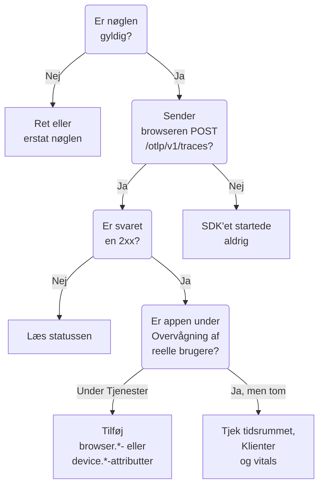

# RUM-fejlfinding

Når en RUM-applikation mangler, er tom eller viser **Afbrudt**, så gå denne side igennem i rækkefølge. Hvert tjek udelukker en del af vejen mellem din app og OneUptime, i den rækkefølge disse problemer normalt opstår.

:::cards
- [Tjek nøglen](#tjek-nøglen): Det hurtigste tjek, og alt andet afhænger af det.
- [Tjek, hvad der forlader browseren](#tjek-hvad-der-forlader-browseren): Eksportforespørgslen i browserens udviklerværktøjer.
- [Tjek, hvor telemetrien ender](#tjek-hvor-telemetrien-ender): En RUM-applikation eller en backend-tjeneste.
- [Problemer med sessionsafspilning](#problemer-med-sessionsafspilning): En separat pipeline, med sin egen side.
:::

## Hvor RUM-telemetri stopper

Telemetri passerer tre tjek på vej til en RUM-applikation. Find det første, der fejler:



## Tjek nøglen

Tjek nøglen først. Det er det hurtigste tjek, og intet af det følgende virker uden en nøgle, som OneUptime accepterer:

```bash
curl -i https://oneuptime.com/otlp/v1/validate \
  -H "x-oneuptime-token: YOUR_TELEMETRY_INGESTION_TOKEN"
```

| Svar | Hvad det betyder |
| --- | --- |
| `200` med `"valid": true` | OneUptime accepterer nøglen. Svaret oplyser også dens `keyType` og dens `projectId`. Gå videre til næste tjek. |
| `401` med `"valid": false` | Nøglen mangler, er ukendt, tilbagekaldt, deaktiveret eller udløbet, og `message` siger hvilken. Opret en aktiv nøgle under **Projektindstillinger → Telemetri og APM → Indtagelsesnøgler**. |

En webapp har brug for en **Browser**-nøgle, og en mobilapp for en **Server**-nøgle: se [Browseropsætning](/docs/rum/browser-setup) og [Mobilopsætning](/docs/rum/mobile-setup). Eksportendpoints afviser også en forkert nøgle med `401`, som OTLP-specifikationen kræver, så et velopdragent SDK logger afvisningen i stedet for at prøve igen. Den linje er let at overse i browserkonsollen, og dette tjek svarer direkte.

## Tjek, hvad der forlader browseren

Åbn browserens udviklerværktøjer på appens side, vælg fanen Netværk, og filtrér på `otlp`. Du leder efter `POST /otlp/v1/traces` besvaret med en `2xx`-status.

### Ingen forespørgsel

SDK'et startede aldrig. Det er næsten altid en af disse årsager:

- `telemetry.ts` er ikke den første import i din app, eller din bundler har fjernet den. Instrumenteringerne ændrer `fetch` og `XMLHttpRequest`, så en forespørgsel, der foretages før den ændring, spores ikke, og en fil, som bundleren har fjernet, kører ingenting.
- Batchprocessoren har ikke eksporteret endnu. `BatchSpanProcessor` venter et par sekunder på at fylde en batch, så vent, eller gå til en anden side, før du konkluderer, at intet bliver sendt.
- En miljøvariabel ved build-tid er forblevet `undefined`, og exporterens URL er ødelagt. Log URL'en én gang ved opstart.

### Browseren blokerer forespørgslen

- **En Content Security Policy-fejl i konsollen.** Din sides politik tillader endnu ikke OneUptime. Tilføj det til dit eksisterende `connect-src`-direktiv, eller brug din egen vært, hvis du selv hoster OneUptime:

  ```text
  connect-src 'self' https://oneuptime.com;
  ```

- **En CORS-fejl.** OTLP-endpoints accepterer forespørgsler fra enhver oprindelse og tillader headeren `x-oneuptime-token`, så en reel CORS-fejl betyder næsten altid, at forespørgslen aldrig nåede OneUptime: kig efter en virksomhedsproxy, en annonceblokering eller en tastefejl i værten. Tjek forespørgslens URL på fanen Netværk.

### Forespørgslen får en fejlstatus

**`401`.** Nøglen er ukendt, tilbagekaldt eller udløbet. Kør [nøgletjekket](#tjek-nøglen), og brug derefter en aktiv nøgle.

**`404`.** URL'en er forkert. Sporexporteren skal have den fulde sti, `/otlp/v1/traces`. En almindelig fejl er at give basisadressen (`https://oneuptime.com/otlp`) til en exporter, der forventer den fulde URL, eller den fulde URL til en, der selv tilføjer stien og ender på `/otlp/v1/traces/v1/traces`.

**`413`.** Batchen var større, end en proxy tillader. OneUptimes egen ingress accepterer op til 4 MB på `/otlp`, men en proxy, du sætter foran OneUptime, kan være strengere — ingress-nginx sætter for eksempel `proxy-body-size` til 1 MB som standard — så hvis du har en, så hæv også dens grænse for `/otlp`. Under alle omstændigheder gør en mindre `maxExportBatchSize` på `BatchSpanProcessor` hver eksport mindre:

```ts
new BatchSpanProcessor(exporter, { maxExportBatchSize: 100 });
```

En browser sender sjældent så store batches, medmindre spans bærer store attributter, som en hel stakspor eller en svarbody. At skære dem ned er den bedre løsning.

**`422`.** OneUptime afviste nøglen her, og beskeden siger hvorfor. `Origin https://app.example.com is not allowed for this browser ingestion key.` betyder, at sidens præcise oprindelse, med dens skema og eventuelle port, mangler i nøglens **Tilladte oprindelser**. `This telemetry ingestion key has been disabled.` betyder, at nogen har deaktiveret nøglen.

**`429`.** Nøglens **Requests Per Minute Limit** er brugt op: `Too many telemetry requests for this ingestion key. Please retry later.` En Browser-nøgle tillader 6000 forespørgsler i minuttet for alle dine besøgende tilsammen, medmindre du sætter din egen grænse på nøglen.

**`403` med en HTML-side, eller en tom body.** OneUptime besvarer hver afvisning i JSON, så denne kom fra noget foran, normalt en webapplikationsfirewall på dit eget domæne, hvis du sender OneUptime igennem den. Firewallen parser OTLP/JSON og sammenligner hver span-attribut med sine injektionsregler, så en URL med en forespørgselsstreng på et span er nok til, at den blokerer, og firewallens log nævner reglen. Undtag OTLP-payloaden fra inspektion kun på OTLP-stierne: [Dine OpenTelemetry-forespørgsler bliver også blokeret](/docs/rum/session-replay-troubleshooting#dine-opentelemetry-forespørgsler-bliver-også-blokeret) viser hvordan, og dækker afspilningsoptageren bag den samme firewall.

## Tjek, hvor telemetrien ender

Forespørgslen virker, men appen dukker op under **Produkter → Tjenester** i stedet for under **Produkter → Ressourcer → Overvågning af reelle brugere**. Det er den mest almindelige henvendelse, og årsagen er næsten altid en ressource uden klientattributter. OneUptime arkiverer kun en batch som RUM, når dens ressource bærer en af disse:

| Type | Attributter |
| --- | --- |
| Browser | `browser.platform`, `browser.language` eller en ikke-tom `browser.brands` |
| Mobil | `device.id` eller `device.model.identifier`, eller `device.manufacturer` på en ressource uden værtsidentitet (`host.name`, `host.id` eller `k8s.node.name`) |

Et `service.name` alene opretter en backend-tjeneste. OpenTelemetry-browser-SDK'et tilføjer ingen `browser.*`-attributter, medmindre du tilføjer browserens ressourcedetektor eller selv sætter dem: se [Browseropsætning](/docs/rum/browser-setup).

For at se, hvad du faktisk sender, skal du åbne OTLP-forespørgslen på fanen Netværk og se på dens payload: `resourceSpans[0].resource.attributes` er den liste, der afgør det. Hvis der ingen `browser.*`-attribut er, tilføjer SDK'et den ikke, uanset hvad dets dokumentation siger.

Tilføj attributterne, og den næste batch opretter RUM-applikationen. Den tjeneste, der blev oprettet først, bliver ikke til en RUM-applikation, fordi det er separate poster, så slet den under **Produkter → Tjenester**, når RUM-telemetrien kommer ind.

> [!NOTE]
> En ressource, hvis eneste klientattribut er `device.manufacturer`, og som også har en værtsidentitet, læses som en maskine og ikke som en telefon, fordi en værts inventar rapporterer sin producent med den samme attribut. Tilføj `device.id` eller `device.model.identifier`, så arkiveres batchen som mobil-RUM, uanset hvad den ellers bærer.

## Applikationen er tom

Applikationen findes, men dens sider viser intet.

- **Tjek tidsrummet.** Oversigten viser som standard den seneste time, så en testbatch fra i morges falder uden for.
- **Vent et par minutter.** Indtagelse går gennem en kø, og **Sidst set** opdateres med få minutters mellemrum i stedet for ved hver batch.
- **Tjek projektet.** En nøgle skriver til sit eget projekt, så telemetri, der sendes med et andet projekts nøgle, ligger der og ikke her.

## Siden Klienter er tom

Siden **Klienter** viser `browser.platform` på web og `device.model.identifier` på mobil. To grunde til, at den forbliver tom, selv når alt andet virker:

- **Safari og Firefox.** `browserDetector` læser UA Client Hints-API'et, som kun Chromium-browsere har. På de andre sætter den `browser.language`, hvilket er nok til at arkivere telemetrien som RUM, men ikke `browser.platform`. Sæt selv `browser.platform` for at få de klienter med.
- **Et mobil-SDK, der kun sætter `device.manufacturer`.** Det arkiverer telemetrien som mobil-RUM, men siden **Klienter** har brug for `device.model.identifier`.

## Core Web Vitals viser «No web vitals reported yet»

Kortet fyldes kun med de metrikker, din app sender, så spor alene fylder det aldrig. Tjek, at du eksporterer metrikker, at deres navne er blandt dem, OneUptime læser, og at de vises på applikationens side **Metrikker**. [Kortet siger «No web vitals reported yet»](/docs/rum/web-vitals#fejlfinding) gennemgår hvert tjek, herunder værdier, der går tabt, når en besøgende lukker fanen før næste eksport.

## Status siger Afbrudt, mens folk bruger appen

En applikation skifter til **Afbrudt** efter 15 minutter uden telemetri. Hvis folk bruger appen:

- **En sampler smider måske alt væk.** Tjek, at du ikke har sat en sampler, der altid er slået fra, eller en meget lav ratio.
- **Appen sender måske kun telemetri ved nogle interaktioner**, og ingen brugte dem i den periode.
- **Nøglen er måske blevet tilbagekaldt eller deaktiveret** efter udrulningen: kør [nøgletjekket](#tjek-nøglen) igen.

En intern app eller en app med lav trafik uden besøgende om natten er virkelig afbrudt. Det er ikke en fejl.

## Problemer med sessionsafspilning

Sessionsafspilning er en separat pipeline med sine egne problemer: optagerens script, lister over tilladte oprindelser, samtykke, Content Security Policy og maskering. [Fejlfinding af sessionsafspilning](/docs/rum/session-replay-troubleshooting) dækker dem. Start der, og start med at slå optagerens diagnostik til, fordi de fleste af dens fejl er tavse med vilje:

```js
localStorage.setItem("oneuptime.sessionReplay.debug", "true");
// then reload the page
```

Applikationens side **Sundhed**, i dens sektion **Sessionsafspilning**, og panelet **Test your installation** på **Replay Policy** tjekker nøglen, listerne over tilladte oprindelser og politikken fra serversiden og siger, hvorfor intet kommer ind. Browserkonsollen giver dig den halvdel, serveren ikke kan se.

Med standardpolitikken sender en optager en chunk omtrent hvert 15. sekund, mens brugeren interagerer med siden. En inaktiv fane har intet at sende, så klik eller bevæg musen først; hvis der derefter ingen chunk-forespørgsel er, er der noget galt. Hvis appen kun uploader _On error or frustration_, er stilhed forventet, indtil noget fejler. Kald `OneUptimeReplay.captureSession()` for at tvinge en upload og teste vejen alligevel.

De to pipelines er uafhængige. Du behøver ikke en fungerende RUM-applikation, for at optageren kan indlæses, og en fungerende optager betyder ikke, at RUM-telemetri kommer ind: hver af dem kan fejle for sig.

## Sidder du stadig fast?

Saml dette, før du beder om hjælp. Det sparer en runde frem og tilbage:

- Listen `resource.attributes` fra payloaden i en reel OTLP-forespørgsel.
- HTTP-statussen for den forespørgsel.
- Det præcise `service.name`, du sender, og om projektet har en applikation eller en tjeneste med det navn.
- Om `/otlp/v1/validate` svarer `200` for nøglen i det udrullede build.

Skriv derefter til support@oneuptime.com, eller opret et issue på [GitHub](https://github.com/OneUptime/oneuptime).

## Næste skridt

:::cards
- [Browseropsætning](/docs/rum/browser-setup): Den opsætning, disse tjek går ud fra, trin for trin.
- [Mobilopsætning](/docs/rum/mobile-setup): Den nøgle og de attributter, en mobilapp har brug for.
- [Administrer applikationer](/docs/rum/applications): Navne, etiketter, opbevaring og status.
- [Fejlfinding af sessionsafspilning](/docs/rum/session-replay-troubleshooting): Hver kode fra optageren, og hvad du gør ved den.
:::
