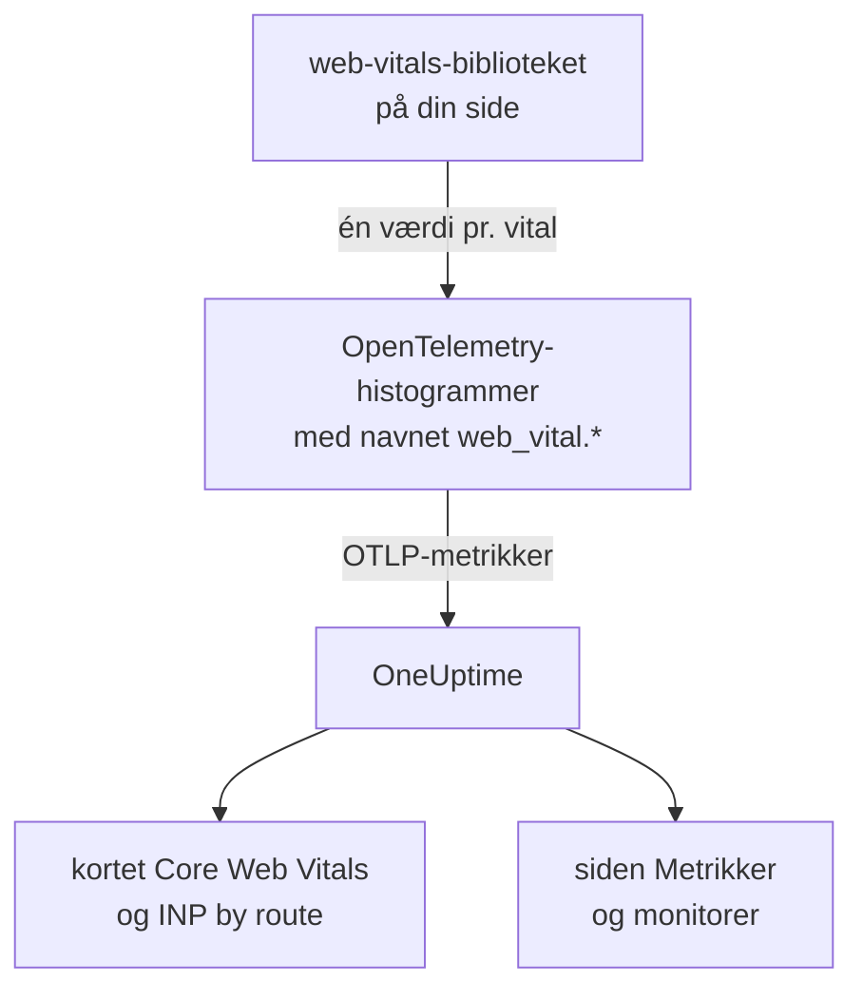
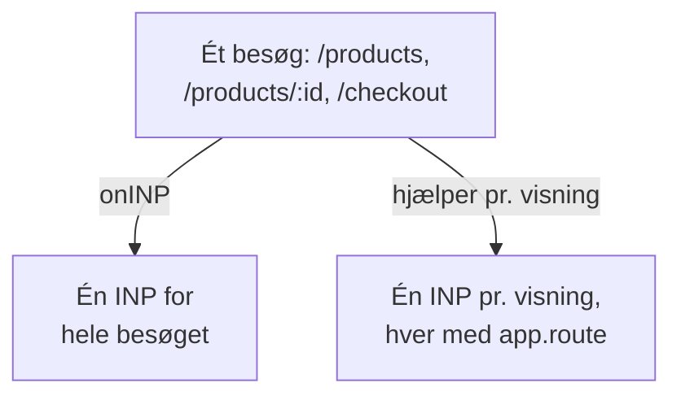

# Core Web Vitals

Kortet **Core Web Vitals** i en RUM-applikations oversigt viser LCP, INP, CLS, FCP og TTFB, hver vurderet efter Googles grænser. OneUptime måler ingen af dem selv: Kortet udfyldes kun ud fra metrikker, som din browserinstrumentering rapporterer, og denne side viser, hvordan du sender dem.

:::cards
- [Send dem](#send-dem-fra-din-app): Videresend web-vitals-bibliotekets værdier som OpenTelemetry-metrikker.
- [Navne, OneUptime læser](#metriknavne-oneuptime-genkender): De metriknavne, hver vital kan komme under.
- [Single-page-apps](#single-page-apps): INP for hver visning, ikke én værdi pr. sideindlæsning.
- [Alarmér på en vital](#alarmér-på-en-vital): Færdige monitorer til dårlige vitals.
:::

## Sådan virker det

Biblioteket [`web-vitals`](https://github.com/GoogleChrome/web-vitals) måler hver vital på siden; det er det samme bibliotek, som Chromes egne værktøjer bruger. Din kode registrerer hver værdi i et OpenTelemetry-histogram, og browserens metrikpipeline eksporterer den til OneUptime.



OpenTelemetry har endnu ingen endelig navnekonvention for web vitals, så OneUptime leder efter hver vital under flere navne og bruger det første med data. Brug navnene `web_vital.*` til ny instrumentering.

## Før du begynder

- En webapp, der er sat op som i [Browseropsætning](/docs/rum/browser-setup), med sin metrikpipeline: Det er `MeterProvider` fra [Tilføj logs og metrikker](/docs/rum/browser-setup#tilføj-logs-og-metrikker), der eksporterer disse værdier.

## Send dem fra din app

:::steps
### Installer biblioteket

```bash
npm install web-vitals
```

### Registrer hver vital i et histogram

Opret `src/web-vitals.ts`. Hver vital er et histogram, så siden **Metrikker** senere kan beregne percentiler, med bucket-grænser på Googles grænser for god og dårlig.

```ts title="src/web-vitals.ts"
// Import after ./telemetry
import { metrics } from "@opentelemetry/api";
import { onCLS, onFCP, onINP, onLCP, onTTFB, type Metric } from "web-vitals";

const meter = metrics.getMeter("web-vitals");

// Histograms, so the Metrics tab can compute percentiles later. The bucket
// edges sit on each vital's good / poor limits: a percentile is read from
// the buckets, and the defaults are far too coarse for these ranges.
const buckets = (...edges: number[]) => ({ advice: { explicitBucketBoundaries: edges } });

const lcp = meter.createHistogram("web_vital.lcp", { unit: "ms", ...buckets(0, 1000, 1500, 2000, 2500, 3000, 3500, 4000, 5000, 7500, 10000) });
const inp = meter.createHistogram("web_vital.inp", { unit: "ms", ...buckets(0, 50, 100, 150, 200, 250, 300, 400, 500, 750, 1000, 2000) });
const fcp = meter.createHistogram("web_vital.fcp", { unit: "ms", ...buckets(0, 600, 1200, 1800, 2400, 3000, 4000, 6000, 10000) });
const ttfb = meter.createHistogram("web_vital.ttfb", { unit: "ms", ...buckets(0, 200, 400, 600, 800, 1200, 1800, 2500, 4000) });
const cls = meter.createHistogram("web_vital.cls", { unit: "1", ...buckets(0, 0.025, 0.05, 0.1, 0.15, 0.2, 0.25, 0.4, 0.6, 1) });

function record(
  histogram: { record: (v: number, a?: Record<string, string>) => void },
) {
  return (metric: Metric): void => {
    histogram.record(metric.value, {
      // Keep attributes low-cardinality. Never put a full URL or a user id here.
      "web_vital.rating": metric.rating,
    });
  };
}

onLCP(record(lcp));
onINP(record(inp));
onCLS(record(cls));
onFCP(record(fcp));
onTTFB(record(ttfb));
```

### Importer den efter din telemetriopsætning

```ts
import "./telemetry";
import "./web-vitals";
```

### Tjek siden Metrikker

Indlæs et par sider, og søg derefter efter `web_vital.lcp` på applikationens side **Metrikker**. Når metrikkerne er der, udfyldes kortet **Core Web Vitals** for det tidsrum, du vælger.
:::

## Send de sidste værdier, før siden lukker

`onINP` og `onCLS` rapporterer, når siden skjules, ikke under besøget. Med eksportintervallet på 30 sekunder fra [Browseropsætning](/docs/rum/browser-setup) kan en besøgende, der lukker fanen lige efter den sidste værdi, nå at gå, før den eksporteres. Hvis fuldstændighed betyder noget, så forkort `exportIntervalMillis`, eller behold den `MeterProvider`, du byggede i `telemetry.ts`, og tøm den, når siden skjules:

```ts
// In telemetry.ts, export the provider you created:
export const meterProvider = new MeterProvider({ /* ... */ });

// Anywhere after setup:
import { meterProvider } from "./telemetry";

document.addEventListener("visibilitychange", () => {
  if (document.visibilityState === "hidden") {
    void meterProvider.forceFlush();
  }
});
```

## Metriknavne, OneUptime genkender

OneUptime prøver navnene i denne rækkefølge, og det første med data i det valgte tidsrum vinder.

| Vital | Metriknavne, et hvilket som helst | Enhed |
| --- | --- | --- |
| LCP: Largest Contentful Paint | `web_vital.lcp`, `browser.largest_contentful_paint`, `largest_contentful_paint`, `web.vitals.lcp` | ms |
| INP: Interaction to Next Paint | `web_vital.inp`, `browser.interaction_to_next_paint`, `interaction_to_next_paint`, `web.vitals.inp` | ms |
| CLS: Cumulative Layout Shift | `web_vital.cls`, `browser.cumulative_layout_shift`, `cumulative_layout_shift`, `web.vitals.cls` | score |
| FCP: First Contentful Paint | `web_vital.fcp`, `browser.first_contentful_paint`, `first_contentful_paint`, `web.vitals.fcp` | ms |
| TTFB: Time to First Byte | `web_vital.ttfb`, `browser.time_to_first_byte`, `time_to_first_byte`, `web.vitals.ttfb` | ms |

De andre navne findes, så en app, der allerede sender efter en fællesskabskonvention, dukker op uden ændringer.

## Vurderingsgrænser

Kortet vurderer hver værdi med Googles offentliggjorte Core Web Vitals-grænser:

| Vital | **Good** | **Needs work** | **Poor** |
| --- | --- | --- | --- |
| LCP | under 2500 ms | 2500 til 4000 ms | 4000 ms eller mere |
| INP | under 200 ms | 200 til 500 ms | 500 ms eller mere |
| CLS | under 0,1 | 0,1 til 0,25 | 0,25 eller mere |
| FCP | under 1800 ms | 1800 til 3000 ms | 3000 ms eller mere |
| TTFB | under 800 ms | 800 til 1800 ms | 1800 ms eller mere |

Kortet viser **gennemsnittet** over det valgte tidsrum, ikke den 75. percentil, som Googles feltværktøjer rapporterer. Det er med vilje: OneUptime læser et histograms percentiler ud fra dets buckets, så en percentil er kun så præcis som dens buckets, mens gennemsnittet kommer fra histogrammets nøjagtige sum og antal. Med OpenTelemetrys standardbuckets (`0, 5, 10, 25, 50, …`) havner hver CLS-værdi i den første bucket, og en 75. percentil ville vise 2,5 for en side, der knap bevæger sig.

> [!TIP]
> Læs kortet som en tendens. For den 75. percentil registrerer du med bucket-grænserne ovenfor og viser så metrikken på siden **Metrikker** med aggregeringen **P75**. En metrikmonitor giver samme valg.

## Single-page-apps

`onINP` måler INP, som browseren definerer det: **én værdi pr. sideindlæsning**. En single-page-app indlæses én gang og skifter derefter rute med `history.pushState`, så et besøg på `/products`, `/products/42` og `/checkout` giver én INP for hele besøget. Alle visningers interaktioner konkurrerer om det ene tal, og en ruteattribut på det angiver den side, der blev vist, da det blev rapporteret, ikke den side, der var langsom.



For at se INP pr. visning skal du måle den pr. visning: Hvert ruteskift afslutter den aktuelle visning og starter en ny, og hver visning rapporterer sin egen INP. Hjælperen nedenfor gør det med browserens Event Timing API, de samme data som `onINP` bruger, og håndterer den del, der er nem at få forkert: Det klik, der **forårsagede** en navigation, leveres først efter ruteskiftet, men hører til den side, der blev klikket på.

```ts title="src/inp-per-route.ts"
// INP for each view of a single-page app.
type Report = (inpMs: number, route: string) => void;

interface View {
  route: string;
  path: string; // the URL path it was opened for
  start: number; // performance.now() when the view began
  latencies: Map<number, number>; // interactionId -> its slowest entry
}

// Long enough for the click that navigated to be delivered: its entry
// arrives after the next paint, i.e. after the route has changed.
const SETTLE_MS = 1000;

let views: Array<View> = [];
let report: Report = () => {};

// The path, plus the hash when a hash router keeps the route there.
const currentPath = (): string =>
  location.pathname + (location.hash.startsWith("#/") ? location.hash : "");

function close(view: View): void {
  if (!views.includes(view)) return; // already reported
  views = views.filter((v) => v !== view);

  const sorted = [...view.latencies.values()].sort((a, b) => b - a);
  if (sorted.length === 0) return; // nobody interacted: no INP, not 0

  // web-vitals' p98: skip one outlier for every 50 interactions.
  report(sorted[Math.min(sorted.length - 1, Math.floor(sorted.length / 50))]!, view.route);
}

function record(entries: PerformanceEntryList): void {
  for (const entry of entries as Array<PerformanceEventTiming & { interactionId?: number }>) {
    if (!entry.interactionId) continue; // hovers, scrolls: not interactions

    // The view the interaction STARTED in, so the click that navigated
    // counts towards the page it was clicked on.
    const view = [...views].reverse().find((v) => entry.startTime >= v.start);
    if (!view) continue;

    const slowest = view.latencies.get(entry.interactionId) ?? 0;
    view.latencies.set(entry.interactionId, Math.max(slowest, entry.duration));
  }
}

export function observeInpPerRoute(route: string, onReport: Report): void {
  if (typeof PerformanceObserver === "undefined" || !PerformanceObserver.supportedEntryTypes?.includes("event")) return;

  report = onReport;
  views = [{ route, path: currentPath(), start: 0, latencies: new Map() }];

  const observer = new PerformanceObserver((list) => record(list.getEntries()));
  observer.observe({ type: "event", durationThreshold: 40, buffered: true } as PerformanceObserverInit);

  // The tab may never come back: report every view now, then keep
  // measuring the current route as a fresh view.
  document.addEventListener("visibilitychange", () => {
    if (document.visibilityState !== "hidden") return;
    record(observer.takeRecords());
    const current = views[views.length - 1]?.route ?? route;
    [...views].forEach(close);
    views = [{ route: current, path: currentPath(), start: performance.now(), latencies: new Map() }];
  });
}

// Call after every navigation, with the route PATTERN ("/products/:id").
// Safe to call when nothing changed (a router's initial navigation, a
// query-string update): the view only ends when the path does.
export function startView(route: string): void {
  const closing = views[views.length - 1];
  if (!closing || closing.path === currentPath()) return;

  views.push({ route, path: currentPath(), start: performance.now(), latencies: new Map() });
  setTimeout(() => close(closing), SETTLE_MS);
}
```

Begge funktioner tager rutens **mønster**, aldrig URL'en: `/products/42` og `/products/7` skal være én rute, ellers bliver hvert produkt sin egen serie. Brug din routers mønster, hvor den har et; ellers samler du selv id'erne:

```ts
// "/products/42" -> "/products/:id", also for UUIDs.
export const toRoutePattern = (path: string): string =>
  path.replace(/\/(\d+|[0-9a-f]{8}-[0-9a-f-]{27})(?=\/|$)/gi, "/:id");
```

Registrer det, hjælperen rapporterer, i det samme histogram `web_vital.inp`, med ruten som `app.route`, og **fjern `onINP`** fra snippet'et ovenfor: Med begge ville hver interaktion blive talt to gange.

```ts
// src/web-vitals.ts, in place of onINP(record(inp))
import { observeInpPerRoute } from "./inp-per-route";

observeInpPerRoute(toRoutePattern(location.pathname), (inpMs, route) => {
  inp.record(inpMs, {
    "app.route": route,
    "web_vital.rating": inpMs <= 200 ? "good" : inpMs <= 500 ? "needs-improvement" : "poor",
  });
});
```

Kald derefter `startView`, hvor din router melder en afsluttet navigation. Den ignorerer et kald, når URL-stien ikke har ændret sig, så en router, der også rapporterer den første indlæsning eller en ændring af query-strengen, deler ikke visningen:

:::tabs
@tab Vue Router
```ts
router.afterEach((to) => startView(to.matched[to.matched.length - 1]?.path ?? toRoutePattern(to.path)));
```
@tab React Router
```tsx
// In a component that stays mounted inside the router
const { pathname } = useLocation();
useEffect(() => startView(toRoutePattern(pathname)), [pathname]);
```
:::

Det får du:

- **INP by route** i oversigten, langsomste først, ud fra `app.route`; OneUptime læser også OpenTelemetrys `url.template`.
- Et rutefilter til alarmer: Filtrer en metrikmonitor på `web_vital.inp` efter `app.route` for at overvåge ét flow, såsom `/checkout`, for sig.
- Den samlede INP for appen på kortet **Core Web Vitals** virker stadig: Det er den samme metrik, nu med én værdi pr. visning i stedet for én pr. sideindlæsning.

Chromium-browsere rapporterer de interaktions-id'er, det kræver. Safari rapporterer ingen, og det er også derfor, `onINP` intet rapporterer der. Chromes eksperimentelle Soft Navigations API sigter mod at gøre det indbygget, men det er ikke almindeligt tilgængeligt; denne hjælper virker i dag.

> [!NOTE]
> Optageren i [Sessionsafspilning](/docs/telemetry/session-replay) måler allerede INP pr. visning uden kode: Hver optagelse viser en INP-række for hver rute, brugeren interagerede på, med det langsomme element og hvordan tiden fordelte sig på inputforsinkelse, behandling og præsentation.

## Hold kardinaliteten under kontrol

Metrikattributter ganges op. `web_vital.rating` har tre mulige værdier, hvilket er fint, og en attribut for rute eller sidetype er som regel umagen værd:

```ts
histogram.record(metric.value, {
  "web_vital.rating": metric.rating,
  "app.route": routePattern, // "/product/:id" — the PATTERN, not "/product/8842"
});
```

At registrere den konkrete URL i stedet for rutemønsteret skaber én tidsserie pr. produktside, hvilket gør siden **Metrikker** langsom og lagerregningen stor. Det samme gælder bruger-id'er, sessions-id'er og skærmstørrelser.

## Alarmér på en vital

Applikationens side **Recommendations** tilbyder en færdig monitor til hver vital. Hver af dem læser femminuttersgennemsnittet af sin metrik og udløses, når det når Googles grænse for dårlig:

| Anbefaling | Metrik | Udløses ved | Alvorlighed |
| --- | --- | --- | --- |
| **Poor Largest Contentful Paint** | `web_vital.lcp` | 4000 ms | **Kritisk** |
| **Poor Interaction to Next Paint** | `web_vital.inp` | 500 ms | **Kritisk** |
| **Poor Cumulative Layout Shift** | `web_vital.cls` | 0,25 | **Kritisk** |
| **Slow First Contentful Paint** | `web_vital.fcp` | 3000 ms | **Warning** |
| **Slow Time to First Byte** | `web_vital.ttfb` | 1800 ms | **Warning** |

Disse monitorer læser kun navnene `web_vital.*`. Hvis din app sender en vital under et andet navn, så ret den oprettede monitors metrik. For at alarmere på én rute tilføjer du et filter `app.route` til monitoren. Du kan også bygge din egen monitor på enhver af disse metrikker: se [Metrik-monitor](/docs/monitor/metrics-monitor).

## Fejlfinding

:::details Kortet siger "No web vitals reported yet"
Kortet udfyldes kun ud fra metrikker, som din app sender. Tjek i rækkefølge:

1. At du overhovedet har en metrikpipeline: Spor alene udfylder aldrig dette kort.
2. At metriknavnene er blandt dem, OneUptime læser: se [Metriknavne, OneUptime genkender](#metriknavne-oneuptime-genkender).
3. At metrikkerne er på applikationens side **Metrikker**. Hvis de er, virker eksporten, og problemet er navnet eller tidsrummet.
4. At INP og CLS rapporteres, når siden skjules, så et kort besøg kan slutte før næste eksport: se [Send de sidste værdier, før siden lukker](#send-de-sidste-værdier-før-siden-lukker).

Hvis intet af dette hjælper, tjekker [RUM-fejlfinding](/docs/rum/troubleshooting) hele pipelinen.
:::

:::details INP rapporteres, men ikke pr. rute
Kortet **INP by route** skal have attributten `app.route`, eller `url.template`, på `web_vital.inp`. Registrer rutemønsteret med hver værdi som i [Single-page-apps](#single-page-apps).
:::

:::details Værdierne afviger fra Googles rapport
Kortet viser gennemsnittet over det tidsrum, du valgte, og Google rapporterer den 75. percentil af sine egne besøgende. Vis **P75** på siden **Metrikker** for at sammenligne lige med lige.
:::

## Næste skridt

:::cards
- [Browseropsætning](/docs/rum/browser-setup): Pipelinen for spor, logs og metrikker, som disse vitals kører på.
- [Metrik-monitor](/docs/monitor/metrics-monitor): Alarmér på enhver vital, for hele appen eller én rute.
- [Sessionsafspilning](/docs/telemetry/session-replay): Se INP pr. visning i optagelser, uden kode.
- [RUM-fejlfinding](/docs/rum/troubleshooting): Hvert tjek, i den rækkefølge problemer typisk opstår.
:::
