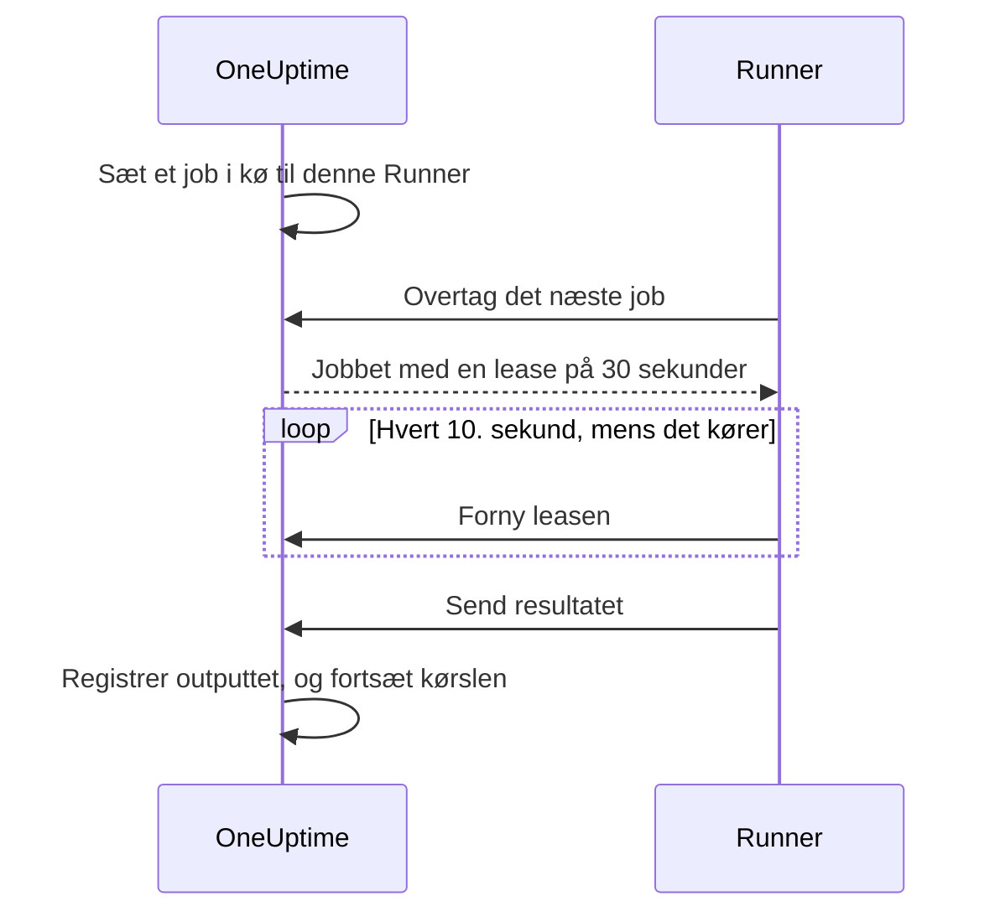

# Runbook-agenter

En **runbook-agent**, der kaldes **Runner** i dashboardet, er en lille selvhostet proces, der kører JavaScript-, Bash-, SSH- og kubectl-trinnene i dine runbooks **i din egen infrastruktur**. OneUptime Worker kører aldrig dine scripts: den sætter dem i kø, og den Runner, som trinnets forfatter valgte, overtager hvert job, kører det og sender resultatet tilbage. Denne side er til dem, der installerer og driver Runners. Et trin, der ikke vælger nogen Runner, kører på [projektets standard-Runner](#projektets-standard-runner), hvis du har angivet en; ellers kører et JavaScript-trin på en [global Runner](#globale-runnere), en af dem, OneUptime kører for alle projekter.

:::cards
- [Installer en Runner](#installer-en-runner): Fra dashboardet til en forbundet container i fem trin.
- [Peg et trin mod en Runner](#peg-et-trin-mod-en-runner): Bind et trin til den Runner, der skal køre det.
- [Projektets standard-Runner](#projektets-standard-runner): Den Runner, et trin kører på, når det ikke vælger nogen.
- [Globale Runnere](#globale-runnere): De Runnere, OneUptime kører for alle projekter, og hvad de kører.
- [Timeouts](#timeouts): Claim- og udførelsestimeouts, og hvordan de spiller sammen.
- [Miljøvariabler](#miljøvariabler): Hvad containeren læser ved opstart.
:::

## Sådan virker det

```mermaid title="Hvad der krydser netværket mellem en Runner og OneUptime"
flowchart TB
    subgraph cloud["OneUptime"]
        direction LR
        worker["Workeren sætter trinnet i kø"]
        ingest["Runner-API"]
    end
    subgraph yours["Din infrastruktur"]
        direction LR
        runner["Runner-container"]
        targets["Værter, klynger, interne tjenester"]
    end
    worker --> ingest
    runner -->|"Udgående HTTPS, Runner-ID og nøgle"| ingest
    ingest -->|"Overtaget job med dets hemmeligheder"| runner
    runner -->|"Script, SSH eller Kubernetes-API"| targets
```

1. Du opretter en Runner i OneUptime. OneUptime genererer et ID og en hemmelig nøgle til den.
2. Du kører Runner-containeren på en vært i din infrastruktur med det ID, den nøgle og din OneUptime-URL.
3. Runneren beder OneUptime om arbejde hvert 5. sekund og melder hvert 60. sekund, at den er i live.
4. Når du skriver et JavaScript-, Bash-, SSH- eller kubectl-trin, vælger du Runneren fra en rulleliste under trinnets **Flere felter**. Trinnet bindes til den Runner. Et trin, der ikke vælger nogen, kører på projektets standard-Runner, hvis du har angivet en, og ellers kører et JavaScript-trin på **Global Runner**.
5. Når trinnet kører, sætter Workeren et job i kø med `targetAgentId` sat til den Runner. Kun den Runner kan overtage det.
6. Runneren kører jobbet lokalt — `bash -c <script>` for Bash og kubectl, en `isolated-vm`-sandkasse for JavaScript, en SSH-forbindelse, der kører scriptet med bash på maskinen — gemmer resultatet, skjuler trinnets hemmeligheder i det og sender det tilbage. Worker genoptager runbooket med resultatet.

Runneren har kun brug for **udgående HTTPS** til din OneUptime-instans. Den accepterer ingen indgående forbindelser.

En Runner gemmer kun sit ID og sin nøgle. Alt andet modtager den med det job, den overtager: et script med de [runbook-variabler](/docs/runbooks/variables), det nævner, indsat, og et SSH-trins nøgle eller adgangskode eller et kubectl-trins kubeconfig. Den får kun en hemmelighed, når hemmeligheden tillader det. Derfor kan alle, der har en Runners nøgle, optræde som den Runner: behandl nøglen som de hemmeligheder, den må bruge.

## Hvorfor scripts kører på en Runner

At køre scripts på OneUptime Worker havde to problemer:

- **Tillidsgrænse.** Alle, der kunne skrive et runbook, kunne køre kode på Workeren med adgang til alt, hvad Workeren kunne nå.
- **Rækkevidde.** De fleste nyttige trin virker på _din_ infrastruktur ("genstart denne tjeneste", "slå en post op i vores interne database"), ikke på OneUptimes.

Med Runners kører de trin på en vært, du styrer, og du bestemmer, hvad den vært må. HTTP-anmodnings- og AI-trin kører stadig på Workeren, fordi de ikke har brug for noget fra dit netværk.

## Globale Runnere

Globale Runnere er de Runnere, OneUptime kører for alle projekter. Et JavaScript-trin, der ikke vælger sin egen Runner, kører på en af dem, medmindre projektet har en [standard-Runner](#projektets-standard-runner), så du kan skrive det, før du installerer noget som helst. **Runbooks → Runbook-agenter** viser dem under **Globale Runnere**, over dine egne Runnere, og rullelisten **Runner** i et JavaScript-trin tilbyder **Global Runner** først, eller lige efter projektets standard-Runner. Rullelisten i et Bash-, SSH- eller kubectl-trin viser den sidst, nedtonet, med **Kører kun JavaScript-trin.** De trin kører på en af dine egne Runnere, inde i dit netværk, aldrig på en, som alle projekter deler.

| | Global Runner | Din egen Runner |
| --- | --- | --- |
| Trin, den kører | JavaScript | JavaScript, Bash, SSH og kubectl |
| Hvad et trin kan nå | Offentlige internetadresser | Hvad dens vært kan nå |
| Længste kørsel for et trin | 5 minutter | 1 time |
| Hemmelige variabler | Dem, du lader globale Runnere bruge | Dem, der viser den |

En global Runner kører trinnene fra mange projekter, så hvert trin holdes adskilt fra alle andre:

- Hvert trin kører i sin egen `isolated-vm`-sandkasse, oprettet til det trin og smidt væk bagefter: ingen filer, ingen processer, ingen miljøvariabler og intet, der gemmes fra ét trin til det næste.
- Dens HTTP-forespørgsler når kun offentlige internetadresser, aldrig en privat, loopback- eller link-local-adresse eller et cloud-metadata-endpoint, så en global Runner når aldrig dit netværk.
- Den får kun en hemmelig variabel, når variablens kontakt **Globale Runnere må bruge den** er slået til, og kun for et trin i variablens eget projekt.
- Et projekt kører højst tre trin ad gangen på globale Runnere, så intet projekt holder dem for sig selv.

Vælg en af dine egne Runnere til et trin, der skal nå dit netværk, eller for at holde trinnet på værter, du styrer. For at holde hvert trin på dine egne Runnere skal du slå **Brug globale Runnere** fra nederst på **Runbooks → Runbook-agenter**. Et JavaScript-trin, der ikke vælger nogen Runner, kører så på projektets standard-Runner eller fejler, hvis der ikke er angivet en, og siger det, indtil det vælger en af dine; et trin, der vælger en af dine Runnere, beholder den under alle omstændigheder. Et koderepositorie, der ikke vælger nogen Runner i sine indstillinger i Kode, arbejder også på en global Runner og skal bruge en af dine, mens kontakten er slået fra; se [Kode](/docs/ai/ai-agent#vælg-repositoriets-runner).

### Hvor globale Runnere kommer fra

I OneUptime Cloud kører OneUptime dem. En selvhostet installation kører som standard sin egen, ligesom den kører sine egne globale prober: tjenesten `global-runner` i Docker Compose og deploymentet `globalRunner` i Helm-chartet. Den har sin egen nøgle, `GLOBAL_RUNNER_KEY`, og intet andet fra serveren.

En masteradministrator kan tilføje flere for at køre trin fra andre værter: Åbn **Indstillinger** og derefter **Globale Runnere** i Admin-dashboardet, opret en, og kør den kommando, dens **Vis ID og nøgle** giver, på en vært, der kan nå internettet.

For at slå den medfølgende fra skal du sætte `GLOBAL_RUNNER_REPLICAS=0` i Docker Composes `config.env` eller `globalRunner.enabled` til `false` i Helm-chartet. Helt uden global Runner viser **Runbooks → Runbook-agenter** kun dine egne Runnere, og hvert JavaScript-trin vælger en af dem.

## Før du går i gang

- **En vært med Docker** i din infrastruktur, som kan nå din OneUptime-URL over HTTPS og de systemer, dine trin virker på.
- **En rolle, der opretter Runners.** Project Owner, Project Admin, Project Member og Runbook Admin kan oprette en. Kun en Project Owner, Project Admin eller Runbook Admin kan se en Runners nøgle, som opsætningskommandoen indeholder.

## Installer en Runner

### 1. Opret agentposten

Gå til **Runbooks → Runbook-agenter**, og opret en ny agent. Klik på **Opret Runner**, og udfyld dens felter, alle på én side:

| Felt | Hvor | Noter |
| --- | --- | --- |
| **Navn** | På siden | Et forståeligt navn, typisk hvor den kører, og hvad den kan nå, f.eks. `prod-eu-west-1`. Det er det, du vælger, når du skriver et trin. |
| **Beskrivelse** | På siden | Valgfri. En sætning om, hvad denne vært kan nå. |
| **Kører runbooks** | Under **Flere felter** | Slået til som standard. Lader denne Runner overtage runbook-trin. |
| **Etiketter** | Under **Flere felter** | Valgfri. |

En Runner henter en ændring af sine funktioner ved sit næste heartbeat; den skal ikke genstartes. AI er ikke en funktion. Et koderepositorie vælger i sine indstillinger i Kode den Runner, AI arbejder i det på, og Runnerens side viser de repositorier, der vælger den. En AI-regel vælger den Runner, OneUptime AI kører sine kommandoer på: Det er valget af en Runner der, der lader OneUptime AI's kommandoer køre på den.

### 2. Kopiér installationskommandoen

Klik på **Vis opsætningsvejledning** i Runnerens række. Dialogen **Opsætning af runbook-agent** viser en `docker run`-kommando, der allerede indeholder denne Runners ID og nøgle. Samme kommando står på Runnerens egen side under **Opsætningsvejledning**.

Kun en Project Owner, Project Admin eller Runbook Admin kan læse nøglen. Alle andre ser "Du har ikke tilladelse til at se denne runbook-agents nøgle" i stedet for kommandoen.

### 3. Kør den på en vært i din infrastruktur

Kør kommandoen på en vært i dit miljø, der kan:

- nå din OneUptime-instans over HTTPS, og
- gøre det, dine trin har brug for, f.eks. nå andre værter via SSH, kalde en klynges API-server eller tale med en database.

```bash
docker run --name oneuptime-runner --restart unless-stopped \
  -e ONEUPTIME_RUNNER_ID=<runner-id> \
  -e ONEUPTIME_RUNNER_KEY=<runner-key> \
  -e ONEUPTIME_URL=https://oneuptime.yourdomain.com \
  -d oneuptime/runner:release
```

### 4. Kontrollér, at agenten er forbundet

Gå tilbage til **Runbooks → Runbook-agenter**. Inden for et minut efter, at containeren er startet, bør Runnerens **Status** vise **Forbundet** med et nyt **Sidst set**. På Runnerens egen side viser kortet **Status for runbook-agent** dens **Version af runbook-agent** og **Vært**. Bliver den ved med at vise **Aldrig forbundet** eller **Afbrudt**, så se [Fejlfinding](#fejlfinding).

### 5. Hold agenten opdateret

Når en agent kører en ældre version end din OneUptime, vises et advarselstegn ud for dens **Version af runbook-agent** på dens side. Vælg det for at se, hvordan du opgraderer: hent det nye image, og fjern containeren, og kør så installationskommandoen fra trin 2 igen. En agent, som Kubernetes-agentens chart installerede, opgraderes i stedet med chartet.

```bash
docker pull oneuptime/runner:release
docker rm -f oneuptime-runner
```

## Peg et trin mod en Runner

:::steps
### Tilføj et trin, der kører på en Runner

Tilføj et JavaScript-, Bash-, SSH- eller kubectl-trin i dit runbooks **Trin**.

### Vælg Runneren

Åbn trinnets **Flere felter**: Dets rulleliste **Runner** viser alle Runners i projektet, og om de er forbundet, og den sammenfoldede linje nævner den Runner, trinnet kører på. Har projektet endnu ingen, siger trinnet det og henviser dig til **Runbooks › Runners**. Det første valg er det, et trin, der ikke vælger nogen Runner, kører på: [projektets standard-Runner](#projektets-standard-runner), markeret med **Projektstandard**, eller ellers, for et JavaScript-trin, **Global Runner**.

### Gem trinnene

Klik på **Save Steps**. Når en kørsel når trinnet, sætter Workeren et job i kø til den Runners ID, og kun den Runner kan overtage det. Et trin på **Global Runner** venter på den globale Runner, der er ledig.
:::

Bash køres med `bash -c`. JavaScript kører i en `isolated-vm`-sandkasse på Runneren uden adgang til filsystemet eller processer; det kan kalde offentlige HTTP-API'er med `axios`, men ikke adresser på et privat netværk. Et SSH- eller kubectl-trin logger ind med en hemmelig [runbook-variabel](/docs/runbooks/variables), som skal vise trinnets Runner under **Dine Runnere, der må bruge den**.

Brug for mere end én Runner? Opret dem, og peg hvert trin mod den rette. For redundans kører du en ekstra Runner og deler dine trin mellem dem, eller du holder et reserve-runbook, hvis trin peger mod den anden Runner.

## Projektets standard-Runner

Et projekt kan gøre en af sine egne Runnere til sin standard, ligesom det gør en Twilio-konfiguration til sin standard. Hvert runbook-trin, der ikke vælger nogen Runner, kører så på den: Bash-, SSH- og kubectl-trin og JavaScript-trin, som ellers ville køre på en global Runner.

For at gøre en Runner til standard skal du gå til **Runbooks → Runbook-agenter**, åbne menuen **⋯** i Runnerens række, klikke på **Indstil som projektstandard** og bekræfte med **Gør til projektstandard**. Eller åbn Runneren, og slå **Brug som projektstandard** til på dens kort **Projektstandard**. Listen markerer standarden med **Projektstandard** ved siden af dens navn, og det samme gør et trins rulleliste **Runner** ved det første valg. Et projekt har én standard-Runner: At gøre en anden Runner til standard erstatter den. **Stop med at bruge som projektstandard** i samme menu, eller kontakten på Runnerens side, holder op med at bruge den.

Hvor et trin, der ikke vælger nogen Runner, kører:

| Projektet | Et JavaScript-trin | Et Bash-, SSH- eller kubectl-trin |
| --- | --- | --- |
| Har en standard-Runner | Standard-Runneren | Standard-Runneren |
| Har ingen og bruger globale Runnere | En global Runner | Ingen steder: Trinnet fejler og siger, at det ikke har nogen Runner |
| Har ingen og bruger ikke globale Runnere | Ingen steder: Trinnet fejler og siger det | Ingen steder: Trinnet fejler og siger, at det ikke har nogen Runner |

Et trin, der har valgt en Runner, beholder den, uanset hvad standarden er, og et JavaScript-trin kan stadig selv vælge **Global Runner**. At angive en standard ændrer ikke noget gemt trin.

Standarden er en af projektets egne Runnere, der kører runbook-trin: ikke en global Runner, ikke den Runner i klyngen, som Kubernetes-agenten installerede, og ikke en med **Kører runbooks** slået fra. Så længe en Runner er standarden, forbliver dens **Kører runbooks** slået til. Når standarden ikke er forbundet, siger et trins rulleliste det, og et trin på den venter på den, som på enhver Runner, indtil dets claim timeout er gået.

Kun runbook-trin bruger standarden. Et koderepositorie vælger sin Runner i sine indstillinger i Kode, og en AI-regel vælger sin egen.

## Driftsnoter

### Timeouts

To timeouts gælder for hvert trin, der kører på en Runner:

| Timeout | Standard | Hvad den styrer |
| --- | --- | --- |
| **Timeout for overtagelse** | 2 minutter | Hvor længe Workeren venter på, at den valgte Runner overtager jobbet. Overtager Runneren det ikke i tide, fejler trinnet på grund af timeout, og runbooket fortsætter (eller stopper, afhængigt af **Fortsæt ved fejl**). |
| **Timeout for kørsel** | 30 sekunder | Hvor længe Runneren lader trinnet køre, før den stopper det. Bash får `SIGKILL`; JavaScripts sandkasse rives ned. |

Begge kan indstilles pr. trin. Åbn **Runbooks › dit runbook › Trin**, fold trinnet ud, og angiv **Timeout for kørsel** og **Timeout for overtagelse** (i sekunder) under dets **Flere felter**. Lad et felt være tomt for at bruge standarden. Hver accepterer 1 sekund til 1 time; værdier uden for det interval begrænses, når trinnet kører.

Workerens samlede ventevindue er `claim timeout + execution timeout + a few seconds`. Vælg værdier, der passer til trinnet.

To ting at huske, når du sænker claim timeout:

- Runneren beder om arbejde i en polling-cyklus (`ONEUPTIME_RUNNER_POLL_INTERVAL_MS`, 5 sekunder som standard). En claim timeout kortere end én cyklus kan udløbe, før en helt sund Runner overhovedet har set jobbet, og trinnet fejler så med samme meddelelse, som en offline Runner giver.
- En Runner kører ét job ad gangen som standard (`ONEUPTIME_RUNNER_CONCURRENCY`). Mens et langt trin optager den, venter andre trin, der peger mod samme Runner, deres egne claim timeouts ud. Hæver du en execution timeout til minutter, så hæv claim timeout tilsvarende på de trin, der deler den Runner, eller giv dem en anden Runner.

### Lease og heartbeat



Når en Runner overtager et job, får den en kort lease (30 sekunder som standard). Mens trinnet kører, fornyer Runneren leasen hvert 10. sekund. Dør Runneren eller mister den netværket midt i et script, udløber leasen, og Workeren markerer jobbet som `TimedOut` i stedet for at vente for evigt.

Bash-underprocesser annulleres **ikke** automatisk, når leasen udløber (en JavaScript-sandkasse får også lov at blive færdig, hvis den nogensinde gør det), men Workeren holder op med at vente på dem, og Runneren kan ikke indsende et resultat, når en anden overtagelse har taget over. Design scripts, så de sikkert kan køre igen, hvis præcis én kørsel er vigtig for dig.

### Hvis OneUptime Worker genstarter midt i et trin

En runbook-udførelse kører på én Worker fra start til slut, så en udrulning eller et nedbrud kan afbryde den, mens et trin er i gang. Hvad der derefter sker, afhænger af, om udførelsen bliver taget op igen:

- **Den genoptages.** Den Worker, der tager den op, finder det job, dit trin allerede har oprettet, og **kobler sig på det igen**. Den venter på det job i stedet for at sende din Runner en ekstra kopi af scriptet. Var Runneren allerede færdig, bruges det registrerede resultat uændret. Et trin sendes højst én gang pr. udførelse til en Runner.
- **Den genoptages ikke.** Bliver udførelsen aldrig taget op igen, markerer en oprydning den som `Failed`, når den har overskredet claim- og udførelsesvinduet for sit nuværende trin, med en meddelelse, der nævner trinnet. En udførelse hænger aldrig i `Running`.

Det eneste, dette ikke kan fortælle dig, er, hvor langt et script nåede, før Workeren forsvandt. Et trin, der var midt i kørslen, rapporteres som mislykket med en note om, at det muligvis er kørt delvist: kontrollér målsystemet, før du kører runbooket igen.

### Ingen agent online

Er den valgte Runner offline, når trinnet kører, venter jobbet som `Pending`, indtil claim timeout er gået, og så fejler trinnet med "No runbook agent picked up this step before the wait window expired." Siden **Runbook-agenter** er stedet, hvor du kontrollerer dækningen, før du kører et runbook for alvor. Et trin på en global Runner fejler i stedet med "No global Runner picked up this step before the wait window expired."

### Outputgrænse

stdout og stderr tilsammen er begrænset til **50 KB** pr. trin. Længere output skæres af med en markør. Har du brug for en fuld log, så skriv den fra scriptet til dit loglager eller objektlager, og vis URL'en med `echo`.

### Annullering

At annullere en runbook-udførelse, fra udførelsessiden eller API'et, markerer straks alle dens job i `Pending`, `Claimed` og `Running` som `Cancelled`. En Runner, der allerede er midt i et script, gør arbejdet færdigt, men serveren accepterer ikke resultatet, og intet senere trin i runbooket sendes ud.

### Samtidighed

Hver Runner kører ét job ad gangen som standard. Vil du tillade flere, så sæt `ONEUPTIME_RUNNER_CONCURRENCY` på containeren, men husk, at Runneren deler værten med alt det andet, der kører der.

## Miljøvariabler

Runneren læser disse ved opstart:

| Variabel | Påkrævet | Standard | Noter |
| --- | --- | --- | --- |
| `ONEUPTIME_URL` | ja | — | Basis-URL til din OneUptime-instans, f.eks. `https://oneuptime.yourdomain.com`. |
| `ONEUPTIME_RUNNER_ID` | ja | — | Runnerens ID fra dens opsætningskommando. |
| `ONEUPTIME_RUNNER_KEY` | ja | — | Runnerens hemmelige nøgle fra dens opsætningskommando. |
| `ONEUPTIME_RUNNER_POLL_INTERVAL_MS` | nej | `5000` | Hvor ofte Runneren beder om nye job. En værdi under `1000` falder tilbage til standarden. |
| `ONEUPTIME_RUNNER_HEARTBEAT_INTERVAL_MS` | nej | `60000` | Hvor ofte Runneren melder, at den er i live. En værdi under `5000` falder tilbage til standarden. |
| `ONEUPTIME_RUNNER_JOB_HEARTBEAT_INTERVAL_MS` | nej | `10000` | Hvor ofte Runneren fornyer leasen på et kørende job. En værdi under `1000` falder tilbage til standarden. |
| `ONEUPTIME_RUNNER_CONCURRENCY` | nej | `1` | Maksimalt antal samtidige job på denne Runner. |
| `ONEUPTIME_RUNNER_ENABLE_RUNBOOKS` | nej | — | Sæt til `false` for at få denne Runner til at holde op med at overtage runbook-trin, uanset hvad dashboardet siger. Den kan kun slå funktionen fra. |
| `ONEUPTIME_RUNNER_ENABLE_CODE_FIXES` | nej | — | Sæt til `false` for at få denne Runner til at holde op med at overtage AI-koderettelser, også for et koderepositorie, der vælger den. |
| `ONEUPTIME_RUNNER_ENABLE_AI_COMMANDS` | nej | — | Sæt til `false` for at få denne Runner til at holde op med at køre AI-afhjælpningskommandoer, uanset hvad dashboardet siger. |

## Udskift en agentnøgle

Hvis en nøgle lækker, så nulstil den. Den gamle nøgle holder straks op med at virke.

:::steps
### Nulstil nøglen

Åbn Runneren fra **Runbooks → Runbook-agenter**, klik på **Nulstil runbook-agentnøgle**, og bekræft. Runneren holder op med at forbinde, indtil den har den nye nøgle.

### Kør containeren med den nye nøgle

Kopiér den nye kommando fra Runnerens **Opsætningsvejledning**, fjern den gamle container, og kør den nye kommando på samme vært:

```bash
docker rm -f oneuptime-runner
```

### Kontrollér, at den forbinder igen

Under **Runbooks → Runbook-agenter** skifter Runnerens **Status** tilbage til **Forbundet** inden for et minut.
:::

## Tilladelser

Administration af agenter ligger i den eksisterende tilladelsesgruppe Runbooks:

- `CreateRunner`, `EditRunner`, `DeleteRunner`, `ReadRunner` — administrer agentposter.
- `RunbookAdmin`, `RunbookMember`, `RunbookViewer` (roller) — `RunbookAdmin` bygger runbooks, deres regler og de Runners, de kører på, og kører dem. `RunbookMember` åbner runbooks og deres kørsler og kører dem — starter en kørsel, fuldfører eller springer dens trin over og annullerer den — men opretter, ændrer og sletter intet runbook eller nogen Runner. `RunbookViewer` læser runbooks og deres kørsler og kører intet. `RunbookAdmin` samler alle de detaljerede tilladelser ovenfor.
- Globale Runnere hører ikke til noget projekt: Kun en masteradministrator tilføjer, ændrer eller fjerner en, i Admin-dashboardet. Alle, der kan læse et projekts Runnere, ser dem, og at slå **Brug globale Runnere** fra kræver tilladelse til at redigere projektet.

At udløse et runbook (og dermed sende dets trin til Runners) kræver en rolle, der kører runbooks — `ProjectOwner`, `ProjectAdmin`, `ProjectMember`, `RunbookAdmin` eller `RunbookMember` — eller `CreateRunbookExecution`; at fuldføre, springe over eller annullere en kørsel accepterer også `EditRunbookExecution`. En rolle kører kun de runbooks, dens omfang når.

En Runners nøgle kan kun læses af Project Owners, Project Admins og Runbook Admins.

## API til agenter

For de nysgerrige: Runneren bruger disse endpoints, monteret under `/runner-ingest`. Stien fra før sammenlægningen, `/runbook-agent-ingest`, betjenes stadig for agenter, der endnu ikke er udrullet igen, så en serveropgradering ikke ødelægger dem. De godkendes med Runnerens ID og nøgle i JSON-body'en (`agentId` og `agentKey`) eller i headerne `x-agent-id` og `x-agent-key`.

| Endpoint | Formål |
| --- | --- |
| `POST /heartbeat` | Livstegn. Opdaterer Runnerens sidst-set-tid, version og værtsoplysninger og returnerer de funktioner, projektet har givet den. |
| `POST /claim-next-job` | Overtag atomisk det ældste job i `Pending`, der er rettet mod denne Runners ID. Returnerer `{ job: null }`, når der ikke er noget at gøre. En global Runner overtager i stedet det ældste trin, der venter på en hvilken som helst global Runner. |
| `POST /job/:jobId/heartbeat` | Forny jobbets lease. Returnerer 404, når leasen er udløbet, eller jobbet er afsluttet. |
| `POST /job/:jobId/result` | Indsend det endelige resultat. Ignoreres, hvis leasen allerede er gået videre. |
| `POST /disconnect` | Log af ved en pæn nedlukning. |

Du burde ikke skulle kalde dem manuelt: den medfølgende Runner gør det. De er dokumenteret her, så du kan bygge din egen agent, hvis du har en begrænsning, som vores ikke passer til.

## Fejlfinding

:::details Runneren bliver ved med at vise Aldrig forbundet eller Afbrudt
- Kontrollér containerens logs med `docker logs oneuptime-runner` for godkendelses- eller netværksfejl.
- Kontrollér, at værten kan nå din OneUptime-URL, f.eks. med `curl`.
- Kontrollér, at ID og nøgle er kopieret uden mellemrum, og at `ONEUPTIME_URL` er den adresse, du åbner OneUptime på.

**Aldrig forbundet** betyder, at Runneren aldrig har meldt sig. **Afbrudt** betyder, at den har, men ikke inden for de sidste 5 minutter.
:::

:::details Trin fejler med "No runbook agent picked up this step before the wait window expired."
Trinnets Runner overtog ikke jobbet inden for sin claim timeout. Kontrollér, at Runneren er **Forbundet**, at **Kører runbooks** er slået til for den, og at den ikke er optaget af et langt trin: den kører ét job ad gangen, medmindre du hæver `ONEUPTIME_RUNNER_CONCURRENCY`. En claim timeout kortere end polling-intervallet fejler på samme måde.
:::

:::details Trin fejler med "The runbook agent stopped responding while this step was running."
Runneren overtog jobbet og holdt så op med at forny sin lease: den gik ned, genstartede eller mistede netværket. Kontrollér, at den er online, og kontrollér derefter målsystemet, før du kører runbooket igen.
:::

:::details Runneren logger "No capability is enabled"
Alle funktioner er slået fra for denne Runner. Slå **Kører runbooks** til på Runnerens side i OneUptime. Den henter ændringen ved sit næste heartbeat.
:::

:::details Et trin fejler, fordi dets Runner ikke må bruge en hemmelig variabel
Trinnet nævner en hemmelig variabel, der ikke lader dets Runner bruge den, så Runneren fik den ikke, og trinnet blev ikke kørt. Fejlen nævner hemmeligheden og det, der skal ændres. Under **Runbooks → Indstillinger → Globale variabler** eller runbookets **Indstillinger → Variabler** skal du tilføje Runneren under **Dine Runnere, der må bruge den** eller slå **Globale Runnere må bruge den** til for et trin på en global Runner. Eller vælg en Runner, som hemmeligheden tillader.
:::

:::details Et kubectl-trin fejler, fordi dets Runner er for gammel
Trinnet fejlede med "This kubectl step runs a script, and this Runner is too old to run one, so it was not run." En Runner, der er ældre end kubectl-scripts, kan ikke køre et. Et Kubernetes-trin, der blev flyttet til et kubectl-script ved opgraderingen, kører stadig på den som den handling, det blev skrevet som, indtil dets script eller kubeconfig ændres. Opdater Runneren, som [Hold agenten opdateret](#5-hold-agenten-opdateret) viser, og kør derefter runbooket igen.
:::

## Næste skridt

:::cards
- [Skriv et runbook](/docs/runbooks/authoring): Skriv de trin, der kører på din Runner.
- [Runbook-variabler](/docs/runbooks/variables): De værdier og hemmeligheder, dine trin bruger, og de Runnere, der får dem.
- [Runbook-konfiguration & sikkerhed](/docs/runbooks/configuration): Grænser, tilladelser og hærdning.
:::
