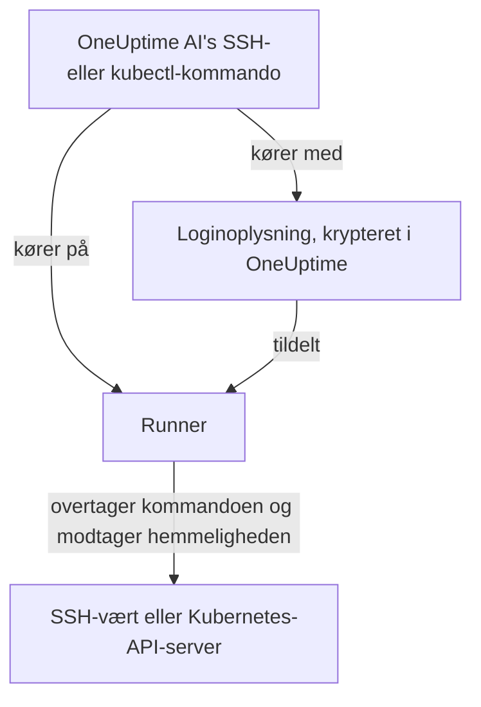

# AI-adgang

AI-adgang er den måde, OneUptime AI's egne kommandoer når noget, der **ikke** er en Runners egen vært — en server over SSH eller API-serveren i en Kubernetes-klynge, der ikke kører Kubernetes-agentens chart. Hver adgang er en loginoplysning: den adgang som et administreret objekt, krypteret i hvile, tildelt bestemte Runnere og valgt af OneUptime AI i stedet for at blive skrevet i en kommando. Runbook-trin bruger dem ikke: et SSH- eller kubectl-trin logger ind med en hemmelig [runbook-variabel](/docs/runbooks/variables). En Runner, der er ældre end denne udgivelse, er undtagelsen: den kører et Kubernetes-trin, der er flyttet fra en handling, med de loginoplysninger, trinnet nævnte, indtil trinnets script eller kubeconfig ændres.

Administrer dem under **Runbooks → Runbook-agenter → AI-adgang**.

:::cards
- [Opret en loginoplysning](#opret-en-loginoplysning): Dens adgang og de Runners, der må bruge den.
- [Mindste privilegium i den anden ende](#mindste-privilegium-i-den-anden-ende): Begræns, hvad nøglen eller tokenet kan gøre.
- [Runnere, der kører OneUptime AI's kommandoer](#runners-der-kører-oneuptime-ais-kommandoer): Hvem der må give sådan en Runner en SSH-loginoplysning.
:::

## Sådan bruges en loginoplysning

OneUptime AI kører en SSH-kommando med en af de SSH-loginoplysninger, der er tildelt den Runner, den kører på, og en kubectl-kommando til en klynge, der ikke kører Kubernetes-agentens chart, med den Kubernetes-loginoplysning, der er bundet til klyngen, som [AI SRE](/docs/ai/ai-sre) viser. Når Runneren overtager kommandoen, kontrollerer OneUptime, at loginoplysningen er tildelt den, dekrypterer hemmeligheden og udleverer den kun i svaret på den overtagelse. Hemmeligheden gemmes aldrig på jobbet og kan aldrig læses gennem API'et.

## Før du går i gang

- **En rolle, der administrerer loginoplysninger.** Project Owner og Project Admin, eller alle med tilladelsen **Create Runbook Credential**. Rollen Runbook Admin omfatter den ikke. At tildele en SSH-loginoplysning til en Runner, der kører OneUptime AI's kommandoer, kræver også **Read Runbook Credential**; se [Runners, der kører OneUptime AI's kommandoer](#runners-der-kører-oneuptime-ais-kommandoer).
- **Et abonnement, der omfatter dem.** På OneUptime Cloud kræver runbook-loginoplysninger abonnementet **Growth** eller højere.
- **En [Runner](/docs/runbooks/agents)**, der kan nå værten eller klyngens API-server over netværket.

## Opret en loginoplysning

:::steps
### Åbn AI-adgang

Åbn **Runbooks → Runbook-agenter → AI-adgang**, og klik på **Opret Credential**.

### Navngiv den, og vælg dens type

I trinnet **Credential** angiver du et **Navn**, f.eks. `prod-cluster`, en valgfri **Beskrivelse** og **Type**: **SSH** eller **Kubernetes**. Typen kan ikke ændres senere; opret i stedet en ny loginoplysning.

### Angiv adgangen

:::tabs
@tab SSH
Under **SSH-vært** angiver du **Værtsnavn**, **Port** (22, hvis feltet er tomt) og **Brugernavn**. Under **SSH-godkendelse** vælger du under **Log ind med**: en **Privat nøgle**, det bedste valg, når du har valget, og indsætter derefter **Private Key (PEM)** med dens **Private Key Passphrase**, hvis den har en; eller en **Adgangskode** til en vært uden nøgleadgang, og angiver derefter **Adgangskode**.
@tab Kubernetes
Under **Kubernetes** angiver du **API Server URL**, f.eks. `https://10.0.0.1:6443`, **Service Account Token** og **CA Certificate (PEM)**, så Runneren kan verificere API-serveren. Lad kun CA'en være tom, hvis API-serveren præsenterer et certifikat, som Runneren allerede stoler på.
:::

### Tildel den til Runners

I trinnet **Runbook-agenter** vælger du de Runners, der må bruge loginoplysningen, og klikker så på **Opret Credential**. En loginoplysning, der ikke er tildelt nogen Runner, kan ikke bruges af nogen kommando.

### Lad OneUptime AI bruge den

OneUptime AI kører sine SSH-kommandoer på en Runner med **Kører AI-afhjælpningskommandoer** slået til, med en af de SSH-loginoplysninger, der er tildelt den. En Kubernetes-loginoplysning bruges, så snart den er bundet til en klynge sammen med en af sine Runnere: se [AI SRE](/docs/ai/ai-sre).
:::

## Hvad der gemmes

| Type | Felter |
| --- | --- |
| SSH | Værtsnavn, port (22 som standard), brugernavn og enten en privat PEM-nøgle (med valgfri adgangssætning) eller en adgangskode. |
| Kubernetes | API-serverens URL, et serviceaccount-token og klyngens CA-certifikat. |

## Hemmelige værdier kan kun skrives

Private nøgler, adgangssætninger, adgangskoder og serviceaccount-tokens er krypteret i hvile, og API'et **returnerer dem aldrig**: hverken til dashboardet, til et workflow eller til en eksport. Tabellen kan vise dig, hvad en loginoplysning *er*, uden nogensinde at vise, hvad den indeholder.

Der er derfor ingen "vis" for en hemmelig værdi, kun "erstat": at indtaste en værdi igen er måden at udskifte den på. Har du mistet originalen, så udsted en ny nøgle på målsystemet, og opdater loginoplysningen.

## Tildel en loginoplysning til Runners

En loginoplysning kan kun bruges af de Runnere, du tildeler den. En kommando, der nævner en loginoplysning, som dens Runner ikke er tildelt, **fejler i stedet for at køre** — en Runner, der i stilhed ikke gør noget, ser præcis ud som en, der virkede.

Tildelingen er adgangsgrænsen, så hold den smal: en Runner, der kun nogensinde genstarter én klynge, har ikke brug for SSH-nøglen til dine databaseværter.

### Runners, der kører OneUptime AI's kommandoer

På en Runner med **Kører AI-afhjælpningskommandoer** slået til vælger OneUptime AI blandt de SSH-loginoplysninger, der er tildelt Runneren, til de kommandoer, den kører der. Derfor når en SSH-loginoplysning kun en sådan Runner gennem en person, der må læse runbook-loginoplysninger (**Read Runbook Credential**, eller en Project Owner eller Project Admin), uanset hvad der gemmes først:

- **Tildel loginoplysningen.** At oprette en SSH-loginoplysning med en sådan Runner, eller tilføje en sådan Runner til en, kræver den tilladelse. Uden den afvises gemningen og nævner Runneren: tildel loginoplysningen til Runners, der ikke kører AI-afhjælpningskommandoer, eller bed en med tilladelsen om at tildele den.
- **Slå kontakten til.** At slå **Kører AI-afhjælpningskommandoer** til for en Runner, der har SSH-loginoplysninger, kræver samme tilladelse.

At fjerne Runners fra en loginoplysning, gemme en loginoplysning med de Runners, den allerede har, og Kubernetes-loginoplysninger kræver ikke mere: OneUptime AI's kubectl-kommandoer kører med den loginoplysning, der er bundet til deres klynge. Tildelinger af loginoplysninger og aktivering af kontakten foretaget af en uden den tilladelse gemmes én ad gangen i et projekt, så de to ikke kan bestå deres kontroller sammen; en gemning, der kommer, mens en anden gemmes, venter på den, og tager det for lang tid, afvises den med *Try again in a moment*. Gem igen.

Et workflows trin handler som Project Admin, men låner ikke en Project Admins læsning af runbook-loginoplysninger: et trin har den kun, hvis den person, der sidst gemte workflowets trin, har den. Se [Hvad workflow-trin må gøre](/docs/workflows/configuration#hvad-workflow-trin-må-gøre).

## Mindste privilegium i den anden ende

OneUptime kan ikke begrænse, hvad din loginoplysning må gøre på målsystemet: det er målsystemets opgave, og det er værd at gøre:

- **SSH** — foretræk en nøgle frem for en adgangskode, giv brugeren kun de kommandoer, den har brug for (en tvungen kommando eller en begrænset shell, hvor det er praktisk), og genbrug ikke en administrators personlige nøgle.
- **Kubernetes** — bind tjenestekontoen til en Role, der kun tillader det, du lader OneUptime AI gøre, i de namespaces, den må handle i. En tjenestekonto, der kun må læse, lader OneUptime AI undersøge og afviser enhver rettelse.

## Hvem kan se dem

At oprette, redigere og slette loginoplysninger kræver tilladelserne til runbook-loginoplysninger (eller Project Owner/Admin). At læse en loginoplysning viser kun dens ikke-hemmelige felter.

Bemærk, at en Runners **agentnøgle** svarer til de loginoplysninger, der er tildelt den Runner: alt, der har nøglen, kan overtage arbejde som den Runner og modtage loginoplysninger. Derfor kan agentnøgler kun læses af Project Owners, Project Admins og Runbook Admins: behandl dem, som du ville behandle selve loginoplysningerne.

## Næste skridt

:::cards
- [Runbook-variabler](/docs/runbooks/variables): De hemmeligheder, som SSH- og kubectl-trin logger ind med.
- [Runbook-agenter](/docs/runbooks/agents): Installer den Runner, som en loginoplysning tildeles.
- [Runbook-konfiguration & sikkerhed](/docs/runbooks/configuration): Tilladelser og hærdning for hele runbook-stakken.
:::
