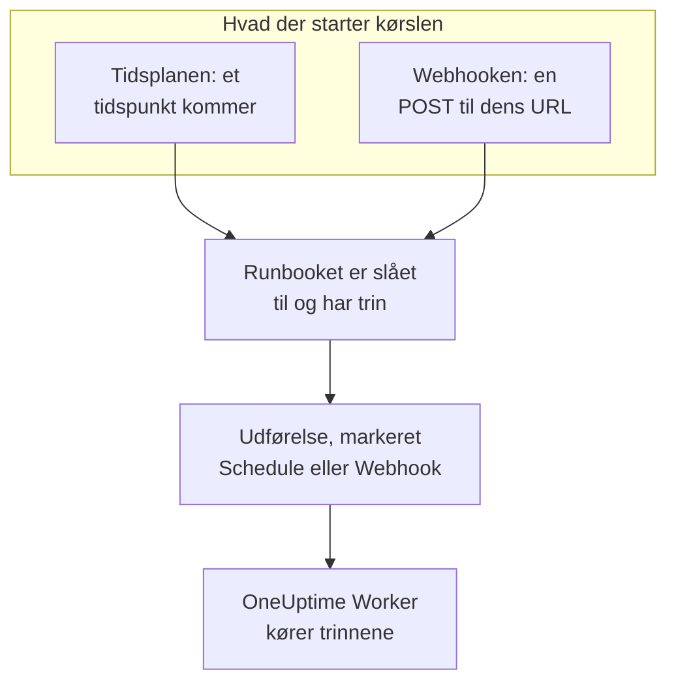

# Runbook-udløsere

Et runbook kan starte af sig selv: efter en tidsplan, eller når et andet værktøj kalder dets webhook-URL. Brug en tidsplan til rutinearbejde, som en natlig oprydning eller et ugentligt tjek af certifikater, og webhooken til at starte et runbook fra et alarmsystem, en CI-pipeline eller et script. Begge sættes op på runbookets side **Udløsere**.

:::cards
- [Kør efter en tidsplan](#kør-efter-en-tidsplan): Med få minutters mellemrum, hver dag, på bestemte ugedage eller med et cron-udtryk.
- [Kald webhooken](#kald-webhooken): Start en kørsel med en POST-anmodning til runbookets URL.
- [Værdier, et webhook-kald sender](#værdier-et-webhook-kald-sender): Hvordan trinnene læser den JSON, en kalder sender.
- [Fejlfinding](#fejlfinding): En tidsplan, der ikke kører, et kald, der afvises.
:::

## Sådan starter en udløser en kørsel



En udløser starter en kørsel, som **Kør nu** gør: kørslen gennemgår runbookets nuværende trin og er ikke knyttet til nogen hændelse, nogen advarsel eller noget planlagt vedligeholdelsesarrangement. Hver kørsel registrerer, hvad der startede den. Runbookets **Udførelser** og **Runbooks → Udførelser** viser det under **Udløst af**, med hvornår en planlagt kørsel skulle ske, eller den adresse, der kaldte webhooken, og begge lister kan filtreres efter det.

## Før du begynder

- Et runbook med mindst ét trin, hvis kontakt **Kør dette runbook** er slået til på dets side **Indstillinger**.
- Tilladelse til at redigere runbooket og til at køre det. Se [Hvem må sætte udløsere op](#hvem-må-sætte-udløsere-op).

## Kør efter en tidsplan

:::steps
### Åbn runbookets side Udløsere
Åbn runbooket fra **Runbooks**, og klik på **Indstillinger → Udløsere** i dets sidemenu. **Indstillinger** starter sammenklappet: klik på den for at vise **Udløsere**.

### Sæt tidsplanen op
Klik på **Opret tidsplan**. Under **Hvornår den kører** vælger du en mulighed under **Gentag** og det, den kræver. Dialogen siger tidsplanen i én sætning, som "Kører hver hverdag kl. 09:00", og viser de næste kørsler, mens du ændrer den.

### Tjek tidszonen
**Tidszone** starter med din egen. Tidsplanens tidspunkter læses på denne zones ur.

### Gem den
Klik på **Gem tidsplan**. Tidsplanen slås til, og kortet viser den i én sætning med dens **Næste kørsler**.
:::

| **Gentag** | Hvad du vælger | For eksempel |
| --- | --- | --- |
| **Med få minutters mellemrum** | **Hver**: 1, 2, 3, 4, 5, 6, 10, 12, 15, 20 eller 30 minutter | Hvert 15. minut |
| **Med få timers mellemrum** | **Hver**: 1, 2, 3, 4, 6, 8 eller 12 timer, og **Minutter over hel time** | Hver 2. time kl. :30 |
| **Hver dag** | **Klokkeslæt** | Hver dag kl. 09:00 |
| **På bestemte ugedage** | **På disse dage**, med **Hverdage** og **Hver dag** som genveje, og **Klokkeslæt** | Hver hverdag kl. 09:00 |
| **Brugerdefineret (cron-udtryk)** | **Cron-udtryk** | `0 2 1 * *`: kl. 02:00 den 1. i hver måned |

Et cron-udtryk har fem felter: minut, time, dag i måneden, måned og ugedag. Runbooks kører højst én gang i minuttet, så der er intet sekundfelt. Dialogen forklarer et udtryk, den ikke kan læse, eller et, der aldrig kører, som `0 0 31 2 *`, og gemmer intet, før det kan køre.

Kortet viser derefter tidsplanen, de næste tre kørsler efter zonens ur, hvad den gør, når en kørsel stadig er i gang, eller et tidspunkt blev misset, og **Seneste planlagte kørsel** med **Se kørsel**. **Rediger tidsplan** åbner den samme dialog, og kontakten **Kør efter denne tidsplan** sætter tidsplanen på pause uden at miste den.

### Hvis en kørsel stadig er i gang

En kørsel er stadig i gang, så længe den står i kø, kører eller venter på, at nogen fuldfører eller godkender et trin, uanset hvordan den blev startet. Tidsplanens indstilling **Hvis en kørsel stadig er i gang**, foldet sammen under **Flere felter** i dialogen, afgør, hvad et tidspunkt, der kommer imens, gør:

| Indstilling | Hvad der sker |
| --- | --- |
| **Spring det tidspunkt over** (standard) | Intet starter. Tidsplanen venter på sit næste tidspunkt. |
| **Kør, når den slutter** | Én kørsel venter og starter, når den igangværende kørsel slutter. Flere tidspunkter, der kommer imens, starter intet. |

### Hvis OneUptime missede et tidspunkt

Hvis OneUptime var nede eller ved at blive opgraderet på et planlagt tidspunkt, er tidspunktet misset, så snart det er mere end 5 minutter forsinket. **Hvis OneUptime missede et tidspunkt** afgør, hvad der sker, når OneUptime er tilbage:

| Indstilling | Hvad der sker |
| --- | --- |
| **Kør én gang, når OneUptime er tilbage** (standard) | Én kørsel starter, uanset hvor mange tidspunkter der blev misset, markeret "Kørt én gang for at indhente tidspunkter, OneUptime missede". |
| **Spring de missede tidspunkter over** | Intet starter før det næste tidspunkt. |

Tidspunkter, der går, mens tidsplanen eller runbooket er slået fra, er ikke missede: slår du en af dem til igen, fortsætter den fra det næste tidspunkt.

### Tidszoner og sommertid

Tidspunkterne læses hele året på zonens ur. En tidsplan til kl. 09:00 i Europe/London kører kl. 09:00 London-tid om vinteren og om sommeren. Den nat, hvor urene stilles frem, kører et tidspunkt, der ikke findes den nat, en time senere på uret. Når urene stilles tilbage, og en time kommer to gange, kører en tidsplan, der kører hver time, i begge, og enhver anden tidsplan kører én gang, i den første.

## Kald webhooken

:::steps
### Slå webhooken til
Slå **Kør, når denne URL kaldes** til på runbookets side **Udløsere**. Runbooket får sin egen URL.

### Kopiér URL'en
**Webhook-URL** er maskeret: klik på **Vis** for at se den, eller på **Kopiér URL** for at kopiere hele den. **Prøv det** har en `curl`-kommando at starte fra.

### Kald den fra dit værktøj
Send en `POST`-anmodning til URL'en med et JSON-objekt som brødtekst, eller uden brødtekst:

```bash
curl -X POST "https://oneuptime.com/runbook/webhook/RUNBOOK_ID/SECRET_KEY" \
  -H "Content-Type: application/json" \
  -d '{"host": "web-1", "reason": "Disk almost full"}'
```

### Tjek kørslen
Svaret navngiver den kørsel, det startede: `{"runbookExecutionId": "...", "status": "Scheduled"}`. Kørslen står under runbookets **Udførelser**, hvor **Udløst af** siger **Webhook**, og dens side viser under **Input**, hvad kaldet sendte.
:::

**Send testanmodning** sender en `POST` med en brødtekst, du skriver, til URL'en, som et andet værktøj ville, og linker til den kørsel, den startede. Det er en rigtig kørsel af runbooket.

### Hvad et kald får som svar

| Svar | Hvornår |
| --- | --- |
| `200` | Kørslen blev startet. Brødteksten navngiver den. |
| `400` | Brødteksten er ikke et JSON-objekt, er indlejret i mere end 32 niveauer eller indeholder et NUL-tegn, eller runbooket har ingen trin. |
| `403` | Webhooken eller runbooket er slået fra. |
| `404` | Ingen runbook-webhook svarer på denne URL: runbook-ID'et eller nøglen er forkert, eller URL'en blev nulstillet. |
| `405` | Anmodningen er en `GET`. En `GET` starter aldrig en kørsel, så en linkforhåndsvisning i en chatapp kan ikke køre den ved et uheld. |
| `413` | Brødteksten er større end 64 KB. |
| `429` | Webhooken startede 30 kørsler i det seneste minut, 10 af dens kørsler er stadig i gang, eller én adresse foretog mere end 120 kald til runbook-webhooks på et minut, eller adresserne i ét IPv6-/64 foretog mere end 1200 sammen. Headeren `Retry-After` siger, hvornår du kan prøve igen, hvor det er muligt. |
| `503` | OneUptime kan ikke tælle kald lige nu. Prøv igen om et minut. |

Et afvist kald starter intet, og dets brødtekst siger hvorfor i én sætning, som "This runbook is turned off, so it was not started. Turn it on with Run this runbook, under the runbook's Settings."

### Hold URL'en hemmelig

URL'en indeholder runbookets hemmelige nøgle: alle, der har den, kan starte runbooket. Nøglen er 43 tilfældige tegn, den sammenlignes i konstant tid, og en forkert nøgle får samme svar, som hvis der ikke fandtes et sådant runbook.

Hvis URL'en slipper ud, så klik på **Nulstil URL**. Runbooket får en ny URL, og den gamle holder straks op med at virke, så giv den nye til hvert værktøj, der kalder den. Slår du webhooken fra og til igen, beholder den samme URL.

## Værdier, et webhook-kald sender

Brødtekstens værdier på øverste niveau bliver kørslens input. De når trinnene som data, aldrig som tekst indsat i et script eller en kommando:

| Trintype | Hvordan den læser input |
| --- | --- |
| Bash og kubectl | Miljøvariabler: én `ONEUPTIME_INPUT_<NAME>` for hver værdi på øverste niveau, `ONEUPTIME_INPUTS` med hele objektet som JSON og `ONEUPTIME_TRIGGER` med det, der startede kørslen, som `Webhook` eller `Schedule`. |
| JavaScript | `args.inputs`, objektet som sendt, og `args.trigger`. |
| AI | I sin prompt, markeret som data udefra OneUptime, når **Medtag udløserkontekst** er slået til. |
| HTTP request og SSH | Slet ikke. Deres URL, script og mål er det, runbooket siger, og intet, en kalder sender, ændrer dem. |

En variabels navn er værdiens navn med store bogstaver, hvor hvert tegn, der ikke er et bogstav eller et ciffer, skrives som `_`: `host-name` bliver til `ONEUPTIME_INPUT_HOST_NAME`. Tekst sendes, som den er, tal og `true` eller `false` som skrevet, og objekter og lister som JSON. Et trin får højst 100 af disse variabler, og et navn på mere end 100 tegn bliver til ingen; hver værdi står stadig i `ONEUPTIME_INPUTS`. Hvert navn begynder med `ONEUPTIME_`, så en kalder ikke kan sætte `PATH` eller nogen anden variabel, som Runneren læser.

En kalder bestemmer disse værdier, så tjek dem, før du handler på dem:

```bash
set -euo pipefail
case "$ONEUPTIME_INPUT_HOST" in
  web-1|web-2|web-3) ;;
  *) echo "Unknown host: $ONEUPTIME_INPUT_HOST"; exit 1 ;;
esac
curl -fsS -X POST "http://$ONEUPTIME_INPUT_HOST.internal:8080/restart"
```

```javascript
const host = args.inputs.host;
if (!["web-1", "web-2", "web-3"].includes(host)) {
  throw new Error(`Unknown host: ${host}`);
}
console.log(`Started by ${args.trigger} for ${host}`);
return { host };
```

## Hvem må sætte udløsere op

En tidsplan eller en webhook starter kørsler, uden at nogen er til stede, så det kræver tilladelse til at redigere runbooket og til at køre det at sætte en op: Project Owner, Project Admin eller Runbook Admin, eller **Edit Runbook** sammen med Project Member, Runbook Member eller **Create Runbook Execution**. De etiketter, en rolle er begrænset til, tæller med, som de gør for **Kør nu**. At se eller nulstille webhook-URL'en kræver det samme.

At slå en tidsplan eller en webhook fra starter intet, så det kræver kun tilladelse til at redigere runbooket. Den, der må redigere runbooket, men ikke køre det, ser siden **Udløsere** med **Opret tidsplan** låst og får at vide, hvem der kan se webhook-URL'en.

## Fejlfinding

:::details Intet kører efter tidsplanen
Runbooket er slået fra eller har ingen trin: kortet siger hvilket. Slå **Kør dette runbook** til på runbookets side **Indstillinger**, eller tilføj trin på dets side **Trin**. Hvis kortet siger, at tidsplanen er sat på pause, så slå **Kør efter denne tidsplan** til.
:::

:::details Et planlagt tidspunkt startede intet
En kørsel var stadig i gang, og tidsplanen springer sådanne tidspunkter over, eller OneUptime missede tidspunktet, og tidsplanen springer missede tidspunkter over. Se [Hvis en kørsel stadig er i gang](#hvis-en-kørsel-stadig-er-i-gang) og [Hvis OneUptime missede et tidspunkt](#hvis-oneuptime-missede-et-tidspunkt).
:::

:::details At gemme en tidsplan fejler med "You do not have permission to set up this runbook's schedule or webhook."
At sætte en udløser op kræver tilladelse til at køre runbooket såvel som til at redigere det. Bed om Runbook Admin, eller om Runbook Member eller **Create Runbook Execution** ud over **Edit Runbook**.
:::

:::details Et kald får svaret "No runbook webhook answers at this URL."
URL'en blev nulstillet eller kopieret forkert. Kopiér den igen fra runbookets side **Udløsere**.
:::

:::details Et kald får svaret "This runbook's webhook is turned off, so the runbook was not started."
Slå **Kør, når denne URL kaldes** til på runbookets side **Udløsere**. URL'en er den samme som før.
:::

## Næste trin

:::cards
- [Kør et runbook](/docs/runbooks/running): Hvad en kørsel viser, og hvordan du får den videre.
- [Skriv et runbook](/docs/runbooks/authoring): Skriv de trin, en udløser kører.
- [Runbook-konfiguration & sikkerhed](/docs/runbooks/configuration): Grænser, tilladelser og hærdning.
:::
