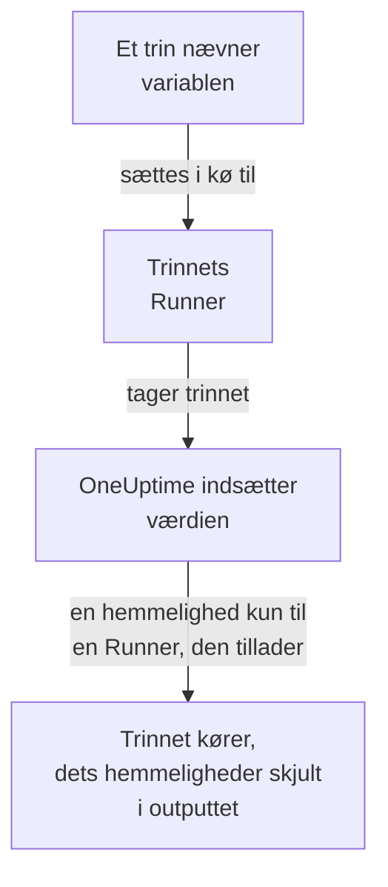

# Runbook-variabler

En runbook-variabel er en værdi, som dine trin bruger ved navn i stedet for selv at indeholde den: en vært, et namespace eller en URL, eller en hemmelighed som en SSH-nøgle, en adgangskode, en kubeconfig eller et API-token. Skift værdien én gang, og hvert trin, der nævner den, bruger den nye næste gang det kører. En hemmelighed er krypteret, vises aldrig igen og skjules i det, trin udskriver.

:::cards
- [Opret en variabel](#opret-en-variabel): En almindelig værdi, eller en hemmelighed og de Runnere, der må bruge den.
- [Brug en variabel i et trin](#brug-en-variabel-i-et-trin): I et script eller en HTTP-anmodning, eller som et SSH-trins login og et kubectl-trins kubeconfig.
- [Hvem modtager en hemmelighed](#hvem-modtager-en-hemmelighed): Dine Runnere, globale Runnere, når du giver dem lov, og OneUptime for et HTTP-anmodningstrin.
:::

## Sådan når en variabel et trin



Et trin indeholder variablens navn, aldrig dens værdi. Når trinnets Runner tager det, indsætter OneUptime værdien - i scriptet, i et SSH-trins maskine og login eller i et kubectl-trins kubeconfig - og udleverer den kun til den Runner. Et trin, der nævner en variabel, det ikke må have, fejler med årsagen i stedet for at køre med navnet, hvor værdien skulle stå.

Bash-, JavaScript-, SSH-, kubectl- og HTTP-anmodningstrin bruger variabler. AI-trin indsætter dem ikke. Et HTTP-anmodningstrin sender OneUptime selv, uden en Runner, så trinnet får hver variabel, det nævner, også hemmeligheder, og skjuler dem i det svar, det registrerer.

## Globale variabler og runbook-variabler

| | Globale variabler | Et runbooks egne variabler |
| --- | --- | --- |
| Administreres under | **Runbooks → Indstillinger → Globale variabler** | Runbookets **Indstillinger → Variabler** |
| Bruges af | Hvert runbook i projektet | Kun det runbooks trin |
| Skrives i et trin som | `{{global.variables.NAME}}` | `{{local.variables.NAME}}` |

Et navn bruges én gang, uanset store og små bogstaver, blandt projektets globale variabler, og én gang blandt et runbooks egne. Et runbooks variabel må dele navn med en global: hver skrives på sin egen måde.

## Før du begynder

- **En rolle, der administrerer variabler.** Project Owner og Project Admin eller tilladelsen **Create Runbook Variable**. Runbook Admin læser variabler for at vælge dem i de trin, den skriver, men ændrer dem ikke.
- **Et abonnement, der omfatter dem.** På OneUptime Cloud kræver runbook-variabler abonnementet **Growth** eller højere.

## Opret en variabel

:::steps
### Åbn variablerne

Åbn **Runbooks → Indstillinger → Globale variabler** eller et runbooks **Indstillinger → Variabler**, og klik på **Opret Variabel**.

### Navngiv den og indtast dens værdi

Indtast et **Navn** i trinnet **Variabel**: bogstaver, tal, bindestreger og understregninger, op til 100 tegn, f.eks. `PROD_DB_SSH_KEY`. **Hemmelighed** er slået til fra starten: indsæt nøglen, adgangskoden, tokenet eller kubeconfig'en i **Værdi af hemmelighed**, og klik på **Næste**. For en værdi, som alle må læse, f.eks. en vært, slår du **Hemmelighed** fra, indtaster den i **Værdi** og klikker på **Opret Variabel**. En valgfri **Beskrivelse** venter under **Flere felter**.

### Vælg, hvem der må bruge en hemmelighed

Vælg dine Runnere under **Dine Runnere, der må bruge den** i trinnet **Hvem må bruge den**. På en server med [globale Runnere](/docs/runbooks/agents#globale-runnere) lader **Globale Runnere må bruge den** også dette projekts trin, der kører på en global Runner, bruge hemmeligheden: den er slået til fra starten, mens projektet bruger globale Runnere. En hemmelighed skal have det ene eller det andet. Klik på **Opret Variabel**.
:::

Om en variabel er en hemmelighed, kan ikke ændres senere. Slet den i stedet, og opret den igen med samme navn: trin nævner variabler ved navn, så de bliver ved med at virke. En klynges Runner i klyngen, den som Kubernetes-agentens chart installerer, får aldrig en hemmelighed.

## Hemmelige værdier kan kun skrives

En hemmeligheds værdi er krypteret i hvile, og API'et **returnerer den aldrig**: hverken til dashboardet, til et workflow eller til en eksport. Listen viser **Hemmelighed**, hvor en almindelig variabel viser sin værdi, og dens kolonne **Runbook-agenter** viser, hvilke Runnere der får hver hemmelighed. For at ændre den skal du klikke på **Erstat værdi** i dens række: den nye værdi krypteres, den gamle er væk for altid, og trin får den nye næste gang de kører.

Når et trin udskriver en hemmelighed, det har fået, erstatter Runneren den med `[REDACTED]`, før outputtet forlader dens vært, og OneUptime gør det igen, før det gemmer outputtet. En linje af en privat nøgle eller tokenet i en kubeconfig skjules også. Der søges ikke efter en hemmelighed på under 4 tegn.

## Brug en variabel i et trin

:::tabs
@tab I et script
Skriv referencen, hvor værdien skal stå, i et Bash-, JavaScript-, SSH- eller kubectl-script:

```bash
curl -s -X POST \
  -H "Authorization: Bearer {{global.variables.CDN_API_TOKEN}}" \
  "https://api.cdn.example.com/v1/purge"
```
@tab I en HTTP-anmodning
Skriv referencen i URL'en, headerne eller body'en på et [HTTP-anmodningstrin](/docs/runbooks/authoring#http-request):

```json
{ "Authorization": "Bearer {{global.variables.API_TOKEN}}" }
```
@tab SSH-login
Et [SSH-trin](/docs/runbooks/authoring#ssh) vælger under **Log ind med** den hemmelige variabel, der indeholder dets private nøgle eller adgangskode, og under **Flere felter → Nøglens adgangsfrase** dets nøgles adgangsfrase. Værdien viser, om det er en nøgle eller en adgangskode.
@tab Kubeconfig
Et [kubectl-trin](/docs/runbooks/authoring#kubectl) vælger under **Kubeconfig** den hemmelige variabel, der indeholder klyngens kubeconfig, eller **Runnerens egen adgang** for at bruge Runnerens.
:::

På et runbooks side **Trin** viser hvert script og hver HTTP-anmodning under **Variabler – klik for at kopiere** de variabler, deres trin kan bruge, og editoren siger til, når et trin nævner en variabel, der ikke findes, eller en hemmelighed, som dets Runner ikke må bruge.

## Hvem modtager en hemmelighed

| Hvem der kører trinnet | En almindelig variabel | En hemmelighed |
| --- | --- | --- |
| En af dine Runnere | Altid | Når hemmeligheden viser den under **Dine Runnere, der må bruge den** |
| En global Runner | Altid | Når **Globale Runnere må bruge den** er slået til, for et trin i hemmelighedens eget projekt |
| OneUptime selv, for et HTTP-anmodningstrin | Altid | Altid |

Et trin, der nævner en hemmelighed, som dets Runner ikke må bruge, fejler med hemmelighedens navn og det, der skal ændres, og intet udleveres.

## Runbook-hemmeligheder og loginoplysninger blev til variabler

Runbook-variabler har taget pladsen for runbook-hemmeligheder og for de loginoplysninger, som SSH- og Kubernetes-trin nævnte. Da OneUptime blev opgraderet, blev det, hvert projekt havde, flyttet én gang, så hvert runbook kører, som det gjorde:

- hver runbook-hemmelighed blev en hemmelig global variabel med samme navn, samme værdi, samme Runnere og samme kontakt for globale Runnere;
- `{{runbookSecrets.NAME}}` i et script blev omskrevet til `{{global.variables.NAME}}`, og den gamle stavemåde læser stadig den globale variabel `NAME`;
- alle loginoplysninger, som et trin nævnte, blev til hemmelige globale variabler med samme Runnere, opkaldt efter dem: `<name>-ssh-key` (og `<name>-ssh-key-passphrase` for en nøgle, der havde en), `<name>-ssh-password` eller `<name>-kubeconfig`;
- hvert SSH-trin, der nævnte loginoplysninger, logger ind på sin maskine med dem og kører sin kommando som sit script, og hvert Kubernetes-trin blev et kubectl-trin, der kører den `kubectl patch`, som dets handling lavede, uden at kræve mere adgang, end trinnet havde.

En Runner, der er ældre end denne udgivelse (14.0.79), kan ikke køre et kubectl-script: den får et kubectl-trin til at fejle og siger, at Runneren skal opdateres. Hvert Kubernetes-trin, der blev flyttet på denne måde, beholdt først sine loginoplysninger og sin handling ved siden af sit script til sådan en Runner; de forsvandt med runbook-loginoplysningerne, så hvert kubectl-trin kræver en Runner fra 14.0.79 eller nyere.

Runbook-loginoplysninger er siden fjernet, og et trin, der stadig nævnte loginoplysninger, blev først flyttet på samme måde. Et trin, der nævner loginoplysninger, kører ikke længere, og dets side med trin tilbyder **Lav om til et script-trin**; en gemning via API'et eller Terraform, der giver et trin loginoplysninger, afvises. Se [Runbook-loginoplysninger er fjernet](/docs/installation/upgrading#runbook-loginoplysninger-er-fjernet).

## Næste trin

:::cards
- [Skriv et runbook](/docs/runbooks/authoring): Skriv de SSH- og kubectl-trin, der bruger en variabel.
- [Runbook-agenter](/docs/runbooks/agents): Installer den Runner, som en hemmelighed udleveres til.
- [Runbook-konfiguration og sikkerhed](/docs/runbooks/configuration): Tilladelser og hærdning af hele runbook-stakken.
:::
