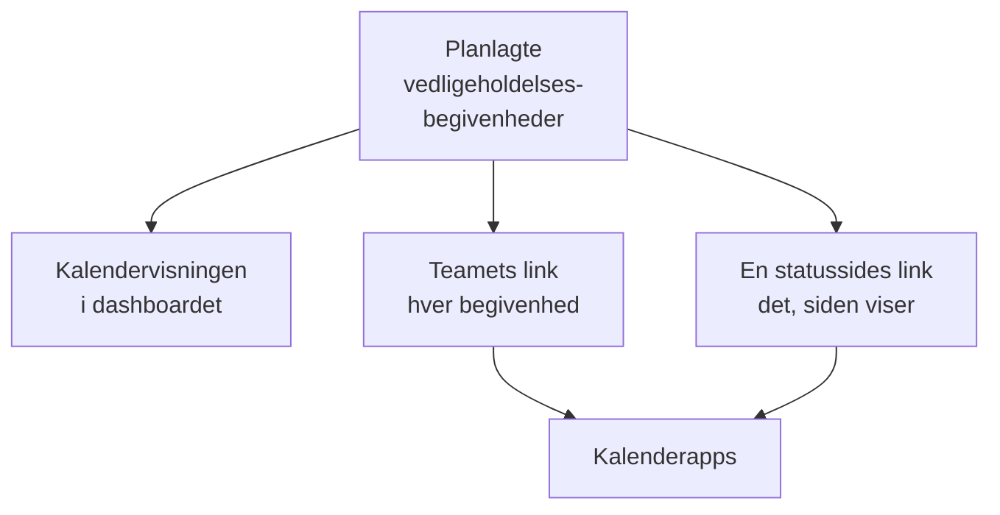

# Vedligeholdelseskalender

Vedligeholdelseskalenderen viser din planlagte vedligeholdelse efter dato: på sin egen side i dashboardet, i dit teams egne kalenderapps via et hemmeligt link og i kalenderne hos de mennesker, der følger dine statussider. På dens side kan kalendere uden for projektet, som helligdage eller et ændringsstop, vises ved siden af dine begivenheder. Denne side forklarer kalendersiden, eksterne kalendere, teamets kalenderlink, en statussides kalender, og hvad hver kalenderbegivenhed indeholder.

:::cards
- [Kalendersiden](#kalendersiden): Hver begivenhed på en måned, en uge eller en dag, i farven på dens tilstand.
- [Eksterne kalendere](#eksterne-kalendere): Helligdage, ændringsstop eller et andet teams vedligeholdelse, ved siden af dine begivenheder.
- [Teamets kalenderlink](#teamets-kalenderlink): Hver begivenhed i projektet i Google Kalender, Outlook eller Apple Kalender.
- [En statussides kalender](#en-statussides-kalender): Det, en statusside viser, i kalenderne hos dens besøgende.
- [Hvad en kalenderbegivenhed indeholder](#hvad-en-kalenderbegivenhed-indeholder): Titlen, tidsrummet, tilstanden og et link tilbage.
:::



## Kalendersiden

Åbn **Planlagt vedligeholdelse → Vedligeholdelseskalender** i sektionen **Kalender** i sidemenuen. **Alle begivenheder** viser de samme begivenheder som en liste.

- Kalenderen åbner på denne måned, med dagen i dag markeret. **Måned**, **Uge** og **Dag** ændrer, hvor meget den viser; flyt med pilene, og vend tilbage med **I dag**. Tidspunkterne står i din egen tidszone.
- Hver begivenhed er en blok i farven på dens tilstand, og tilstandenes farver er navngivet under kalenderen. Klik på en begivenhed for at åbne den.
- Filtrene over kalenderen virker som på listen: vælg en tilstand, en etiket eller en ejer for kun at se de begivenheder.
- En dag, der endnu ikke er kommet, viser et **+**, når du peger på dens uge. Det åbner **Opret planlagt vedligeholdelseshændelse** med **Begynder den** på den dag, i den time, formularen ville vælge i dag. Du ser det kun, hvis du må oprette begivenheder.
- En visning viser op til 500 begivenheder. En travlere måned siger det: indsnævr den med filtrene, eller se på en uge.

**Alle begivenheder** skiftede tidligere mellem en liste og en kalender. Hvis din browser sidst lod den stå på kalenderen, åbner **Alle begivenheder** én gang **Vedligeholdelseskalender** og er derefter listen.

## Eksterne kalendere

Kalendersiden kan også vise begivenhederne fra kalendere uden for projektet: helligdage, et ændringsstop, som din virksomhed fører i en anden kalender, eller et andet teams vedligeholdelse. OneUptime læser hver af dem fra dens iCalendar-link (`.ics`) og tegner dens begivenheder ved siden af dine, lysere og i kalenderens egen farve. De er skrivebeskyttede: de bliver aldrig til vedligeholdelsesbegivenheder, ingen får besked om dem, og de vises aldrig i projektets egne kalenderlinks.

:::steps
### Tilføj kalenderen

Vælg **Tilføj ekstern kalender** i kalenderens **⋯**-menu, eller åbn **Planlagt vedligeholdelse → Kalenderindstillinger** i sektionen **Indstillinger** i sidemenuen, og klik på **Tilføj ekstern kalender**. Udfyld **Navn**, og indsæt linket i **Kalenderlink**. **Flere felter** rummer dens **Farve** og **Opdater**, hvor ofte den læses: **Hver time**, medmindre du vælger andet.

### Tjek, at den blev læst

OneUptime læser en ny kalender med det samme. Dens **Status** siger **Virker**, når den er læst, og **Senest læst** siger hvornår, og hvor mange begivenheder den har gemt. En læsning, der mislykkedes, siger **Virker ikke** med årsagen, og hvad du skal gøre.

### Vis eller skjul den

Hver ekstern kalender har en kontakt med sit navn under kalenderen. Skjuler du en, skjules den kun for dig; din browser husker valget for projektet.
:::

Kopiér linket fra kalenderens egne delingsindstillinger: i Google Kalender dens hemmelige adresse i iCal-format, i Outlook ICS-linket til en publiceret kalender, i enhver anden app dens `.ics`- eller `webcal://`-link. Linket må være privat: OneUptime gemmer det krypteret, viser det aldrig igen, og **Skift link** erstatter det.

| Handling | Hvad der sker |
| --- | --- |
| **Læs nu** | Læser kalenderen nu i stedet for ved næste læsning. |
| **Skift link** | Erstatter dens link. Begivenhederne fra det gamle link glemmes, og det nye læses med det samme. |
| **Slå fra** | Holder op med at læse den og skjuler dens begivenheder for alle, indtil **Slå til**. |

Hver kalender gemmer sine begivenheder fra 90 dage tilbage til et år frem, op til 2.000 af dem, de nærmeste i dag først. En kalender større end 5 MB læses ikke. Gentagne begivenheder, deres undtagelser og deres tidszoner læses, som kalenderappen skrev dem, og en heldagsbegivenhed bliver på sin dato i alle tidszoner. Et projekt kan have op til 20 eksterne kalendere, og én visning af kalenderen tegner op til 500 af deres begivenheder.

De roller, der opretter, redigerer og sletter planlagte vedligeholdelsesbegivenheder, tilføjer, ændrer og fjerner eksterne kalendere, og alle, der kan læse begivenhederne, ser dem i kalenderen. OneUptime læser aldrig en adresse på sin egen server eller en cloud-metadataadresse, og OneUptime Cloud afviser adresser på et privat netværk. En selvhostet server kan læse en kalender på dit eget netværk, medmindre `DATA_SOURCE_BLOCK_PRIVATE_ADDRESSES` er `true`.

## Teamets kalenderlink

**Abonner på kalender**, under kalenderen, åbner projektets kalenderlink: ét hemmeligt iCalendar-link (`.ics`), der lægger hver planlagt vedligeholdelsesbegivenhed i projektet ind i Google Kalender, Outlook, Apple Kalender eller enhver app, der abonnerer på en kalender via en URL.

:::steps
### Udgiv linket

Klik på **Udgiv link**. Et projekt har ét link til hele teamet, så det er kun nødvendigt én gang.

### Føj det til din kalenderapp

**Google Kalender** åbner Google Kalender, som spørger, om kalenderen skal tilføjes. **Apple Kalender / Outlook** åbner linket i kalenderappen på din computer eller telefon. **Kopiér link** kopierer det til enhver anden app.

### Tjek, at det virker

Panelet **Status** fortæller, hvornår en kalenderapp sidst læste linket, og hvilken. Et nyt link viser **Venter på første synkronisering**, indtil en app læser det.
:::

Linket ser sådan ud:

```text
https://<your host>/api/scheduled-maintenance-calendar/project/<token>/maintenance.ics
```

> [!WARNING]
> Alle med linket ser hver planlagt vedligeholdelsesbegivenhed i projektet uden at logge ind. Behandl det som en adgangskode, og generér det igen, hvis det deles ved en fejl.

### Hvem kan se linket

Linket viser hver begivenhed i projektet, så dialogen viser det kun til personer, der kan læse hver begivenhed. Den, hvis rolle begrænser vedkommende til nogle begivenheder, efter etiket eller til de begivenheder, vedkommende ejer, får i stedet at vide hvorfor.

| Handling | Hvem kan gøre det |
| --- | --- |
| Kopiere linket | Alle, der kan læse hver planlagt vedligeholdelsesbegivenhed i projektet |
| **Udgiv link** | Alle, der også kan oprette planlagte vedligeholdelsesbegivenheder |
| **Generér link igen**, **Deaktivér link** | Alle, der også kan redigere planlagte vedligeholdelsesbegivenheder |

### Administrer linket

**Generér link igen** og **Deaktivér link** ligger i menuen **⋯** øverst i dialogen.

| Handling | Hvad der sker |
| --- | --- |
| **Generér link igen** | Laver et nyt link. I 30 dage leverer det gamle en tom kalender, så de apps, der har det, rydder deres kopi; derefter findes det ikke. Abonner igen med det nye link. |
| **Deaktivér link** | Beholder linket, men det leverer en tom kalender indtil **Aktivér link**. |

Kalenderen indeholder hver begivenhed fra 90 dage tilbage til et år frem, op til 1.000 begivenheder.

## En statussides kalender

De mennesker, der følger en statusside, kan lægge dens planlagte vedligeholdelse ind i deres egen kalender. På statussidens side med planlagte begivenheder tilbyder **Abonner på kalender** Google Kalender, kalenderappen på deres enhed eller linket til at kopiere. Linket er sidens adresse efterfulgt af `/maintenance.ics`, for eksempel `https://status.example.com/maintenance.ics`.

- **Hvad den indeholder.** Præcis det, siden viser: begivenhederne i sidens historikvindue, hver begivenhed, der endnu ikke er begyndt, og hver, der er i gang, så længe **Synlig på statussiden** er slået til, og fra dens **Offentliggør den**, hvis du har valgt et. Det, hver begivenhed berører, nævnes, som siden navngiver sine ressourcer, aldrig med dine monitorers egne navne.
- **En privat side.** En kalenderapp kan ikke logge ind, så en privat side tilbyder ingen **Abonner på kalender**, og dens link leverer en tom kalender, der siger, at siden er privat.
- **Én begivenhed.** **Føj til kalender** på en begivenheds side tilføjer kun den begivenhed: Google Kalender åbner med den udfyldt, eller den hentes som en fil, som enhedens kalenderapp åbner. Det virker også på en privat side for en besøgende, der er logget ind, og tilbydes ikke, når begivenheden er slut.

## Hvad en kalenderbegivenhed indeholder

Hver kalender, teamets og en statussides, skriver en begivenhed på samme måde.

| Del | Hvad den indeholder |
| --- | --- |
| Titel | Begivenhedens titel |
| Start og slut | Dens planlagte tidsrum i UTC; kalenderappen viser det i din egen tidszone |
| Beskrivelse | Dens beskrivelse som ren tekst, dens tilstand, hvad den berører, og et link til begivenheden; teamets link nævner også dens statussider |
| Status | Aflyst, når begivenheden blev aflyst: afsluttet uden nogensinde at have været i gang |
| Ledig eller optaget | Ledig, så et vedligeholdelsesvindue aldrig blokerer din tilgængelighed |
| Kategorier | Dens etiketter; en statussides kalender viser dem kun, når siden viser etiketter |

En begivenhed, der redigeres i OneUptime, opdateres på stedet i hver kalender, der har den, og en, der slettes eller tages af en statusside, forsvinder fra kalenderen ved næste opdatering.

## Hvor ofte kalendere opdateres

Kalenderapps læser et abonneret link efter deres egen tidsplan. Google Kalender gør det med nogle timers mellemrum, nogle gange kun én gang om dagen; Apple Kalender og Outlook som regel hver time. OneUptime gemmer en kalender i højst fem minutter, så den ventetid, du ser, er kalenderappens. Trinnene for hver app står på [Kalenderfeeds](/docs/on-call/calendar-feeds#abonnér-i-din-kalenderapp), som fungerer på samme måde for vagter.

## Fejlfinding

:::details Kalenderappen viser ikke længere nye begivenheder
Linket er genereret igen eller deaktiveret: åbn **Abonner på kalender** for at se dets status. Et link, der er genereret igen, skal abonneres på igen med det nye link; et deaktiveret link kommer tilbage med **Aktivér link**.
:::

:::details Google Kalender kan ikke tilføje linket
Google Kalender læser linket fra Googles servere, så OneUptime-serveren skal kunne nås fra internettet. Se [Kalenderfeeds](/docs/on-call/calendar-feeds#fejlfinding) for en selvhostet server.
:::

:::details En begivenhed mangler i en statussides kalender
Sidens kalender indeholder det, siden viser. Tjek, at begivenheden nævner siden, at **Synlig på statussiden** er slået til i dens **Indstillinger**, at dens **Offentliggør den**, hvis den har et, er nået, og at den begyndte inden for sidens historikvindue.
:::

:::details En ekstern kalender siger Virker ikke
Årsagen står under **Virker ikke** i dens **Status**: ingen kalender på linket, et link, der kræver login eller ikke længere deles, en fejl fra dens server, en kalender større end 5 MB, eller en, der gentager begivenheder for ofte til at kunne behandles. Ret linket med **Skift link**, eller brug **Læs nu**, når kalenderen er tilbage. Indtil da viser kalenderen begivenhederne fra sin seneste vellykkede læsning.
:::

## Næste trin

:::cards
- [Opret vedligeholdelsesbegivenheder](/docs/scheduled-maintenance/creating-events): Formularen, felt for felt, og hvad der sker bagefter.
- [Abonnenter og meddelelser](/docs/status-pages/subscribers#planlagte-vedligeholdelsesbegivenheder): Hvad en statussides abonnenter får at vide om vedligeholdelse.
- [Kalenderfeeds](/docs/on-call/calendar-feeds): Samme slags link til vagter.
:::
