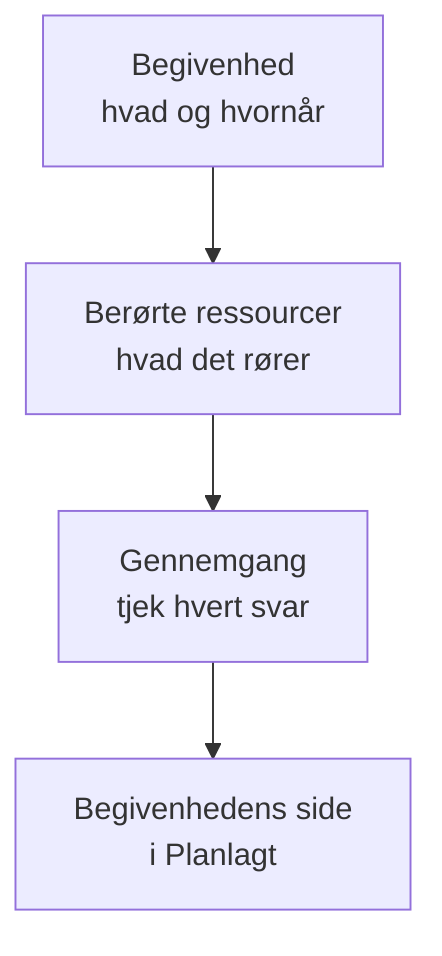

# Opret vedligeholdelsesbegivenheder

Planlæg vedligeholdelse i to korte trin: sig, hvad der sker og hvornår, og derefter hvad det påvirker, og hvem der skal høre om det. Kun titlen skal skrives; alt andet starter med en fornuftig standardværdi. Denne side gennemgår formularen, hvad der sker i det øjeblik, du opretter en begivenhed, hvordan du ændrer den senere, og hvordan du opretter begivenheder fra kode.

:::cards
- [Opret en begivenhed](#opret-en-begivenhed): To trin og en gennemgang.
- [Hvad der sker, når du opretter den](#hvad-der-sker-når-du-opretter-den): Dens nummer, regler, ejere og de første beskeder.
- [Ændr en begivenhed senere](#ændr-en-begivenhed-senere): Dens vindue, ressourcer, statussider og noter.
- [Opret begivenheder fra kode](#opret-begivenheder-fra-kode): API'et, Terraform, workflows og chat.
:::

## Sådan fungerer det

Formularen stiller to spørgsmål, ét pr. trin, og viser derefter alt i en gennemgang, før den opretter begivenheden. Begivenheden starter i din planlagte tilstand, og dens side åbner.



## Før du begynder

- **Din rolle.** At oprette en begivenhed kræver **Projektejer**, **Projektadministrator**, **Projektmedlem**, **Vedligeholdelsesadministrator** eller **Vedligeholdelsesmedlem** eller en brugerdefineret rolle med **Create Scheduled Maintenance**.
- **Dine statussider.** For at informere kunderne skal du have en statusside, der viser planlagte vedligeholdelsesbegivenheder. Se [Statussider – Oversigt](/docs/status-pages/index).

## Opret en begivenhed

:::steps
### Åbn formularen

Gå til **Planlagt vedligeholdelse → Alle begivenheder**, og klik på **Opret planlagt vedligeholdelseshændelse**. Formularen åbner på sit første trin, **Begivenhed**.

### Sig, hvad der sker og hvornår

Skriv en **Titel**, og tilføj en **Beskrivelse**, hvis det hjælper: den er i Markdown og vises på dine statussider. **Begynder den** står allerede på den næste hele time på dit ur, og **Slutter den** en time senere; ændr dem kun, hvis de er forkerte. Når du flytter **Begynder den**, flytter **Slutter den** med, så vinduet bevarer sin længde. **Ejere** og **Etiketter** venter foldet sammen under **Flere felter**.

### Vælg, hvad det påvirker

Klik på **Næste** for at komme til **Berørte ressourcer**. Vælg de **Monitorer**, arbejdet rører. Så snart du vælger én, vises **Skift overvågningsstatus til** under dem: den status, monitorerne skifter til, når begivenheden starter. Vælg derefter eventuelle **Andre berørte ressourcer**, såsom værter, klynger, databaser, netværkslokationer eller tjenester.

### Vælg, hvem der hører om det

Vælg statussiderne under **Vis begivenhed på disse statussider**. **Notifikationer til abonnenter**, foldet sammen, siger på én linje, hvem der får besked og hvornår; åbn den for at ændre **Når begivenheden planlægges**, **Når begivenheden starter**, **Når begivenheden slutter** eller **Påmindelser før begivenheden**.

### Opret den

Klik på **Næste** for at se gennemgangen, tjek den, og klik derefter på **Opret planlagt vedligeholdelseshændelse**. Begivenhedens egen side åbner.
:::

Intet sendes, før du vælger en statusside: en begivenhed, der ikke vises på nogen statusside, giver ingen abonnent besked.

## Formularens felter

| Felt                                 | Trin               | Starter som                     | Hvad det gør                                                                     |
| ------------------------------------ | ------------------ | ------------------------------- | -------------------------------------------------------------------------------- |
| **Titel**                            | **Begivenhed**     | Tom, og påkrævet                | Navngiver begivenheden overalt, også på dine statussider.                        |
| **Beskrivelse**                      | **Begivenhed**     | Tom                             | Forklarer arbejdet for dine kunder, i Markdown.                                  |
| **Begynder den**                     | **Begivenhed**     | Den næste hele time             | Hvornår begivenheden starter af sig selv.                                        |
| **Slutter den**                      | **Begivenhed**     | En time efter **Begynder den**  | Hvornår begivenheden slutter af sig selv. Den skal ligge efter **Begynder den**. |
| **Ejere**                            | **Begivenhed**     | Ingen                           | Personer og teams, der ejer begivenheden og får besked om den.                   |
| **Etiketter**                        | **Begivenhed**     | Ingen                           | Etiketter, som regler og filtre kan matche på.                                   |
| **Monitorer**                        | **Berørte ressourcer** | Ingen                       | De monitorer, der ikke kontrolleres, mens begivenheden står på.                  |
| **Skift overvågningsstatus til**     | **Berørte ressourcer** | Ingen ændring               | Den status, de monitorer viser under begivenheden. Spørges om, så snart en monitor er valgt. |
| **Andre berørte ressourcer**         | **Berørte ressourcer** | Ingen                       | Værter, klynger, databaser, netværkslokationer, tjenester og mere.               |
| **Vis begivenhed på disse statussider** | **Berørte ressourcer** | Ingen                    | De statussider, der viser begivenheden og giver deres abonnenter besked.         |
| **Notifikationer til abonnenter**    | **Berørte ressourcer** | Alle tre tidspunkter slået til, ingen påmindelser | Hvornår abonnenterne på de sider får besked.        |

To ting udfylder formularen for dig undervejs:

- **Tilknyttede ressourcer.** Når du vælger en monitor, tilføjes de værter, klynger, tjenester og andre ressourcer, den er knyttet til, under **Andre berørte ressourcer**, og en linje under feltet nævner dem. Fjern dem, du ikke vil have.
- **Foreslåede statussider.** Under **Vis begivenhed på disse statussider** foreslås de sider, der viser dine monitorer: klik på en sides navn for at tilføje den, eller på **Tilføj alle**. Intet vælges for dig. Se [Planlagte vedligeholdelsesbegivenheder](/docs/status-pages/subscribers#planlagte-vedligeholdelsesbegivenheder).

## Start fra en ressource eller en skabelon

På fanen **Planlagt vedligeholdelse** for en vært, en Kubernetes-, Proxmox-, Ceph- eller Docker Swarm-klynge, en Docker- eller Podman-vært, en vCenter, et storage array, en IoT-flåde, en database, en tjeneste eller en netværkslokation åbner **Opret planlagt vedligeholdelseshændelse** den samme formular med den ressource allerede valgt under **Andre berørte ressourcer**, og fanen viser de begivenheder, der påvirker den. Fanen for et lagerelement vælger den vært, tjeneste eller Kubernetes-klynge, elementet peger på.

**Opret fra skabelon**, ved siden af knappen til at oprette, beder dig om at **Vælg skabelon for planlagt vedligeholdelse** og åbner derefter formularen udfyldt fra skabelonen. Se [Skabeloner og tilbagevendende begivenheder](/docs/scheduled-maintenance/templates).

## Hvad der sker, når du opretter den

I det øjeblik du klikker på **Opret planlagt vedligeholdelseshændelse**, gennemgår OneUptime disse trin i denne rækkefølge:

1. **Den får et nummer og en tilstand.** Nummeret kommer fra en tæller pr. projekt og vises med dit præfiks (`SM-42`). Begivenheden starter i din planlagte tilstand, uanset hvilken tilstand en anmodning nævner.
2. **Dine chatværktøjer hører om den.** Slack- og Microsoft Teams-reglerne under **Arbejdsområde** poster den i deres kanaler, og en regel kan oprette en kanal til begivenheden. Dens feed registrerer, at den blev oprettet.
3. **Dens tilstandstidslinje begynder.** Den første række i dens **Tilstandstidslinje** er din planlagte tilstand.
4. **Ejere og etiketter tilføjes**: dem, du har valgt, og derefter dem fra matchende ejer- og etiketregler.
5. **Runbook-regler starter** de runbooks, der matcher begivenheden.
6. **Påmindelser planlægges**, når en påmindelsesregel matcher, for dens ejere.

Inden for et minut får abonnenterne på dens statussider besked om, at den er planlagt, medmindre du har slået **Når begivenheden planlægges** fra. Workflow-triggeren **On Create Scheduled Maintenance Event** starter ethvert workflow, der er bygget på den, og dens ejere hører om den, hvis de har slået den notifikation til: se [Notifikationsindstillinger](/docs/notifications/notification-settings).

## Ændr en begivenhed senere

Alt fra formularen kan ændres på begivenhedens egne sider, undtagen de tre abonnenttidspunkter, som fastlægges én gang, når begivenheden oprettes.

| For at ændre                                | Gå til                                                                         |
| ------------------------------------------- | ------------------------------------------------------------------------------ |
| Titlen, vinduet eller etiketterne           | **Rediger** på kortet **Maintenance Details** i dens **Oversigt**, trinnet **Begivenhed** |
| Statussiderne eller påmindelserne           | Samme **Rediger**, trinnet **Statussider**                                      |
| Monitorerne, deres status eller andre ressourcer | **Rediger** på kortet **Berørte ressourcer**                              |
| Beskrivelsen                                | **Beskrivelse** i dens sidemenu                                                |
| Ejerne                                      | **Ejere** i dens sidemenu                                                      |

**Skift overvågningsstatus til** kan ændres, indtil begivenheden starter. Derefter viser kortet den skrivebeskyttet, fordi monitorerne allerede er i den status. En redigering tilføjer en post i **Planlagt Vedligeholdelse Feed**, der nævner, hvad den ændrede; at gemme uden ændringer tilføjer ingen.

## Post noter, mens arbejdet skrider frem

- **Offentlige noter** er opdateringer til dine kunder: de vises på begivenhedens statussider, og hver af dem kan give deres abonnenter besked med **Notify status page subscribers**.
- **Private noter** er kun for dit team.

Skriv en på begivenhedens side **Offentlige noter** eller **Private noter**, eller fra menuen **Handlinger** i **Planlagt Vedligeholdelse Feed** med **Add Public Note** eller **Tilføj privat note**. Den samme menu kører en runbook med **Execute Runbook**. En noteskabelon udfylder tekst, dit team ofte skriver: se [Vedligeholdelsesregler og indstillinger](/docs/scheduled-maintenance/settings#noteskabeloner).

## Opret begivenheder fra kode

Begivenhedsmodellen har et standard-API, så `POST /api/scheduled-maintenance` opretter en begivenhed. Godkend dig med en API-nøgle fra **Projektindstillinger → Avanceret → API-nøgler**, sendt i headeren `apikey`; nøglen angiver projektet.

```bash
curl -X POST https://oneuptime.com/api/scheduled-maintenance \
  -H "apikey: $ONEUPTIME_API_KEY" \
  -H "Content-Type: application/json" \
  -d '{
    "data": {
      "title": "Database upgrade",
      "description": "Writes pause for a few minutes while the primary restarts.",
      "startsAt": "2030-06-01T02:00:00Z",
      "endsAt": "2030-06-01T04:00:00Z"
    }
  }'
```

| Felt                                                  | Bemærkninger                                                                              |
| ----------------------------------------------------- | ----------------------------------------------------------------------------------------- |
| `title`, `startsAt`, `endsAt`                          | Påkrævet, som i formularen.                                                               |
| `monitors`, `statusPages`, `labels`                   | Begivenhedens monitorer, statussider og etiketter, alle fra API-nøglens projekt.         |
| `changeMonitorStatusToId`                             | Den overvågningsstatus, dens monitorer skifter til, når den starter.                      |
| `currentScheduledMaintenanceStateId`                  | Ignoreres: hver begivenhed starter i din planlagte tilstand.                              |
| `shouldStatusPageSubscribersBeNotifiedOnEventCreated` | Kontakten **Når begivenheden planlægges**. De to andre tidspunkter har deres egne felter. |

Den samme begivenhed som kode er Terraform-ressourcen `oneuptime_scheduled_maintenance_event`: se [Eksempler](/docs/terraform/examples#planlagt-vedligeholdelse). Et workflow opretter én med sit trin **Create One Scheduled Maintenance Event**, og `/oneuptime maintenance` åbner formularen i Slack: se [Slack](/docs/workspace-connections/slack#opret-hændelser-og-vedligeholdelse-fra-slack).

## Fejlfinding

:::details Slutter den skal ligge efter Begynder den
Vinduet skal være i orden: begivenheden slutter, efter at den er startet. Flyt først **Begynder den**, da **Slutter den** følger med, og indstil derefter **Slutter den**.
:::

:::details Skift overvågningsstatus til mangler i formularen
Der spørges kun om den, når begivenheden har en monitor. Vælg én under **Monitorer**, så vises den lige under dem.
:::

:::details Skift overvågningsstatus til kan ikke længere ændres
Begivenheden er startet, og dens monitorer er allerede i den status. Statussen gælder fra det øjeblik, begivenheden starter, til den slutter.
:::

## Næste skridt

:::cards
- [Vedligeholdelsestilstande](/docs/scheduled-maintenance/states): Hvad der starter og afslutter en begivenhed, og hvordan du flytter den manuelt.
- [Skabeloner og tilbagevendende begivenheder](/docs/scheduled-maintenance/templates): Gem formularens svar til næste gang.
- [Abonnenter og meddelelser](/docs/status-pages/subscribers#planlagte-vedligeholdelsesbegivenheder): Præcis hvem der får besked, og hvornår.
- [Vedligeholdelsesregler og indstillinger](/docs/scheduled-maintenance/settings): Tilføj ejere, etiketter og påmindelser automatisk.
:::
