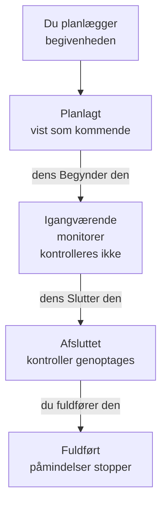

# Planlagt vedligeholdelse – Oversigt

En planlagt vedligeholdelsesbegivenhed fortæller alle om planlagt arbejde, før det sker: en databaseopgradering, en netværksændring, en flytning til nye servere. OneUptime starter og afslutter begivenheden til tiden, holder op med at kontrollere de berørte monitorer, mens arbejdet står på, og viser den på dine statussider, så planlagt nedetid aldrig ligner et nedbrud. Denne side forklarer, hvordan en begivenhed forløber, hvor alt findes i dashboardet, og hvad en begivenhed ændrer i resten af OneUptime.

:::cards
- [Hvordan en begivenhed forløber](#hvordan-en-begivenhed-forløber): Fra planlagt til fuldført, for det meste af sig selv.
- [Hvor begivenheder kommer fra](#hvor-begivenheder-kommer-fra): Formularen, skabeloner, en tidsplan, formularer, chat og kode.
- [Hvad en begivenhed påvirker](#hvad-en-begivenhed-påvirker): Monitorer, statussider, abonnenter og advarsler.
- [En begivenheds egne sider](#en-begivenheds-egne-sider): Dens oversigt, tidslinje, noter og indstillinger.
:::

## Hvordan en begivenhed forløber

Hver begivenhed har et planlagt tidsvindue, sit **Begynder den** og **Slutter den**, og bevæger sig ned gennem din liste over vedligeholdelsestilstande. Et job, der kører hvert minut, flytter den videre i begge ender af vinduet, så du planlægger arbejdet én gang, og OneUptime klarer resten.

En ny begivenhed starter i **Planlagt**. Ved sit **Begynder den** skifter den til **Igangværende**: OneUptime holder op med at kontrollere dens monitorer og viser dem, hvis du har valgt en status til dem, i den status. Ved sit **Slutter den** skifter den til **Afsluttet**: kontrollerne genoptages, og hver monitor vender tilbage til "operationel". **Fuldført** er det sidste trin, og intet tager det af sig selv: en person, en chatknap eller API'et markerer arbejdet som godkendt, hvilket også stopper påmindelserne til ejerne.

Du kan starte eller afslutte en begivenhed tidligt eller tilføje dine egne tilstande mellem disse fire. Se [Vedligeholdelsestilstande](/docs/scheduled-maintenance/states).

## Vedligeholdelse og meddelelser

Begge informerer de besøgende på dine statussider. Brug en vedligeholdelsesbegivenhed til arbejde med en start og en slutning, og en meddelelse til alt andet, de bør læse.

|                              | Planlagt vedligeholdelse                                                | Meddelelse                                     |
| ---------------------------- | ----------------------------------------------------------------------- | ---------------------------------------------- |
| **Hvad det er**              | Planlagt arbejde med et tidsvindue                                      | En besked til de besøgende på dine statussider |
| **Dens monitorer**           | Kontrolleres ikke, mens den står på, og vises i den valgte status      | Uændrede                                       |
| **Hvordan den skrider frem** | Gennem dine vedligeholdelsestilstande, til tiden                        | Den vises fra sit starttidspunkt til sit sluttidspunkt, hvis den har et |
| **Hvornår abonnenter får besked** | Når den planlægges, starter og slutter, og før start, hvis du ønsker det | Én gang, når den begynder at blive vist |
| **Numre i et nyt projekt**   | `SM-42`                                                                 | Ingen                                          |

Meddelelser beskrives i [Abonnenter og meddelelser](/docs/status-pages/subscribers#meddelelser).

## Hvor begivenheder kommer fra

- **Formularen.** Klik på **Opret planlagt vedligeholdelseshændelse** på listen over begivenheder eller på fanen **Planlagt vedligeholdelse** for en vært, en klynge, en tjeneste, en netværkslokation eller en anden ressource, som vælger den ressource for dig. Se [Opret vedligeholdelsesbegivenheder](/docs/scheduled-maintenance/creating-events).
- **En skabelon.** **Opret fra skabelon** udfylder formularen fra en skabelon, du har gemt til arbejde, du ofte udfører. Se [Skabeloner og tilbagevendende begivenheder](/docs/scheduled-maintenance/templates).
- **En tidsplan.** En tilbagevendende skabelon opretter en ny begivenhed efter en tidsplan, for eksempel hver uge eller hver måned, uden at nogen åbner formularen.
- **En formular.** En formular, hvis indsendelser opretter vedligeholdelsesbegivenheder, gør en ændringsanmodning til en begivenhed. Se [Hvad en indsendelse opretter](/docs/forms/on-submit#sådan-bliver-en-indsendelse-til-en-planlagt-vedligeholdelsesbegivenhed).
- **Chat.** `/oneuptime maintenance` i Slack, eller `maintenance` skrevet til OneUptime-botten i Microsoft Teams, åbner formularen i dit chatværktøj. Se [Slack](/docs/workspace-connections/slack#opret-hændelser-og-vedligeholdelse-fra-slack).
- **Kode.** API'et på `/api/scheduled-maintenance`, Terraform-ressourcen `oneuptime_scheduled_maintenance_event` og trinnet **Create One Scheduled Maintenance Event** i et workflow.

## Hvor vedligeholdelse findes i dashboardet

Åbn **Planlagt vedligeholdelse** fra menuen **Produkter** i topbjælken. Listen over begivenheder ligger på `/dashboard/{projectId}/scheduled-maintenance-events`, og dens sidemenu rummer alt om vedligeholdelse:

| Sektion       | Hvad du gør der                                                                                                            |
| ------------- | -------------------------------------------------------------------------------------------------------------------------- |
| **Oversigt**  | **Alle begivenheder** og **Igangværende hændelser**, hvis mærke tæller de begivenheder, der står på lige nu.                |
| **Kalender** | **Vedligeholdelseskalender**: hver begivenhed på en måned, en uge eller en dag, ved siden af de kalendere uden for projektet, du tilføjer. |
| **Arbejdsområde** | **Slack** og **Microsoft Teams**, alt efter hvad projektet har forbundet, eller **Forbind Slack eller Teams**, når det ikke har nogen af dem. |
| **Regler**    | **Ejerregler**, **Runbook-regler**, **Etiketregler**, **Reminder Rules**.                                                   |
| **Indstillinger** | **Begivenhedsstatus**, **Begivenhedsskabeloner**, **Noteskabeloner**, **Brugerdefinerede felter**, **Målinger**, **Kalenderindstillinger**, **Nummerering**. |

**Oversigt** og **Kalender** er åbne; **Arbejdsområde**, **Regler**, **Indstillinger** og **Udvikler** starter foldet sammen, og en sektion åbner af sig selv, når du er på en af dens sider. **Udvikler** rummer **Terraform**, **API** og **AI-assistenter** til at styre vedligeholdelse fra kode. Alt om vedligeholdelse ligger her, ikke i **Projektindstillinger**.

Listen viser **Nummer for planlagt vedligeholdelse**, **Titel**, **Aktuel tilstand**, **Berørte ressourcer**, **Vist på statusside**, **Begynder den**, **Varighed**, **Slutter den**, **Etiketter** og **Ejere**. Vælg begivenheder for at handle på flere ad gangen: **Markér som {{state}}**, **Skift tilstand**, **Tildel til mig**, **Tilføj ejer**, **Fjern ejer**, **Tilføj etiketter**, **Fjern etiketter** eller **Slet**. Menuen **⋯** for enden af hver begivenheds række gør det samme for netop den begivenhed: skridtene **Markér som {{state}}**, så længe begivenheden kan tage dem, **Skift tilstand**, **Tildel til mig**, indtil du ejer den, og **Tilføj ejer**.

**Vedligeholdelseskalender** i sektionen **Kalender** viser de samme begivenheder på en måned, en uge eller en dag og kan vise kalendere uden for projektet ved siden af. Se [Vedligeholdelseskalender](/docs/scheduled-maintenance/calendar).

## Hvad en begivenhed påvirker

Mens en begivenhed står på, behandler OneUptime det nedbrud, den planlægger, som forventet:

- **Dens monitorer kontrolleres ikke.** Hver monitor under **Monitorer** holder op med at blive kontrolleret, og dens sider viser **Denne overvågning er deaktiveret**. Hvis du har valgt et **Skift overvågningsstatus til**, viser monitorerne den status, også på dine statussider. Når begivenheden slutter eller slettes, genoptages kontrollerne, og hver monitor vender tilbage til "operationel", medmindre en anden igangværende begivenhed stadig holder den.
- **Dens andre ressourcer forbliver stille.** En telemetrimonitor, der overvåger mange værter, klynger, databaser eller tjenester med én serie hver, opretter ingen hændelse eller advarsel for en serie, hvis ressource begivenheden dækker, mens de andre serier bliver ved med at advare.
- **Netværkslokationer og SLO'er holder igen.** En netværkslokation, som begivenheden dækker, holder op med at regne sit planlagte nedbrud med mod lokationerne over den, og et SLO's forbrugsrateregler udløser intet, så længe en af dets monitorer er i vedligeholdelse. Se [Netværkslokationer](/docs/monitor/network-sites#planlagt-vedligeholdelse-for-netværkslokationer) og [Forbrugsrateadvarsler og -hændelser](/docs/slo/burn-rate-alerts#planlagt-vedligeholdelse).
- **Dine statussider viser den.** Begivenheden vises på de statussider, du har valgt, først som kommende, så som igangværende og så som overstået, så længe **Synlig på statussiden** er slået til i dens **Indstillinger**.
- **Abonnenterne hører om det.** Som standard får abonnenterne på de sider besked, når den planlægges, når den starter, og når den slutter, og de får en påmindelse før start, hvis du opsætter påmindelser. Se [Planlagte vedligeholdelsesbegivenheder](/docs/status-pages/subscribers#planlagte-vedligeholdelsesbegivenheder).
- **Dit team hører om det.** Dens ejere får besked, som deres [notifikationsindstillinger](/docs/notifications/notification-settings) siger, og Slack- og Microsoft Teams-reglerne under **Arbejdsområde** poster den i dine kanaler.

## En begivenheds egne sider

Åbn en begivenhed fra listen for at se dens sider. Dens sidemenu rummer:

| Sektion i sidemenuen | Sider                                                                                      |
| ----------------- | --------------------------------------------------------------------------------------------- |
| **Oversigt** | **Oversigt**, **Tilstandstidslinje**, **Beskrivelse**, **Runbooks** |
| **Team** | **Ejere** |
| **Notifikationer**   | **Notifikationslogs** og **AI-logs**: hver besked, der er sendt om begivenheden, og hvad AI har gjort for den |
| **Noter**         | **Private noter** og **Offentlige noter**                                                      |
| **Udvikler**      | **Terraform**, **API** og **AI-assistenter**: begivenheden styret fra kode                     |
| **Avanceret**     | **Brugerdefinerede felter**, **Indstillinger**, **Auditlogs**, **Slet begivenhed**             |

**Oversigt**, **Team** og **Noter** er åbne; de andre sektioner forbliver foldet sammen, indtil du klikker på dem.

- **Oversigt** — headeren viser begivenhedens nummer, titel og tilstand, hvor lang tid der er til start, eller hvor længe den har stået på, hvem der ejer den, hvilke statussider den vises på, og hvem der oprettede den, og knapperne, der flytter den videre. Under den viser **Starter**, **Slutter** og **Varighed** det planlagte vindue i din tidszone. **Planlagt Vedligeholdelse Feed** registrerer alt, hvad der er sket med begivenheden, ved siden af kortene **Maintenance Details** og **Berørte ressourcer** og kortene **Målinger** og **Brugerdefinerede felter**, når dit projekt har nogen.
- **Tilstandstidslinje** — hver tilstand, begivenheden har været i, hvornår og hvor længe. Se [Vedligeholdelsestilstande](/docs/scheduled-maintenance/states#tilstandstidslinjen).
- **Offentlige noter** — opdateringer til dine statussider og deres abonnenter. **Private noter** er kun for dit team.
- **Indstillinger** — **Synlig på statussiden**, som viser eller skjuler begivenheden på dens statussider, og **Send påmindelser**, som minder dens ejere om den, indtil den er fuldført. Hver kontakt gemmer, så snart du slår den om.

## Fejlfinding

:::details En begivenhed startede ikke ved sit Begynder den
Jobbet, der starter begivenheder, kører hvert minut, så giv det et minut. Hvis headeren viser **Start forsinket**, har begivenheden overskredet sin start med mere end to minutter: start den med knappen i headeren, som gør alt, hvad jobbet gør, og åbn dens **Tilstandstidslinje** for at se, hvor den stod.
:::

:::details En monitor blev stadig kontrolleret under vedligeholdelsen
Kun de monitorer, begivenheden nævner under **Monitorer**, holder op med at blive kontrolleret, og kun mens begivenheden står på. En monitor for en vært eller tjeneste, som begivenheden nævner under **Andre berørte ressourcer**, kontrolleres stadig. Rediger begivenhedens kort **Berørte ressourcer** for at tilføje monitoren.
:::

:::details Begivenheden vises ikke på min statusside
Kontrollér, at begivenheden nævner siden under **Vis begivenhed på disse statussider**, og at **Synlig på statussiden** er slået til i begivenhedens **Indstillinger**. Kontrollér derefter selve statussiden: den skal vise planlagte vedligeholdelsesbegivenheder, og en begivenhed, der startede længere tilbage end sidens historikvindue, 14 dage medmindre du har ændret det, vises ikke længere.
:::

## Næste skridt

:::cards
- [Opret vedligeholdelsesbegivenheder](/docs/scheduled-maintenance/creating-events): Formularen, felt for felt, og hvad der sker bagefter.
- [Vedligeholdelsestilstande](/docs/scheduled-maintenance/states): Hvad der starter og afslutter en begivenhed, og egne tilstande.
- [Skabeloner og tilbagevendende begivenheder](/docs/scheduled-maintenance/templates): Genbrug en begivenhed, eller planlæg den hver uge.
- [Vedligeholdelsesregler og indstillinger](/docs/scheduled-maintenance/settings): Ejere, etiketter, runbooks og påmindelser, automatisk.
:::
