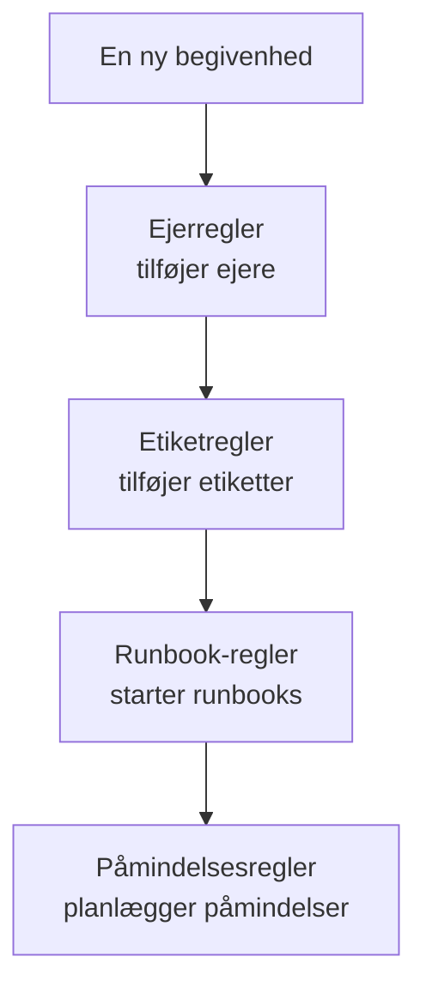

# Vedligeholdelsesregler og indstillinger

Konfigurationen af vedligeholdelse findes i **Planlagt vedligeholdelse**, ikke i **Projektindstillinger**: reglerne, der handler på hver ny begivenhed, og indstillingerne, der former hver begivenhed i projektet. Denne side er opslagsværket for hver af dem og for, hvem der må ændre dem.

:::cards
- [Reglerne, en ny begivenhed går igennem](#reglerne-en-ny-begivenhed-går-igennem): I rækkefølge, og hvad hver af dem gør.
- [Påmindelsesregler](#påmindelsesregler): Mind ejerne om begivenheden, indtil den er fuldført.
- [Indstillinger](#indstillinger): Noteskabeloner, brugerdefinerede felter, målinger og nummerering.
- [Hvem der kan ændre dem](#hvem-der-kan-ændre-dem): Vedligeholdelsesrollerne og abonnementerne.
:::

## Hvor vedligeholdelsesindstillingerne findes

Åbn **Planlagt vedligeholdelse** fra menuen **Produkter** i topbjælken. Sektionerne **Regler** og **Indstillinger** i dens sidemenu starter foldet sammen, så fold dem ud først. Hver side her gælder hele projektet, på en adresse, der begynder med `/dashboard/{projectId}/scheduled-maintenance-events/settings/`.

| Regelside          | Hvad den gør                                                           |
| ------------------ | ---------------------------------------------------------------------- |
| **Ejerregler**     | Tilføjer ejere til matchende begivenheder.                             |
| **Runbook-regler** | Starter runbooks for matchende begivenheder.                           |
| **Etiketregler**   | Tilføjer etiketter til matchende begivenheder.                         |
| **Reminder Rules** | Minder ejerne om begivenheden med et interval, indtil den er fuldført. |

Sektionen **Indstillinger** rummer **Begivenhedsstatus**, som er beskrevet på [Vedligeholdelsestilstande](/docs/scheduled-maintenance/states), **Begivenhedsskabeloner**, som er beskrevet på [Skabeloner og tilbagevendende begivenheder](/docs/scheduled-maintenance/templates), og derefter **Noteskabeloner**, **Brugerdefinerede felter**, **Målinger**, **Kalenderindstillinger** og **Nummerering**. **Kalenderindstillinger** er beskrevet på [Vedligeholdelseskalender](/docs/scheduled-maintenance/calendar#eksterne-kalendere), resten nedenfor.

Sektionen **Arbejdsområde** rummer de Slack- og Microsoft Teams-regler, der poster begivenheder i kanaler. Se [Slack](/docs/workspace-connections/slack#notifikationsregler) og [Microsoft Teams](/docs/workspace-connections/microsoft-teams#notifikationsregler).

## Reglerne, en ny begivenhed går igennem

Reglerne er forskellige i, hvordan flere match afgøres:

- **Ejerregler**, **Etiketregler** og **Runbook-regler** handler alle, når de matcher. Ejere og etiketter, som flere regler tilføjer, tilføjes én gang.
- **Reminder Rules** kontrolleres fra toppen af deres liste og nedad, og det første match vinder. Træk en regel for at ændre dens plads; en ny regel kommer sidst.

En ny regel starter aktiveret; slå **Aktiveret** fra i dens redigeringsformular for at sætte den på pause, og listen viser et grønt **Aktiveret** eller et rødt **Deaktiveret** for hver regel. Ejer-, etiket- og runbook-regler handler på begivenheder, der oprettes, efter du har gemt dem. For at anvende en ejer- eller etiketregel på de begivenheder, du allerede har, bruger du **Kør nu**: se [Kør regler på eksisterende ressourcer](/docs/configuration/run-rules-now).

## Ejer- og etiketregler

**Ejerregler** tilføjer ejerbrugere og -teams til nye begivenheder, der matcher, og **Etiketregler** tilføjer etiketter. At oprette en tager to trin: **Match**, betingelserne, og derefter **Ejere** eller **Etiketter**, det, reglen tilføjer.

| Betingelse                                                         | Matcher                                                                    |
| ------------------------------------------------------------------ | -------------------------------------------------------------------------- |
| **Monitorer**, **Begivenhedsetiketter**, **Overvågningsetiketter** | Begivenheder med en af de monitorer eller etiketter, du vælger.            |
| **Begivenhedstitel**, **Hændelsesbeskrivelse**, **Overvågningsnavn**, **Overvågningsbeskrivelse** | Et mønster, som et regulært udtryk, uden forskel på store og små bogstaver. |

En regel matcher kun, når hver betingelse, du udfylder, holder; en betingelse, der står tom, springes over.

- **En regel kan nedarve.** Foldet sammen under **Nedarv ejere** eller **Nedarv etiketter** giver seks kontakter ejerne eller etiketterne videre fra begivenhedens monitorer, værter, Kubernetes-klynger, Docker-værter, Podman-værter og tjenester.
- **En ny regel skal tilføje noget**: vælg mindst én ejer eller etiket, eller slå en kontakt til.
- **Underret ejere**, under **Flere felter** på en ejerregel, afgør, om de tilføjede personer får besked.

[Etiket- og ejerregler](/docs/configuration/label-and-owner-rules) gennemgår formularen trin for trin for alle slags ressourcer.

## Runbook-regler

**Runbook-regler** starter en runbook, når en ny begivenhed matcher, for eksempel en tjekliste før hver databaseopgradering. De matcher på de samme ting som ejer- og etiketregler; begivenheder har ingen alvorsgrad, så runbook-regler for vedligeholdelse tilbyder ikke nogen. Kørslen knyttes til begivenheden, på dens side **Runbooks**. Se [Runbook-regler](/docs/runbooks/rules).

## Påmindelsesregler

**Planlagt vedligeholdelse → Regler → Reminder Rules** minder en begivenheds ejere om den, indtil arbejdet er godkendt. Hver begivenhed får den første regel, der matcher den, fra toppen af listen og nedad.

:::steps
### Vælg, hvilke begivenheder der mindes om

Klik på **Opret Scheduled Maintenance Reminder Rule**. Under **Match** lader du **Alle planlagte vedligeholdelsesbegivenheder** være valgt for at minde om hver begivenhed, eller du vælger **Kun planlagte vedligeholdelsesbegivenheder, der opfylder betingelserne** og derefter de **Etiketter**, den gælder for.

### Indstil intervallet

Under **Påmindelser** indstiller du **Påmindelsesinterval (minutter)**, hvor ofte ejerne påmindes, og vælger under **Påmind ejere**, hvornår. Dens **Navn** følger begge dele, for eksempel "Påmind hver 30 minutter, mens den er i gang", indtil du skriver dit eget, og en **Beskrivelse** venter under **Flere felter**. Opret derefter reglen.
:::

| Svar | Hvornår ejerne påmindes |
| --- | --- |
| **Mens den er i gang** | Fra begivenheden starter, til den slutter. En ny regel starter med dette svar. |
| **Før den starter** | Fra begivenheden er planlagt, til den starter. |
| **Før den starter, og mens den er i gang** | Fra begivenheden er planlagt, til den slutter. |

En regel gemt via API'en eller Terraform, der venter på, at begivenheden starter, og stopper, når den starter, sender aldrig en påmindelse: Listen markerer den med **Påminder aldrig**, og dens formular beder dig vælge et svar.

Ejerne får hver påmindelse som **Maintenance reminder**, som er slået til via e-mail for hvert nyt medlem. At gemme, ændre eller slette en påmindelsesregel matcher hver begivenhed, der ikke er fuldført, igen. For at stoppe påmindelserne for én begivenhed slår du **Send påmindelser** fra på dens side **Indstillinger**; den gemmer, så snart du slår den om.

Disse påmindelser er til dit team. De påmindelser, dine statussideabonnenter får, før en begivenhed starter, indstilles på selve begivenheden under **Påmindelser før begivenheden**.

## Indstillinger

### Noteskabeloner

**Planlagt vedligeholdelse → Indstillinger → Noteskabeloner** rummer færdigskrevet tekst til opdateringer om vedligeholdelse. Kortet **Skabeloner til offentlige eller private noter for planlagte vedligeholdelseshændelser** viser dem; **Opret Planlagt Vedligeholdelse Note Skabelon** beder om et **Skabelonnavn**, en **Skabelonbeskrivelse** og **Note**. En skabelon tilbydes, når nogen skriver en offentlig eller privat note på en begivenhed, og når de ændrer dens tilstand, og dens tekst kan redigeres, før den postes. I modsætning til noteskabeloner for hændelser udfylder noteskabeloner for vedligeholdelse ingen variabler.

### Brugerdefinerede felter

**Planlagt vedligeholdelse → Indstillinger → Brugerdefinerede felter** tilføjer dine egne felter til hver begivenhed, for eksempel en ændringssag eller et kundeniveau. Udfyld dem på en begivenheds side **Brugerdefinerede felter** eller via API'et som `customFields`. Et felt kan kopiere sin værdi fra et brugerdefineret felt på en monitor i stedet for at blive skrevet ind: se [Felter kopieret fra en monitor](/docs/incidents/settings#felter-der-kopieres-fra-en-monitor), som fungerer på samme måde for begivenheder.

### Målinger

**Planlagt vedligeholdelse → Indstillinger → Målinger** tager tid på, hvor længe ting varer på hver begivenhed. Vælg **Startforsinkelse**, fra den planlagte start, til begivenheden starter, **Overskridelse**, fra den planlagte slutning, til den slutter, eller **Vedligeholdelsens varighed**, fra den starter, til den slutter; eller to tidspunkter efter eget valg med **Noget andet**. Hver måling vises på begivenhedens side og tegnes som `oneuptime.scheduled-maintenance.measurement.<key>`. Se [Målinger](/docs/incidents/settings#målinger), som fungerer på samme måde for begivenheder.

### Nummerering

**Planlagt vedligeholdelse → Indstillinger → Nummerering** angiver teksten foran begivenhedsnumre: `SM-` i et nyt projekt, eller `#` uden præfiks. **Opdater** beder om **Nummerpræfiks for planlagt vedligeholdelse** og viser nummeret i en forhåndsvisning, mens du skriver. Kun begivenheder, der oprettes bagefter, får det nye præfiks; eksisterende beholder deres numre. Reglerne for et præfiks står på [Nummerpræfikser](/docs/incidents/settings#nummerpræfikser).

Kortet **Næste nummer** nedenunder sætter det nummer, den næste begivenhed får, for at fortsætte et andet værktøjs numre: **Opdater** åbner **Næste nummer for planlagt vedligeholdelse**, som skal være højere end det højeste indtil nu. Se [Næste numre](/docs/incidents/settings#næste-numre).

> [!NOTE]
> På OneUptime Cloud kræver brugerdefinerede felter abonnementet **Growth** eller højere, og det samme gør tilføjelse og ændring af vedligeholdelsestilstande og skabeloner.

## Workflows

Hver vedligeholdelsesmodel har workflow-udløsere og -handlinger, opkaldt efter den: **On Create Scheduled Maintenance Event**, **On Update Scheduled Maintenance Event**, **On Create or Update Scheduled Maintenance Event** og **On Delete Scheduled Maintenance Event**, det samme for **Scheduled Maintenance State Timeline** og de andre, og handlinger som **Create One Scheduled Maintenance Event** og **Update One Scheduled Maintenance Event**. Definitioner af brugerdefinerede felter og måleværdier er undtagelserne: de har ingen workflow-trin. Se [Workflows – Oversigt](/docs/workflows/index).

## Hvem der kan ændre dem

| Rolle                             | Hvad den kan                                                                                         |
| --------------------------------- | ---------------------------------------------------------------------------------------------------- |
| **Vedligeholdelsesseer**  | Læser begivenheder og ændrer intet.                                                                  |
| **Vedligeholdelsesmedlem**  | Opretter, ændrer og sletter begivenheder med deres noter, tilstandstidslinjer og ejere samt begge slags skabeloner. |
| **Vedligeholdelsesadministrator**   | Alt, hvad et medlem gør, og opretter, ændrer og sletter desuden vedligeholdelsestilstande.           |

Regler, brugerdefinerede felter og målinger kræver **Projektejer** eller **Projektadministrator** eller en brugerdefineret rolle med den sides egen tilladelse, for eksempel **Create Scheduled Maintenance Owner Rule**. Runbook-regler accepterer også **Runbook-administrator**. **Projektmedlem** arbejder med begivenheder og skabeloner ligesom **Vedligeholdelsesmedlem**. Se [Brugere, teams og tilladelser](/docs/permissions/index).

## Fejlfinding

:::details En ejerregel tilføjede ingen til en ny begivenhed
Åbn reglen, og kontrollér dens betingelser: hver betingelse, du har udfyldt, skal holde. Et titelmønster er et regulært udtryk, så `db upgrade` matcher ikke "DB-Upgrade"; skriv `db.upgrade`. En regel handler også kun på begivenheder, der er oprettet, efter den blev gemt: brug **Kør nu** til dem, du allerede har.
:::

:::details Ejerne fik ingen påmindelse
Kontrollér, at en påmindelsesregel matcher begivenhedens etiketter, at begivenhedens **Send påmindelser** er slået til, og at **Maintenance reminder** er slået til i ejernes notifikationsindstillinger. En regel med **Mens den er i gang** sender intet, før begivenheden starter.
:::

## Næste skridt

:::cards
- [Vedligeholdelsestilstande](/docs/scheduled-maintenance/states): Siden Begivenhedsstatus, og hvad hver tilstand gør.
- [Skabeloner og tilbagevendende begivenheder](/docs/scheduled-maintenance/templates): Siden Begivenhedsskabeloner i dybden.
- [Etiket- og ejerregler](/docs/configuration/label-and-owner-rules): Regelformularen trin for trin.
- [Notifikationsindstillinger](/docs/notifications/notification-settings): Hvordan hver ejer vælger, hvad der når frem til dem.
:::
