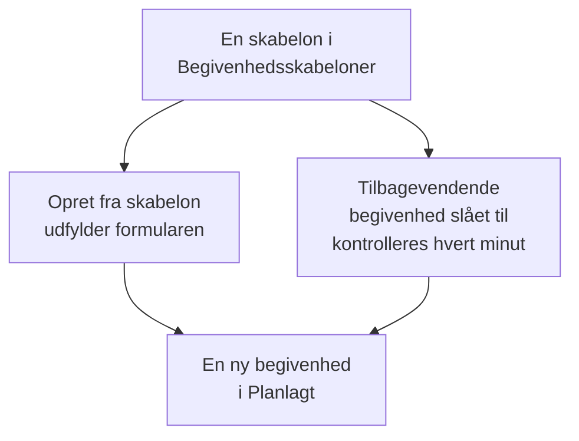

# Skabeloner og tilbagevendende begivenheder

En skabelon for planlagt vedligeholdelse gemmer en begivenhed, du ofte planlægger: dens titel og beskrivelse, de monitorer, den sætter på pause, de statussider, den vises på, og hvem der får besked. Brug en til at udfylde formularen med ét klik, eller gør den tilbagevendende, så OneUptime planlægger begivenheden for dig hver uge, hver måned eller med et hvilket som helst interval, du vælger.

:::cards
- [Opret en skabelon](#opret-en-skabelon): Formularens trin, med et navn forrest og en tidsplan til sidst.
- [Brug en skabelon](#brug-en-skabelon): Udfyld en ny begivenhed ud fra den.
- [Tilbagevendende begivenheder](#tilbagevendende-begivenheder): Lad OneUptime planlægge begivenheden af sig selv.
- [Ændr eller stop en skabelon](#ændr-eller-stop-en-skabelon): Rediger den, sæt dens tidsplan på pause, eller slet den.
:::

## Sådan fungerer det

En skabelon er et udgangspunkt. En begivenhed, der er oprettet ud fra den, er en kopi med sine egne værdier: ændrer du skabelonen senere, ændres kun de begivenheder, der oprettes derefter.

## Før du begynder

- **Dit abonnement.** På OneUptime Cloud kræver skabeloner abonnementet **Growth** eller højere.
- **Din rolle.** At oprette en skabelon kræver **Projektejer**, **Projektadministrator**, **Projektmedlem**, **Vedligeholdelsesadministrator** eller **Vedligeholdelsesmedlem** eller en brugerdefineret rolle, der må oprette skabeloner for planlagt vedligeholdelse.

## Opret en skabelon

:::steps
### Åbn skabelonerne

Gå til **Planlagt vedligeholdelse → Indstillinger → Begivenhedsskabeloner**. **Indstillinger** starter foldet sammen i sidemenuen: fold den ud først. Klik på **Opret Planlagt Vedligeholdelse Skabelon**.

### Navngiv skabelonen

Under **Skabeloninformation** giver du den et **Skabelonnavn** og en **Skabelonbeskrivelse**, så dit team ved, hvornår den skal bruges. Begge er påkrævede.

### Beskriv begivenheden

Under **Begivenhed** udfylder du den **Titel** og den **Beskrivelse**, som hver begivenhed fra den starter med. **Ejere** og **Etiketter** venter under **Flere felter**.

### Vælg, hvad den påvirker

Under **Berørte ressourcer** vælger du **Monitorer**, **Skift overvågningsstatus til** for dem, eventuelle **Andre berørte ressourcer**, statussiderne under **Vis begivenhed på disse statussider** og **Notifikationer til abonnenter**.

### Beslut, om den gentages

Under **Tilbagevendende** lader du **Tilbagevendende begivenhed** være slået fra for en skabelon, du bruger manuelt, eller slår den til og udfylder dens tidsplan. Klik på **Næste** for at gennemgå oversigten, og opret derefter skabelonen.
:::

En skabelon spørger om **Skift overvågningsstatus til**, selv når den ikke nævner nogen monitorer: statussen gælder også de monitorer, du tilføjer, når du planlægger en begivenhed ud fra den. Under **Andre berørte ressourcer** tager en skabelon værter, Kubernetes-klynger, Docker-værter, Podman-værter og tjenester.

## Hvad en skabelon udfylder

| Del af begivenheden                                 | Opret fra skabelon                   | En tilbagevendende begivenhed   |
| --------------------------------------------------- | ------------------------------------ | ------------------------------- |
| **Titel** og **Beskrivelse**                        | Udfyldt, og du kan ændre dem         | Kopieret                        |
| **Monitorer** og **Skift overvågningsstatus til**   | Udfyldt                              | Kopieret                        |
| **Andre berørte ressourcer**                        | Udfyldt                              | Kopieret                        |
| Statussiderne og **Notifikationer til abonnenter**  | Udfyldt                              | Kopieret                        |
| **Ejere** og **Etiketter**                          | Udfyldt                              | Kopieret                        |
| **Begynder den** og **Slutter den**                 | Den næste hele time, i en time       | Beregnet ud fra tidsplanen      |

## Brug en skabelon

:::steps
### Vælg skabelonen

På **Planlagt vedligeholdelse → Alle begivenheder** klikker du på **Opret fra skabelon** og vælger en skabelon under **Vælg skabelon for planlagt vedligeholdelse**.

### Kontrollér formularen

Klik på **Opret fra skabelon**. Formularen åbner med skabelonens svar allerede udfyldt. Indstil vinduet, og ret det, denne begivenhed har brug for.

### Opret begivenheden

Gå gennem trinnene med **Næste**, og klik derefter på **Opret planlagt vedligeholdelseshændelse** i oversigten.
:::

Når projektet endnu ikke har nogen skabelon, siger **Opret fra skabelon** det og linker til **Begivenhedsskabeloner**.

## Tilbagevendende begivenheder

En tilbagevendende skabelon opretter begivenheden efter en tidsplan. Du angiver, hvornår den første begivenhed oprettes, hvornår den starter, og hvornår den slutter; hver senere begivenhed holder de samme afstande, ét interval senere.

| Felt                                                           | Hvad det betyder                                                                                      |
| -------------------------------------------------------------- | ----------------------------------------------------------------------------------------------------- |
| **Tilbagevendende begivenhed**                                 | Slår tidsplanen til.                                                                                  |
| **Første begivenhed planlagt til**                             | Hvornår OneUptime opretter den første begivenhed, og dermed hvornår dens abonnenter får at vide, at den er planlagt. |
| **Første begivenhed starter kl.**                              | Hvornår den første begivenhed starter.                                                                |
| **Første begivenhed slutter kl.**                              | Hvornår den første begivenhed slutter.                                                                |
| **Hvor ofte vil du have, at denne begivenhed skal gentages?**  | Et tal og en enhed: timer, dage, uger, måneder eller år.                                              |

For eksempel et ugentligt vindue, hvor den første begivenhed oprettes en mandag til lørdagen efter:

| Begivenhed   | Oprettet           | Starter            | Slutter            |
| ------------ | ------------------ | ------------------ | ------------------ |
| Den første   | `2030-06-03 09:00` | `2030-06-08 02:00` | `2030-06-08 04:00` |
| Den anden    | `2030-06-10 09:00` | `2030-06-15 02:00` | `2030-06-15 04:00` |

Sæt **Første begivenhed planlagt til** så langt før starten, som du vil have, at dine kunder hører om arbejdet. Alle tre tidspunkter skal ligge i fremtiden, når du opretter skabelonen, begivenheden skal oprettes, før den starter og slutter, og den skal starte, før den slutter; formularen siger, hvilken regel et tidspunkt bryder.

Et job kontrollerer de tilbagevendende skabeloner hvert minut. Når en skabelons næste tidspunkt kommer, flytter det tidspunktet ét interval frem og opretter begivenheden. Skabelonlisten viser det tidspunkt i sin kolonne **Tilbagevendende begivenhed**, og **Nej** for en skabelon, der ikke gentages. En begivenhed, der er oprettet ud fra tidsplanen, er som enhver anden: dens regler kører, dens ejere tilføjes, og dens abonnenter får at vide, at den er planlagt.

## Ændr eller stop en skabelon

Åbn en skabelon fra listen for at se dens side:

- **Skabelondetaljer for planlagt vedligeholdelse** viser, hvad nye begivenheder starter med. Dens **Rediger** går gennem **Skabeloninformation**, **Begivenhed**, **Statussider** og **Tilbagevendende**.
- **Berørte ressourcer** rummer dens **Monitorer**, deres **Skift overvågningsstatus til** og dens **Andre berørte ressourcer**, med sin egen **Rediger**.
- **Ejere** viser de personer og teams, der ejer hver begivenhed, der planlægges ud fra den.

Ændringer gælder de begivenheder, der oprettes, efter du har gemt dem; begivenheder, der allerede er oprettet, beholder deres egne værdier. For at stoppe en tidsplan slår du **Tilbagevendende begivenhed** fra under **Rediger** eller sletter skabelonen. En skabelon, der er slået fra, beholder sin tidsplan: slår du den til igen, fortsætter den ved tidsplanens næste tidspunkt og springer de tidspunkter over, hvor den var slået fra. Sletter du en skabelon, bliver de begivenheder, den har oprettet, stående.

## Fejlfinding

:::details Når en tilbagevendende skabelon oprettes, står der, at et tidspunkt skal ligge i fremtiden
Alle tre første tidspunkter skal ligge efter nu, når du opretter den. Flyt dem frem: tidsplanen fortsætter derefter fra den første begivenhed.
:::

:::details En tilbagevendende skabelon oprettede ingen begivenhed
Kontrollér, at **Tilbagevendende begivenhed** stadig er slået til, og se på tidspunktet i listens kolonne **Tilbagevendende begivenhed**: begivenheden oprettes på det tidspunkt, ikke ved sin start. Jobbet kører hvert minut, så giv det et minut.
:::

:::details En begivenhed fra en skabelon mangler en ressource, jeg valgte
En skabelon tager værter, Kubernetes-klynger, Docker-værter, Podman-værter og tjenester under **Andre berørte ressourcer**. Tilføj andre slags ressourcer til selve begivenheden med **Rediger** på dens kort **Berørte ressourcer**.
:::

## Næste skridt

:::cards
- [Opret vedligeholdelsesbegivenheder](/docs/scheduled-maintenance/creating-events): Formularen, som en skabelon udfylder.
- [Vedligeholdelsestilstande](/docs/scheduled-maintenance/states): Hvordan hver begivenhed går videre, når den er oprettet.
- [Vedligeholdelsesregler og indstillinger](/docs/scheduled-maintenance/settings): Giv hver ny begivenhed ejere og etiketter automatisk.
- [Planlagt vedligeholdelse – Oversigt](/docs/scheduled-maintenance/index): Hvor skabeloner passer ind i resten af vedligeholdelsen.
:::
