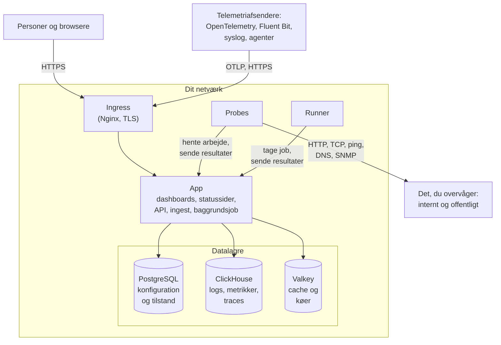

# Arkitektur

En selvhostet OneUptime-installation er en håndfuld containere: én ingress, som hver forespørgsel kommer ind gennem, ét app-image, der gør arbejdet, probes, der kører dine monitorers tjek, og tre datalagre. Denne side viser, hvordan de hænger sammen, hvad hver enkelt gør, og hvilke forbindelser der krydser dit netværk.

## Det viser dette

- Personer når OneUptime gennem **ingress**, som afslutter TLS og sender hver forespørgsel videre til appen: Dashboardet, statussiderne, API'et og hvert ingest-endpoint, som telemetri sendes til.
- **Appen** læser og skriver sin tilstand i PostgreSQL, gemmer telemetri i ClickHouse og bruger Valkey (den BSD-licenserede fork af Redis 7.2) som cache og til de køer, dens baggrundsjob arbejder sig igennem.
- **Probes** kan køre inde i din klynge (anbefalet) og/eller andre steder på dit netværk. De kan overvåge:
  - Interne/private tjenester bag din firewall.
  - Eksterne/offentlige ressourcer på internettet.
- Proberesultater sendes til appen, sættes i kø i Valkey og behandles af baggrundsjobbene ind i dine datalagre. En probe andre steder på dit netværk når appen gennem ingress, på din OneUptime-URL.
- Telemetri (metrikker, traces, logs og mere) modtages af den samme app og gemmes i ClickHouse.

> [!NOTE]
> Hvis du bruger ekstern PostgreSQL, Valkey (eller Redis) eller ClickHouse i stedet for de medfølgende, forbinder appen sig i stedet til dine eksterne endpoints. Det logiske flow forbliver det samme.

## Komponenterne

| Komponent | Docker Compose-tjeneste | Helm-chart | Hvad den gør |
| --- | --- | --- | --- |
| Ingress | `ingress` | `nginx` | Afslutter TLS, betjener dit værtsnavn og dine statussiders domæner og sender hver forespørgsel videre til appen. |
| App | `app` | `app` | Dashboardet, statussiderne, API- og ingest-endpoints og, medmindre du skiller dem ud, baggrundsjobbene. |
| Worker | En del af `app` | `worker` (slået fra som standard) | Baggrundsjobbene i deres egne pods, så tung købehandling aldrig konkurrerer med API-forespørgsler. |
| Telemetry writer | En del af `app` | `telemetryWriter` (slået fra som standard) | Et lag af fast størrelse, der udfører hver ClickHouse-indsættelse, så indsættelserne holdes begrænsede, uanset hvor langt workerne skalerer. |
| Probe | `probe-1` | `probes` | Kører monitortjek og sender resultaterne tilbage. Hver medfølgende probe er en global probe, som alle projekter kan bruge. |
| Runner | `runner` | `runner` | Instansens egen Runner, som kan køre AI-koderettelser for alle projekter. Runbook-trin kører på [Runnere](/docs/runbooks/agents), som du installerer der, hvor de skal køre. |
| PostgreSQL | `postgres` | `postgresql` eller `postgresOperator.cnpg` | Projekter, monitorer, hændelser, brugere og alle andre indstillinger og tilstande. |
| ClickHouse | `clickhouse` | `clickhouse` eller `clickhouseOperator.altinity` | Logs, metrikker, traces, undtagelser, profiler og monitorlogs. |
| Valkey | `valkey` | `valkey` | Cachen, jobkøerne og kortlivet tilstand som ventende push-kvitteringer. |

Alle appens roller er det samme image: Docker Compose kører dem i én `app`-container, og Helm-chartet kan køre workeren og telemetry writer som deres egne deployments. Hvordan du dimensionerer hvert lag, står i [Dimensionering og kapacitetsplanlægning](/docs/installation/sizing).

## Forbindelser ud af dit netværk

Appen forbinder sig kun udad for det, du slår til. Hver af disse er valgfri, og hver har en side, der nævner de præcise adresser, der skal tillades:

| Udgående forbindelse | Bruges til | Læs mere |
| --- | --- | --- |
| E-mail (SMTP eller SendGrids API) | Notifikationer og invitationer | [SMTP](/docs/emails/smtp) |
| Twilio | Sms og telefonopkald | [Twilio-integration](/docs/self-hosted/twilio-integration) |
| OneUptimes push-relay eller Expo | Mobile push-notifikationer | [Push-notifikationer](/docs/self-hosted/push-notifications) |
| Slack og Microsoft Teams | Notifikationer og handlinger i arbejdsområdet | [Slack-integration](/docs/self-hosted/slack-integration) |
| En LLM-udbyder som OpenAI, Anthropic, Microsoft Foundry eller en model, du selv kører | OneUptime AI | [LLM-udbydere](/docs/ai/llm-provider) |
| `oneuptime.com` | Aktivering af en Enterprise-licens online | [Enterprise Edition](/docs/self-hosted/enterprise) |

Forbindelser den anden vej – SendGrid, der leverer indgående e-mail, og Slack og Microsoft Teams, der kalder tilbage – kræver, at ingress kan nås fra internettet. Hvilke private adresser appen og probes må nå, bestemmer du: se [Adgang til privat netværk](/docs/self-hosted/private-network-access).

## Næste trin

:::cards
- [Docker Compose](/docs/installation/docker-compose): Installer alle komponenter på én maskine.
- [Dimensionering og kapacitetsplanlægning](/docs/installation/sizing): Hvor meget CPU, hukommelse og disk hvert lag har brug for.
- [Egne probes](/docs/probe/custom-probe): Kør en probe inde i et andet netværk.
- [Enterprise Edition](/docs/self-hosted/enterprise): Hvad Enterprise-imagesne tilføjer, og hvordan licensering fungerer.
:::
