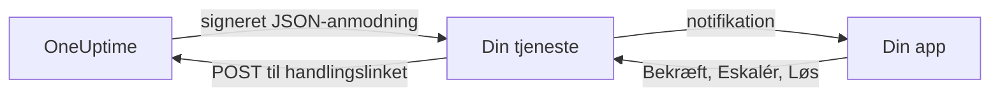

# Brugerdefinerede notifikationskanaler

En brugerdefineret kanal sender vagttilkald til en tjeneste, du selv driver: din virksomheds egen app, et personsøgersystem eller en gateway, der kontrollerer, hvad der forlader dit netværk. Du tilføjer den én gang for hele serveren, og alle kan tilkaldes gennem den uden at sætte noget op. I Admin Dashboard hedder de **Custom Channels**.

> [!NOTE]
> Brugerdefinerede kanaler er en del af [OneUptime Enterprise Edition](/docs/self-hosted/enterprise) og kræver en Enterprise-licens, der omfatter dem. Community Edition har ingen side **Custom Channels** og sender intet til en kanal. Se [Uden licens](#uden-licens).

:::cards
- [Tilføj en kanal](#tilføj-en-kanal): Et navn, en URL og en signeringshemmelighed.
- [Hvad din tjeneste modtager](#hvad-din-tjeneste-modtager): Én signeret JSON-anmodning pr. person pr. tilkald.
- [Reager på et tilkald](#reager-på-et-tilkald): Bekræft, eskalér eller løs fra din egen app.
- [Levering og nye forsøg](#levering-og-nye-forsøg): Hvad der sker, når din tjeneste er nede.
- [Andre notifikationer](#andre-notifikationer): Notifikationer til ejere, noter og vagter for dem, der vil have dem.
- [Uden licens](#uden-licens): Hvad der stopper, og hvad der bevares.
:::

## Sådan fungerer det



Når en vagtpolitik tilkalder nogen, og vedkommendes vagtregel bruger kanalen, sender OneUptime en anmodning til kanalens URL. Den fortæller, hvem tilkaldet er til (navn og e-mail), og hvad det handler om, og indeholder links, som din tjeneste kalder, når personen bekræfter, eskalerer eller løser det i din app.

## Tilføj en kanal

1. Åbn **Indstillinger** i Admin Dashboard, derefter **Custom Channels**, og vælg **Add**.
2. Udfyld i trinnet **Channel**:
   - **Navn**: det, folk ser i deres notifikationsmetoder og vagtregler, for eksempel `CorpoApp`.
   - **Webhook URL**: hvor OneUptime sender hvert tilkald. Den kan ligge på dit private netværk.
   - **Signing Secret**: OneUptime laver en til dig. Kopiér den ind i din tjeneste, som kontrollerer hver anmodning med den. Du kan se den igen ved at redigere kanalen.
3. Gem i trinnet **Delivery**, og vælg derefter **Send test** for at sende din tjeneste en [testanmodning](#testanmodninger).

I trinnet **Delivery** er **Page everyone through this channel** slået til. OneUptime tilføjer så kanalen til alles vagtregler i hvert projekt og til reglerne for alle, der senere slutter sig til et projekt, og bruger den til at nå en vagthavende, der ikke har nogen regel for det, der udløste tilkaldet. Slå det fra, så folk selv kan tilføje kanalen til deres regler.

Folk ser kanalen under **Brugerindstillinger**, derefter **Notifikationsmetoder**, derefter **Custom Channels**, med en knap **Send test**, og vælger den i deres vagtregler som `Custom Channel: CorpoApp`. De skal ikke sætte noget op: Din tjeneste får at vide, hvem hvert tilkald er til.

For at stoppe udsendelsen uden at ændre nogens regler skal du redigere kanalen og slå **Til** fra. Tilkald, der ville være gået til den, registreres i vagtloggen som ikke sendt. Sletter du en kanal, slettes alle vagtregler, der bruger den.

## Hvad din tjeneste modtager

Hvert tilkald er en `POST`-anmodning med en JSON-body:

| Header | Hvad den indeholder |
| --- | --- |
| `Content-Type` | `application/json` |
| `X-OneUptime-Event` | Hændelsestypen, for eksempel `on-call.incident.created` |
| `X-OneUptime-Signature` | `sha256=` og den hexadecimale HMAC-SHA256 af den rå body, lavet med kanalens signeringshemmelighed |

```json title="An incident page"
{
  "version": 1,
  "event": "on-call.incident.created",
  "notificationId": "5f2c8a1e-6b1d-4c3a-9e7f-2a4b6c8d0e1f",
  "sentAt": "2026-10-27T03:14:15.000Z",
  "channel": { "id": "0b7e…", "name": "CorpoApp" },
  "title": "New Incident INC-42: API latency high",
  "message": "A new incident has been created: INC-42 (API latency high) in Agency A. Click to view details.",
  "project": { "id": "8d1f…", "name": "Agency A" },
  "team": { "id": "2c9a…", "name": "SRE" },
  "user": { "id": "4e6b…", "name": "Jane Tan", "email": "jane@example.com" },
  "recordType": "incident",
  "record": {
    "id": "9a3c…",
    "number": "INC-42",
    "title": "API latency high",
    "description": "p95 latency above 2 seconds for 5 minutes.",
    "severity": "Critical",
    "state": "Created",
    "url": "https://oneuptime.example.com/dashboard/8d1f…/incidents/9a3c…"
  },
  "onCallPolicy": { "id": "1d4e…", "name": "Primary" },
  "escalationRule": { "id": "7b2f…", "name": "Level 1" },
  "isPageAgain": false,
  "actions": {
    "acknowledge": "https://oneuptime.example.com/api/custom-notification-channel/page/5f2c…/acknowledge?token=…",
    "escalate": "https://oneuptime.example.com/api/custom-notification-channel/page/5f2c…/escalate?token=…",
    "resolve": "https://oneuptime.example.com/api/custom-notification-channel/page/5f2c…/resolve?token=…"
  }
}
```

| Felt | Hvad det er |
| --- | --- |
| `version` | `1`. Der bliver kun tilføjet felter til denne version. |
| `event` | `on-call.incident.created`, `on-call.alert.created`, `on-call.incidentEpisode.created`, `on-call.alertEpisode.created`, `notification` for [andre notifikationer](#andre-notifikationer) eller `test` |
| `notificationId` | Én pr. person pr. tilkald. Brug den til at kassere en anmodning, du allerede har behandlet. |
| `title`, `message` | Klar til at blive vist, sådan som en push-notifikation ville vise dem |
| `user` | Hvem tilkaldet er til. Find personens konto i din app ud fra `email` eller `id`. |
| `team` | Det team, personen blev tilkaldt gennem, eller `null`, når personen blev tilkaldt direkte |
| `recordType`, `record` | Hvad tilkaldet handler om: en `incident`, `alert`, `incidentEpisode` eller `alertEpisode` |
| `onCallPolicy`, `escalationRule` | Den politik og det niveau, der tilkaldte personen |
| `isPageAgain` | `true`, når posten blev bekræftet for et stykke tid siden og stadig ikke er løst |
| `actions` | De links, din tjeneste kalder for at [reagere på tilkaldet](#reager-på-et-tilkald) |

Et tilkald til flere personer er én anmodning pr. person, hver med den persons egne links, så OneUptime ved, hvem der svarede. Titlen, beskeden og beskrivelsen er tilsammen begrænset til 16.384 tegn; en længere beskrivelse bliver afkortet og slutter med "… (truncated — see OneUptime for the full text)".

### Kontrollér signaturen

Beregn HMAC'en af anmodningens rå body, før du parser den, og sammenlign den med headeren:

```javascript title="Node.js"
const crypto = require("crypto");

function isFromOneUptime(rawBody, signatureHeader, secret) {
  const expected =
    "sha256=" + crypto.createHmac("sha256", secret).update(rawBody).digest("hex");
  const received = String(signatureHeader || "");

  return (
    received.length === expected.length &&
    crypto.timingSafeEqual(Buffer.from(received), Buffer.from(expected))
  );
}
```

## Reager på et tilkald

Når personen trykker på en knap i din app, sender din tjeneste en `POST`-anmodning til det tilsvarende link i `actions`. Der kræves ingen API-nøgle: Hvert link bærer et token til netop det tilkald, som er gyldigt i 7 dage, og handlingen registreres som udført af den person, der blev tilkaldt.

| Handling | Hvad den gør |
| --- | --- |
| `acknowledge` | Bekræfter personens tilkald og dermed hændelsen, advarslen eller episoden |
| `escalate` | Personen kan ikke tage det: tilkalder nu næste niveau i vagtpolitikken og holder op med at tilkalde personen |
| `resolve` | Løser hændelsen, advarslen eller episoden, hvis personens egne tilladelser giver lov til det |

```bash title="Acknowledge a page"
curl -X POST "https://oneuptime.example.com/api/custom-notification-channel/page/5f2c…/acknowledge?token=…"
```

Svaret fortæller, hvad der skete, med ord, som din app kan vise, som de er:

```json title="The answer"
{
  "action": "acknowledge",
  "result": "acknowledged",
  "message": "Acknowledged."
}
```

`result` er en af `acknowledged`, `alreadyAcknowledged`, `escalated`, `notEscalated`, `resolved` og `alreadyResolved`. Et udløbet eller forkert link afvises med en 4xx-status og en besked.

## Andre notifikationer

Tilkald er ikke de eneste notifikationer, folk får: OneUptime fortæller dem også, når en hændelse, de ejer, skifter tilstand, når der bliver skrevet en note, når deres vagt begynder, og mere. Hver person vælger, hvor hver af dem skal hen, under **Brugerindstillinger > Notifikationsindstillinger**, som har en kolonne **Custom Channels**, så længe en kanal er slået til. Den er slået fra for alle, indtil de selv slår den til.

En notifikation går til hver kanal, der er slået til, som én anmodning pr. kanal, med `event` sat til `notification`:

```json title="A notification"
{
  "version": 1,
  "event": "notification",
  "notificationId": null,
  "sentAt": "2026-10-27T03:20:00.000Z",
  "channel": { "id": "0b7e…", "name": "CorpoApp" },
  "title": "Incident INC-42 acknowledged",
  "message": "Incident INC-42 (API latency high) was acknowledged in Agency A.",
  "project": { "id": "8d1f…", "name": "Agency A" },
  "team": null,
  "user": { "id": "4e6b…", "name": "Jane Tan", "email": "jane@example.com" },
  "recordType": null,
  "record": null,
  "onCallPolicy": null,
  "escalationRule": null,
  "isPageAgain": false,
  "actions": null,
  "notificationType": "Send incident state changed notification when I am the owner of the incident",
  "url": "https://oneuptime.example.com/dashboard/8d1f…/incidents/9a3c…"
}
```

`title` og `message` er det, personens push-notifikation ville sige. `notificationType` angiver den indstilling, den blev sendt for, og `url` linker til det, den handler om, eller er `null`. Der er intet at reagere på, så `actions` er `null`.

## Levering og nye forsøg

En anmodning tæller som leveret, når din tjeneste svarer med en 2xx-status inden for 10 sekunder. En anmodning, den ikke svarede på eller svarede med 408, 429 eller en 5xx-status, sendes igen efter 1 sekund og efter yderligere 4 sekunder: tre forsøg i alt. Ved enhver anden 4xx-status sendes den ikke igen.

Resultatet af hvert forsøg står i personens vagtlog med kanalens navn og den status, din tjeneste svarede med, aldrig URL'en. Et tilkald, der ikke bliver leveret, stopper ikke vagtpolitikken: Hvis ingen bekræfter, eskalerer den som sædvanlig. Behold en e-mail- eller SMS-regel længere nede i dine regler, hvis din tjeneste er den eneste måde at nå folk på.

## Testanmodninger

**Send test** på siden i Admin Dashboard eller i en persons notifikationsmetoder sender en anmodning med `event` sat til `test`, den person, der trykkede, som `user` og `notificationId`, `record` og `actions` sat til `null`. Brug den til at prøve din tjeneste, før et rigtigt tilkald kommer.

## Uden licens

Brugerdefinerede kanaler virker i Enterprise Editions prøveperiode på 14 dage og i henstandsperioden på 30 dage, efter at en licens er udløbet. Derefter, eller med en licens, der ikke omfatter dem:

- **Der sendes intet til en brugerdefineret kanal.** Et tilkald, der ville være gået til en, registreres i personens vagtlog som ikke sendt, og det samme gælder en test.
- **Kanaler bliver ikke længere tilbudt.** De forsvinder fra folks notifikationsmetoder, vagtregler og notifikationsindstillinger, og parathed og reserven holder op med at tælle dem med.
- **Siden er skrivebeskyttet.** Du kan se og slette kanaler, men ikke tilføje eller ændre dem, og ingen kan pege en regel eller en notifikationsindstilling på en kanal.
- **Intet bliver slettet.** Kanalerne og de vagtregler og indstillinger, der bruger dem, bevares.

Alt fortsætter, så snart en licens er aktiveret, uden genstart. Folk, der kom med i et projekt, mens brugerdefinerede kanaler var stoppet, får ikke en kanal, der tilkalder alle, i deres regler: De kan selv tilføje den.
