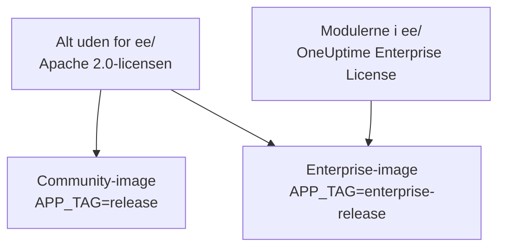
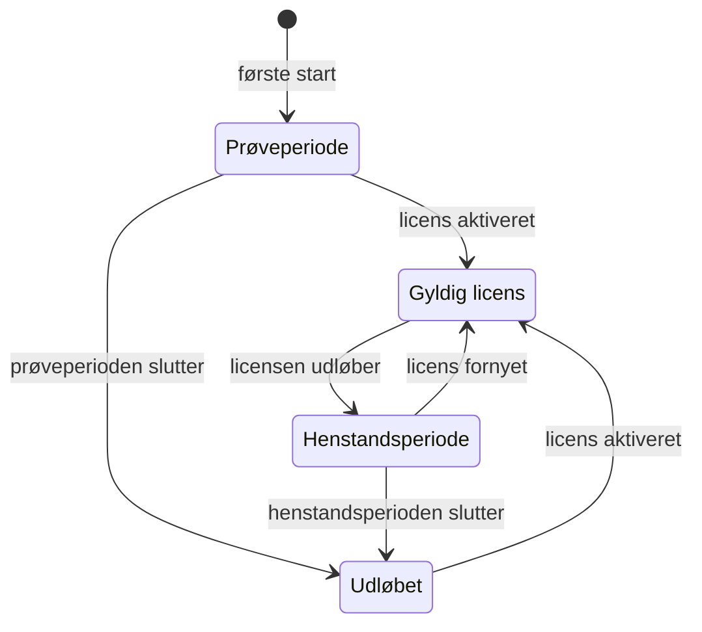

# Enterprise Edition

OneUptime bygges fra ét repository og leveres i to udgaver:

- **Community Edition**: hele platformen til overvågning, hændelser og observability, inklusive single sign-on med SAML og OpenID Connect, open source under Apache 2.0-licensen og gratis at hoste selv i enhver skala.
- **Enterprise Edition**: Community Edition plus enterprise-modulerne i repositoriets mappe [`ee/`](https://github.com/OneUptime/oneuptime/tree/master/ee). Modulerne tilføjer SCIM-provisionering samt funktioner til governance og administration af instansen. De er licenseret under [OneUptime Enterprise License](https://github.com/OneUptime/oneuptime/blob/master/ee/LICENSE), og brug i produktion kræver en Enterprise-licens til dit antal brugere.

De to udgaver er separate container-images. Community-imaget indeholder ingen kode fra `ee/`. OneUptime Cloud kører Enterprise Edition, og i skyen afgør dit abonnement, hvilke af disse funktioner du får.



> [!NOTE]
> **Single sign-on findes i alle udgaver.** Login med SAML og OIDC til projekter og statussider, globalt SSO og "Require SSO for login" er en del af Community Edition, og ingen licenstilstand slår dem fra.

Denne side beskriver, hvad hver udgave indeholder, hvordan du kører Enterprise Edition, hvordan licenser fungerer, og hvad der sker, når du skifter udgave.

:::cards
- [Sammenlign udgaverne](#hvad-hver-udgave-indeholder): Hvad Enterprise Edition tilføjer.
- [Kør Enterprise-imaget](#kør-enterprise-edition): Én indstilling, på Kubernetes eller Docker Compose.
- [Aktivér en licens](#licenser): Online med en nøgle eller offline med et signeret token.
- [Når en licens udløber](#når-en-licens-udløber-eller-mangler): Hvad der stopper, hvad der aldrig stopper, og hvordan det kommer tilbage.
:::

## Hvad hver udgave indeholder

| Funktion | Community | Enterprise | OneUptime Cloud |
| --- | --- | --- | --- |
| Overvågning, advarsler, hændelser, vagtordning, statussider, logs, metrikker, traces, exceptions, dashboards, workflows, AI-funktioner, API og Terraform | Ja | Ja | Alle abonnementer |
| Login med adgangskode, totrinsgodkendelse, teams, roller og API-nøgler | Ja | Ja | Alle abonnementer |
| [SAML-SSO og OpenID Connect](/docs/identity/sso) til login i projekter | Ja | Ja | Abonnementet Scale og derover |
| SAML-SSO og OpenID Connect til login på private statussider | Ja | Ja | Abonnementet Scale og derover |
| [Globalt SSO og OIDC (for hele instansen)](/docs/identity/global-sso) | Ja | Ja | Ikke relevant |
| [SCIM-provisionering](/docs/identity/scim) til projekter og statussider | Nej | Ja | Abonnementet Scale og derover |
| Indstillinger for team-compliance | Nej | Ja | Abonnementet Scale og derover |
| Auditlogs | Nej | Ja | Abonnementet Enterprise |
| Tilsidesættelser af opbevaring: opbevaring efter telemetritype (logs, traces, metrikker, profiler, med regler efter logalvorlighed og trace-status) samt opbevaring pr. tjeneste og pr. ressource | Nej | Ja | Abonnementet Scale og derover |
| Administrationens **Health**-dashboards: oversigt over instansen, baggrundskøer, instanslogs, PostgreSQL, Valkey, ClickHouse-klynge, diagnoselogs og telemetri-indtagelse | Nej | Ja | Ikke relevant |
| Administrationens **Query Console** | Nej | Ja | Ikke tilgængelig |
| Health-advarsler for PostgreSQL og Valkey (Redis) | Nej | Ja | Ikke relevant |
| Kapacitetsvisning for ClickHouse, kapacitetsadvarsler og automatisk oprydning af disken | Ja | Ja | Ikke relevant |
| Migreringsstatus, supportpakke og globale prober i Admin-dashboardet | Ja | Ja | Ikke relevant |
| Administration af Enterprise-licens, pladser og instanser | Nej | Ja | Ikke relevant |

Single sign-on omfatter "Require SSO for login" for projekter, private statussider og hele instansen, i begge udgaver.

Alle udgaver har projektets standardopbevaring af telemetri under **Projektindstillinger > Telemetri og APM > Dataopbevaring**. Tilsidesættelser af opbevaring er det, Enterprise Edition tilføjer oven i det.

På OneUptime Cloud kan en betalt funktion altid slås fra, på ethvert abonnement. En tilsidesættelse af opbevaring, som en prøveperiode (eller et skift til et lavere abonnement) efterlod indstillet, gælder fortsat for ny telemetri, så under abonnementet Scale viser opbevaringssiderne den under opgraderingskortet med knappen **Fjern tilsidesættelse**. Fjernelse virker på alle abonnementer; at indstille en igen kræver abonnementet Scale. Telemetri, der allerede er gemt, beholder den opbevaring, den blev gemt med. På samme måde viser **Projektindstillinger > Sikkerhed > SSO** kontakten **Kræv SSO til login** under sit opgraderingskort, så længe projektet stadig kræver SSO, så den kan slås fra.

Rækker med "Ikke relevant" er funktioner til administration af instansen. På OneUptime Cloud driver OneUptime instansen for dig.

## Kør Enterprise Edition

Begge udgaver bruger den samme konfiguration, de samme databaser og de samme data. Et skift af udgave ændrer det image, du kører, og intet andet. Der kræves ingen migrering i nogen retning.

:::tabs
@tab Kubernetes
Angiv image-typen i din `values.yaml`:

```yaml title="values.yaml"
image:
  type: enterprise-edition
```

Opgradér derefter som sædvanligt:

```bash
helm upgrade my-oneuptime oneuptime/oneuptime -f values.yaml
```

Chartet henter så `enterprise-`-varianten af hvert image-tag, for eksempel `oneuptime/app:enterprise-release`, eller `enterprise-<version>`, når du fastlåser `image.tag`. Angiv `image.type: community-edition` (standardværdien) for at køre Community Edition.
@tab Docker Compose
Angiv `APP_TAG` i din `config.env`:

```bash title="config.env"
APP_TAG=enterprise-release
```

Brug `enterprise-<version>` for at fastlåse en release. Hent derefter images, og genstart:

```bash
npm run update
```

For at gå tilbage til Community Edition skal du angive `APP_TAG=release` **og** `IS_ENTERPRISE_EDITION=false`. Så længe `IS_ENTERPRISE_EDITION=true` er angivet, sætter `npm run update` `APP_TAG` tilbage til `enterprise-release`, og Community-imaget nægter at starte.
:::

### `IS_ENTERPRISE_EDITION` er forældet

Det image, du kører, afgør udgaven. `IS_ENTERPRISE_EDITION` slår ikke længere enterprise-funktioner til og fjernes i en kommende release. Du kan lade den være uangivet.

At angive `IS_ENTERPRISE_EDITION=true` på Community-imaget slår **ikke** enterprise-funktioner til. App'en **nægter i stedet at starte**, så en opgradering, der ender på Community-imaget, aldrig i det stille kan stoppe SCIM-provisionering (inklusive deprovisionering) og auditlogning. Fejlen fortæller dig, hvad du skal angive: `APP_TAG=enterprise-<version>` for at beholde Enterprise Edition eller `IS_ENTERPRISE_EDITION=false` for at køre Community Edition. Med Helm kan det ikke ske: chartet udleder variablen af `image.type`.

`ONEUPTIME_EDITION=community` får Enterprise-imaget til at køre som Community Edition. Det er nyttigt til at afprøve en nedgradering, før du foretager den. Enterprise-imaget angiver selv `ONEUPTIME_EDITION=enterprise`; tilsidesæt den ikke med andet end `community`.

## Licenser

Filen [`LICENSE`](https://github.com/OneUptime/oneuptime/blob/master/LICENSE) i roden af repositoriet fastlægger, hvilken licens der dækker hvad: alt i mappen `ee/` er under [OneUptime Enterprise License](https://github.com/OneUptime/oneuptime/blob/master/ee/LICENSE), tredjepartskomponenter beholder de licenser, deres ejere leverer dem under, og alt andet er under Apache 2.0-licensen.

En ny installation af Enterprise Edition kører som en **prøveperiode på 14 dage**, regnet fra første gang installationen starter Enterprise Edition. Prøveperioden er til evaluering: brug af Enterprise Edition i produktion kræver et abonnement under OneUptime Enterprise License. Aktivér en licens, før prøveperioden slutter: derefter stopper SCIM, auditlogning og tilsidesættelser af opbevaring, og enterprise-konfigurationen bliver skrivebeskyttet (se [Når en licens udløber eller mangler](#når-en-licens-udløber-eller-mangler)). Kontakt [sales@oneuptime.com](mailto:sales@oneuptime.com) for at få en licens.

Licensen administreres fra **udgavemærket**, som masteradministratorer ser i headeren på Admin-dashboardet og i bunden af Dashboardet. Det viser licensstatus, brugen af pladser og, for masteradministratorer, instans-ID'et.

### Onlineaktivering (licensnøgle)

:::steps
1. Log ind som masteradministrator, og åbn udgavemærket.
2. Indtast din licensnøgle, og validér den.
:::

Installationen kontrollerer nøglen hos OneUptime og gemmer den licens, den modtager. Derefter holder den licensen opdateret med en daglig synkronisering. Brug **Refresh license** på udgavemærket til at hente ændringer, såsom ekstra pladser eller en fornyelse, med det samme.

Onlineaktivering kræver udgående HTTPS fra OneUptime-serveren til `https://oneuptime.com`. Hvis serveren kun når internettet gennem et relæ, skal du angive `ENTERPRISE_LICENSE_SERVER_URL` til relæets `https://`-adresse. Relæet skal videresende `/api/enterprise-license/` til oneuptime.com.

### Offlineaktivering (installationer uden netværksadgang)

En installation uden rute til internettet kan bruge et **signeret licenstoken** i stedet for en nøgle:

:::steps
1. Log ind som masteradministrator, åbn udgavemærket, og notér **instans-ID'et**.
2. Bed OneUptime ([sales@oneuptime.com](mailto:sales@oneuptime.com)) om et offline-licenstoken til det instans-ID.
3. Indsæt tokenet i udgavemærkets tokenfelt, og aktivér det.
:::

Installationen verificerer selv tokenet, mod de OneUptime-signeringsnøgler, der er indbygget i din release. Den kontakter aldrig OneUptime. Et token udstedt til ét instans-ID afvises af alle andre installationer, og et token udstedt uden instans-ID (såsom det token, en onlineaktiveret installation modtager) afvises også. For at forny eller tilføje pladser skal du aktivere et nyt token, før det nuværende udløber.

> [!IMPORTANT]
> **Offlineaktivering kræver en release, der stoler på OneUptimes licenssigneringsnøgle.** Hvis din release endnu ikke indeholder den nøgle, mislykkes aktiveringen med "this build does not trust the key that signed this token". Aktivér i så fald online, eller opgradér til en release, der indeholder nøglen.

### Hvad den daglige licenssynkronisering sender

En onlineaktiveret installation sender én rapport til OneUptime om dagen. Den indeholder:

- licensnøglen;
- instans-ID'et (en tilfældig identifikator, som installationen genererer) og det værtsnavn, installationen er konfigureret med (`HOST`);
- den OneUptime-version, installationen kører;
- antallet af brugere på installationen;
- en **SHA-256-hash** af hver brugers e-mailadresse med små bogstaver. OneUptime bruger hasherne til at tælle en person med konti på flere af dine installationer som én plads. Almindelige brugeres e-mailadresser sendes aldrig i klartekst;
- e-mailadresserne på installationens **masteradministratorer**, så OneUptime kan kontakte dig om fornyelser og pladsgrænser.

Svaret indeholder licensen, som OneUptime kender den den dag: firmanavn, udløbsdato, pladsgrænse, det samlede antal brugere på tværs af dine installationer og de installationer, der er registreret på licensen. Andre replikaer af installationen opfanger en ændring inden for cirka et minut.

Når du aktiverer eller opdaterer licensen, sender installationen kun licensnøglen, instans-ID'et, værtsnavnet og versionen.

Intet andet sendes. Ingen overvågningsdata, telemetri, logs eller konfiguration forlader installationen. Community Edition sender intet af dette, og det gør en offlineaktiveret installation heller ikke.

### Når en licens udløber eller mangler

Alle enterprise-funktioner virker i prøveperioden på 14 dage og i 30 dage efter, at en licens er udløbet (henstandsperioden). Udgavemærket advarer, før en af dem slutter. Derefter **stopper SCIM, auditlogning og tilsidesættelser af opbevaring**, indtil en licens aktiveres, ligesom på Community Edition, og enterprise-konfigurationen bliver skrivebeskyttet. Single sign-on er ikke en enterprise-funktion: login med SAML og OIDC, globalt SSO og "Require SSO for login" virker ens i alle licenstilstande.



| Tilstand | Hvad der sker |
| --- | --- |
| **Gyldig licens** | Alle enterprise-funktioner virker. Nye brugere kan ikke tilføjes ud over det licenserede antal pladser. Eksisterende brugere fjernes aldrig. |
| **Prøveperiode eller henstandsperiode** (de første 14 dage af en installation uden licens, eller 30 dage efter, at en licens er udløbet), eller en installation med en licens, hvis udløb aldrig blev registreret | Alle enterprise-funktioner virker, og udgavemærket viser en advarsel. I henstandsperioden efter et udløb gælder pladsgrænsen stadig. En installation med en licens uden registreret udløb kører den samme prøveperiode på 14 dage som en installation uden licens, og pladsgrænsen håndhæves ikke, fordi den licenspost, den har, allerede er ufuldstændig. |
| **Efter prøveperioden eller henstandsperioden** (udløbet, manglende eller ugyldig licens, eller en licens, der ikke omfatter funktionen) | SCIM-provisionering, auditlogning og tilsidesættelser af opbevaring **stopper** (se nedenfor). Enterprise-konfigurationen bliver **skrivebeskyttet**: du kan se og slette den, men ikke oprette eller ændre den. Én ændring virker altid, så du kan reagere på en hændelse: at udskifte et SCIM-bearer-token. SCIM-indstillingssiderne tilbyder den, mens alt andet er skrivebeskyttet: **Nulstil bearer-token** på en SCIM-konfiguration, som viser det nye token én gang. Via API'en sender du `bearerToken` alene (mindst 32 tegn). Auditlogning kan ikke slås til eller udvides. Enterprise-Health-dashboards og Query Console er låst. Pladsgrænsen håndhæves ikke længere. |

Hvad der stopper, når en licens udløber:

- **SCIM-provisionering stopper.** Din identitetsudbyders SCIM-anmodninger afvises, inklusive deprovisionering, og SCIM-teamlåse ophæves, så teams, der styres af SCIM-push-grupper, kan redigeres manuelt.
- **Auditlogningen holder op med at registrere.** Auditlogs, der er registreret indtil da, bevares.
- **Tilsidesættelser af opbevaring holder op med at gælde.** Ny telemetri opbevares i projektets standardopbevaring. Telemetri, der allerede er gemt, beholder den opbevaring, den blev skrevet med. Du kan stadig rydde en tilsidesættelse via API'en, men ikke indstille en.

Hvad der **ikke** stopper:

- **Single sign-on.** Login med SAML og OIDC til projekter, private statussider, hele instansen (globalt SSO) og mobilapps samt "Require SSO for login" er en del af alle udgaver. En udløbet licens ændrer intet af det, og konfigurationen af single sign-on kan stadig redigeres.
- **Den grundlæggende overvågning påvirkes aldrig**: monitorer, advarsler, hændelser, vagtordning, statussider og telemetri virker alle fortsat.
- **Masteradministratorer kan altid logge ind med deres adgangskode.**
- **Intet slettes.** SCIM-konfiguration, auditlogs og tilsidesættelser af opbevaring forbliver, som de er.

**Alt genoptages, så snart en licens aktiveres**, uden genstart: SCIM-provisionering, auditlogning og tilsidesættelser af opbevaring vender tilbage med den konfiguration, du har. OneUptime slår dem kun fra, når det ved, at licensen er udløbet. Så længe det ikke kan læse licenstilstanden, for eksempel et øjeblik mens serveren starter, forbliver SCIM, auditlogning og tilsidesættelser af opbevaring slået til.

> [!WARNING]
> **Hvis din identitetsudbyder deprovisionerer brugere via SCIM, så aktivér en licens, før prøveperioden eller henstandsperioden slutter.** Derefter deprovisionerer SCIM ikke længere de personer, du fjerner hos din identitetsudbyder: deres OneUptime-konti forbliver, og medmindre "Require SSO for login" gælder for dem, kan enhver, der stadig kan nå sådan en kontos indbakke, angive en adgangskode og logge ind. Hvis du lader licensen udløbe, skal du selv fjerne disse brugere i OneUptime.

## Skifte fra Enterprise til Community

Din konfiguration bliver i databasen. Et skift tilbage til Enterprise-imaget gendanner alt, som det var, så længe installationen har en gyldig licens eller stadig er i sin prøveperiode eller henstandsperiode. Single sign-on ændres ikke: login med SAML og OIDC, globalt SSO og "Require SSO for login" virker ens på begge images. På Community-imaget:

- **SCIM stopper.** Dets provisioneringsendpoints findes ikke længere, så SCIM-kald fra IdP'en mislykkes. Det gælder også SCIM-deprovisionering.
- **SCIM-teamlåse ophæves**, så teams, der blev styret af SCIM-push-grupper, kan redigeres manuelt. Ved opstart logger serveren, hvilke projekter fik deres SCIM-teamlåse ophævet.
- **Auditlogning stopper.** Auditlogs, der er registreret indtil da, bevares, men auditlog-siderne viser en opfordring til at opgradere.
- **Tilsidesættelser af opbevaring holder op med at gælde.** Ny telemetri opbevares i projektets standardopbevaring, og opbevaringskortene under **Projektindstillinger > Telemetri og APM > Dataopbevaring** og på indstillingssiden for hver tjeneste og hver ressource viser en opfordring til at opgradere. Tilsidesættelserne bliver i databasen og gælder igen, når du skifter tilbage.
- **Enterprise-indstillingssider viser en opfordring til at opgradere.** Via API'en kan du stadig læse og slette enterprise-konfiguration og nulstille et SCIM-bearer-token, men ikke oprette eller ændre noget andet. Auditlogning kan ikke slås til.
- **Enterprise-Health-dashboards, Query Console og health-advarslerne for PostgreSQL og Valkey stopper.** Kapacitetsovervågning og oprydning for ClickHouse, migreringsstatus og supportpakken virker fortsat.

> [!CAUTION]
> **Før du skifter en installation, hvis identitetsudbyder deprovisionerer brugere via SCIM, til Community-imaget, så gennemgå, hvem der har adgang.** Uden SCIM beholder de personer, du fjerner hos din identitetsudbyder, deres OneUptime-konti, og medmindre "Require SSO for login" gælder for dem, kan enhver, der stadig kan nå sådan en kontos indbakke, angive en adgangskode og logge ind. Fjern disse brugere først.

## Fejlfinding

:::details App'en nægter at starte efter en opgradering
`IS_ENTERPRISE_EDITION=true` er angivet på Community-imaget. Angiv `APP_TAG=enterprise-<version>` for at beholde Enterprise Edition eller `IS_ENTERPRISE_EDITION=false` for at køre Community Edition, og kør derefter `npm run update` igen.
:::

:::details Offlineaktivering mislykkes med "this build does not trust the key that signed this token"
Din release blev bygget, før den stolede på OneUptimes licenssigneringsnøgle. Aktivér online, eller opgradér til en release, der indeholder nøglen.
:::

:::details Din identitetsudbyders SCIM-anmodninger afvises
På Enterprise-imaget er licensen udløbet: aktivér en, og provisioneringen genoptages uden genstart. På Community-imaget findes SCIM-endpointsene slet ikke.
:::

## Næste trin

:::cards
- [Opgradering](/docs/installation/upgrading): Skift til en ny release, og mellem udgavernes images.
- [SSO](/docs/identity/sso): Single sign-on, i alle udgaver.
- [Global SSO](/docs/identity/global-sso): Én identitetsudbyder for hele instansen.
- [SCIM](/docs/identity/scim): Klargør brugere og teams fra din identitetsudbyder.
:::
