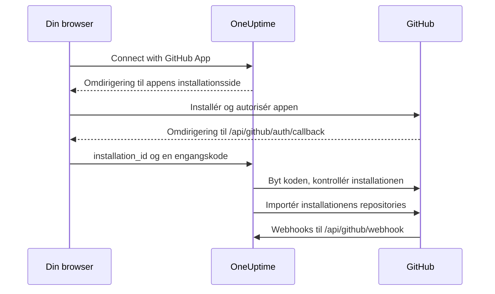

# GitHub-integration

Forbind din selvhostede OneUptime med GitHub via en GitHub App, du selv ejer. Når appen er installeret fra OneUptime, importeres installationens repositories til dit projekt og holdes synkroniseret, AI-rettelsesopgaver åbner pull requests, og dit team kan give appen opgaver fra GitHub ved at nævne den.

Denne side er til den, der driver OneUptime-serveren: Du opretter appen én gang, og derefter forbinder hvert projekt den fra **Koderepositorier**.

:::cards
- [Opret GitHub-appen](#opret-github-appen): Registrér appen med de rigtige URL'er, tilladelser og events.
- [Konfigurér OneUptime](#konfigurér-oneuptime): Giv serveren appens seks værdier.
- [Forbind repositories](#forbind-repositories): Installér appen fra OneUptime.
- [Fejlfinding](#fejlfinding): Hvad meddelelserne under Koderepositorier betyder.
:::

## Sådan fungerer det

Installationen starter i OneUptime, ikke på GitHub: Det link, OneUptime sender dig til GitHub med, er det, der knytter installationen til dit projekt.



- Omdirigeringen i browseren bærer installationen og en OAuth-engangskode. OneUptime bytter koden for at bekræfte, at den GitHub-konto, der installerede appen, administrerer installationen, og importerer derefter dens repositories.
- Webhooks holder listen over repositories synkroniseret og giver appen opgaver: omtaler, tildelinger, trigger-labels og anmodninger om review. GitHub signerer hver enkelt med webhook-secret, og OneUptime afviser dem, den ikke kan verificere.

## Før du begynder

- En GitHub-konto, der kan oprette GitHub Apps for den organisation eller bruger, appen skal installeres på. For at installere den i en organisation skal du være ejer af den eller få en ejer til at godkende anmodningen.
- Et offentligt HTTPS-værtsnavn til OneUptime, som GitHub kan nå for webhooks. Se [Netværksadgang](#netværksadgang-for-selvhostede-installationer).
- Adgang til serverens konfiguration: `config.env` til Docker Compose eller dine Helm-values til Kubernetes.

## Opret GitHub-appen

:::steps
### Åbn indstillingerne for GitHub Apps

- **For en organisation:** `https://github.com/organizations/YOUR_ORG/settings/apps`
- **For en personlig konto:** `https://github.com/settings/apps`

Vælg **New GitHub App**.

### Udfyld registreringsformularen

| Felt | Værdi |
| --- | --- |
| **GitHub App name** | Et vilkårligt unikt navn, for eksempel `OneUptime`. Notér det præcist: Det er `GITHUB_APP_NAME`. |
| **Homepage URL** | `https://your-oneuptime-domain.com` |
| **Callback URL** | `https://your-oneuptime-domain.com/api/github/auth/callback` |
| **Request user authorization (OAuth) during installation** | Til. **Det er påkrævet**: Se bemærkningen nedenfor. |
| **Setup URL** | `https://your-oneuptime-domain.com/api/github/auth/callback`, hvis GitHub lader dig angive en (se nedenfor). |
| **Redirect on update** | Valgfri. Når nogen har ændret en installation på GitHub, sender OneUptime dem til **Koderepositorier**. |
| **Webhook URL** | `https://your-oneuptime-domain.com/api/github/webhook`, med webhooken sat til **Active**. |
| **Webhook secret** | En lang tilfældig streng. Notér den: Den er `GITHUB_APP_WEBHOOK_SECRET`. **Påkrævet**: OneUptime afviser usignerede webhooks, så hvis `GITHUB_APP_WEBHOOK_SECRET` ikke er sat, stopper synkroniseringen af repositories i stedet for at acceptere uverificerede payloads. |

Ifølge GitHubs dokumentation kan du med **Request user authorization (OAuth) during installation** slået til [ikke angive en Setup URL](https://docs.github.com/en/apps/creating-github-apps/registering-a-github-app/about-the-setup-url): Brugere sendes i stedet til Callback URL, efter at de har installeret appen. Begge peger på samme OneUptime-adresse, så omdirigeringen lander det rigtige sted under alle omstændigheder.

> [!IMPORTANT]
> **Hvorfor "Request user authorization (OAuth) during installation" er påkrævet.** Efter en installation omdirigerer GitHub tilbage med et `installation_id` i URL'en. Det tal alene beviser intet om, hvem der ejer installationen — enhver kan skrive et andet. Med denne indstilling slået til returnerer GitHub også en OAuth-`code` til engangsbrug, knyttet til den GitHub-konto, der udførte installationen, som OneUptime bytter for at bekræfte, at kontoen virkelig administrerer installationen, før den forbindes med dit projekt.
>
> Uden den nægter OneUptime at forbinde installationen, og dashboardet viser en fejl, der beder dig slå indstillingen til. Det er bevidst: At acceptere installations-id'et uden verificering ville lade ét OneUptime-projekt gøre krav på en anden organisations repositories.

### Angiv tilladelserne

Angiv disse **Repository permissions** under **Permissions & events**:

| Tilladelse | Adgang | Hvad OneUptime bruger den til |
| --- | --- | --- |
| Contents | Read and write | Læse filer i repositoryet og pushe branches til AI-rettelsers pull requests |
| Pull requests | Read and write | Åbne og opdatere pull requests og poste reviews |
| Issues | Read and write | Poste appens kommentarer — **også på pull requests**, hvis samtale GitHub sender gennem issues-API'et |
| Checks | Read-only | Valgfri. Læse CI-resultatet af rettelsers pull requests. Uden den forbliver deres CI-status uverificeret |
| Metadata | Read-only | Grundlæggende metadata for repositoryet (krævet af GitHub) |

**Det er Issues: Read and write, der gør appen interaktiv.** Uden den modtages omtaler, men de mislykkes lydløst, når appen prøver at svare — GitHub leverer kommentarer i pull request-samtaler fra issues-API'et, så denne ene tilladelse afgør hvert svar, appen skriver. Se [Arbejd med OneUptime fra GitHub](/docs/ai/github-app).

OneUptime har ikke brug for tilladelser på organisations- eller kontoniveau.

### Abonnér på webhook-events

OneUptime bruger to sæt events, og de har forskellige opgaver.

**Synkronisering af repositories** — `installation` og `installation_repositories`. GitHub Apps modtager dem automatisk; de holder de forbundne repositories i takt med, hvor appen er installeret.

**Den interaktive app** — disse skal du abonnere på eksplicit, og hver af dem muliggør en bestemt måde at give appen opgaver på:

| Event | Hvad det muliggør |
| --- | --- |
| **Issue comment** | `@mention`-kommandoer i issues **og** i pull requests |
| **Issues** | at tildele appen et issue, og repositoryets trigger-label |
| **Pull request** | at anmode appen om et review |
| **Pull request review** | en omtale skrevet i teksten til et indsendt review |
| **Pull request review comment** | en omtale i en inline-kommentar i diffet |

Hvis der ikke er abonneret på nogen af dem, forbinder GitHub-appen stadig repositories og åbner stadig rettelsers pull requests fra OneUptime — den svarer bare aldrig på noget, der skrives i GitHub. Det er den hyppigste årsag til "botten ignorerer mig". Se [Arbejd med OneUptime fra GitHub](/docs/ai/github-app), hvilke kommandoer der findes, og hvem der må give dem.

Andre events (**Push**, **Workflow run**) kvitteres og ignoreres; at abonnere på dem slår hverken notifikationer eller CI/CD-automatisering til.

### Vælg, hvor appen kan installeres

Vælg under **Where can this GitHub App be installed?**:

- **Only on this account** - Til privat/intern brug
- **Any account** - Hvis andre skal kunne installere din app

### Opret appen, og notér dens id'er

Vælg **Create GitHub App**. GitHub åbner appens indstillingsside. Notér **App ID** øverst på siden og **Client ID** i afsnittet **About**.

### Generér en client secret

Vælg **Generate a new client secret** under **Client secrets**. Kopiér den med det samme: GitHub viser den kun én gang.

### Generér en privat nøgle

Vælg **Generate a private key** under **Private keys**. GitHub downloader en `.pem`-fil. Opbevar den sikkert: Den lader OneUptime godkende sig som appen.
:::

## Konfigurér OneUptime

:::tabs
@tab Docker Compose
`config.env` har én værdi pr. linje, så angiv den private nøgle base64-kodet på en enkelt linje. OneUptime afkoder den:

```bash
base64 < private-key.pem | tr -d '\n'
```

```bash title="config.env"
GITHUB_APP_ID=YOUR_APP_ID
GITHUB_APP_NAME=YOUR_APP_NAME
GITHUB_APP_CLIENT_ID=YOUR_CLIENT_ID
GITHUB_APP_CLIENT_SECRET=YOUR_CLIENT_SECRET
GITHUB_APP_PRIVATE_KEY=YOUR_BASE64_ENCODED_PRIVATE_KEY
GITHUB_APP_WEBHOOK_SECRET=YOUR_WEBHOOK_SECRET
```

Anvend ændringen med `npm run start`, som genopretter containerne. `docker compose restart` læser ikke `config.env` igen.
@tab Kubernetes
```yaml title="values.yaml"
gitHubApp:
  id: "YOUR_APP_ID"
  name: "YOUR_APP_NAME" # The exact name of your GitHub App
  clientId: "YOUR_CLIENT_ID"
  clientSecret: "YOUR_CLIENT_SECRET"
  privateKey: "<BASE64_ENCODED_PRIVATE_KEY_CONTENT>"
  webhookSecret: "YOUR_WEBHOOK_SECRET"
```

`privateKey` tager også selve PEM'en som en blok over flere linjer (`privateKey: |`). Anvend ændringen med `helm upgrade`.
:::

Når OneUptime kører igen, viser **Koderepositorier** knappen **Connect with GitHub App** i stedet for **GitHub App is not configured on this server**.

### Oversigt over miljøvariabler

| Docker Compose (`config.env`) | Helm (`values.yaml`) | Værdi |
| --- | --- | --- |
| `GITHUB_APP_ID` | `gitHubApp.id` | **App ID**. Bruges til at godkende som appen. |
| `GITHUB_APP_NAME` | `gitHubApp.name` | Appens præcise navn. Installationslinket og appens `@mention`-handle (med små bogstaver, bindestreger i stedet for mellemrum) bygges ud fra det. Uden det kan **Koderepositorier** ikke forbinde. |
| `GITHUB_APP_CLIENT_ID` | `gitHubApp.clientId` | **Client ID**. Nødvendig for at kontrollere, hvem der installerede appen. |
| `GITHUB_APP_CLIENT_SECRET` | `gitHubApp.clientSecret` | Den client secret, du genererede. Nødvendig sammen med client ID. |
| `GITHUB_APP_PRIVATE_KEY` | `gitHubApp.privateKey` | Den private nøgle: PEM'en eller PEM'en base64-kodet. |
| `GITHUB_APP_WEBHOOK_SECRET` | `gitHubApp.webhookSecret` | Webhook-secret. Hver webhook verificeres med den, og ingen accepteres uden den. |

Alle seks er påkrævet.

## Forbind repositories

Start forbindelsen fra OneUptime, ikke fra appens side på GitHub: Det link, OneUptime sender dig til GitHub med, er det, der knytter installationen til dit projekt.

:::steps
1. Log ind på dit OneUptime-dashboard
2. Gå til **Produkter** > **Opgaver** > **Koderepositorier**
3. Klik på **Connect with GitHub App**. OneUptime sender dig til GitHub
4. Vælg den organisation eller konto, appen skal installeres på, og vælg, hvilke repositories den må tilgå: **All repositories** (alle nuværende og fremtidige repositories) eller **Only select repositories**
5. Klik på **Install** (eller **Save**, hvis appen allerede er installeret dér)
6. GitHub sender dig tilbage til **Koderepositorier**, og hvert repository i installationen importeres. Repositories, der senere tilføjes til eller fjernes fra installationen, holdes automatisk synkroniseret.
:::

**Hvem der kan forbinde.** At forbinde importerer installationens repositories til projektet og kræver derfor tilladelse til at tilføje koderepositorier: **Project Owner**, **Project Admin**, **Project Member**, **Settings Admin**, **Settings Member** eller et team med **Create Code Repository**. Et team, der blokerer tilladelsen, fjerner den. På OneUptime Cloud kræver koderepositorier Growth-abonnementet eller højere. For alle andre er kortet låst og siger, hvad der skal til.

**Gør det færdigt inden for 15 minutter, i samme browser.** Linket virker én gang, i 15 minutter, i den browser, der startede det. Når GitHub sender dig tilbage, kontrollerer OneUptime tilladelsen igen, før den importerer noget.

## Netværksadgang for selvhostede installationer

### Trafikretning og endpoints

| Trafik | Påkrævet adgang |
| --- | --- |
| OneUptime til GitHub | DNS og udgående HTTPS på TCP 443 til `api.github.com` for tokens til GitHub-appen og API-kald til repositories og til `github.com` for udveksling af OAuth-token og Git-handlinger over HTTPS |
| GitHub til OneUptime | Offentlig HTTPS på TCP 443 til `POST /api/github/webhook` for synkronisering af installationer og adgang til repositories og for den interaktive app |
| Brugerens browser til OneUptime | Adgang til dashboardet og `GET /api/github/auth/callback` for omdirigeringer ved installation og autorisation; de kan forblive tilgængelige via brugerens VPN |

Callbacken er en [omdirigering i browseren](https://docs.github.com/en/apps/creating-github-apps/registering-a-github-app/about-the-user-authorization-callback-url), mens webhooken er en anmodning fra GitHubs servere. En brugers VPN-forbindelse giver ikke GitHub adgang til webhooken. Domænerne ovenfor dækker integrationens centrale anmodninger; yderligere værktøjer til repositories, downloads, LFS eller pakker kan kræve andre destinationer. Disse indstillinger beskriver GitHub.com; at ændre firewallen opsætter ikke understøttelse af et værtsnavn til GitHub Enterprise Server.

### Private installationer og sikkerhed for callbacks

Eksponér `/api/github/webhook` gennem en offentlig gateway med offentlig DNS, et offentligt betroet HTTPS-certifikat med komplet kæde og en privat rute til OneUptimes ingress. Tillad indgående TCP 443 til gatewayen, og begræns den offentlige videresendelse til denne POST-rute. Behold dashboardet og browserens callback på den private ingress, hvis brugerne tilgår dem via VPN; split DNS kan levere samme værtsnavn internt og eksternt.

Angiv `HOST=oneuptime.example.com` og `HTTP_PROTOCOL=https` i `config.env`, eller `host: oneuptime.example.com` og `httpProtocol: https` i Helm. Anvend konfigurationen, og vent på, at OneUptime genstarter. Disse værdier genererer URL'er; de opretter hverken DNS, TLS eller netværksadgang. Hvis værtsnavnet ændres, så opdatér GitHub-appens webhook-, callback-, setup- og homepage-URL'er.

Bevar metoden, den oprindelige sti, forespørgselsstrengen, body, `Content-Type`, `X-Hub-Signature-256`, `X-GitHub-Event` og `X-GitHub-Delivery`. Bevar den offentlige vært og HTTPS-skemaet via betroede proxyheadere. Undtag webhooken fra browser-SSO, CAPTCHA og proxyens loginsider. Lad GitHubs SSL-verificering være slået til, og konfigurér samme `GITHUB_APP_WEBHOOK_SECRET` i begge systemer: OneUptime afviser usignerede anmodninger og kan ikke validere webhooks uden denne secret. Se [GitHubs vejledning i validering af webhooks](https://docs.github.com/en/webhooks/using-webhooks/validating-webhook-deliveries).

Hvis du også begrænser webhooks' kilde-IP'er, så brug de aktuelle `hooks`-intervaller fra GitHubs Meta API, og opdatér dem jævnligt; erstat dem ikke med intervallerne for GitHub Actions-runners, og udelad ikke signaturverificeringen. GitHub advarer om, at [deres adresser ændrer sig, og at den offentliggjorte liste ikke er fuldstændig](https://docs.github.com/en/authentication/keeping-your-account-and-data-secure/about-githubs-ip-addresses).

### Kontrollér adgangen, og forstå begrænsningerne

:::steps
1. Forbind en installation fra **Koderepositorier**.
2. Åbn **Advanced** i GitHub-appens indstillinger, og se på **Recent Deliveries**. Gensend en levering, og bekræft, at gatewayen videresender den, og at OneUptime accepterer den.
3. Tilføj eller fjern et testrepository fra installationen, og kontrollér, at listen over repositories i OneUptime følger med.
:::

GitHub dokumenterer [diagnosticering af leveringer](https://docs.github.com/en/webhooks/testing-and-troubleshooting-webhooks/viewing-webhook-deliveries) og kræver [en 2xx-kvittering inden for ti sekunder](https://docs.github.com/en/webhooks/using-webhooks/best-practices-for-using-webhooks). Et GET fra browseren til webhooken tester ikke et signeret POST.

> [!WARNING]
> Uden indgående adgang kan autorisation i browseren samt udgående API- og Git-handlinger virke, men webhooks kan ikke nå OneUptime: Slettede installationer og ændringer i adgangen til repositories synkroniseres ikke, og appen svarer aldrig på omtaler, tildelinger eller anmodninger om review.

[Indstillingen for adgang til private netværk](/docs/self-hosted/private-network-access) styrer udgående anmodninger til private destinationer og gør ikke webhooken tilgængelig for GitHub.

## Fejlfinding

### Forbindelsen blev ikke fuldført

Når GitHub sender dig tilbage, og installationen ikke blev forbundet, viser **Koderepositorier** meddelelsen **GitHub blev ikke forbundet** med én sætning på dit sprog, der siger hvorfor. Resten af siden indlæses som normalt, så du kan forbinde igen lige dér. Den viser aldrig, hvad GitHub selv svarede: Det står i OneUptime-serverens log sammen med årsagen.

| Siden siger | Hvad du gør |
| --- | --- |
| **"Dette forbindelseslink er ugyldigt, er udløbet eller er allerede brugt. Start forfra."** | Linket virker én gang, i 15 minutter, i den browser, der startede det. Start forfra fra **Koderepositorier**, og gør det færdigt på GitHub inden for 15 minutter i samme browser. At installere appen fra dens side på GitHub forbinder den ikke med noget projekt. |
| **"Du har ikke tilladelse til at tilføje kode-repositories til dette projekt."** | At forbinde kræver tilladelse til at tilføje koderepositorier (se [Forbind repositories](#forbind-repositories)). Bed en projektadministrator om at give den. Den kontrolleres igen, når GitHub sender dig tilbage, så en tilladelse, der er fjernet i mellemtiden, afslutter også forbindelsen her. |
| **"Det kræver ...-abonnementet at forbinde GitHub."** | På OneUptime Cloud kræver koderepositorier det abonnement, sætningen nævner. Opgradér projektets abonnement, og forbind igen. |
| **"GitHub bekræftede ikke, hvem der installerede appen, så installationen kunne ikke kontrolleres."** | Slå **Request user authorization (OAuth) during installation** til i GitHub-appens indstillinger (se [Opret GitHub-appen](#opret-github-appen)), og forbind igen. |
| **"OneUptime kunne ikke bekræfte, at din GitHub-konto kan administrere denne installation."** | Den GitHub-konto, der fuldførte installationen, administrerer den ikke. Installér appen med en konto, der ejer den organisation eller bruger, den installeres på, eller bed en ejer om det. |
| **"GitHub sendte ingen installation tilbage."** | Når et medlem af organisationen anmoder om appen i stedet for at installere den, skal en ejer af organisationen først godkende anmodningen. Forbind igen, når det er sket. |
| **"GitHub App er ikke sat op på denne OneUptime-server."** | Angiv både `GITHUB_APP_CLIENT_ID` og `GITHUB_APP_CLIENT_SECRET` (se [Konfigurér OneUptime](#konfigurér-oneuptime)), og genstart OneUptime. |
| **"OneUptime kunne ikke fuldføre forbindelsen. Prøv igen."** | GitHub svarede med en fejl, eller en anmodning eller en skrivning mislykkedes under afslutningen. OneUptime-serverens log siger hvilken. Prøv igen; hvis det bliver ved, så tjek loggen og GitHub-appens indstillinger. |

### Andre problemer

:::details Koderepositorier siger "GitHub App is not configured on this server"
`GITHUB_APP_NAME` er ikke angivet. Sæt den til appens præcise navn sammen med de fem andre værdier, og genstart OneUptime.
:::

:::details Jeg sendes ikke tilbage til OneUptime efter at have installeret appen
Kontrollér, at appens **Callback URL** er `https://your-oneuptime-domain.com/api/github/auth/callback`, og det samme for **Setup URL**, hvis den er angivet. Begge skal pege på det samme endpoint `/api/github/auth/callback` på værtsnavnet i `HOST`.
:::

:::details GitHubs Recent Deliveries viser "Invalid webhook signature"
Webhook-secret i GitHub-appen og `GITHUB_APP_WEBHOOK_SECRET` er forskellige, `GITHUB_APP_WEBHOOK_SECRET` er ikke angivet, eller en proxy har ændret anmodningens body. Angiv samme secret begge steder, genstart OneUptime, og sørg for, at gatewayen videresender body uændret.
:::

:::details Webhook-events modtages ikke
Kontrollér, at webhook-URL'en kan nås offentligt over HTTPS, og se derefter på **Advanced > Recent Deliveries** i GitHub-appens indstillinger for hvert forsøg og dets svar. Webhooks afvises, så længe `GITHUB_APP_WEBHOOK_SECRET` ikke er angivet.
:::

:::details Repositories eller rettelsesopgaver fejler med en godkendelsesfejl
OneUptime godkender sig som appen med `GITHUB_APP_ID` og `GITHUB_APP_PRIVATE_KEY`. Kontrollér, at App ID er korrekt, og at nøglen er den komplette PEM, inklusive linjerne `BEGIN` og `END`, eller den PEM base64-kodet. Hvis appen er afinstalleret fra GitHub, så forbind den igen fra **Koderepositorier**.
:::

:::details Der mangler repositories efter installationen
Kontrollér i installationens indstillinger på GitHub, hvilke repositories installationen har adgang til. Repositories, du tilføjer dér, importeres automatisk, så længe webhooks når OneUptime.
:::

:::details Appen ignorerer omtaler i GitHub
Giv appen **Issues: Read and write**, og abonnér den på de interaktive events fra [Abonnér på webhook-events](#abonnér-på-webhook-events). Omtaler matcher desuden kun det handle, der bygges ud fra `GITHUB_APP_NAME`, så sæt den til appens rigtige navn.
:::

## Bedste praksis for sikkerhed

- **Rotér hemmeligheder jævnligt.** Generér med jævne mellemrum nye client secrets og private nøgler.
- **Lad webhook-secret være angivet.** OneUptime afviser webhooks, den ikke kan verificere.
- **Begræns adgangen til repositories.** Giv kun installationen de repositories, der skal forbindes.
- **Hold øje med webhook-leveringer.** Tjek jævnligt for mislykkede leveringer eller mistænkelig aktivitet.
- **Hold private nøgler ude af versionsstyring.**

## Næste trin

:::cards
- [Arbejd med OneUptime fra GitHub](/docs/ai/github-app): De kommandoer, man kan give appen, og hvem der må give dem.
- [Rettelsesopgaver](/docs/ai/ai-agent): Hvordan AI-agenten åbner rettelsers pull requests.
- [Adgang til privat netværk](/docs/self-hosted/private-network-access): Lad workflows og webhooks nå interne værktøjer.
:::
