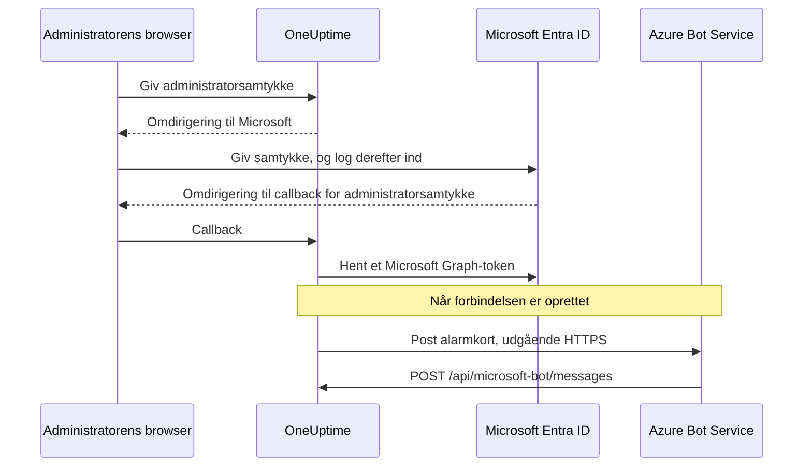
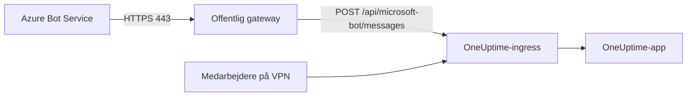

# Microsoft Teams-integration

Forbind din selvhostede OneUptime med Microsoft Teams. Du registrerer en app i Microsoft Entra ID, opretter en Azure Bot til den, giver OneUptime appens loginoplysninger og installerer den Teams-app-pakke, din server genererer. Derefter poster OneUptime alarmer og hændelser i dine kanaler og chats, og dit team handler på dem direkte fra Teams.

Denne side er til den, der driver OneUptime-serveren. Når Teams er forbundet, sættes notifikationsregler op pr. projekt: se [Microsoft Teams](/docs/workspace-connections/microsoft-teams).

:::cards
- [Sæt integrationen op](#sæt-integrationen-op): Ni trin, fra Azure-portalen til dit første team.
- [Miljøvariabler](#miljøvariabler): De tre værdier, OneUptime skal bruge fra app-registreringen.
- [Netværksadgang](#netværksadgang): Bot-endpointet, som Microsoft skal kunne nå.
- [Fejlfinding](#fejlfinding): Endpoints, der ikke kan nås, manglende installationer og forbindelser, der mislykkedes.
:::

## Sådan fungerer det

OneUptime bruger en Azure Bot til Teams-integrationen. Trafikken går begge veje, og de to retninger er uafhængige: OneUptime kalder Microsoft for at poste beskeder, og Azure Bot Service kalder din server, når nogen trykker på en knap, skriver til botten eller føjer den til en chat.



En Incoming Webhook eller en Teams-workflow-URL erstatter ikke denne bots beskedendpoint.

Videoopkald (et Teams-møde for en hændelse) bruger ikke denne bot: de kræver deres egen app-registrering, beskrevet i [Videoopkald](/docs/workspace-connections/video-calls#forbind-med-ét-klik-på-en-selvhostet-server).

## Før du går i gang

- Et Azure-abonnement til Azure Bot-ressourcen.
- En konto, der kan oprette app-registreringer i Microsoft Entra ID, og en Microsoft 365-administrator, der kan give administratorsamtykke.
- Et offentligt HTTPS-værtsnavn til OneUptime, som Azure Bot Service kan nå. Se [Netværksadgang](#netværksadgang).
- Adgang til serverkonfigurationen: `config.env` med Docker Compose eller dine Helm-values på Kubernetes.
- For at forbinde et projekt: rollen **Project Owner**, **Project Admin** eller **Project Member** i det.

## Sæt integrationen op

:::steps
### Trin 1: Opret Azure-app-registreringen

Åbn **App registrations** i [Azure-portalen](https://portal.azure.com), og vælg **New registration**. Udfyld formularen:

- **Name:** oneuptime
- **Supported account types:** Accounts in this organizational directory only (Single tenant)
- **Redirect URI:** Web - `https://your-oneuptime-domain.com/api/microsoft-teams/auth`

Vælg **Register**, og tilføj derefter en anden Web-omdirigerings-URI, `https://your-oneuptime-domain.com/api/microsoft-teams/admin-consent/callback`. Notér **Application (client) ID** og **Directory (tenant) ID**: du skal bruge begge senere.

> [!NOTE]
> **Hvorfor én tenant:** en selvhostet OneUptime-installation betjener én organisation, og dens bot er registreret til den ene tenant, du angiver i `MICROSOFT_TEAMS_APP_TENANT_ID` (trin 6). At registrere appen som multitenant udvider ikke det og indfører en fejlmåde: gæste- / B2B-brugere, hvis egen Microsoft-tenant er en anden end din, når botten med deres eget tenant-id, som OneUptime ikke kan matche med dit projekt. Har du allerede registreret en multitenant-app, fortsætter den med at virke; sørg bare for, at `MICROSOFT_TEAMS_APP_TENANT_ID` er din egen tenant, og regn med, at gæstekonti skal have en konto i din tenant for at bruge botten.

### Trin 2: Konfigurer appens tilladelser

Åbn **API permissions** i din app-registrering, vælg **Add a permission**, og vælg **Microsoft Graph**.

**Tilføj delegerede tilladelser** (når appen handler på vegne af en logget ind bruger):

- **User.Read** - Kræves for at hente den godkendte brugers profiloplysninger (visningsnavn, e-mail) under OAuth-flowet
- **Team.ReadBasic.All** - Kræves for at liste de teams, brugeren er medlem af, når brugeren vælger, hvilket team der skal forbindes
- **Channel.ReadBasic.All** - Kræves for at læse kanaloplysninger og liste kanaler i teams til levering af notifikationer
- **ChannelMessage.Send** - Kræves for at sende notifikationer om alarmer og hændelser til Teams-kanaler

**Tilføj programtilladelser** (når appen handler som sig selv, uden en logget ind bruger):

- **Team.ReadBasic.All** - Kræves for at liste alle teams i organisationen, når administratorsamtykke er givet
- **Channel.ReadBasic.All** - Kræves for at kontrollere, at kanaler findes, og hente deres detaljer
- **TeamsAppInstallation.ReadForTeam.All** - Kræves til diagnosticering. Den lader OneUptime læse, hvilken app-pakke der faktisk er installeret i et team, og sammenligne den med denne installations klient-id, så en mislykket afsendelse kan fortælle dig, *hvilken* af de mulige årsager det er. Uden den kan OneUptime ikke skelne "ikke installeret" fra "installeret, men det er en andens pakke", og den melder kun, hvad Microsoft sagde. Det er hovedårsagen til, at fejlfinding af denne integration tager dage i stedet for minutter. Giv den.
- **Chat.ReadBasic.WhereInstalled** - Valgfri. Den lader OneUptime læse navnet på hver chat, OneUptime-appen er i. Uden den giver hver chat det via manifesttilladelsen **ChatSettings.Read.Chat** (nedenfor), som en chat, der blev tilføjet med et ældre manifest, først har, når appen er opdateret i den.

`ChannelMessage.Send` er kun en delegeret tilladelse; der findes ingen variant som programtilladelse i [Microsoft Graphs tilladelsesreference](https://learn.microsoft.com/en-us/graph/permissions-reference#channelmessagesend). Behold den på listen over delegerede tilladelser ovenfor.

Vælg derefter **Grant admin consent** for din organisation.

Selve botten bruger tilladelser til ressourcespecifikt samtykke (RSC), der er defineret i Teams-appmanifestet. De gives, når appen installeres eller opdateres i et team eller en chat, ikke i Entra ID:

- **ChannelMessage.Send.Group** - Lader botten sende beskeder til teamkanaler
- **ChannelMessage.Read.Group** - Lader botten læse kanalbeskeder til interaktive kommandoer
- **Channel.Create.Group** - Lader botten oprette kanaler efter behov
- **ChatMessage.Read.Chat** - Lader botten læse beskeder i chats, den er føjet til (til interaktive kommandoer)
- **ChatMember.Read.Chat** - Lader botten læse medlemmerne af chats, den er føjet til (for at navngive chats i OneUptime)
- **ChatSettings.Read.Chat** - Lader OneUptime læse navnet på gruppechats, appen er føjet til. Teams sender ikke pålideligt navnet på en gruppechat til botten, så uden den vises en navngivet gruppechat med medlemmernes navne
- **TeamsAppInstallation.Read.Group** - Lader OneUptime bekræfte, at appen er installeret i et team, den skal poste i

Hvis du uploadede appmanifestet, før disse tilladelser fandtes, så download det igen fra **Projektindstillinger > Arbejdsområde > Microsoft Teams**, og upload det til Teams som en opdatering af OneUptime-appen. Teams giver team- og chattilladelserne, når appen installeres eller opdateres i det team eller den chat, så accepter opdateringen i hvert team og hver chat, der allerede har appen. For chats, se [En gruppechat vises med medlemmernes navne](#en-gruppechat-vises-med-medlemmernes-navne).

### Trin 3: Opret en klienthemmelighed

Åbn **Certificates & secrets** i din app-registrering, og vælg **New client secret**. Tilføj en beskrivelse, vælg en udløbsperiode (24 måneder er et fornuftigt valg), og vælg **Add**. Kopiér hemmelighedens værdi med det samme: Azure viser den kun én gang.

> [!IMPORTANT]
> Kopiér hemmelighedens **Value**, ikke dens **Secret ID**. Værdien er den længste streng.

### Trin 4: Opret en Bot Service

Opret en **Azure Bot**-ressource i Azure-portalen:

- **Bot handle:** oneuptime-bot
- **Subscription** og **Resource group:** dine egne
- **Pricing tier:** F0 (Free) er nok til test
- **Type of App:** Single Tenant, med den eksisterende app-registrering: dens **Application (client) ID** og **Directory (tenant) ID** fra trin 1

Vælg **Review + create** og derefter **Create**. Når botten er udrullet, åbner du dens side **Configuration**, sætter **Messaging endpoint** til `https://your-oneuptime-domain.com/api/microsoft-bot/messages` og gemmer.

**Bekræft endpointet, før du går videre.** Azure Bot Service kalder denne URL fra det offentlige internet, så test den fra et sted uden for dit netværk: ikke inde fra klyngen og ikke over en VPN, der kan se værten, når Azure ikke kan:

```bash
curl -sS -i https://your-oneuptime-domain.com/api/microsoft-bot/messages
```

Brug `-i` i stedet for kun at se på statuskoden: ved en 404 er **brødteksten det eneste, der fortæller dig, hvem der genererede den**, og den forskel er hele diagnosen.

- **405** er korrekt og betyder, at du er færdig. Endpointet accepterer kun POST, så en GET får `405 Method Not Allowed` med `Allow: POST` og en beskrivelse af endpointet. Det er netop det, der testes, at den nås.
- **En 404 med JSON-brødteksten `{"message":"Page not found - /api/microsoft-bot/messages"}`** kommer fra OneUptime, så forespørgslen *nåede* frem. Enten er denne installation ældre end 405-svaret ovenfor (ældre versioner betjente kun denne rute for POST, så en GET endte i den generelle "not found"-handler), eller også omskriver noget foran OneUptime stien og fjerner præfikset `/api`, før appen ser den (en Kubernetes-ingress med `rewrite-target: /` er den sædvanlige synder).
- **En 404 med en HTML-fejlside** fra nginx, din ingress eller en load balancer betyder det modsatte: forespørgslen nåede aldrig OneUptime, og det, der står foran, sender ikke `/api` videre til appen.
- **En TLS-fejl, en timeout eller en afvist forbindelse** betyder, at Azure heller ikke kommer igennem. Se [fejlfindingen for beskedendpointet](#kortknapper-siger-unable-to-reach-app-og-chats-dukker-aldrig-op) længere nede.

### Trin 5: Føj Microsoft Teams-kanalen til botten

Åbn **Channels** i din Azure Bot-ressource, og tilføj **Microsoft Teams**. Behold standardindstillingerne for beskeder, medmindre du har særlige behov, og gem. Uden denne kanal bliver botten aldrig klargjort i Teams-samtaler.

### Trin 6: Konfigurer OneUptimes miljøvariabler

Giv OneUptime appens loginoplysninger:

:::tabs
@tab Docker Compose
```bash title="config.env"
MICROSOFT_TEAMS_APP_CLIENT_ID=YOUR_TEAMS_APP_CLIENT_ID
MICROSOFT_TEAMS_APP_CLIENT_SECRET=YOUR_TEAMS_APP_CLIENT_SECRET
MICROSOFT_TEAMS_APP_TENANT_ID=YOUR_MICROSOFT_TENANT_ID
```

Anvend ændringen med `npm run start`, som genopretter containerne. `docker compose restart` genindlæser ikke `config.env`.
@tab Kubernetes
```yaml title="values.yaml"
microsoftTeamsApp:
  clientId: YOUR_TEAMS_APP_CLIENT_ID
  clientSecret: YOUR_TEAMS_APP_CLIENT_SECRET
  tenantId: YOUR_MICROSOFT_TENANT_ID
```

Vil du gemme værdierne i en Kubernetes-Secret, du selv administrerer, så angiv i stedet `microsoftTeamsApp.existingSecret`: dens `name` og nøglerne `clientIdKey`, `clientSecretKey` og `tenantIdKey`. Anvend ændringen med `helm upgrade`.
:::

Når OneUptime kører igen, viser **Projektindstillinger > Arbejdsområde > Microsoft Teams** kortet **Giv administratorsamtykke** i stedet for opsætningsvejledningen.

### Trin 7: Giv administratorsamtykke i OneUptime

Åbn **Projektindstillinger > Arbejdsområde > Microsoft Teams**, og vælg **Giv administratorsamtykke**. Log ind hos Microsoft som Microsoft 365-administrator, og accepter tilladelserne. Microsoft sender dig tilbage til samme side, og kortet viser **Admin Consent Completed**: projektet er nu forbundet med din tenant.

Vælg derefter **Connect my account with Microsoft Teams** for at knytte din egen konto. Andre projektmedlemmer gør det samme fra **Brugerindstillinger > Arbejdsområde > Microsoft Teams**.

### Trin 8: Upload Teams-appmanifestet

Efter administratorsamtykket viser **Projektindstillinger > Arbejdsområde > Microsoft Teams** kortet **Action Required: Install This Deployment's App on Microsoft Teams**. Vælg **Download app-manifest-zip**: pakken indeholder denne installations bot-id.

Åbn **Apps > Manage your apps** i Microsoft Teams, vælg **Upload an app**, derefter **Upload a custom app**, og vælg den zip, du downloadede.

> [!WARNING]
> Installer ikke "OneUptime" fra Microsoft Teams-butikken til en selvhostet installation. Butiksappen peger på OneUptime Clouds bot, så Teams accepterer den og afviser derefter hver besked, denne installation sender.

### Trin 9: Føj OneUptime til hvert team (påkrævet)

Når du uploader manifestet, installeres appen for **dig**. Det giver **ikke** botten adgang til kanalerne i noget team. Microsoft accepterer kun beskeder i et team, appen er føjet til, så du skal gøre det i hvert team, hvor du vil have notifikationer:

1. Klik på "..." ud for **teamnavnet** i Microsoft Teams (ikke kanalnavnet)
2. Vælg **Manage team** > **Apps** > **More apps**
3. Søg efter **OneUptime**, og klik på **Add**

Bemærkninger:

- At installere OneUptime for dig selv eller føje den til en chat er en **anden** installation. Ingen af dem lader den poste i et teams kanaler.
- **Private kanaler** skal have appen installeret i selve kanalen: åbn kanalen > "..." > **Manage channel** > **Apps** > **Add an app**. En installation på teamniveau dækker ikke private kanaler.
- **Delte kanaler** kan slet ikke modtage notifikationer: Microsoft Teams understøtter ikke bots i delte kanaler. OneUptime skjuler dem i kanalvælgeren.
- Hvis **Manage team > Apps > More apps** er tom eller nedtonet, blokerer din Teams-politik for appopsætning brugerdefinerede apps. Ret det i Teams Administration under **Teams apps > Manage apps** og **Setup policies**.
:::

## Miljøvariabler

| Docker Compose (`config.env`) | Helm (`values.yaml`) | Værdi |
| --- | --- | --- |
| `MICROSOFT_TEAMS_APP_CLIENT_ID` | `microsoftTeamsApp.clientId` | **Application (client) ID**. Det er også bot-id'et i Teams-app-pakken, så det skal være et GUID. |
| `MICROSOFT_TEAMS_APP_CLIENT_SECRET` | `microsoftTeamsApp.clientSecret` | Klienthemmelighedens **Value**, ikke dens id. |
| `MICROSOFT_TEAMS_APP_TENANT_ID` | `microsoftTeamsApp.tenantId` | **Directory (tenant) ID**. Botten godkender sig som en single-tenant-app i denne tenant. |
| `HOST` | `host` | Dit offentlige værtsnavn. Omdirigerings-URI'erne, beskedendpointet og Teams-app-pakken bygges ud fra det. |
| `HTTP_PROTOCOL` | `httpProtocol` | `https`. Azure Bot Service kalder kun HTTPS-endpoints. |

Alle tre værdier `MICROSOFT_TEAMS_APP_*` er påkrævede:

- Uden klient-id'et viser Microsoft Teams-siden opsætningsvejledningen i stedet for **Giv administratorsamtykke**.
- Uden klient-id'et eller hemmeligheden ender forbindelsen med **"Microsoft Teams er ikke sat op på denne OneUptime-server."**
- Uden tenant-id'et kan botten ikke godkende sig, så både postning og bot-endpointet fejler.

## Netværksadgang

Microsoft kræver et [offentligt tilgængeligt HTTPS-endpoint til en selvhostet bot](https://learn.microsoft.com/en-us/azure/bot-service/bot-service-resources-faq-security?view=azure-bot-service-4.0). En privat IP-adresse, et internt DNS-navn eller en medarbejders VPN-forbindelse giver ikke Azure Bot Service adgang til OneUptime.

| Retning | Destination | Formål |
| --- | --- | --- |
| Fra OneUptime til Microsoft | HTTPS over TCP 443 til Microsoft Graph, Microsoft-identitet og Bot Framework-tjenesterne | Tokenudveksling, opslag af teams og kanaler samt levering af notifikationer |
| Fra Microsoft til OneUptime | `POST /api/microsoft-bot/messages` | Botbeskeder, installationshændelser i samtaler og korthandlinger |
| Fra brugerens browser til OneUptime | `/api/microsoft-teams/auth` og `/api/microsoft-teams/admin-consent/callback` | Omdirigeringer for login og administratorsamtykke |

App-registreringens omdirigeringer til `/api/microsoft-teams/auth` og `/api/microsoft-teams/admin-consent/callback` vender tilbage gennem brugerens browser. Den browser skal kunne nå OneUptime, for eksempel via virksomhedens netværk eller VPN. Botbeskeder og korthandlinger kommer fra Microsofts servere og kræver deres egen tilgængelige ingress. Udgående levering af alarmer alene bekræfter ikke indgående forbindelse.

### Udgiv bot-endpointet fra en privat udrulning



:::steps
1. Lad den offentlige DNS for dit OneUptime-værtsnavn pege på en reverse proxy eller load balancer, der vender mod internettet. Tillad indgående TCP 443, og server et offentligt betroet TLS-certifikat med hele kæden.
2. Forbind gatewayen med OneUptimes private ingress, direkte eller via din egen site-to-site-VPN / private forbindelse, og tillad dens origin-tjenesteport. En Kubernetes-`ClusterIP`-tjeneste kræver en tilgængelig ingress eller en anden rute fra gatewayen. Hold databaser og andre interne tjenester private.
3. Udgiv `/api/microsoft-bot/messages` gennem den gateway, og sæt Azure Bottens **Messaging endpoint** fra trin 4 til den fulde offentlige HTTPS-URL. Bevar metoden, præfikset `/api`, forespørgselsstrengen, brødteksten og headeren `Authorization`. Bevar den offentlige `Host`, og sæt betroede forwarding-headere for den offentlige vært og HTTPS-skemaet. Tilføj ikke omdirigeringer, browser-SSO, CAPTCHA eller proxy-login til denne rute; OneUptimes Bot Framework-adapter skal modtage og godkende forespørgslen.
4. Hold andre ruter private, hvis det er nødvendigt. Med split DNS kan medarbejdere slå det samme værtsnavn op til den private ingress via virksomhedens netværk eller VPN. Den ingress skal også servere HTTPS med et certifikat, der er gyldigt for værtsnavnet, og tillade browseromdirigeringerne fra tabellen ovenfor. Begræns adgangen til origin til gatewayen og godkendte interne klienter.
5. Sæt `HOST=oneuptime.example.com` og `HTTP_PROTOCOL=https` i Docker Compose' `config.env`, eller `host: oneuptime.example.com` og `httpProtocol: https` i Helm-values. Erstat eksemplet med dit domæne, anvend opdateringen af udrulningen, og vent på, at appen genstarter. Disse værdier genererer URL'er; de klargør ikke DNS, TLS eller netværksadgang. Hvis værtsnavnet ændres, så opdater Azure Bot-endpointet og app-registreringens omdirigeringer, og download og upload Teams-manifestet igen.
:::

OneUptimes [indstillinger for adgang til private netværk](/docs/self-hosted/private-network-access) styrer udgående forespørgsler til interne tjenester. At slå `ALLOW_PRIVATE_NETWORK_WEBHOOKS` til gør ikke bot-endpointet tilgængeligt for Microsoft.

### Udgående adgang og IP-begrænsninger

Tillad DNS-opslag og udgående HTTPS fra OneUptime-appen. Brug `graph.microsoft.com`, `login.microsoftonline.com`, Bot Frameworks godkendelses- og kanalendpoints og den connector-tjeneste-URL, der angives for en samtale. Fallback-connectoren i den kommercielle cloud er `https://smba.trafficmanager.net/teams/`; samtalers tjeneste-URL'er kan være andre. Følg [Microsofts firewallvejledning](https://learn.microsoft.com/en-us/azure/bot-service/bot-service-resources-faq-security?view=azure-bot-service-4.0), og undersøg blokeret trafik under test; dette er ikke en udtømmende liste over værtsnavne.

Microsoft understøtter ikke faste IP-tilladelseslister for indgående Bot Framework-trafik, fordi dens kildeadresser ændrer sig. IP-intervallerne for medier fra Teams-klienter beskriver ikke, hvor botwebhooks kommer fra. Hold Bot Framework-godkendelsen slået til i stedet for at behandle en kilde-IP som bevis for identitet.

### Test og udrulninger uden indgående adgang

Brug trin 4 til at bekræfte offentlig DNS, TLS og routing uden for dit netværk og din VPN. Forbind derefter Teams, send en testnotifikation, skriv til botten, og tryk på en knap på et kort. Bekræft handlingen i OneUptime, og sammenhold Microsofts leveringsdiagnosticering med gatewayens og appens logs. En tilgængelig GET-rute eller en leveret notifikation bekræfter ikke i sig selv en godkendt indgående bot-POST.

Til udvikling beskriver [Microsofts vejledning i at teste Teams-bots lokalt](https://learn.microsoft.com/en-us/microsoftteams/platform/bots/how-to/authentication/add-authentication#testing-the-bot-locally-in-teams), hvordan du gør en lokal tjeneste tilgængelig med en tunnel. Videresend til en proxy, der tillader bot-endpointet, og brug `/api/microsoft-bot/messages` i stedet for Microsofts eksempelsti `/api/messages`. Opdater det konfigurerede værtsnavn og Azure Bot-endpointet, hver gang tunnelens offentlige URL ændres, stop tunnelen efter testen, og brug en stabil ingress i produktion. En tunnel åbner også for indgående adgang.

> [!WARNING]
> Hvis en politik forbyder indgående forbindelser, kan den fulde Teams-botintegration ikke fungere: kommandoer, korthandlinger og opdagelse af samtaler afhænger af, at Microsoft når OneUptime. Azure Bot Private Endpoint løser ikke dette krav. Microsofts [vejledning i netværksisolering](https://learn.microsoft.com/en-us/azure/bot-service/dl-network-isolation-how-to?view=azure-bot-service-4.0) beskriver Direct Line-isolering og angiver, at deaktivering af offentlig netværksadgang ødelægger konfigurationen af Teams-kanaler. En helt afkoblet installation kan ikke bruge Teams.

## Fejlfinding

Start med disse kontroller:

- App-registreringen har tilladelserne ovenfor, og administratorsamtykke er givet.
- Omdirigerings-URI'erne matcher præcist (erstat `your-oneuptime-domain.com` med dit rigtige domæne).
- Miljøvariablerne er sat, og OneUptime er genstartet, efter du satte dem.
- Bottens beskedendpoint kan nås fra internettet, og botten har Microsoft Teams-kanalen.
- Den Teams-app-pakke, du uploadede, er den, der blev downloadet fra denne installation.

### Kortknapper siger "Unable to reach app", og chats dukker aldrig op

Disse symptomer betyder som regel, at **Azure Bot Service ikke kan levere godkendte aktiviteter til dit beskedendpoint**. Kontrollér routing, botgodkendelse og projektkonfiguration.

Det forvirrende er, at alarmkort stadig når Teams, hvilket får integrationen til at se næsten sund ud. Det er den ikke: de to retninger er uafhængige, og kun den ene virker:

| Retning | Hvordan den rejser | Skal Azure kunne nå dig? |
| --- | --- | --- |
| OneUptime poster et alarmkort i en kanal | OneUptime kalder Microsoft og godkender sig med din klienthemmelighed | **Nej** |
| Du trykker på en knap på det kort | Azure Bot Service sender en POST til `/api/microsoft-bot/messages` | **Ja** |
| Du skriver `help` til botten | Azure Bot Service sender en POST til `/api/microsoft-bot/messages` | **Ja** |
| En chat registreres i **Microsoft Teams Chats** | Azure Bot Service sender en botaktivitet med POST til `/api/microsoft-bot/messages` | **Ja** |

En alarm, der kommer frem, bekræfter altså den udgående afsendelse; den bekræfter ikke hver Graph-tilladelse eller det indgående bot-endpoint. Interaktive funktioner kræver, at indgående botaktiviteter behandles korrekt.

OneUptime registrerer chats ud fra botaktiviteter, såsom installation af appen, tilføjelse af botten til samtalen eller en besked til botten i den chat. De kommer alle ind gennem det samme indgående endpoint. En tom **Microsoft Teams Chats**-liste, efter at du har tilføjet appen og skrevet til den, betyder, at der ikke er registreret nogen chat for det projekt; kontrollér indgående forespørgsler, godkendelsesfejl og koblingen mellem tenant og projekt. Et klik på **Refresh Chats** genindlæser de chats, OneUptime har gemt, og genindlæser navnet på hver gemt gruppechat fra Microsoft.

**Diagnosticer det i denne rækkefølge:**

1. **Søg efter POST, ikke efter 404'erne.** Det er her, de fleste undersøgelser går galt:

   ```bash
   grep 'POST /api/microsoft-bot/messages' <your access log>
   ```

   Er der ingen POST-linjer, så bekræft, at den rigtige adgangslog registrerer forespørgsler, og kontrollér derefter det endpoint, der er konfigureret i Azure, og netværksstien. Kommer der POST'er ind, så undersøg deres svar og OneUptimes fejl i godkendelse eller projektkobling. `GET`-linjer, der returnerer 404, er en separat kontrol; se bemærkningen nedenfor.

2. **Kald endpointet uden for dit netværk,** som i trin 4, med `curl -i` for at se brødteksten. En `405` beviser, at ruten er aktiv og kan nås fra det sted, du kørte kommandoen. En TLS-fejl, en timeout eller en afvist forbindelse er dit svar.

3. **Kontrollér certifikatkæden.** Azure kræver HTTPS med et offentligt betroet certifikat, der serveres med hele kæden. Et selvsigneret certifikat, en intern CA eller et manglende mellemcertifikat får TLS-handshaket til at fejle, før OneUptime ser forespørgslen, så din adgangslog forbliver tom, og det ligner, at Azure aldrig prøvede:

   ```bash
   openssl s_client -connect your-oneuptime-domain.com:443 -servername your-oneuptime-domain.com -verify_return_error </dev/null
   ```

4. **Kontrollér, at værten kan slås op offentligt.** Et privat DNS-navn, en split-horizon-post eller en kun intern ingress når dig og din VPN, men forbliver usynlig for Azure. Slå den op fra et netværk uden adgang til dit.

5. **Bekræft endpointet i Azure Bot-ressourcen**: det skal matche denne installation præcist, inklusive skema og sti: `https://your-oneuptime-domain.com/api/microsoft-bot/messages`.

**En 404 på `GET /api/microsoft-bot/messages` er ikke fejlen og heller ikke et bevis på, at Azure ikke kunne nå dig.** Endpointet har altid kun accepteret POST, så i versioner før denne endte en GET fra browseren i OneUptimes generelle "not found"-handler og kom tilbage som `{"message":"Page not found - /api/microsoft-bot/messages"}`. Det ligner en manglende rute og har sendt mere end én administrator på jagt efter en regression, der ikke fandtes; men se, hvad det faktisk beviser: OneUptime genererede det svar, så forespørgslen nåede appen. Det fylder 58 bytes, og derfor står det i en adgangslog som `"GET /api/microsoft-bot/messages HTTP/1.1" 404 58`.

Denne version svarer på en GET med `405 Method Not Allowed` og en beskrivelse af sig selv, så forskellen behøver ikke længere en forklaring. Hvis du stadig kører en ældre version, så bedøm en 404 ud fra brødteksten: JSON fra OneUptime betyder, at forespørgslen nåede frem; en HTML-fejlside fra din proxy betyder, at den ikke gjorde.

### En gruppechat vises med medlemmernes navne

Teams sender ikke pålideligt navnet på en gruppechat til botten, så OneUptime læser det fra Microsoft Graph. Det kræver manifesttilladelsen **ChatSettings.Read.Chat**, som hver chat giver, når OneUptime-appen installeres eller opdateres i den. Chats, som appen blev føjet til med et ældre manifest, har den ikke, og **Refresh Chats** markerer dem. Ret det på en af disse to måder:

1. Download manifestet igen fra **Projektindstillinger > Arbejdsområde > Microsoft Teams**, upload det til Teams som en opdatering af OneUptime-appen, accepter opdateringen i hver af de chats, og klik derefter på **Refresh Chats**.
   - Teams accepterer kun uploaden som en opdatering, når dens version er højere end den installerede. Release-images sætter den ud fra `APP_VERSION`. Et build uden `APP_VERSION` bruger en fast reserveværdi, der kun ændres, når OneUptime ændrer manifestet; hvis Teams siger, at pakken ikke er nyere, så hæv manifestets `version`, før du uploader det.
   - Hvis din tenant kun tillader chattilladelser for forhåndsgodkendte apps, så føj først **ChatSettings.Read.Chat** til OneUptimes forhåndsgodkendelsespolitik (for eksempel `Update-MgBetaTeamAppPreapproval -TeamsAppId <app id> -ResourceSpecificApplicationPermissionsAllowedForChats @('ChatMember.Read.Chat','ChatMessage.Read.Chat','ChatSettings.Read.Chat')`), ellers kan den opdaterede app ikke føjes til chats.
2. Eller giv app-registreringen programtilladelsen **Chat.ReadBasic.WhereInstalled** (trin 2) med administratorsamtykke, og klik derefter på **Refresh Chats**. Det dækker hver chat, appen er i, på én gang, uden opdatering chat for chat. OneUptime bliver ved med at bruge sit nuværende Microsoft Graph-token, indtil det udløber, så en nyligt givet tilladelse kan tage op til en time om at træde i kraft.

En gruppechat, der ikke har et navn i Teams, vises med medlemmernes navne, og det er bevidst. En chat, der får nyt navn i Teams, får det nye navn, næste gang nogen klikker på **Refresh Chats**.

### Kontrollér denne installations botkonfiguration

```bash
curl -sS https://your-oneuptime-domain.com/api/microsoft-bot/test | jq
```

Det rapporterer, hvad OneUptime kan se lokalt: om `MICROSOFT_TEAMS_APP_CLIENT_ID` og `MICROSOFT_TEAMS_APP_CLIENT_SECRET` er sat, det beskedendpoint, denne installation forventer, og, mest nyttigt, det **bot-id**, som din Teams-app-pakke skal indeholde.

Det læser miljøvariabler og intet andet. Det kalder ikke Azure, så det kan ikke fortælle dig, om Azure Bot-ressourcen findes, om dens beskedendpoint peger hertil, om Teams-kanalen er slået til, om hemmeligheden stadig er gyldig, eller om Azure kan nå dig. Svaret siger det selv ved at liste, hvad det kontrollerede, og hvad det ikke kontrollerede, så det aldrig forveksles med grønt lys.

Den ene afgørende kontrol, det giver mulighed for: sammenlign det `botId`, det returnerer, med bot-id'et i den OneUptime-app, der er installeret i Teams. Hvis de er forskellige, kan den pakke ikke modtage beskeder fra denne installation; se trin 8.

### "The OneUptime app is not installed in the Microsoft Teams team ..."

OneUptime har kontrolleret det med Microsoft Graph, og appen mangler virkelig i det team (eller, for en privat kanal, i den kanal). Gennemfør **trin 9** ovenfor. OneUptime kan liste hver kanal i din tenant med Graphs programtilladelser, men kan kun *poste* i teams, som appen er medlem af.

### "Microsoft Teams refused the message ... because the OneUptime bot is not a member of that conversation"

Microsoft afviste postningen (med sine egne ord `BotNotInConversationRoster`), og OneUptime kunne **ikke** bekræfte, at appen mangler, så gå ikke ud fra det. Gennemgå årsagerne i rækkefølgen nedenfor; de to første ser, set fra Teams, helt ud som en korrekt opsætning.

1. **Appen i teamet er en anden pakke.** Det er ikke nok at se et ikon med navnet "OneUptime" under **Manage team > Apps**: det afgørende er, om den pakkes bot-id er `MICROSOFT_TEAMS_APP_CLIENT_ID` for *denne* installation. Den offentlige OneUptime-app fra Teams-butikken peger på OneUptime Clouds bot og accepterer aldrig postninger fra din selvhostede installation. Kun manifestet, der er downloadet fra **Projektindstillinger > Arbejdsområde > Microsoft Teams** (trin 8), er lavet til din installation. Er du i tvivl, så fjern appen fra teamet, upload dit eget manifest igen, og tilføj det.
2. **Azure Bot har ingen Microsoft Teams-kanal.** Gennemfør **trin 5**. Uden den bliver botten aldrig klargjort i Teams-samtaler, så den er ikke på medlemslisten for nogen kanal, selv om appen installeres uden problemer, og applisten ser rigtig ud.
3. **Appen er installeret for dig eller i en chat, men ikke i teamet.** Gennemfør **trin 9**.
4. **Kanalen er privat.** En installation på teamniveau dækker ikke private kanaler; se bemærkningerne i trin 9.

Giv **TeamsAppInstallation.ReadForTeam.All** (trin 2), så OneUptime fortæller dig, hvilken af disse det er, i stedet for at liste dem.

### Notifikationer virker i ét team, men ikke i et andet

Installation sker pr. team. At føje OneUptime til ét team gør intet for andre teams, og det gør det heller ikke at forbinde integrationen: det giver *læseadgang* til Graph i hele tenanten, og derfor kan kanalvælgeren vise dig kanaler fra teams, som botten ikke kan poste i. Gennemfør **trin 9** i hvert team, hvor du vil have notifikationer.

### "Testregel" virker, men rigtige notifikationer kommer aldrig frem

Kontrollér, hvilke destinationer reglen faktisk har slået til. En regel afprøver kun det, den er sat op til: med **Create Microsoft Teams Channel** slået til opretter testen en kanal og poster i den, hvilket beviser, at botten kan poste *i det team, hvor den kanal blev oprettet*, og intet om andre teams. **Projektindstillinger > Notifikationer > Notifikationslogs** registrerer hver testafsendelse, inklusive Microsofts nøjagtige fejl, når en mislykkes.

### "Sorry, I couldn't find your project configuration"

Den Microsoft-tenant, botaktiviteten kom fra, er ikke den tenant, der er forbundet med et OneUptime-projekt. Kontrollér tenant-id'et i dine serverlogs:

```bash
grep "Project auth not found for tenant ID" <your app logs>
```

Sammenlign det med den tenant, der er gemt for projektet:

```sql
SELECT "projectId", "workspaceProjectId"
FROM "WorkspaceProjectAuthToken"
WHERE "workspaceType" = 'MicrosoftTeams';
```

Hvis de ikke matcher, er den bruger, der skriver til botten, logget ind i en anden Microsoft-tenant (ofte en gæste- / B2B-konto, hvis egen tenant ikke er din). Bed brugeren om at bruge en konto fra den forbundne tenant eller om at @-nævne botten i en kanal i det forbundne team i stedet for i en 1:1-chat.

### "This Microsoft 365 organization is connected to more than one OneUptime project"

To eller flere OneUptime-projekter har forbundet den samme Microsoft-tenant. En botbesked indeholder kun et tenant-id, så OneUptime kan ikke vide, hvilket projekt du mener, og afviser i stedet for at gætte. Afbryd Microsoft Teams fra alle projekter undtagen ét.

### "Microsoft Teams App Client ID must be a valid GUID"

**Download app-manifest-zip** nægter at bygge en pakke, når `MICROSOFT_TEAMS_APP_CLIENT_ID` ikke er et GUID, fordi Teams kræver et til app- og bot-id'et. Kopiér **Application (client) ID** igen fra app-registreringens oversigtsside, sæt den, og anvend konfigurationen.

### Forbindelsen blev ikke fuldført

Når Microsoft sender dig tilbage, og forbindelsen ikke blev oprettet (da du gav administratorsamtykke eller loggede ind med Microsoft), viser den Microsoft Teams-side, du startede fra (**Projektindstillinger > Arbejdsområde > Microsoft Teams** eller dine egne **Brugerindstillinger > Arbejdsområde > Microsoft Teams**, hvis du forbandt din konto), **Microsoft Teams blev ikke forbundet** med en sætning på dit sprog, der fortæller hvorfor. Resten af siden indlæses som normalt, så du kan prøve igen med det samme. Den viser aldrig, hvad Microsoft selv svarede (for eksempel en `AADSTS`-kode): det står i OneUptimes serverlog sammen med årsagen.

| Siden siger | Hvad du skal gøre |
| --- | --- |
| **"Dette forbindelseslink er ugyldigt, er udløbet eller er allerede brugt. Start forfra."** | Linket virker én gang, i 15 minutter, i den browser, der startede det. Start forfra fra Microsoft Teams-siden, og bliv færdig inden for 15 minutter i samme browser. |
| **"Du har ikke tilladelse til at forbinde dette projekt til Microsoft Teams."** | At give administratorsamtykke for projektet kræver **Project Owner**, **Project Admin** eller **Project Member**. Det kontrolleres igen, når Microsoft sender dig tilbage. |
| **"Du er ikke længere medlem af dette projekt."** | For at forbinde din egen Microsoft-konto skal du være medlem af projektet, når Microsoft sender dig tilbage. |
| **"Du loggede ind i en anden Microsoft 365-organisation end den, denne forbindelse er til."** | Log ind med en konto fra den Microsoft 365-organisation, der gav administratorsamtykke, eller som projektet er forbundet med. |
| **"Din Microsoft 365-organisation har endnu ingen teams."** | Opret et team i Microsoft Teams, og giv derefter administratorsamtykke igen. |
| **"Forbindelsen blev annulleret, så intet blev ændret."** | Der blev ikke givet samtykke hos Microsoft. Start forfra, og accepter det. |
| **"Microsoft Teams er ikke sat op på denne OneUptime-server."** | Angiv klient-id og hemmelighed for Microsoft Teams-appen (se [trin 6](#trin-6-konfigurer-oneuptimes-miljøvariabler)), og genstart OneUptime. |
| **"OneUptime kunne ikke fuldføre forbindelsen. Prøv igen."** | Microsoft svarede med en fejl, eller en forespørgsel eller en skrivning mislykkedes under afslutningen. OneUptimes serverlog fortæller hvilken. Prøv igen; hvis det bliver ved, så kontrollér loggen og app-registreringens indstillinger. |

Vi vil gerne forbedre denne integration, så feedback er velkommen på [hello@oneuptime.com](mailto:hello@oneuptime.com).

## Næste trin

:::cards
- [Microsoft Teams](/docs/workspace-connections/microsoft-teams): Opret notifikationsregler og opsummeringer for projektet.
- [Slack-integration](/docs/self-hosted/slack-integration): Sæt også Slack-appen op på din server.
- [Adgang til privat netværk](/docs/self-hosted/private-network-access): Lad workflows og webhooks nå interne værktøjer.
:::
