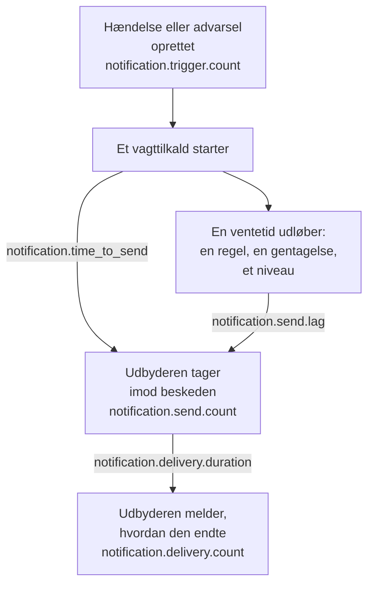

# Metrikker for notifikationslevering

OneUptime registrerer, hvordan det går med de notifikationer, det sender: hvor mange hændelser og advarsler der kalder på dem, om hver besked nåede sin udbyder, hvor lang tid et vagttilkald tog om at gå ud, og om det nåede telefonen. Send OneUptimes egen telemetri til et OneUptime-projekt eller til en hvilken som helst OpenTelemetry-backend for at sætte leveringsmål for de mennesker, din installation betjener, og for at kontrollere, at du holder dem.

:::cards
- [Slå dem til](#slå-dem-til): To indstillinger, og uden dem registreres intet.
- [Metrikkerne](#metrikkerne): Syv metrikker, fra udløseren til telefonen.
- [Sådan tages tid på et tilkald](#sådan-tages-tid-på-et-tilkald): Hvad tid til afsendelse og afsendelsesforsinkelse regnes fra.
- [SLO'er at starte med](#sloer-at-starte-med): Fire mål, forespørgsel for forespørgsel.
:::

## Sådan virker det



Hver besked tæller i `notification.send.count`, på hver kanal, ikke kun vagttilkald. De to tider, `notification.time_to_send` og `notification.send.lag`, dækker kun vagttilkald.

## Slå dem til

Intet registreres, før OneUptime har en OpenTelemetry-eksportør: uden en koster metrikkerne intet og gemmes ingen steder. Peg den mod et OneUptime-projekt med en Server-[indtagelsesnøgle](/docs/telemetry/ingestion-keys) fra det projekt, eller mod en hvilken som helst backend, der tager imod OTLP over HTTP.

:::tabs
@tab Kubernetes
```yaml
openTelemetryExporter:
  endpoint: https://oneuptime.example.com/otlp
  headers: x-oneuptime-token=YOUR_INGESTION_KEY
```
Deployments `app` og `worker` sender dem: lad `app.disableTelemetryCollection` og `worker.disableTelemetryCollection` stå på `false`, deres standard.
@tab Docker Compose
```bash
OPENTELEMETRY_EXPORTER_OTLP_ENDPOINT=https://oneuptime.example.com/otlp
OPENTELEMETRY_EXPORTER_OTLP_HEADERS=x-oneuptime-token=YOUR_INGESTION_KEY
DISABLE_TELEMETRY_FOR_APP=false
```
Angiv dem i `config.env`, og kør derefter `npm start`. `DISABLE_TELEMETRY_FOR_APP` er som standard `true`, og så sendes intet.
:::

OneUptime skal have både endpointet og headerne: uden en header sender det intet. Skriv hver header som `name=value`, og adskil flere med `;`. En værdi må gerne indeholde `=`. OneUptime tilføjer selv `/v1/metrics` til endpointet, og de samme indstillinger sender også dets egne traces og logs. Hver metrik dukker op, så snart OneUptime registrerer den første gang: `notification.send.count` med den første sendte besked.

### Send deltaer til et OneUptime-projekt

OneUptime sender tællere og histogrammer, som OpenTelemetry gør som standard: hvert punkt indeholder den løbende total, siden den serverproces startede. Måleudforskeren lægger punkterne i hvert trin af et diagram sammen, så den læser kun antal og percentiler for et tidsrum præcist ud fra deltaer, punkter, der indeholder det, der er sket siden det forrige. Når metrikkerne går til et OneUptime-projekt, så send deltaer:

:::tabs
@tab Kubernetes
```yaml
extraEnv:
  - name: OTEL_EXPORTER_OTLP_METRICS_TEMPORALITY_PREFERENCE
    value: delta
```
En tjenestes egen liste erstatter den for hele chartet: hvis du angiver `app.extraEnv` eller `worker.extraEnv`, så tilføj den også dér.
@tab Docker Compose
```yaml title="docker-compose.override.yml"
services:
  app:
    environment:
      OTEL_EXPORTER_OTLP_METRICS_TEMPORALITY_PREFERENCE: delta
```
Opret den ved siden af `docker-compose.yml`, eller føj dette til den, du har, og kør derefter `npm start`.
:::

Det gælder for hver metrik, OneUptime sender om sig selv. En backend, der selv læser løbende totaler, som Prometheus, har ikke brug for nogen ændring.

## Metrikkerne

| Metrik | Type | Enhed | Hvad den besvarer |
| --- | --- | --- | --- |
| `notification.trigger.count` | Tæller | `1` | Hvor mange poster der kaldte på notifikationer |
| `notification.send.count` | Tæller | `1` | Hvordan det gik med hver besked, der blev givet til en udbyder |
| `notification.send.duration` | Histogram | `ms` | Hvor lang tid udbyderen tog om at tage imod den |
| `notification.time_to_send` | Histogram | `ms` | Hvor længe efter sin udløser et tilkald nåede sin udbyder |
| `notification.send.lag` | Histogram | `ms` | Hvor længe efter forfaldstidspunktet en senere sendt notifikation nåede sin udbyder |
| `notification.delivery.count` | Tæller | `1` | Hvordan de beskeder, udbyderne tog imod, endte |
| `notification.delivery.duration` | Histogram | `ms` | Hvor længe efter at udbyderen tog imod den en besked endte |

Hver attribut har en af nogle få faste værdier, aldrig et projekt, en person, et telefonnummer eller en post. Den eneste undtagelse er en brugerdefineret kanals ID og navn: en installation har en håndfuld, og at kunne skelne dem ad er hele pointen.

### Poster, der giver folk besked

`notification.trigger.count` tæller hver hændelse, advarsel, hændelsesepisode og advarselsepisode, når den oprettes.

| Attribut | Værdier |
| --- | --- |
| `notification.trigger.type` | `incident`, `alert`, `incident_episode`, `alert_episode` |
| `notification.trigger.source` | `automatic`, når OneUptime oprettede den, fra en monitor eller en regel; `manual`, når en person eller API'et gjorde det |
| `monitor.type` | Typen af den monitor, der oprettede en hændelse eller en advarsel, såsom `Incoming Request`, `Logs` eller `Metrics`; udeladt, når ingen monitor gjorde det |

### Beskeder, der gives til en udbyder

`notification.send.count` tæller hver besked, der gives til en udbyder, og `notification.send.duration` tager tid på kaldet til udbyderen. Begge bærer disse attributter:

| Attribut | Værdier |
| --- | --- |
| `notification.channel` | `email`, `sms`, `call`, `whatsapp`, `telegram`, `push`, `webhook`, `slack`, `microsoft_teams`, `mattermost`, `custom_channel` |
| `notification.provider` | `twilio`, `sms_and_call_gateway`, `smtp`, `sendgrid`, `amazon_ses`, `mailgun`, `postmark`, `resend`, `microsoft_graph`, `expo`, `push_relay`, `web_push`, `meta_whatsapp`, `telegram_bot_api`, `slack`, `microsoft_teams`, `mattermost`, `webhook`, `custom_channel`, eller `none`, når intet blev givet til nogen |
| `notification.provider.config` | `global` for installationens egen konto og indstillinger; `project` for et projekts egen Twilio-konto, SMTP-server, webhook eller workspace-forbindelse, hvis fejl det er projektets opgave at rette |
| `notification.on_call_page` | `true` for en notifikation fra et vagttilkald, ellers `false` |
| `outcome` | `success`, `failure` eller `not_sent`, som nedenfor |
| `notification.destination` | Slack, Microsoft Teams og Mattermost: `direct_message` til én person, `channel` for et opslag i en kanal eller en Teams-gruppechat, `incoming_webhook` for en indgående webhook, såsom en statusside-abonnents. Webhooks: `status_page_subscriber` for en statusside-abonnents egen webhook. Udeladt for en persons webhook og for alle andre kanaler |
| `notification.custom_channel.id`, `notification.custom_channel.name` | Kun brugerdefinerede kanaler: kanalens ID og dens navn, afkortet til 100 tegn |

- `success`: udbyderen tog imod beskeden.
- `failure`: udbyderen afviste den eller kunne ikke nås, eller afsendelsen mislykkedes. En chatkanal, der ikke kunne findes, er en fejl uden varighed.
- `not_sent`: bevidst ikke sendt. Projektet har slået kanalen fra, har for lidt saldo eller er blokeret, push er slået fra på denne server, eller en brugerdefineret kanal er slået fra, slettet eller ikke dækket af licensen. En succesrate udelader dem: det er indstillinger, der virker, ikke platformen, der fejler.

En besked til en statusside-abonnents egen webhook tælles én gang, uanset hvor mange gange den blev forsøgt: `success`, når endpointet svarede med en 2xx-status, og `failure`, når det svarede med en anden status, ikke kunne nås, eller dets adresse ikke er tilladt.

### Hvad der nåede telefonen

`notification.delivery.count` tæller, hvordan hver besked, en udbyder tog imod, endte, som udbyderen melder det senere, én gang pr. besked. `notification.delivery.duration` tager tid på, hvor længe efter at udbyderen tog imod den. Begge bærer `notification.channel`, `notification.provider`, `notification.provider.config`, `notification.on_call_page` og `outcome`, den endelige status:

| Kanal | Udbyder | `outcome` | Varighed |
| --- | --- | --- | --- |
| `sms` | `twilio` | `delivered`, `undelivered`, `failed` | Indtil Twilio melder status |
| `call` | `twilio` | `answered`, `not_answered`, `failed` | Indtil opkaldet blev besvaret, eller ellers sluttede |
| `push` | `expo`, `push_relay` | `delivered`, `undelivered`, `failed` | Ikke målt: en kvittering siger, om Apple eller Google tog imod pushen, ikke hvornår |
| `whatsapp` | `meta_whatsapp` | `delivered`, `failed` | Indtil Meta melder status |

Et opkald, der ringede ud, var optaget eller blev afvist, er `not_answered`. En push til en app, der ikke findes længere, er `undelivered`, og en læst WhatsApp-besked tæller som leveret. `notification.provider.config` er kun `project` for SMS og opkald på et projekts egen Twilio-konto.

Statusser kommer kun, hvor udbyderen kan melde dem:

- SMS og opkald: gennem Twilio, når Twilio kan nå din server på dens `HOST` (se [Twilio-integration](/docs/self-hosted/twilio-integration#3-konfigurer-netværksadgang)). SMS- og opkaldsgatewayen melder ingen.
- WhatsApp: når Metas webhook er sat op til din installation.
- Push: fra Expos kvitteringer, som OneUptime læser omkring 15 minutter efter pushen, også gennem push-relayet. Den installation, der sendte pushen, tæller den.
- E-mail, Telegram, webhooks, chat og brugerdefinerede kanaler melder ingen endelig status.

## Sådan tages tid på et tilkald

### Tid til afsendelse

`notification.time_to_send` løber fra et tilkalds udløser, til udbyderen tager imod notifikationen. Den måler kun de notifikationer, der forfalder, når tilkaldet starter: personerne i den første eskaleringsregel, efter deres vagtregler, der ikke venter på noget, og ethvert niveau, tilkaldet går videre til med det samme, fordi det ikke nåede nogen. Ventetider, som vagtkonfigurationen beder om, er ikke platformens forsinkelse, så de er udeladt: de står i [afsendelsesforsinkelse](#afsendelsesforsinkelse). Kun notifikationer, som udbyderen tog imod, måles; en fejl viser sig i `notification.send.count`.

| Attribut | Værdier |
| --- | --- |
| `notification.channel` | Som på `notification.send.count` |
| `notification.page.start` | Hvad tiden regnes fra, som nedenfor |
| `notification.trigger.type` | Den post, tilkaldet gælder: `incident`, `alert`, `incident_episode`, `alert_episode` |
| `notification.custom_channel.id`, `notification.custom_channel.name` | Kun brugerdefinerede kanaler |

| `notification.page.start` | Tiden regnes fra |
| --- | --- |
| `monitor_data_received` | Da OneUptime modtog de data, der udløste monitoren: en indgående anmodning, en serveragents rapport, en indgående e-mail, en probes kontrol, en SNMP-trap eller en forespørgsel til en netværksenhed. Det omfatter den tid, dataene ventede i køen på at blive vurderet. |
| `record_created` | Da hændelsen, advarslen eller episoden blev oprettet: af en telemetrimonitor, en regel eller en person, og ved en kontrol for fravær, såsom et heartbeat, der stoppede. |
| `page_started` | Da et tilkald startede senere: en person, en arbejdsgang eller en regel, der nu passer, startede det, eller det er et direkte tilkald. For et tilkald, som dets vagtregel eller OneUptime AI holdt tilbage, da pausen udløb, eller da det startede, hvis det var før. For et nyt tilkald, da timeouten efter bekræftelse udløb. En worker, der nåede frem til et af dem for sent, viser sig altså i tiden. |

For en indgående anmodning løber tiden fra den seneste anmodning, endpointet modtog, så den kan blive en smule for kort.

### Afsendelsesforsinkelse

`notification.send.lag` løber fra det øjeblik, en senere sendt notifikation forfaldt, til udbyderen tager imod den. To workers sender dem, hver én gang i minuttet, så en worker, der er i tide, viser op til omkring et minut, og en, der er kommet bagud, viser hvor meget.

| `notification.schedule` | Forfalder når |
| --- | --- |
| `rule_wait` | En persons vagtregel, der venter, såsom "ring til mig efter 10 minutter": så længe efter at personen blev tilkaldt. Aldrig før workeren sidst gennemgik personens regler, så en regel, der tilføjes eller ændres senere, forfalder fra da. |
| `repeat` | En push, der gentages, indtil nogen kvitterer: hver gang dens interval udløber. |
| `escalation` | Et senere eskaleringsniveau: når niveauet før det har afsluttet sin ventetid, eller med det samme, når en person giver tilkaldet videre. |
| `policy_repeat` | Politikken, der starter forfra fra sit første niveau: når ventetiden på dens sidste niveau er udløbet. |

Den bærer også `notification.channel`, `notification.trigger.type` og, for brugerdefinerede kanaler, `notification.custom_channel.id` og `notification.custom_channel.name`. En notifikation, der forfalder, når dens tilkald starter, er aldrig med i den, heller ikke når en worker startede tilkaldet for sent, efter en pause eller som et nyt tilkald: den er i tid til afsendelse.

### Histogrammernes buckets

Hvert histogram har sine egne bucketgrænser, i millisekunder, sat så et mål kan aflæses ved en grænse:

| Histogram | Bucketgrænser, i millisekunder |
| --- | --- |
| `notification.send.duration` | `5, 10, 25, 50, 100, 250, 500, 1000, 2500, 5000, 10000, 30000, 60000, 120000` |
| `notification.time_to_send` | `250, 500, 1000, 2000, 5000, 10000, 15000, 30000, 60000, 120000, 300000, 600000, 1800000, 3600000` |
| `notification.send.lag` | `1000, 5000, 10000, 15000, 30000, 45000, 60000, 75000, 90000, 120000, 180000, 300000, 600000, 1800000, 3600000` |
| `notification.delivery.duration` | `500, 1000, 2000, 5000, 10000, 15000, 30000, 60000, 120000, 300000, 600000, 1800000, 3600000, 14400000, 86400000` |

En percentil beregnes ud fra buckets og tegnes som midten af den bucket, den falder i. Sammenlign den derfor med en buckets grænse: en P95 af `notification.time_to_send` på eller under 30000 betyder, at 95 % af tilkaldene tog 30 sekunder eller mindre.

## SLO'er at starte med

Fire mål, som de fleste installationer kan love, hvert bygget af en eller to forespørgsler i måleudforskeren i det projekt, der modtager metrikkerne. De læser et tidsrum præcist, når metrikkerne ankommer som deltaer: se [Send deltaer til et OneUptime-projekt](#send-deltaer-til-et-oneuptime-projekt).

### Byg et i måleudforskeren

:::steps
1. Åbn projektets [Måleudforsker](/docs/telemetry/metrics-explorer), og klik på målets første metrik. Dens forespørgsel er `a`.
2. Vælg dens aggregering under **Aggregate by**. Åbn derefter **Filters & grouping**, og tilføj hver af dens betingelser under **Filter by attributes**.
3. For en anden forespørgsel skal du klikke på **Tilføj metrik** og sætte `b` op på samme måde.
4. For en formel skal du klikke på **Tilføj formel** og skrive den i **Formel**.
5. For at få besked, når målet ikke nås, skal du klikke på **Handlinger → Opret monitor fra denne visning** og advare, når værdien overskrider målet: se [Metrik-monitor](/docs/monitor/metrics-monitor).
:::

For at følge et mål over 30 dage med et fejlbudget skal du knytte den monitor til en [SLO](/docs/slo/introduction): den tæller den tid, målet ikke blev nået.

### Vagt-SMS'er når Twilio

Højst 1 % af de vagt-SMS'er, der sendes gennem installationens egen Twilio-konto, fejler, så 99 % bliver taget imod.

| Forespørgsel | Metrik | Aggregering | Betingelser |
| --- | --- | --- | --- |
| `a` | `notification.send.count` | **Sum** | `notification.channel = sms`, `notification.on_call_page = true`, `notification.provider.config = global`, `outcome != not_sent` |
| `b` | `notification.send.count` | **Sum** | De samme, med `outcome = failure` |

Formlen `$b / $a * 100` er den andel, der fejlede, og målet holder, så længe den bliver på eller under 1. Et trin uden fejl tegner intet punkt, da `b` ikke har noget. `outcome != not_sent` udelader det, projekternes egne indstillinger holdt tilbage, og `global` projekternes egne Twilio-konti. På en installation, der sender SMS gennem sin SMS- og opkaldsgateway, måler de samme forespørgsler gatewayen. For en anden kanal skal du ændre `sms`: `call`, `push` eller `email`.

### Tilkald går ud inden for 30 sekunder

95 % af vagttilkaldene når deres udbyder inden for 30 sekunder efter deres udløser.

| Forespørgsel | Metrik | Aggregering | Betingelser |
| --- | --- | --- | --- |
| `a` | `notification.time_to_send` | **P95** | `notification.page.start != page_started` |

Målet holder, så længe `a` bliver på eller under 30000. Tilkald, der startes senere, måles fra deres start eller fra det tidspunkt, de forfaldt, ikke fra en udløser, så de er udeladt. Gruppér efter `notification.page.start` for at se monitorernes kø (`monitor_data_received`) adskilt fra resten, eller efter `notification.channel` for at finde en langsom kanal.

### Senere sendte notifikationer går ud inden for 90 sekunder

99 % af de notifikationer, der sendes efter en ventetid, når deres udbyder inden for 90 sekunder efter forfaldstidspunktet.

| Forespørgsel | Metrik | Aggregering | Betingelser |
| --- | --- | --- | --- |
| `a` | `notification.send.lag` | **P99** | — |

Målet holder, så længe `a` bliver på eller under 90000. Gruppér efter `notification.schedule` for at se, hvilken worker der kom bagud: `rule_wait` og `repeat` hører til den ene worker, `escalation` og `policy_repeat` til den anden.

### Vagt-SMS'er når telefonen

Højst 5 % af de vagt-SMS'er, som Twilio tog imod for installationens egen konto, bliver ikke leveret.

| Forespørgsel | Metrik | Aggregering | Betingelser |
| --- | --- | --- | --- |
| `a` | `notification.delivery.count` | **Sum** | `notification.channel = sms`, `notification.on_call_page = true`, `notification.provider.config = global` |
| `b` | `notification.delivery.count` | **Sum** | De samme, med `outcome != delivered` |

Formlen `$b / $a * 100` er den andel, der ikke blev leveret. Teleoperatører og slukkede telefoner afgør en del af den, så sæt målet ud fra det, du ser over et par uger. For opkald skal du bruge `call` og `outcome != answered`. Twilio skal kunne nå din server: se [Hvad der nåede telefonen](#hvad-der-nåede-telefonen).

## Fejlfinding

:::details Der kommer ingen notifikationsmetrikker
Kontrollér, at `OPENTELEMETRY_EXPORTER_OTLP_ENDPOINT` og `OPENTELEMETRY_EXPORTER_OTLP_HEADERS` begge er angivet, og i Docker Compose at `DISABLE_TELEMETRY_FOR_APP` er `false`, og genstart derefter OneUptime. Når OneUptime starter, logger det en advarsel, hvis det ikke kan læse en header, eller hvis det intet sender. En metrik dukker først op, når noget er registreret, så send først en notifikation.
:::

:::details Et antal vokser kun, eller en percentil rører sig næsten ikke
Metrikkerne ankommer som løbende totaler. Send deltaer: se [Send deltaer til et OneUptime-projekt](#send-deltaer-til-et-oneuptime-projekt).
:::

:::details Der kommer ingen endelige statusser
Endelige statusser kommer fra udbyderne, senere, og kun hvor de kan melde dem: se [Hvad der nåede telefonen](#hvad-der-nåede-telefonen). På en installation, som Twilio ikke kan nå, tælles SMS og opkald som sendt, men aldrig som leveret.
:::

## Næste skridt

:::cards
- [Måleudforsker](/docs/telemetry/metrics-explorer): Vis, kombinér og sammenlign enhver metrik.
- [Metrik-monitor](/docs/monitor/metrics-monitor): Advar, når et mål ikke nås.
- [Twilio-integration](/docs/self-hosted/twilio-integration): Lad Twilio melde, hvad der nåede telefonen.
- [Eskaleringsregler](/docs/on-call/escalation-rules): De ventetider, afsendelsesforsinkelsen regnes fra.
:::
