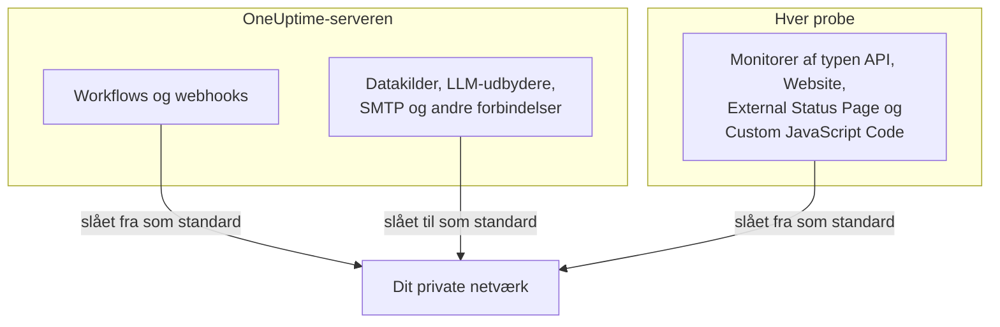

# Adgang til privat netværk

OneUptime nægter at sende visse udgående forespørgsler til værter, der slås op til et privat område, et loopback-område eller et link-local-område. Hvis du har prøvet at pege et workflow mod et internt værktøj, har du set beskeden:

> Webhook URL resolves to a private, loopback, or link-local address and is not allowed

Den standard er rigtig for det hostede produkt, hvor alle kan oprette sig, og målet for en webhook er input, man ikke kan stole på. På en selvhostet instans står den i vejen for noget helt almindeligt: at sende en alarm til en selvhostet Mattermost, Jira eller et ticketsystem, der kun findes på dit eget netværk.

Denne side forklarer, hvordan du tillader det, bevidst og snævert. Tre kontakter afgør det, hver for sin slags forbindelse, og de konfigureres på forskellige maskiner:

| Hvad du vil nå internt | Hvor indstillingen ligger | Standard på en selvhostet installation |
| --- | --- | --- |
| Workflows, projekt-webhooks, bruger-webhooks til vagt | Miljøet for **API-serveren** | Private adresser afvist |
| Datakilder, LLM-udbydere, SMTP-servere, OIDC-discovery og andre forbindelser | Miljøet for **API-serveren** | Private adresser tilladt |
| **Monitorer** af typen API, Website, External Status Page og Custom JavaScript Code | **Probens** eget miljø | Private adresser afvist |



Netværksnære monitortyper som Ping, Port, SSL-certifikat, DNS, DNSSEC, SNMP / Netværksenhed, SQL-forespørgsel, Databasesundhed, Synthetic og Network Path bruger deres egne transporter. Indstillingen på denne side styrer de HTTP-transporter, der returnerer vilkårligt svarindhold til et projekt: monitorer af typen API, Website, External Status Page og Custom JavaScript Code.

:::cards
- [Webhooks og workflows](#webhooks-og-workflows): Lad en webhook sende ind i dit netværk.
- [Andre udgående forbindelser](#andre-udgående-forbindelser): Datakilder, LLM-udbydere og mailservere.
- [Probes og monitorer](#probes-og-monitorer): Lad en probe tjekke private websteder.
- [Bekræft, at det virker](#bekræft-at-det-virker): Læs, hvilken kontakt en afvisning nævner.
:::

## Hvad der er blokeret, og hvad der kan frigives

Blokerede mål falder i to niveauer.

| Niveau | Områder | Kan det tillades? |
| --- | --- | --- |
| **Privat** | RFC-1918 (`10.0.0.0/8`, `172.16.0.0/12`, `192.168.0.0/16`), CGNAT (`100.64.0.0/10`), IPv6 unique-local (`fc00::/7`) og site-local (`fec0::/10`) | Ja |
| **Forbudt** | Loopback (`127.0.0.0/8`, `::1`), den uspecificerede adresse, link-local (`169.254.0.0/16`, `fe80::/10`), multicast, reserveret, broadcast samt navnene `localhost` og `metadata.google.internal` | Kun ved at nævne den præcise vært eller CIDR i webhook-tilladelseslisten. Aldrig for monitorer. |

Cloud-metadata-endpointet `169.254.169.254` ligger i det forbudte niveau af en grund. På en cloud-VM udleverer det instansens IAM-loginoplysninger til alt, der kan lave en HTTP-forespørgsel fra maskinen, så ingen generel indstilling vil nogensinde åbne det.

IPv6-skrivemåder, der bærer et IPv4-mål i sig – IPv4-mapped (`::ffff:10.0.0.5`), NAT64, 6to4, Teredo – klassificeres efter den IPv4-adresse, de når, så de kan ikke bruges til at smugle en forbudt adresse forbi en tilladelse til det private niveau.

## Webhooks og workflows

Disse destinationer er omfattet, fordi målet er en URL, som et godkendt medlem af dit projekt har skrevet:

- **API**-komponenter i workflows (GET / POST / PUT / PATCH / DELETE)
- HTTP-forespørgsler fra workflow-komponenten **Custom JavaScript**
- Projektets webhook-notifikationer (hændelser, alarmer, monitorer, vagt, planlagt vedligeholdelse, hændelser på statussider)
- **Bruger-webhooks** til vagt

**Ikke** omfattet, og det bliver de aldrig: **webhooks for abonnenter på statussider**. Enhver besøgende på en offentlig statusside kan registrere en, så at løsne den destination ville lade alle på internettet få din server til at POSTe ind i dit private netværk. Det kan ikke konfigureres.

Udgående forbindelser, der ikke er webhooks – eksterne datakilder, LLM-udbydere, SMTP-servere (et projekts SMTP-indstillinger og workflow-komponenten **Email**), SMTP-OAuth-token-endpoints, OIDC-discovery og HTTP-trin i runbooks – styres særskilt, af `DATA_SOURCE_BLOCK_PRIVATE_ADDRESSES`, og tillader allerede private områder på selvhostede installationer. Se [Andre udgående forbindelser](#andre-udgående-forbindelser).

### Konfigurer API-serveren

Sæt den ene eller begge af disse på API-serveren, og genstart den. De er slået fra som standard, så en instans, der ikke sætter nogen af dem, opfører sig præcis som før.

| Variabel | Helm-værdi | Hvad den tillader |
| --- | --- | --- |
| `ALLOW_PRIVATE_NETWORK_WEBHOOKS` | `webhooks.allowPrivateNetwork` | Hele det private niveau, når den er sat til `true`. |
| `PRIVATE_NETWORK_WEBHOOK_ALLOWLIST` | `webhooks.privateNetworkAllowlist` | De værter og CIDR'er, den nævner, uanset niveau. |

:::tabs
@tab Docker Compose
```bash title="config.env"
ALLOW_PRIVATE_NETWORK_WEBHOOKS=true
PRIVATE_NETWORK_WEBHOOK_ALLOWLIST=mattermost.internal,*.svc.cluster.local,10.20.0.0/16
```
@tab Kubernetes
```yaml title="values.yaml"
webhooks:
  allowPrivateNetwork: true
  privateNetworkAllowlist: "mattermost.internal,10.20.0.0/16"
```
:::

På Docker Compose har `config.env` en linje `ALLOW_PRIVATE_NETWORK_WEBHOOKS=false`: Ret den i stedet for at tilføje en linje mere, og kør så `npm run start`. På Kubernetes opgraderer du releasen.

Poster i tilladelseslisten kan adskilles med kommaer, mellemrum eller linjeskift, og hver kan være:

- et værtsnavn – `mattermost.internal`
- et jokertegn – `*.svc.cluster.local` (matcher underdomæner, ikke selve suffikset)
- en IPv4- eller IPv6-adresse – `10.20.30.40`, `fd00::1`
- en CIDR – `10.20.0.0/16`, `fd12:3456::/32`

Et skema, en port, en sti eller brugeroplysninger i en post fjernes, så det virker at indsætte den webhook-URL, du allerede har.

Et værtsnavn, der er nævnt i tilladelseslisten, stoles på **uden DNS-tjek** – det er netop meningen med at nævne det, da det forventes at blive slået op til noget, som blokeringslisten ville afvise. En adressepost sammenlignes med den bogstavelige værdi i URL'en og med hver adresse, DNS returnerer for den.

> [!CAUTION]
> **Sæt aldrig `169.254.169.254`, eller et område, der indeholder den, i tilladelseslisten.** På en cloud-VM giver det hvert projektmedlem din instans' IAM-loginoplysninger.

## Andre udgående forbindelser

En anden beskyttelse dækker udgående forbindelser, hvis mål et projektmedlem vælger, men som ikke er webhooks:

- eksterne datakilder (PostgreSQL-, MySQL-, SQL Server-, ClickHouse-, Elasticsearch- og REST API-forbindelser), forbindelser til sikkerhedshændelser som Splunk samt threat intel-feeds
- LLM-udbydere, herunder en selvhostet Ollama eller vLLM
- SMTP-servere – et projekts SMTP-indstillinger og workflow-komponenten **Email** – samt OAuth-token-URL'er til SMTP og workflows
- OIDC-discovery til single sign-on
- verificering af egne domæner for statussider og dashboards
- HTTP-trin i runbooks
- URL'en til Grafana OnCall-API'et, som en import læser fra (**Projektindstillinger** > **Grundlæggende** > **Importér fra et andet værktøj**)

Denne beskyttelse virker omvendt af webhook-indstillingerne. På en selvhostet installation **tillader** den det private niveau som standard, fordi databasen, mailserveren eller modelserveren, som disse forbindelser går til, som regel ligger på dit eget netværk. Det forbudte niveau – loopback, link-local og cloud-metadata-endpointet – afvises under alle omstændigheder, og der findes ingen tilladelsesliste for det.

`DATA_SOURCE_BLOCK_PRIVATE_ADDRESSES` strammer den. Sæt den til `true` for også at afvise det private niveau for disse forbindelser, for eksempel når projekterne på din instans tilhører personer, der ikke bør nå dit interne netværk:

:::tabs
@tab Docker Compose
```bash title="config.env"
DATA_SOURCE_BLOCK_PRIVATE_ADDRESSES=true
```
@tab Kubernetes
```yaml title="values.yaml"
outboundConnections:
  blockPrivateNetwork: true
```
:::

Denne indstilling gælder ikke for en global LLM-udbyder, som en administrator konfigurerer i stedet for et projekt (med variablerne `GLOBAL_LLM_PROVIDER_*`, Helm-chartets værdi `vllm.globalProvider` eller i Admin-dashboard under **Indstillinger** > **Globale LLM-udbydere**): En sådan udbyder kan stadig nå private adresser, selv om loopback og link-local også forbliver afvist for den.

Kun den præcise værdi `true` slår den til. På en instans med `BILLING_ENABLED=true` er den altid slået til, uanset hvad du sætter. Den ændrer ikke, hvilke mål webhook-indstillingerne ovenfor eller probe-indstillingen nedenfor tillader; hver port konfigureres for sig. Den ændrer derimod, hvordan afvisninger formuleres, også for webhooks og workflow-forespørgsler: Når den er slået til, rapporteres et afvist værtsnavn uden at sige, hvad det blev slået op til (se [Bekræft, at det virker](#bekræft-at-det-virker)).

På Docker Compose har `config.env` en linje `DATA_SOURCE_BLOCK_PRIVATE_ADDRESSES=false` (tilføj den, hvis din `config.env` er ældre). Ret den linje til `true` i stedet for at tilføje en linje mere, og kør så `npm run start`, så containerne genskabes med den nye værdi; `docker compose restart` læser ikke `config.env` igen. På Kubernetes sætter du den i din values-fil og opgraderer releasen; chartet giver den videre til app- og worker-podsene.

Når den er slået til, rapporteres et afvist værtsnavn uden at sige, hvad det blev slået op til, for eksempel _"LLM provider host ollama.internal could not be reached."_ Et navn, der slet ikke kan slås op, får samme besked, så projektmedlemmer ikke kan bruge disse felter til at finde ud af, hvilke interne navne der findes. En adresse indtastet som IP nævnes stadig sammen med årsagen, for eksempel _"LLM provider host 10.0.4.12 is not allowed: private network address."_ Med `LOG_LEVEL=DEBUG` logger appen den adresse, hvert afvist navn blev slået op til.

## Probes og monitorer

Fire monitortyper er berørt: **API**, **Websted**, **External Status Page** og **Custom JavaScript Code**. På en standardprobe kan de nå offentlige HTTP(S)-mål, men afviser privat adresserum. Monitorer af typen API, Website og External Status Page validerer og fastlåser DNS-resultater for hver forbindelse og validerer hver omdirigering igen; Custom JavaScript Code anvender den samme adressepolitik i broen til sin sandkasse.

Kontakten læses af **probeprocessen fra dens eget miljø**, ikke fra API-serverens, og hver probe læser den: dem, der følger med Docker Compose, dem, Helm-chartet udruller, og enhver [egen probe](/docs/probe/custom-probe), du selv kører. Den, der udruller en probe, styrer dens miljø og ved, hvilket netværk proben kan se – en egen probe er som regel en anden maskine, ofte drevet af en anden person, og den læser aldrig API-serverens konfiguration.

:::tabs
@tab Docker Compose
`config.env` har allerede en linje `PROBE_ALLOW_PRIVATE_NETWORK_MONITORS=false`: Ret den linje til `true` i stedet for at tilføje en linje mere, for når en variabel optræder to gange, vinder den sidste linje. Kør så `npm run start`, som genskaber containerne med den nye værdi; `docker compose restart` læser ikke `config.env` igen. Hver medfølgende probe læser den ene linje, så den gælder for `probe-1` og, hvor din stack kører en probe mere, for `probe-2`.

```bash title="config.env"
PROBE_ALLOW_PRIVATE_NETWORK_MONITORS=true
```
@tab Kubernetes
Sæt den pr. probe i din values-fil, og opgrader releasen. Hver post under `probes:` er en separat probe, så sæt den på hver probe, der skal nå private adresser:

```yaml title="values.yaml"
probes:
  one:
    allowPrivateNetworkMonitors: true
```
:::

På en egen probe sætter du `PROBE_ALLOW_PRIVATE_NETWORK_MONITORS=true` i den probes eget miljø og genstarter den. Værdien skal være præcis `true`; alt andet, som `TRUE` eller `1`, lader kontakten være slået fra, og proben siger det i en advarsel ved opstart, uanset hvad `LOG_LEVEL` er sat til.

De medfølgende probes er **globale probes**: De registrerer sig med instansens `REGISTER_PROBE_KEY`, og alle projekter på instansen kan vælge dem. At slå kontakten til for en medfølgende probe lader derfor monitorer fra **alle projekter på instansen** nå private adresser gennem den. Det er som regel det, en installation til et enkelt team ønsker. Hvor projekter ikke må dele den rækkevidde – separate teams eller kunder, du hoster –, lader du den være slået fra på de medfølgende probes og udruller i stedet en privat (egen) probe i hvert netværk, kun slået til dér.

Der er én undtagelse. En probe, der registrerer sig med `REGISTER_PROBE_KEY` og har `BILLING_ENABLED=true` i sit eget miljø – en global probe i det hostede produkt med åben tilmelding, hvor alle kan oprette sig, og alle projekter deler de globale probes – forbliver kun offentlig, selv med kontakten slået til, og logger ved opstart en advarsel om, at den ser bort fra den. De probes, der følger med Docker Compose og Helm-chartet, får automatisk instansens `BILLING_ENABLED`; giv den til enhver anden `REGISTER_PROBE_KEY`-probe, du kører for en sådan instans. En probe kan ikke på anden måde vide, at den er global, så en global probe, der er oprettet i Admin-dashboard og køres med `PROBE_ID` og `PROBE_KEY`, respekterer kontakten som en privat: Slå den ikke til dér, hvis projekter ikke må dele den probes netværk. En privat probe respekterer kontakten på enhver instans.

Hver probe logger ved opstart sin gældende politik for private netværk: om overvågning af private netværk er slået til eller fra, og hvorfor. En værdi, der ses bort fra, og en global probe, som kontakten åbner for alle projekter, logges som advarsler på ethvert `LOG_LEVEL`. Den almindelige linje til eller fra og JSON'en "Probe environment", der registrerer den samme beslutning under `privateNetworkMonitors`, logges ved `LOG_LEVEL=INFO`, Helm-chartets standard; Docker Compose leveres med `LOG_LEVEL=ERROR`, så sæt `LOG_LEVEL=INFO` for at se dem dér. Tjek den log først, når en monitor på en probe, du lige har ændret, stadig afvises.

At slå den til åbner **ikke** loopback, link-local eller cloud-metadata-endpointet. De forbliver afvist på alle probes, hvilket betyder mest for probes, der kører i et netværk, som monitorens forfatter ikke ejer.

> [!WARNING]
> Lad den være slået fra på probes, du driver på vegne af andre.

## Bekræft, at det virker

Kør workflowet eller monitoren igen. Hvis det stadig afvises, nævner fejlbeskeden, hvilken port der er lukket:

- _"...points to a private network address and is not allowed. Self-hosted instances can allow this by setting `ALLOW_PRIVATE_NETWORK_WEBHOOKS`..."_ – API-serverens indstilling mangler.
- _"...private network address... Set PROBE_ALLOW_PRIVATE_NETWORK_MONITORS=true on the probe running this monitor to allow it."_ – en privat (egen) probe kørte monitoren, og dens kontakt er slået fra. Bemærk, at den sættes på proben, ikke på API-serveren.
- _"...private network address... Set PROBE_ALLOW_PRIVATE_NETWORK_MONITORS=true on the probe running this monitor to allow it (probes.<name>.allowPrivateNetworkMonitors in the Helm chart). This is a global probe, so that allows it for every project on this instance; otherwise, select a private probe deployed on that network."_ – en medfølgende (global) probe kørte monitoren, og dens kontakt er slået fra. Slå den til for den probe som beskrevet ovenfor, hvis alle projekter på instansen må nå det netværk; vælg ellers en privat probe på monitoren.
- _"...Global probes cannot monitor private network addresses. Deploy and select a private probe for this target."_ – en global probe med `BILLING_ENABLED=true` i sit miljø kørte monitoren. Automatisk registrerede globale probes forbliver kun offentlige dér, uanset hvad deres kontakt siger; udrul en privat probe inde i målets netværk, og vælg den på monitoren.
- _"Monitor target host ... could not be reached."_ – en monitor af typen API, Website eller External Status Page, hvis mål er et **værtsnavn**, rapporterer dette både, når navnet slås op til en afvist adresse, og når DNS fejler, så en monitor ikke kan bruges til at kortlægge, hvilke interne navne der findes. Fejldetaljerne, der vises med den, nævner `PROBE_ALLOW_PRIVATE_NETWORK_MONITORS` i begge tilfælde; de siger ikke, hvilket tilfælde der var tale om. Hvis navnet peger på en privat adresse, så tjek probens politik for private netværk i dens opstartslog; er den slået fra, er løsningen den samme som for beskederne ovenfor. Med `LOG_LEVEL=DEBUG` logger proben også den præcise årsag for hvert afvist navn.
- _"Request URL could not be reached."_ – den samme regel for en monitor af typen **Custom JavaScript Code**: Et script, der forespørger et **værtsnavn**, får dette både, når navnet slås op til en afvist adresse, og når DNS fejler. Med `LOG_LEVEL=DEBUG` logger proben den præcise årsag.
- _"Webhook URL could not be reached."_ eller, fra et workflow, _"Request URL could not be reached."_ – instansen kører med `DATA_SOURCE_BLOCK_PRIVATE_ADDRESSES=true` (eller `BILLING_ENABLED=true`), så et afvist **værtsnavn** forklares ikke: Det blev enten slået op til en afvist adresse eller slet ikke slået op. Med `LOG_LEVEL=DEBUG` logger appen eller workeren, hvilket af de to, og adressen.
- _"...points to a private, loopback, or link-local address and is not allowed."_ – målet ligger i det forbudte niveau. For en webhook nævner du den præcise vært eller CIDR i `PRIVATE_NETWORK_WEBHOOK_ALLOWLIST`, hvis du virkelig har brug for det. For en monitor findes der ingen undtagelse.
- _"...hostname could not be resolved via DNS."_ – containeren kan ikke slå navnet op. Tjek, at den deler et netværk med målet.

## Sikkerhedsnoter

At åbne for dette ændrer reelt, hvad din OneUptime-instans kan bringes til at nå, så det er værd at gøre det bevidst:

- **Foretræk tilladelseslisten frem for den generelle kontakt.** At nævne `mattermost.internal` er en langt mindre tilladelse end at åbne alle RFC-1918-adresser.
- **Alle, der kan oprette et workflow eller en monitor af typen API, Website, External Status Page eller Custom JavaScript Code, kan nå alt, hvad du har tilladt.** Behandl medlemskab af de projekter derefter.
- **Svarets indhold kommer tilbage.** En API-komponent i et workflow returnerer status, headere og body i workflow-loggen, så en tilladt vært kan læses, ikke kun skrives til.
- **Omdirigeringer følges aldrig** ved webhook-forespørgsler, så en tilladt offentlig vært ikke kan sende serveren videre til en intern vært i et andet hop.
- **Afgræns pr. probe i stedet for for hele instansen, hvor du kan.** En probe udrullet inde i ét netværk er en snævrere tilladelse end at åbne API-serverens udgående trafik.

## Næste trin

:::cards
- [Egne probes](/docs/probe/custom-probe): Kør en probe inde i det netværk, den skal tjekke.
- [Workflow-konfiguration](/docs/workflows/configuration): Hvad workflow-trin kan nå og gøre.
- [LLM-udbydere](/docs/ai/llm-provider): Forbind OneUptime AI med en model på dit netværk.
- [Arkitektur](/docs/self-hosted/architecture): Hvilken del af en selvhostet installation der laver hvilken forbindelse.
:::
