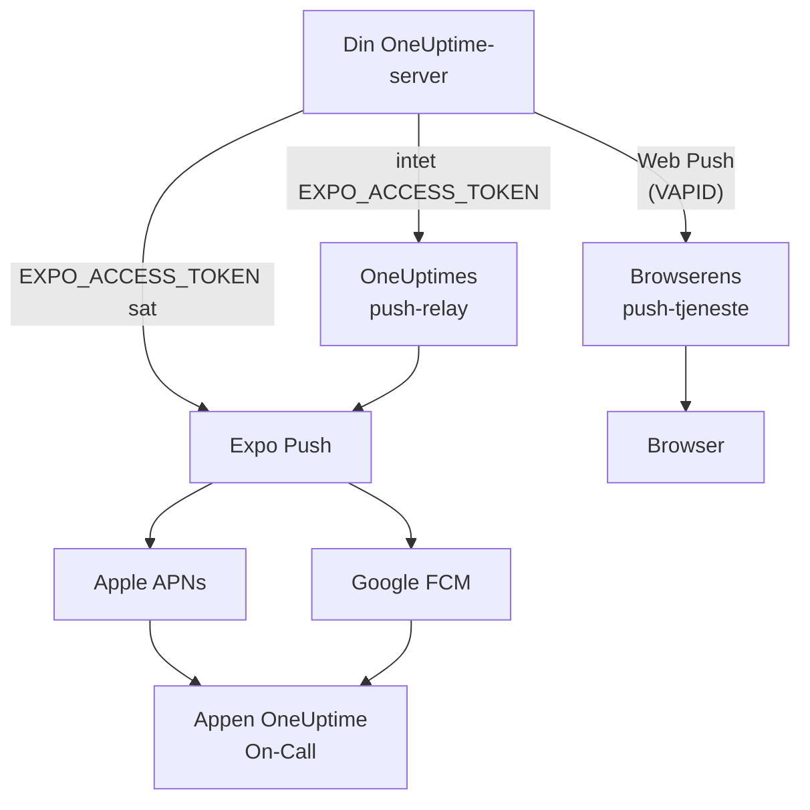
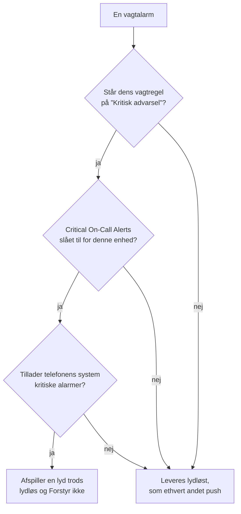

# Push-notifikationer

OneUptime alarmerer folk på telefonen via mobilappen **OneUptime On-Call** og i browseren via Web Push. Mobile pushes kører gennem **Expo Push**: En selvhostet instans sender dem som standard gennem OneUptimes push-relay, så den har brug for udgående netværksadgang til relayet og ingen egne loginoplysninger til Expo, Apple eller Google.

:::cards
- [Vælg, hvordan pushes sendes](#selvhostet-opsætning): Push-relayet eller dit eget Expo-adgangstoken.
- [Åbn firewallen](#netværksadgang): De adresser, din server og dine folks enheder når frem til.
- [Ring igennem lydløs tilstand](#kritiske-vagtalarmer-tilsidesætter-lydløs-tilstand): Lad vagtalarmer lyde på en telefon, der er sat på lydløs.
- [Ret pushes, der aldrig kommer frem](#fejlfinding): Hvad hver af Expos fejl betyder.
- [Slå push fra](#deaktivering-af-push-for-hele-serveren): Send intet gennem Expo, relayet eller browsere.
:::

## Sådan fungerer det



OneUptimes mobilapp registrerer et Expo Push-token hos backenden. Backenden sender notifikationer gennem OneUptimes push-relay eller direkte til Expo, når `EXPO_ACCESS_TOKEN` er konfigureret. Expo sender beskederne videre til Apple APNs eller Google FCM til levering på enheden.

Web Push-notifikationer bruger fortsat VAPID-nøgler og Web Push-protokollen.

## Selvhostet opsætning

Med den officielle mobilapp og standardrelayet behøver serveren ingen Expo-loginoplysninger. Til direkte levering via Expo skal du konfigurere `EXPO_ACCESS_TOKEN` med loginoplysninger, der passer til din apps Expo-projekt. Web Push kræver `VAPID_PUBLIC_KEY`, `VAPID_PRIVATE_KEY` og `VAPID_SUBJECT`.

| Variabel | Helm-værdi | Standard | Hvad den gør |
| --- | --- | --- | --- |
| `PUSH_NOTIFICATION_RELAY_URL` | `pushNotification.relayUrl` | `https://oneuptime.com/api/notification/push-relay/send` | Hvor mobile pushes sendes hen, så længe `EXPO_ACCESS_TOKEN` ikke er sat. |
| `EXPO_ACCESS_TOKEN` | `expo.accessToken` | Tom | Sender mobile pushes direkte til Expo med dit Expo-projekts token. |
| `PUSH_NOTIFICATION_RELAY_SERVER_ENABLED` | `pushNotification.relayServerEnabled` | Tom | Videresender mobile pushes for andre OneUptime-servere med denne servers `EXPO_ACCESS_TOKEN`. Tom betyder slået fra, medmindre `BILLING_ENABLED` er `true`. |
| `VAPID_PUBLIC_KEY` | `vapid.publicKey` | Tom | Den offentlige halvdel af nøgleparret, som browsere abonnerer med. |
| `VAPID_PRIVATE_KEY` | `vapid.privateKey` | Tom | Den private halvdel, der signerer hvert Web Push. |
| `VAPID_SUBJECT` | `vapid.subject` | `mailto:support@oneuptime.com` | En kontaktadresse, som browsernes push-tjenester kan nå dig på. |

Generer et VAPID-nøglepar én gang med `npx web-push generate-vapid-keys`, og behold det: Browsere, der abonnerede med ét nøglepar, holder op med at modtage pushes, når det ændres.

:::tabs
@tab Docker Compose
```bash title="config.env"
VAPID_PUBLIC_KEY=your-public-key
VAPID_PRIVATE_KEY=your-private-key
VAPID_SUBJECT=mailto:oncall@example.com
# Leave unset to send mobile pushes through the push relay.
EXPO_ACCESS_TOKEN=
```
@tab Kubernetes
```yaml title="values.yaml"
vapid:
  publicKey: your-public-key
  privateKey: your-private-key
  subject: mailto:oncall@example.com
# Leave empty to send mobile pushes through the push relay.
expo:
  accessToken:
```

:::details Opbevar den private nøgle i en Secret
`vapid.privateKey` holder den private nøgle i releasens værdier, som Helm gemmer med hver revision. For at holde den ude af dem skal du lægge den i en Kubernetes-Secret i OneUptimes namespace, under `privateKey`, og i stedet angive den Secret:

```bash
kubectl create secret generic oneuptime-vapid \
  --namespace oneuptime \
  --from-literal=privateKey=your-private-key
```

```yaml title="values.yaml"
vapid:
  publicKey: your-public-key
  existingSecret:
    name: oneuptime-vapid
  subject: mailto:oncall@example.com
```

Sæt `vapid.privateKey` eller `vapid.existingSecret.name`, ikke begge: chartet afviser de to sammen. Hvis din Secret har den private nøgle under en anden nøgle, angiver du den nøgle i `vapid.existingSecret.privateKeyKey`. Den offentlige nøgle bliver i `vapid.publicKey`: hver browser får den.
:::
:::

## Netværksadgang

| Retning | Destination | Protokol / port | Hvornår det kræves |
| --- | --- | --- | --- |
| OneUptime → standard-push-relay | `https://oneuptime.com/api/notification/push-relay/send`, `https://oneuptime.com/api/notification/push-relay/receipts` | HTTPS / TCP 443 | Mobilt push, når `EXPO_ACCESS_TOKEN` ikke er sat. |
| OneUptime → Expo | `https://exp.host/--/api/v2/push/send`, `https://exp.host/--/api/v2/push/getReceipts` | HTTPS / TCP 443 | Direkte mobilt push, når `EXPO_ACCESS_TOKEN` er sat. |
| OneUptime → browserens push-tjeneste | Det HTTPS-endpoint, der er gemt i browserens push-abonnement | HTTPS / normalt TCP 443 | Web Push. |
| Mobilapp eller browser → OneUptime | Dit OneUptime-værtsnavn | HTTPS / TCP 443 | Logge ind, registrere enheden og åbne notifikationslinks. |

Hvis du ændrer `PUSH_NOTIFICATION_RELAY_URL`, så tillad dens destinationsværtsnavn og den konfigurerede port. Et eget relay skal implementere OneUptimes relay-API. Disse standarder og skiftet mellem relay og direkte levering er defineret i [OneUptimes konfiguration](https://github.com/OneUptime/oneuptime/blob/master/config.example.env) og [push-tjenesten](https://github.com/OneUptime/oneuptime/blob/master/packages/Common/Server/Services/PushNotificationService.ts). Direkte Expo-forespørgsler bruger det endpoint, der er dokumenteret i [Expos vejledning om afsendelse](https://docs.expo.dev/push-notifications/sending-notifications/). OneUptime læser leveringskvitteringer fra relayet på den samme adresse med `/receipts` i stedet for `/send`. Et relay uden den rute leverer stadig pushes; en enhed, hvis app er fjernet, opdages så først, når et senere push til den bliver afvist.

En selvhostet OneUptime-server videresender kun pushes for andre servere med `PUSH_NOTIFICATION_RELAY_SERVER_ENABLED=true` og sit eget `EXPO_ACCESS_TOKEN`; uden indstillingen svarer den 404 på den adresse. Slå den kun til på den server, som dine andre OneUptime-servere sender gennem, og lad kun de servere nå den adresse.

Til Web Push skal du tillade de faktiske værter for abonnements-endpoints for de browsere, dit team bruger. OneUptime accepterer `fcm.googleapis.com`, `android.googleapis.com`, `push.services.mozilla.com`, `notify.windows.com` og `push.apple.com`, inklusive deres underdomæner. Typiske eksempler er `updates.push.services.mozilla.com` og `web.push.apple.com`. [Browserens push-abonnement](https://developer.mozilla.org/en-US/docs/Web/API/PushSubscription) leverer destinationen; at tillade kun Expo eller OneUptimes relay muliggør ikke Web Push.

Tillad DNS-opslag og udgående TLS fra den OneUptime-proces, der sender notifikationer. Dens trust store skal kunne validere destinationens certifikat, og proxyer skal lade API-forespørgsler passere uden interaktiv godkendelse. Push-udbydere kalder ikke en webhook på din OneUptime-server, så serveren kan forblive privat, når brugernes enheder kan nå den via en VPN eller en anden privat forbindelse. En server uden adgang til sit relay eller eksterne push-tjenester kan ikke levere disse notifikationer.

Enhedernes forbindelse er et særskilt krav. iOS-enheder har brug for adgang til APNs, typisk TCP 5223 med TCP 443 som reserve; se [Apples aktuelle netværkskrav](https://support.apple.com/en-us/102266) for destinationsområder. Android-enheder har brug for adgang til FCM på TCP 5228–5230 og 443; brug [Googles aktuelle vejledning om værter og firewalls](https://firebase.google.com/docs/cloud-messaging/network-configuration). Disse enhedsporte skal ikke åbnes indgående på OneUptime, og serverens mobile flow bruger relayet eller Expo i stedet for at forbinde direkte til APNs/FCM.

:::steps
1. Tjek DNS og HTTPS fra den container eller pod, der sender notifikationer, til destinationen for din leveringsmåde: relayet, Expo eller en browsers push-tjeneste.
2. Send en test fra **Brugerindstillinger > Notifikationsmetoder > Push Notifications** med **Testnotifikation**, og bekræft, at den når frem til en registreret enhed. Test hver browser for sig til Web Push.
3. Tjek fejl fra relayet, Expo eller Web Push i OneUptimes logs; en vellykket indsendelse til API'et bekræfter ikke i sig selv levering på enheden.
:::

For mobile pushes læser OneUptime også Expos leveringskvittering omkring 15 minutter efter hvert push: Et push, der aldrig nåede enheden, vises så som ikke leveret i push-loggen og, for en vagtalarm, på vagttidslinjen.

## Deaktivering af push for hele serveren

Hvis intet må forlade dit netværk via Expo, push-relayet eller en browsers push-tjeneste, kan en masteradministrator slå push fra under **Admin Dashboard > Indstillinger > Push Notifications**: Slå **Send push notifications** fra, og bekræft.

Mens push er slået fra:

- Intet pushes til telefoner eller browsere, i noget projekt.
- Ingen enhed kan registreres. Fanen **Push Notifications** under **Brugerindstillinger > Notifikationsmetoder** viser hver person, at push er slået fra, og vagtregler tilbyder ingen push-enheder.
- En alarm via en push-regel sendes ikke. Personens vagtlog siger `Push notification not sent: Push notifications are turned off on this server.`
- Parathed tæller push-enheder som ubrugelige, og reserven springer dem over. En person, hvis eneste bekræftede metode er en push-enhed, vises som utilgængelig.

For fortsat at nå folk på deres telefoner kan du tilføje en [brugerdefineret kanal](/docs/self-hosted/custom-notification-channels) til din egen app eller gateway. Hver OneUptime-server læser kontakten igen inden for 10 sekunder efter en ændring. Når push slås til igen, registreres enhederne igen fra mobilappen, næste gang den starter, eller fra browseren.

## Kritiske vagtalarmer (tilsidesætter lydløs tilstand)

Som standard adlyder en push-notifikation telefonen: En telefon på lydløs forbliver lydløs, og Forstyr ikke holder notifikationen tilbage. For den, der har vagt, er det den forkerte standard kl. 3 om natten, så mobilappen tilbyder en indstilling pr. enhed – **Settings > Notifications > Critical On-Call Alerts** – der lader *kun vagtalarmer* afspille en lyd gennem begge.

Omfanget er bevidst snævert. Kun alarmer, som en vagtnotifikationsregel frembringer, er omfattet. Ejerabonnementer, beskeder om nye noter, opdateringer om tilstandsskift og monitornotifikationer eskaleres aldrig, uanset hvad indstillingen siger.



Fire ting skal alle være opfyldt, før en alarm tilsidesætter lydløs tilstand. Mangler blot én, leveres alarmen stadig – bare lydløst.

1. **Personen har slået det til for den enhed.** Gemt pr. enhed, slået fra som standard, i `UserPush.isCriticalAlertEnabled`. En persons telefon og tablet er separate valg. Versioner af appen nyere end 1.6.0 rapporterer det igen, hver gang de åbnes, som slået fra, mens telefonens egne indstillinger ikke tillader kritiske alarmer, så enhedslisten viser, hvad telefonen faktisk vil gøre.
2. **Den vagtregel, der sendte alarmen, beder om det.** Under **Brugerindstillinger > Vagtregler** står hver regel, der giver besked til en telefon, på ”Kritisk advarsel”, som er standard, eller på ”Normal”, der følger telefonens lydindstillinger – så en person kan blive vækket af en kritisk hændelse og få besked lydløst om en mindre. Gemt pr. regel i `UserNotificationRule.pushNotificationLevel`.
3. **Serveren markerer alarmen som kritisk.** Den sender APNs' kritiske lyd-payload plus `interruptionLevel: critical` til iOS og bruger en kritisk notifikationskanal til Android: `oncall_critical` eller den valgte alarms egen kanal (se [Valg af alarmlyd](#valg-af-alarmlyd)).
4. **Operativsystemet tillader det**, og det er her, de to platforme adskiller sig.

:::tabs
@tab iOS
Kritiske alarmer på iOS kræver entitlementet `com.apple.developer.usernotifications.critical-alerts`, som Apple efter ansøgning tildeler pr. udviklerkonto til apps, der underretter folk om akutte hændelser. Ansøg om det via [Apples ansøgningsformular til Critical Alerts](https://developer.apple.com/contact/request/notifications-critical-alerts-entitlement/).

Den officielle app **OneUptime On-Call** i App Store har entitlementet fra **version 1.5.0**. Tidligere versioner har det ikke, og iOS tilbyder dem aldrig kritiske alarmer, så opdater appen, før du slår indstillingen til.

Hvis du selv bygger appen, er entitlementet valgfrit. En provisioneringsprofil kan ikke bære et entitlement, som teamet ikke har fået tildelt, og et build, der erklærer et, det ikke kan bære, **kan ikke signeres**. Kun profilen `production` i `packages/MobileApp/eas.json` slår det til, fordi Apple har tildelt det til det team, der udgiver den officielle app. En fork, der signerer med sit eget Apple-team, skal fjerne den `env`-post, indtil Apple også tildeler det team entitlementet. Når det er sket, slår du det til ved build:

```bash
EXPO_IOS_CRITICAL_ALERTS_ENTITLEMENT=true npx expo prebuild
```

eller tilføj `EXPO_IOS_CRITICAL_ALERTS_ENTITLEMENT: "true"` til build-profilens `env`-blok i `packages/MobileApp/eas.json`.

Slå på enheden **Settings > Notifications > Critical On-Call Alerts** til i appen, og tillad kritiske alarmer, når iOS spørger. iOS tilføjer først en kontakt **Critical Alerts** for appen under **Settings > Notifications > OneUptime On-Call** i iOS-indstillingerne, efter at appen har bedt om tilladelsen, så den kontakt findes ikke, før du slår indstillingen til i appen. Afviser du forespørgslen, kan du tillade kritiske alarmer senere med den kontakt i iOS-indstillingerne.

På et build uden entitlementet viser iOS hverken forespørgsel eller kontakt, og appens indstillingsskærm siger, at denne version af appen ikke kan modtage kritiske alarmer. Den sender ikke personen ud for at lede efter en kontakt, som iOS ikke viser.
@tab Android
Android har intet godkendelsestrin hos producenten, men omgåelse af Forstyr ikke tildeles af brugeren på en systemskærm frem for via en forespørgsel i appen. Når en person slår indstillingen til, åbner appen **Settings > Notifications > Do Not Disturb access** for vedkommende og tjekker igen, når vedkommende vender tilbage.

To mekanismer er i spil, og de dækker forskellige tilfælde:

- Hver kritisk notifikationskanal – `oncall_critical` og kanalen for hver alarmlyd – beder om `bypassDnd`, som dækker Forstyr ikke og kræver den adgang, der er beskrevet ovenfor.
- De samme kanaler bruger lydstrømmen **alarm**, som kan høres på en telefon, hvis ringetone blot er slået fra. Den halvdel kræver slet ingen tilladelse.

Android fastfryser en kanals indstillinger, når kanalen oprettes første gang, så de kan ikke ændres med en appopdatering – kun ved at udgive et nyt kanal-id.
:::

For at tjekke, at det virker, sender du en testnotifikation til enheden fra **Brugerindstillinger > Notifikationsmetoder > Push Notifications**. Når enheden har kritiske alarmer slået til, sendes testen også som en kritisk alarm – så sæt telefonen på lydløs først, og du hører, om en rigtig alarm ville nå dig. Den samme liste viser, om hver enhed har kritiske alarmer slået til, og for en telefon, der ikke har, hvordan du slår dem til.

### Valg af alarmlyd

En kritisk alarm afspiller telefonens egen lyd til kritiske alarmer, medmindre personen vælger en anden. I appen tilbyder **Settings > Notifications > Alarm sound**, som vises, når Critical On-Call Alerts er slået til, fem kraftigere alarmer, der er lavet til at vække folk: Klaxon, Siren, Digital alarm, Smoke alarm og Rising alarm, der starter svagt og bliver ved med at blive højere. Hver af dem kan afspilles, før den vælges. Valget hører til enheden og gemmes i `UserPush.criticalAlertSound`, og testnotifikationen afspiller den også.

- **iOS**: Alarmen angiver lyden, og iOS afspiller den fra appen gennem lydløs tilstand med den lydstyrke, der er valgt på samme skærm: 25 %, 50 %, 75 % eller 100 %, som er standard. Lydstyrken gemmes i `UserPush.criticalAlertVolume`.
- **Android**: Hver alarm har sin egen notifikationskanal (`oncall_critical_klaxon`, `oncall_critical_siren` og så videre), fordi Android fastlægger en kanals lyd, når kanalen oprettes. Serveren sender alarmen på den valgte alarms kanal, og den spiller med telefonens alarmlydstyrke.

En enhed beholder systemlyden, indtil den kører en version af appen, der tilbyder valget, så en ældre app aldrig får sendt en alarm, den ikke har.

### Gentagelse af en alarm, indtil den bekræftes

En push-regel kan sende sin alarm igen, indtil nogen bekræfter den. Under **Brugerindstillinger > Vagtregler** indstiller du **Gentag indtil bekræftelse**, når du tilføjer en push-regel, eller ændrer det senere i reglens række: hvert minut eller hvert 2., 3., 5., 10., 15. eller 30. minut. Alarmen sendes igen med det interval, højst 10 gange mere, og stopper, så snart hændelsen, advarslen eller episoden er bekræftet. Gemt pr. regel i `UserNotificationRule.repeatEveryMinutes`, hvor 0, som er standard, sender alarmen én gang.

## Fejlfinding

### Push-notifikationer kommer ikke frem

- Sørg for, at mobilappen er bygget med EAS Build (Expo Go understøtter ikke push-notifikationer)
- Bekræft, at enheden er registreret i tabellen `UserPush` i din database
- Tjek OneUptimes serverlogs for fejl fra Expo Push API
- Bekræft, at enheden har en aktiv internetforbindelse og har notifikationstilladelser slået til
- Tjek **Brugerindstillinger > Notifikationsmetoder > Push Notifications**: En enhed markeret **Modtager ikke notifikationer** er holdt op med at modtage dem og skal registreres igen (se nedenfor)

### Ingen kontakt til Critical Alerts i iOS-indstillingerne

- Opdater OneUptime On-Call fra App Store. Versioner før 1.5.0 blev bygget uden Apples entitlement til kritiske alarmer, og iOS viser slet ingen kontakt Critical Alerts for dem
- Slå **Settings > Notifications > Critical On-Call Alerts** til i appen. iOS tilføjer først kontakten til sine egne indstillinger, efter at appen har bedt om tilladelsen, og appen beder om den, når denne indstilling slås til
- At fjerne og tilføje vagtnotifikationsregler eller push-enheder igen ændrer ikke på dette. Indstillingen hører til appen på enheden, ikke til en regel

### Kritiske alarmer tilsidesætter ikke lydløs tilstand

- Tjek, at kontakten er slået til for **den** enhed – indstillingen gælder pr. enhed, og en geninstallation eller en ny telefon, der er sat op fra bunden, opretter en ny enhedsregistrering (en telefon, der er sat op fra en sikkerhedskopi af den gamle, overtager den gamle telefons registrering, så snart den ikke længere modtager notifikationer, med den indstilling, appen havde)
- Tjek vagtreglen for den alvorlighed under **Brugerindstillinger > Vagtregler**: en push-regel på ”Normal” følger telefonens lydindstillinger, uanset hvad enhedens kontakt siger
- **iOS**: Bekræft, at buildet bærer Apples entitlement til kritiske alarmer (se ovenfor), og at Critical Alerts er tilladt under iOS Settings > Notifications > OneUptime On-Call
- **Android**: Bekræft, at appen har adgang til Forstyr ikke under Settings > Notifications > Do Not Disturb access
- **Android**: Hvis du har valgt en alarmlyd, skal dens egen notifikationskanal også have lov til at tilsidesætte Forstyr ikke; appens skærm Alarm sound siger det, når den ikke har det
- Indstillingsskærmen siger, hvilken af disse der mangler; den læser den aktuelle tilstand tilbage fra operativsystemet i stedet for at stole på, hvad appen sidst bad om, og fortæller serveren, hvad den finder

### Pushes markeret "ikke leveret"

At Expo accepterer et push, betyder ikke, at det nåede enheden: Apple eller Google kan stadig afvise det. OneUptime læser hvert mobilt pushs leveringskvittering omkring 15 minutter efter afsendelsen, gennem push-relayet, når `EXPO_ACCESS_TOKEN` ikke er sat. Når kvitteringen melder en fejl, skifter push-loggen og alarmens vagttidslinje fra sendt til **Push notification not delivered** med Expos fejlkode:

- `DeviceNotRegistered`: Mobilappen er fjernet fra enheden, eller dens push-token er ikke længere gyldigt. Se næste afsnit.
- `MessageRateExceeded`: Der blev sendt for mange notifikationer til enheden på kort tid. Senere pushes til den sendes som normalt.
- `MessageTooBig`: Notifikationen var større, end push-tjenester accepterer. OneUptime forkorter notifikationer, så de passer, så det burde ikke ske; giv besked, hvis det gør.
- `InvalidCredentials` eller `MismatchSenderId`: Push-loginoplysningerne for det Expo-projekt, der sendte pushet, er ikke gyldige. Med `EXPO_ACCESS_TOKEN` tjekker du dit Expo-projekts push-loginoplysninger; med standardrelayet kontakter du OneUptimes support.

Når Expo afviser et push med det samme, giver push-loggen årsagen med det samme. Gennem push-relayet virker det også: Relayet sender Expos fejlkode videre i stedet for at svare med en serverfejl.

### "DeviceNotRegistered"-fejl i logs

Expo melder `DeviceNotRegistered`, når mobilappen er fjernet fra enheden, eller enhedens push-token ikke længere er gyldigt. Som regel står det i et pushs leveringskvittering, som OneUptime læser omkring 15 minutter efter pushet, og nogle gange afviser Expo pushet med det samme. Uanset hvad holder OneUptime op med at sende til den enhed. Den markeres som ikke modtagende i stedet for at blive slettet, så dens notifikationsregler bliver, og push-loggen og vagttidslinjen for den alarm, der ikke kom frem, siger hvorfor. **Brugerindstillinger > Notifikationsmetoder > Push Notifications** viser den som **Modtager ikke notifikationer**. Ejerens andre enheder og notifikationsmetoder alarmeres stadig.

For at få enheden tilbage åbner du mobilappen på den, mens du er logget ind. Appen registrerer sig igen, hvilket fornyer dens push-token hos Expo, og enheden modtager igen notifikationer med sine regler. Er appen fjernet, så installer den igen og log ind. En kvittering for et push, der blev sendt, før appen registrerede sig igen, markerer ikke enheden. Når en opdateret mobilapp sættes op på en ny telefon fra en sikkerhedskopi af den gamle, fortæller den OneUptime det push-token, den havde før; hvis den gamle telefons enhed ikke længere modtager notifikationer, overtager den nye telefon den med dens regler.

Gennem push-relayet (intet `EXPO_ACCESS_TOKEN`) virker det på samme måde: Relayet melder `DeviceNotRegistered`, når det sender et push, og læser de leveringskvitteringer, som din instans spørger om.

Hvis intet af dette hjælper, så kontakt os på [hello@oneuptime.com](mailto:hello@oneuptime.com) med fejlene fra dine OneUptime-logs.

## Næste trin

:::cards
- [Mobilapps](/docs/mobile-desktop-apps/index): Installer appen OneUptime On-Call, og log ind.
- [Fejlfinding i mobilappen](/docs/mobile-desktop-apps/faq-troubleshooting): Ret problemer med login og notifikationer på telefonen.
- [Eskaleringsregler](/docs/on-call/escalation-rules): Bestem, hvem der alarmeres, og hvornår.
- [Adgang til privat netværk](/docs/self-hosted/private-network-access): Hvad din server må nå på dit eget netværk.
:::
