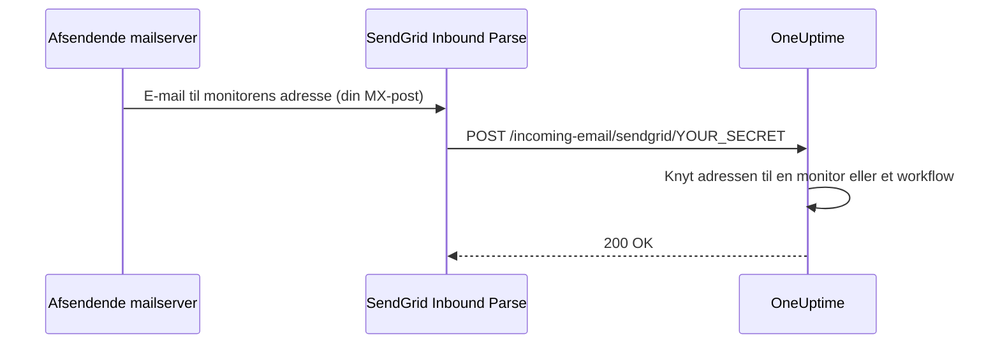

# SendGrid indgående e-mail

OneUptimes **Incoming Email Monitor** lader dig oprette og løse alarmer ud fra e-mails, der sendes til unikke, monitorspecifikke e-mailadresser. Det er nyttigt til at integrere ældre systemer, alarmeringsværktøjer eller enhver tjeneste, der kan sende e-mails.

Den samme opsætning lader også workflows modtage e-mail: Et workflow med triggeren **Incoming Email** får sin egen adresse på det samme domæne, og hver e-mail til den starter workflowet. Se [Triggere](/docs/workflows/triggers#incoming-email).

Denne vejledning forklarer, hvordan du sætter SendGrid Inbound Parse op til at videresende indgående e-mails til din selvhostede OneUptime-instans. OneUptime Cloud har ikke brug for noget af det: Dér virker adresserne med det samme.

:::cards
- [Før du går i gang](#forudsætninger): En SendGrid-konto, et domæne og en offentlig HTTPS-adresse.
- [Opsætning](#opsætningsvejledning): Syv trin, fra MX-posten til en test-e-mail.
- [Miljøvariabler](#reference-for-miljøvariabler): De tre indstillinger og deres standardværdier.
- [Fejlfinding](#fejlfinding): E-mails, der aldrig kommer frem, og webhooks, der fejler.
:::

## Sådan fungerer det



1. Du opretter en **Incoming Email Monitor** i OneUptime
2. OneUptime genererer en unik e-mailadresse til den monitor (f.eks. `monitor-abc123@inbound.yourdomain.com`)
3. Når der sendes en e-mail til den adresse, modtager SendGrid den og videresender den til OneUptime via webhook
4. OneUptime vurderer e-mailen ud fra de kriterier, du har sat op, for at oprette eller løse alarmer

## Forudsætninger

- En SendGrid-konto med adgang til Inbound Parse
- Et domæne, du har kontrol over, med adgang til DNS-indstillingerne
- Et offentligt HTTPS-endpoint, der videresender SendGrid-webhooks til din OneUptime-instans

## Netværksadgang

Med Inbound Parse er det SendGrid, der opretter forbindelsen til OneUptime. Det er ikke nok kun at tillade udgående internetadgang fra OneUptime.

| Retning | Destination | Protokol / port | Formål |
| --- | --- | --- | --- |
| SendGrid → OneUptime | `https://your-oneuptime-domain.com/incoming-email/sendgrid/YOUR_SECRET` | HTTPS / TCP 443 | Levere den parsede e-mail som et multipart-POST. |
| Afsendende mailservere → SendGrid | `mx.sendgrid.net`, valgt via den offentlige MX-post for dit indgående domæne | SMTP / TCP 25 | Modtage e-mail hos SendGrid; denne forbindelse går ikke til din OneUptime-server. |
| OneUptime → SendGrid, kun når afsendelse af e-mail via SendGrid-udbyderen er sat op særskilt | `api.sendgrid.com` | HTTPS / TCP 443 | Sende notifikations-e-mails via Mail Send API'et. |

Udgiv DNS for webhookens værtsnavn, og server et certifikat, som offentlige klienter stoler på. En privat OneUptime-installation kan nøjes med at eksponere webhook-stien gennem en offentlig reverse proxy eller gateway, der kan nå OneUptime internt. Bevar stien, hemmeligheden, indholdstypen og multipart-requestens body, og lad POST'et komme igennem uden interaktivt login eller browserudfordring. OneUptime-serveren har ikke brug for en indgående SMTP-lytter. Se [SendGrids opsætning af Inbound Parse](https://www.twilio.com/docs/sendgrid/for-developers/parsing-email/setting-up-the-inbound-parse-webhook).

Sæt `INBOUND_EMAIL_WEBHOOK_SECRET` til en stærk tilfældig værdi, og erstat `YOUR_SECRET` i URL'en med den værdi. Ruten kræver det sidste stisegment. OneUptime kontrollerer dets værdi, når hemmeligheden er sat; en tom variabel slår kontrollen fra. Hold den fulde URL og monitorernes e-mailadresser hemmelige, også i proxylogs. OneUptime validerer i øjeblikket hverken SendGrids signerede Inbound Parse-headere eller OAuth-tokens. Hvis du har brug for de mekanismer, så sæt en gateway op, der validerer dem, før den videresender til OneUptime, efter [SendGrids dokumentation om webhooksikkerhed](https://www.twilio.com/docs/sendgrid/for-developers/parsing-email/securing-your-parse-webhooks).

SendGrid stiller ikke en pålidelig liste over statiske kilde-IP'er til rådighed for Inbound Parse. SendGrids IP'er til afsendelse af e-mail og de adresser, der slås op for `mx.sendgrid.net`, er ikke en tilladelsesliste for webhooks. Følg [SendGrids vejledning om firewalls](https://support.sendgrid.com/hc/en-us/articles/44375457225371-How-to-Configure-Firewall-Settings-for-SendGrid-Webhook-and-Inbound-Parse-IPs) i stedet for at fastlåse et aktuelt DNS-resultat.

Inbound Parse er adskilt fra afsendelse af udgående e-mail. For at modtage monitor-e-mails behøver OneUptime ikke at kalde SendGrid-API'et. Hvis du også vælger SendGrid til at sende notifikationer, så tillad DNS-opslag og udgående HTTPS til `api.sendgrid.com`; [Mail Send](https://www.twilio.com/docs/sendgrid/api-reference/mail-send/mail-send) behøver ikke et indgående callback for at indsende. Bruger du SMTP i stedet, så tillad den SMTP-server og port, der er sat op i OneUptime.

## Opsætningsvejledning

:::steps
### Vælg dit domæne til indgående e-mail

Vælg et underdomæne, der kun bruges til at modtage e-mail til OneUptime, f.eks. `inbound.yourdomain.com`, `email.yourdomain.com` eller `monitor.yourdomain.com`. Det bruges kun til e-mail til OneUptime-monitorer og -workflows, så ingen af dine postkasser ligger på det.

### Lad dets MX-post pege på SendGrid

Tilføj en MX-post, der sender e-mail til underdomænet videre til SendGrid:

| Type | Vært/Navn | Prioritet | Værdi |
| --- | --- | --- | --- |
| MX | inbound | 10 | mx.sendgrid.net |

Hvis dit domæne er `example.com`, og du bruger `inbound.example.com`, lyder posten:

```text
inbound.example.com.  IN  MX  10  mx.sendgrid.net.
```

DNS-ændringer kan tage op til 48 timer om at slå igennem, men er som regel færdige inden for få timer.

### Godkend domænet i SendGrid

Det modtagende domæne skal høre til et af dine [godkendte domæner i SendGrid](https://www.twilio.com/docs/sendgrid/ui/account-and-settings/inbound-parse). Gå i [SendGrid-dashboardet](https://app.sendgrid.com) til **Settings** > **Sender Authentication**, klik på **Authenticate Your Domain**, og tilføj de DNS-poster, den beder om (CNAME-poster til DKIM).

### Tilføj Inbound Parse-webhooken

Gå i SendGrid-dashboardet til **Settings** > **Inbound Parse**, og klik på **Add Host & URL**. Udfyld formularen som nedenfor, og klik så på **Add**:

| Felt | Værdi |
| --- | --- |
| **Receiving Domain** | Dit indgående underdomæne (f.eks. `inbound.yourdomain.com`) |
| **Destination URL** | `https://your-oneuptime-domain.com/incoming-email/sendgrid/YOUR_SECRET` |
| **Check incoming emails for spam** | Valgfrit – slå til, hvis du ønsker det |
| **Send raw, full MIME message** | Lad være umarkeret (ikke nødvendigt) |
| **POST the raw, full MIME message** | Lad være umarkeret (ikke nødvendigt) |

### Konfigurer OneUptime

Sæt variablerne til indgående e-mail, med den samme hemmelighed som i Destination URL:

:::tabs
@tab Docker Compose
```bash title="config.env"
INBOUND_EMAIL_PROVIDER=SendGrid
INBOUND_EMAIL_DOMAIN=inbound.yourdomain.com
INBOUND_EMAIL_WEBHOOK_SECRET=replace-with-a-strong-random-secret
```
@tab Kubernetes
```yaml title="values.yaml"
inboundEmail:
  provider: "SendGrid"
  domain: "inbound.yourdomain.com"
  webhookSecret: "replace-with-a-strong-random-secret"
```
:::

Anvend dem derefter: Kør `npm run start` på Docker Compose, hvilket genskaber containerne med de nye værdier, eller opgrader Helm-releasen på Kubernetes.

### Opret en Incoming Email-monitor

[Opret en Incoming Email-monitor](/docs/monitor/incoming-email-monitor#opret-en-monitor-for-indgående-e-mail). Dens side **Oversigt** viser dens adresse, f.eks. `monitor-abc123def456@inbound.yourdomain.com`, og dens kriterier afgør, hvilke e-mails der opretter en alarm, og hvilke der løser den.

Workflows bruger det samme domæne. Tilføj triggeren **Incoming Email** til et workflow, og klik på den: Dens adresse (`workflow-…@inbound.yourdomain.com`) står øverst i dens indstillinger. Indtil variablerne til indgående e-mail ovenfor er sat, siger triggeren, at serveren ikke er sat op til at modtage e-mail.

### Send en test-e-mail

Send en e-mail til monitorens adresse med et emne, der matcher dens kriterier. Monitorens oversigt viser e-mailen, og der oprettes en alarm, når kriterierne matcher.
:::

## Reference for miljøvariabler

| Variabel | Helm-værdi | Beskrivelse | Påkrævet | Standard |
| --- | --- | --- | --- | --- |
| `INBOUND_EMAIL_PROVIDER` | `inboundEmail.provider` | Udbyderen af indgående e-mail. SendGrid er den eneste. | Nej | `SendGrid` |
| `INBOUND_EMAIL_DOMAIN` | `inboundEmail.domain` | Det underdomæne, der er sat op til indgående e-mail. Indgående e-mail er slået fra, indtil det er sat. | Ja | Tom |
| `INBOUND_EMAIL_WEBHOOK_SECRET` | `inboundEmail.webhookSecret` | Hemmelighed, der sammenlignes med det sidste segment af webhook-URL'en: `/incoming-email/sendgrid/YOUR_SECRET`. Sæt den for offentlige endpoints; en tom værdi slår valideringen fra. | Anbefalet | Tom |

Hvad en Incoming Email-monitor kan matche på – emnet, afsenderen, brødteksten, modtageren og om en e-mail kom frem til tiden – står i [Tilgængelige filtertyper](/docs/monitor/incoming-email-monitor#tilgængelige-filtertyper).

## Fejlfinding

:::details E-mails modtages ikke
1. **Tjek DNS-udbredelsen:** `dig MX inbound.yourdomain.com` skal returnere `mx.sendgrid.net`.
2. **Bekræft Inbound Parse-indstillingerne i SendGrid:** Tjek dit domæne og webhook-URL'en i SendGrid-dashboardet under **Settings** > **Inbound Parse**.
3. **Tjek OneUptimes logs:** Se efter webhook-forespørgsler for indgående e-mail, og eventuelle fejl, i logs for OneUptime-tjenesten `app`. SendGrid gemmer ingen detaljerede logs for Inbound Parse, så disse logs er optegnelsen over, hvad der kom frem.
:::

:::details Webhooks fejler
1. **Tjek den offentlige webhook-rute:** Den fulde URL, inklusive hemmeligheden, skal nå OneUptime fra internettet. URL'en uden dens sidste hemmelige segment matcher ikke ruten.
2. **Tjek firewallreglerne:** Tillad HTTPS POST-forespørgsler til webhook-stien uden login-omdirigeringer eller browserudfordringer, og brug ikke SendGrids IP'er til afsendelse af e-mail som tilladelsesliste for webhookens kilde.
3. **Bekræft SSL-certifikatet:** Brug et gyldigt, offentligt betroet certifikat til webhookens værtsnavn, og medtag dets certifikatkæde.
:::

:::details Monitoren opretter ikke alarmer
1. **Bekræft kriterierne:** Tjek, at dine kriterier for oprettelse af alarmer matcher e-mailens indhold, og test først med eksakte strenge, før du bruger mønstre.
2. **Tjek monitoren:** Sørg for, at den ikke er deaktiveret, og at dens type er Incoming Email.
3. **Gennemgå monitorens oversigt:** Tjek, om e-mailen blev modtaget og behandlet, og læs evalueringslogsene for, hvordan kriterierne matchede.
:::

:::details Triggeren siger, at serveren ikke er sat op til at modtage e-mail
`INBOUND_EMAIL_DOMAIN` er tom på serveren. Sæt den, anvend ændringen, og åbn workflowets trigger igen.
:::

## Bedste sikkerhedspraksis

1. **Brug HTTPS:** Brug altid HTTPS til dit webhook-endpoint
2. **Webhook-hemmelighed:** Sæt `INBOUND_EMAIL_WEBHOOK_SECRET`, og medtag den i din webhook-URL (f.eks. `/incoming-email/sendgrid/your-secret`) som ekstra validering
3. **Domænebekræftelse:** Bekræft dit domæne i SendGrid for bedre e-mailsikkerhed
4. **Begræns adgangen:** Opret kun monitorer til betroede e-mailkilder
5. **Overvåg logs:** Gennemgå jævnligt logs for indgående e-mail for mistænkelig aktivitet

## Næste trin

:::cards
- [Incoming Email Monitor](/docs/monitor/incoming-email-monitor): Kriterier, adresseformater og eksempler.
- [Workflow-triggere](/docs/workflows/triggers): Start et workflow fra en e-mail.
- [Adgang til privat netværk](/docs/self-hosted/private-network-access): Hvad din server må nå på dit eget netværk.
- [Arkitektur](/docs/self-hosted/architecture): Hvor webhooken lander i en selvhostet installation.
:::
