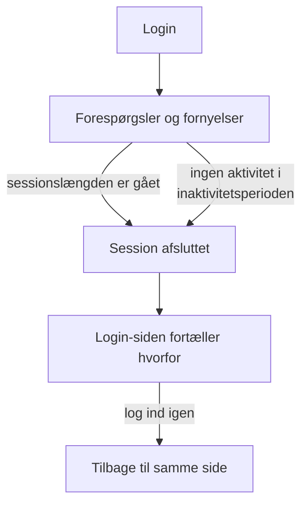

# Sessionslængde

Vælg, hvor længe folk forbliver logget ind på OneUptime, før de logger ind igen: et fast tidsrum efter de har logget ind, et tidsrum uden brug, eller begge dele. Det gælder for hvert login på dashboardet, Admin Dashboard og mobilappen, med en adgangskode, en adgangsnøgle, login med Microsoft eller single sign-on. SSO-logins kan have deres egne længder.

> [!NOTE]
> Sessionslængde er en del af [OneUptime Enterprise Edition](/docs/self-hosted/enterprise). Community Edition har ingen side **Sessionslængde**, og hvert login varer, som [Uden grænse](#uden-grænse) beskriver.

:::cards
- [Angiv en sessionslængde](#angiv-en-sessionslængde): To indstillinger i Admin Dashboard.
- [Sådan slutter en session](#sådan-slutter-en-session): Hvad serveren tæller, og hvornår.
- [SSO-logins](#sso-logins): Egne længder for single sign-on.
- [Hvad der ikke er et login](#hvad-der-ikke-er-et-login): API-nøgler, MCP-forbindelser og læsere af statussider.
:::

## Uden grænse

Indtil du angiver en længde, har et login ingen. Dets adgangstoken varer 15 minutter og fornyes i baggrunden med et opdateringstoken, som varer 30 dage og starter forfra, hver gang det bruges. Den, der åbner OneUptime mindst én gang hver 30. dag, forbliver logget ind; den, der ikke gør, logger ind igen.

## Angiv en sessionslængde

:::steps
### Åbn Sessionslængde
Åbn **Indstillinger** i Admin Dashboard, og derefter **Sessionslængde** i sidemenuen.

### Vælg længderne
- **Log folk ud efter**: hvor længe et login varer fra det øjeblik, nogen logger ind, uanset hvor aktive de er.
- **Log folk ud efter inaktivitet i**: hvor længe nogen må gå uden at klikke, skrive eller rulle i OneUptime.

Hvert valg gemmes, så snart du træffer det.

### Bekræft, hvem der logges ud
En kortere længde gælder for alle, der er logget ind nu. Når den logger folk ud med det samme, fortæller OneUptime først hvor mange, og om du er en af dem. Vælg **Gem og log dem ud** for at fortsætte.
:::

| Indstilling | Valg | Standard |
| --- | --- | --- |
| **Log folk ud efter** | 1 time til 90 dage | **Ingen grænse** |
| **Log folk ud efter inaktivitet i** | 15 minutter til 14 dage | 30 dage, det længste der findes |

Via API'et tager `sessionLengthInMinutes` ethvert helt antal minutter fra 15 til 525600 (et år) og `sessionIdleTimeoutInMinutes` fra 15 til 43200 (30 dage), i serverens globale konfiguration. Tom er standarden.

## Sådan slutter en session

- Serveren tæller begge længder ud fra selve sessionen: hvornår den loggede ind, og hvornår dens person sidst var aktiv. Den tjekker dem ved hver forespørgsel, hver fornyelse og hver liveopdatering og overlader aldrig udlogningen til browseren.
- Inaktivitetsperioden tæller fra det seneste klik, tastetryk eller den seneste rulning i en hvilken som helst fane på dashboardet eller Admin Dashboard. En fane, der står åben, holder ikke en session i live.
- Mobilappen tæller som aktiv, hver gang den bruges.
- Når en session slutter, går browseren til login-siden, som fortæller hvorfor. Efter at have logget ind igen kommer personen tilbage til den side, de var på.

| Ændring | Hvad der sker med dem, der er logget ind nu |
| --- | --- |
| En kortere sessionslængde eller inaktivitetsperiode | Alle, der er forbi den, logges ud med det samme, de andre når de når den |
| En længere, eller ingen | Ingen logges ud, og sessioner varer længere fra deres næste fornyelse |

## SSO-logins

Logins via single sign-on følger de samme to indstillinger. For at give dem deres egne længder skal du åbne **Yderligere indstillinger** på siden **Sessionslængde** og slå **Separate længder for SSO-logins** til. De to indstillinger under den gælder så for logins via et projekts SAML- eller OpenID Connect-udbyder eller serverens egen [globale SSO](/docs/identity/global-sso), og de to øverst på siden for alle andre logins.

Et projekt, der kræver SSO, lukker desuden kun en session ind, så længe dens SSO-login varer, og det er aldrig længere end den længde, SSO-logins følger.

Via API'et er kontakten `useSeparateSsoSessionLengths`, og SSO-logins' længder er `ssoSessionLengthInMinutes` og `ssoSessionIdleTimeoutInMinutes`, med de samme intervaller.

## Hvad der ikke er et login

- **API-nøgler** beholder den udløbstid, du giver dem.
- **MCP-forbindelser**, AI-assistenter forbundet med OAuth, beholder deres egen levetid. I et projekt, der kræver SSO, varer en forbindelse aldrig længere end det SSO-login, den blev godkendt med.
- **Private statussider** har deres egen længde for deres læsere: se [Private brugere](/docs/status-pages/index#private-brugere).

## Uden licens

Efter prøveperioden eller henstandsperioden, uden en gyldig licens eller med en licens, der ikke omfatter sessionslængder, kan længderne ikke angives eller ændres. Dem, der allerede er angivet, logger stadig folk ud, og du kan stadig fjerne dem. Med Community Edition-imaget gælder ingen længde: værdierne bliver i databasen og gælder igen, når du skifter tilbage.

## Næste trin

:::cards
- [SSO](/docs/identity/sso): Log folk ind med din identitetsudbyder.
- [Global SSO](/docs/identity/global-sso): Én identitetsudbyder for hele serveren.
- [Enterprise Edition](/docs/self-hosted/enterprise): Hvad Enterprise Edition tilføjer, og dens licens.
:::
