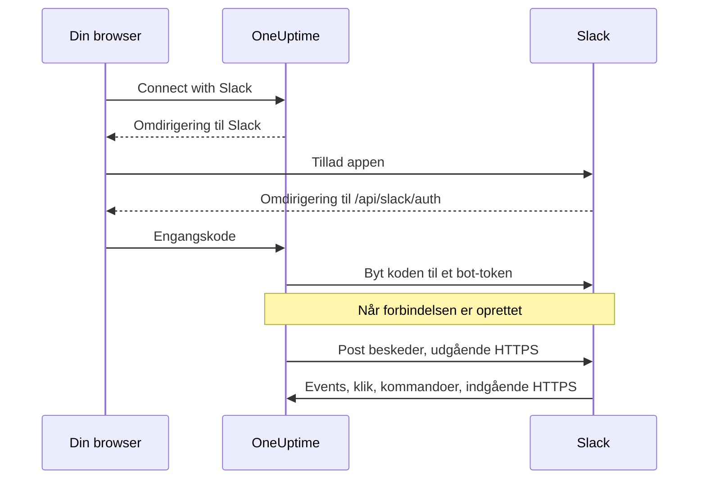
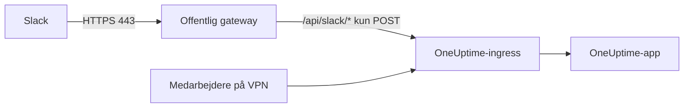

# Slack-integration

Forbind din selvhostede OneUptime med Slack. Du opretter en Slack-app ud fra det manifest, din server genererer, giver OneUptime appens legitimationsoplysninger og forbinder hvert projekt med et arbejdsområde. Derefter poster OneUptime hændelser, alarmer og planlagt vedligeholdelse i dine kanaler, og dit team handler på dem fra Slack.

Denne side er til den, der driver OneUptime-serveren. Når Slack er forbundet, opsættes notifikationsregler pr. projekt: se [Slack](/docs/workspace-connections/slack).

:::cards
- [Opsæt Slack-appen](#opsæt-slack-appen): Opret appen ud fra dit manifest, og forbind et projekt.
- [Miljøvariabler](#miljøvariabler): De tre værdier, OneUptime skal bruge fra appen.
- [Netværksadgang](#netværksadgang-for-selvhostede-installationer): De callbacks, Slack skal kunne nå.
- [Fejlfinding](#fejlfinding): Hvad Slack-sidens meddelelser betyder, og hvad du gør.
:::

## Sådan fungerer det

Slack-appen er din egen: Den er installeret i dit arbejdsområde og taler kun med din server. Trafikken går begge veje, og hver retning kræver sin egen netværksadgang.



- **Udgående**: OneUptime kalder Slacks Web API for at poste beskeder, oprette kanaler og uploade billeder.
- **Indgående**: Slack kalder fire ruter på din server for events, klik på knapper, menuer og slash-kommandoer. Hver anmodning er signeret med appens signing secret. OneUptime afviser en anmodning, hvis signatur ikke passer, eller hvis tidsstempel er mere end fem minutter gammelt.

## Før du begynder

- Et Slack-arbejdsområde, hvor du kan oprette og installere apps.
- Et offentligt HTTPS-værtsnavn til OneUptime, som Slack kan nå. Se [Netværksadgang](#netværksadgang-for-selvhostede-installationer).
- Adgang til serverens konfiguration: `config.env` til Docker Compose eller dine Helm-values til Kubernetes.
- For at forbinde et projekt: rollen **Project Owner**, **Project Admin** eller **Project Member** i det.

## Opsæt Slack-appen

:::steps
### Angiv den offentlige URL

OneUptime bygger appmanifestet og hver callback-URL ud fra `HOST` og `HTTP_PROTOCOL`. Sæt dem til det værtsnavn, Slack skal kalde, over HTTPS:

:::tabs
@tab Docker Compose
```bash title="config.env"
HOST=oneuptime.example.com
HTTP_PROTOCOL=https
```
@tab Kubernetes
```yaml title="values.yaml"
host: oneuptime.example.com
httpProtocol: https
```
:::

Disse værdier genererer kun URL'er. De opretter ikke DNS-poster, certifikater eller firewallregler.

### Kopiér appmanifestet

Åbn **Projektindstillinger > Arbejdsområde > Slack**. Indtil Slack er sat op på serveren, viser siden **Integrating Slack with your OneUptime Project** med det manifest, der er genereret til dit værtsnavn. Det serveres også på `https://oneuptime.example.com/api/slack/app-manifest`.

Kontrollér, at hver URL i manifestet begynder med dit offentlige værtsnavn. Hvis ikke, så ret først `HOST` og `HTTP_PROTOCOL`, og anvend ændringen.

### Opret Slack-appen

Opret på [api.slack.com/apps](https://api.slack.com/apps) en ny app ud fra et manifest, vælg dit arbejdsområde, og indsæt manifestet. Brug altid det manifest, din egen server genererer, så dets URL'er passer til dit værtsnavn.

### Kopiér appens legitimationsoplysninger

Kopiér **Client ID**, **Client Secret** og **Signing Secret** på appens side **Basic Information** under **App Credentials**.

### Tilføj legitimationsoplysningerne i OneUptime

:::tabs
@tab Docker Compose
```bash title="config.env"
SLACK_APP_CLIENT_ID=YOUR_SLACK_APP_CLIENT_ID
SLACK_APP_CLIENT_SECRET=YOUR_SLACK_APP_CLIENT_SECRET
SLACK_APP_SIGNING_SECRET=YOUR_SLACK_APP_SIGNING_SECRET
```
@tab Kubernetes
```yaml title="values.yaml"
slackApp:
  clientId: "YOUR_SLACK_APP_CLIENT_ID"
  clientSecret: "YOUR_SLACK_APP_CLIENT_SECRET"
  signingSecret: "YOUR_SLACK_APP_SIGNING_SECRET"
```

For at holde værdierne i en Kubernetes-Secret, som du selv administrerer, angiver du i stedet `slackApp.existingSecret`: dens `name` og nøglerne `clientIdKey`, `clientSecretKey` og `signingSecretKey`.
:::

### Anvend konfigurationen

:::tabs
@tab Docker Compose
```bash
npm run start
```

Det genopretter containerne med den nye `config.env`. `docker compose restart` læser den ikke igen.
@tab Kubernetes
```bash
helm upgrade my-oneuptime oneuptime/oneuptime -f values.yaml
```
:::

Når OneUptime kører igen, viser **Projektindstillinger > Arbejdsområde > Slack** en knap **Connect with Slack** i stedet for manifestet.

### Bekræft request-URL'en til events

Bekræft request-URL'en under **Event Subscriptions** i Slack-appen. OneUptime besvarer først Slacks challenge, når signing secret er angivet, så prøv igen, hvis det mislykkedes, mens du oprettede appen.

### Forbind projektet

Vælg **Connect with Slack** under **Projektindstillinger > Arbejdsområde > Slack**, og tillad appen i Slack. Slack sender dig tilbage til samme side, som nu viser dit arbejdsområde.

### Forbind din egen Slack-konto

Knapper, formularer og kommandoer handler som den OneUptime-bruger, der er knyttet til den Slack-konto, der bruger dem. Hver person åbner **Brugerindstillinger > Arbejdsområde > Slack** og vælger **Connect my account with Slack**. Den, der ikke har forbundet en konto, får en direkte besked fra appen, der beder om det.
:::

## Miljøvariabler

| Docker Compose (`config.env`) | Helm (`values.yaml`) | Påkrævet | Værdi |
| --- | --- | --- | --- |
| `SLACK_APP_CLIENT_ID` | `slackApp.clientId` | Ja | Appens **Client ID**. Uden den viser Slack-siden opsætningsvejledningen i stedet for **Connect with Slack**. |
| `SLACK_APP_CLIENT_SECRET` | `slackApp.clientSecret` | Ja | Appens **Client Secret**, som bruges til at bytte den kode, Slack returnerer, til et token. |
| `SLACK_APP_SIGNING_SECRET` | `slackApp.signingSecret` | Ja | Appens **Signing Secret**. Hver anmodning fra Slack kontrolleres med det. |
| `HOST` | `host` | Ja | Dit offentlige værtsnavn, uden skema. |
| `HTTP_PROTOCOL` | `httpProtocol` | Ja | `https`. Slack kalder kun HTTPS-URL'er. |

## Hvad appen kan

Manifestet opsætter disse funktioner. Hver af dem når din server via den viste rute og virker derfor kun, når Slack kan nå den rute.

| Funktion | Hvad den gør | Rute |
| --- | --- | --- |
| `/incident` og genvejen **Create New Incident** | Erklær en hændelse fra Slack | `POST /api/slack/interactive` |
| `/maintenance` og genvejen **Create Scheduled Event** | Planlæg vedligeholdelse fra Slack | `POST /api/slack/interactive` |
| `/oneuptime` | Spørg OneUptime AI om dine logs, traces, metrikker, hændelser og monitorer | `POST /api/slack/command` |
| Knapper og formularer i OneUptime-beskeder | Kvittér, løs, tilføj en note, skift tilstand, kør en vagtpolitik | `POST /api/slack/interactive` og `POST /api/slack/options-load` |
| Events | Omtaler, beskeder, reaktioner og fastgørelser, for eksempel for at gemme en besked som note | `POST /api/slack/events` |

### Billeder i beskeder

Beskrivelser af hændelser og alarmer kan indeholde skærmbilleder, for eksempel fra en syntetisk monitor (se [Syntetiske monitorer](/docs/monitor/incident-alert-templating#syntetiske-monitorer)). OneUptime viser dem i Slack-beskeder ved at uploade hvert enkelt til dit arbejdsområde som en privat fil, hvilket kræver bot-scopet `files:write`. Det genererede manifest indeholder det.

Hvis du har oprettet din Slack-app ud fra et ældre manifest, så tilføj `files:write` under **OAuth & Permissions > Bot Token Scopes** (eller opdatér appen ud fra det aktuelle manifest). Vælg derefter **Connect with Slack** igen under **Projektindstillinger > Arbejdsområde > Slack**, så det nye scope bliver givet. Indtil da vises hvert skærmbillede som sin alternative tekst.

## Netværksadgang for selvhostede installationer

### Trafikretning og endpoints

| Trafik | Påkrævet adgang |
| --- | --- |
| OneUptime til Slack | DNS og udgående HTTPS på TCP 443 til `slack.com` for Web API-kald og udveksling af OAuth-token; `hooks.slack.com` for svar-URL'er fra kommandoer og notifikationer via incoming webhooks, når de bruges |
| Slack til OneUptime | Offentlig HTTPS på TCP 443 til de fire POST-ruter nedenfor, for den fulde integration |
| Brugerens browser til OneUptime | Adgang til dashboardet og OAuth-omdirigeringer til `/api/slack/auth/:projectId/:userId` og `/api/slack/auth/:projectId/:userId/user`; de kan forblive tilgængelige via brugerens VPN |

De udgående domæner beskriver OneUptimes Slack-integration, ikke en fuldstændig tilladelsesliste for Slack-klienter eller hver Slack-funktion. En Slack-*incoming webhook* hostes af Slack: OneUptime sender til den, så den er ikke et indgående endpoint på din server. Se Slacks [vejledning til incoming webhooks](https://docs.slack.dev/messaging/sending-messages-using-incoming-webhooks/).

Videresend disse callbacks til OneUptime gennem dens ingress:

| Metode og sti | Formål |
| --- | --- |
| `POST /api/slack/events` | Verificering af Events API, reaktioner, fastgørelser, omtaler og beskeder |
| `POST /api/slack/interactive` | Knapper, genveje, indsendte modaler, `/incident` og `/maintenance` |
| `POST /api/slack/options-load` | Anmodninger om valgmuligheder i interaktive menuer |
| `POST /api/slack/command` | Kommandoen `/oneuptime` |

OAuth er en [omdirigering i browseren efterfulgt af en tokenudveksling på serveren](https://docs.slack.dev/authentication/installing-with-oauth/). Manifestet registrerer `/api/slack/auth` som præfiks for omdirigerings-URL'en, og OneUptime tilføjer projekt- og brugerstierne, når den starter autorisationen. Adgang fra browseren alene lader ikke Slack levere events eller klik på knapper.

### Private installationer og sikkerhed for callbacks



Brug offentlig DNS og en gateway med et offentligt betroet HTTPS-certifikat, en komplet certifikatkæde og en privat rute til din OneUptime-ingress. Tillad indgående TCP 443 til gatewayen, og videresend kun de fire callback-ruter ovenfor. En privat `ClusterIP`, et internt DNS-navn eller en medarbejders VPN-forbindelse kan Slack ikke nå. Split DNS kan holde dashboardet og OAuth-ruterne private under samme værtsnavn.

Generér manifestet igen, og opdatér Slack-appen efter en ændring af værtsnavnet.

Bevar gennem gatewayen:

- metoden, stien, forespørgselsstrengen og den oprindelige body;
- `Content-Type`, `X-Slack-Signature` og `X-Slack-Request-Timestamp`;
- den offentlige vært og HTTPS-skemaet, via betroede proxyheadere.

Undtag callback-ruterne fra browser-SSO, CAPTCHA og proxyens loginsider, og behold OneUptimes kontrol af signing secret og tidsstempel. Hold serverens ur synkroniseret: En anmodning, der afviger mere end fem minutter, afvises. Slack dokumenterer [verificering af anmodningers signatur](https://docs.slack.dev/authentication/verifying-requests-from-slack/); en kontrol af kilde-IP erstatter den ikke.

### Kontrollér adgangen, og forstå begrænsningerne

:::steps
1. Bekræft request-URL'en under **Event Subscriptions** i Slack-appen. Slack sender en [POST-challenge og kontrollerer TLS](https://docs.slack.dev/apis/events-api/using-http-request-urls/).
2. Send en testnotifikation, kør en slash-kommando, tryk på en knap i en hændelsesbesked, og udløs et abonneret event.
3. Gennemgå gatewayens og OneUptimes logs for mislykkede leveringer, uden at logge hemmeligheder.
:::

Slack forventer hurtige kvitteringer, herunder [et svar inden for tre sekunder ved interaktioner](https://docs.slack.dev/interactivity/handling-user-interaction/). Et GET fra browseren eller en udgående besked, der lykkes, bekræfter ikke disse POST-callbacks.

> [!WARNING]
> Hvis al indgående forbindelse er forbudt, kan en allerede autoriseret app stadig sende beskeder med udgående HTTPS, men events, knapper, genveje og kommandoer kan ikke fungere. OneUptimes manifest bruger HTTP-callbacks og slår Socket Mode fra; at slå Slacks Socket Mode til er ikke en understøttet erstatning for disse ruter.

[Indstillingerne for adgang til private netværk](/docs/self-hosted/private-network-access) styrer udgående anmodninger til private destinationer. De gør ikke callbacks tilgængelige for Slack.

## Fejlfinding

### Forbindelsen blev ikke fuldført

Når Slack sender dig tilbage, og forbindelsen ikke blev oprettet, viser den Slack-side, du startede fra (**Projektindstillinger > Arbejdsområde > Slack**, eller dine egne **Brugerindstillinger > Arbejdsområde > Slack**, hvis du forbandt din konto), **Slack blev ikke forbundet** med én sætning på dit sprog, der siger hvorfor. Resten af siden indlæses som normalt, så du kan forbinde igen lige dér. Den viser aldrig, hvad Slack selv svarede: Det står i OneUptime-serverens log sammen med årsagen.

| Siden siger | Hvad du gør |
| --- | --- |
| **"Dette forbindelseslink er ugyldigt, er udløbet eller er allerede brugt. Start forfra."** | Linket virker én gang, i 15 minutter, i den browser, der startede det. Start forfra fra Slack-siden, og gør det færdigt i Slack inden for 15 minutter i samme browser. |
| **"Du har ikke tilladelse til at forbinde dette projekt til Slack."** | At installere OneUptime i Slack kræver **Project Owner**, **Project Admin** eller **Project Member**. Det kontrolleres igen, når Slack sender dig tilbage, så en rolle, der er fjernet i mellemtiden, afslutter også forbindelsen her. |
| **"Du er ikke længere medlem af dette projekt."** | For at forbinde din egen Slack-konto skal du være medlem af projektet, når Slack sender dig tilbage. |
| **"Dette projekt er endnu ikke forbundet til et Slack-arbejdsområde."** | Installér først OneUptime i Slack fra **Projektindstillinger > Arbejdsområde > Slack**, og forbind derefter din egen konto. |
| **"Du loggede ind i et andet Slack-arbejdsområde end det, dette projekt er forbundet til."** | Forbind din konto, mens du er logget ind i det Slack-arbejdsområde, projektet er installeret i. |
| **"Forbindelsen blev annulleret, så intet blev ændret."** | Anmodningen blev ikke tilladt i Slack. Start forfra, og tillad den. |
| **"Slack er ikke sat op på denne OneUptime-server."** | Angiv `SLACK_APP_CLIENT_ID` og `SLACK_APP_CLIENT_SECRET` (se [Miljøvariabler](#miljøvariabler)), og genstart OneUptime. |
| **"OneUptime kunne ikke fuldføre forbindelsen. Prøv igen."** | Slack svarede med en fejl, eller en anmodning eller en skrivning mislykkedes under afslutningen. OneUptime-serverens log siger hvilken. Prøv igen; hvis det bliver ved, så tjek loggen og Slack-appens indstillinger. |

### Andre problemer

:::details Slack kan ikke bekræfte request-URL'en til events
OneUptime besvarer kun Slacks challenge, når `SLACK_APP_SIGNING_SECRET` er angivet, og anmodningen når frem. Angiv signing secret, anvend konfigurationen, og prøv bekræftelsen igen. Hvis den stadig mislykkes, så kontrollér, at `POST /api/slack/events` kan nås fra internettet med et offentligt betroet certifikat.
:::

:::details Knapper og slash-kommandoer gør ingenting, men notifikationer kommer frem
Notifikationer er udgående og virker derfor uden indgående adgang. Knapper, genveje og kommandoer er indgående: Kontrollér, at Slack kan nå `POST /api/slack/interactive` og `POST /api/slack/command`, og at gatewayen bevarer body samt headerne `X-Slack-Signature` og `X-Slack-Request-Timestamp`.
:::

:::details Appen siger, at min Slack-konto ikke er forbundet med OneUptime
Knapper, formularer og kommandoer kræver, at din Slack-konto er knyttet til din OneUptime-bruger. Åbn **Brugerindstillinger > Arbejdsområde > Slack**, og vælg **Connect my account with Slack**. Hvis du er fjernet fra projektet, siger appen det i stedet, og handlinger fra Slack afvises.
:::

:::details Skærmbilleder vises som tekst
Slack-appen mangler scopet `files:write`. Se [Billeder i beskeder](#billeder-i-beskeder).
:::

## Næste trin

:::cards
- [Slack](/docs/workspace-connections/slack): Opret notifikationsregler og opsummeringer for projektet.
- [Microsoft Teams-integration](/docs/self-hosted/microsoft-teams-integration): Opsæt også Teams-botten på din server.
- [Adgang til privat netværk](/docs/self-hosted/private-network-access): Lad workflows og webhooks nå interne værktøjer.
:::
