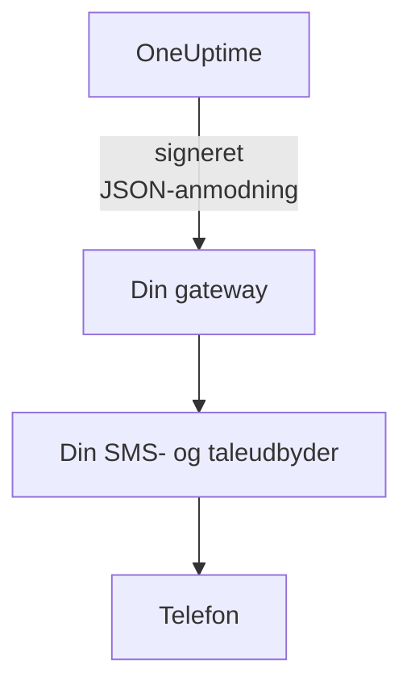

# SMS- og opkaldsgateway

OneUptime kan sende sine SMS og opkald gennem en gateway, du selv driver, i stedet for Twilio. Brug den, når dine regler kræver, at hver besked går gennem din egen SMS- og taleudbyder eller gennem et system, der kontrollerer den, før den forlader dit netværk. OneUptime sender hver SMS og hvert opkald til din gateway som en signeret JSON-anmodning, og din gateway leverer den.

:::cards
- [Sæt gatewayen op](#sæt-gatewayen-op): En URL og en signeringshemmelighed, der laves til dig.
- [Hvad din gateway modtager](#hvad-din-gateway-modtager): Én signeret JSON-anmodning pr. SMS eller opkald.
- [Reager på et tilkald](#reager-på-et-tilkald): Bekræft, eskalér eller løs fra et opkald eller et svar.
- [Levering og nye forsøg](#levering-og-nye-forsøg): Hvad der sker, når din gateway er nede.
:::

## Sådan fungerer det



Gatewayen træder i stedet for serverens egen Twilio-konto for alt, der ellers ville gå gennem den: vagttilkald, notifikationer, bekræftelseskoder og SMS til abonnenter på statussider. Projekter, der tilføjer deres egen Twilio-konfiguration på kortet **Twilio-konfiguration** under **Projektindstillinger > Notifikationer > Notifikationsindstillinger**, sender stadig gennem den konfiguration. Hvert projekts kontakter for SMS og opkald, og dets saldo, hvor fakturering er slået til, kontrolleres på samme måde som for Twilio.

## Sæt gatewayen op

:::steps
1. Gå i Admin Dashboard til **Indstillinger > Opkald og SMS**, og klik på **Edit Provider** på kortet **SMS and Call Provider**.
2. Vælg **Your own gateway**, og indtast **Gateway URL**. Gatewayen kan ligge på dit private netværk.
3. Gem. OneUptime laver en signeringshemmelighed til dig. Kopiér den fra kortet ind i din gateway.
4. Klik på **Send Test**. Din gateway skal svare med en 2xx-status og ikke sende noget.
:::

For at udskifte hemmeligheden skal du rydde **Signing Secret** under **Flere felter** og gemme: OneUptime laver en ny. For at gå tilbage til Twilio skal du vælge **Twilio** og gemme.

## Hvad din gateway modtager

Hver SMS og hvert opkald er én `POST`-anmodning med en JSON-body og disse headers:

| Header | Værdi |
| --- | --- |
| `Content-Type` | `application/json` |
| `X-OneUptime-Event` | `sms`, `call` eller `test` |
| `X-OneUptime-Signature` | `sha256=` efterfulgt af HMAC-SHA256 af bodyen i hex, med signeringshemmeligheden som nøgle |
| `User-Agent` | `OneUptime-CallAndSmsGateway/1.0` |

```json title="An on-call page by SMS"
{
  "version": 1,
  "event": "sms",
  "id": "7c5b0d0e-3e5f-4d1a-9a4f-2b8e6c1d9f00",
  "sentAt": "2026-10-27T09:30:00.000Z",
  "to": "+15551234567",
  "message": "OneUptime: A new alert has been created. Alert #42: Database is down…",
  "isSensitive": false,
  "project": {
    "id": "0f6b8c3a-1d2e-4f5a-8b9c-0d1e2f3a4b5c",
    "name": "Production"
  },
  "actions": {
    "acknowledge": "https://oneuptime.example.com/api/custom-notification-channel/page/5f2c…/acknowledge?token=…",
    "escalate": "https://oneuptime.example.com/api/custom-notification-channel/page/5f2c…/escalate?token=…",
    "resolve": "https://oneuptime.example.com/api/custom-notification-channel/page/5f2c…/resolve?token=…"
  }
}
```

| Felt | Hvad det er |
| --- | --- |
| `version` | Altid `1` for denne form. Der bliver kun nogensinde tilføjet felter til den. |
| `event` | `sms`, `call` eller `test`, som i `X-OneUptime-Event`. |
| `id` | Unik for denne besked og den samme i hvert forsøg på at levere den: Brug den til at se bort fra en besked, du allerede har sendt. |
| `sentAt` | Hvornår OneUptime sendte den, i ISO 8601. |
| `to` | Telefonnummeret i E.164-format. `null` i en test. |
| `message` | SMS'en, eller det, opkaldet siger. En SMS er højst 1.600 tegn, og et opkalds tekst højst 16.384. En længere tekst afkortes og slutter med en note om, at resten står i OneUptime. |
| `isSensitive` | `true` for en bekræftelseskode. Hold beskeden ude af dine egne logs. |
| `project` | Projektets `id` og `name`, eller `null`, når intet projekt sendte den. |
| `actions` | For et vagttilkald de links, der handler på det. Ellers `null`. |

Et opkald beskrives i stedet for at blive skrevet som et manuskript: `message` er det, opkaldet siger, uden Twilios "tryk 1 for at bekræfte". Tilbyd handlingerne på din egen måde, f.eks. med tastetryk, og kald det tilsvarende link.

### Kontrollér signaturen

Beregn HMAC'en af anmodningens rå body, før du parser den, og sammenlign den med headeren. Kontrollen er den samme som for en [brugerdefineret kanal](/docs/self-hosted/custom-notification-channels#kontrollér-signaturen), så én verifikator dækker begge:

```javascript title="Node.js"
const crypto = require("crypto");

function isFromOneUptime(rawBody, signatureHeader, secret) {
  const expected =
    "sha256=" + crypto.createHmac("sha256", secret).update(rawBody).digest("hex");
  const received = String(signatureHeader || "");

  return (
    received.length === expected.length &&
    crypto.timingSafeEqual(Buffer.from(received), Buffer.from(expected))
  );
}
```

## Reager på et tilkald

Når personen svarer under et opkald eller med et svar, sender din gateway en `POST`-anmodning til det tilsvarende link i `actions`. Linkene fungerer som en brugerdefineret kanals links: De kræver ingen API-nøgle, hvert link bærer et token, der kun gælder netop det tilkald og er gyldigt i 7 dage, og handlingen registreres som udført af den person, der blev tilkaldt. Se [Reager på et tilkald](/docs/self-hosted/custom-notification-channels#reager-på-et-tilkald) for hver handling og svaret.

```bash title="Acknowledge a page"
curl -X POST "https://oneuptime.example.com/api/custom-notification-channel/page/5f2c…/acknowledge?token=…"
```

## Levering og nye forsøg

En anmodning tæller som leveret, når din gateway svarer med en 2xx-status inden for 10 sekunder. En anmodning, den ikke svarede på eller svarede på med 408, 429 eller en 5xx-status, sendes igen efter 1 sekund og efter yderligere 4 sekunder: tre forsøg i alt. Ved enhver anden 4xx-status sendes den ikke igen.

SMS- eller opkaldsloggen, og for et vagttilkald personens vagtlog, viser `Sent to the SMS and call gateway (HTTP 200).` eller hvorfor den ikke blev leveret, aldrig URL'en. OneUptime får ikke at vide, om beskeden nåede telefonen, så en SMS vises som sendt, så snart din gateway accepterer den, og nummeret, den blev sendt fra, står tomt.

## Testanmodninger

**Send test** sender en anmodning med `event` sat til `test` og `to`, `project` og `actions` sat til `null`. Besvar den med en 2xx-status, og send ingenting.

## Næste trin

:::cards
- [Brugerdefinerede notifikationskanaler](/docs/self-hosted/custom-notification-channels): Tilkald folk gennem din egen app.
- [Push-notifikationer](/docs/self-hosted/push-notifications): Slå push fra for hele serveren.
- [Twilio-integration](/docs/self-hosted/twilio-integration): Send gennem Twilio i stedet.
- [Adgang til privat netværk](/docs/self-hosted/private-network-access): Hvad din server må nå på dit eget netværk.
:::
