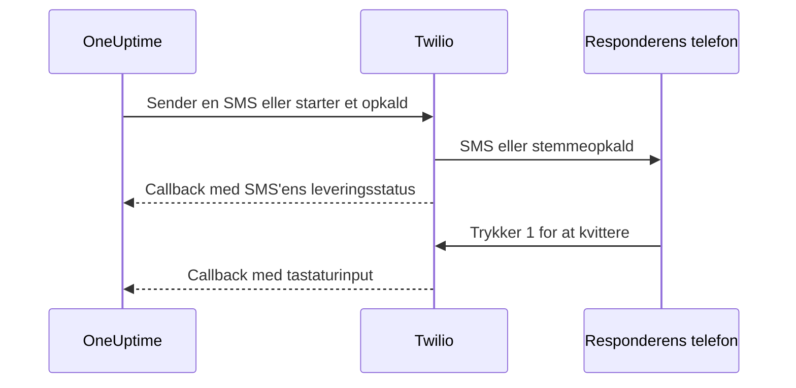

# Twilio-integration

En selvhostet OneUptime sender SMS- og stemmealarmer gennem din egen Twilio-konto, og du betaler Twilio direkte. Twilio-legitimationsoplysningerne gemmer du i OneUptimes dashboard, ikke i miljøvariabler: Leveringen af notifikationer læser den gemte konfiguration, og Helm-chartet har ingen værdier til Twilio-legitimationsoplysninger.

> [!NOTE]
> En gammel migrering importerede `TWILIO_ACCOUNT_SID`, `TWILIO_AUTH_TOKEN` og `TWILIO_PHONE_NUMBER`; at ændre de variabler er ikke måden at opdatere legitimationsoplysningerne i en eksisterende installation på.

:::cards
- [Forbered din Twilio-konto](#1-forbered-din-twilio-konto): Legitimationsoplysninger, et telefonnummer og kontoens grænser.
- [Gem legitimationsoplysningerne](#2-gem-legitimationsoplysningerne-i-oneuptime): For ét projekt eller for hele installationen.
- [Konfigurer netværksadgang](#3-konfigurer-netværksadgang): Hvad Twilio skal kunne nå på din server, og hvornår.
- [Bekræft telefonnumre](#5-bekræft-teammedlemmers-telefonnumre): Hvordan teammedlemmernes numre bekræftes.
:::

## 1. Forbered din Twilio-konto

:::steps
### Kopiér dine legitimationsoplysninger

Åbn [Twilio Console](https://console.twilio.com/), og kopiér dit **Account SID** og dit **Auth Token**.

### Skaf et telefonnummer

Skaf et Twilio-telefonnummer med de SMS- og/eller stemmefunktioner, du har brug for. Brug formatet E.164 med landekode til afsender- og modtagernumre.

### Tjek kontoens grænser

Tjek kontoens saldo, tilladelserne for destinationslande og de gældende krav til registrering af afsendere. Prøvekonti har begrænsninger på modtagere, geografi og andet, som kan forhindre rigtige alarmer fra OneUptime i at virke; læs [Twilios dokumentation om konti og prøveperioden](https://www.twilio.com/docs/usage/tutorials/how-to-use-your-free-trial-account), før du tester. Brug en opgraderet konto i produktion.
:::

## 2. Gem legitimationsoplysningerne i OneUptime

Gem legitimationsoplysningerne for ét projekt eller én gang for hele installationen:

| | Projektkonfiguration | Konfiguration for hele installationen |
| --- | --- | --- |
| Hvor | Kortet **Twilio-konfiguration** under **Projektindstillinger > Notifikationer > Notifikationsindstillinger** | **Admin Dashboard > Indstillinger > Opkald og SMS** |
| Hvem kan sætte den | **Project Owner**, **Project Admin** eller **Create Call and SMS** i en brugerdefineret rolle | En master-admin |
| Bruges til | SMS og opkald til projektets medlemmer, så længe den er projektstandarden, de statussider, den er tildelt, og de politikker for indgående opkald, der bruger den | SMS og opkald til medlemmerne af ethvert projekt, der ikke har en standardkonfiguration |

Sådan tilføjer du en projektkonfiguration:

:::steps
1. Gå til **Projektindstillinger > Notifikationer > Notifikationsindstillinger**.
2. Vælg **Opret Twilio-konfiguration** i **Twilio-konfiguration**.
3. Angiv et navn, **Twilio Account SID**, **Twilio Auth Token** og **Twilio primært telefonnummer**. Du kan også angive kommaseparerede **Twilio sekundære telefonnumre** til andre lande.
4. **Indstil som projektstandard** er slået til for projektets første konfiguration, så SMS og opkald til projektets medlemmer, herunder vagtnotifikationer, går gennem den, så snart du gemmer. Slå den fra, hvis kontoen kun er til statussider eller indgående opkald. En senere konfiguration starter med kontakten slået fra: Slå den til, eller vælg **Indstil som projektstandard** i konfigurationens rækkemenu for at flytte de beskeder til den. En API-anmodning, der udelader `isProjectDefault`, behandles på samme måde.
5. Gem. Kun én konfiguration kan være projektstandarden. Statussider bruger den konfiguration, der udtrykkeligt er tildelt hver statusside.

> [!IMPORTANT]
> **SMS** og **Telefonopkald** er slået fra fra start i hvert projekt, og indtil de er slået til, kan ingen i projektet tilføje et telefonnummer til dem. En projektejer, en **Billing Admin** eller en person med **Manage Billing** slår dem til i kortet **Notifikationskanaler** på samme side.
:::

For en standard for hele installationen kan en administrator i stedet åbne **Admin Dashboard > Indstillinger > Opkald og SMS**, redigere Twilio-legitimationsoplysningerne og telefonnumrene og gemme. Medlemmernes notifikationer bruger denne globale konfiguration, når deres projekt ikke har en standard. Hold Auth Token fortroligt.

## 3. Konfigurer netværksadgang

Afsendelse virker med udgående adgang alene. Leveringsopdateringer, kvittering via tastaturet og indgående opkald kræver, at Twilio kan nå din server.

En privat installation skal have DNS-opslag og udgående HTTPS over TCP 443 til Twilio for at indsende SMS og opkald. Twilio anbefaler at tillade udgående HTTPS til `*.twilio.com`, fordi API-adresserne er dynamiske; se [Twilios IP-adresser](https://help.twilio.com/articles/115015934048-All-About-Twilio-IP-Addresses). Anvend det på udgående trafik fra OneUptime-applikationens workload, herunder Kubernetes-NetworkPolicies og eksterne firewalls.

Indgående adgang afhænger af funktionen:

| Funktion | Skal Twilio kunne nå OneUptime? |
| --- | --- |
| Indsendelse af SMS | Nej. Opdateringer af leveringsstatus kræver dog et callback. |
| Et simpelt teststemmeopkald | Nej. OneUptime sender de talte instruktioner med i den udgående API-anmodning. |
| Tryk 1 for at kvittere for en vagtalarm | Ja. Twilio sender tastaturinputtet til OneUptime. |
| Politikker for indgående opkald | Ja. Twilio henter opkaldsinstruktioner og rapporterer resultaterne af opkaldet. |

Det er de eksterne stier gennem OneUptimes Nginx-gateway. Pladsholderne er forskellige for hver notifikation:

| Metode | Sti | Formål |
| --- | --- | --- |
| POST | `/notification/sms/status-callback/:smsLogId/:token` | SMS'ens leveringsstatus |
| POST | `/api/user-notification-log-timeline/call/gather-input/:itemId?token=...` | Kvittering via tastaturet |
| POST | `/notification/incoming-call/voice` | Valgfrie instruktioner til indgående opkald |
| POST | `/notification/incoming-call/dial-status/:callLogId/:callLogItemId` | Valgfrie resultater af routing af indgående opkald |

OneUptime genererer automatisk URL'erne til SMS og kvittering. Erstat ikke deres tokens med en fast webhook-URL. For indgående opkald følger du [politikker for indgående opkald](/docs/on-call/incoming-call-policy), der konfigurerer nummerets webhook, når du tilknytter et nummer.

Twilio kræver [offentligt tilgængelige webhook-URL'er](https://www.twilio.com/docs/usage/webhooks/webhooks-overview). Brug et offentligt betroet TLS-certifikat, og bevar den oprindelige vært, protokol, sti, forespørgselsparametre, body og headeren `X-Twilio-Signature` gennem proxyer. Handlerne til indgående opkald validerer Twilios signaturer; SMS-levering bruger et URL-token pr. besked, og kvittering via tastaturet et signeret forespørgselstoken. Afslør ikke tokens i delte logs eller skærmbilleder. Se [Twilios webhook-sikkerhed](https://www.twilio.com/docs/usage/webhooks/webhooks-security).

### Udgiv callbacks fra en privat installation

:::steps
1. Udgiv DNS for dit OneUptime-værtsnavn, for eksempel `oneuptime.example.com`, så det peger på en reverse proxy eller load balancer, der kan nås fra internettet. Tillad indgående TCP 443, og konfigurer et offentligt betroet certifikat med den fulde kæde. En privat IP, DNS, der kun virker internt, eller en administrators VPN-forbindelse giver ikke Twilio forbindelse.
2. Giv gatewayen en netværksrute til OneUptimes private ingress, direkte eller gennem dit eget site-to-site-VPN eller private link. Tillad tjenestens upstream-port. En Kubernetes-tjeneste af typen `ClusterIP` kræver en tilgængelig ingress eller en anden rute fra gatewayen. Hold databaser og andre interne tjenester private.
3. Udgiv kun de callback-stier fra tabellen ovenfor, som du bruger. Send dem videre gennem OneUptimes Nginx-gateway, der knytter det eksterne præfiks `/notification` til applikationen. Bevar `/api` på ruten til kvittering via tastaturet. Bevar HTTP-metoden og anmodningens data; omdiriger ikke til en anden URL. Bevar den offentlige `Host`, og sæt betroede videresendelses-headere for den offentlige vært og HTTPS-skemaet på din proxy.
4. Undtag disse ruter fra browser-SSO, CAPTCHA og proxyens loginsider. Lad OneUptimes callback-godkendelse være slået til. Begræns adgangen til den private oprindelse til gatewayen og godkendte interne klienter.
5. Sæt `HOST=oneuptime.example.com` og `HTTP_PROTOCOL=https` i Docker Composes `config.env`, eller `host: oneuptime.example.com` og `httpProtocol: https` i Helm-values. Anvend ændringen i installationen, og vent, til applikationen er genstartet. Indstillingerne genererer URL'er; de opretter hverken DNS, certifikater eller firewallregler. OneUptime har ingen separat indstilling til et værtsnavn for Twilio-callbacks. Hvis værtsnavnet ændres, så opdater også webhooken på eksisterende Twilio-telefonnumre.
:::

Dashboardet kan blive på en privat ingress: Med split DNS slår medarbejderne det samme værtsnavn op til den ingress gennem firmanetværket eller VPN'en, mens Twilio slår det op til gatewayen. Lever et certifikat, der er gyldigt for værtsnavnet, ad begge veje. OneUptimes [indstillinger for adgang til private netværk](/docs/self-hosted/private-network-access) styrer udgående anmodninger til interne tjenester; `ALLOW_PRIVATE_NETWORK_WEBHOOKS` udgiver ikke et indgående endpoint.

### IP-begrænsninger og installationer uden indgående adgang

De almindelige kildeadresser for Twilios webhooks ændrer sig, så brug ikke SIP- eller medie-IP-intervaller som allowlist for callbacks. Kvalificerede Twilio-udgaver tilbyder [Static Proxy for Webhooks](https://www.twilio.com/docs/iam/twilio-editions/twilio-static-proxy). Bekræft, at din udgave er kvalificeret, og hvilke produkter der understøttes, og konfigurer din firewall med de intervaller, Twilio aktuelt offentliggør; bliv ved med at validere callbacks, også når du bruger det.

> [!WARNING]
> Hvis en politik forbyder indgående forbindelser, kan indsendelse af SMS og simpel indbygget afspilning af stemme virke med udgående HTTPS. Opdateringer af SMS-levering, kvittering via tastaturet og routing af indgående opkald kan ikke virke uden tilgængelige callbacks. En fuldstændig afskåret installation kan ikke bruge Twilio.

Til udvikling beskriver Twilios [vejledning i test af webhooks](https://www.twilio.com/docs/usage/webhooks/webhook-testing) brugen af en offentlig tunnel: Send den videre til en proxy, der kun tillader de nødvendige ruter, konfigurer det værtsnavn, du får, som ovenfor, og stop tunnelen efter testen. En tunnel åbner stadig for indgående adgang.

## 4. Test levering og callbacks hver for sig

:::steps
1. Kontrollér uden for firmanetværket og VPN'en, at callback-værtsnavnet slås op til den offentlige gateway og leverer et gyldigt TLS-certifikat. En GET fra browseren tester ikke disse POST-callbacks.
2. Brug **Send test-SMS** og **Send testopkald** på projektets Twilio-konfiguration. Bekræft modtagelsen på destinationstelefonen. Begge kræver tilladelse til at tilføje Twilio-konfigurationer: **Project Owner**, **Project Admin** eller **Create Call and SMS** og **Read Call and SMS** i en brugerdefineret rolle.
3. Konfigurer brugerens bekræftede SMS- eller opkaldskontakt og notifikationsregler, og udløs derefter en kontrolleret vagtalarm. Tryk 1, og bekræft kvitteringen i OneUptime. Hvis du bruger politikker for indgående opkald, så ring til det konfigurerede nummer, og tjek dets routing og opkaldslog.
4. Bekræft SMS'ens leveringsstatus i OneUptime og i Twilios beskedlogs. En accepteret afsendelse er ikke bevis for levering; [Twilio rapporterer senere statusændringer via callbacks](https://www.twilio.com/docs/messaging/guides/track-outbound-message-status).
:::

| Symptom | Hvor du skal kigge |
| --- | --- |
| Intet bliver sendt | Legitimationsoplysninger, nummerets funktioner, kontoens begrænsninger og den udgående forbindelse. |
| SMS'en eller opkaldet kommer frem, men status eller kvittering opdateres ikke | Callback-URL'en og logs fra den offentlige ingress. Twilios [vejledning om fejl ved HTTP-hentning](https://www.twilio.com/docs/api/errors/11200) hjælper med utilgængelige callbacks, TLS-problemer og HTTP-fejl. |

Et vellykket testopkald alene beviser ikke, at callbacks kan nås.

## 5. Bekræft teammedlemmers telefonnumre

Når du tilføjer et telefonnummer til SMS eller opkald, sendes dets bekræftelseskode med det samme, og bekræftelsesdialogen åbnes. Den viser, hvornår koden blev sendt, og hvor længe den gælder, og sender en ny kode på opfordring, højst én gang i minuttet. Intet skal sendes igen, før du bekræfter.

Når der ikke kan sendes en kode, fortæller dialogen hvorfor i stedet for at påstå, at en kode er sendt: for eksempel at der ikke er konfigureret en Twilio-konto, så længe der hverken findes en standardkonfiguration for projektet eller konfigurationen for hele installationen ovenfor. Et nummer, hvis første kode ikke kan sendes, tilføjes ikke, og formularen viser årsagen, for eksempel at Twilio afviser et destinationsland.

Et nummer, der er bekræftet til SMS, er også bekræftet til opkald, uden en ny kode. Bekræftelse via opkald bekræfter ikke SMS, fordi et nummer, der tager imod opkald, som en fastnettelefon, ikke altid kan modtage sms'er. Hvis Twilio accepterer en kode, der aldrig når frem, viser projektets SMS-log dens leveringsstatus.

## Næste trin

:::cards
- [Politik for indgående opkald](/docs/on-call/incoming-call-policy): Lad opkald via et Twilio-nummer nå dine vagthavende ingeniører.
- [Eskaleringsregler](/docs/on-call/escalation-rules): Bestem, hvem der tilkaldes på hvert niveau, via SMS, opkald eller en anden metode.
- [SMTP](/docs/emails/smtp): Send også e-mail gennem din egen mailserver.
- [Adgang til private netværk](/docs/self-hosted/private-network-access): Lad workflows og webhooks nå interne værktøjer.
:::
