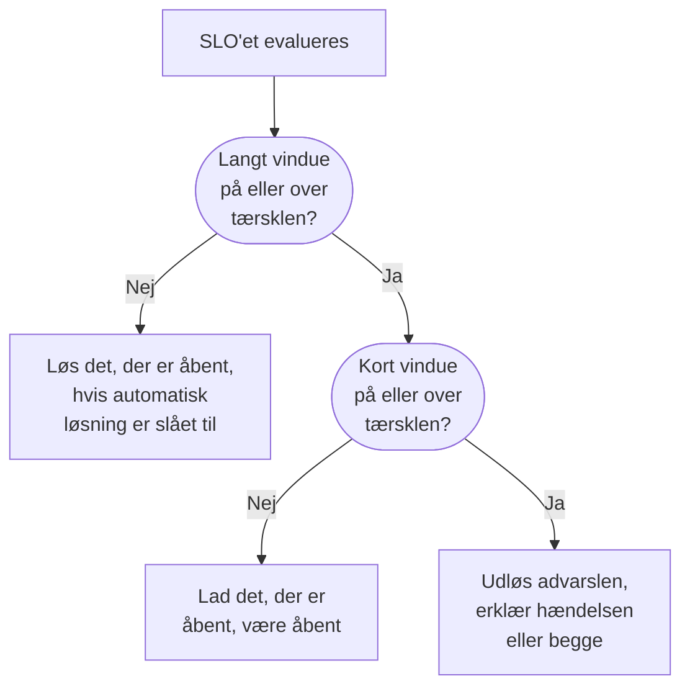

# Forbrugsrateadvarsler og -hændelser

Fejlbudgetter fortæller dig, hvor du står; forbrugsrateregler fortæller dig, hvornår du skal ud af sengen. Når et SLO bruger sit fejlbudget hurtigt nok til, at det betyder noget, udløser en forbrugsrateregel en advarsel, erklærer en hændelse eller begge dele, med din egen titel og beskrivelse, alvor, ejere, etiketter, vagteskalering og beskeder i arbejdsområdet.

:::cards
- [Hvordan en regel beslutter](#hvordan-en-regel-beslutter-at-udløse): To vinduer, begge over tærsklen.
- [Standardregler](#standardregler): Fast burn og Slow burn, tilpasset SLO'ets vindue.
- [Opret en regel](#opret-eller-redigér-en-regel): Fem trin på SLO'ets side Burn Rate Rules.
- [Skabelonvariabler](#hvad-hver-advarsel-og-hændelse-siger): Skriv dine egne titler og beskrivelser.
:::

## Hvad forbrugsrate betyder

Forbrugsraten er, hvor hurtigt du bruger fejlbudgettet sammenlignet med et jævnt tempo:

```text
burn rate = (share of time that was bad) ÷ (share of time the target allows to be bad)
```

Ved en forbrugsrate på 1 bruger du budgettet præcis over vinduet og når målet uden noget tilovers. Højere tal bruger det op tidligere. For et SLO på 99,9 % over 30 dage:

| Forbrugsrate, hvis den fortsætter | Budgettet er brugt op efter |
| --- | --- |
| 1 | 30 dage |
| 2 | 15 dage |
| 6 | 5 dage |
| 14.4 | cirka 2 dage (50 timer) |

Forbrugsraten afhænger ikke af, hvor meget budget der er tilbage. Den svarer på "hvor slemt er det lige nu?", og det er det, du skal vide for at beslutte, om du skal tilkalde nogen.

## Hvordan en regel beslutter at udløse

OneUptime tjekker hver aktiveret forbrugsrateregel ved hver evaluering af SLO'et, hvert 5. minut. Hver regel måler forbrugsraten over to vinduer og udløser kun, når begge ligger på dens tærskel eller derover:

- Det **lange vindue** (for eksempel 1 time) viser, at forbruget er vedvarende og betydeligt, og ikke et enkelt mislykket tjek.
- Det **korte vindue** (for eksempel 5 minutter) viser, at det stadig sker. Uden det ville en spids for en time siden blive ved med at advare længe efter, at alt var kommet sig.

Det er mønsteret med flere vinduer og flere forbrugsrater fra Google SRE Workbook, og det, OneUptime sætter op for dig.



En regel kan ikke udløse, før SLO'et har et helt langt vindue af overvågningshistorik: ellers ville en monitors allerførste mislykkede tjek, delt med få minutters historik, give en enorm forbrugsrate. Så et nyt SLO kan ikke udløse sin regel **Fast burn** i den første time, og heller ikke sin regel **Slow burn** i de første seks. Hvis et SLO senere ikke længere har så meget historik, for eksempel efter at dets monitorer er skiftet ud med nye, løser reglen det, den havde åbnet, i stedet for at lade det hænge. En regel udløser heller ikke, mens en af SLO'ets monitorer er i planlagt vedligeholdelse: se [Planlagt vedligeholdelse](#planlagt-vedligeholdelse).

## Standardregler

Hvert nyt SLO får to forbrugsrateregler. For et vindue på 30 dage:

| Regel | Tærskel | Langt vindue | Kort vindue | Udløser, når |
| --- | --- | --- | --- | --- |
| **Fast burn** | 14.4× | 1 time | 5 minutter | Cirka 2 % af budgettet bruges på en time: det ville være brugt op på cirka 2 dage. |
| **Slow burn** | 6× | 6 timer | 30 minutter | Cirka 5 % af budgettet bruges på seks timer: det ville være brugt op på cirka 5 dage. |

Tærsklerne på 14.4× og 6× er beregnet til et budget på 30 dage, så OneUptime tilpasser dem til dit SLO's vindue. Hver regel betyder altid "2 % af budgettet på 1 time" eller "5 % af budgettet på 6 timer":

| SLO'ets vindue | Tærskel for Fast burn | Tærskel for Slow burn |
| --- | --- | --- |
| 7 dage | 3.36× | 1.4× |
| 28 dage | 13.44× | 5.6× |
| 30 dage | 14.4× | 6× |
| 90 dage | 43.2× | 18× |

SLO'er med kalendermåned får værdierne for 30 dage. Begge regler udløser en advarsel med projektets højeste advarselsalvor, med standardtitlen og -beskrivelsen, løser den automatisk og tilføjer ingen ejere eller etiketter. De erklærer ikke hændelser, så en opgradering af OneUptime begynder aldrig at erklære hændelser for dig. Redigér dem, slet dem, eller tilføj dine egne.

## Opret eller redigér en regel

Du skal have tilladelse til at oprette SLO-forbrugsrateregler.

:::steps
### Åbn Burn Rate Rules

Åbn SLO'et, gå til **Burn Rate Rules**, og klik på **Opret SLO Burn Rate Rule**, eller redigér en af standardreglerne.

### Giv reglen et navn

Under **Rule** angiver du et **Navn**, som "Fast burn". **Aktiveret** er slået til.

### Angiv forbrugsvinduet

Under **Burn Window** angiver du **Burn Rate Threshold** (for eksempel `14.4`), **Long Window (Minutes)** og **Short Window (Minutes)** og eventuelt **Re-fire Suppression (Minutes)**.

### Vælg, hvad den erklærer

Under **What It Declares** slår du **Opret advarsel**, **Erklær hændelse** eller begge til. **Add SLO Owners as Owners** gør også SLO'ets ejere til ejere af alt, hvad reglen opretter.

### Beskriv advarslen og hændelsen

Trinnene **Advarsel** og **Hændelse** vises kun for det, reglen erklærer. Hvert har en titel og en alvor og sammenfoldede sektioner: **Beskrivelse**, **Ejerskab og etiketter**, **Vagt** og **Flere felter**, der rummer automatisk løsning, privatliv og afhjælpningsnoter. Nye regler starter med standardtitlen og -beskrivelsen, klar til at blive redigeret. Klik på **Opret SLO Burn Rate Rule** i det sidste trin.
:::

OneUptime tjekker en regels tal, når du gemmer den:

| Indstilling | Skal være |
| --- | --- |
| **Burn Rate Threshold** | Større end 0. |
| **Short Window (Minutes)** | Større end 0. |
| **Long Window (Minutes)** | Længere end det korte vindue. |
| **Re-fire Suppression (Minutes)** | 0 eller mere. Tom betyder det lange vindues længde. |

En regel skal oprette en advarsel, erklære en hændelse eller begge: en regel med begge slået fra afvises, fordi den ville blive tjekket ved hver evaluering uden nogensinde at erklære noget.

Regeltabellen viser for hver regel tærsklen, vinduerne og undertrykkelsen, hvad den erklærer (og om advarslen eller hændelsen kun løses manuelt eller er privat), alvorsgraderne, vagtpolitikkerne, ejerne og etiketterne.

> [!TIP]
> Et godt udgangspunkt: behold de to standardregler, send reglen for hurtigt forbrug til den vagtpolitik, der tilkalder folk, med høj alvor, og lad reglen for langsomt forbrug udløse en advarsel med lavere alvor til arbejdstiden. Arbejder dit team med hændelser, så slå **Erklær hændelse** til på reglen for hurtigt forbrug, og slå **Opret advarsel** fra der, hvis du helst ikke vil have begge.

## Hvad en regel erklærer

|  | **Opret advarsel** | **Erklær hændelse** |
| --- | --- | --- |
| Fra start | Til | Fra |
| Hvad det er | Det lette signal: havner på advarselslisten. | Det tunge signal: får et hændelsesnummer og starter hele responsforløbet. |
| Titel og beskrivelse | Egne, eller standardteksten | Egne, eller standardteksten |
| Alvor | **Advarselsalvor**: projektets højeste, hvis tom | **Hændelsesalvor**: projektets højeste, hvis tom |
| Eskalering | **Alert On-Call Duty Policies** | **Incident On-Call Duty Policies** |
| Ejere og etiketter | **Ejere af advarslen** og **Advarselsmærkater** | **Ejere af hændelsen** og **Hændelsesetiketter** |
| Privat | Fra | Fra |
| Automatisk løsning | Til | Til |
| Statussider | Aldrig offentliggjort | Aldrig offentliggjort |

Fordi hver af dem sættes op for sig, kan du sende en kort advarsel til det ansvarlige teams vagtplan og en udførlig hændelse til din vagtplan for større hændelser. De lever også hver for sig: hver bliver deduplikeret, løst og undertrykt for sig, så at løse hændelsen nulstiller ikke advarslens undertrykkelse, og omvendt.

### SLO'et er en berørt ressource

Hver advarsel og hændelse, som en forbrugsrateregel opretter, viser sit SLO under **Berørte ressourcer** og linker til det. Filteret **Berørte ressourcer** på listerne over advarsler og hændelser begrænser dem til ét SLO, og SLO'ets sider **Advarsler** og **Hændelser** viser dem, med mærker i sidemenuen, der tæller de åbne. OneUptime opretter selv denne forbindelse, og at redigere advarslen eller hændelsen fjerner den aldrig.

### Forbrugsratehændelser forbliver interne

Et fejlbudget, der brændes hurtigt af, er et signal til udviklingen, ikke et erklæret nedbrud. En forbrugsratehændelse vises aldrig på statussider og giver aldrig abonnenter på statussider besked. Den knyttes heller ikke til nogen monitorer, fordi det ellers ville omskrive selve den statushistorik for monitorerne, som SLO'et måles ud fra, når den bliver løst.

Løser du sådan en hændelse manuelt, erklærer intet den igen, før forbruget er kommet sig, og reglen virkelig udløser igen, så du aldrig kæmper mod reglen, mens du arbejder på en hændelse.

## Hvad hver advarsel og hændelse siger

Nye regler starter med standardtitlen og -beskrivelsen, både på advarslen og på hændelsen. Tøm en titel eller en beskrivelse for at gå tilbage til standardteksten. Standardtitlen er:

```text
SLO burn rate: {{sloName}} — {{ruleName}}
```

Standardbeskrivelsen nævner reglen, angiver forbrugsraten for begge vinduer i forhold til tærsklen og det resterende fejlbudget.

For at skrive din egen tekst bruger du skabelonvariabler i titlen, beskrivelsen og afhjælpningsnoterne. Hvert af de felter viser dem under **Skabelonvariabler**: klik på en for at indsætte den ved markøren, eller skriv `{{` i feltet, og vælg en. Beskrivelsen og afhjælpningsnoterne har også **Indsæt variabel** i deres værktøjslinje. Variablerne udfyldes, når reglen udløser:

| Variabel | Hvad den indeholder | Eksempel |
| --- | --- | --- |
| `{{sloName}}` | SLO'ets navn. | `Checkout availability` |
| `{{sloId}}` | SLO'ets ID. | `b7f4c2d8-1f3e-4a5b-9c6d-7e8f9a0b1c2d` |
| `{{sloLink}}` | Link til SLO'et i OneUptime-dashboardet. | `https://oneuptime.com/dashboard/project-id/slos/slo-id` |
| `{{sloStatus}}` | SLO'ets status efter denne evaluering. | `At Risk` |
| `{{ruleName}}` | Navnet på den forbrugsrateregel, der udløste. | `Fast burn` |
| `{{burnRateThreshold}}` | Reglens forbrugsratetærskel (et multiplum af det holdbare tempo). | `14.4` |
| `{{longWindowBurnRate}}` | Forbrugsrate målt over reglens lange vindue. | `21.5` |
| `{{shortWindowBurnRate}}` | Forbrugsrate målt over reglens korte vindue. | `36` |
| `{{longWindowInMinutes}}` | Længden af reglens lange vindue, i minutter. | `60` |
| `{{shortWindowInMinutes}}` | Længden af reglens korte vindue, i minutter. | `5` |
| `{{targetPercentage}}` | SLO'ets mål, i procent. | `99.9` |
| `{{currentSliPercentage}}` | SLI'en målt over SLO'ets compliancevindue, i procent. | `99.87` |
| `{{errorBudgetRemainingPercentage}}` | Andelen af fejlbudgettet, der stadig er til rådighed, i procent. Negativ, når budgettet er overskredet. | `42.5` |
| `{{errorBudgetRemaining}}` | Fejlbudget, der stadig er til rådighed, som varighed. Starter med et minustegn, når budgettet er overskredet. | `18m 22s` |
| `{{errorBudgetRemainingMinutes}}` | Fejlbudget, der stadig er til rådighed, i minutter. | `18.37` |
| `{{windowDescription}}` | SLO'ets compliancevindue, med ord. | `rolling 30-day window` |

For eksempel bliver titlen `{{ruleName}}: {{sloName}} is burning {{longWindowBurnRate}}x` til `Fast burn: Checkout availability is burning 21.5x`.

:::details Hvordan variabler udfyldes
- Tal afrundes til to decimaler.
- Mellemrum inden for tuborgklammerne er i orden: `{{ sloName }}` virker.
- En stavet forkert variabel bliver stående præcis, som den er, så en tastefejl ses i advarslen i stedet for at forsvinde i stilhed.
- Titler må være 500 tegn lange, og beskrivelser og afhjælpningsnoter 50.000. En titel, der er længere end 500 tegn, efter at variablerne er udfyldt, sættes på én linje og afkortes med en ellipse, så advarslen eller hændelsen alligevel oprettes.
- Kan linket til SLO'et ikke bygges, når reglen udløser, forbliver `{{sloLink}}` tom, og advarslen eller hændelsen oprettes alligevel.
:::

## Ejere, etiketter og privatliv

- **Ejere af advarslen** og **Ejere af hændelsen** er personer og teams, valgt fra én liste med **Tilføj ejer**. De tilføjes til advarslen eller hændelsen, så snart den oprettes, og får besked. Personer skal være medlemmer af projektet.
- **Add SLO Owners as Owners** tilføjer også SLO'ets ejere, dets ejerbrugere og medlemmerne af dets ejerteams, til alt, hvad reglen opretter. SLO'ets ejere hører allerede om selve SLO'ets statusændringer, så det kan give dem besked to gange. Det er slået fra som standard.
- Hver ejer tilføjes én gang: en bruger, der allerede er ejer af advarslen eller hændelsen, for eksempel via projektets ejerregler, eller som er med i et tilføjet ejerteam, tilføjes ikke igen.
- **Advarselsmærkater** og **Hændelsesetiketter** tilføjes til advarslen eller hændelsen, så filtre, ejerregler og beskedregler for arbejdsområdet kan matche dem.
- En privat advarsel eller hændelse er kun synlig for sine ejere, projektets administratorer og projektets ejere.

Etiketter, ejerteams og vagtpolitikker skal høre til SLO'ets projekt.

## Løsning og undertrykkelse af nye udløsninger

- **Løsning følger det lange vindue.** Med automatisk løsning slået til (standard) løser OneUptime en regels advarsel og hændelse, så snart det lange vindues forbrugsrate falder under tærsklen. At løse på det korte vindue ville give flimmer: et nedbrud, der kommer og går, ville blive løst efter fem rolige minutter og tilkalde folk igen hele natten.
- **Automatisk løsning slået fra.** Slå **Løs advarsel automatisk** eller **Løs hændelse automatisk** fra, og den post forbliver åben, indtil nogen løser den, også efter at forbruget er kommet sig. Reglen åbner ikke en ny oven i den, og når den er løst manuelt, og det lange vindue ligger under tærsklen, kan reglen udløse igen efter sin undertrykkelse.
- **Undertrykkelse af nye udløsninger.** Når en post er løst, erklærer reglen ikke den slags post igen i undertrykkelsesperioden, som standard det lange vindues længde. Så får et system, der er ved at komme sig, tid til det uden at tilkalde nogen for den støj, der er tilbage.

Nogle ændringer løser altid det, en regel har åbnet, uanset hvad dens indstillinger for automatisk løsning siger, så intet bliver ved med at eskalere for en regel, der ikke længere kan begrunde det:

- at slå **Opret advarsel** eller **Erklær hændelse** fra lukker det, det output havde åbnet;
- at slå reglen fra eller slette den;
- at slå SLO'ets evaluering fra, arkivere SLO'et eller slette det;
- at SLO'et skifter til **Sat på pause** eller **Misconfigured**, fordi det så ikke måler noget;
- at reglen mister sin tærskel eller sine vinduer, eller at SLO'et ikke længere har et helt langt vindue af historik.

## Planlagt vedligeholdelse

Mens en af SLO'ets monitorer er i en igangværende planlagt vedligeholdelse, udløser dets forbrugsrateregler ikke advarsler og erklærer ikke hændelser: planlagt arbejde skal ikke tilkalde nogen. Det, reglerne allerede havde åbnet, løses stadig som normalt. Tiden tæller stadig med i fejlbudgettet, efter SLO'ets nedetidsstatusser.

## SLO'ets feed

SLO'ets **Feed** offentliggør hver advarsel, en regel udløser, og hver hændelse, den erklærer, med et link og de forbrugsrater, der forklarer den, og hvornår hver af dem løses, automatisk eller manuelt. En post, som reglen samler op igen, fordi den stadig var åben, offentliggøres ikke to gange. At oprette, redigere og slette en regel offentliggøres også og registreres i SLO'ets **Auditlogs**. Se [SLO-feed og auditlogs](/docs/slo/feed-and-audit-logs).

## Fejlfinding

:::details En regel udløste ikke lige efter, at SLO'et blev oprettet
En regel udløser kun, når SLO'et har et helt langt vindue af overvågningshistorik: en time for standardreglen for hurtigt forbrug, seks timer for den for langsomt forbrug.
:::

:::details En advarsel blev løst, mens nedbruddet stadig stod på
Automatisk løsning følger det lange vindue: så snart det lange vindues forbrugsrate falder under tærsklen, løses advarslen. Giv reglen et længere langt vindue, eller slå **Løs advarsel automatisk** fra, og løs advarslen manuelt.
:::

:::details Intet udløste under en planlagt vedligeholdelse
Forbrugsrateregler er tavse, mens en af SLO'ets monitorer er i en igangværende planlagt vedligeholdelse. Nedetiden tæller stadig med i budgettet.
:::

:::details Er der et minimumsantal målinger?
Ikke for SLO'er, der måles på monitorernes tilgængelighed. Tilgængelighed måles i sekunder, så hvert sekund i vinduet er en måling, og der er ikke noget tilfælde med lav trafik at beskytte sig mod. Et minimumsantal målinger har kun betydning for hændelsesbaserede SLI'er, som endnu ikke findes.
:::

## Næste trin

:::cards
- [Fejlbudgetter](/docs/slo/error-budget): Hvad budgettet er, og hvor længe det holder.
- [Eskaleringsregler](/docs/on-call/escalation-rules): Hvem der tilkaldes, og i hvilken rækkefølge.
- [SLO-feed og auditlogs](/docs/slo/feed-and-audit-logs): Hver advarsel og hændelse, en regel udløser.
:::
