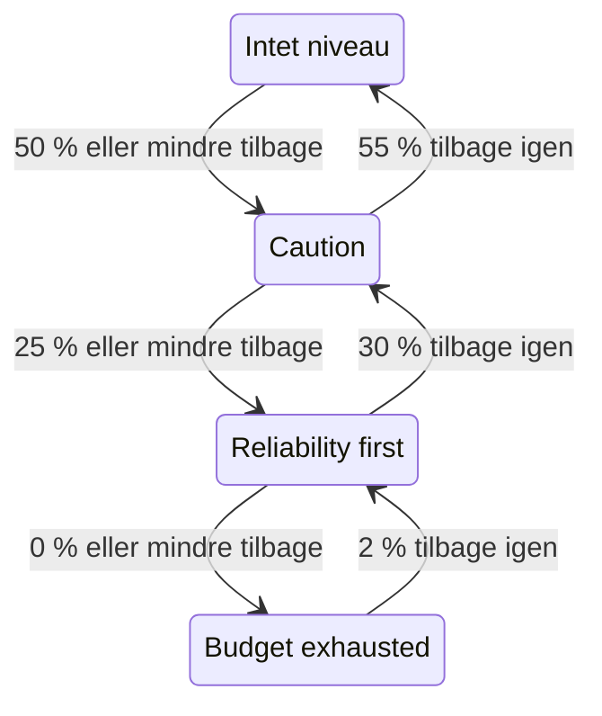

# Fejlbudgetpolitik

En fejlbudgetpolitik skriver ned, hvad dit team har aftalt at gøre, mens et SLO's fejlbudget løber ud, for eksempel at gennemgå risikable ændringer, når halvdelen er brugt, eller at fastfryse udgivelser, når det hele er brugt. OneUptime placerer SLO'et i det niveau i politikken, som dets budget har nået, viser teamets aftale for niveauet på SLO'ets sider, kan udløse en advarsel eller erklære en hændelse, når SLO'et går ind i et niveau, slår hvert skift af niveau op i de kanaler i Slack, Microsoft Teams eller Mattermost, du vælger, og fortæller dine CI/CD-pipelines, om de skal holde udgivelser tilbage. Det er praksissen med en fejlbudgetpolitik fra [Google SRE Workbook](https://sre.google/workbook/error-budget-policy/).

:::cards
- [Sådan fungerer niveauer](#sådan-fungerer-niveauer): Hvilket niveau der gælder, og hvornår SLO'et forlader det.
- [Opsæt en politik](#opsæt-en-politik): Start med den anbefalede politik, eller skriv dine egne niveauer.
- [Advarsler og hændelser](#advarsler-og-hændelser): Alarmér dit team, når SLO'et går ind i et niveau.
- [Slå op i Slack, Microsoft Teams og Mattermost](#slå-op-i-slack-microsoft-teams-og-mattermost): Giv en kanal besked, når et SLO går ind i et niveau, uden at alarmere nogen.
- [Udrulningsspærre](#udrulningsspærre): Hold udgivelser tilbage fra CI/CD, mens et niveau fryser udrulninger.
- [Læs niveauet via API'et](#læs-niveauet-via-apiet): Tjek niveauet fra CI og scripts.
:::

## Sådan fungerer niveauer

En politik er et sæt niveauer. Hvert niveau har tre felter:

| Felt | Hvad det indeholder |
| --- | --- |
| **Navn** | Hvad teamet kalder niveauet, for eksempel "Reliability first". |
| **Tærskel for resterende budget (%)** | Den andel af det resterende fejlbudget, ved eller under hvilken niveauet gælder. Fra 0 til 100, decimaler tilladt. Hvert niveau i et SLO har sin egen tærskel. |
| **Hvad vi gør** | Hvad teamet har aftalt at gøre, mens SLO'et er i niveauet, i Markdown. Påkrævet, op til 10.000 tegn. |

Et niveau gælder, så længe det resterende budget er ved eller under dets tærskel, så et niveau på 0 % er niveauet for et opbrugt budget. Når flere niveauer gælder, er SLO'et i det med den laveste tærskel: det mest alvorlige. Når ingen gælder, er SLO'et ikke i noget niveau. Med niveauer på 50 %, 25 % og 0 % er et SLO med 30 % af sit budget tilbage i niveauet på 50 %, og et med 10 % tilbage er i niveauet på 25 %.

Et niveau kan også fryse udrulninger, mens SLO'et er i det: se [Udrulningsspærre](#udrulningsspærre).

### At gå ind i et niveau og forlade det

Niveauet følger det resterende budget, sådan som SLO'ets status gør:

- At gå ind i et niveau sker med det samme: Den evaluering, der finder budgettet ved eller under et niveaus tærskel, placerer SLO'et i niveauet. Et budget, der falder forbi flere tærskler på én gang, går direkte til det mest alvorlige niveau.
- At forlade et niveau for et mindre alvorligt venter, til budgettet tydeligt er tilbage. Et niveau på 0 % forlades, når 2 % af budgettet er tilbage igen. Ethvert andet niveau forlades, når budgettet er 5 point over dets tærskel.

Et niveau på 0 % følger altså statussen **Budget opbrugt**, og et niveau ved SLO'ets risikotærskel følger **I risiko**: se [Statusændringer og risikotærsklen](/docs/slo/error-budget#statusændringer-og-risikotærsklen). Et rullende vindue, der svinger omkring en tærskel, får ikke niveauet til at skifte frem og tilbage.



## Opsæt en politik

Du skal have tilladelse til at oprette niveauer i SLO'ers fejlbudgetpolitik.

:::steps
### Åbn Fejlbudgetpolitik

Åbn SLO'et, og gå til **Fejlbudgetpolitik** i sektionen **Regler** i dets sidemenu. Siden viser SLO'ets niveauer, hver med sit navn, det resterende budget, det gælder ved, og hvad teamet gør.

### Start med den anbefalede politik

Så længe SLO'et ikke har nogen niveauer, tilbyder siden **Brug den anbefalede politik**. Klik på den, tjek de tre niveauer, den viser, og bekræft. Tilpas derefter hvert niveaus ordlyd til dit teams egen aftale.

### Eller tilføj selv et niveau

Klik på **Opret SLO-fejlbudgetpolitikniveau**. Angiv et **Navn** og en **Tærskel for resterende budget (%)**, og skriv teamets aftale i **Hvad vi gør**. Slå **Frys udrulninger** til, hvis pipelines skal holde udgivelser tilbage, mens SLO'et er i niveauet.

### Vælg, hvad niveauet udløser

Et niveau registrerer og viser aftalen. For også at alarmere nogen, når SLO'et går ind i niveauet, skal du åbne de sammenfoldede indstillinger for advarsel og hændelse og slå en advarsel, en hændelse eller begge til. Begge er slået fra som standard. Se [Advarsler og hændelser](#advarsler-og-hændelser).
:::

At tilføje, redigere eller slette et niveau virker med det samme: OneUptime evaluerer SLO'et igen inden for cirka et minut. Er budgettet allerede ved eller under et niveaus tærskel, kommer SLO'et så i det niveau, og niveauet udløser det, det er sat op til at udløse. At slå et niveau fra eller slette det løser det, niveauet har udløst, og SLO'et flytter til det niveau, dets budget er i. At slå et niveaus advarsel eller hændelse fra løser den advarsel eller hændelse.

### Den anbefalede politik

**Brug den anbefalede politik** tilføjer tre niveauer, ved halvdelen af budgettet, en fjerdedel og nul, med denne engelske ordlyd:

| Niveau | Gælder ved | Hvad teamet gør | Udrulninger |
| --- | --- | --- | --- |
| **Caution** | 50 % tilbage eller mindre | Half of the error budget is spent. Review risky changes before they ship, and find out what has been spending the budget. | Tilladt |
| **Reliability first** | 25 % tilbage eller mindre | Reliability comes first. Only reliability improvements and critical fixes ship until the budget recovers. | Tilladt |
| **Budget exhausted** | 0 % tilbage eller mindre | The error budget is spent. Freeze non-critical releases: only fixes for this SLO's reliability and security fixes ship until the budget is back. | Frosset |

Ingen af dem udløser en advarsel eller erklærer en hændelse, før du slår det til. **Budget exhausted** fryser udrulninger, som dets aftale siger, og bekræftelsen markerer det: se [Udrulningsspærre](#udrulningsspærre). Niveauer, der blev tilføjet, før spærren fandtes, fryser intet, før du slår frysningen til. Kun de niveauer, SLO'et ikke har, tilføjes: Et niveau med samme navn eller med samme tærskel tæller som til stede, uanset om det er slået til eller fra. At bede om det to gange, fra en anden fane eller via API'et, tilføjer altså intet to gange. Kan et af niveauerne ikke tilføjes, tilføjes ingen af dem: SLO'et forbliver, som det var, og du kan prøve igen. Hvert niveau, der tilføjes på den måde, registreres i SLO'ets auditlogs som tilføjet af dig.

## Hvor niveauet vises

- SLO'ets **Oversigt** viser det niveau, det er i, og hvad teamet har aftalt at gøre der, så alle, der åbner SLO'et, ser den aftale, der gælder nu. Mens niveauet fryser udrulninger, viser et rødt mærke under dets navn, siden hvornår.
- Diagrammet **Burn-down af fejlbudget** tegner en linje med etiket ved hvert niveaus tærskel ved siden af risikotærsklens linje.
- SLO'ets **Feed** viser hvert skift af niveau: det niveau, SLO'et forlod, og det niveau, det gik ind i, det resterende budget, hvad teamet har aftalt at gøre i det nye niveau, og om skiftet frøs udrulninger eller tillod dem igen.
- De kanaler i Slack, Microsoft Teams og Mattermost, som dine regler nævner, får det samme opslag: se [Slå op i Slack, Microsoft Teams og Mattermost](#slå-op-i-slack-microsoft-teams-og-mattermost).
- SLO'ets **Auditlogs** registrerer hvert skift af niveau, og hver gang udrulninger fryses eller tillades igen, som en ændring, OneUptime selv har lavet, og viser det derfor kun med **Gem systemhændelser** slået til: se [Slå auditlogs til](/docs/slo/feed-and-audit-logs#slå-auditlogs-til). At tilføje, redigere og fjerne et niveau registreres under den person, der gjorde det.
- SLO'ets læse-API returnerer niveauet, og om udrulninger er tilladt: se [Læs niveauet via API'et](#læs-niveauet-via-apiet) og [Udrulningsspærre](#udrulningsspærre).

## Advarsler og hændelser

Hvert niveau kan udløse en advarsel, erklære en hændelse eller begge dele, når SLO'et går ind i det. De har de samme muligheder som en forbrugsrateregels advarsel og hændelse: alvorsgrad, vagtpolitikker, skabeloner til titel, beskrivelse og afhjælpningsnoter, privatliv, automatisk løsning, etiketter, ejerteams og -brugere og tilføjelse af SLO'ets ejere som ejere. Se [Hvad en regel erklærer](/docs/slo/burn-rate-alerts#hvad-en-regel-erklærer). Begge er slået fra som standard, så et niveau alarmerer ingen, før du slår en af dem til.

- At gå ind i et mere alvorligt niveau løser det, det forrige niveau udløste, uanset dets indstilling for automatisk løsning, fordi det nye niveau afløser det. Så højst ét niveaus advarsel og hændelse er åbne ad gangen, og de hører til det niveau, SLO'et er i.
- At komme sig til et mindre alvorligt niveau, eller ud af alle niveauer, løser dem, når niveauets automatiske løsning er slået til, som den er som standard. Med automatisk løsning slået fra forbliver de åbne, til nogen løser dem.
- Der er ingen undertrykkelse af nye udløsninger. Et niveau udløser først igen, når SLO'et tydeligt har forladt det og er gået ind i det igen, så det kan ikke blafre. Løser nogen manuelt det, niveauet udløste, mens SLO'et stadig er i niveauet, forbliver det løst.
- Så længe en monitor i SLO'et er i planlagt vedligeholdelse, udløser niveauer intet. Selve niveauet skifter stadig, og det, der er åbent, løses stadig. Er SLO'et stadig i niveauet, når vedligeholdelsen slutter, udløser niveauet det, det er sat op til at udløse.

Ligesom ved en forbrugsrateregel viser en advarsel eller hændelse, som et niveau udløser, SLO'et under **Berørte ressourcer**, og en hændelse vises aldrig på statussider. SLO'ets feed viser hver enkelt, og hvornår den løses.

### Hvad de siger

Et niveaus titel, beskrivelse og afhjælpningsnoter tager skabelonvariabler, ligesom en regels: se [Hvad hver advarsel og hændelse siger](/docs/slo/burn-rate-alerts#hvad-hver-advarsel-og-hændelse-siger). Et niveaus felter tilbyder variablerne for SLO'et og dets budget og tre af niveauets egne: `{{sloName}}`, `{{sloId}}`, `{{sloLink}}`, `{{sloStatus}}`, `{{policyTier}}`, `{{policyTierThresholdPercentage}}`, `{{policyTierWhatWeDo}}`, `{{targetPercentage}}`, `{{currentSliPercentage}}`, `{{errorBudgetRemainingPercentage}}`, `{{errorBudgetRemaining}}`, `{{errorBudgetRemainingMinutes}}` og `{{windowDescription}}`. En regels egne variabler, såsom `{{ruleName}}` og forbrugsraterne, tilbydes ikke og er tomme i et niveaus skabeloner.

De tre niveauvariabler virker også i forbrugsratereglers skabeloner:

| Variabel | Hvad den indeholder |
| --- | --- |
| `{{policyTier}}` | Navnet på det niveau, SLO'et er i efter evalueringen, eller `None`, når det ikke er i noget niveau. |
| `{{policyTierThresholdPercentage}}` | Niveauets tærskel, for eksempel `25`. Tom, når SLO'et ikke er i noget niveau. |
| `{{policyTierWhatWeDo}}` | Hvad teamet har aftalt at gøre i niveauet. Tom, når SLO'et ikke er i noget niveau. |

Et niveau, hvis titel er tom, bruger den indbyggede titel:

```text
SLO error budget policy: {{sloName}} — {{policyTier}}
```

Den indbyggede beskrivelse nævner niveauet, holder det resterende budget op mod niveauets tærskel og siger, hvad teamet har aftalt at gøre i det.

## Slå op i Slack, Microsoft Teams og Mattermost

En regel kan slå hvert skift i et SLO's fejlbudgetpolitik op i de kanaler i Slack, Microsoft Teams eller Mattermost, som dit team læser, uden at alarmere nogen: når SLO'et går ind i et niveau, kommer sig til et mindre alvorligt niveau eller forlader alle niveauer, og når dets udrulninger fryses eller tillades igen. Hver regel vælger de SLO'er og de skift, den slår op. Forbind først workspacet med projektet: se [Slack](/docs/workspace-connections/slack), [Microsoft Teams](/docs/workspace-connections/microsoft-teams) eller [Mattermost](/docs/workspace-connections/mattermost).

:::steps
### Åbn sektionen Arbejdsområde for SLO'er

Gå til **SLOs** → **Arbejdsområde** → **Slack**, eller **Microsoft Teams**, eller **Mattermost**. Sektionen **Arbejdsområde** viser kun de chat-workspaces, dit projekt har forbundet.

### Opret en regel

Klik på **Opret Notifikationsregel for SLO'er**, og giv den et **Regelnavn**. Under **Hvilke SLO'er** beholder du **Alle SLO'er**, eller du vælger **Kun SLO'er, der opfylder betingelserne** og tilføjer betingelser: se [Hvad en regel matcher](#hvad-en-regel-matcher).

### Vælg, hvor den slår op

Under **Derefter i Slack** angiver du de kanaler, reglen slår op i. I Microsoft Teams vælger du et team og dets kanaler, eller chats, som OneUptime-appen er føjet til. Et SLO får ikke sin egen kanal, så en regel slår kun op i kanaler og chats, du allerede har.
:::

Beskeden beskriver skiftet med ordene fra SLO'ets **Feed**: det niveau, SLO'et forlod, og det niveau, det gik ind i, hvad der skete med udrulningerne, det resterende fejlbudget, det nye niveaus tærskel, og hvad teamet har aftalt at gøre der, sådan som teamet skrev det. En omtale i aftalen, såsom `<!channel>`, slås op som tekst og giver ingen besked.

- Et skift slås op én gang, efter at den evaluering, der førte til det, er gemt. En evaluering, der ikke gemmes, slår intet op, og den næste slår skiftet op.
- Intet slås op, så længe SLO'et bliver i sit niveau, uanset hvor længe budgettet svinger omkring en tærskel: se [At gå ind i et niveau og forlade det](#at-gå-ind-i-et-niveau-og-forlade-det).
- At slå **Frys udrulninger** til eller fra for det niveau, SLO'et er i, slår sin egen besked op.
- Et SLO, der er sat på pause, forkert konfigureret, deaktiveret eller arkiveret, beholder sit niveau og slår intet op.
- En besked, der ikke kan sendes, logges, og evalueringen, SLO'ets feed og det, niveauet udløser, fortsætter uden den.

### Hvad en regel matcher

| Betingelse | Hvad den matcher |
| --- | --- |
| **SLOs** | De SLO'er, du vælger, eller alle SLO'er undtagen dem. |
| **SLO-etiketter** | SLO'ets etiketter: en hvilken som helst af dem, du vælger, dem alle eller ingen af dem. |
| **SLO-navn** | SLO'ets navn: lig med din tekst eller ej, indeholder den eller ej, begynder eller slutter med den. |
| **Ændring i fejlbudgetpolitik** | Hvad der ændrede sig: **Gik ind i et mere alvorligt niveau**, **Kom tilbage til et mindre alvorligt niveau**, **Forlod alle niveauer**, **Udrulninger frosset** eller **Udrulninger tilladt igen**. |

Et skift af niveau, der frøs udrulninger eller tillod dem igen, er én besked, der tæller som begge skift. En regel for **Udrulninger frosset** slår altså også et skift op, når SLO'et går ind i et niveau, der fryser dem: En udgivelseskanal hører om hver frysning.

## Når budgettet ikke måles

- Et SLO, der er **Sat på pause** eller **Forkert konfigureret**, måler intet budget, så dets niveau bliver, hvor det var, og det, niveauet udløste, forbliver åbent, til der måles igen. Forbrugsrateregler løser derimod det, de har åbent.
- At slå SLO'ets evaluering fra eller at arkivere SLO'et løser det, dets niveauer udløste. Det niveau, SLO'et er i, forbliver, som det var.
- At slette SLO'et sletter dets niveauer og løser det, de udløste.
- I hvert af disse tilfælde beholder SLO'et det svar, det gav om udrulninger, fordi det beholder sit niveau: se [Udrulningsspærre](#udrulningsspærre).

## Udrulningsspærre

Et niveau kan fryse udrulninger. Mens SLO'et er i et niveau med **Frys udrulninger** slået til, er SLO'ets felt `deploymentsAllowed` `false`, så en CI/CD-pipeline, der tjekker det før en udgivelse, holder udgivelsen tilbage. Ellers er det `true`: når SLO'et ikke har nogen politik, mens dets budget er over alle niveauer, og i et niveau, der ikke fryser udrulninger. Den anbefalede politiks niveau **Budget exhausted** fryser udrulninger.

:::steps
### Slå Frys udrulninger til

Åbn SLO'ets **Fejlbudgetpolitik**, redigér niveauet, slå **Frys udrulninger** til, og gem. Niveauets kolonne **Udrulninger** i tabellen viser **Frosset**.

### Giv pipelinen en nøgle

Opret en [API-nøgle](/docs/api-reference/api-reference) til projektet, der kan læse SLO'et, og gem den som en hemmelighed i pipelinen med navnet `ONEUPTIME_API_KEY`.

### Tjek SLO'et før udgivelsen

Tilføj tjekket nedenfor som et trin før det trin, der udruller, med SLO'ets ID i stedet for `<slo-id>`.
:::

:::tabs
@tab Shell
```bash
ALLOWED=$(curl -sS -X POST 'https://oneuptime.com/api/service-level-objective/<slo-id>/get-item' \
  -H "ApiKey: $ONEUPTIME_API_KEY" \
  -H 'Content-Type: application/json' \
  -d '{ "select": { "deploymentsAllowed": true } }' | jq -r '.deploymentsAllowed')
[ "$ALLOWED" = "true" ]
```
@tab GitHub Actions
```yaml title=".github/workflows/deploy.yml"
name: Deploy
on:
  push:
    branches: [main]

jobs:
  deploy:
    runs-on: ubuntu-latest
    steps:
      - uses: actions/checkout@v4
      - name: Stop while the error budget policy freezes deployments
        env:
          ONEUPTIME_API_KEY: ${{ secrets.ONEUPTIME_API_KEY }}
          SLO_ID: <slo-id>
        run: |
          SLO=$(curl -sS -X POST "https://oneuptime.com/api/service-level-objective/$SLO_ID/get-item" \
            -H "ApiKey: $ONEUPTIME_API_KEY" \
            -H 'Content-Type: application/json' \
            -d '{ "select": { "deploymentsAllowed": true, "currentErrorBudgetPolicyTierName": true } }')
          if [ "$(echo "$SLO" | jq -r '.deploymentsAllowed')" != "true" ]; then
            echo "Not deploying: $SLO"
            exit 1
          fi
      - name: Deploy
        run: ./deploy.sh
```
@tab GitLab CI
```yaml title=".gitlab-ci.yml"
error-budget-gate:
  stage: test
  image: alpine:3.20
  variables:
    SLO_ID: <slo-id>
  before_script:
    - apk add --no-cache curl jq
  script:
    - >
      SLO=$(curl -sS -X POST "https://oneuptime.com/api/service-level-objective/$SLO_ID/get-item"
      -H "ApiKey: $ONEUPTIME_API_KEY"
      -H 'Content-Type: application/json'
      -d '{ "select": { "deploymentsAllowed": true, "currentErrorBudgetPolicyTierName": true } }')
    - echo "$SLO"
    - test "$(echo "$SLO" | jq -r '.deploymentsAllowed')" = "true"
```
:::

Tjekket lykkes kun, når svaret er `true`. Et frosset SLO, et svar uden feltet (nøglen kan ikke læse SLO'et, eller ID'et er forkert) og slet intet svar stopper hver især trinnet, så en pipeline aldrig udgiver på et svar, den ikke fik. I GitLab CI kører jobbet i fasen test, så et frosset SLO stopper fasen deploy efter den; tilføj `ONEUPTIME_API_KEY` som en maskeret CI/CD-variabel. På en selvhostet installation skal du bruge installationens egen adresse i stedet for oneuptime.com.

SLO'et svarer med to felter, der læses med SLO'ets egen læsetilladelse:

| Felt | Hvad det indeholder |
| --- | --- |
| `deploymentsAllowed` | `false`, mens SLO'et er i et niveau, der fryser udrulninger, ellers `true`. |
| `deploymentsFrozenAt` | Hvornår udrulningerne blev frosset. Tomt, mens de er tilladt. |

Sådan ændrer svaret sig:

- Udrulninger fryses af den evaluering, der placerer SLO'et i et niveau, som fryser dem, og tillades igen af den evaluering, der tager det ud, med niveauets egne marginer for at komme sig: se [At gå ind i et niveau og forlade det](#at-gå-ind-i-et-niveau-og-forlade-det). Fra ét niveau, der fryser, til et andet forbliver de frosset, og `deploymentsFrozenAt` beholder sit tidspunkt.
- At slå **Frys udrulninger** til eller fra for det niveau, SLO'et er i, virker inden for cirka et minut. For at udgive, før budgettet er kommet sig, skal du slå frysningen fra: Ændringen registreres i SLO'ets auditlogs som din.
- Et SLO, der er **Sat på pause** eller **Forkert konfigureret**, beholder det svar, det havde, ligesom det beholder sit niveau: Et vedligeholdelsesvindue, der sætter alle monitorer på pause, hverken ophæver en frysning eller starter en. Et deaktiveret eller arkiveret SLO evalueres slet ikke, så det beholder også sit svar.
- Mens udrulninger er frosset, viser SLO'ets **Oversigt**, siden hvornår, og dets **Feed** siger, hvornår de fryses og tillades igen.

## Læs niveauet via API'et

SLO'ets eget læse-API returnerer det niveau, det er i, så et CI-job eller et script kan tjekke det, før det handler, for eksempel før en udgivelse. Alle tre felter er tomme, så længe SLO'et ikke er i noget niveau:

| Felt | Hvad det indeholder |
| --- | --- |
| `currentErrorBudgetPolicyTierId` | Niveauets ID. |
| `currentErrorBudgetPolicyTierName` | Niveauets navn. |
| `currentErrorBudgetPolicyTierEnteredAt` | Hvornår SLO'et gik ind i niveauet. |

De læses med SLO'ets egen læsetilladelse, den samme, som dets budget også kræver. For eksempel med en [API-nøgle](/docs/api-reference/api-reference) til projektet:

```bash
curl -X POST 'https://oneuptime.com/api/service-level-objective/<slo-id>/get-item' \
  -H "ApiKey: $ONEUPTIME_API_KEY" \
  -H 'Content-Type: application/json' \
  -d '{ "select": { "name": true, "errorBudgetRemainingPercentage": true, "currentErrorBudgetPolicyTierName": true, "currentErrorBudgetPolicyTierEnteredAt": true } }'
```

Selve niveauerne er en ressource for sig, `/api/service-level-objective-error-budget-policy-tier`, med de anmodninger om at vise, læse, oprette, ændre og slette, som enhver ressource har. To anmodninger mere betjener den anbefalede politik. Begge tager `{ "serviceLevelObjectiveId": "..." }` og svarer med niveauerne i `tiers`:

| Anmodning | Hvad den gør |
| --- | --- |
| `POST /api/service-level-objective-error-budget-policy-tier/recommended-policy` | Viser de anbefalede niveauer, SLO'et mangler. Den skriver intet. |
| `POST /api/service-level-objective-error-budget-policy-tier/recommended-policy/add` | Tilføjer dem og viser, hvad den tilføjede. At spørge igen tilføjer intet. |

## Tilladelser

| Tilladelse | Lader en rolle |
| --- | --- |
| **Read SLO Error Budget Policy Tier** | Se et SLO's niveauer. |
| **Create SLO Error Budget Policy Tier** | Tilføje niveauer, manuelt eller med **Brug den anbefalede politik**. |
| **Edit SLO Error Budget Policy Tier** | Ændre niveauer og slå dem til eller fra. |
| **Delete SLO Error Budget Policy Tier** | Fjerne niveauer. |

Disse tilladelser ligger i en rolles SLO-gruppe. Rollerne Project Owner og Project Admin har dem alle, og rollerne Project Member og Viewer kan læse niveauer.

## Endnu ikke tilgængeligt

Nogle dele af en fejlbudgetpolitik er endnu ikke tilgængelige: en særskilt workflow-udløser for hvert niveau, en politik, som flere SLO'er deler, at kvittere for et niveau eller give en undtagelse fra det, og niveauer, der bygger på budgettets rækkevidde i stedet for det resterende budget. OneUptime stopper ikke selv en udgivelse: Det gør en pipeline, der tjekker `deploymentsAllowed`, som [Udrulningsspærre](#udrulningsspærre) viser.

## Næste trin

:::cards
- [Fejlbudgetter](/docs/slo/error-budget): Hvad budgettet er, og hvordan statussen følger det.
- [Forbrugsrateadvarsler og -hændelser](/docs/slo/burn-rate-alerts): Alarmér dit team, når budgettet brændes for hurtigt.
- [SLO-feed og auditlogs](/docs/slo/feed-and-audit-logs): Hvert skift af niveau, og hvad niveauerne udløste.
:::
