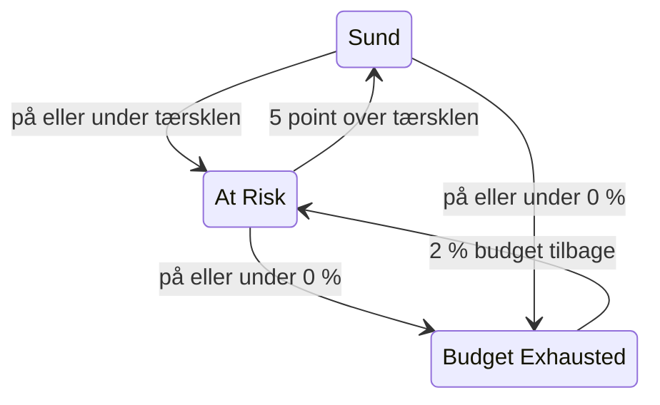

# Fejlbudgetter

Fejlbudgettet er den nedetid, et SLO's mål tillader. Et mål på 99,9 % betyder ikke "gå aldrig ned": det betyder "du må være nede i op til 43 minutter på 30 dage, så brug dem klogt". Denne side forklarer, hvordan OneUptime tæller budgettet, hvor længe det holder, hvordan det kommer igen, og hvem der hører om det.

:::cards
- [Hvordan budgettet beregnes](#hvordan-budgettet-beregnes): Formlen og budgettet for almindelige mål.
- [Budgettets rækkevidde](#budgettets-rækkevidde): Hvor længe budgettet holder i det nuværende tempo.
- [Hvordan budgettet kommer igen](#hvordan-budgettet-kommer-igen): Rullende vinduer og kalendermåneder.
- [Besked til ejere](#besked-til-ejere): Hvem der hører om det, når budgettet bliver knapt.
:::

## Hvordan budgettet beregnes

Det samlede budget er den del af vinduet, som dit mål ikke lover:

```text
total budget = (100% − target) × window length
```

| Mål | Vindue på 7 dage | Vindue på 28 dage | Vindue på 30 dage | Vindue på 90 dage |
| --- | --- | --- | --- | --- |
| 99% | 1h 40m 48s | 6h 43m 12s | 7h 12m | 21h 36m |
| 99.5% | 50m 24s | 3h 21m 36s | 3h 36m | 10h 48m |
| 99.9% | 10m 5s | 40m 19s | 43m 12s | 2h 9m 36s |
| 99.95% | 5m 2s | 20m 10s | 21m 36s | 1h 4m 48s |
| 99.99% | 1m 0s | 4m 2s | 4m 19s | 12m 58s |

SLO'ets side **Indstillinger** viser det budget, dets mål tillader, ved siden af målet, for eksempel "43m 12s nedetid pr. vindue på 30 dage".

### Budgettet for et SLO med flere monitorer

I tilstanden **Any Monitor Down** er budgettet `(100% − target) × window`, uanset hvor mange monitorer SLO'et måler: vinduet er én tidslinje.

I tilstanden **Monitor Seconds Average** tælles budgettet i monitorsekunder, lagt sammen på tværs af monitorerne, så det vokser med antallet af monitorer: et SLO med tre monitorer på 99,9 % over 30 dage har cirka 129 minutters budget i stedet for 43. Procenterne (SLI, resterende budget, forbrugsrate) betyder det samme; kun varighederne ændrer sig.

### Budgettet for en kalendermåned

Et SLO med kalendermåned har hele månedens budget fra første dag: et SLO på 99,9 % i en måned med 31 dage har alle sine 44m 38s den 1. Budgettet beregnes ikke forholdsmæssigt efter den del af måneden, der er gået, så et nedbrud på et minut om morgenen den 1. bruger et minut af månedens budget.

## Resterende budget

Efterhånden som nedetiden løber op, viser **Oversigt** det resterende budget i feltet **Error budget left**:

- som en procentdel af det samlede budget, der også afgør SLO'ets status og fylder bjælken. Bjælken har et mærke ved SLO'ets risikotærskel;
- som en varighed, for eksempel "31m 4s left of 43m 12s".

Når budgettet er brugt op, viser feltet **No budget left**. Når nedetiden overskrider det, viser feltet **Budget exceeded** og overskridelsen som tid, for eksempel "4d 23m over budget · 5m 47s allowed": SLO'et har brugt alle 5 minutter og 47 sekunder af sit budget og 4 dage og 23 minutter mere. Bjælken forbliver tom og rød.

Det resterende budget gemmes som et tal med fortegn til beregninger og historikdiagrammer, så der vises et overskredet budget som en negativ procentdel. En stærkt negativ procentdel betyder, at overskridelsen er stor i forhold til budgettet; det er ikke den andel af tiden, hvor tjenesten var nede.

Hvilke sekunder der tæller som nedetid, afgøres af SLO'ets nedetidsstatusser og, for et SLO med flere monitorer, af dets tilstand for flere monitorer, begge under **Indstillinger** → **Downtime Calculation**. Se [SLO'er – Oversigt](/docs/slo/introduction).

## Budgettets rækkevidde

Feltet **Budget runway** på **Oversigt** svarer på "hvis det fortsætter sådan, hvornår løber vi tør?". Det deler det resterende budget med forbrugsraten over de seneste 60 minutter:

```text
runway = budget left ÷ (burn rate × (100% − target))
```

| Feltet viser | Hvad det betyder |
| --- | --- |
| En varighed, som **~2d 5h** | I det nuværende tempo løber budgettet tør om cirka så lang tid. Gul, og rød ved en dag eller mindre. **Under 1m** betyder mindre end et minut. |
| **Not burning** | Der er ikke brugt noget budget i de seneste 60 minutter. |
| **Sustainable** | Kun rullende vinduer: rækkevidden er mindst ét helt vindue, så budgettet bruges ikke hurtigere, end gammel nedetid falder ud af vinduet. I det tempo løber det ikke tør. |
| **Lasts until reset** | Kun kalendermåneder: budgettet nulstilles ved starten af næste måned, før det løber tør. |
| **Overspent** | Budgettet er allerede brugt. Feltet fortæller, hvor meget det er overskredet med. |

For SLO'er med kalendermåned fortæller feltet også, hvornår budgettet nulstilles.

Rækkevidden er en lineær fremskrivning. I et rullende vindue giver gammel nedetid, der falder ud af vinduet, budget tilbage, hvilket fremskrivningen ser bort fra: læs den som den mindste tid, du har tilbage. Den vises ikke før den første evaluering, og heller ikke for SLO'er i tilstanden **Monitor Seconds Average**, hvis budget tælles i monitorsekunder og ikke i realtid.

## Fejlbudgettets forbrug

Diagrammet **Error budget burn-down** på **Oversigt** viser det resterende budget, i procent, hen over det aktuelle compliancevindue:

- En linje ved 0 % markerer, hvor budgettet er brugt op, og en stiplet linje markerer SLO'ets risikotærskel.
- For SLO'er med kalendermåned falder en svag linje jævnt fra et fuldt budget ved månedens start til et tomt ved nulstillingen. Under den linje bruger måneden sit budget for hurtigt.
- Der registreres et punkt ved hver evaluering, hvert 5. minut, så et nyt SLO's diagram er tomt indtil dets første evaluering.
- Træk hen over diagrammet for at zoome ind på en del af vinduet. Dobbeltklik, eller klik på **Reset zoom**, for at se hele vinduet igen.

**Open metrics** åbner SLO'ets side **Metrikker**, hvis fane **Error Budget History** går op til 400 dage tilbage. Se [SLO-metrikker og -dashboards](/docs/slo/metrics).

## Hvordan budgettet kommer igen

Hvordan budgettet kommer igen, afhænger af SLO'ets vinduestype:

:::tabs
@tab Rolling
Et rullende vindue kigger altid lige langt tilbage fra nu, så nedetid falder til sidst ud af det: et nedbrud holder op med at tælle præcis ét vindue efter, at det skete. Et nedbrud på 30 minutter den 1. juni falder ud af regnestykket for et SLO på 30 dage den 1. juli, og budgettet kommer gradvist igen, efterhånden som hvert sekund af nedetid forlader vinduet, ikke på én gang.

Så genopretning bliver fortjent, ikke planlagt. Bliver der ved med at komme små nedbrud, falder gammel nedetid ud, mens ny kommer ind, og budgettet står stille i stedet for at komme sig.
@tab Calendar Month
Et SLO med kalendermåned nulstilles ved midnat den første i hver måned, i sin tidszone. Hele budgettet kommer igen på én gang, og den forrige måned lukkes. Intet føres over fra én måned til den næste, i nogen retning: en dårlig måned skader ikke den næste, og en god måned giver den ikke ekstra luft.
:::

### Unge SLO'er

Et SLO med rullende vindue, der er yngre end sit vindue, måles over de data, der findes indtil videre, og dets samlede budget vokser med dem: et SLO på 30 dage, der blev oprettet for en uge siden, har indtil videre et budget for 7 dage. Indtil vinduet er fyldt, viser **Oversigt**, hvor fyldt det er, med en indikator **Window 23% full** og den samme bemærkning i feltet **Error budget left**. Forvent, at tallene falder til ro, efterhånden som vinduet fyldes.

## Statusændringer og risikotærsklen

Det resterende budget afgør SLO'ets status:

| Status | Hvornår |
| --- | --- |
| **Sund** | Der er mere budget tilbage end risikotærsklen. |
| **At Risk** | Det resterende budget ligger på risikotærsklen eller derunder: 20 % som standard. |
| **Budget Exhausted** | Det resterende budget er nul eller derunder. |

Angiv risikotærsklen under **Indstillinger** → **Objective**.

Rullende vinduer kommer sig ét sekund ad gangen, så et SLO tæt på en grænse kunne hoppe frem og tilbage mellem to statusser. For at hver statusændring skal betyde noget, forlader et SLO kun en status, når det tydeligt er kommet over grænsen:



Med standardtærsklen på 20 % bliver et truet SLO sundt igen ved 25 % resterende budget, og et SLO med opbrugt budget bliver truet igen ved 2 %. Hver statusændring vises i SLO'ets **Feed** med den SLI, det budget og den forbrugsrate, der forklarer den.

## Besked til ejere

Når et SLO skifter til **At Risk** eller **Budget Exhausted**, giver OneUptime dets ejere besked:

- Ejerne er de brugere og teammedlemmer på SLO'ets side **Ejere**, der stadig er medlemmer af projektet. Et SLO uden ejere giver i stedet projektets ejere besked.
- Hver ejer får en e-mail som standard, og beskeden på enhver anden kanal, vedkommende slår til for **SLO status changed** under **Brugerindstillinger** → **Notifikationsindstillinger** → **Overvågning**.
- E-mailens emne nævner status og SLO'et, for eksempel `[SLO At Risk] API Availability`.

For at et SLO tæt på en grænse ikke skal blive ved med at give besked, får dets ejere højst én besked i timen. Et skift til **Budget Exhausted** sendes altid, også inden for den time.

> [!TIP]
> Besked til ejere fortæller dem, der står for et SLO, at dets budget er i knibe. Brug [Forbrugsrateadvarsler og -hændelser](/docs/slo/burn-rate-alerts) for at tilkalde dit vagthold via eskaleringspolitikker. En forbrugsrateregel kan også tilføje SLO'ets ejere til hver advarsel og hændelse, den opretter.

## Næste trin

:::cards
- [Forbrugsrateadvarsler og -hændelser](/docs/slo/burn-rate-alerts): Advar dit team, når budgettet brændes for hurtigt af.
- [SLO-metrikker og -dashboards](/docs/slo/metrics): Vis budgettet over tid i et diagram.
- [SLO'er – Oversigt](/docs/slo/introduction): Mål, vinduer og nedetidsstatusser.
:::
