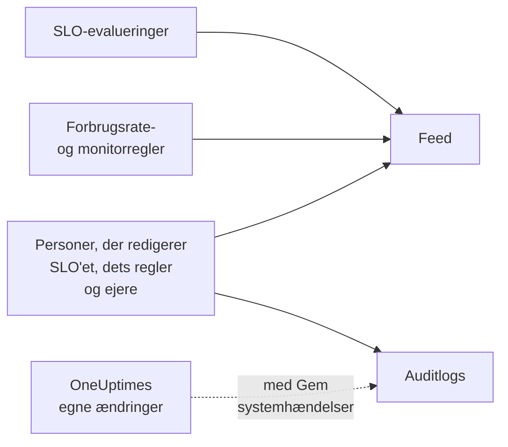

# SLO-feed og auditlogs

Et SLO fører to optegnelser over sin historik, og de svarer på forskellige spørgsmål. **Feed** svarer på "hvad er der sket med dette SLO?", skrevet til dem, der passer på det. **Auditlogs** svarer på "hvem ændrede hvad, helt præcist?", felt for felt, til gennemgang og compliance.

## Feed eller auditlogs?

| | **Feed** | **Auditlogs** |
| --- | --- | --- |
| Svarer på | Hvad der er sket med SLO'et | Hvem der ændrede hvad, og hvornår |
| Registrerer | Statusændringer, forbrugsrateadvarsler og -hændelser, og ændringer af SLO'et, dets regler, monitorer og ejere | Hver ændring, som personer har lavet i SLO'et, dets forbrugsrateregler, monitorregler og ejere, med den gamle og den nye værdi |
| Medtager OneUptimes eget arbejde | Ja: evalueringer og monitorregler, der tilknytter monitorer | Kun med **Gem systemhændelser** slået til |
| Abonnementer | Alle abonnementer | Enterprise-abonnementet på OneUptime Cloud eller Enterprise Edition på en selvhostet installation |
| Opbevares | Tre år på OneUptime Cloud | 7 dage som standard, op til 180 |

## SLO'ets feed

Feedet ligger på SLO'ets side **Feed**, og dets nyeste elementer under **Recent activity** på SLO'ets **Oversigt**. Elementerne linker til det SLO, de monitorer, advarsler og hændelser, de nævner, og de fleste har en sektion **More Information** med tallene eller de gamle og nye værdier.

| Begivenhed | Offentliggøres, når |
| --- | --- |
| SLO oprettet | SLO'et oprettes. Nævner dets mål, compliancevindue, SLI, risikotærskel, beskrivelse og de standardforbrugsrateregler, det startede med. |
| SLO opdateret | Navnet, beskrivelsen, etiketterne, målet, compliancevinduet, tidszonen, risikotærsklen, tilstanden for flere monitorer eller nedetidsstatusserne ændres. Viser hver gammel og ny værdi. |
| SLO aktiveret eller deaktiveret | Evalueringen slås til eller fra. |
| SLO arkiveret eller gendannet | SLO'et arkiveres eller fjernes fra arkivet. |
| Status ændret | En evaluering flytter SLO'et til en ny status. Viser den SLI, det fejlbudget, den forbrugsrate og den risikotærskel, der forklarer den, og årsagen ved **Sat på pause** eller **Misconfigured**. |
| Forbrugsrateadvarsel udløst | En forbrugsrateregel opretter en advarsel. Linker til den og viser de forbrugsrater, der udløste den. |
| Forbrugsratehændelse erklæret | En forbrugsrateregel erklærer en hændelse. Linker til den og viser de forbrugsrater, der udløste den. |
| Forbrugsrateadvarsel eller -hændelse løst | En regels advarsel eller hændelse lukkes: løst automatisk eller manuelt, mens automatisk løsning var slået fra. |
| Forbrugsrateregel tilføjet, ændret eller fjernet | Nogen opretter, redigerer eller sletter en forbrugsrateregel. Et nyt SLO's standardregler står i stedet i dets element "SLO oprettet". |
| Monitorregel tilføjet, ændret eller fjernet | Nogen opretter, redigerer eller sletter en monitorregel. En gemning, der ikke ændrer noget af betydning, offentliggøres ikke. |
| Monitorer tilknyttet eller frakoblet | Monitorer føjes til SLO'et eller fjernes fra det, manuelt eller af en monitorregel. Lange lister nævner de første monitorer "og N mere". |
| Ejer tilføjet eller fjernet | En bruger eller et team føjes til SLO'ets ejere eller fjernes fra dem. |
| Etiketregel anvendt | En etiketregel har knyttet etiketter til SLO'et, da det blev oprettet, eller da nogen kørte reglen. Nævner de regler, der matchede. Se [Etiket- og ejerregler](/docs/slo/label-and-owner-rules). |
| Ejerregel anvendt | En ejerregel har tilføjet ejere til SLO'et. Nævner de regler, der matchede; hver ejer, den tilføjede, får også sit eget element "Ejer tilføjet". |

Et par detaljer:

- Elementer fortæller, hvem der lavede en ændring, når det var en person. Ændringer, som OneUptime selv laver, som en evaluering eller en monitorregel, der tilknytter en monitor, og ændringer via API'en eller en automatisering har ingen bruger.
- En advarsel eller hændelse, som en regel samler op igen, fordi den stadig var åben, offentliggøres ikke to gange.
- For en privat advarsel eller hændelse udelader elementet dens titel, nummer og link, fordi alle, der kan læse SLO'et, kan læse dets feed. Det siger stadig, at der blev oprettet en privat post, og viser de forbrugsrater, der udløste den.
- Ingen kan redigere eller slette feedelementer. På OneUptime Cloud fjernes elementer, der er ældre end tre år.

## Auditlogs

SLO'ets side **Auditlogs** viser ændringer i:

- selve SLO'et: dets oplysninger, indstillinger, etiketter, monitorer og arkivering;
- dets forbrugsrateregler;
- dets monitorregler;
- dets ejerbrugere og ejerteams.

Ændringer af regler og ejere registreres på reglen eller ejeren og samles på SLO'et, så dets side viser hele historikken ét sted, og hver post linker til den side, den hører til. Relaterede elementer som etiketter og monitorer registreres med deres navn, ikke kun deres ID.

To ting er udeladt:

- **Evalueringsresultater.** SLI'en, fejlbudgettet, forbrugsraten, status og evalueringstiderne ændrer sig med få minutters mellemrum. Deres historik findes på **Oversigt**, siden **Metrikker** og i **Feed**.
- **Ændringer, som OneUptime selv laver**, som en monitorregel, der tilknytter eller frakobler en monitor, medmindre **Gem systemhændelser** er slået til for projektet. **Feed** registrerer tilknytninger og frakoblinger af monitorer under alle omstændigheder.

### Slå auditlogs til

Auditlogs er en Enterprise-funktion: de kræver **Enterprise**-abonnementet på OneUptime Cloud eller Enterprise Edition på en selvhostet installation. På andre abonnementer forklarer SLO'ets side **Auditlogs**, hvordan du får den. På en selvhostet installation holder auditloggen op med at registrere uden en gyldig licens (efter prøveperioden på 14 dage, eller 30 dage efter at en licens udløber), og den fortsætter, så snart en licens aktiveres (se [When a license expires or is missing](/docs/self-hosted/enterprise#when-a-license-expires-or-is-missing)). Siderne **Auditlogs** siger det, når der ikke registreres.

Auditlogs er også slået fra som standard i hvert projekt. Sådan slår du dem til:

:::steps
### Åbn indstillingerne for auditlogs

Gå til **Projektindstillinger**, åbn **Auditlogs** i sidemenuen, og klik på **Indstillinger**.

### Redigér indstillingerne

Klik på **Edit Audit Log Settings**, og slå **Aktivér revisionslogs** til.

### Vælg, hvad der skal gemmes

Angiv **Opbevaring (dage)**, fra 7 (standarden) til 180, og slå **Gem systemhændelser** til for også at registrere de ændringer, OneUptime selv laver. Gem. Ændringen træder i kraft inden for cirka et minut.
:::

Mens auditloggen er slået fra, står der **Audit logging is off** på SLO'ets side **Auditlogs**, med et link til at slå den til. Poster, der blev registreret, før den blev slået fra, forbliver synlige. Projektets samlede auditlog, for alle ressourcer, findes under **Projektindstillinger** → **Auditlogs** → **Auditlogs**.

## Næste trin

:::cards
- [SLO'er – Oversigt](/docs/slo/introduction): Hver side, et SLO har.
- [Monitorer og monitorregler](/docs/slo/monitor-rules): Hvad der tilknytter og frakobler monitorer.
- [Forbrugsrateadvarsler og -hændelser](/docs/slo/burn-rate-alerts): Hvad der udløser og løser advarslerne og hændelserne i feedet.
- [Etiket- og ejerregler](/docs/slo/label-and-owner-rules): Hvad der automatisk tilføjer etiketter og ejere.
:::
