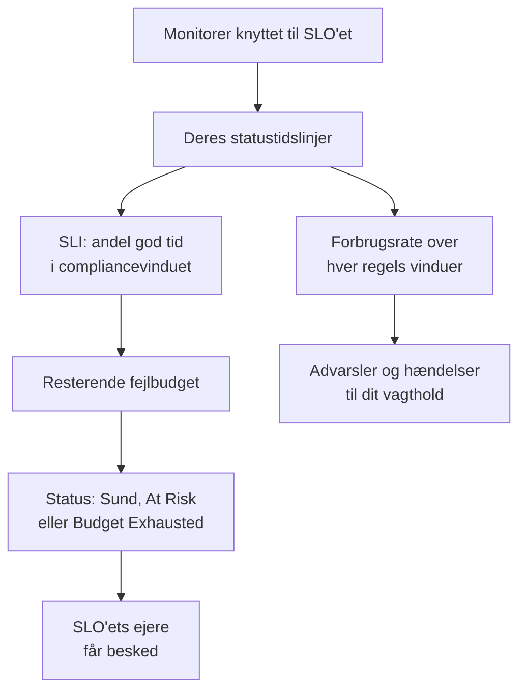

# SLO'er – Oversigt

Et service level objective (SLO) er et pålidelighedsmål for det, du overvåger, som "tilgængelig 99,9 % af tiden over rullende 30 dage". OneUptime måler hvert SLO mod dets mål hvert 5. minut, så i stedet for "virker det lige nu?" kan du svare på "har vi været pålidelige nok, over et vindue, der betyder noget for vores brugere, og hvor meget plads til fejl har vi tilbage?".

:::cards
- [Opret et SLO](#opret-et-slo): Et navn og et mål. Alt andet starter med en standardværdi.
- [Monitorer og monitorregler](/docs/slo/monitor-rules): Vælg de monitorer, et SLO måler.
- [Fejlbudgetter](/docs/slo/error-budget): Hvor meget nedetid et mål tillader, og hvordan budgettet kommer igen.
- [Forbrugsrateadvarsler og -hændelser](/docs/slo/burn-rate-alerts): Advar dit team, når budgettet brændes for hurtigt af.
:::

## Sådan fungerer det

Et SLO læser statustidslinjerne for de monitorer, der er knyttet til det: de samme data, som dine statussider viser. Ud fra dem beregner OneUptime, hvor stor en del af compliancevinduet der var god tid, hvor meget af fejlbudgettet der er tilbage, og hvor hurtigt det bliver brugt.

## Nøglebegreber

| Begreb | Betydning |
| --- | --- |
| **SLI** (service level indicator) | Målingen: den procentdel af compliancevinduet, hvor SLO'ets monitorer var tilgængelige. |
| **SLO** (service level objective) | Et mål for SLI'en, for eksempel "mindst 99,9 % over de seneste 30 dage". |
| **Fejlbudget** | Den nedetid, målet tillader: `(100% − target) × window`. Ved 99,9 % over 30 dage er det 43 minutter og 12 sekunder. |
| **Forbrugsrate** | Hvor hurtigt budgettet bruges sammenlignet med et jævnt tempo. Ved en forbrugsrate på 1 er budgettet brugt op præcis ved vinduets slutning. |

Et fejlbudget gør pålidelighed til noget, du kan bruge. Er der meget tilbage, så udgiv hurtigere og tag chancer; er der lidt tilbage, så sæt farten ned og invester i stabilitet. SLO'et giver den samtale et tal, som alle kan se.

## Opret et SLO

Du skal have en rolle, der må oprette SLO'er: Project Owner, Project Admin eller en tilpasset rolle med tilladelsen Create Service Level Objective.

:::steps
### Åbn SLO'er

Åbn **SLOs** fra menuen **Produkter** i topbjælken. Det ligger i den første gruppe, ved siden af monitorer og hændelser. Klik på **Opret Service Level Objective**.

### Giv det et navn og et mål

Angiv et **Navn**, for eksempel "API Availability", og et **Target (%)**: den andel af tiden, dets monitorer skal være tilgængelige. Målet starter på `99.9`. Det skal være større end 0 og højst 99,999, fordi et mål på 100 % ikke efterlader noget fejlbudget at følge.

### Tjek standardværdierne under Flere felter

**Flere felter** er foldet sammen, med en linje, der fortæller, hvad standardværdierne gør: SLO'et måles over et rullende vindue på 30 dage og bliver truet, når der er mindre end 20 % af fejlbudgettet tilbage. Fold det ud for at ændre et af felterne i tabellen nedenfor.

### Gem SLO'et

Klik på **Opret Service Level Objective**. OneUptime åbner det nye SLO. Dets **Oversigt** viser **Choose what this SLO measures**, fordi et nyt SLO endnu ikke har nogen monitorer.

### Tilknyt monitorer

Klik på **Create a monitor rule** for at tilknytte alle monitorer, der matcher, nu og fremover, eller på **Add monitors** for at vælge dem manuelt. Se [Monitorer og monitorregler](/docs/slo/monitor-rules).

### Se de første tal komme ind

OneUptime evaluerer aktiverede SLO'er hvert 5. minut. SLI'en, fejlbudgettet og forbrugsgrafen vises efter den første evaluering, der har monitorer at måle.
:::

Felterne under **Flere felter**:

| Felt | Det, du angiver | Standard |
| --- | --- | --- |
| **Beskrivelse** | Hvad SLO'et er til. | Tom |
| **Risikotærskel (%)** | Den andel af det resterende fejlbudget, hvor SLO'et skifter til **At Risk**. Et heltal fra 0 til 100. | 20 |
| **Window Type** | **Rolling**: de seneste N dage, som kommer sig, efterhånden som gammel nedetid falder ud af vinduet. **Calendar Month**: hver måned for sig, nulstillet den 1. | **Rolling** |
| **Window (Days)** | Kun rullende vinduer: hvor mange dage der kigges tilbage, fra 1 til 366. Typisk 28 eller 30. | 30 |
| **Tidszone** | Kun kalendermåneder: den tidszone, hver måned starter og slutter i. | UTC |
| **Etiketter** | Etiketter til at organisere og filtrere SLO'er. | Ingen |

Alt, hvad der bestemmer, hvordan SLO'et måler, starter med en standardværdi, som du ændrer senere:

| Indstilling | Et nyt SLO starter med | Ændres under |
| --- | --- | --- |
| Monitorer | Ingen | **Monitorer** eller **Monitor Rules** |
| Nedetidsstatusser | Alle projektets ikke-operationelle statusser | **Indstillinger** → **Downtime Calculation** |
| Tilstand for flere monitorer | **Any Monitor Down** | **Indstillinger** → **Downtime Calculation** |
| Evaluering | Til | **Indstillinger** → **Evaluering** |
| Forbrugsrateregler | En regel **Fast burn** og en regel **Slow burn**, tilpasset vinduet | **Burn Rate Rules** |

## Hvad et SLO består af

| Del | Hvad den afgør |
| --- | --- |
| Monitorer | Hvor SLI'en kommer fra. Tilknyt dem manuelt eller med monitorregler: se [Monitorer og monitorregler](/docs/slo/monitor-rules). |
| Mål | Den andel god tid, SLO'et lover, større end 0 og højst 99,999. |
| Compliancevindue | Den periode, SLI'en og budgettet måles over: et rullende vindue på 1 til 366 dage eller en kalendermåned. |
| Risikotærskel | Den andel af det resterende budget, hvor SLO'et skifter til **At Risk**. |
| Nedetidsstatusser | Hvilke monitorstatusser der tæller som nedetid. |
| Tilstand for flere monitorer | Hvordan nedetid fra flere monitorer kombineres. |

### Hvilke statusser der tæller som nedetid

Hvert SLO har sin egen liste over monitorstatusser, der tæller som nedetid. Et nyt SLO starter med alle projektets statusser, der ikke er markeret som operationelle, som Degraded og Offline, ligesom dine statussider gør. Ændr listen under **Indstillinger** → **Downtime Calculation**. Lad den være tom for at tælle alle ikke-operationelle statusser, også dem, der føjes til projektet senere.

> [!TIP]
> Mål de samme monitorer på to måder med to SLO'er: et strengt tilgængeligheds-SLO, hvor både Degraded og Offline tæller, og et mere lempeligt SLO for fuldt nedbrud, hvor kun Offline tæller.

### Compliancevinduer

| Vinduestype | Hvordan den opfører sig |
| --- | --- |
| **Rolling** | Kigger et fast antal dage tilbage fra nu. Gammel nedetid falder ud af vinduet, så budgettet kommer gradvist igen. |
| **Calendar Month** | Måler fra den første i måneden, i SLO'ets tidszone (UTC som standard). Hele budgettet kommer igen ved starten af hver måned. |

### Flere monitorer på ét SLO

Når et SLO måler mere end én monitor, afgør dets **Multi Monitor Mode**, hvordan deres nedetid kombineres. Et nyt SLO bruger **Any Monitor Down**.

| Tilstand | Hvordan nedetid tæller | Brug den, når |
| --- | --- | --- |
| **Any Monitor Down** | Ethvert øjeblik, hvor mindst én monitor er nede, tæller som nedetid for hele SLO'et. Overlappende nedbrud tæller én gang. | Monitorerne tilsammen er én tjeneste: går en af dem ned, mærker brugerne det. |
| **Monitor Seconds Average** | Hver monitors nedetid tæller for sig, i gennemsnit over al overvåget tid: SLI = 1 − (sekunder nede for alle monitorer ÷ overvågede sekunder for alle monitorer). | Monitorerne er en flåde af ens ressourcer, og en delvis påvirkning skal tælle delvist. |

Lad os sige, at monitor A er nede fra 10:00 til 11:00, mens monitor B forbliver tilgængelig. **Any Monitor Down** registrerer 60 minutters nedetid; **Monitor Seconds Average** registrerer hvad der svarer til 30 minutter, fordi én ud af to monitorer var nede i en time. I den tilstand tælles budgettet også i monitorsekunder: se [Fejlbudgetter](/docs/slo/error-budget).

## SLO-status

OneUptime giver hvert evalueret SLO en status:

| Status | Hvad den betyder |
| --- | --- |
| **Sund** | Der er mere budget tilbage end risikotærsklen. |
| **At Risk** | Det resterende budget er faldet til risikotærsklen eller derunder: 20 % som standard. |
| **Budget Exhausted** | Budgettet er brugt helt op eller overskredet. |
| **Misconfigured** | SLO'et kan ikke måles: det har ingen monitorer, dets monitorer findes ikke længere eller har endnu ikke registreret nogen status i dets vindue, eller dets mål er uden for området. |
| **Sat på pause** | Alle monitorer, det måler, er arkiveret eller har aktiv overvågning slået fra, manuelt, af en manuel hændelse eller af planlagt vedligeholdelse. Det fortsætter af sig selv, så snart en af dem bliver overvåget igen. |

Et deaktiveret eller arkiveret SLO evalueres ikke, så dets status bliver, som den var; SLO-listen viser i stedet et mærke **Deaktiveret** eller **Arkiveret**. Et SLO's ejere får besked, når status skifter til **At Risk** eller **Budget Exhausted**: se [Fejlbudgetter](/docs/slo/error-budget).

## SLO-listen

Siden **SLOs** viser hvert SLO, der ikke er arkiveret, med status, SLI, resterende budget, forbrugsrate, mål, vindue, monitorer, etiketter og ejere.

- Felterne over listen tæller SLO'er efter status: **Sund**, **At Risk**, **Budget Exhausted**, **Misconfigured**, **Sat på pause** og **Deaktiveret**. Klik på et felt for kun at se de SLO'er, og igen for at se dem alle.
- Vælg SLO'er for at tilføje eller fjerne etiketter og ejere, arkivere dem eller slette dem, alle på én gang.
- Sidemenuens sektion **Indstillinger** indeholder **Etiketregler** og **Ejerregler**, som sætter etiketter på nye SLO'er og giver dem ejere: se [Etiket- og ejerregler](/docs/slo/label-and-owner-rules).
- Sidemenuens sektion **Avanceret** indeholder **Arkiveret**, listen over arkiverede SLO'er.

## Et SLO's sider

Åbn et SLO for at se dets sider i sidemenuen:

| Side | Hvad den viser |
| --- | --- |
| **Oversigt** | Status, nøgletallene, fejlbudgettets forbrug, seneste aktivitet, åbne advarsler og hændelser og forbrugsratereglerne. |
| **Metrikker** | SLO'ets `oneuptime.slo.*`-metrikker, dets langsigtede fejlbudgethistorik og metrikkerne for de hændelser og advarsler, der påvirker det. Se [SLO-metrikker og -dashboards](/docs/slo/metrics). |
| **Hændelser** | De hændelser, dets forbrugsrateregler har erklæret. Mærket tæller de åbne. |
| **Advarsler** | De advarsler, dets forbrugsrateregler har udløst. Mærket tæller de åbne. |
| **Feed** | Hvad der er sket med SLO'et, som en tidslinje. Se [SLO-feed og auditlogs](/docs/slo/feed-and-audit-logs). |
| **Monitorer** | De monitorer, det måler, og om hver enkelt blev tilknyttet af en person eller en regel. |
| **Monitor Rules** | Reglerne, der tilknytter matchende monitorer. |
| **Burn Rate Rules** | Reglerne, der udløser advarsler og erklærer hændelser, når budgettet brændes for hurtigt af. |
| **Ejere** | De brugere og teams, der hører om dets statusændringer. |
| **Indstillinger** | Målet, complianceperioden, beregningen af nedetid, evalueringskontakten og arkiveringskortet. |
| **Auditlogs** | Hvem der har ændret SLO'et, dets regler og dets ejere, og hvornår. |
| **Delete SLO** | Sletter SLO'et permanent og løser de forbrugsrateadvarsler og -hændelser, det havde åbne. |

**Monitorer**, **Monitor Rules** og **Burn Rate Rules** ligger i en sektion **Konfiguration**, og **Ejere**, **Indstillinger**, **Auditlogs** og **Delete SLO** i en sektion **Management**. Begge starter foldet sammen, ligesom en sektion **Udvikler** til at styre SLO'et fra kode: klik på en sektions titel for at åbne den.

Når noget forhindrer et SLO i at måle, fortæller et banner øverst på hver af dets sider, hvad der er galt, og linker til den side, der løser det: se [Fejlfinding](#fejlfinding).

### Oversigten

**Oversigt** svarer på "holder vi os inden for budgettet?", oppefra og ned:

- **Opsummeringen**: status, en sætning om, hvad den betyder, og beskrivelsen. Ved siden af står **Opdater** og hvornår SLO'et sidst blev evalueret. Nedenunder står målet, **Compliance window** (med en fyldningsindikator, mens et ungt rullende vindue fyldes op: se [Unge SLO'er og vinduets fyldningsindikator](#unge-sloer-og-vinduets-fyldningsindikator)), antallet af monitorer og ejerne.
- **Nøgletallene**:
  - **SLI**: andelen af god tid i vinduet, og hvor meget den ligger over eller under målet.
  - **Error budget left**: en procentdel, en varighed som "12m 30s left of 43m 12s" og en bjælke med et mærke ved risikotærsklen. Når budgettet er overskredet, viser den **Budget exceeded** og med hvor meget.
  - **Burn rate**: hvor hurtigt budgettet bruges over de seneste 60 minutter, den periode, standardreglen for hurtigt forbrug bruger. Bliver gul over 1× og rød, med **Rule threshold reached**, ved den laveste tærskel blandt SLO'ets aktiverede forbrugsrateregler.
  - **Budget runway**: hvor længe budgettet holder i det tempo. Se [Fejlbudgetter](/docs/slo/error-budget#budgettets-rækkevidde).
- **Error budget burn-down**: det resterende budget over det aktuelle vindue. Se [Fejlbudgetter](/docs/slo/error-budget#fejlbudgettets-forbrug).
- **Recent activity**: de nyeste elementer i SLO'ets feed.
- **SLO Details**: navnet, beskrivelsen og etiketterne, de eneste indstillinger, der redigeres på oversigten.
- **Open alerts & incidents**: hvad forbrugsratereglerne har åbent lige nu.
- **Burn rate rules**: tærsklen for hver aktiveret regel ved siden af den aktuelle forbrugsrate, og hvad reglen erklærer.

### Indstillinger

Siden **Indstillinger** samler, hvordan et SLO måler, med ét kort til hver ting:

| Kort | Det, du ændrer | Godt at vide |
| --- | --- | --- |
| **Objective** | **Target (%)** og **Risikotærskel (%)**, med **Edit Objective**. | Viser den nedetid, målet tillader, for eksempel "43m 12s nedetid pr. vindue på 30 dage". |
| **Compliance Period** | **Window Type**, **Window (Days)** og **Tidszone**, med **Edit Period**. | Forbrugsrateregler beholder deres tærskler, når vinduet ændres, så gennemgå dem bagefter. |
| **Downtime Calculation** | **Multi Monitor Mode** og **Nedetidsovervågningsstatusser**, med **Edit Downtime Calculation**. | Uden statusser tæller alle ikke-operationelle statusser, også dem, der tilføjes senere. |
| **Evaluering** | Kontakten **Evaluer dette SLO**, der gemmer, så snart du slår den om. | At slå den fra beder om bekræftelse, fordi det også løser SLO'ets åbne forbrugsrateadvarsler og -hændelser. |
| **Archive SLO** | **Arkiver** eller **Fjern fra arkiv**. | Se [Arkivér et SLO](#arkivér-et-slo). |

Efter en ændring af målet, perioden eller beregningen af nedetid evaluerer OneUptime SLO'et igen ved næste kørsel.

## Arkivér et SLO

Arkivér et SLO, du ikke længere måler, men vil beholde, som en udfaset tjeneste eller sidste års mål. Arkivér det fra **Indstillinger** → **Archive SLO**, eller vælg SLO'er på listen og vælg **Arkiver**.

Et arkiveret SLO:

- er skjult på SLO-listen, dens statusfelter og dashboardenes SLO-vælgere og -lister;
- evalueres ikke: dets tal bliver, som de var ved den sidste evaluering, dets forbrugsrateregler udløses ikke, og det sender ingen metrikker;
- får sine åbne forbrugsrateadvarsler og -hændelser løst;
- beholder sine indstillinger, sin historik, sine regler og sine ejere. Dets monitorregler holder dets monitorliste opdateret, så det fortsætter med de rigtige monitorer.

Arkiverede SLO'er står på siden **Arkiveret**, under **Avanceret** i SLO-listens sidemenu. Vælg dem der, og vælg **Fjern fra arkiv** for at hente dem tilbage: de evalueres igen ved næste kørsel, med SLI og budget genberegnet ud fra deres monitorers historik.

Arkivering og evaluering er to separate kontakter. Et SLO, der var deaktiveret, før det blev arkiveret, forbliver deaktiveret, når du fjerner det fra arkivet: slå det til igen med **Slå evaluering til** i dets banner, eller med **Evaluer dette SLO** under **Indstillinger** → **Evaluering**.

| Du vil | Gør dette |
| --- | --- |
| Holde pause med at måle og beholde det på listen | Slå evalueringen fra |
| Udfase det, men beholde dets historik og indstillinger | Arkivér det |
| Fjerne det for altid | Slet det |

## SLO'er på advarsler, hændelser og monitorer

Hver advarsel og hændelse, som en forbrugsrateregel opretter, er knyttet til dens SLO:

- Siden for advarslen eller hændelsen viser SLO'et under **Berørte ressourcer**, med et link til det.
- Listerne over advarsler og hændelser viser SLO'et blandt de berørte ressourcer, og filteret **Berørte ressourcer** begrænser en liste til ét SLO.
- SLO'ets sider **Advarsler** og **Hændelser** viser dem, og deres mærker i sidemenuen tæller de åbne.

OneUptime opretter denne forbindelse, når en regel opretter advarslen eller hændelsen; du kan ikke tilføje den manuelt, og at redigere advarslen eller hændelsen fjerner den aldrig.

En monitors sidemenu har også en side **SLOs**: de SLO'er, der måler den monitor, så du ved, hvilke mål der afhænger af den, før du sætter den på pause eller ændrer den.

## Unge SLO'er og vinduets fyldningsindikator

Et SLO med rullende vindue, der er yngre end sit vindue, måles over de data, der findes indtil videre: et SLO på 30 dage, der blev oprettet i går, har én dags data. Dets fejlbudget starter småt og vokser, efterhånden som vinduet fyldes, så dets første tal svinger mere, end de vil gøre senere.

Så længe det er tilfældet, siger **Oversigt** det: opsummeringen viser en indikator **Window 23% full** (**Window under 1% full** den første dag), og feltet **Error budget left** gentager det under sit tal. Begge forsvinder, når vinduet er fyldt. SLO'er med kalendermåned viser dem aldrig, fordi deres budget dækker hele måneden fra første dag, og det gør SLO'er i tilstanden **Monitor Seconds Average** heller ikke, fordi deres budget tælles på tværs af monitorerne.

## Fejlfinding

Et banner øverst på SLO'ets sider fortæller, hvad der forhindrer det i at måle:

| Banner | Hvad det betyder | Hvad du gør |
| --- | --- | --- |
| **No monitors attached** | SLO'et har ingen monitorer, så der er intet at måle. | Tilknyt monitorer, eller opret en monitorregel. |
| **Waiting for SLO evaluation** | Der er tilknyttet monitorer, men den seneste evaluering havde ingen statusdata fra dem. | Tjek, at monitorerne bliver tjekket. Tallene vises efter den næste evaluering med data. |
| **Measurement is paused** | Alle monitorer, det måler, er arkiveret eller har aktiv overvågning slået fra. | Slå overvågning til igen for mindst én monitor, eller vent på, at vedligeholdelsen slutter. |
| **The target is out of range** | Målet er ikke større end 0 og mindre end 100. | Sæt et mål som 99,9 under **Indstillinger** → **Objective**. |
| **This SLO is disabled** | Evalueringen er slået fra. | Klik på **Slå evaluering til**. |
| **This SLO is archived** | SLO'et er arkiveret. | Fjern det fra arkivet under **Indstillinger**. |
| **Not evaluated yet** | SLO'et er lige blevet oprettet. | Vent på den første evaluering, højst et par minutter. |

## Næste trin

:::cards
- [Monitorer og monitorregler](/docs/slo/monitor-rules): Tilknyt monitorer manuelt eller med regler.
- [Fejlbudgetter](/docs/slo/error-budget): Budgetberegningen, rækkevidden og hvordan budgettet kommer igen.
- [Forbrugsrateadvarsler og -hændelser](/docs/slo/burn-rate-alerts): Advar dit vagthold, når budgettet brændes for hurtigt af.
- [SLO-metrikker og -dashboards](/docs/slo/metrics): Vis SLO'er i diagrammer, og byg et SLO-dashboard.
:::
