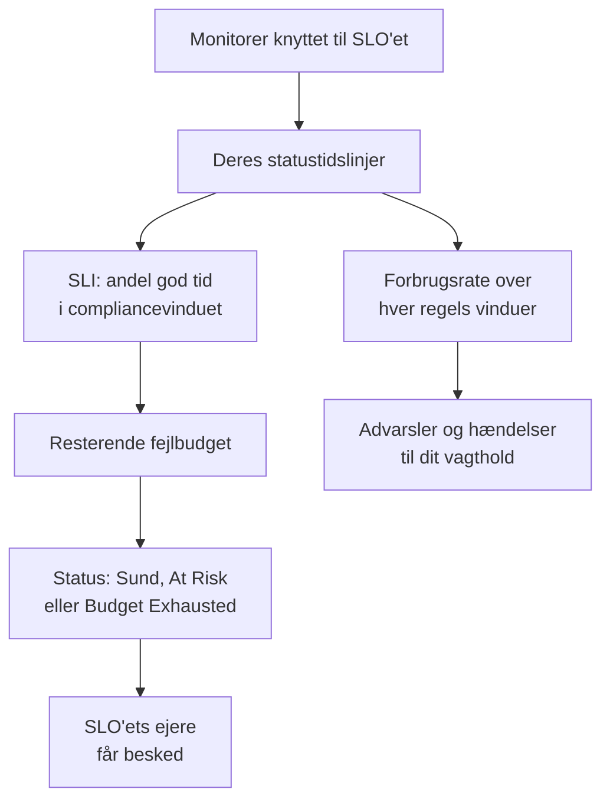

# SLO'er – Oversigt

Et service level objective (SLO) er et pålidelighedsmål for det, du driver, som "tilgængelig 99,9 % af tiden over rullende 30 dage" eller "99,9 % af checkout-anmodningerne lykkes". OneUptime måler hvert SLO mod dets mål hvert 5. minut, så i stedet for "virker det lige nu?" kan du svare på "har vi været pålidelige nok, over et vindue, der betyder noget for vores brugere, og hvor meget plads til fejl har vi tilbage?". I [Ordliste](/docs/introduction/glossary#slo) står SLO'er side om side med de andre ord, OneUptime bruger.

:::cards
- [Opret et SLO](#opret-et-slo): Hvad det måler, et navn og et mål. Alt andet starter med en standardværdi.
- [Monitorer og monitorregler](/docs/slo/monitor-rules): Vælg de monitorer, et SLO måler.
- [SLO'er for anmodninger og latens](/docs/slo/request-slos): Mål tjenesters anmodninger ud fra deres spor.
- [Fejlbudgetter](/docs/slo/error-budget): Hvor meget nedetid et mål tillader, og hvordan budgettet kommer igen.
- [Forbrugsrateadvarsler og -hændelser](/docs/slo/burn-rate-alerts): Advar dit team, når budgettet brændes for hurtigt af.
:::

## Sådan fungerer det

Et SLO måler én af to ting. Et SLO for monitoroppetid læser statustidslinjerne for de monitorer, der er knyttet til det: de samme data, som dine statussider viser. Et anmodnings-SLO tæller de anmodninger, dets tjenester besvarer, ud fra deres spor: se [SLO'er for anmodninger og latens](/docs/slo/request-slos). Resten af denne side beskriver SLO'er for monitoroppetid, og anmodnings-SLO'er fungerer på samme måde, medmindre andet er nævnt. Ud fra dem beregner OneUptime, hvor stor en del af compliancevinduet der var god tid, hvor meget af fejlbudgettet der er tilbage, og hvor hurtigt det bliver brugt. Tid, hvor en monitors overvågning er slået fra, udelades: intet tjekker monitoren i den tid, så den hverken bruger af fejlbudgettet eller tæller som god tid. Det samme gælder tiden før en monitors første tjek: indtil noget har tjekket en monitor, er dens status kun den driftsklare, som hver monitor oprettes med, så et SLO måles fra dets monitorers første tjek, og et SLO, hvis monitorer intet har tjekket endnu, har intet at måle, før de bliver tjekket.



## Nøglebegreber

Se [Ordliste](/docs/introduction/glossary) for de ord, der bruges på tværs af OneUptime.

| Begreb | Betydning |
| --- | --- |
| **SLI** (service level indicator) | Målingen: den procentdel af compliancevinduet, hvor SLO'ets monitorer var tilgængelige, eller af dets tjenesters anmodninger, der var gode. |
| **SLO** (service level objective) | Et mål for SLI'en, for eksempel "mindst 99,9 % over de seneste 30 dage". |
| **Fejlbudget** | Den nedetid, målet tillader: `(100% − target) × window`. Ved 99,9 % over 30 dage er det 43 minutter og 12 sekunder. For et anmodnings-SLO er det de dårlige anmodninger, målet tillader: én ud af hver 1.000 ved 99,9 %. |
| **Forbrugsrate** | Hvor hurtigt budgettet bruges sammenlignet med et jævnt tempo. Ved en forbrugsrate på 1 er budgettet brugt op præcis ved vinduets slutning. |

Et fejlbudget gør pålidelighed til noget, du kan bruge. Er der meget tilbage, så udgiv hurtigere og tag chancer; er der lidt tilbage, så sæt farten ned og invester i stabilitet. SLO'et giver den samtale et tal, som alle kan se.

## Opret et SLO

Du skal have en rolle, der må oprette SLO'er: Projektejer, Projektadministrator eller en tilpasset rolle med tilladelsen Create Service Level Objective.

:::steps
### Åbn SLO'er

Åbn **SLOs** fra menuen **Produkter** i topbjælken. Det ligger i den første gruppe, ved siden af monitorer og hændelser. Klik på **Opret Serviceniveaumål**.

### Vælg, hvad det måler

Under **Hvad det måler** beholder du **Monitoroppetid** for at måle den andel af tiden, monitorerne er tilgængelige. Vælg i stedet **Vellykkede anmodninger** eller **Anmodningslatens** for at måle tjenesters anmodninger, og vælg tjenesterne under **Tjenester**: se [SLO'er for anmodninger og latens](/docs/slo/request-slos). Vælg **Metrik** for at tælle de gode begivenheder i en tæller eller et histogram, som dine tjenester sender: se [SLO'er ud fra en metrik](/docs/slo/request-slos#sloer-ud-fra-en-metrik). Klik på **Næste**.

### Giv det et navn og et mål

Angiv et **Navn**, for eksempel "API Availability", og et **Mål (%)**: den andel af tiden eller af anmodningerne, der skal være god. Målet starter på `99.9`. Det skal være større end 0 og højst 99,999, fordi et mål på 100 % ikke efterlader noget fejlbudget at følge.

### Tjek standardværdierne under Flere felter

**Flere felter** er foldet sammen, med en linje, der fortæller, hvad standardværdierne gør: SLO'et måles over et rullende vindue på 30 dage og bliver truet, når der er mindre end 20 % af fejlbudgettet tilbage. Fold det ud for at ændre et af felterne i tabellen nedenfor.

### Gem SLO'et

Klik på **Opret Serviceniveaumål**. OneUptime åbner det nye SLO. **Oversigt** for et SLO for monitoroppetid viser **Choose what this SLO measures**, fordi det endnu ikke har nogen monitorer.

### Tilknyt monitorer

For et SLO for monitoroppetid skal du klikke på **Opret en monitorregel** for at tilknytte alle monitorer, der matcher, nu og fremover, eller på **Tilføj monitorer** for at vælge dem manuelt. Se [Monitorer og monitorregler](/docs/slo/monitor-rules).

### Se de første tal komme ind

OneUptime evaluerer aktiverede SLO'er hvert 5. minut. SLI'en, fejlbudgettet og forbrugsgrafen vises efter den første evaluering, der har monitorer at måle eller anmodninger at tælle.
:::

Felterne under **Flere felter**:

| Felt | Det, du angiver | Standard |
| --- | --- | --- |
| **Beskrivelse** | Hvad SLO'et er til. | Tom |
| **Risikotærskel (%)** | Den andel af det resterende fejlbudget, hvor SLO'et skifter til **I risiko**. Et heltal fra 0 til 100. | 20 |
| **Vinduestype** | **Rullende**: de seneste N dage, som kommer sig, efterhånden som gammel nedetid falder ud af vinduet. **Kalendermåned**: hver måned for sig, nulstillet den 1. | **Rullende** |
| **Vindue (dage)** | Kun rullende vinduer: hvor mange dage der kigges tilbage, fra 1 til 366. Typisk 28 eller 30. | 30 |
| **Tidszone** | Kun kalendermåneder: den tidszone, hver måned starter og slutter i. | UTC |
| **Etiketter** | Etiketter til at organisere og filtrere SLO'er. | Ingen |

Alt, hvad der bestemmer, hvordan SLO'et måler, starter med en standardværdi, som du ændrer senere:

| Indstilling | Et nyt SLO starter med | Ændres under |
| --- | --- | --- |
| Monitorer | Ingen | **Monitorer** eller **Monitorregler** |
| Nedetidsstatusser | Alle projektets ikke-operationelle statusser | **Indstillinger** → **Beregning af nedetid** |
| Tilstand for flere monitorer | **En vilkårlig monitor nede** | **Indstillinger** → **Beregning af nedetid** |
| Evaluering | Til | **Indstillinger** → **Evaluering** |
| Forbrugsrateregler | En regel **Fast burn**, en regel **Slow burn** og en regel **Slow leak**, tilpasset vinduet | **Forbrugsrateregler** |

## Hvad et SLO består af

| Del | Hvad den afgør |
| --- | --- |
| Hvad det måler | **Monitoroppetid**, **Vellykkede anmodninger** eller **Anmodningslatens**. |
| Monitorer eller tjenester | Hvor SLI'en kommer fra: monitorer, tilknyttet manuelt eller med monitorregler (se [Monitorer og monitorregler](/docs/slo/monitor-rules)), eller de tjenester, hvis anmodninger et anmodnings-SLO tæller. |
| Mål | Den andel god tid, SLO'et lover, større end 0 og højst 99,999. |
| Compliancevindue | Den periode, SLI'en og budgettet måles over: et rullende vindue på 1 til 366 dage eller en kalendermåned. |
| Risikotærskel | Den andel af det resterende budget, hvor SLO'et skifter til **I risiko**. |
| Nedetidsstatusser | Hvilke monitorstatusser der tæller som nedetid. |
| Tilstand for flere monitorer | Hvordan nedetid fra flere monitorer kombineres. |

### Hvilke statusser der tæller som nedetid

Hvert SLO har sin egen liste over monitorstatusser, der tæller som nedetid. Et nyt SLO starter med alle projektets statusser, der ikke er markeret som operationelle, som Degraded og Offline, ligesom dine statussider gør. Ændr listen under **Indstillinger** → **Beregning af nedetid**. Lad den være tom for at tælle alle ikke-operationelle statusser, også dem, der føjes til projektet senere.

> [!TIP]
> Mål de samme monitorer på to måder med to SLO'er: et strengt tilgængeligheds-SLO, hvor både Degraded og Offline tæller, og et mere lempeligt SLO for fuldt nedbrud, hvor kun Offline tæller.

### Compliancevinduer

| Vinduestype | Hvordan den opfører sig |
| --- | --- |
| **Rullende** | Kigger et fast antal dage tilbage fra nu. Gammel nedetid falder ud af vinduet, så budgettet kommer gradvist igen. |
| **Kalendermåned** | Måler fra den første i måneden, i SLO'ets tidszone (UTC som standard). Hele budgettet kommer igen ved starten af hver måned. |

### Flere monitorer på ét SLO

Når et SLO måler mere end én monitor, afgør dets **Tilstand for flere monitorer**, hvordan deres nedetid kombineres. Et nyt SLO bruger **En vilkårlig monitor nede**.

| Tilstand | Hvordan nedetid tæller | Brug den, når |
| --- | --- | --- |
| **En vilkårlig monitor nede** | Ethvert øjeblik, hvor mindst én monitor er nede, tæller som nedetid for hele SLO'et. Overlappende nedbrud tæller én gang. | Monitorerne tilsammen er én tjeneste: går en af dem ned, mærker brugerne det. |
| **Gennemsnit af monitorsekunder** | Hver monitors nedetid tæller for sig, i gennemsnit over al overvåget tid: SLI = 1 − (sekunder nede for alle monitorer ÷ overvågede sekunder for alle monitorer). | Monitorerne er en flåde af ens ressourcer, og en delvis påvirkning skal tælle delvist. |

Lad os sige, at monitor A er nede fra 10:00 til 11:00, mens monitor B forbliver tilgængelig. **En vilkårlig monitor nede** registrerer 60 minutters nedetid; **Gennemsnit af monitorsekunder** registrerer hvad der svarer til 30 minutter, fordi én ud af to monitorer var nede i en time. I den tilstand tælles budgettet også i monitorsekunder: se [Fejlbudgetter](/docs/slo/error-budget).

## SLO-status

OneUptime giver hvert evalueret SLO en status:

| Status | Hvad den betyder |
| --- | --- |
| **Sund** | Der er mere budget tilbage end risikotærsklen. |
| **I risiko** | Det resterende budget er faldet til risikotærsklen eller derunder: 20 % som standard. |
| **Budget opbrugt** | Budgettet er brugt helt op eller overskredet. |
| **Venter** | Intet har tjekket dets monitorer endnu: en monitor oprettet for et minut siden eller en selvhostet sonde, der ikke er forbundet. Det måles fra deres første tjek. |
| **Forkert konfigureret** | SLO'et kan ikke måles: det har ingen monitorer, dets monitorer findes ikke længere eller har endnu ikke registreret nogen status i dets vindue, eller dets mål er uden for området. Et anmodnings-SLO er forkert konfigureret uden tjenester, uden en latensgrænse, eller før dets tjenester har besvaret en anmodning i dets vindue. |
| **Sat på pause** | Alle monitorer, det måler, er arkiveret eller har aktiv overvågning slået fra, manuelt, af en manuel hændelse eller af planlagt vedligeholdelse. Det fortsætter af sig selv, så snart en af dem bliver overvåget igen. |

Et deaktiveret eller arkiveret SLO evalueres ikke, så dets status bliver, som den var; SLO-listen viser i stedet et mærke **Deaktiveret** eller **Arkiveret**. Et SLO's ejere får besked, når status skifter til **I risiko** eller **Budget opbrugt**: se [Fejlbudgetter](/docs/slo/error-budget). En regel kan også slå statusskift op i Slack, Microsoft Teams eller Mattermost: se [Statusændringer](/docs/slo/error-budget-policy#statusændringer).

## SLO-listen

Siden **SLOs** viser hvert SLO, der ikke er arkiveret, med status, SLI, resterende budget, forbrugsrate, mål, vindue, monitorer, etiketter og ejere. Kolonnen **Hvad det måler** viser et anmodnings-SLO's tjenester, hvor den for et oppetids-SLO viser dets monitorer, og filteret **Tjenester** finder de SLO'er, der måler en tjeneste.

- Felterne over listen tæller SLO'er efter status: **Sund**, **I risiko**, **Budget opbrugt**, **Venter**, **Forkert konfigureret**, **Sat på pause** og **Deaktiveret**. De vises, så snart der er et SLO, der ikke er arkiveret. Klik på et felt for kun at se de SLO'er, og igen for at se dem alle.
- Vælg SLO'er for at tilføje eller fjerne etiketter og ejere, aktivere eller deaktivere dem, give dem de [anbefalede forbrugsrateregler](/docs/slo/burn-rate-alerts#tilføj-dem-til-mange-sloer-på-én-gang), de mangler, eller den [anbefalede fejlbudgetpolitik](/docs/slo/error-budget-policy#den-anbefalede-politik), arkivere dem eller slette dem, alle på én gang.
- Filteret **Udrulninger** viser de SLO'er, hvis fejlbudgetpolitik fryser udrulninger lige nu, eller dem, hvor den tillader dem. Vis kolonnen **Udrulninger** fra listens kolonnevælger for at se, siden hvornår hvert af dem er frosset: se [Udrulningsspærre](/docs/slo/error-budget-policy#udrulningsspærre).
- Sidemenuens sektion **Indstillinger** indeholder **Etiketregler** og **Ejerregler**, som sætter etiketter på nye SLO'er og giver dem ejere: se [Etiket- og ejerregler](/docs/slo/label-and-owner-rules).
- Sidemenuens sektion **Avanceret** indeholder **Arkiveret**, listen over arkiverede SLO'er.

## Et SLO's sider

Åbn et SLO for at se dets sider i sidemenuen:

| Side | Hvad den viser |
| --- | --- |
| **Oversigt** | Status, nøgletallene, fejlbudgettets forbrug, seneste aktivitet, åbne advarsler og hændelser og forbrugsratereglerne. |
| **Metrikker** | SLO'ets `oneuptime.slo.*`-metrikker, dets langsigtede fejlbudgethistorik og metrikkerne for de hændelser og advarsler, der påvirker det. Se [SLO-metrikker og -dashboards](/docs/slo/metrics). |
| **Månedsrapport** | Hvordan SLO'et klarede sig i hver kalendermåned og over hele perioden. Se [Månedsrapporten](#månedsrapporten). |
| **Hændelser** | De hændelser, dets forbrugsrateregler og dets fejlbudgetpolitik har erklæret. Mærket tæller de åbne. |
| **Advarsler** | De advarsler, dets forbrugsrateregler og dets fejlbudgetpolitik har udløst. Mærket tæller de åbne. |
| **Feed** | Hvad der er sket med SLO'et, som en tidslinje. Se [SLO-feed og auditlogs](/docs/slo/feed-and-audit-logs). |
| **Monitorer** | De monitorer, det måler, og om hver enkelt blev tilknyttet af en person eller en regel. Kun SLO'er for monitoroppetid. |
| **Monitorregler** | Reglerne, der tilknytter matchende monitorer. Kun SLO'er for monitoroppetid. |
| **Forbrugsrateregler** | Reglerne, der udløser advarsler og erklærer hændelser, når budgettet brændes for hurtigt af. |
| **Fejlbudgetpolitik** | Hvad teamet har aftalt at gøre, mens fejlbudgettet løber ud, og de advarsler og hændelser, hvert niveau i politikken udløser. Se [Fejlbudgetpolitik](/docs/slo/error-budget-policy). |
| **Ejere** | De brugere og teams, der hører om dets statusændringer. |
| **Indstillinger** | Hvad det måler, målet, complianceperioden, beregningen af nedetid, evalueringskontakten og arkiveringskortet. |
| **Auditlogs** | Hvem der har ændret SLO'et, dets regler og dets ejere, og hvornår. |
| **Slet SLO** | Sletter SLO'et permanent og løser de forbrugsrateadvarsler og -hændelser, det havde åbne. |

**Monitorer** ligger i sektionen **Oversigt**, under **Oversigt**; **Monitorregler**, **Forbrugsrateregler** og **Fejlbudgetpolitik** i en sektion **Regler**; og **Ejere**, **Indstillinger**, **Auditlogs** og **Slet SLO** i en sektion **Administration**. **Regler** og **Administration** starter foldet sammen, ligesom en sektion **Udvikler** til at styre SLO'et fra kode: klik på en sektions titel for at åbne den.

Når noget forhindrer et SLO i at måle, fortæller et banner øverst på hver af dets sider, hvad der er galt, og linker til den side, der løser det: se [Fejlfinding](#fejlfinding).

### Oversigten

**Oversigt** svarer på "holder vi os inden for budgettet?", oppefra og ned:

- **Opsummeringen**: status, en sætning om, hvad den betyder, og beskrivelsen. Ved siden af står **Opdater** og hvornår SLO'et sidst blev evalueret. Nedenunder står målet, **Overholdelsesvindue** (med en fyldningsindikator, mens et ungt rullende vindue fyldes op: se [Unge SLO'er og vinduets fyldningsindikator](#unge-sloer-og-vinduets-fyldningsindikator)), antallet af monitorer (eller et anmodnings-SLO's tjenester) og ejerne, med **Tilføj ejere** til at tilføje en lige der.
- **Nøgletallene**:
  - **SLI**: andelen af god tid i vinduet, og hvor meget den ligger over eller under målet.
  - **Fejlbudget tilbage**: en procentdel, en varighed som "12 min. og 30 sek. tilbage af 43 min. og 12 sek." (for et anmodnings-SLO et antal dårlige anmodninger) og en bjælke med et mærke ved risikotærsklen. Når budgettet er overskredet, viser den **Budget overskredet** og med hvor meget.
  - **Forbrugsrate**: hvor hurtigt budgettet bruges over de seneste 60 minutter, den periode, standardreglen for hurtigt forbrug bruger. Bliver gul over 1× og rød, med **Regeltærskel nået**, ved den laveste tærskel blandt SLO'ets aktiverede forbrugsrateregler, der ser 6 timer eller mindre tilbage. En time siger ikke meget om en regel, der ser flere dage tilbage, som **Slow leak**, så den sammenlignes ikke med sådan en regel.
  - **Budgettets rækkevidde**: hvor længe budgettet holder i det tempo. Se [Fejlbudgetter](/docs/slo/error-budget#budgettets-rækkevidde).
- **Burn-down af fejlbudget**: det resterende budget over det aktuelle vindue. Se [Fejlbudgetter](/docs/slo/error-budget#fejlbudgettets-forbrug).
- **Seneste aktivitet**: de nyeste elementer i SLO'ets feed.
- **SLO-detaljer**: navnet, beskrivelsen og etiketterne, de eneste indstillinger, der redigeres på oversigten.
- **Åbne advarsler og hændelser**: hvad forbrugsratereglerne har åbent lige nu.
- **Burn rate rules**: tærsklen for hver aktiveret regel ved siden af den aktuelle forbrugsrate, for regler, der ser 6 timer eller mindre tilbage, og hvad reglen erklærer.

Når SLO'et er i et niveau i sin fejlbudgetpolitik, viser **Oversigt** også det niveau, og hvad teamet har aftalt at gøre i det: se [Fejlbudgetpolitik](/docs/slo/error-budget-policy).

Kortet **Bruges af** viser de forbrugsrateregler og de trin i fejlbudgetpolitikken, der virker på SLO'et, og de dashboards, der viser det. Når du arkiverer eller sletter SLO'et, siges de først: dets regler og trin forsvinder med det.

### Indstillinger

Siden **Indstillinger** samler, hvordan et SLO måler, med ét kort til hver ting:

| Kort | Det, du ændrer | Godt at vide |
| --- | --- | --- |
| **Hvad det måler** | **Hvad det måler**, **Tjenester**, **Latensgrænse (ms)**, **Anmodningsfilter** og **Metrik**, med **Rediger, hvad det måler**. | Et anmodnings-SLO tæller sine anmodninger forfra efter en ændring. |
| **Mål** | **Mål (%)** og **Risikotærskel (%)**, med **Rediger mål**. | Viser den nedetid, målet tillader, for eksempel "43 min. og 12 sek. nedetid pr. vindue på 30 dage". |
| **Overholdelsesperiode** | **Vinduestype**, **Vindue (dage)** og **Tidszone**, med **Rediger periode**. | Forbrugsrateregler beholder deres tærskler, når vinduet ændres, så gennemgå dem bagefter. |
| **Beregning af nedetid** | **Tilstand for flere monitorer** og **Nedetidsmonitorstatusser**, med **Rediger beregning af nedetid**. | Kun SLO'er for monitoroppetid. Uden statusser tæller alle ikke-operationelle statusser, også dem, der tilføjes senere. |
| **Evaluering** | Kontakten **Evaluer dette SLO**, der gemmer, så snart du slår den om. | At slå den fra beder om bekræftelse, fordi det også løser SLO'ets åbne forbrugsrateadvarsler og -hændelser. |
| **Arkiver SLO** | **Arkiver** eller **Fjern fra arkivet**. | Se [Arkiver et SLO](#arkiver-et-slo). |

Efter en ændring af, hvad det måler, målet, perioden eller beregningen af nedetid evaluerer OneUptime SLO'et igen ved næste kørsel.

### Månedsrapporten

**Månedsrapport** viser, hvordan SLO'et klarede sig i hver kalendermåned i de seneste **3 måneder**, **6 måneder**, **9 måneder** eller **12 måneder** eller i et kalenderår. Hver måned viser sin SLI, sin nedetid (for et anmodnings-SLO de mislykkede eller langsomme anmodninger, for et metrik-SLO de dårlige begivenheder), den andel af sit fejlbudget, den brugte, og sit resultat:

| Resultat | Hvad det betyder |
| --- | --- |
| Opfyldt | Måneden er slut, og dens SLI nåede målet. |
| Ikke nået | Måneden er slut og nåede ikke målet, eller måneden er stadig i gang og har allerede mere nedetid, end hele måneden tillader. |
| På rette spor | Måneden er stadig i gang, og dens SLI indtil videre når målet. |
| Under målet | Måneden er stadig i gang, og dens SLI indtil videre er under målet. |
| Ingen data | Intet blev målt den måned. |

Rækken **Total** måler hele perioden som én. Et SLO med flere monitorer får også en tabel **Efter monitor**: hver monitors egen SLI i hver måned, med den monitor, der kostede SLO'et mest, først. **Download CSV** gemmer rapporten som en fil til et regneark.

Der gemmes intet ekstra til rapporten. Hver måned beregnes ud fra monitorernes statushistorik, når du åbner den, med SLO'ets monitorer, nedetidsstatusser og mål, som de er nu, så den rækker tilbage til før SLO'et blev oprettet. Et anmodnings-SLO's måneder kommer fra de anmodninger, OneUptime har talt for det, og et metrik-SLO's fra begivenhederne fra dets metrik, som gemmes i 400 dage. Månederne følger SLO'ets tidszone eller UTC, hvis det ikke har nogen.

API'et svarer med den samme rapport:

```bash
curl -sS "https://oneuptime.com/api/service-level-objective/<slo-id>/monthly-report?months=12" \
  -H "ApiKey: $ONEUPTIME_API_KEY"
```

Bed med `months` om 1 til 24 måneder, der slutter med den aktuelle måned, eller om et kalenderår med `year`, for eksempel `year=2025`.

## Arkiver et SLO

Arkiver et SLO, du ikke længere måler, men vil beholde, som en udfaset tjeneste eller sidste års mål. Arkiver det fra **Indstillinger** → **Arkiver SLO**, eller vælg SLO'er på listen og vælg **Arkiver**.

Et arkiveret SLO:

- er skjult på SLO-listen, dens statusfelter og dashboardenes SLO-vælgere og -lister;
- evalueres ikke: dets tal bliver, som de var ved den sidste evaluering, dets forbrugsrateregler udløses ikke, og det sender ingen metrikker;
- får sine åbne forbrugsrateadvarsler og -hændelser løst;
- beholder sine indstillinger, sin historik, sine regler og sine ejere. Dets monitorregler holder dets monitorliste opdateret, så det fortsætter med de rigtige monitorer.

Arkiverede SLO'er står på siden **Arkiveret**, under **Avanceret** i SLO-listens sidemenu. Vælg dem der, og vælg **Fjern fra arkivet** for at hente dem tilbage: de evalueres igen ved næste kørsel, med SLI og budget genberegnet ud fra deres monitorers historik.

Arkivering og evaluering er to separate kontakter. Et SLO, der var deaktiveret, før det blev arkiveret, forbliver deaktiveret, når du fjerner det fra arkivet: slå det til igen med **Slå evaluering til** i dets banner, eller med **Evaluer dette SLO** under **Indstillinger** → **Evaluering**.

| Du vil | Gør dette |
| --- | --- |
| Holde pause med at måle og beholde det på listen | Slå evalueringen fra |
| Udfase det, men beholde dets historik og indstillinger | Arkiver det |
| Fjerne det for altid | Slet det |

## SLO'er på advarsler, hændelser og monitorer

Hver advarsel og hændelse, som en forbrugsrateregel opretter, er knyttet til dens SLO:

- Siden for advarslen eller hændelsen viser SLO'et under **Berørte ressourcer**, med et link til det.
- Listerne over advarsler og hændelser viser SLO'et blandt de berørte ressourcer, og filteret **Berørte ressourcer** begrænser en liste til ét SLO.
- SLO'ets sider **Advarsler** og **Hændelser** viser dem, og deres mærker i sidemenuen tæller de åbne.

OneUptime opretter denne forbindelse, når en regel opretter advarslen eller hændelsen; du kan ikke tilføje den manuelt, og at redigere advarslen eller hændelsen fjerner den aldrig.

En monitors sidemenu har også en side **SLOs**: de SLO'er, der måler den monitor, så du ved, hvilke mål der afhænger af den, før du sætter den på pause eller ændrer den.

## Unge SLO'er og vinduets fyldningsindikator

Et SLO med rullende vindue, der er yngre end sit vindue, måles over de data, der findes indtil videre: et SLO på 30 dage, der blev oprettet i går, har én dags data. Dets fejlbudget starter småt og vokser, efterhånden som vinduet fyldes, så dets første tal svinger mere, end de vil gøre senere.

Så længe det er tilfældet, siger **Oversigt** det: opsummeringen viser en indikator **Vinduet er 23 % fyldt** (**Vinduet er under 1 % fyldt** den første dag), og feltet **Fejlbudget tilbage** gentager det under sit tal. Begge forsvinder, når vinduet er fyldt. SLO'er med kalendermåned viser dem aldrig, fordi deres budget dækker hele måneden fra første dag, og det gør SLO'er i tilstanden **Gennemsnit af monitorsekunder** heller ikke, fordi deres budget tælles på tværs af monitorerne. Et anmodnings-SLO viser dem, mens OneUptime stadig tæller dets tjenesters ældre anmodninger: se [SLO'er for anmodninger og latens](/docs/slo/request-slos#sådan-tælles-anmodninger).

## Fejlfinding

Et banner øverst på SLO'ets sider fortæller, hvad der forhindrer det i at måle:

| Banner | Hvad det betyder | Hvad du gør |
| --- | --- | --- |
| **Ingen monitorer tilknyttet** | SLO'et har ingen monitorer, så der er intet at måle. | Tilknyt monitorer, eller opret en monitorregel. |
| **Venter på SLO-evaluering** | Der er tilknyttet monitorer, men den seneste evaluering havde ingen statusdata fra dem. | Tjek, at monitorerne bliver tjekket. Tallene vises efter den næste evaluering med data. |
| **Venter på første tjek** | Der er tilknyttet monitorer, men intet har tjekket dem endnu: en monitor oprettet for et minut siden eller en selvhostet sonde, der ikke er forbundet. | Intet: SLO'et måles fra deres første tjek. Kommer det ikke, så åbn monitorerne for at se hvorfor. |
| **Målingen er sat på pause** | Alle monitorer, det måler, er arkiveret eller har aktiv overvågning slået fra. | Slå overvågning til igen for mindst én monitor, eller vent på, at vedligeholdelsen slutter. |
| **Målet er uden for det tilladte interval** | Målet er ikke større end 0 og mindre end 100. | Sæt et mål som 99,9 under **Indstillinger** → **Mål**. |
| **Denne SLO er deaktiveret** | Evalueringen er slået fra. | Klik på **Slå evaluering til**. |
| **Denne SLO er arkiveret** | SLO'et er arkiveret. | Fjern det fra arkivet under **Indstillinger**. |
| **Endnu ikke evalueret** | SLO'et er lige blevet oprettet. | Vent på den første evaluering, højst et par minutter. |
| **Ingen tjenester valgt** | Et anmodnings-SLO har ingen tjenester, så det har ingen anmodninger at tælle. | Vælg dets tjenester under **Indstillinger** → **Hvad det måler**. |
| **Ingen latensgrænse** | Et SLO for anmodningslatens har ingen grænse, så ingen anmodning kan tælle som hurtig nok. | Angiv **Latensgrænse (ms)** under **Indstillinger** → **Hvad det måler**. |
| **Venter på anmodninger** | Ingen af et anmodnings-SLO's tjenester har besvaret en anmodning i dets vindue endnu. | Tjek, at tjenesterne sender spor til OneUptime. Tallene vises efter den næste evaluering, der tæller en anmodning. |
| **Ingen metrik at tælle** | Et metrik-SLO har ingen metrik, det kan tælle: Der er ikke valgt nogen, eller der er ikke angivet, hvordan dets gode begivenheder skelnes fra de andre. | Vælg metrikken og betingelsen eller værdien for dens gode begivenheder under **Indstillinger** → **Hvad det måler**. |
| **Venter på metrikken** | Ingen af et metrik-SLO's tjenester har sendt en begivenhed fra dets metrik i dets vindue endnu. | Tjek, at tjenesterne sender metrikken til OneUptime under det navn, SLO'et tæller. Tallene vises efter den næste evaluering, der tæller en begivenhed. |

## Næste trin

:::cards
- [Monitorer og monitorregler](/docs/slo/monitor-rules): Tilknyt monitorer manuelt eller med regler.
- [SLO'er for anmodninger og latens](/docs/slo/request-slos): Mål en tjenestes anmodninger ud fra dens spor.
- [Fejlbudgetter](/docs/slo/error-budget): Budgetberegningen, rækkevidden og hvordan budgettet kommer igen.
- [Udgivelsestjek](/docs/slo/release-checks): Rul en udgivelse tilbage, der brænder fejlbudgettet af.
:::
