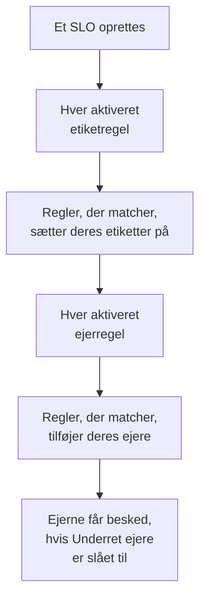

# Etiket- og ejerregler

Etiketregler og ejerregler holder orden på dine SLO'er for dig. En **etiketregel** sætter etiketter på hvert nyt SLO, den matcher, og en **ejerregel** tilføjer ejerbrugere og -teams til det, så et nyt checkout-SLO får etiketten _Checkout_ og ejes af checkoutteamet, uden at nogen skal huske det. Begge virker som etiket- og ejerreglerne for alle andre produkter: se [Etiket- og ejerregler](/docs/configuration/label-and-owner-rules) for det, de har til fælles.

## Sådan fungerer det

Regler kører, når et SLO oprettes, fra dashboardet eller via API'en. Etiketregler kører først, så en ejerregel kan matche en etiket, som en etiketregel lige har sat på.

Begge slags gælder for hele projektet. Du finder dem i SLO-listens sidemenu under **Indstillinger**: **Etiketregler** og **Ejerregler**. Sektionen **Indstillinger** starter foldet sammen; klik på dens titel for at åbne den.

## Opret en regel

:::steps
### Åbn regellisten

Åbn **SLOs**, derefter **Indstillinger** → **Etiketregler** eller **Indstillinger** → **Ejerregler** i sidemenuen, og klik på **Opret SLO Label Rule** eller **Opret SLO Owner Rule**.

### Vælg, hvad reglen matcher

I trinnet **Match** klikker du på **Tilføj betingelse** for hver betingelse, et SLO skal opfylde (se [Matchkriterier](#matchkriterier)). Med to eller flere vælger du **Alle skal matche** eller **Én skal matche**. En regel uden betingelser matcher hvert nyt SLO.

### Vælg, hvad reglen tilføjer

En etiketregels andet trin er **Etiketter**, hvor du vælger **Etiketter at tilføje**. En ejerregels er **Ejere**, hvor du vælger de **Ejere**, der skal tilføjes — personer og teams, valgt fra én liste med **Tilføj ejer**. En regel skal tilføje mindst én etiket eller ejer.

### Tjek navnet og de sammenfoldede felter

**Navn** udfyldes ud fra det, du vælger, som _Tilføj Checkout, Production_ eller _Tilføj Checkout team som ejere_, og følger dine valg, indtil du skriver dit eget navn. **Flere felter** rummer den valgfri **Beskrivelse** og, på en ejerregel, **Underret ejere**.

### Gem reglen

Klik på **Opret SLO Label Rule** eller **Opret SLO Owner Rule** igen i det sidste trin. Reglen starter aktiveret.
:::

**Underret ejere** (under **Flere felter**) er slået til som standard: de ejere, en ejerregel tilføjer, får den samme besked "du er blevet tilføjet som ejer" som en ejer, der er tilføjet manuelt. Slå det fra for at tilføje ejere uden at give dem besked.

For at sætte en regel på pause uden at slette den slår du **Aktiveret** fra i dens redigeringsformular. Redigeringsformularen kræver aldrig etiketter eller ejere: en ældre regel, der ikke tilføjer noget, kan stadig omdøbes, slås fra eller slettes, og listen markerer den med **Tilføjer intet**.

Når en regel matcher et SLO:

- En etiketregel sætter hver etiket fra **Etiketter at tilføje** på. Etiketter, som SLO'et allerede har, tilføjes ikke to gange, og når flere regler matcher, får SLO'et alle deres etiketter.
- En ejerregel tilføjer hver bruger og hvert team på reglen som ejer. Ejere, som SLO'et allerede har, springes over, og når flere regler matcher, får SLO'et alle deres ejere. En bruger, der ikke længere er medlem af projektet, eller et team fra et andet projekt, tilføjes aldrig; reglens andre ejere tilføjes stadig.

Et SLO's ejere er de personer, der hører om dets statusændringer: se [Fejlbudgetter](/docs/slo/error-budget).

## Matchkriterier

Hver betingelse sammenligner ét felt på SLO'et:

| Felt | Sammenlignes med | Operatorer |
| --- | --- | --- |
| **SLO-etiketter** | SLO'ets etiketter. | **Har en af**, **Har alle**, **Har ingen af** |
| **SLO-navn** | SLO'ets navn. | **Indeholder**, **Indeholder ikke**, **Er lig med**, **Er ikke lig med**, **Starter med**, **Slutter med**, **Matcher mønster**, **Matcher ikke mønster** |
| **SLO-beskrivelse** | SLO'ets beskrivelse. | De samme som for **SLO-navn** |

En ny betingelse på navn eller beskrivelse starter på **Indeholder**. Et mønster er et regulært udtryk, som `^checkout-.*`, eller et `*`-jokertegn, som `*checkout*`, og skelner ikke mellem store og små bogstaver. Et mønster, der ikke er nogen af delene, som `checkout-(01`, afvises, når du gemmer, i stedet for stille og roligt ikke at matche noget.

| Du vil have | Betingelser |
| --- | --- |
| Hvert SLO for checkouttjenesten | **SLO-navn** indeholder `checkout` |
| Hvert produktions-SLO | **SLO-etiketter** har en af _Production_ |
| Checkout-SLO'er, men ikke dem fra staging | **Alle skal matche**: **SLO-navn** indeholder `checkout`, og **SLO-etiketter** har ingen af _Staging_ |

## Hvornår regler kører

- **Når et SLO oprettes**, fra dashboardet eller via API'en: hver aktiveret etiketregel, derefter hver aktiveret ejerregel.
- **Når du kører en regel** med **Run Now**: se nedenfor.

At redigere et SLO anvender ikke reglerne igen, og en regel fjerner aldrig noget: hverken etiketter eller ejere, som nogen har tilføjet manuelt, eller dem, den selv har tilføjet. En regel, der er slået fra, gør ingenting.

## Kør en regel på eksisterende SLO'er

En regel, du skriver i dag, gælder for de SLO'er, der oprettes efter den. For at anvende den på de SLO'er, du allerede har, klikker du på **Run Now** i reglens række, eller på **Vis** og derefter **Run Now** på reglens egen side. Du kan også vælge flere regler og køre dem fra tabellens massehandlinger.

En kørsel tjekker hvert SLO i projektet, også de arkiverede, og fortæller, hvor mange den matchede, og hvor mange den ændrede. Ejere, som en kørsel tilføjer, får kun besked, når du vælger at give dem besked i kørselsdialogen, og reglen har **Underret ejere** slået til. Se [Kør regler på eksisterende ressourcer](/docs/configuration/run-rules-now).

Etiketregler kan også kopieres mellem projekter: se [Import og eksport af etiketregler](/docs/configuration/label-rule-import-export).

## Historik

Hver gang en regel ændrer et SLO, registrerer SLO'ets **Feed**, hvilke regler der gjorde det. Hver ejer, en regel tilføjer, får også sit eget feedelement "tilføjet som ejer", så feedet fortæller, hvem der blev tilføjet og hvorfor. Se [SLO-feed og auditlogs](/docs/slo/feed-and-audit-logs).

## Tilladelser

| For at | Skal du have |
| --- | --- |
| Arbejde med etiketregler | **Create SLO Label Rule**, **Edit SLO Label Rule**, **Delete SLO Label Rule** eller **Read SLO Label Rule** |
| Arbejde med ejerregler | **Create SLO Owner Rule**, **Edit SLO Owner Rule**, **Delete SLO Owner Rule** eller **Read SLO Owner Rule** |
| Køre en etiketregel | **Edit SLO Label Rule** og **Edit Service Level Objective** |
| Køre en ejerregel | **Edit SLO Owner Rule**, **Edit Service Level Objective**, **Create SLO User Owner** og **Create SLO Team Owner** |

Disse tilladelser ligger i en rolles SLO-gruppe, og rollerne Project Owner og Project Admin har dem alle. En kørsel ændrer hvert SLO i projektet, så en tilladelse, der er begrænset til nogle etiketter eller til de SLO'er, du ejer, er ikke nok til at køre en regel.

## Næste trin

:::cards
- [Etiket- og ejerregler](/docs/configuration/label-and-owner-rules): Hvordan alle produkters etiket- og ejerregler virker.
- [Kør regler på eksisterende ressourcer](/docs/configuration/run-rules-now): Hvordan Run Now virker for hver slags regel.
- [SLO'er – Oversigt](/docs/slo/introduction): Hver side, et SLO har, og SLO-listen.
:::
