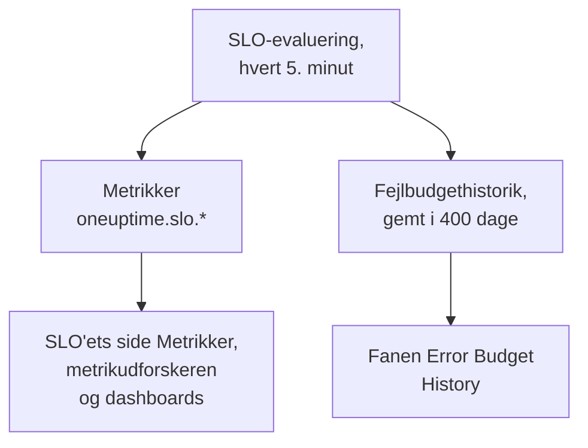

# SLO-metrikker og -dashboards

Hver gang OneUptime evaluerer et SLO, hvert 5. minut, skriver det resultaterne som metrikker med navnet `oneuptime.slo.*`. De ligger i det samme metriklager som dine monitormetrikker, så du kan vise et SLO i et diagram på dets side **Metrikker**, åbne det i metrikudforskeren og sætte det på ethvert dashboard, filtreret og grupperet som enhver anden serie.

:::cards
- [Metrikkerne](#metrikkerne): Seks serier, deres enheder og hvordan de aggregeres.
- [Siden Metrikker](#siden-metrikker): Et SLO's diagrammer, historik og hændelses- og advarselsmetrikker.
- [SLO'er på dashboards](#sloer-på-dashboards): SLO-widgetten og skabelonen SLO Dashboard.
:::

## Sådan fungerer det

## Metrikkerne

| Metrik | Enhed | Aggregering | Hvad den indeholder |
| --- | --- | --- | --- |
| `oneuptime.slo.sli.percent` | `%` | Avg | SLI'en over SLO'ets compliancevindue: den andel af den målte tid, der var god. |
| `oneuptime.slo.target.percent` | `%` | Avg | SLO'ets mål, sendt med hver evaluering, så et diagram kan tegne det over SLI'en. |
| `oneuptime.slo.error.budget.remaining.percent` | `%` | Avg | Andelen af fejlbudgettet, der endnu ikke er brugt i vinduet. Negativ, når budgettet er overskredet. |
| `oneuptime.slo.error.budget.remaining.seconds` | `seconds` | Avg | Nedetid, SLO'et stadig kan tåle, før det brydes. Negativ, når budgettet er overskredet. |
| `oneuptime.slo.burn.rate` | `x` | Max | Hvor hurtigt budgettet bruges, over de seneste 60 minutter. 1x bruger budgettet præcis over vinduet. |
| `oneuptime.slo.status` | — | Max | SLO'ets status ved hver evaluering: `0` er Sund, `1` er At Risk, `2` er Budget Exhausted. |

Aggregeringen er den måde, SLO'ets egne diagrammer og skabelonen SLO Dashboard kombinerer de punkter, der falder i ét diagraminterval. Procenter og varigheder tages som gennemsnit. Forbrugsrate og status tager maksimum, så en kort forbrugsspids eller en kort tur forbi Budget Exhausted ikke forsvinder i gennemsnittet.

For et SLO i tilstanden **Monitor Seconds Average** tæller `oneuptime.slo.error.budget.remaining.seconds` monitorsekunder, lagt sammen på tværs af dets monitorer, ligesom dets fejlbudget: se [Fejlbudgetter](/docs/slo/error-budget).

### Når der ikke skrives noget punkt

- Et deaktiveret eller arkiveret SLO evalueres ikke, så det sender intet.
- Et SLO, der er **Sat på pause** eller **Misconfigured**, måler intet, så det sender kun `oneuptime.slo.target.percent`, som er konfiguration og ikke en måling. Dets diagrammer for SLI, budget, forbrugsrate og status viser et hul.
- En værdi, der ikke er et rigtigt tal, som en forbrugsrate over et vindue uden data, springes over og skrives aldrig som 0.

### Attributter

Hvert punkt har disse attributter:

| Attribut | Værdi |
| --- | --- |
| `sloId` | SLO'ets ID. SLO'ets egne sider filtrerer på det, så at omdøbe et SLO deler aldrig dets diagrammer. |
| `sloName` | SLO'ets navn, da punktet blev skrevet. |
| `projectId` | Projektets ID. |
| `oneuptime.label.<key>` | Én attribut pr. SLO-etiket. En etiket med navnet `Tier 1` bliver til `oneuptime.label.tier_1` = `true`, og en etiket med navnet `product:checkout` bliver til `oneuptime.label.product` = `checkout`. Nøgler skrives med små bogstaver, og mellemrum og tegnsætning bliver til `_`. |

Serierne hører til SLO'et, ikke til nogen af dets monitorer, og tæller ikke som telemetriforbrug.

Hændelses- og advarselsmetrikker har to tilsvarende attributter, `serviceLevelObjectiveIds` og `serviceLevelObjectiveNames`: kommaseparerede lister over de SLO'er, hændelsen eller advarslen påvirker.

### Opbevaring

`oneuptime.slo.*`-metrikker gemmes lige så længe som monitormetrikker: **30 dage** som standard. På en selvhostet installation kan en masteradministrator ændre det med **Monitor Metric Retention (Days)** i indstillingerne for **Dataopbevaring** i Admin Dashboard.

Det begrænser ikke fanen **Error Budget History** på SLO'ets side **Metrikker**. Den historik gemmes for sig og opbevares i 400 dage.

## Siden Metrikker

Et SLO's side **Metrikker** har fire faner:

| Fane | Hvad den viser |
| --- | --- |
| **SLO Metrics** | `oneuptime.slo.*`-serierne i tre kort, der deler ét tidsinterval, som standard det seneste døgn: **Objective** (SLI'en med målet over, og det resterende budget), **Burn** (forbrugsrate og resterende budgettid) og **Status**. |
| **Error Budget History** | SLI'en, det resterende budget og forbrugsraten over den langsigtede historik, med linjer ved målet, ved grænserne for risiko og opbrugt budget og ved tærsklen for hver aktiveret forbrugsrateregel. |
| **Hændelsesmetrikker** | Antallet, tiden til kvittering, tiden til løsning og varigheden af de hændelser, der påvirker dette SLO, som standard den seneste uge. Hændelser, som dets forbrugsrateregler har erklæret, er med. |
| **Advarselsmetrikker** | Det samme for advarsler. Advarsler, som dets forbrugsrateregler har udløst, er med. |

Fanerne **SLO Metrics**, **Hændelsesmetrikker** og **Advarselsmetrikker** læser metriklageret, hvilket kræver tilladelse til at læse telemetri. En tilpasset rolle, der må læse SLO'er, men ikke telemetri, ser de faner tomme, mens **Error Budget History** stadig virker.

## SLO'er på dashboards

### Vis enhver SLO-metrik i et diagram

:::steps
#### Tilføj et diagram

I et dashboards redigeringstilstand tilføjer du en diagram- eller værdiwidget og vælger en af `oneuptime.slo.*`-metrikkerne.

#### Gruppér eller filtrér

Gruppér efter `sloName` og `sloId` for at få én linje pr. SLO; `sloId` holder to SLO'er med samme navn adskilt. Eller filtrér på `sloName` eller på en `oneuptime.label.*`-attribut.

#### Vælg aggregeringen

Brug aggregeringen fra tabellen ovenfor: Avg for procenterne og varighederne, Max for forbrugsrate og status.
:::

### SLO-widgetten

[SLO-widgetten](/docs/dashboards/widgets#slo) viser ét SLO's SLI, resterende budget eller forbrugsrate som et felt eller et diagram. Den får sit SLO på en af to måder:

| Indstilling | Hvordan den opfører sig |
| --- | --- |
| **Service Level Objective** | Fastgør widgetten til ét SLO. Vælgeren viser SLO'er, der ikke er arkiveret. |
| **Follow SLO Variable** | Viser det SLO, der er valgt i en dashboardvariabel: en variabel af typen **Telemetry Attribute** på nøglen `sloName`. Ignoreres, så længe et SLO er fastgjort. |

På et [offentligt dashboard](/docs/dashboards/sharing) lader en widget, der følger en variabel, seerne vælge et hvilket som helst ikke-arkiveret SLO i projektet efter navn. En fastgjort widget viser kun sit eget SLO og bliver ved med at vise de seneste tal for et SLO, der senere arkiveres.

### Skabelonen SLO Dashboard

Når du opretter et dashboard, vælger du skabelonen **SLO Dashboard** for at få en færdig tavle med alle projektets SLO'er, i tre bånd:

1. **Service Level Objectives**: en liste over hvert ikke-arkiveret SLO med dets status, SLI i forhold til målet, budgetbjælke og forbrugsrate, og en optælling af SLO'er efter status. Aktiverede SLO'er kommer først, det med mindst budget først; et deaktiveret SLO kommer sidst som **Deaktiveret**, med sine seneste tal nedtonet.
2. **Error Budget & Burn Rate**: felterne **Lowest Error Budget Remaining**, **Least Error Budget Time Left** og **Peak Burn Rate** og diagrammerne **Error Budget Remaining by SLO** og **Burn Rate by SLO** med én linje pr. SLO, grupperet efter `sloName` og `sloId`.
3. **Selected SLO**: felterne **SLI**, **Error Budget Remaining** og **Burn Rate** og diagrammerne **SLI History**, **Error Budget History** og **Burn Rate History** for ét SLO.

Én SLO-variabel i værktøjslinjen afgrænser hele tavlen. Det er en variabel af typen Telemetry Attribute på `sloName`, så dens muligheder er de SLO-navne, der findes i metrikkerne. At vælge et SLO indsnævrer listen til det, afgrænser båndets diagrammer og felter og udfylder widgetterne under **Selected SLO**, som følger variablen. Indtil du vælger et, beder de dig om at vælge et SLO i værktøjslinjen.

## Fejlfinding

:::details Et SLO mangler i værktøjslinjens SLO-vælger
Vælgeren viser de SLO-navne, der er sendt inden for det seneste døgn. Et nyt SLO dukker op efter sin første evaluering; et SLO, der er **Sat på pause** eller **Misconfigured**, kan stadig vælges, fordi det stadig sender sit mål; et deaktiveret eller arkiveret SLO forsvinder cirka et døgn efter sit seneste punkt.
:::

:::details At vælge et navn viser to SLO'er
To SLO'er har det navn. Listen og diagrammerne viser begge, og widgetterne under **Selected SLO** siger, at navnet er tvetydigt. Giv SLO'er forskellige navne.
:::

:::details Fanen SLO Metrics er tom
Din rolle må ikke læse telemetri, eller SLO'et er ikke evalueret endnu. **Error Budget History** læser selve SLO'et og virker stadig.
:::

## Næste trin

:::cards
- [Dashboard-widgets](/docs/dashboards/widgets): Alle widgets, SLO-widgetten medregnet.
- [Dashboard-variabler](/docs/dashboards/variables): Afgræns en hel tavle med én vælger.
- [Fejlbudgetter](/docs/slo/error-budget): Hvad budgettallene betyder.
:::
