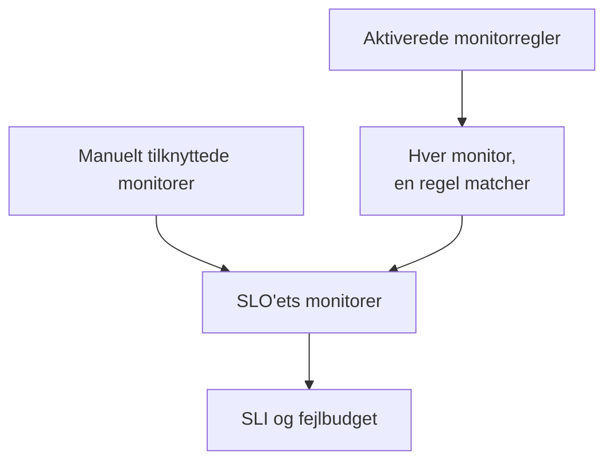

# Monitorer og monitorregler

Et SLO måler tilgængeligheden af de monitorer, der er knyttet til det. Tilknyt dem manuelt, lad monitorregler tilknytte hver monitor, der matcher, eller gør begge dele. Denne side handler om et SLO's sider **Monitorer** og **Monitor Rules**, som begge ligger under **Konfiguration** i dets sidemenu.

:::cards
- [Vælg monitorer manuelt](#tilknyt-monitorer-manuelt): Bedst til et lille, fast sæt.
- [Tilknyt monitorer med en regel](#tilknyt-monitorer-med-en-regel): "Hver monitor med etiketten Production", holdt opdateret for dig.
- [Matchkriterier](#matchkriterier): De felter og operatorer, en regel kan matche på.
:::

## Hvilke monitorer et SLO måler

Et SLO måler foreningsmængden af de monitorer, du har tilknyttet manuelt, og hver monitor, som mindst én af dets aktiverede monitorregler matcher.

Et nyt SLO har ingen monitorer, fordi oprettelsesformularen ikke beder om nogen. Indtil det har en, kan det ikke evalueres: dets sider viser **No monitors attached**, og dets **Oversigt** tilbyder begge måder at tilknytte monitorer på.

## Tilknyt monitorer manuelt

Du skal have tilladelse til at redigere SLO'et.

:::steps
### Åbn siden Monitorer

Åbn SLO'et, og gå til **Monitorer**.

### Vælg monitorerne

Klik på **Add Monitors**, og vælg monitorer fra projektet. Kun monitorer, der ikke allerede er tilknyttet, vises.

### Gem listen

Klik på **Add Monitors**. Monitorerne vises på listen med kilden **Manual** og tæller med i SLI'en fra næste evaluering.
:::

Klik på **Fjern** i en monitors række for at tage den ud af SLO'et. Selve monitoren ændres ikke; den holder bare op med at tælle med i SLO'ets SLI og fejlbudget.

Siden **Monitorer** viser for hver monitor:

| Kolonne | Hvad den viser |
| --- | --- |
| **Aktuel status** | Monitorens aktuelle status, eller **Arkiveret**, **Deaktiveret**, **Sonder ikke aktiveret**, **Sonder afbrudt** eller **Ukendt**, når den ikke bliver tjekket eller endnu ikke har rapporteret noget. |
| **Kilde** | **Rule**, hvis en af SLO'ets monitorregler har tilknyttet den, **Manual**, hvis nogen har tilknyttet den manuelt. |
| **Etiketter** | Monitorens etiketter. |

## Tilknyt monitorer med en regel

En monitorregel beskriver de monitorer, et SLO skal måle, som "hver monitor med etiketten Production" eller "hver monitor, hvis navn starter med api-". Hver monitor, der matcher, bliver tilknyttet, nu og hver gang monitorer oprettes eller ændres, så ingen skal huske den monitor, som nogen tilføjer i næste måned.

:::steps
### Åbn Monitor Rules

Åbn SLO'et, gå til **Monitor Rules**, og klik på **Opret SLO Monitor Rule**.

### Giv reglen et navn

Under **Grundlæggende oplysninger** angiver du et **Navn** og eventuelt en **Beskrivelse** af, hvorfor disse monitorer hører til dette SLO.

### Vælg, hvad den matcher

Under **Matchkriterier** klikker du på **Tilføj betingelse**, vælger et felt og en operator og angiver eller vælger værdien. Med to eller flere betingelser vælger du **Alle skal matche** eller **Én skal matche**. En monitorregel skal have mindst én betingelse.

### Gem reglen

Klik på **Opret SLO Monitor Rule**. Reglen starter aktiveret, og SLO'ets monitorer vurderes igen med det samme: hver monitor, der matcher, tilknyttes med kilden **Rule**.
:::

Regeltabellen viser for hver regel navnet, matchkriterierne i almindelige ord og om den er aktiveret. For at sætte en regel på pause slår du **Aktiveret** fra i dens redigeringsformular. **View Monitors** åbner SLO'ets side **Monitorer**.

### Matchkriterier

Hver betingelse sammenligner ét felt på en monitor:

| Felt | Sammenlignes med | Operatorer |
| --- | --- | --- |
| **Overvågningsetiketter** | Monitorens etiketter. | **Har en af**, **Har alle**, **Har ingen af** |
| **Monitortype** | Monitorens type, valgt fra listen over typer. | **Er lig med**, **Er ikke lig med** |
| **Overvågningsnavn** | Monitorens navn. | **Indeholder**, **Indeholder ikke**, **Er lig med**, **Er ikke lig med**, **Starter med**, **Slutter med**, **Matcher mønster**, **Matcher ikke mønster** |
| **Overvågningsbeskrivelse** | Monitorens beskrivelse. | De samme som for **Overvågningsnavn** |

Et mønster er et regulært udtryk, som `^api-.*`, eller et `*`-jokertegn, som `*checkout*`, og skelner ikke mellem store og små bogstaver. Et mønster, der ikke er nogen af delene, som `api-(01`, afvises, når du gemmer, i stedet for stille og roligt ikke at matche noget. For at tilknytte alle monitorer i projektet tilføjer du en betingelse på **Overvågningsnavn**, der matcher mønsteret `.*`.

| Du vil have | Betingelser |
| --- | --- |
| Hver produktionsmonitor | **Overvågningsetiketter** har en af _Production_ |
| Hver API-monitor | **Monitortype** er lig med _API_ |
| Hver monitor undtagen de manuelle | **Monitortype** er ikke lig med _Manual_ |
| Hver monitor, hvis navn starter med api- | **Overvågningsnavn** matcher mønsteret `^api-` |
| Checkout-monitorerne, men ikke dem fra staging | **Alle skal matche**: **Overvågningsnavn** matcher mønsteret `*checkout*`, og **Overvågningsetiketter** har ingen af _Staging_ |

### Hvornår regler kører

- Når du opretter, redigerer, slår til, slår fra eller sletter en regel, vurderes SLO'ets monitorer igen med det samme.
- Når en monitor oprettes, eller dens etiketter, navn eller beskrivelse ændres, tjekker alle monitorregler i projektet den, også de etiketter, som dine monitoretiketregler giver den.
- Når en etiket slettes, vurderes de SLO'er, hvis regler brugte den, igen.
- Regler holder et SLO's monitorliste opdateret, også mens SLO'et er deaktiveret eller arkiveret, så det fortsætter med de rigtige monitorer.

Regler synkroniserer igen ved hver gemning, så **Run Now** er til at indhente det, SLO'et er gået glip af. Den findes i hver række, på reglens egen side (**Vis**) og i tabellens massehandlinger. At køre en regel vurderer alle SLO'ets aktiverede monitorregler igen samlet, og bagefter fortæller dialogen, hvor mange monitorer der blev tilknyttet og frakoblet. At køre en regel kræver tilladelse til at redigere SLO-monitorregler. Se [Kør regler på eksisterende ressourcer](/docs/configuration/run-rules-now).

### Hvilke monitorer en regel ejer

- En monitor forbliver tilknyttet, så længe en aktiveret regel matcher den, og frakobles, så snart ingen gør det længere.
- At slå en regel fra eller slette den frakobler kun de monitorer, som ingen anden aktiveret regel stadig matcher.
- Regler frakobler kun monitorer, som en regel har tilknyttet. En manuelt tilknyttet monitor overtages aldrig af en regel, der tilfældigvis matcher den, og frakobles ikke, når den holder op med at matche. Dens kilde forbliver **Manual**.

## Manuelt valg, mens regler er slået til

Så længe mindst én regel er aktiveret, er det reglerne, der styrer SLO'ets monitorer:

- monitorer kan ikke tilføjes manuelt: **Add Monitors** er deaktiveret, og et banner siger **This SLO's monitors are managed by its monitor rules**, med et link **Manage Monitor Rules**;
- monitorer, som en regel har tilknyttet, kan ikke fjernes manuelt, fordi reglen ville tilknytte dem igen: deres knap **Fjern** er låst, og værktøjstippet forklarer hvorfor;
- monitorer, der blev tilknyttet manuelt, før regler blev slået til, kan stadig fjernes.

Det gælder også API'en. Slå alle regler fra for at vælge monitorerne selv igen.

## De SLO'er, en monitor tæller med i

En monitors side viser de SLO'er, der måler den: åbn monitoren, og gå til **SLOs** i dens sidemenu. Tjek den, før du sætter en monitor på pause eller ændrer den, for at se, hvilke mål der afhænger af den. Arkiverede SLO'er vises ikke, fordi de ikke evalueres.

## Fra Auto-Add Monitors With Labels

Tidligere versioner havde en indstilling **Auto-Add Monitors With Labels** på SLO-formularen. Ved opgraderingen får hvert SLO, der brugte den, en aktiveret monitorregel med navnet **Auto-add monitors with labels**, der matcher de samme etiketter, så det bliver ved med at måle præcis de samme monitorer. Feltet `monitorLabels` i SLO-API'en er forældet: brug SLO-monitorregler i stedet.

:::details Hvad hvis noget stadig gemmer den gamle indstilling?
En dashboardfane, der blev åbnet før opgraderingen, eller en API-klient eller et workflow, der er skrevet til den tidligere version, kan stadig gemme den gamle indstilling. Så et SLO ikke stille og roligt mister monitorer på den måde:

- **Et SLO uden monitorregler** gør de gemte etiketter til en regel **Auto-add monitors with labels**, og dets monitorer vurderes igen med det samme. At gemme en tom liste frakobler de monitorer, som indstillingen havde tilknyttet, som før.
- **Et SLO, der har monitorregler**, slået til eller ej, ignorerer etiketter, der er gemt via den gamle indstilling, fordi det er dets regler, der bestemmer, hvad det måler.
- **At oprette den første monitorregel** for et SLO, hvis monitorer blev tilknyttet af den gamle indstilling, konverterer først indstillingen til en regel, så den nye regel føjes til ved siden af i stedet for at erstatte den.

En konverteret regel, som du sletter, forbliver slettet, medmindre dens monitorer stadig er tilknyttet bagefter, for eksempel fordi en server, der stadig kører den tidligere version, tilknyttede dem igen under opgraderingen: den næste monitorændring eller den næste nye regel konverterer så etiketterne igen. Slet den regel igen, når opgraderingen er færdig.
:::

## Historik

Hver tilknytning og frakobling, og hver regel, der oprettes, redigeres eller slettes, vises i SLO'ets **Feed**. Regelændringer registreres også i dets **Auditlogs**. Se [SLO-feed og auditlogs](/docs/slo/feed-and-audit-logs).

## Fejlfinding

:::details Add Monitors er deaktiveret
Mindst én af SLO'ets monitorregler er aktiveret, så det er reglerne, der styrer dets monitorer. Ændr reglerne, eller slå dem alle fra for at vælge monitorer manuelt.
:::

:::details En monitors knap Fjern er låst
En monitorregel har tilknyttet den monitor og ville tilknytte den igen. Ændr eller slå den regel fra, der matcher den.
:::

:::details En monitor, som en regel burde matche, er ikke tilknyttet
Tjek, at reglen er aktiveret, og at hver betingelse er opfyldt med **Alle skal matche**. Etiketter, som en monitoretiketregel tilføjer, tæller også. Klik på **Run Now** på reglen for at synkronisere SLO'et igen.
:::

:::details Det mislykkes at gemme en regel med en mønsterfejl
Værdien er hverken et regulært udtryk eller et `*`-jokertegn, for eksempel på grund af en parentes, der ikke er lukket. Ret mønsteret, eller brug **Indeholder**.
:::

## Næste trin

:::cards
- [SLO'er – Oversigt](/docs/slo/introduction): Hvordan nedetid fra flere monitorer kombineres.
- [Fejlbudgetter](/docs/slo/error-budget): Hvad monitorernes nedetid bruger af.
- [Kør regler på eksisterende ressourcer](/docs/configuration/run-rules-now): Hvordan Run Now virker for hver slags regel.
:::
