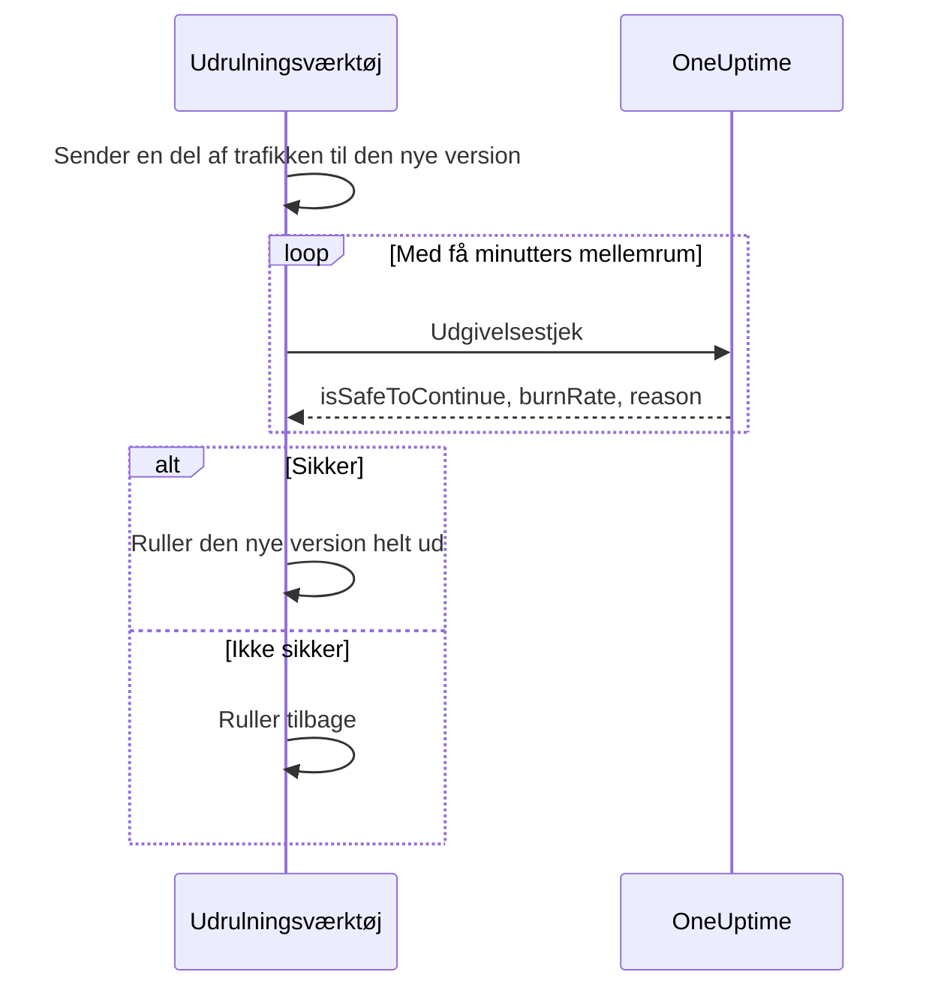

# Udgivelsestjek

Et udgivelsestjek spørger et SLO "er det sikkert at fortsætte med at rulle denne udgivelse ud?", mens udgivelsen går ud, og svarer ud fra, hvor hurtigt SLO'et har brugt af sit fejlbudget i de seneste minutter. Argo Rollouts, Flagger eller en udrulningspipeline stiller spørgsmålet, mens en canary tager imod trafik, og ruller udgivelsen tilbage ved et nej. OneUptime udruller ikke selv noget: Dit udrulningsværktøj står fortsat for udrulningen, og OneUptime fortæller det, hvordan udgivelsen klarer sig.

:::cards
- [Kald tjekket](#kald-tjekket): Én anmodning med en API-nøgle, og hvad den svarer.
- [Argo Rollouts](#argo-rollouts): En analyse, der afbryder udrulningen.
- [Flagger](#flagger): En webhook, der standser canaryen.
- [GitHub Actions](#github-actions): Et trin, der ruller tilbage efter en udrulning.
- [Slå et feature flag fra](#slå-et-feature-flag-fra): En arbejdsgang, der slår et flag fra, når SLO'et bruger sit fejlbudget for hurtigt.
:::

## Sådan fungerer det

[Udrulningsspærren](/docs/slo/error-budget-policy#udrulningsspærre) svarer før en udgivelse, ud fra fejlbudgettet for hele compliancevinduet. En udgivelse, der ødelægger noget, har i sine første ti minutter brugt næsten intet af en måneds budget, så udgivelsestjekket læser det, udgivelsen ændrer: forbrugsraten over de seneste minutter.



Tjekket svarer med en af tre afgørelser:

| Afgørelse | Hvornår | `isSafeToContinue` |
| --- | --- | --- |
| `Pass` | Vinduet brugte af fejlbudgettet med `maxBurnRate` eller langsommere. | `true` |
| `Fail` | Det brugte hurtigere, eller SLO'ets fejlbudgetpolitik fryser udrulninger. | `false` |
| `NotEnoughData` | Vinduet havde færre anmodninger end `minimumRequestCount`, eller SLO'ets monitorer registrerede ingen status i det. For lidt til at kalde udgivelsen sikker. | `false` |

Ved en forbrugsrate på 1 ramte vinduet præcis SLO'ets mål, så standardværdien `1` for `maxBurnRate` afviser en udgivelse, der klarer sig dårligere end målet.

Hvad tjekket læser, afhænger af, hvad SLO'et måler:

- Et [anmodnings-SLO](/docs/slo/request-slos) bedømmes ud fra dets tjenesters anmodninger i vinduet, læst fra deres spans, efterhånden som de ankommer. Tilføj `serviceVersion` for kun at bedømme den nye versions anmodninger: OneUptime matcher værdien mod spannenes ressourceattribut `service.version`, som et OpenTelemetry-SDK sætter ud fra `OTEL_RESOURCE_ATTRIBUTES=service.version=1.4.2`. Så bedømmes canaryen på sine egne anmodninger og udvandes ikke af den gamle versions.
- Et [metrik-SLO](/docs/slo/request-slos#sloer-ud-fra-en-metrik) bedømmes ud fra metrikkens begivenheder i vinduet, talt på samme måde som dets SLI tæller dem, så `minimumRequestCount`, `goodRequestCount` og `totalRequestCount` er begivenheder. Med `serviceVersion` tæller kun de af metrikkens punkter, hvis ressourceattribut `service.version` har den værdi: Et OpenTelemetry-SDK sætter den på sine metrikker, ligesom det gør på sine spans.
- Et SLO for monitoroppetid bedømmes ud fra dets monitorers statustidslinjer over vinduet. `minimumRequestCount` gælder ikke for det, og et tjek med `serviceVersion` afvises: Monitorer har ingen versioner.

## Før du begynder

Du skal have et SLO, der måler det, udgivelsen påvirker. Et anmodnings-SLO for den tjeneste, du udgiver, bedømmer en canary bedst, fordi det læser netop den tjenestes egne anmodninger.

## Opsæt et udgivelsestjek

:::steps
### Giv udrulningen en nøgle

Opret en [API-nøgle](/docs/api-reference/api-reference) til projektet med en rolle, der kan læse SLO'er, og gem den som en hemmelighed i dit udrulningsværktøj eller din pipeline.

### Kopiér SLO'ets ID

Åbn SLO'et, og kopiér dets ID fra adressen: `/slos/<slo-id>`.

### Kald tjekket én gang manuelt

Kør anmodningen under [Kald tjekket](#kald-tjekket) med nøglen og ID'et. Den svarer med `isSafeToContinue` og en `reason`.

### Føj det til din udrulning

Kald tjekket fra [Argo Rollouts](#argo-rollouts), [Flagger](#flagger) eller [GitHub Actions](#github-actions), og rul tilbage, når `isSafeToContinue` er `false`.
:::

## Kald tjekket

Tjekket er en `GET` eller `POST` på SLO'ets adresse `release-check`. Send indstillingerne i forespørgselsstrengen eller som en JSON-brødtekst med `POST`:

```bash
curl -sS "https://oneuptime.com/api/service-level-objective/<slo-id>/release-check?windowInMinutes=10&serviceVersion=1.4.2" \
  -H "ApiKey: $ONEUPTIME_API_KEY"
```

Det svarer først med afgørelsen og derefter med det, afgørelsen blev læst ud fra:

```json
{
  "isSafeToContinue": false,
  "verdict": "Fail",
  "reason": "The last 10 minutes burned the error budget at 3.2x, faster than the 1x this check allows (SLI 99.68% against the 99.9% target).",
  "sloId": "<slo-id>",
  "sloName": "Checkout requests",
  "sliType": "Request Success",
  "targetPercentage": 99.9,
  "windowInMinutes": 10,
  "maxBurnRate": 1,
  "burnRate": 3.2,
  "sliPercentage": 99.68,
  "deploymentsAllowed": true,
  "errorBudgetPolicyTier": null,
  "sloStatus": "Healthy",
  "checkedAt": "2026-11-15T12:00:00.000Z",
  "goodRequestCount": 2492,
  "totalRequestCount": 2500,
  "minimumRequestCount": 1,
  "serviceVersion": "1.4.2"
}
```

Indstillingerne:

| Indstilling | Standard | Hvad den gør |
| --- | --- | --- |
| `windowInMinutes` | `10` | Hvor langt tilbage tjekket kigger, i hele minutter fra 1 til 360. |
| `maxBurnRate` | `1` | Den højeste forbrugsrate, der består. `2` lader vinduet bruge af budgettet dobbelt så hurtigt, som målet tillader. |
| `minimumRequestCount` | `1` | Anmodnings-SLO'er: det mindste antal anmodninger, tjekket afgør noget ud fra. Med `0` består et vindue uden anmodninger. |
| `serviceVersion` | Ingen | Anmodnings-SLO'er: bedøm kun de anmodninger, hvis spans har denne `service.version`. |
| `includeDeploymentGate` | `true` | Afvis, så længe SLO'ets fejlbudgetpolitik fryser udrulninger. Med `false` afgør kun forbrugsraten det. |
| `failWithStatusCode` | `false` | Svar på et nej med HTTP-status 412 i stedet for 200, til værktøjer, der kun læser statuskoden. |

Svarets felter:

| Felt | Hvad det indeholder |
| --- | --- |
| `isSafeToContinue` | `true` for at fortsætte udrulningen, `false` for at rulle den tilbage. |
| `verdict` | `Pass`, `Fail` eller `NotEnoughData`. |
| `reason` | Én sætning til udrulningens log, der siger, hvad der blev målt, og hvorfor tjekket svarede, som det gjorde. |
| `burnRate` og `sliPercentage` | Hvor hurtigt vinduet brugte af fejlbudgettet, og SLI'en over vinduet. |
| `goodRequestCount` og `totalRequestCount` | Anmodnings-SLO'er: de anmodninger, vinduet indeholdt, og hvor mange af dem der var gode. |
| `deploymentsAllowed` og `errorBudgetPolicyTier` | Om SLO'ets fejlbudgetpolitik tillader udrulninger, og det niveau, SLO'et er i. |
| `checkedAt` | Hvornår tjekket blev målt. |

Et SLO, der ikke kan måles – et anmodnings-SLO uden tjenester, et latens-SLO uden grænse, et metrik-SLO uden en tællelig metrik, et SLO for monitoroppetid uden monitorer – får svaret HTTP 400 og besked om, hvad der skal rettes, så en udrulning stopper på en tydelig fejl i stedet for et gæt. På en selvhostet installation skal du bruge installationens egen adresse i stedet for oneuptime.com.

## Argo Rollouts

En analyse med en `web`-metrik kalder tjekket ved hvert trin i en canary, og Argo Rollouts afbryder udrulningen og skalerer canaryen ned, når tjekket fejler. Gem først API-nøglen som en hemmelighed:

```bash
kubectl create secret generic oneuptime --from-literal=api-key="$ONEUPTIME_API_KEY"
```

Tilføj derefter skabelonen, og kør den efter canaryens første trin:

:::tabs
@tab AnalysisTemplate
```yaml title="oneuptime-release-check.yaml"
apiVersion: argoproj.io/v1alpha1
kind: AnalysisTemplate
metadata:
  name: oneuptime-release-check
spec:
  args:
    - name: version
    - name: api-key
      valueFrom:
        secretKeyRef:
          name: oneuptime
          key: api-key
  metrics:
    - name: slo-burn-rate
      interval: 2m
      count: 5
      failureLimit: 0
      successCondition: result == true
      provider:
        web:
          url: "https://oneuptime.com/api/service-level-objective/<slo-id>/release-check?windowInMinutes=10&serviceVersion={{args.version}}"
          headers:
            - key: ApiKey
              value: "{{args.api-key}}"
          jsonPath: "{$.isSafeToContinue}"
```
@tab Rollout
```yaml title="rollout.yaml"
apiVersion: argoproj.io/v1alpha1
kind: Rollout
metadata:
  name: checkout
spec:
  strategy:
    canary:
      steps:
        - setWeight: 10
        - analysis:
            templates:
              - templateName: oneuptime-release-check
            args:
              - name: version
                value: "1.4.2"
        - setWeight: 50
        - pause: { duration: 10m }
```
:::

Analysen spørger fem gange med to minutters mellemrum, og det første nej afbryder udrulningen. Angiv den samme version, som canaryens pods sætter i `OTEL_RESOURCE_ATTRIBUTES`. Kan canaryen risikere ikke at få nogen trafik ved sin første vægt, skal du tilføje `&minimumRequestCount=0` til adressen, ellers dumper en stille canary analysen med `NotEnoughData`.

## Flagger

Flagger kalder en `rollout`-webhook ved hvert trin i sin analyse og standser canaryen og ruller den tilbage, når webhooken bliver ved med at fejle. Flaggers webhooks sender ingen headers, så kald tjekket gennem Flaggers load tester, der kører en kommando for webhooken:

```yaml title="canary.yaml"
apiVersion: flagger.app/v1beta1
kind: Canary
metadata:
  name: checkout
spec:
  analysis:
    interval: 1m
    threshold: 2
    maxWeight: 50
    stepWeight: 10
    webhooks:
      - name: oneuptime-release-check
        type: rollout
        url: http://flagger-loadtester.test/
        timeout: 30s
        metadata:
          type: bash
          cmd: "curl -sSf -H \"ApiKey: $ONEUPTIME_API_KEY\" 'https://oneuptime.com/api/service-level-objective/<slo-id>/release-check?windowInMinutes=5&failWithStatusCode=true'"
```

Med `failWithStatusCode=true` er et nej HTTP 412, så `curl -f` afslutter med en fejl, og webhooken fejler. Giv load testeren nøglen som `ONEUPTIME_API_KEY` i dens miljø, fra en Kubernetes-hemmelighed. Når `threshold` tjek er fejlet, ruller Flagger canaryen tilbage.

## GitHub Actions

En pipeline, der udruller i ét hug, kan stadig holde øje med udgivelsen: Udrul, kald tjekket et par gange, og rul tilbage, når det svarer nej.

```yaml title=".github/workflows/deploy.yml"
name: Deploy
on:
  push:
    branches: [main]

jobs:
  deploy:
    runs-on: ubuntu-latest
    steps:
      - uses: actions/checkout@v4
      - name: Deploy
        run: ./deploy.sh
      - name: Watch the release against the SLO
        env:
          ONEUPTIME_API_KEY: ${{ secrets.ONEUPTIME_API_KEY }}
          SLO_ID: <slo-id>
          VERSION: ${{ github.sha }}
        run: |
          for attempt in 1 2 3 4 5; do
            sleep 120
            CHECK=$(curl -sS "https://oneuptime.com/api/service-level-objective/$SLO_ID/release-check?windowInMinutes=10&serviceVersion=$VERSION" \
              -H "ApiKey: $ONEUPTIME_API_KEY")
            echo "$CHECK" | jq -r '.reason'
            if [ "$(echo "$CHECK" | jq -r '.isSafeToContinue')" != "true" ]; then
              exit 1
            fi
          done
      - name: Roll back
        if: failure()
        run: ./rollback.sh
```

Trinnet fejler ved et nej og ved ethvert svar uden `isSafeToContinue: true` – et forkert ID, en nøgle, der ikke kan læse SLO'et, slet intet svar – så pipelinen aldrig fortsætter på et svar, den ikke fik. Sæt `service.version` til committet (`${{ github.sha }}`), når tjenesten starter, så tjekket kun bedømmer den nye version.

## Slå et feature flag fra

En udgivelse bag et feature flag rulles tilbage ved at slå flaget fra. Det kan en arbejdsgang gøre for dig: Når en af SLO'ets [forbrugsrateregler](/docs/slo/burn-rate-alerts) udløser sin advarsel eller erklærer sin hændelse, slår arbejdsgangen flaget fra i LaunchDarkly eller Unleash. En dårlig udrulning er dermed rullet tilbage på få minutter, uden at nogen skal gribe ind.

:::steps
### Kopiér forbrugsratereglens ID

Åbn SLO'et, og gå til **Forbrugsrateregler**. Åbn menuen for den regel, der skal slå flaget fra, og vælg **Vis ID**. En regel for hurtigt forbrug egner sig bedst, fordi den udløser inden for få minutter efter en dårlig udrulning.

### Opret arbejdsgangen fra en skabelon

Åbn **Arbejdsgange**, og klik på **Opret arbejdsgang**. Under **Eller start fra en skabelon** vælger du kategorien **SLOs** og derefter skabelonen til din flagtjeneste:

| Skabelon | Hvad den beder om |
| --- | --- |
| **Turn a LaunchDarkly flag off when an SLO burns too fast** | Et API-adgangstoken, der må opdatere flaget, og nøglerne til LaunchDarkly-projektet, flaget og miljøet. |
| **Turn an Unleash flag off when an SLO burns too fast** | Din Unleash-adresse, et token til en tjenestekonto eller et personligt adgangstoken samt flagets projekt, navn og miljø. |

Indsæt reglens ID i **Burn Rate Rule ID**, udfyld resten, og opret arbejdsgangen.

### Slå arbejdsgangen til

Arbejdsgange oprettes slået fra. Når du er klar, slår du **Aktiveret** til øverst i arbejdsgangens **Bygger**.
:::

Arbejdsgangen starter, hver gang en forbrugsrateregel i projektet udløser en advarsel eller erklærer en hændelse. Blokken **Hvis / Ellers** lader den kun fortsætte for den regel, hvis ID du indsatte, og det næste trin kalder flagtjenesten: hos LaunchDarkly instruktionen `turnFlagOff` med en kommentar, der nævner reglen og SLO'et, eller hos Unleash `off` for miljøet. Begge slår flaget fra for alle i det miljø, uanset flagets targeting. Afviser flagtjenesten kaldet, fejler kørslen, og dens log fortæller hvorfor. Reglens advarsel tilkalder stadig folk, som den altid gør.

**Kør arbejdsgang** i **Bygger** kører arbejdsgangen, som om den regel, du vælger, lige havde udløst, så den slår flaget fra for alvor. Prøv det først med et flag i et testmiljø.

For en anden flagtjeneste eller en LaunchDarkly-instans med egen adresse starter du fra en af de to skabeloner og ændrer kaldet i dens API-trin til et kald, der slår flaget fra for alle i miljøet. Vælg et kald, der ligesom disse to også tilsidesætter segmenter og targetingregler, ellers bliver flaget ved med at være slået til gennem en gradvis udrulning.

## Næste trin

:::cards
- [SLO'er for anmodninger og latens](/docs/slo/request-slos): Mål en tjenestes anmodninger, den SLI, der bedømmer en canary bedst.
- [Fejlbudgetpolitik](/docs/slo/error-budget-policy): Frys udrulninger, mens budgettet er lavt.
- [Forbrugsrateadvarsler og -hændelser](/docs/slo/burn-rate-alerts): Advar dit team, når budgettet brændes for hurtigt af.
:::
