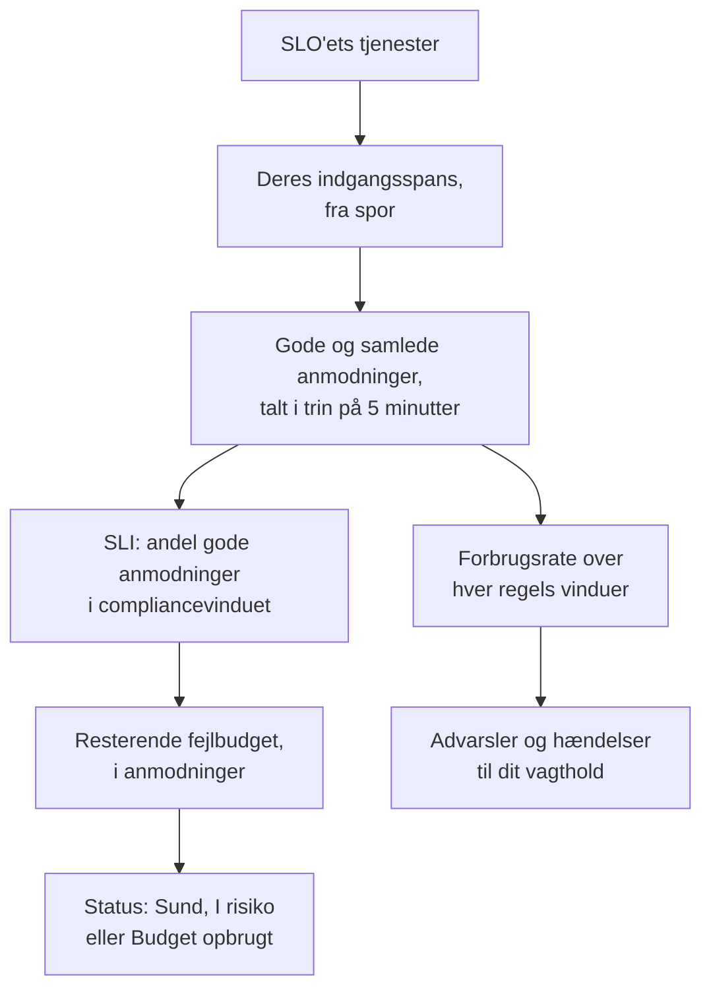

# SLO'er for anmodninger og latens

Et anmodnings-SLO måler, hvad dine brugere får fra en tjeneste: den andel af tjenestens anmodninger, der lykkes, eller som bliver besvaret hurtigt nok. OneUptime tæller dem ud fra de spor, dine tjenester allerede sender, så der er ingen monitor at sætte op: Vælg tjenesterne og et mål, så måler OneUptime dem hvert 5. minut.

:::cards
- [Opret et anmodnings-SLO](#opret-et-anmodnings-slo): Tjenesterne, en grænse for latens og et mål.
- [Tæl kun nogle anmodninger](#tæl-kun-nogle-anmodninger): Ét endpoint, eller alle anmodninger undtagen sundhedstjek.
- [SLO'er ud fra en metrik](#sloer-ud-fra-en-metrik): En tæller eller et histogram, til tjenester, der ikke sender spor.
- [Sådan tælles anmodninger](#sådan-tælles-anmodninger): Hvilke spans der tæller, og hvornår.
- [Udgivelsestjek](/docs/slo/release-checks): Rul en udgivelse tilbage, der brænder fejlbudgettet af.
:::

## Vellykkede anmodninger og anmodningslatens

| Hvad det måler | En anmodning er dårlig, når | Fejlbudgettet tæller |
| --- | --- | --- |
| **Vellykkede anmodninger** | Dens span har status `Error`. Et span uden status tæller som godt, sådan som OpenTelemetry definerer det. | Fejlede anmodninger |
| **Anmodningslatens** | Den tog længere tid end SLO'ets **Latensgrænse (ms)**, uanset dens status. | Langsomme anmodninger |

SLI'en er andelen af gode anmodninger i compliancevinduet, og fejlbudgettet er de dårlige anmodninger, målet tillader: ved 99,9 % én ud af hver 1.000. Et latens-SLO tæller en anmodning, der fejlede hurtigt, som god, så mål en vigtig tjeneste på begge måder: ét SLO for, at den virker, og ét for, at den er hurtig.

## Sådan fungerer det

En anmodning er et indgangsspan i en af SLO'ets tjenester: det span, hvor en anmodning eller en besked kommer ind i tjenesten, sådan som listen [Spor](/docs/telemetry/traces-explorer#spor-og-spans) viser dem som standard. En anmodning, der går gennem to af SLO'ets tjenester, tæller én gang i hver af dem.

Derfra fungerer et anmodnings-SLO som ethvert andet SLO. Dets status, forbrugsrateregler, fejlbudgetpolitik, ejere og notifikationer er de samme, blot med fejlbudgettet i anmodninger i stedet for minutter.

## Før du begynder

- Tjenesterne sender spor til OneUptime: se [OpenTelemetry](/docs/telemetry/open-telemetry). Hver af dem findes i [tjenestekataloget](/docs/telemetry/services) under sit `service.name`.
- En rolle, der må oprette SLO'er: Projektejer, Projektadministrator eller en tilpasset rolle med tilladelsen Create Service Level Objective.

## Opret et anmodnings-SLO

:::steps
### Åbn SLO'er

Åbn **SLOs** fra menuen **Produkter** i topbjælken, og klik på **Opret Serviceniveaumål**.

### Vælg, hvad det måler

Under **Hvad det måler** vælger du **Vellykkede anmodninger** eller **Anmodningslatens** og derefter under **Tjenester** de tjenester, hvis anmodninger SLO'et skal tælle. For **Anmodningslatens** angiver du også **Latensgrænse (ms)**: En anmodning, der besvares inden for grænsen, tæller som hurtig nok, for eksempel `300`. Vil du kun tælle nogle af deres anmodninger, angiver du et **Anmodningsfilter**: se [Tæl kun nogle anmodninger](#tæl-kun-nogle-anmodninger). Klik på **Næste**.

### Giv det et navn og et mål

Angiv et **Navn**, for eksempel "Checkout requests", og et **Mål (%)**: den andel af anmodningerne, der skal være gode. Klik på **Opret Serviceniveaumål**.

### Se de første tal komme ind

Den første evaluering, inden for 5 minutter, tæller anmodningerne fra de seneste 6 timer, så SLO'et har tal med det samme. De efterfølgende evalueringer tæller også ældre anmodninger, indtil hele compliancevinduet er dækket.
:::

En tjenestes egen side **SLOs** viser de SLO'er, der måler den, og dens **Opret Serviceniveaumål** åbner den samme formular med tjenesten allerede valgt. Vil du senere ændre, hvad et SLO måler, dets tjenester, dets grænse eller dets filter, skal du åbne dets **Indstillinger** og klikke på **Rediger, hvad det måler**.

## Tæl kun nogle anmodninger

Et anmodnings-SLO tæller alle anmodninger fra sine tjenester. Et **Anmodningsfilter** tæller kun dem, der betyder noget, såsom checkout-endpointet, eller udelader nogle, såsom sundhedstjek, der ville få SLI'en til at se bedre ud end det, brugerne får. Skriv det som en søgning i spor, i den samme [søgesyntaks](/docs/telemetry/search-syntax#matchning-af-værdier) som sporudforskeren:

| Anmodningsfilter | Tæller |
| --- | --- |
| `@http.route:/checkout*` | Anmodninger, hvis rute begynder med `/checkout`. |
| `-@http.route:/health` | Alle anmodninger undtagen sundhedstjek. |
| `@http.request.method:[POST, PUT]` | POST- og PUT-anmodninger. |
| `name:"POST /checkout"` | Anmodninger, hvis span hedder `POST /checkout`. |

Alle betingelser skal matche, så `@http.route:/checkout* -@http.route:/checkout/health` tæller checkout-anmodningerne undtagen deres sundhedstjek. En betingelse med `@` er en attribut på anmodningens span, og `name:` er spannets navn. Fritekst og udforskerens andre felter, såsom `status:` og `duration:`, er ikke filtre her: SLO'et afgør allerede, hvilke anmodninger der er dårlige eller langsomme. Et filter kan rumme op til 10 betingelser på højst 500 tegn.

**Oversigt** viser filteret under SLO'ets tjenester, og **Indstillinger** viser det under **Hvad det måler**. Ændrer du det, tælles SLO'ets anmodninger forfra.

## SLO'er ud fra en metrik

Når dine tjenester allerede tæller deres anmodninger som metrikker, eller ikke sender spor, så mål i stedet SLO'et ud fra en tæller eller et histogram. Under **Hvad det måler** vælger du **Metrik** og under **Tjenester** de tjenester, der sender metrikken, og derefter udfylder du trinnet **Metrik**:

| Felt | Det, du angiver |
| --- | --- |
| **Metrik** | Metrikkens navn, valgt blandt dit projekts metrikker eller skrevet ind, såsom `http_requests_total` eller `http.server.request.duration`. |
| **Gode begivenheder** | **En tæller, ud fra en betingelse** eller **Et histogram, ud fra en værdi**. |
| **God, når** | For en tæller: de begivenheder, der er gode, som en søgning i dens attributter, såsom `@http.response.status_code:<500`. |
| **God på eller under** | For et histogram: den værdi, en god observation ligger på eller under, i metrikkens egen enhed, såsom `0.3` for 300 ms i et histogram i sekunder. Brug en af dets bucketgrænser. |
| **Metrikfilter** | Valgfrit: de serier, der tæller, såsom `-@http.route:/health`. |

En tællers begivenheder er det, den voksede med i hvert trin på 5 minutter, sådan som Prometheus' `increase()` læser en tæller: En tæller, der genstarter, tæller fra nul igen, og både kumulative tællere og deltatællere tæller med. Et histograms begivenheder er dets observationer, og de gode er dem i de buckets, der ligger på eller under værdien. Kun metrikkens egne punkter tæller, og kun fra SLO'ets tjenester: En gauge med samme navn tæller slet ikke. En SLO på en gauge, som enhver cloudmetrik er, siger det på sin side, og det gør metrikvælgeren også: Mål en cloudmetrik med en metrikmonitor og en SLO af den monitors oppetid.

Derfra fungerer et metrik-SLO som et anmodnings-SLO, blot med fejlbudget, forbrugsrateregler og udgivelsestjek i begivenheder. Ændrer du metrikken, tælles dens begivenheder forfra.

## Sådan tælles anmodninger

OneUptime tæller hvert SLO's gode og samlede anmodninger i trin på 5 minutter og gemmer optællingerne, så SLO'et læser sit vindue ud fra sine egne optællinger i stedet for at gennemgå hvert eneste span hver gang:

- Et trin tælles 2 minutter efter, at det slutter, så spans, der ankommer sent, kommer med, og den næste evaluering tæller de seneste to trin igen for at få spans med, der ankommer endnu senere.
- Et nyt SLO starter med de seneste 6 timer. Hver evaluering derefter tæller op til et døgns ældre anmodninger, nyeste først, indtil vinduet er dækket.
- Kun anmodninger, der stadig er inden for din [opbevaring af telemetri](/docs/telemetry/data-retention#hvor-længe-telemetri-opbevares), kan tælles. Optalte trin gemmes i 400 dage, længere end noget compliancevindue, så et vindue, der er længere end opbevaringen, fyldes op, efterhånden som SLO'et bliver ældre.
- Ændrer du, hvad SLO'et måler, dets tjenester, dets latensgrænse eller dets anmodningsfilter, tælles dets anmodninger forfra. Et længere compliancevindue fyldes op ved at tælle længere tilbage.

Så længe optællingerne kun dækker en del af compliancevinduet, siger **Oversigt** det med en indikator **Vinduet er 23 % fyldt**, og feltet **Fejlbudget tilbage** gentager det under sit tal. Begge forsvinder, når optællingerne dækker hele vinduet.

## Fejlbudgettet i anmodninger

Budgettet er de dårlige anmodninger, målet tillader blandt de anmodninger, der er talt i vinduet, så det vokser med trafikken: Ved 99,9 % tillader et vindue med 2.000.000 anmodninger 2.000 fejlede. På **Oversigt**:

- **Fejlbudget tilbage** viser, hvor mange dårlige anmodninger der er tilbage ud af hvor mange, eller hvor mange anmodninger SLO'et er over budgettet.
- **Budgettets rækkevidde** viser, hvor længe budgettet holder ved den nuværende forbrugsrate, så længe trafikken forbliver, som den har været.
- Opsummeringen viser antallet af SLO'ets tjenester, og et latens-SLO viser sin grænse under sit mål.

Forbrugsrateadvarsler, notifikationer og feedet angiver også budgettet i anmodninger. Metrikken `oneuptime.slo.error.budget.remaining.seconds` sendes ikke for et anmodnings-SLO; vis i stedet `oneuptime.slo.error.budget.remaining.percent` i dine diagrammer.

Et anmodnings-SLO får de samme regler, **Fast burn**, **Slow burn** og **Slow leak**, som ethvert nyt SLO. En stille time med en håndfuld anmodninger kan få budgettet til at brænde hurtigt af ved en enkelt fejl, så en regel kan se bort fra vinduer med for få anmodninger: Angiv reglens **Mindste antal anmodninger**, så springer reglen et langt vindue over, når det har færre anmodninger end det.

## Fejlfinding

:::details SLO'et viser Venter på anmodninger
Ingen af SLO'ets tjenester har besvaret en anmodning i vinduet endnu. Tjek, at tjenesterne sender spor til OneUptime, og at deres spans omfatter indgangsspans: En tjeneste, hvis spans alle er interne, har ingen anmodninger at tælle. Har SLO'et et **Anmodningsfilter**, så søg med det i [sporudforskeren](/docs/telemetry/traces-explorer): Et filter, der ikke matcher nogen anmodning dér, giver SLO'et ingen anmodninger at tælle.
:::

:::details SLI'en ændrede sig, efter at jeg ændrede tjenesterne
Ændrer du, hvad SLO'et måler, dets tjenester, dets latensgrænse eller dets anmodningsfilter, tælles dets anmodninger igen, begyndende med de seneste 6 timer, så SLI'en og budgettet starter forfra derfra. Indikatoren **Vinduet er 23 % fyldt** viser, hvor stor en del af vinduet der er talt indtil videre.
:::

## Næste trin

:::cards
- [Udgivelsestjek](/docs/slo/release-checks): Lad Argo Rollouts, Flagger eller en pipeline rulle en udgivelse tilbage, der brænder budgettet af.
- [Forbrugsrateadvarsler og -hændelser](/docs/slo/burn-rate-alerts): Advar dit team, når budgettet brændes for hurtigt af.
- [Fejlbudgetpolitik](/docs/slo/error-budget-policy): Aftal, hvad teamet gør, mens budgettet løber ud.
:::
