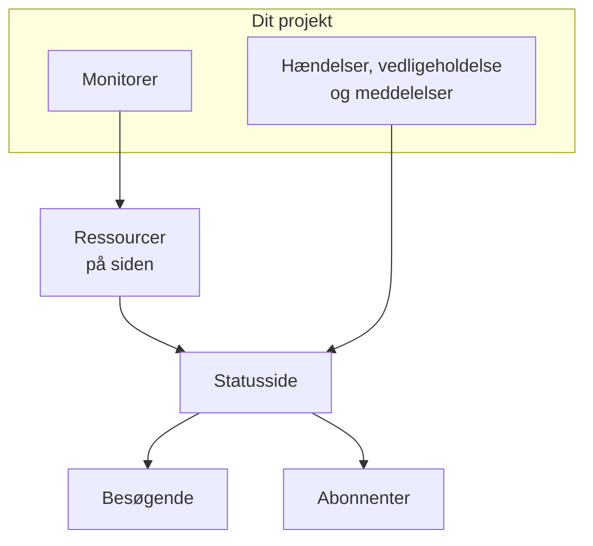

# Statussider – Oversigt

En statusside er det offentlige ansigt for alt, hvad du overvåger: én URL, som dine kunder kan åbne i stedet for at skrive til dig og spørge, om problemet kun er hos dem. Den viser den aktuelle status for de tjenester, du vælger at vise, de hændelser, du arbejder på, den vedligeholdelse, du har planlagt, og enhver meddelelse, du vil fastgøre øverst.

Når noget går i stykker klokken 2 om natten, er statussiden det første, din supportkø henviser til. Det er også derfra, dine abonnenter får besked, så det betaler sig at sætte den op, før du får brug for den, ikke midt i nedbruddet.

:::cards
- [Opret en statusside](#at-oprette-en-statusside): To felter for at komme i gang, alt det andet bagefter.
- [Vælg hvad den viser](#at-vælge-hvad-der-vises-på-siden): Hændelser, episoder, meddelelser, vedligeholdelse og oppetid, på ét kort.
- [Bestem hvem der må se den](#at-begrænse-hvem-der-må-se-siden): Alle med linket, kun personer, der logger ind, eller alle med adgangskoden.
- [Arkivér en statusside](#at-arkivere-en-statusside): Tag en side offline uden at slette den.
:::

## Sådan fungerer det

Statussider ligger under **Statussider** i menuen **Produkter** i den øverste bjælke, blandt de vigtigste. Alt på denne side gælder pr. statusside: et projekt kan have så mange, det vil — en offentlig til kunder, en privat til et internt publikum, en pr. region til et bestemt marked.

Siden viser de monitorer, du sætter på den, som ressourcer. Hændelser og planlagt vedligeholdelse når siden gennem de monitorer, og meddelelser offentliggøres direkte på den. Besøgende læser siden, og abonnenter får besked om hver ændring på de kanaler, de har valgt.

## Kort fortalt

- **Oprettes med to felter.** En ny statusside beder kun om **Navn** og **Beskrivelse**. Ressourcer, branding og domæner sætter du op bagefter.
- **Ressourcer er det, besøgende ser.** Hver række på siden er en **Statusside Ressource**: en monitor (eller monitorgruppe) med sit eget visningsnavn, værktøjstip og oppetidsindstillinger. Grupper deler en lang side op i sektioner og kan indlejres.
- **En forhåndsvisnings-URL fra første dag.** Hver statusside får et forhåndsvisningslink, så du kan se den, før der findes et brugerdefineret domæne.
- **Ruterne for besøgende afhænger af indstillinger.** Hændelser, episoder, meddelelser og planlagte begivenheder vises kun, så længe deres kontakt i **Hvad din statusside viser** (under **Avancerede indstillinger**) er slået til, og tilmeldingssiden kun, så længe **Vis abonnentside** er slået til.
- **Hvem der må se den, er ét valg.** Alle med linket, kun personer, der logger ind (private brugere, SAML- eller OIDC-SSO), eller alle med adgangskoden, på sidens skærm **Adgang**, med en valgfri IP-tilladelsesliste under **Yderligere indstillinger**.
- **Abonnenter får automatisk besked.** Abonnenter via e-mail, SMS, Slack, Microsoft Teams og webhook kan følge en side, hver kanal bag sin egen kontakt.

## Nøglebegreber

| Begreb | Hvad det betyder |
| --- | --- |
| **Statusside** | Én offentlig (eller privat) side med sin egen branding, sine egne domæner, ressourcer og abonnenter. Modellen `StatusPage`. |
| **Ressource** | Én række, som besøgende ser: en monitor eller monitorgruppe vist på siden med et visningsnavn og oppetidsindstillinger. |
| **Gruppe** | En navngivet sektion, der indeholder ressourcer. Grupper indlejres i grupper, og hvert niveau opsummerer status for alt under det. |
| **Meddelelse** | En besked, du offentliggør på en eller flere statussider, med et starttidspunkt og et valgfrit sluttidspunkt. |
| **Abonnent** | Nogen (eller noget), der følger siden via e-mail, SMS, Slack, Microsoft Teams eller en webhook. |
| **Brugerdefineret domæne** | Et domæne, du ejer, `status.example.com`, som peger på siden med en CNAME-post. OneUptime udsteder SSL-certifikatet til det gratis og fornyer det. |
| **Privat bruger** | En konto, der kan logge ind på en privat statusside. Adskilt fra brugerne i dit OneUptime-projekt. |

## At oprette en statusside

:::steps
### Åbn oprettelsesformularen

Åbn **Statussider → Alle statussider**, og klik på **Opret statusside**.

### Giv siden et navn

Udfyld **Navn** (påkrævet, mindst to tegn) i vinduet **Opret ny: Statusside** og, hvis du vil, **Beskrivelse**, og klik på **Opret statusside**.

Det er hele formularen. Listen, du kommer tilbage til, viser **Navn**, **Beskrivelse**, **Etiketter** og **Ejere** og kan filtreres efter **Statusside-ID**, **Navn** og **Beskrivelse**.

### Åbn den nye side

Åbn den nye side, og du lander på dens skærm **Oversigt**, som har to kort: **Status Page Preview URL** med et link til selve siden og **Statussidedetaljer**, hvor du kan redigere det navn, den beskrivelse og de etiketter, du lige har angivet. Når projektet har brugerdefinerede felter til statussider, følger et kort **Brugerdefinerede felter**.
:::

En side, der oprettes med API'et eller med Terraform, er underlagt de samme abonnementer som indstillingerne nedenfor. På OneUptime Cloud afvises oprettelsen af en side med en slået-til-indstilling, som dit abonnement ikke omfatter (for eksempel privat, en skjult liste, brugerdefineret HTML, CSS eller JavaScript, e-mailrapporter, abonnenter via SMS, Slack, Microsoft Teams eller webhook, en IP-tilladelsesliste), med `402 Payment Required`, og beskeden nævner abonnementet. Hver indstillings abonnement står ved indstillingen nedenfor. Indstillinger, der står på standard, som denne formular efterlader dem, virker på alle abonnementer.

Derefter, nogenlunde i rækkefølge efter nytte:

- Tilføj ressourcer, så siden viser noget: se [Statusside – ressourcer og grupper](/docs/status-pages/resources-and-groups).
- Angiv sidens titel, favicon, logo og forsidebillede, og tilknyt derefter et brugerdefineret domæne: se [Statusside – branding og domæner](/docs/status-pages/branding-and-domains).
- Bestem, hvilke kanaler folk kan abonnere på: se [Abonnenter og meddelelser](/docs/status-pages/subscribers).
- Finjustér, hvad der vises på siden, under **Avancerede indstillinger**.

## Hvor alting bor

Når du har åbnet en statusside, er dens egen venstremenu delt op i ni sektioner. Brug den som kort over resten af denne del af dokumentationen.

| Sektion | Hvad den indeholder |
| --- | --- |
| **Grundlæggende** | **Oversigt**, **Meddelelser**, **Ejere**. |
| **Ressourcer** | Én skærm **Ressourcer** (grupperne til venstre, den valgte gruppes monitorer til højre) og **Monitor Rules**. |
| **Abonnenter** | **E-mail-abonnenter**, **SMS-abonnenter**, **Slack-abonnenter**, **MS Teams-abonnenter**, **Webhook-abonnenter**, **Abonnementsindstillinger**. |
| **Notifikationslogs** | **Notifikationslogs**: hvad der er sendt til abonnenterne. |
| **Branding** | **Branding** (logo, titel, favicon, links, sidefod, farver og sprog, på én side), **Brugerdefinerede domæner**, **HTML, CSS og JavaScript**. |
| **Sikkerhed** | **Adgang** (hvem der må se siden), **Private brugere**, **SSO**, **OIDC**, **SCIM**. |
| **AI** | **MCP**. |
| **Udvikler** | **Terraform**, **API**, **AI-assistenter**: siden som kode. |
| **Avanceret** | **Indlejret status**, **Rapporter**, **Brugerdefinerede felter**, **Avancerede indstillinger**, **Auditlogs**, **Slet statusside**. |

Kun **Grundlæggende** og **Ressourcer**, det siden viser, starter åbne. Alle andre sektioner starter foldet sammen, ligesom de sjældent brugte sektioner i alle OneUptimes menuer: klik på en sektions titel for at vise dens sider. En sektion åbner af sig selv, når du er på en af dens sider, for eksempel **Avancerede indstillinger** eller **E-mail-abonnenter**.

To navneskikke, som er værd at kende, før du begynder at lede:

- Punktet **Ressourcer** hedder kun **Ressourcer**, når projektet har monitorgrupper slået til. Ellers hedder det **Monitorer**. Det er den samme skærm i begge tilfælde.
- Der er ingen separat gruppeside. Grupper og ressourcer er lagt sammen, og den gamle rute `/groups` omdirigerer nu til ressourceskærmen.

Uden for en bestemt side viser selve sektionen **Statussider** **Alle statussider**, og en sektion **Mere** indeholder **Meddelelser**. En sammenfoldet sektion **Indstillinger** indeholder **Meddelelsesskabeloner**, **Abonnementsskabeloner**, **Brugerdefinerede felter**, **Ejerregler** og **Etiketregler**, som gælder for hele projektet og deles af alle statussider. En sammenfoldet sektion **Avanceret** indeholder **Arkiveret**: de statussider, du har taget offline (se [Arkivér en statusside](#at-arkivere-en-statusside)).

**Etiketregler** og **Ejerregler** giver nye statussider etiketter og tildeler dem ejere. En regel har to trin (**Match**, de betingelser en statusside skal opfylde, og derefter **Etiketter** eller **Ejere**, det reglen tilføjer), og dens **Navn** udfyldes ud fra det, du vælger. En ny regel skal tilføje mindst én etiket eller ejer; når du redigerer, bliver der aldrig insisteret på det, og listen markerer en gammel regel, der ikke tilføjer noget, med **Tilføjer intet**. Se [Etiket- og ejerregler](/docs/configuration/label-and-owner-rules).

## Hvad besøgende ser

Den offentlige side er en applikation for sig, med et lille sæt ruter:

- `/`: **Oversigt**.
- `/incidents` og `/incidents/:id`: listen over hændelser og en enkelt hændelse.
- `/announcements` og `/announcements/:id`.
- `/scheduled-events` og `/scheduled-events/:id`.
- `/subscribe/email`, `/subscribe/sms`, `/subscribe/slack`, `/subscribe/microsoft-teams`, `/subscribe/webhooks`.
- `/confirm-subscription/:id`, `/update-subscription/:id` og `/unsubscribe/:token`: linkene i de beskeder, abonnenterne får.
- `/rss`: feedet.
- `/login`, `/sso` og `/master-password`: kun relevante på en privat side.

Navigationsbjælken øverst viser altid **Oversigt**; resten vises kun, når det er slået til. **Hændelser**, **Meddelelser** og **Planlagte hændelser** kræver hver deres kontakt; **Abonner** kræver både **Vis abonnentside** og mindst én slået-til abonnementskanal. En privat side har også et punkt **Log ud**.

En enkelt hændelse, episode, meddelelse eller planlagt begivenhed åbner kun, hvis siden ville vise den, uanset dens historikvindue: en privat hændelse eller episode, en, der er skjult på statussider, en planlagt begivenhed, der er skjult på statussider, eller en meddelelse, der er planlagt til senere, findes heller ikke via sit link.

### Oversigtssiden

Oversigten er den side, de fleste besøgende ser. Fra top til bund viser den:

1. **Igangværende meddelelser**: meddelelser, hvis starttidspunkt er passeret, og hvis sluttidspunkt ikke er.
2. **Et banner med den samlede status**: én linje, der opsummerer, om alle ressourcer er berørt eller kun nogle.
3. **En samlet oppetidsprocent**, hvis du har slået den til: i slutningen af banneret med den samlede status, så længe alle ressourcer er i drift. Slået fra som standard.
4. **Ressourcegrupperne**, hver med sine ressourcer, deres aktuelle status og deres bjælker med oppetidshistorik.
5. **Aktive hændelser**, med aktive episoder.
6. **Planlagte vedligeholdelseshændelser**.

En nyoprettet side uden indhold viser en tom tilstand, der beder dig tilføje ressourcer fra dashboardet — signalet til at gå til skærmen **Ressourcer**.

Den oversigt, en besøgende ser, er højst 15 sekunder gammel, og alt, hvad du fjerner fra siden, forsvinder fra den inden for et sekund: en hændelse, episode eller planlagt begivenhed, som du skjuler på statussider, gør privat, begrænser til andre sider eller sletter, en meddelelse, som du afslutter, udskyder eller sletter, en offentlig note, som du sletter, og en ressource, gruppe eller monitor, som du fjerner fra siden eller sletter. Andre ændringer, som en ny titel, vises inden for de 15 sekunder.

Hvad der sætter en hændelse på denne side, og hvad der fjerner den, kan du læse i [Hændelsestilstande og alvorsgrader](/docs/incidents/states-and-severities).

## At vælge hvad der vises på siden

Hvad besøgende ser, angives på ét kort: **Hvad din statusside viser** under **Statussider → din side → Avanceret → Avancerede indstillinger**. Det har en række for hver liste, siden kan vise, derefter **Oppetidshistorik** (med den samlede oppetidsprocent og de statusser, der tæller som nedetid) og linjen "Powered by OneUptime". Der er ingen redigeringsknap: en kontakt gemmes, så snart du slår den om, et antal dage, når du forlader feltet eller trykker på Enter, og et valg fra en liste, så snart du træffer det.

- **Vis hændelser** (`showIncidentsOnStatusPage`): slået til som standard. Under den bestemmer **Vis de seneste … dage** (`showIncidentHistoryInDays`, standard 14), hvor langt hændelseslisten går tilbage, og **Vis hændelsesetiketter** (`showIncidentLabelsOnStatusPage`) er slået fra som standard.
- **Vis kun hændelser, der er begrænset til denne side** (`onlyShowScopedIncidents`): også i hændelsesrækken, slået fra som standard. Slå den til, og siden viser, og underretter sine abonnenter om, kun de hændelser, der er begrænset til den med **Begræns til disse statussider**. Hændelser, der ikke er begrænset til nogen side, også dem, som en monitor, Slack, Microsoft Teams, API'et eller AI åbner af sig selv, når aldrig siden, før nogen tilføjer siden til dem. Den bestemmer også, hvilke hændelser der bringer deres episoder på siden, og derfor er den fortsat tilgængelig, når **Vis hændelser** er slået fra. For sider, der deler monitorer, men betjener forskellige målgrupper, se [Én statusside pr. målgruppe](/docs/status-pages/one-status-page-per-audience).
- **Vis episoder** (`showEpisodesOnStatusPage`): slået til som standard, med **Vis de seneste … dage** (`showEpisodeHistoryInDays`, standard 14) og **Vis episodeetiketter** (`showEpisodeLabelsOnStatusPage`, slået fra som standard). Episoder er en model for sig med egne endpoints, ikke en visning af hændelser.
- **Vis meddelelser** (`showAnnouncementsOnStatusPage`): slået til som standard, med **Vis de seneste … dage** (`showAnnouncementHistoryInDays`, standard 14).
- **Vis planlagte vedligeholdelsesbegivenheder** (`showScheduledMaintenanceEventsOnStatusPage`): slået til som standard, med **Vis de seneste … dage** (`showScheduledEventHistoryInDays`, standard 14) og **Vis begivenhedsetiketter** (`showScheduledEventLabelsOnStatusPage`, slået fra som standard).
- **Oppetidshistorik**: alt om sidens oppetid, i én række:
  - **Vis de seneste … dage** (`showUptimeHistoryInDays`) er længden af oppetidsbjælken ved hver ressource. Den er 90 som standard og skal være mellem 1 og 90. Alle en ressources eller gruppes indstillinger **Vis oppetid %** og **Vis statushistorikdiagram** læser dette tal, og det samme gør den samlede oppetidsprocent.
  - **Vis samlet oppetidsprocent** (`showOverallUptimePercentOnStatusPage`): slået fra som standard. Slå den til, og banneret med den samlede status slutter med en oppetidsprocent for hele siden, gennemsnittet af dens ressourcer og grupper, så længe alt er i drift. Mens den er slået til, vælger **Præcision** (`overallUptimePercentPrecision`), hvor mange decimaler den viser: `99%`, `99.9%`, `99.99%` (standard) eller `99.999%`. Hver ressource og hver gruppe har sin egen præcision.
  - **Tæller som nedetid** (`downtimeMonitorStatuses`): de monitorstatusser, hvis tid tæller imod hver oppetidsprocent på siden: hver ressources, hver gruppes og den samlede. Hver status er en etiket i sin egen farve. Tilføj en fra listen, eller fjern en med dens **×**, og ændringen gemmes med det samme. En ny statusside starter med alle projektets statusser, der ikke er i drift. Der er altid mindst én status tilbage: den sidste kan ikke fjernes, fordi uden nogen ville al oppetid på siden vise 100%.
- **Vis "Powered By OneUptime"-branding**: slået til som standard, så sidefoden for besøgende siger "Powered by OneUptime". Slå den fra for at skjule linjen. Kolonnen gemmer det omvendt, som `hidePoweredByOneUptimeBranding`.

**En slået-fra liste** forsvinder fra siden sammen med sit punkt i navigationsbjælken, hvis den har et; dens offentlige endpoint afviser forespørgslen, og sidens abonnenter får ikke besked om den slags begivenhed. Dens række viser så kun dens kontakt: hvor langt en skjult liste går tilbage, og om den viser etiketter, ændrer intet.

**Abonnementer.** På OneUptime Cloud viser en indstilling, som dit abonnement ikke kan ændre, det abonnement, den kræver, ved siden af. De fire listekontakter, de tre etiketkontakter og episodernes historik kræver **Growth**; at vise den samlede oppetidsprocent og at skjule linjen "Powered by OneUptime" kræver **Scale**. De andre historikvinduer, **Oppetidshistorik**, **Præcision**, **Tæller som nedetid** og **Vis kun hændelser, der er begrænset til denne side** kan ændres på alle abonnementer, og hver af dem gemmes for sig: en side, hvis samlede oppetidsprocent allerede er slået til, kan ændre dens præcision på ethvert abonnement. At sætte en indstilling tilbage til, som den er på en ny side (vise en liste igen, skjule etiketterne eller den samlede oppetidsprocent, vise linjen "Powered by OneUptime", sætte episodernes historik tilbage til 14 dage), virker på alle abonnementer, så intet, som en prøveperiode ændrede, bliver hængende for mangel på abonnement: kontakten siger, at den stadig kan gå tilbage, og hvilket abonnement der skal til for at ændre den igen.

Om siden viser et punkt **Abonner** (**Vis abonnentside**, `showSubscriberPageOnStatusPage`, slået til som standard), og hvilke kanaler besøgende kan abonnere på, angives ikke på denne skærm: begge dele står på kortet **Kanaler** under **Abonnenter → Abonnementsindstillinger** (se [Abonnementskanaler](/docs/status-pages/subscribers#abonnementskanaler)).

Under kortet står **Eksportér Statusside som JSON**, der downloader statussidens egne indstillinger til en fil, du kan importere igen, og **Archive status page** (se [Arkivér en statusside](#at-arkivere-en-statusside)). Den samlede oppetidsprocent og nedetidsstatusserne var tidligere to selvstændige kort her, hver bag en knap **Rediger**; nu er de rækker på kortet.

**Hvor farverne er.** Oppetidsbjælkernes farver er ikke her: **Standardbjælkefarve** og farvereglerne for bjælkerne ligger under **Yderligere indstillinger** i **Statussider → din side → Branding → Branding**. Der findes ingen indstilling for tema eller brandfarve nogen steder; alt ud over disse kontroller klarer du med **Brugerdefineret CSS**.

## At se siden an, før du går live

Skærmen **Oversigt** for hver statusside har et kort **Status Page Preview URL** med et direkte link til siden. Brug det, mens du stadig tilføjer ressourcer, og før der findes et brugerdefineret domæne.

Bag kulisserne har hver offentlig rute en forhåndsvisningstvilling under `/status-page/{statusPageId}/...`: en forhåndsvist oversigt, en forhåndsvist hændelsesliste, en forhåndsvist tilmeldingsside og så videre. En URL eller et skærmbillede taget fra dashboardets forhåndsvisning svarer derfor ikke til det, en kunde ser, når et brugerdefineret domæne er tilknyttet, så tjek alle links, du indsætter i en runbook eller en e-mail.

## At begrænse hvem der må se siden

Ikke alle statussider er til offentligheden. Hvem der må se en side, er ét valg, det første kort på **Statussider → din side → Sikkerhed → Adgang**, **Hvem der kan se denne statusside**:

- **Alle med linket**: siden er offentlig. Alle nye statussider starter her.
- **Kun personer, der logger ind**: besøgende lander på `/login` og logger ind som privat bruger eller med din SSO- eller OIDC-udbyder (se nedenfor). Under valget viser kortet den login-opsætning, siden har (hvor mange private brugere den har, og om SSO og OIDC er slået til, hver med et link til sin skærm), og advarer, så længe dette er valget, når ingen endnu kan logge ind.
- **Alle med adgangskoden**: besøgende lander på `/master-password` og låser siden op med en adgangskode, du deler med dem. Ingen behøver en konto. Når du vælger det, beder samme dialog om adgangskoden, hvis siden ikke har en; har den allerede en, kan du beholde den eller skrive en ny. Bagefter erstatter **Skift adgangskode** under valget den. Adgangskoden gemmes som hash og kan ikke vises igen, og dem, der har indtastet den gamle, kan blive ved med at se siden i op til 7 dage.

Et valg beder om bekræftelse og siger, hvad der ændrer sig for besøgende, og gemmes med det samme. Der er ingen redigeringsknap.

**Billeder.** Et billede i det, siden viser (en offentlig note, en meddelelse, en beskrivelse), åbner på sin egen lange adresse, som ikke kan gættes, og som virker uden login, så e-mails til dine abonnenter også kan vise det. Selve siden kræver stadig login eller adgangskoden.

**Hvad der gemmes.** Valget består af tre kolonner, som API'et og Terraform læser og skriver som før: `isPublicStatusPage`, `enableMasterPassword` og `masterPassword`. Besøgende bliver kun bedt om adgangskoden på en side, der ikke er offentlig, med `enableMasterPassword` slået til og en adgangskode angivet; en privat side med kontakten slået til, men uden adgangskode, er en login-side. At vælge **Alle med linket** slår også `enableMasterPassword` fra, fordi en offentlig side aldrig beder om den. Skærmen **Adgang** skriver kun de kolonner, et valg ændrer.

**Abonnementer.** På OneUptime Cloud kræver det abonnementet **Growth** at gøre en side privat: på et lavere abonnement viser de to private valg det abonnement, de kræver, og kan ikke vælges. At gøre den offentlig igen (**Alle med linket**) virker på alle abonnementer, så en side, der blev efterladt privat, da en prøveperiode sluttede, eller efter et skift til et lavere abonnement, altid kan åbnes igen; dialogen siger, at det kræver **Growth** at gøre den privat igen. At skifte fra **Kun personer, der logger ind** til **Alle med adgangskoden** virker på alle abonnementer, ligesom **Skift adgangskode**.

### Private brugere

Tilføj de personer, der må logge ind, under **Statussider → din side → Sikkerhed → Private brugere**. Der er en handling **Tilføj i bulk**: indsæt en liste med e-mailadresser, og hver adresse får en invitationsmail. Private brugere har deres eget forløb for glemt adgangskode og nulstilling, adskilt fra kontiene i dit OneUptime-projekt.

**Private brugere og adgangskoden lægges ikke sammen.** Så længe **Alle med adgangskoden** er valget, kan private brugere ikke logge ind (de indtaster også adgangskoden), og skærmen **Private brugere** siger det, med et link tilbage til **Adgang**.

### SSO og OIDC

For en privat side, der er koblet til din identitetsudbyder, sætter **Statussider → din side → Sikkerhed → SSO** SAML op: du indtaster login-URL'en, udstederen og x509-certifikatet, og signerings- og digest-metoderne udfyldes under **Flere felter**. **Statussider → din side → Sikkerhed → OIDC** sætter OpenID Connect op: du indtaster udstederen, klient-id'et og hemmeligheden, og discovery-URL'en, scopes og claim-navnene udfyldes under **Flere felter**. **SCIM** opretter automatisk private brugere fra IdP'en. På OneUptime Cloud kræver alle tre abonnementet Scale eller højere. I en selvhostet installation er SSO og OIDC en del af alle udgaver, og SCIM kræver [Enterprise Edition](/docs/self-hosted/enterprise).

At slå en statussides SSO- eller OIDC-udbyder fra eller slette den logger de private brugere ud, som den har logget ind: deres sessioner slutter ved deres næste forespørgsel, og at slå udbyderen til igen bringer dem ikke tilbage; de logger ind gennem den igen. Et nyt certifikat eller en ny klienthemmelighed, andre URL'er eller et nyt navn holder alle logget ind. På en side, der kræver SSO, låser det alle ude at slå dens sidste udbyder fra, indtil du slår en til igen eller slår **Kræv SSO til login** fra; for at skifte til en anden udbyder skal du sætte den nye op og teste den, før du slår den gamle fra.

Under udbyderne indeholder kortet **SSO-indstillinger** kontakten **Kræv SSO til login** (`requireSsoForLogin`, slået fra som standard), som gemmes, så snart du slår den om. At slå den til beder først om bekræftelse, fordi private brugere derefter ikke kan logge ind med e-mail og adgangskode: kun de personer, din SSO- eller OIDC-udbyder lukker ind, kan se siden. Test SSO med linket på den skærm, før du slår den til. Den har kun betydning, så længe **Kun personer, der logger ind** er valget, og skærmen **Adgang** viser den som **SSO påkrævet** under det valg. Mens den er slået til, bliver en privat bruger, der loggede ind med e-mail og adgangskode, også logget ud ved sin næste forespørgsel: kun sessioner, som en SSO- eller OIDC-udbyder har startet, tæller. På OneUptime Cloud kræver det abonnementet **Scale** at slå den til, og at slå den fra virker på alle abonnementer. En side, der stadig kræver SSO, efter at en prøveperiode med Scale er slut, eller efter et skift til et lavere abonnement, bliver ved med det, indtil nogen slår det fra: dens sider **SSO** og **OIDC** viser kontakten til det under abonnementstilbuddet.

### IP-tilladelsesliste

Under **Yderligere indstillinger** på **Adgang** begrænser sektionen **IP-tilladelsesliste** (kolonnen `ipWhitelist`) en side til kendte netværk. Den gælder uanset sidens publikum: en besøgende fra enhver anden adresse afvises, også med adgangskoden eller en konto som privat bruger. Skriv én post pr. linje: en IPv4- eller IPv6-adresse eller et IPv4-interval som `10.0.0.0/8`; en linje, der ikke er nogen af delene, afvises, når du gemmer. Lad den være tom for at tillade alle adresser. Mens listen gælder, viser den sammenfoldede overskrift **Yderligere indstillinger** **IP-tilladelsesliste** med antallet af poster i den. På OneUptime Cloud kræver det abonnementet **Scale** at ændre den; at tømme den virker på alle abonnementer.

## Det indlejrbare mærke og RSS-feedet

To måder at vise status andre steder end på selve siden.

**Indlejret statusmærke.** Under **Statussider → din side → Avanceret → Indlejret status** slår du **Aktivér indlejret statusmærke** til (`enableEmbeddedOverallStatus`, slået fra som standard) og klikker derefter på **Regenerer token** på kortet **Sikkerhedstoken** for at give mærket sit token (`embeddedOverallStatusToken`). Mærket leveres fra `/api/status-page/badge/<status-page-id>?token=<token>`, og skærmen viser det i **Badge-forhåndsvisning** med uddrag, du kan kopiere, så du kan sætte den aktuelle samlede status ind i din dokumentation, din apps sidefod eller en markedsføringsside.

**RSS-feed.** Hver statusside leverer `/rss`: et feed med titlen "{sidetitel} Updates", med den **Sidetitel**, der er angivet under **Branding**, eller sidens navn, hvis den ikke har nogen, og hvis elementer begynder med `Incident: `, `Announcement: ` og `Scheduled Maintenance: `. Nyttigt for dem, der hellere vil trække dine opdateringer ind i en feedlæser eller en chatbot end abonnere via e-mail.

Hvis du hellere vil hente dataene selv, bygger statussiden på offentlige læse-endpoints for oversigten, hændelserne, de planlagte vedligeholdelsesbegivenheder, meddelelserne og episoderne: se [Offentlig API](/docs/status-pages/public-api).

## At arkivere en statusside

Arkivér en statusside for at tage den offline uden at slette den. En arkiveret statusside:

- **Er offline.** Dens URL, dens brugerdefinerede domæner, dens indlejrede mærke, dens offentlige API og dens MCP-server svarer, som om siden ikke fandtes ("Status Page not found"), så en besøgende ikke kan skelne en arkiveret side fra en, der aldrig har eksisteret. Dashboardets forhåndsvisningslink holder også op med at virke.
- **Sender intet til sine abonnenter.** Ingen notifikationer om hændelser, episoder, vedligeholdelse eller meddelelser, ingen rapporter og ingen abonnementsbekræftelser. Ingen kan abonnere på den.
- **Forsvinder fra listen over statussider.** Du finder den under **Statussider → Avanceret → Arkiveret**.
- **Beholder alt.** Dens ressourcer, grupper, branding, domæner, private brugere og abonnenter bevares, så når du fjerner den fra arkivet, kommer siden online igen præcis, som den var.

For at arkivere en statusside åbner du den og går til **Avanceret → Avancerede indstillinger → Archive status page**. For at arkivere flere vælger du dem i listen **Statussider** og vælger **Arkiver**. For at få en tilbage åbner du **Statussider → Avanceret → Arkiveret**, vælger den og vælger **Fjern fra arkiv**, eller du åbner den og klikker på **Fjern fra arkiv** i banneret øverst på dens sider.

## Næste trin

:::cards
- [Statusside – ressourcer og grupper](/docs/status-pages/resources-and-groups): Sæt monitorer på siden, og organisér dem i sektioner.
- [Statusside – branding og domæner](/docs/status-pages/branding-and-domains): Dit logo og dine farver, og siden på dit eget domæne.
- [Abonnenter og meddelelser](/docs/status-pages/subscribers): De fem abonnementskanaler og offentliggørelse af meddelelser.
- [Én statusside pr. målgruppe](/docs/status-pages/one-status-page-per-audience): En side pr. kunde, lokation eller region, og hvilke der får besked om hver hændelse.
:::
