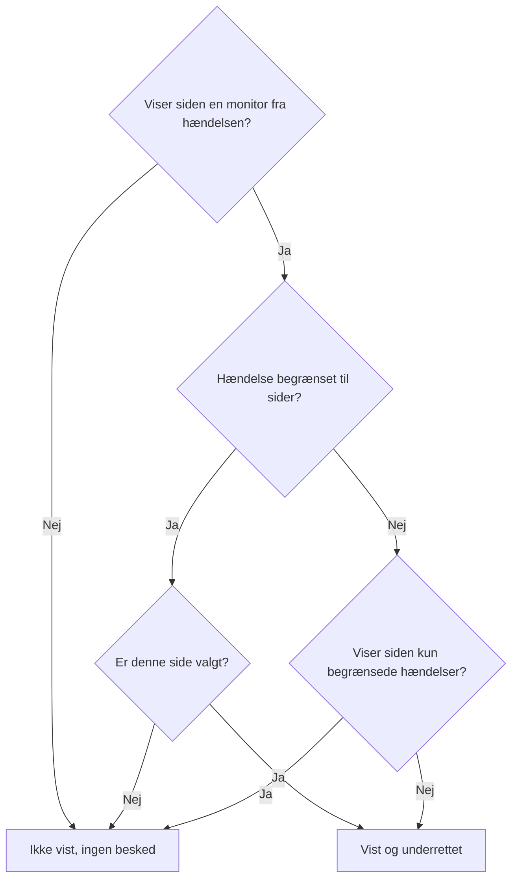

# Én statusside pr. målgruppe

Forskellige mennesker har brug for forskellige nyheder. En kunde vil ikke høre om en anden kundes nedbrud, og personalet på én lokation vil ikke have en e-mail, hver gang en anden lokation mister sit netværk. I OneUptime er enheden for en målgruppe statussiden: hver side har sine egne abonnenter, sin egen branding og sit eget privatliv. Så giv hver målgruppe sin egen side, og beslut hændelse for hændelse, hvilke sider der hører om den.

Delt infrastruktur gjorde det svært. En hændelse når en statusside gennem sine monitorer, så en monitor, der blev delt af ti lokationssider, fortalte alle ti lokationer om et nedbrud, der ramte to. Den eneste løsning var en side, eller en monitor, for hver kombination af lokationer. Denne side dækker de indstillinger, der løser det:

- **Begræns til disse statussider** på en hændelse, så den vises på, og giver besked til, kun de sider, du vælger.
- **Vis kun hændelser, der er begrænset til denne side** på en statusside, så en hændelse, som ingen har begrænset endnu, ikke når nogen af disse sider, før nogen beslutter det. Det gælder også de hændelser, som en monitor, Slack, Microsoft Teams, API'et eller AI åbner af sig selv.
- En registrering af, hvilke sider der fik at vide, at en hændelse blev oprettet, så en side, du tilføjer senere, får besked én gang, og de andre ikke får besked igen.
- En oversigt **Underretter**, der viser, hvem der hører om en hændelse, før du erklærer den eller offentliggør en offentlig note, og **Forhåndsvisning**, der viser, hvad hver sides abonnenter får.

:::cards
- [Sæt det op](#opsætning-af-én-side-pr-målgruppe): En side pr. målgruppe og den kontakt, der holder hændelser uden begrænsning væk fra dem.
- [Begræns en hændelse](#begræns-en-hændelse-til-statussider): Vælg siderne, når du erklærer den, eller senere.
- [Tilføj eller fjern sider](#tilføjelse-og-fjernelse-af-statussider): Hvem der får besked om en side, du tilføjer, og hvad det trækker tilbage at fjerne en.
- [Hvad hver besked indeholder](#hvad-hver-besked-indeholder): De værdier, hver side får, og hvad de fortæller hver målgruppe.
:::

## Hvornår du skal bruge det

- **En managed service provider** med en statusside pr. kunde, på monitorer, som kunderne deler.
- **En organisation med lokationer, fabrikker eller regioner**, hver med sit eget personale, der skal have besked.
- **Intern IT** med en side pr. afdeling eller bygning.

Hvis din målgruppe gerne vælger selv, kan én side være nok: lad abonnenterne vælge de ressourcer, de interesserer sig for (se [Abonnenter og meddelelser](/docs/status-pages/subscribers)). Brug en side pr. målgruppe, når du træffer valget for dem, hændelse for hændelse, eller når én målgruppe slet ikke må se en anden målgruppes hændelser.

## Sådan når en hændelse en statusside

En hændelse når en statusside gennem sine monitorer. En side viser en hændelse og giver sine abonnenter besked om den, når en af sidens ressourcer er en af hændelsens monitorer, direkte eller gennem en monitorgruppe på siden. To indstillinger indsnævrer det:

- **Begræns til disse statussider** på hændelsen (`statusPages`). Lades den være tom, når hændelsen hver side, der viser dens monitorer, som den altid har gjort. Med valgte sider når den kun de valgte sider **blandt** dem, der viser dens monitorer.
- **Vis kun hændelser, der er begrænset til denne side** på statussiden (`onlyShowScopedIncidents`, slået fra som standard). Med den slået til viser siden aldrig en hændelse, der ikke er begrænset til bestemte statussider, og giver aldrig nogen besked om den.



For en side, der viser en af hændelsens monitorer:

| Hændelsen er | Side med **Vis kun hændelser, der er begrænset til denne side** slået fra | Side med den slået til |
| --- | --- | --- |
| Ikke begrænset til nogen statusside | Vist og underrettet | Ikke vist, ingen besked |
| Begrænset til statussider, og denne side er valgt | Vist og underrettet | Vist og underrettet |
| Begrænset til statussider, men ikke denne | Ikke vist, ingen besked | Ikke vist, ingen besked |

En side, der ikke viser nogen af hændelsens monitorer, viser den aldrig, uanset hvad du vælger, og en hændelse uden monitorer giver ingen statussideabonnenter besked overhovedet. De sædvanlige regler gælder stadig oveni: hændelsen skal være **Synlig på statussiden** og ikke privat, siden skal have **Vis hændelser** slået til, og en abonnent, der kun valgte nogle ressourcer eller begivenhedstyper, får kun det, vedkommende valgte.

De samme regler bestemmer alt, der afhænger af, hvilke sider en hændelse når:

- hændelseslisterne, oversigten og hændelsens egen side på den offentlige statusside og statussidens [Offentlig API](/docs/status-pages/public-api);
- de beskeder via e-mail, SMS, Slack, Microsoft Teams og webhook, der sendes, når hændelsen oprettes, skifter tilstand, får en offentlig note eller får en postmortem;
- antallet af hændelser i statussiderapporter, der sendes via e-mail, og som kun tæller de hændelser, siden viser.

En hændelsesepisode når en side, når mindst én af dens hændelser gør det. Dens notifikationer går til hver side, dens hændelser når, og dens side på en statusside, som ingen af dem når, findes ikke. En privat hændelse når ingen side, så den bringer aldrig sin episode ind på en, og en privat episode vises slet ikke på nogen side.

## Opsætning af én side pr. målgruppe

:::steps
### Opret en statusside for hver målgruppe

Opret én side pr. målgruppe, for eksempel `Site 01` til `Site 10`. Gør dem private, hvis målgruppen er intern (se [At begrænse hvem der må se siden](/docs/status-pages/index#at-begrænse-hvem-der-må-se-siden)). Abonnenter på en privat side kan stadig afmelde sig uden at logge ind, via linket i hver besked (se [Administrer og opsig et abonnement](/docs/status-pages/subscribers#administrer-og-opsig-et-abonnement)). Giv dem etiketter som `Region East`, så vælgeren kan tilføje alle sider med en etiket med ét klik.

### Sæt den delte monitor på hver side

Tilføj den delte monitor til hver side som en ressource (se [Statusside – ressourcer og grupper](/docs/status-pages/resources-and-groups)). En regel under **Ressourcer → Monitor Rules** kan gøre det for dig ud fra monitorens etiketter.

### Slå Vis kun hændelser, der er begrænset til denne side til

Slå den til på hver af de sider. Den står på kortet **Hvad din statusside viser** under **Statussider → din side → Avanceret → Avancerede indstillinger**, under **Vis hændelser**, og gemmes i det øjeblik, du slår den om. Fra da af når intet en lokations side, medmindre nogen vælger den.

### Tilføj hver målgruppes abonnenter

For personale skal du bruge **Tilføj i bulk** under **E-mail-abonnenter** og foretrække hver persons egen adresse frem for en mailingliste som `site03-all@`: alle på listen kan afmelde den for alle på den. Hvis en abonnent, du har tilføjet, afmelder sig, får sidens ejere og den, der tilføjede vedkommende, en e-mail (se [Delte adresser og mailinglister](/docs/status-pages/subscribers#delte-adresser-og-mailinglister)).

### Lad dem, der håndterer hændelser, læse statussider

Vælgeren viser kun de statussider, personen kan læse, og hændelsesrollerne kan ikke læse statussider. Giv dem, der håndterer hændelser, rollen **Status Page Viewer** ved siden af deres hændelsesrolle; den kan begrænses til sider med bestemte etiketter. Uden den er vælgeren tom.

### Bestem, hvad hver besked siger

Under **Hændelser → Indstillinger → Brugerdefinerede felter** definerer du de brugerdefinerede hændelsesfelter, dit team svarer på hver gang, for eksempel `Impact` (en rulleliste), `Expected Resolution` (en dato og et klokkeslæt) og `Acknowledgement` (en ja/nej-kontakt). Træk dem i den **Rækkefølge**, du vil have dem spurgt om og vist i, og slå **Vis ved oprettelse** til, så erklæringsformularen spørger om dem, **Påkrævet ved oprettelse**, hvor et svar er et must, og **Medtag i abonnentnotifikationer** for dem, som alle målgrupper må læse. De står så i hver sides standard-e-mail. Se [Brugerdefinerede felter](/docs/incidents/settings#brugerdefinerede-felter).

### Giv hver sides e-mail sin egen branding (valgfrit)

På abonnementet **Scale** giver du hver side en **Brugerdefineret SMTP-konfiguration** og knytter brugerdefinerede skabeloner til hændelsesbegivenhederne; de kan placere ethvert felt med `{{incident.customFields.<key>}}`. Mens du skriver en skabelon, viser **Live-eksempel** under den skabelonen udfyldt med eksempelværdier. Se [Hvad en brugerdefineret skabelon kræver](/docs/status-pages/subscribers#hvad-en-brugerdefineret-skabelon-kræver) og [Hvad hver besked indeholder](#hvad-hver-besked-indeholder), før du bruger `{{affectedStatusPages}}`.

### Gem hændelsesskabeloner med valgte sider (valgfrit)

En skabelon `Region East outage` kan have siderne for lokationerne i øst og standardsvar til de brugerdefinerede felter.

### Tjek hver sides e-mail før det første nedbrud

Start **Erklær hændelse** med den delte monitor og to af lokationssiderne valgt, og åbn **Forhåndsvisning** ved siden af **Ja** i oversigten, før du indsender: den viser den e-mail, hver sides abonnenter ville få, og hvilken skabelon den bruger og hvorfor. **Send test til mig** sender en til din egen indbakke. Ingen andre får noget, før du erklærer hændelsen, så forlad formularen uden at indsende den, når du er færdig. Se [Hvem der får besked](#hvem-der-får-besked).
:::

## Begræns en hændelse til statussider

### Når du erklærer den

På **Hændelser → Alle hændelser → Erklær hændelse** har trinnet **Berørte ressourcer** feltet **Begræns til disse statussider** under **Flere felter**, efter monitorerne og de andre ressourcer. Dets eksempeltekst, **Alle statussider, der viser monitorerne**, er det, det betyder at lade det være tomt. Vælg sider efter navn, eller åbn vælgerens fane **Etiketter**, og vælg en etiket for at tilføje alle sider, der har den.

Formularen advarer dig:

- når en valgt side ikke viser nogen af hændelsens monitorer, eller der slet ikke er knyttet nogen monitor. Hændelsen vil ikke blive vist på den side eller give dens abonnenter besked;
- når du også angiver **Skift overvågningsstatus til**, lige under monitorerne på samme trin. Se [Monitorstatus er delt](#monitorstatus-er-delt);
- når du også sætter kryds ved **Privat hændelse** under **Flere felter** på trinnet **Hændelsesdetaljer**. Private hændelser er skjult på alle statussider, også dem, du valgte.

Trinnet **Detaljer**, lige efter **Berørte ressourcer**, spørger om de brugerdefinerede hændelsesfelter, der er markeret med **Vis ved oprettelse** (se [Opret en hændelse](/docs/incidents/declaring-incidents)). Svarene går til hver side, hændelsen når: værdier i brugerdefinerede felter hører til hændelsen, ikke til en statusside.

**Opret fra skabelon** udfylder feltet fra skabelonen. En skabelons sider angives på dens trin **Berørte ressourcer**, når du opretter den, og bagefter på dens kort **Statussideomfang** (**Hændelser → Indstillinger → Hændelsesskabeloner**). Som med de andre skabelonfelter vinder en liste, du selv angiver. En skabelons sider udfyldes også for en, der håndterer hændelser og ikke kan læse statussider: den, der satte skabelonen op, valgte dem for alle, der erklærer ud fra den.

### Hvem der får besked

Under **Underret statussideabonnenter**, lige under vælgeren under **Flere felter** på trinnet **Berørte ressourcer**, og igen i oversigten, før du indsender, viser formularen, hvem hændelsen vil nå:

> Underretter:
>
> - Site 03 (op til 41 via e-mail)
> - Site 07 (op til 18 via e-mail)

Under det, under **Underrettes ikke:**, viser den de sider, der viser monitorerne, men ikke får besked, og hvorfor: den er ikke en af de sider, hændelsen er begrænset til, det er en side, der kun viser hændelser, der er begrænset til den, eller det er en side, der ikke viser hændelser.

Når ingen får besked, viser oversigten intet: hændelsen har ingen monitorer, ingen statusside viser dem, siderne har endnu ingen abonnenter, **Underret statussideabonnenter** er slået fra, eller hændelsen er privat. Den advarer kun, når statussideomfanget er årsagen, og nævner de sider, den udelader: hændelsen er ikke begrænset, og de sider, der viser dens monitorer, viser kun hændelser, der er begrænset til dem, den er begrænset til andre sider, eller de sider, den er begrænset til, viser ingen af dens monitorer. I oversigten lyder **Underret statussideabonnenter** **Ja** eller **Nej** ligesom alle andre felter, med **Forhåndsvisning** ved siden af **Ja**; den tilbydes ikke, mens feltet er slået fra, hændelsen er privat, eller der ikke er knyttet nogen monitor.

Den samme oversigt vises under **Underret statussideabonnenter**, når du skriver en note på hændelsens side **Offentlige noter**, for hændelsen, som den står. Der siger den også, når hændelsen er skjult på statussider, da intet vil blive sendt i så fald.

Antallene er "op til". De tæller pr. kanal de bekræftede abonnenter på hver side, der ikke har afmeldt sig, og en abonnent, der kun valgte nogle ressourcer eller begivenhedstyper, får måske ikke denne besked. Sider, du ikke kan læse, nævnes ikke. De tælles som "statussider mere, som du ikke har adgang til".

**Forhåndsvisning** ved siden af **Ja** i oversigten og ved siden af notens afkrydsningsfelt viser, hvad de vil få: vælg en side for at se dens e-mail, som dens abonnenter vil modtage den, med emnet, og hvilken skabelon den bruger og hvorfor, for eksempel at en sides brugerdefinerede skabelon ikke bruges, fordi siden ikke har nogen **Brugerdefineret SMTP-konfiguration**. **Send test til mig** sender sidens e-mail til din kontos e-mailadresse og til ingen andre. Sider, du ikke kan læse, tælles, men forhåndsvises ikke. Se [Forhåndsvis e-mailen, før den sendes](/docs/status-pages/subscribers#forhåndsvis-e-mailen-før-den-sendes).

### Efter at den er erklæret

Åbn hændelsen, og gå til **Avanceret → Indstillinger**. Kortet **Statussideomfang** viser de sider, hændelsen er begrænset til, og **Rediger statussideomfang** ændrer dem. Hændelsens **Oversigt** viser den samme liste som **Statussideomfang**, skrivebeskyttet, med et link **Skift under Indstillinger**.

På **Hændelser → Alle hændelser** finder filteret **Statusside** de hændelser, der er begrænset til de sider, du vælger, eller dem, der ikke er begrænset til nogen side.

### Via API'et

`statusPages` er en liste over statusside-id'er, på `POST /api/incident` og ved opdateringer af en hændelse samt på hændelsesskabeloner. Hver side skal tilhøre hændelsens projekt; en side fra et andet projekt afvises. Hver side, du tilføjer, skal også være en, du kan læse, som i vælgeren, ellers afvises forespørgslen. Sider, som hændelsen eller skabelonen allerede har, bevares, uanset om du kan læse dem, og en side fra en hændelsesskabelon, du kan læse, kan vælges, når du erklærer en hændelse. To kolonner mere følger af det, og ingen af dem er dine at angive:

- `isScopedToStatusPages` udledes af `statusPages`. Alt, hvad du sender til den, ignoreres.
- `statusPagesNotifiedOnCreation` er registreringen af de sider, der fik at vide, at hændelsen blev oprettet. Se [Tilføjelse af statussider](#tilføjelse-af-statussider).

For at se, hvem en hændelse ville nå, uden at sende noget, kalder du målgruppe-endpointet:

```bash
curl -X POST https://oneuptime.com/api/incident/subscriber-audience \
  -H "apikey: $ONEUPTIME_API_KEY" \
  -H "Content-Type: application/json" \
  -d '{
    "monitorIds": ["<monitor-id>"],
    "statusPageIds": ["<status-page-id>"]
  }'
```

Send i stedet `{"incidentId": "<incident-id>"}` for en hændelse, der allerede findes. Svaret viser hver side, der vil få besked, med et antal pr. kanal (`email`, `sms`, `slack`, `microsoftTeams`, `webhook`), de sider, der er udeladt, og hvorfor, og `hiddenStatusPageCount` for de sider, kalderen ikke kan læse. Det returnerer aldrig en adresse.

## Hændelser, som ingen har begrænset endnu

Monitorkriterier, Slack, Microsoft Teams, API'et og AI kan alle åbne en hændelse af sig selv, og ingen af dem ved, hvilke lokationer en fejl på en delt monitor rammer. En sådan hændelse er ikke begrænset til nogen side, så hver side, der viser monitoren, ville vise den og give sine abonnenter besked inden for cirka et minut. Når en abonnent først har fået en e-mail, kan den ikke tages tilbage.

**Vis kun hændelser, der er begrænset til denne side** er det, der stopper det. En side med den slået til ignorerer hver hændelse uden begrænsning. Hændelsen åbnes stadig, vagtpolitikkerne tilkalder stadig dem, der håndterer hændelser, og dens ejere får stadig besked, men ingen af disse sider hører om den. Den, der håndterer hændelsen, finder så ud af, hvem der er ramt, og tilføjer de sider på hændelsens fane **Indstillinger**, med kryds ved **Send meddelelsen om oprettet hændelse til nyligt tilføjede sider**. Deres abonnenter får besked inden for cirka et minut.

## Tilføjelse og fjernelse af statussider

### Tilføjelse af statussider

Abonnenterne på en side hører én gang, at en hændelse blev oprettet. Så når du tilføjer sider på kortet **Statussideomfang**, tilbyder redigeringsformularen **Send meddelelsen om oprettet hændelse til nyligt tilføjede sider**, med kryds som standard:

- Med kryds sættes hændelsens notifikation om "oprettet" i kø igen, og den går kun til de sider, der endnu ikke har fået besked. Hændelsen holder en registrering af de sider, der fik besked, så de andre ikke hører det to gange.
- Uden kryds begynder de tilføjede sider at vise hændelsen og hører om alt fra nu af, men får ikke at vide, at den blev oprettet.

Afkrydsningsfeltet vises kun, når et kryds ville sende noget: mindst én side, du tilføjer, har endnu ikke fået besked, og hændelsen blev erklæret med **Underret statussideabonnenter** slået til, er synlig på statussider og er ikke privat. Nogle tilfælde håndteres for dig:

- **Notifikationen står stadig i kø eller sendes lige nu.** En afsendelse i kø læser siderne, når den går ud, og en afsendelse, der kører, læser dem igen, når den er færdig, og giver så de sider, der blev tilføjet imens, besked. Så der er intet afkrydsningsfelt: de sider, du tilføjer, får besked under alle omstændigheder. (Hvis den afsendelse mislykkes, er de sider, der blev tilføjet imens, blandt dem, dens **Prøv igen** sender til.)
- **Hver side, du tilføjer, har allerede fået besked**, for eksempel en side, du fjernede og tilføjer igen, eller en hændelse, der nåede alle lokationer og nu er indsnævret til to af dem. Ingen får besked igen, så der er intet afkrydsningsfelt.
- **Hændelsen blev aldrig annonceret.** Når den blev offentliggjort uden **Underret abonnenter om, at denne hændelse er oprettet**, eller erklæret uden monitorer, fik ingen besked. Et kryds i feltet giver kun de sider, du tilføjer, besked, ikke de sider, den allerede var begrænset til.
- **Hændelsen blev erklæret, før denne funktion blev udgivet.** Dens notifikation om "oprettet" gik til hver side, der viste dens monitorer, og der er ingen registrering af de sider. At tilføje sider sender den ikke igen, så afkrydsningsfeltet tilbydes ikke.
- **Hændelsen er skjult.** Intet sendes, mens den er skjult. Når du slår **Synlig på statussiden** til igen, tilbyder kortet **Hændelsesindstillinger** **Underret abonnenter om, at denne hændelse er oprettet** for de sider i dens omfang, der aldrig fik besked, som dem, der blev tilføjet, mens den var skjult.

En side, der tilføjes senere, hører om det, der sker bagefter: senere offentlige noter, tilstandsændringer og postmortem'en. Den får ikke tilsendt de noter og tilstandsændringer, der blev sendt, før den blev tilføjet. Hvis den skal indhente noget, så offentliggør en offentlig note.

Den samme registrering får **Prøv igen** på en mislykket notifikation om "oprettet" til at fortsætte, hvor den stoppede: sider, der allerede har fået besked, springes over. En side tæller kun som underrettet, når alle dens abonnenter har fået beskeden; en side, hvor en besked mislykkedes, eller hvor afsendelsen stoppede undervejs, får den igen i fuld længde. Registreringen skrives, efterhånden som hver side bliver færdig, så det gælder også for en afsendelse, der blev afbrudt. Den holdes pr. side, ikke pr. abonnent: abonnenterne på en side, hvor afsendelsen stoppede undervejs, og som allerede havde fået beskeden, får den en gang til.

For i stedet at starte forfra, for eksempel efter at have rettet en skabelon eller en SMTP-indstilling, sætter du kryds ved **Send den igen til alle statussider, også de sider, der allerede er nået** i bekræftelsen af **Prøv igen**: knappen bliver til **Send igen til alle sider**, registreringen tømmes, og hver side, hændelsen når nu, får den igen. Efter en notifikation, der blev sendt i fuld længde, tilbyder **Abonnentnotifikationsstatus** på hændelsens **Oversigt** **Send igen**, som gør det samme. Begge bekræftelser viser de sider, den ville nå nu, eller siger, at den ikke ville nå nogen; den almindelige bekræftelse af **Prøv igen** viser de sider, der allerede er nået, som ikke sendt igen, da den springer dem over. Ingen af dem tilbydes for en notifikation, der blev sprunget over, eller som stadig står i kø eller er ved at blive sendt, og heller ikke til en, der ikke må redigere hændelsen.

Via API'et sender du `"miscDataProps": {"notifyAddedStatusPagesOfIncidentCreated": true}` med den opdatering, der ændrer `statusPages`. At sætte `subscriberNotificationStatusOnIncidentCreated` tilbage til `Pending` selv sender stadig notifikationen om "oprettet" igen til hver side, hændelsen når, som det altid har gjort: registreringen tømmes samtidig. Efter en fejl fortsætter den i stedet, hvor den mislykkede afsendelse stoppede. For også at sende den til hver side efter en fejl tilføjer du `"miscDataProps": {"resendIncidentCreatedToAllStatusPages": true}` til den opdatering. Den forespørgsel afvises for en notifikation, der blev sprunget over, eller som står i kø eller er ved at blive sendt.

At skrive `shouldStatusPageSubscribersBeNotifiedOnIncidentCreated` er ikke et af disse tilfælde. Den vælges, når hændelsen erklæres, og ingen projektrolle kan ændre den via API'et bagefter. Et workflow, der skriver som systemet, og en instans' hovedadministrator kan, men det gemmer blot den nye værdi. At skrive den tilbage uændret, som et workflow, der kopierer hele hændelsen, gør, sender intet igen, og at slå den til senere sender ikke den notifikation om "oprettet", hændelsen blev erklæret uden. Slået fra, før den notifikation er sendt, springes den over.

### Fjernelse af statussider

At fjerne en side trækker intet tilbage. Siden holder op med at vise hændelsen, og dens abonnenter hører intet mere om den, ikke engang at den blev løst. Når du fjerner en side, der allerede har fået besked om hændelsen, advarer redigeringsformularen dig og foreslår en afsluttende offentlig note. Offentliggør den note først, mens siden stadig er på listen, og fjern derefter siden.

At tømme hele listen er noget andet end at fjerne sider: hændelsen er så slet ikke begrænset. Den vises igen på, og giver besked til, hver side, der viser dens monitorer, undtagen de sider, der kun viser hændelser, der er begrænset til dem. Formularen advarer dig også om det.

### Når en valgt statusside slettes

At slette en statusside fjerner den fra hver hændelse, der var begrænset til den. En hændelse, hvis valgte sider alle er slettet, forbliver begrænset, til ingenting: den er skjult på hver statusside i stedet for at blive vist på hver side, der viser dens monitorer. Kortet **Statussideomfang** siger det. Vælg andre sider, eller tøm listen, for at vise den igen.

Hændelsesskabeloner fungerer på samme måde. En skabelon, hvis sider alle er slettet, forbliver begrænset: en hændelse, som en [formular](/docs/forms/on-submit#the-incident-template) eller et workflows trin **Create One Incident** erklærer ud fra den, er skjult på hver statusside, skabelonens kort **Statussideomfang** advarer dig, og **Erklær hændelse** starter uden nogen valgt side og beder dig vælge de sider, hændelsen er til. Vælg andre sider på skabelonen, eller gem dens liste tom for at holde op med at begrænse de hændelser, der erklæres ud fra den.

## Én e-mail pr. person

For en hændelse, der er begrænset til bestemte statussider, får en e-mailadresse eller et telefonnummer, der er tilmeldt på mere end én af de sider, én e-mail eller SMS pr. afsendelse, ikke én pr. side. Siderne gennemgås i navnerækkefølge, så den første sides skabelon, branding og afmeldingslink er dem, personen får.

Beskeder via webhook, Slack og Microsoft Teams flettes aldrig. Deres payloads nævner den statusside, de er til, og en integration, der lytter pr. side, skal se hver side.

Det gælder kun inden for én afsendelse. En, der er tilmeldt på `Site 03` og `Site 05`, og som fik e-mailen om "oprettet" gennem `Site 03`, får den igen, når `Site 05` tilføjes senere. En hændelse, der ikke er begrænset til nogen side, sender én besked pr. abonnement, som den altid har gjort.

## Hvad hver besked indeholder

Hver side, hændelsen når, får de samme værdier: de hører til hændelsen, ikke til en statusside.

- **Brugerdefinerede felter i standardbeskederne.** Brugerdefinerede hændelsesfelter med **Medtag i abonnentnotifikationer** slået til vises i hver sides beskeder om oprettelse, tilstandsændring, offentlig note og postmortem, i deres **Rækkefølge**: e-mail, Slack, Microsoft Teams og webhooks, men ikke SMS. Det kræver hverken abonnementet Scale eller brugerdefineret SMTP. Se [Brugerdefinerede hændelsesfelter i notifikationer](/docs/status-pages/subscribers#brugerdefinerede-hændelsesfelter-i-notifikationer).
- **Opdateringer.** At ændre et brugerdefineret felt alene giver ingen besked. Den næste offentlige note eller tilstandsændring har de aktuelle værdier, så for at fortælle lokationerne, at `Expected Resolution` er flyttet, ændrer du feltet og offentliggør derefter en offentlig note.
- **Noteskabeloner.** At vælge en noteskabelon udfylder pladsholdere som `{{incident.title}}` og `{{incident.customFields.<key>}}` med hændelsens aktuelle værdier, og du kan stadig redigere noten, før du offentliggør den. Se [Noteskabeloner](/docs/incidents/settings#noteskabeloner).
- **Navnene på de andre målgrupper.** `{{affectedStatusPages}}` i en brugerdefineret abonnentskabelon og `{{incident.affectedStatusPages}}` i en noteskabelon viser de sider, hændelsen når, og alle, beskeden går til, læser listen: abonnenterne på `Site 03` får at vide, at `Site 07` også er ramt. Mellem lokationer i én organisation kan det være det, du vil have. Mellem kunder fortæller det én kunde om en anden, så lad begge være ude af de skabeloner og noter, de sider får.

## Sådan adskiller det sig fra planlagt vedligeholdelse

Planlagte vedligeholdelsesbegivenheder har også en liste **Statussider**, men den virker anderledes:

- **Planlagt vedligeholdelse erstatter.** Begivenheden vises på præcis de sider, der er på dens liste, uanset om de viser dens monitorer.
- **En hændelse indsnævrer.** Dens liste vælger kun blandt de sider, der allerede viser dens monitorer. At vælge en side, der ikke viser nogen af dem, gør intet, og formularen siger det. Sæt monitoren på den side først.

Det forhindrer, at et forkert valg sætter en hændelse på en side om noget helt andet. Det betyder også, at en hændelse uden monitorer ikke når nogen statusside, uanset hvor mange du vælger.

## Monitorstatus er delt

En monitor har én status, og hver statusside, der viser monitoren, viser den. At begrænse en hændelse ændrer ikke på det. Hvis hændelsen angiver **Skift overvågningsstatus til**, eller monitoren går ned af sig selv, bliver monitoren rød på hver side, der viser den, også sider, hændelsen ikke er begrænset til, og sider, der kun viser hændelser, der er begrænset til dem. Erklæringsformularen advarer dig, når du kombinerer en statusændring med valgte sider.

**Når hver lokation har brug for sin egen status, så giv hver lokation en manuel monitor.** Opret en [Manuel monitor](/docs/monitor/manual-monitor) pr. lokation, for eksempel `Site 03 network`, og vis den kun på den lokations side. Knyt de berørte lokationers manuelle monitorer til hændelsen, med **Skift overvågningsstatus til**, hvis du vil have deres status til at ændre sig, og lad den delte monitor være til de sider, der skal se den. Hændelsen når så præcis de lokationer, hvis monitorer den har, og en statusændring vises kun på deres sider.

## Hvad der registreres

- **Hændelsesfeedet.** Posten om "oprettet" for en begrænset hændelse viser de sider, den er begrænset til. Hver ændring af listen tilføjer en post, der viser de tilføjede og fjernede sider, og om de tilføjede sider får tilsendt notifikationen om "oprettet".
- **Hver abonnentnotifikation.** Posten **Abonnentnotifikation sendt** i hændelsesfeedet har et panel **More Information**, der viser hver side, afsendelsen gik til: hvor mange beskeder der blev sendt, og hvor mange der mislykkedes på hver kanal, og det emne, dens e-mail blev sendt med. Det viser også de sider, den sprang over, og hvorfor (allerede underrettet eller viser ikke hændelser), de sider, omfanget udelod, og om e-mail og SMS blev sendt én gang pr. adresse. Når afsendelsen satte værdier fra brugerdefinerede felter ind i en besked, slutter panelet med dem under **Custom fields sent**.
- **Notifikationens status.** Hver notifikations statusbesked siger for hver side, hvor mange beskeder der blev sendt, og hvor mange der mislykkedes på hver kanal, og efter en fejl, hvad **Prøv igen** vil gøre. En afsendelse, der blev afbrudt undervejs, fordi dens server genstartede eller holdt op med at svare, markeres som mislykket med en besked, der starter med `Interrupted:`, i stedet for at forblive i gang. Se [Tjek, hvad der blev sendt](/docs/status-pages/subscribers#tjek-hvad-der-blev-sendt).
- **Notifikationslogs** på hver statusside viser hver besked, den side har sendt.

Se [Hændelsesnoter, ejere og feed](/docs/incidents/notes-owners-and-feed) for selve feedet.

## Tilladelser

- **At vælge en statusside kræver læseadgang til den.** Statussider læses under statussiderollerne, ikke hændelsesrollerne, og en statusside kan begrænses efter etiket. Giv dem, der håndterer hændelser, **Status Page Viewer**, eventuelt begrænset til etiketter. Uden den er vælgeren tom, og API'et afviser en side, som kalderen ikke kan læse, på både hændelser og hændelsesskabeloner.
- **Sider, som redaktøren ikke kan se, bevares.** En redaktør, der kun kan læse nogle af en hændelses sider, ser kun dem i vælgeren, og når der gemmes, bevares de sider, vedkommende ikke kan se.
- **De sider, en hændelse er begrænset til, er en del af hændelsen.** Ligesom dens monitorer ser alle, der kan læse hændelsen, deres navne på kortet **Statussideomfang**, på oversigten og i hændelsesfeedet, uanset om de kan læse de statussider.
- **Det, en afsendelse nåede, er også en del af hændelsen.** Når en notifikation er sendt, nævner dens statusbesked og dens post i feedet hver statusside, den gik til, med det, der blev sendt, og det, der mislykkedes på hver, og alle, der kan læse hændelsen, ser dem, uanset om de kan læse de statussider. Kun oversigten og forhåndsvisningen nedenfor, som ser fremad, holder sig til de sider, personen kan læse.
- **Målgruppeoversigten** er åben for de roller, der kan erklære eller redigere en hændelse eller offentliggøre en offentlig note på en. Den nævner kun de sider, personen kan læse. Andre sider, hændelsen vil give besked, tælles som "statussider mere, som du ikke har adgang til", og den viser aldrig adresser.
- **Forhåndsvisning** er åben for de samme roller og forhåndsviser kun de sider, personen kan læse, højst tres gange hvert tiende minut. Ligesom oversigten viser den aldrig en adresse. **Send test til mig** sender kun til personens egen kontos e-mailadresse, når den er bekræftet, højst ti gange hvert 15. minut.
- **At sende en notifikation igen** kræver tilladelsen til at redigere hændelsen, for dens notifikation om "oprettet", og både tilladelsen til at redigere offentlige noter og tilladelsen til at offentliggøre offentlige noter, der giver abonnenter besked, for en note — og det samme gælder for at give abonnenter besked om en redigering af en note. Ingen af dem accepteres, mens den notifikation er ved at blive sendt.

## Opgradering af en selvhostet server

De workers, der sender abonnentnotifikationer, er det, der holder en hændelse til de sider, den er begrænset til. Mens en opgradering til en version med denne funktion rulles ud, sender en worker, der stadig kører den forrige version, de notifikationer, den henter, som den altid har gjort: til hver statusside, der viser hændelsens monitorer, også sider, der kun viser hændelser, der er begrænset til dem. Så lad worker-deploymentet blive færdig med at rulle ud, eller skalér de gamle workers ned til nul, før nogen begrænser en hændelse til statussider eller slår **Vis kun hændelser, der er begrænset til denne side** til. Med Helm kører `migrate.hook: true` også databasemigreringerne, før nogen ny pod starter.

## Næste trin

:::cards
- [Abonnenter og meddelelser](/docs/status-pages/subscribers): Abonnentkanalerne, og hvad hver begivenhed sender.
- [Opret en hændelse](/docs/incidents/declaring-incidents): Erklæringsformularen, trin for trin.
- [Hændelsestilstande og alvorsgrader](/docs/incidents/states-and-severities): Hvad der ellers holder en hændelse væk fra en statusside.
- [Manuel monitor](/docs/monitor/manual-monitor): Monitorer, hvis status du selv angiver.
:::
