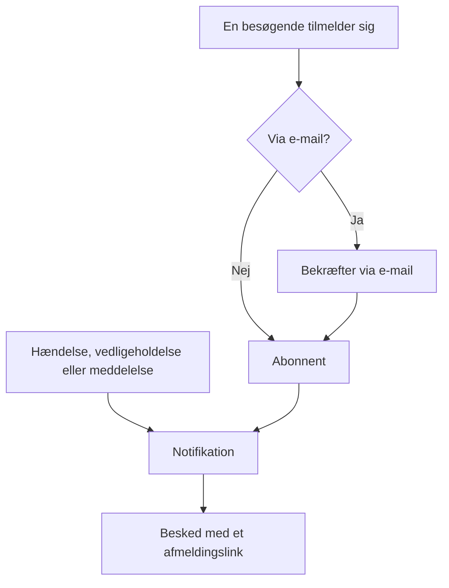

# Abonnenter og meddelelser

En statusside er et sted, folk går hen. Abonnenter er dem, der helst ikke vil være nødt til det — de giver dig én gang en e-mailadresse, et telefonnummer, en Slack-webhook eller et HTTP-endpoint, og derefter kommer dine opdateringer til dem.

Meddelelser er den anden halvdel af det samme arbejde. En monitor kan fortælle dine besøgende, at checkout returnerer 500-fejl; ingen monitor kan fortælle dem, at du migrerer databaser på lørdag, at en ekstern leverandør har en dårlig dag, eller at den hændelse, de læste om i går, er helt afsluttet. Meddelelser er fritekstkanalen til alt det, dine tjek ikke kan se, og de når den samme abonnentliste.

Denne side dækker begge dele: de fem abonnementskanaler og hvordan besøgende tilmelder sig, hvad abonnenter kan vælge at få besked om, forløbene for dobbelt bekræftelse og afmelding, den e-mailrapport, abonnenter kan få hver måned, og hvordan meddelelser skrives, planlægges og gøres til skabeloner.

:::cards
- [Abonnementskanaler](#abonnementskanaler): De kanaler, besøgende kan tilmelde sig på, og den side, de tilmelder sig på.
- [Hvad abonnenter får at vide](#hvad-abonnenter-får-besked-om): Meddelelser, vedligeholdelse, hændelser og episoder, og redigeringer af dem.
- [Tjek, hvad der blev sendt](#tjek-hvad-der-blev-sendt): Hver notifikations status, og Prøv igen og Send igen.
- [Meddelelser](#meddelelser): Offentliggør en besked på en eller flere statussider.
:::

## Sådan fungerer det



Hver statusside har sine egne abonnenter. En besøgende tilmelder sig på statussidens side **Abonner**, hvor en e-mailadresse bekræfter med et link, før den hører noget, eller dit team tilføjer vedkommende på dashboardet. Derefter giver hver hændelse, hver planlagt vedligeholdelsesbegivenhed og hver meddelelse, der når siden, besked til dens abonnenter, hver på den kanal, de tilmeldte sig med, og hver besked har det link, der opsiger abonnementet.

## Abonnementskanaler

En statusside understøtter fem kanaler. De, og den side, besøgende tilmelder sig på, slås til ét sted: kortet **Kanaler** under **Statussider → din side → Abonnenter → Abonnementsindstillinger**. Hver kontakt gemmes, så snart du slår den om:

- **Vis abonnentside** (`showSubscriberPageOnStatusPage`) — slået til som standard. Sætter punktet **Abonner** i statussidens navigationsbjælke, hvor besøgende tilmelder sig via kanalerne nedenfor.
- **E-mail** (`enableEmailSubscribers`) — slået til som standard. Alt andet er slået fra, indtil du slår det til.
- **SMS** (`enableSmsSubscribers`) — slået fra som standard. På OneUptime Cloud betales hver SMS af projektets saldo til SMS og opkald, medmindre siden har sin egen **Twilio-konfiguration** (se [nedenfor](#e-mailsidefod-egen-smtp-og-twilio)). At slå den til kræver også, at **SMS** er slået til for projektet, i kortet **Notifikationskanaler** under **Projektindstillinger > Notifikationer > Notifikationsindstillinger**, hvilket en projektejer, en **Billing Admin** eller en person med **Manage Billing** kan gøre.
- **Slack** (`enableSlackSubscribers`) — slået fra som standard.
- **Microsoft Teams** (`enableMicrosoftTeamsSubscribers`) — slået fra som standard.
- **Webhook** (`enableWebhookSubscribers`) — slået fra som standard.

Kontakterne bestemmer, hvordan besøgende kan tilmelde sig selv, og statussiden afviser en tilmelding via en kanal, der er slået fra. De stopper ikke notifikationer: abonnenter, som dit team tilføjer på dashboardet, med API'et eller via et workflow, får opdateringer, uanset hvilke kanaler der er slået til.

På OneUptime Cloud står abonnementets navn ved en kontakt, som dit abonnement ikke omfatter: **Growth** for **SMS** og **Vis abonnentside**, **Scale** for **Slack**, **Microsoft Teams** og **Webhook**. At slå en kanal fra virker på alle abonnementer, så en kanal, som en prøveperiode slog til, altid kan slås fra igen; kontakten siger det under sig.

Hver kanal har også sin egen liste i statussidens sidemenu under **Abonnenter**: **E-mail-abonnenter**, **SMS-abonnenter**, **Slack-abonnenter**, **MS Teams-abonnenter** og **Webhook-abonnenter**. Det er der, du ser, hvem der er tilmeldt, tilføjer nogen manuelt eller efterlader dig selv en post i **Noter** (`internalNote`) om en bestemt abonnent. Så længe en kanal er slået fra, siger toppen af dens liste det, med kanalens kontakt lige der, så du kan slå den til uden at forlade listen.

**Én kontakt er ikke nok.** Punktet **Abonner** i statussidens navigationsbjælke vises kun, når **Vis abonnentside** er slået til, *og* mindst én kanal er slået til. Hvis du slår **E-mail** til, men lader **Vis abonnentside** være slået fra, har besøgende ingen mulighed for at nå formularen.

## Hvad en besøgende ser på Abonner-siden

Siden **Abonner** har en undermenu med én fane pr. slået-til kanal. Hver fane beder om det mindste, den har brug for:

| Fane | Adresse | Overskrift | Hvad den beder om |
| --- | --- | --- | --- |
| **E-mail** | `/subscribe/email` | **Abonner via e-mail** | **Din e-mail**, med eksemplet `subscriber@company.com`. |
| **SMS** | `/subscribe/sms` | **Abonner via SMS** | **Dit telefonnummer**, med eksemplet `+11234567890`. |
| **Slack** | `/subscribe/slack` | **Abonner via Slack** | **Slack-arbejdsområdets navn** (bruges til validering) og **URL til indgående webhook for Slack**, med eksemplet `https://hooks.slack.com/services/...`. |
| **MS Teams** | `/subscribe/microsoft-teams` | **Abonner via Microsoft Teams** | **Microsoft Teams-arbejdsområdets navn** og **URL til indgående webhook for Microsoft Teams**, med eksemplet `https://outlook.office.com/webhook/...`. |
| **Webhooks** | `/subscribe/webhooks` | **Abonner via webhook** | **Webhook-URL**, med eksemplet `https://example.com/webhook`. Der sendes en JSON-`POST`-forespørgsel til den ved hver begivenhed på statussiden. |

Indsendelsesknappen hedder **Abonner**. En tilmelding via SMS, Slack, Microsoft Teams eller webhook viser *Du er blevet tilmeldt.* En tilmelding via e-mail siger, at der er sendt et bekræftelseslink, og at man skal tjekke spam-mappen, hvis det ikke kommer (se [Dobbelt bekræftelse på e-mail](#dobbelt-bekræftelse-på-e-mail)). Fanerne **E-mail**, **SMS**, **Slack** og **MS Teams** har også opdelingen **Nyt abonnement** / **Administrer eksisterende abonnement**, så en, der allerede har tilmeldt sig, kan komme tilbage til sine præferencer uden at lede efter en gammel besked.

## Lad abonnenter vælge ressourcer og hændelsestyper

Som standard får en abonnent alt på siden. To kontakter på kortet **Avancerede abonnentindstillinger** ændrer det:

- **Tillad abonnenter at vælge ressourcer** (`allowSubscribersToChooseResources`) — slået fra som standard. Slå den til, og tilmeldingsformularen får en kontakt **Abonner på alle ressourcer**; slå den fra, og **Vælg ressourcer at abonnere på** vises, så den besøgende kan vælge enkelte ressourcer.
- **Tillad abonnenter at vælge begivenhedstyper** (`allowSubscribersToChooseEventTypes`) — slået fra som standard. Samme form: en kontakt **Abonner på alle hændelsestyper** og **Vælg hændelsestyper at abonnere på** nedenunder, når den er slået fra.

Med en af dem slået til er tilmeldingsformularen stadig én side. Under hvor opdateringerne skal sendes hen (e-mailadressen, telefonnummeret, arbejdsområdet eller webhooken) kommer **Præferencer**, foldet sammen til én linje, der siger, hvad den besøgende vil få. Hver ressource og hver slags begivenhed er allerede valgt, så den starter som "Du får alle opdateringer fra denne statusside.", og en besøgende, der vil have det hele, trykker på **Abonner** uden at åbne den. Alle andre åbner **Præferencer** og indsnævrer ressourcerne eller begivenhedstyperne; foldet sammen igen følger linjen det, de har valgt ("Du får kun opdateringer om de ressourcer, du har valgt."). Med begge slået fra er der ingen **Præferencer**: formularen er hvor opdateringerne skal sendes hen, og derefter **Abonner**.

Siden **Opdater abonnement** (se nedenfor) viser de samme valg foldet ud, da det er dem, en abonnent kommer for at ændre.

Begivenhedstyperne er `Incident`, `Announcement` og `Scheduled Event`.

**En monitorgruppe står for hver monitor i den.** En ressource på siden er enten en monitor eller en monitorgruppe, og en abonnent, der vælger en monitorgruppe, får besked om hændelser, planlagte vedligeholdelsesbegivenheder (inklusive deres noter) og meddelelser for enhver monitor i gruppen, præcis som hvis vedkommende havde valgt den monitor, og sådan viser statussiden dem også. Den, der kun har valgt andre ressourcer, får ikke besked, og den, der har valgt en monitor og den gruppe, der indeholder den, får én notifikation, ikke to.

Valgene havner på abonnentposten som **Is Subscribed to All Resources** (`isSubscribedToAllResources`, standard true), **Is Subscribed to All Event Types** (`isSubscribedToAllEventTypes`, standard true), **Subscribed to Resources** og **Subscribed to Event Types**.

**En abonnent vælger blandt sin egen sides ressourcer.** **Subscribed to Resources** nævner ressourcer fra abonnentens egen statusside, uanset hvem der skriver det: en besøgende på siden, en kollega på dashboardet, en API-nøgle eller et workflow. En besøgende vælger blandt det, siden viser vedkommende, så en ressource, hvis monitor er arkiveret, og som siden skjuler, kan vedkommende ikke vælge. En ressource fra en anden statusside, eller en, som siden skjuler for en besøgende, afvises med den `400`, der nævner feltet og id'et, ligesom et id, der ikke matcher noget. En ændring spørger kun ind til de ressourcer, den tilføjer, så et abonnement beholder en ressource, det allerede nævner, for eksempel en, hvis monitor blev arkiveret, efter at den blev valgt. En abonnent får kun besked om en begivenhed gennem ressourcer på sin egen side.

God til: en side, der dækker flere produkter. En kunde, der kun bruger dit API, vil ikke have en besked, hver gang marketingsitet vakler — lad dem selv indsnævre listen i stedet for at se dem afmelde sig helt.

Det samme kort indeholder også **Tidszoner for abonnenter**.

## Dobbelt bekræftelse på e-mail

E-mailabonnenter bekræfter altid. Når en abonnent oprettes med en e-mailadresse og ikke blev oprettet som allerede bekræftet, tvinges **Is Subscription Confirmed** (`isSubscriptionConfirmed`) til `false`, og der genereres et sekscifret **Subscription Confirmation Token**. OneUptime sender derefter et bekræftelseslink på formen `{statusPageUrl}/confirm-subscription/{statusPageSubscriberId}?verification-token={token}`. Den besøgende lander på en side **Bekræft abonnement** og ser, når det er gået igennem, *Abonnement bekræftet*.

Abonnenter via SMS, Slack, Microsoft Teams og webhook springer dette over — de oprettes med `isSubscriptionConfirmed` allerede sat til `true`. Det samme gør e-mailabonnenter, som dit team tilføjer under **E-mail-abonnenter**: der er **Send ikke bekræftelseslink** slået til som standard. Slå det fra for at få adressen til at bekræfte som ved en tilmelding.

**Ubekræftet betyder stille.** Forespørgslen, der henter abonnenter til en notifikation, filtrerer på `isUnsubscribed: false` og `isSubscriptionConfirmed: true`. En e-mailadresse, der aldrig klikkede på linket, bliver stående i din liste **E-mail-abonnenter** og modtager intet. Hvis nogen sværger på, at de er tilmeldt, men intet hører, så tjek den kolonne først.

Der er ingen kontakt til at slå e-mailbekræftelsen fra — den er ubetinget for alle, der tilmelder sig via statussiden. En separat kolonne pr. abonnent, **Send You Have Subscribed Message** (`sendYouHaveSubscribedMessage`, standard true), styrer e-mailen "du er tilmeldt", der sendes, når en abonnent er bekræftet.

## Administrer og opsig et abonnement

Hver besked, en abonnent får, har et afmeldingslink på formen `{statusPageUrl}/unsubscribe/{statusPageSubscriberId}-{token}`: nederst i en e-mail, i teksten i en SMS, Slack- eller Microsoft Teams-besked og som `unsubscribeUrl` i en webhooks payload. Tokenet er en tilfældig hemmelighed, der hører til netop det abonnement, så linket virker uden login. Det gælder også en privat statusside, hvor alt andet kræver en besøgende, der er logget ind.

Den eneste undtagelse er en SMS fra en **public** statusside, som i stedet har abonnentens link til **Opdater abonnement** (se nedenfor). Den side virker på en offentlig statusside uden login, og dens link er 57 tegn kortere. En SMS faktureres pr. segment på 160 tegn, så det længere link ville skubbe de fleste standardtekster over i endnu et segment. `{{unsubscribeUrl}}` i en brugerdefineret SMS-skabelon følger samme regel. En SMS fra en privat statusside har afmeldingslinket.

SMS-loggen (fanen **SMS** under **Notifikationslogs**, på statussiden og i projektets indstillinger) gemmer teksten i hver SMS, og flere projektmedlemmer kan læse den, end der kan administrere abonnenter. Derfor viser loggen et afmeldingslink med tokenet erstattet af `[redacted]`, for eksempel `{statusPageUrl}/unsubscribe/{statusPageSubscriberId}-[redacted]`. Kun abonnentens egen telefon får det fungerende link. API'et returnerer heller aldrig en ny abonnents token, ikke engang i svaret på den forespørgsel, der oprettede den.

**At åbne linket ændrer intet.** Siden viser statussidens navn og logo og det abonnement, linket hører til: en e-mailadresse i fuld længde, et telefonnummer maskeret undtagen de sidste fire cifre, et Slack- eller Microsoft Teams-arbejdsområdes navn eller en webhooks vært. Den spørger *Vil du stoppe med at modtage notifikationer fra denne statusside?*, og kun et tryk på **Afmeld** opsiger abonnementet, så mailscannere og linkforhåndsvisninger, der åbner hvert link i en besked, ikke kan afmelde nogen. Intet andet fra siden vises, og intet af dens brugerdefinerede JavaScript køres. At bekræfte to gange, eller at åbne linket til et abonnement, der allerede er opsagt, siger blot, at det er opsagt. På en offentlig statusside linker afmeldingssiden også til abonnentens side **Opdater abonnement**, så man i stedet kan vælge, hvilke notifikationer man får.

Siden **Opdater abonnement**, `{statusPageUrl}/update-subscription/{statusPageSubscriberId}`, har titlen **Opdater abonnement** og fortæller den besøgende, at de kan opdatere deres præferencer eller afmelde sig der. Den indeholder:

- De vælgere af ressourcer og begivenhedstyper, som siden tillader.
- En kontakt **Afmeld**, beskrevet som afmelding fra alle ressourcer. Den skriver **Er afmeldt** (`isUnsubscribed`, standard false).
- En indsendelsesknap med teksten **Opdater abonnement**; at gemme viser *Dine ændringer er blevet gemt.*

På en privat statusside kræver den en besøgende, der er logget ind, ligesom resten af siden. Den, der har mistet linket, bruger **Administrer eksisterende abonnement** på siden **Abonner** og trykker på **Send administrationslink**. Linket går til selve abonnementet — dets e-mailadresse, dets telefonnummer eller dets Slack- eller Microsoft Teams-kanal —, aldrig til en adresse i forespørgslen, og siden svarer det samme, uanset om et abonnement matchede eller ej, så den kan ikke bruges til at finde ud af, hvem der er tilmeldt. Den besked linker til siden **Opdater abonnement** og giver en brugerdefineret skabelon begge links: `manageSubscriptionUrl` og `unsubscribeUrl`.

Endpointene bag alt dette er `POST .../subscribe/:statusPageId`, `POST .../manage-subscription/:statusPageId`, `POST .../get-subscription/:statusPageId/:subscriberId`, `PUT .../update-subscription/:statusPageId/:subscriberId` samt `GET` og `POST .../unsubscribe/:statusPageId/:subscriberId/:token`. Afmeldings-`GET` beskriver kun linket. `POST` opsiger abonnementet, uanset brødteksten, også brødteksten `List-Unsubscribe=One-Click` i en afmeldingsforespørgsel med ét klik. Begge giver det samme svar for et forkert token, en slettet abonnent og en abonnent på en anden statusside, så de ikke kan bruges til at finde ud af, hvem der er tilmeldt.

Afmelding vender et flag i stedet for at slette en række, så posten bliver stående i kanallisten med **Er afmeldt** sat — nyttigt, når du senere skal forklare, hvorfor en bestemt adresse holdt op med at få post. Den registrerer også **Afmeldt den** (`unsubscribedAt`), uanset hvem der opsagde abonnementet: abonnenten via linket eller siden **Opdater abonnement**, eller en kollega på dashboardet eller via API'et. Hver abonnentliste har en kolonne og et filter **Afmeldt den**. At slå **Er afmeldt** fra igen rydder den. Abonnementer, der blev opsagt, før OneUptime registrerede dette, har ingen dato.

Links i beskeder, der blev sendt, før afmeldingssiden fandtes, virker stadig: et link til **Opdater abonnement** åbner stadig den side. Meget gamle beskeder havde `/api/status-page-subscriber/unsubscribe/{statusPageSubscriberId}`, som tidligere afmeldte, så snart det blev åbnet. Det ændrer ikke længere noget: det fører til afmeldingssiden, som siger, at linket er forældet, og at man skal bruge det i en nyere besked.

### Delte adresser og mailinglister

Alle, der kan læse en postkasse, kan afmelde den. For en adresse, som nogen selv har tilmeldt, er det meningen. For en, som dit team har tilføjet, som for eksempel en lokations mailingliste som `site03-all@`, betyder det, at én læser kan fjerne alle på listen fra siden før næste nedbrud. Derfor:

- **Tilføj folk med deres egne adresser, hvor du kan.** Formularen **Tilføj i bulk** og formularen til e-mailabonnenter siger det i e-mailfeltets beskrivelse.
- **Teamet får besked.** En abonnent, som dit team har tilføjet, er en, der er tilføjet fra dashboardet, med en API-nøgle (REST API'et, Terraform, et script) eller af et workflow; API'et læser det som **Is Added By Team** (`isAddedByTeam`). Når en sådan afmelder sig, via sit link eller siden **Opdater abonnement**, får statussidens ejere (dens ejerbrugere og medlemmerne af dens ejerteams) hver én e-mail, der nævner abonnenten, med et link til sidens abonnentliste. Det gør den kollega, der tilføjede den, også, når det var en kollega. En side uden ejere sender kun e-mailen til den kollega, så en abonnent, som en API-nøgle eller et workflow har tilføjet til en side uden ejere, bliver ikke rapporteret. Personer, der selv tilmeldte sig på statussiden, bliver aldrig rapporteret. Abonnenter, som en API-nøgle eller et workflow tilføjede, før OneUptime registrerede dette, kan ikke skelnes fra tilmeldinger og rapporteres heller ikke.
- **Abonnentlisterne viser det.** Over hver liste nævner en meddelelse de abonnenter, dit team tilføjede, som har afmeldt sig inden for de seneste 30 dage.

Afmeldingssiden advarer læseren af et sådant abonnement, før vedkommende bekræfter: hvis det er en delt adresse, stopper afmelding notifikationerne for alle, der modtager dem, og teamet får besked.

## Hvad abonnenter får besked om

Abonnenter hører om de tre begivenhedstyper ovenfor, men hver kilde har sin egen kontakt, så intet sendes ved et uheld.

### Notifikationer om meddelelser

Selve meddelelsen har **Should subscribers be notified?** (`shouldStatusPageSubscribersBeNotified`), som oprettelsesformularen viser som afkrydsningsfeltet **Underret statussideabonnenter** under **Tidsplan og notifikationer**, slået til som standard. Abonnenter får besked én gang, når meddelelsen begynder at blive vist, så det afgøres, når meddelelsen oprettes; en redigering kan ikke ændre det. Et workflow, der skriver det senere, gemmer det blot: at skrive det tilbage uændret sender aldrig meddelelsen igen, at slå det til sender den ikke, og at slå det fra, før notifikationen er sendt, springer notifikationen over. Hvis meddelelsen nævner monitorer under **Berørte monitorer**, begrænses notifikationen til de monitorer: på en side, hvor abonnenter vælger ressourcer, går den til abonnenterne på de monitorer, på de monitorgrupper, der indeholder dem, og på alle ressourcer. Lad feltet være tomt, og alle abonnenter får besked. På en statusside, der ikke viser nogen af de monitorer, hverken direkte eller gennem en gruppe, er meddelelsen til alle, der læser den side, så hver abonnent der, som får meddelelser, får besked.

### Planlagte vedligeholdelsesbegivenheder

En planlagt vedligeholdelsesbegivenhed har sit eget sæt abonnentkolonner: **Should subscribers be notified when event is created?**, **Should subscribers be notified when event is changed to ongoing?**, **Should subscribers be notified when event is changed to ended?**, plus **Subscriber notifications before the event** og **Next subscriber notification before the event at?** til forhåndsvarsler. **Statussider** på begivenheden bestemmer, hvilke sider den vises på, og **Should be visible on status page?** bestemmer, om den vises overhovedet.

**Opret planlagt vedligeholdelseshændelse** går gennem to trin og derefter en gennemgang, ligesom **Erklær hændelse** gør:

1. **Begivenhed** — **Titel**, **Beskrivelse**, **Begynder den** og **Slutter den**. En ny begivenhed starter ved næste hele time på dit ur og varer en time; ændr kun tiderne, når de er forkerte. At flytte **Begynder den** flytter **Slutter den** med, så vinduet beholder sin længde, og begivenheden skal slutte, efter at den starter. **Ejere** og **Etiketter** venter under **Flere felter**.
2. **Berørte ressourcer** — først **Monitorer** og lige under dem **Skift overvågningsstatus til**, når en monitor er valgt: monitorerne skifter til den status, når begivenheden starter, og tilbage til i drift, når den slutter. Derefter **Andre berørte ressourcer**: de værter, klynger, containerværter, databaser, IoT-flåder, netværkslokationer og tjenester, vedligeholdelsen berører. Derefter **Vis begivenhed på disse statussider** og så **Notifikationer til abonnenter**, foldet sammen til én linje, der siger, hvad der vil ske. Som standard står der "Abonnenter på begivenhedens statussider underrettes, når den planlægges, når den starter, og når den slutter." Fold den ud for at ændre **Når begivenheden planlægges**, **Når begivenheden starter**, **Når begivenheden slutter** og **Påmindelser før begivenheden**; linjen følger det, du sætter kryds ved, og gennemgangstrinnet viser den også.

Fra fanen **Planlagt vedligeholdelse** på en vært, en Kubernetes-, Proxmox-, Ceph- eller Docker Swarm-klynge, en Docker- eller Podman-vært, en vCenter, et storage-array, en IoT-flåde, en database, en tjeneste eller en netværkslokation åbner **Opret planlagt vedligeholdelseshændelse** (og **Opret fra skabelon**) den samme formular med den ressource allerede valgt under **Andre berørte ressourcer**, og brødkrummerne går tilbage til den fane. Fanen **Planlagt vedligeholdelse** på et inventarelement vælger den vært, den tjeneste eller den Kubernetes-klynge, elementet peger på, og brødkrummerne går tilbage gennem den ressources fane.

Kun titlen skal skrives: alt andet har en standardværdi, så **Næste** går gennem de andre trin uden at spørge om noget, og **Opret planlagt vedligeholdelseshændelse** står på gennemgangen til sidst. Ingen får besked, før du vælger en statusside. De tre indstillinger **Når begivenheden…** vælges, når begivenheden oprettes, og et workflow, der skriver **Når begivenheden planlægges** senere, gemmer den blot: skrevet tilbage uændret eller slået til sender den intet, og slået fra, før notifikationen om "planlagt" er sendt, springes den notifikation over. Knappen **Rediger** på begivenhedens kort **Maintenance Details** ændrer dens titel, vindue og etiketter (**Begivenhed**) og dens statussider og påmindelser (**Statussider**). Knappen **Rediger** på dens kort **Berørte ressourcer** spørger på samme måde som formularen: **Monitorer**, derefter **Skift overvågningsstatus til**, når der er en monitor, og derefter **Andre berørte ressourcer**, og kortet viser status under monitorerne. Alle, der kan redigere begivenheden, kan ændre dens monitorstatus, indtil begivenheden starter. Når den starter — på sit starttidspunkt, eller når nogen flytter den til en igangværende tilstand manuelt, fra Slack eller Microsoft Teams eller via API'et —, skifter dens monitorer til den status, den har i det øjeblik, og det samme gør monitorer, der tilføjes, mens den kører. At flytte den fra **Scheduled** direkte til en tilstand, du selv har lavet, placeret mellem **Ongoing** og **Ended**, som "Verifying", starter den på samme måde: dens monitorer skifter til dens status, som de ville i **Ongoing**, og går tilbage til i drift, når den slutter. Fra da af kan status ikke længere ændres: kortets **Rediger** viser den skrivebeskyttet med "Begivenheden er startet, så dette kan ikke længere ændres.", og API'et afviser en ændring med "Change Monitor Status to can no longer be changed: this event has already started." At skrive den status tilbage, som begivenheden allerede har, accepteres stadig. Skabeloner til planlagt vedligeholdelse (**Indstillinger → Begivenhedsskabeloner**) bruger de samme trin, med skabelonens navn forrest og dens tilbagevendende tidsplan til sidst. En skabelon spørger om **Skift overvågningsstatus til**, uanset om den nævner monitorer, fordi dens status også gælder de monitorer, der vælges, når en begivenhed planlægges ud fra den. En eksisterende skabelons kort **Berørte ressourcer** spørger på samme måde og viser den status, skabelonen vælger, eller **Monitorer beholder deres status.**, når den ikke vælger nogen; alle, der kan redigere skabelonen, kan ændre det der.

**Hvilke statussider?** Så snart begivenheden nævner monitorer, foreslås de statussider, der viser dem, under **Vis begivenhed på disse statussider**: "Statussider, der viser de berørte monitorer:" efterfulgt af hver sides navn. Klik på et navn for at tilføje den side, eller på **Tilføj alle** for at tilføje dem alle. En side tæller med, når den viser en af monitorerne, direkte eller gennem en monitorgruppe. Kun de statussider, du kan se, foreslås, og arkiverede sider og sider, der ikke viser planlagte vedligeholdelsesbegivenheder, udelades. Intet vælges for dig: en statusside, du vælger, viser begivenheden og giver med standardnotifikationerne besked til sine abonnenter, så det forbliver dit valg. Trinnet **Statussider** i begivenhedens **Rediger** og formularerne for en skabelon til planlagt vedligeholdelse foreslår på samme måde ud fra begivenhedens eller skabelonens monitorer.

**Dine egne tilstande.** En begivenhed er i gang i **Ongoing** og i hver tilstand, du selv har lavet, placeret mellem **Ongoing** og **Ended** — et "Verifying"-trin, for eksempel. En tilstand, du selv har lavet, placeret før **Ongoing**, er ikke startet endnu, og en placeret efter **Ended** — "Reviewing" — er overstået. Alt, der spørger, om en begivenhed er i gang, bruger denne ene regel. En sådan begivenhed vises som igangværende på sine statussider — på oversigten, på begivenhedens egen side og i RSS-feedet — og i listerne **Ongoing** under **Planlagt vedligeholdelse** og **Hjem**, deres menumærker og feltet **Igangværende vedligeholdelse** på **Hjem**, og Microsoft Teams-appen viser den som igangværende vedligeholdelse. Dens monitorer forbliver i vedligeholdelse, de netværkslokationer og telemetriserier, den dækker, forbliver dæmpede, og SLO-burn-rate-advarsler på dens monitorer holdes tilbage. Ved dens **Slutter den** afsluttes den, som en igangværende begivenhed gør, og dens abonnenter får besked, hvis **Når begivenheden slutter** er slået til. At flytte den fra **Ongoing** eller "Verifying" direkte til en tilstand, du selv har lavet, placeret efter **Ended**, afslutter den, som **Ended** gør: dens monitorer går tilbage til i drift, og begivenhedens overskrift viser, hvor længe den varede. At flytte den fra **Ongoing** til "Verifying", eller fra **Ended** til "Reviewing", starter eller afslutter intet igen. En tilstands placering er dens placering i listen på siden **Begivenhedsstatus** under **Planlagt vedligeholdelse → Indstillinger**.

**Venter på at starte, overstået og fuldført.** Den samme placering afgør resten. En begivenhed venter på sin **Begynder den** i **Scheduled** og i hver tilstand, du selv har lavet, placeret mellem **Scheduled** og **Ongoing** — et "Confirmed"-trin, for eksempel. På sit starttidspunkt starter den derfra, som den starter fra **Scheduled**: den går over i **Ongoing**, dens monitorer skifter til dens **Skift overvågningsstatus til**, dens ejere får besked og dens abonnenter også, hvis **Når begivenheden starter** er slået til. Indtil da står den blandt de kommende begivenheder — på oversigten, siden med planlagte begivenheder og RSS-feedet på dens statussider, og når nogen spørger Microsoft Teams-appen om planlagt vedligeholdelse —, og påmindelserne før begivenheden sendes stadig til dens abonnenter. Dens feed og dens statussides tidslinje viser en sådan tilstand med det ur, de viser for **Scheduled**. En tilstand, du selv har lavet, placeret før **Scheduled** — en "Draft" eller et godkendelsestrin — er heller ikke startet, men venter på en person: intet starter en begivenhed der på dens tidspunkt, og den vises ikke som kommende. En begivenhed er overstået i **Ended**, i **Completed** og i hver tilstand, du selv har lavet, placeret efter **Ended**, og begivenhedens **Oversigt** behandler den som overstået overalt — dens overskrift, dens kort **Målinger** og den tidslinje, den viser. Den er fuldført i **Completed** og i hver tilstand, du selv har lavet, placeret efter den — "Archived": det er det, der stopper påmindelserne til dens ejere (**Remind until event is Completed**), det, som Slack og Microsoft Teams afviser **Mark as Complete** for, og det, som dens feed og dens statussides tidslinje markerer som færdigt. I **Ended**, eller i "Reviewing" mellem **Ended** og **Completed**, er den overstået, men endnu ikke fuldført.

**Netværkslokationer følger hver tilstandsændring.** De netværkslokationer, en begivenhed dækker, holder op med at regne dens planlagte nedbrud mod lokationerne over dem, mens den er i gang. Hver ændring af begivenhedens tilstand beregner deres status forfra med det samme, i begge retninger — også når den går tilbage, som når posten for den tilstand, den er i, slettes fra dens **Tilstandstidslinje**: flyttet tilbage fra "Verifying" til **Scheduled** holder den straks op med at dæmpe dem i stedet for ved næste gennemløb, som stadig kører hvert femte minut som sikkerhedsnet.

**Hvad feedet registrerer ved en redigering.** En redigering tilføjer en post **Scheduled Maintenance was updated.** til begivenhedens **Planlagt Vedligeholdelse Feed** — også sendt til dens Slack- og Microsoft Teams-kanaler — med en linje for hver ting, den ændrede: titlen, **Begynder den**, **Slutter den**, beskrivelsen, påmindelserne før begivenheden, hvad begivenheden berører, **Skift overvågningsstatus til**, de statussider, den vises på, og dens etiketter, hver med sin nye værdi. En værdi, der gemmes, som den var, får ingen linje, så at gemme kortet **Maintenance Details** uden at ændre noget — det sender titlen, vinduet, etiketterne, statussiderne og påmindelserne hver gang — eller en API-klient, et workflow eller Terraform, der skriver begivenheden tilbage, som den er, tilføjer slet ingen post. Et tidspunkt er det samme, når det angiver det samme øjeblik, uanset hvordan det er skrevet — et, der er skrevet uden tidszone, er UTC, som det gemmes —, og påmindelserne, statussiderne, de berørte ressourcer og etiketterne er det samme sæt i vilkårlig rækkefølge. At fjerne alle påmindelser, statussider eller etiketter registreres som "No reminders before the event.", "Not shown on any status page." eller "All labels removed.", og at fjerne den sidste berørte ressource ud over monitorerne — den sidste vært, klynge eller tjeneste, for eksempel — som "No other affected resources.". Begivenhedens påmindelsesregel matches igen, og ventetiden på dens næste påmindelse starter forfra, kun når dens etiketter ændres, eller dens kontakt **Send påmindelser** slås om. En påmindelsesregel (**Planlagt vedligeholdelse → Regler → Reminder Rules**) med **Remind While Event is Scheduled** slået fra tæller den første påmindelse fra begivenhedens start, så at flytte **Begynder den** til et andet tidspunkt flytter den påmindelse med, så længe starten stadig ligger forude; påmindelserne fra en regel, der minder, mens begivenheden er planlagt, bliver, hvor de er. En monitors feed registrerer på samme måde en redigering af dens navn, beskrivelse og etiketter.

Hvis en begivenhed oprettes med **Når begivenheden planlægges** slået fra (under **Notifikationer til abonnenter** på oprettelsesformularens trin **Berørte ressourcer**), starter nye offentlige noter på den med **Notify status page subscribers** slået fra, med en linje under afkrydsningsfeltet, der forklarer hvorfor. Det gælder på begivenhedens side **Offentlige noter** og i **Add Public Note** på **Planlagt Vedligeholdelse Feed**, som åbner den samme noteeditor. Noter, der offentliggøres uden et udtrykkeligt valg, følger den samme indstilling **Når begivenheden planlægges**: noter fra Slack og Microsoft Teams, workflows og API-forespørgsler, der udelader `shouldStatusPageSubscribersBeNotifiedOnNoteCreated`. En udtrykkelig `true` eller `false` bevares altid. **Når begivenheden planlægges** slår kun den meddelelse fra, der sendes, når begivenheden oprettes. Påmindelser (**Subscriber notifications before the event**, angivet med **Påmindelser før begivenheden** på oprettelsesformularen) og de notifikationer, som **Når begivenheden starter** og **Når begivenheden slutter** angiver, er separate indstillinger og sendes stadig. Hvis abonnenterne allerede har hørt om begivenheden på den måde, for eksempel fra en påmindelse eller notifikationen om, at den er i gang, så sæt kryds i feltet for at give dem besked om noten.

Vinduet **Markér planlagt vedligeholdelse som `<state name>`**, der åbnes fra knapperne øverst på begivenhedens side **Oversigt**, har ét afkrydsningsfelt **Underret statussideabonnenter**, der dækker både tilstandsændringen og vinduets **Offentlig note** (foldet sammen under **Tilføj en offentlig note**). På en begivenhed, der er oprettet med **Når begivenheden planlægges** slået til, starter det slået til, som før. På en begivenhed, der er oprettet med den slået fra, starter det slået fra, med den samme linje under, undtagen i to tilfælde, hvor det starter slået til, i overensstemmelse med hvad den automatiske tilstandsændring ville annoncere:

- Du flytter begivenheden til dens igangværende tilstand, eller fra en tilstand, hvor den ikke er startet, til en tilstand, du selv har lavet, placeret mellem **Ongoing** og **Ended** (den starter), og **Når begivenheden starter** er slået til.
- Du flytter begivenheden til en afsluttet eller fuldført tilstand, eller fra en tilstand, hvor den er i gang, til en tilstand, du selv har lavet, placeret efter **Ended** (den slutter), og **Når begivenheden slutter** er slået til.

**En note, der sendes med en tilstandsændring, er den eneste besked.** Skriv en **Offentlig note** i det vindue (eller i massehandlingen **Skift tilstand**) med **Underret statussideabonnenter** slået til, og abonnenterne får noten, på hver kanal, i stedet for en separat besked om tilstandsændringen: én besked, ikke to. Tilstandsændringen viser **Notifikationer sendt**, og dens statusbesked siger, at noten bar den. Noten offentliggøres, når tilstandsændringen er gemt: den følger ændringen i begivenhedens feed og i Slack og Microsoft Teams, og en tilstandsændring, der ikke gemmes, offentliggør ingen note og giver ingen besked. En note, der kun indeholder mellemrum, offentliggøres ikke, og abonnenterne får beskeden om tilstandsændringen. Med feltet slået fra giver hverken tilstandsændringen eller dens note nogen besked. Via API'et går noten med tilstandsændringen i `"miscDataProps": {"publicNote": "..."}` på `POST /api/scheduled-maintenance-state-timeline`, og `shouldStatusPageSubscribersBeNotified` bestemmer for begge (udeladt giver tilstandsændringen besked, og dens note gør ikke). Hændelser fungerer på samme måde; se [Hændelsestilstande og alvorsgrader](/docs/incidents/states-and-severities#giv-statussideabonnenter-besked-om-en-tilstandsændring).

**Noten nævner den nye tilstand.** Da den er den eneste besked, siger en note, der sendes med en tilstandsændring, hvad begivenheden er nu, på hver kanal, som beskeden om tilstandsændringen gjorde: e-mailens emne lyder `[Ongoing Scheduled Maintenance] <title>`, og dens detaljer viser en række **Status**, SMS'en siger `Maintenance <title> on <status page> is Ongoing.`, beskeder i Slack og Microsoft Teams har en linje `**Status:** Ongoing`, og webhookens payload `ScheduledMaintenanceNoteCreated` har `scheduledMaintenanceState` i `data`. En note, der offentliggøres for sig selv, læses som altid. At offentliggøre noten kræver **Create Scheduled Maintenance Status Page Note** (de indbyggede roller for planlagt vedligeholdelse og for projektet har den): den, der ikke har den, får ikke tilbudt **Tilføj en offentlig note**, og en tilstandsændring, som vedkommende sender med en note, afvises, så begivenheden beholder sin tilstand i stedet for at skifte, uden at nogen får besked.

Den manuelle formular på begivenhedens side **Tilstandstidslinje** og massehandlingen **Skift tilstand** i listen over planlagt vedligeholdelse ser ikke på disse indstillinger: deres afkrydsningsfelt **Underret statussideabonnenter** starter altid slået til.

Begivenheder, der oprettes fra en skabelon, tager **Når begivenheden planlægges** fra skabelonen sammen med dens andre abonnentindstillinger. **Opret fra skabelon** udfylder oprettelsesformularen med skabelonens værdier, og tilbagevendende begivenheder, som en skabelon planlægger under **Indstillinger → Begivenhedsskabeloner**, kopierer dem.

### Hændelser

`Incident` er den tredje begivenhedstype. Hvad der overhovedet får en hændelse til at nå en statusside — hvilke ressourcer den berører, og hvilke tilstande der holder den synlig — er beskrevet i [Hændelsestilstande og alvorsgrader](/docs/incidents/states-and-severities). Offentlige noter på en hændelse, der blev erklæret uden at give abonnenterne besked, starter med **Underret statussideabonnenter** slået fra; se [Hændelsesnoter, ejere og feed](/docs/incidents/notes-owners-and-feed#slå-en-offentlig-note-op).

En hændelses beskeder — oprettet, tilstand ændret, offentlig note og postmortem — går til abonnenterne på hver statusside, der viser en af dens monitorer. To indstillinger indsnævrer det. **Begræns til disse statussider** på hændelsen holder den til de sider, du vælger blandt dem, og **Vis kun hændelser, der er begrænset til denne side** på en statusside holder enhver hændelse væk, der ikke er begrænset til den. For en hændelse, der er begrænset til bestemte sider, får en e-mailadresse eller et telefonnummer, der er tilmeldt på flere af dem, én e-mail eller SMS pr. afsendelse, ikke én pr. side; beskeder via webhook, Slack og Microsoft Teams flettes aldrig. Erklæringsformularen og siden **Offentlige noter** viser, hvem der får besked, før noget sendes. Se [Én statusside pr. målgruppe](/docs/status-pages/one-status-page-per-audience).

#### Hændelsens postmortem

Abonnenter hører om en hændelses postmortem én gang, når den offentliggøres: første gang statussiden viser den. Statussiden viser en postmortem, når **Offentliggør på statussiden** er slået til, og postmortem'en har en note; dens vedhæftninger vises sammen med noten, aldrig uden den. Så at slå offentliggørelse til over en skrevet note offentliggør den, og det gør det også at skrive noten til en postmortem, der er slået til. **Underret abonnenter** på den samme formular bestemmer, om de overhovedet får besked. Derefter:

- **At gemme den igen giver ingen besked.** Formularen **Rediger obduktionsnote** sender hele postmortem'en ved hver gemning, og en API-klient, Terraform eller et workflow kan skrive hele hændelsen tilbage; det, der allerede var offentliggjort, er ikke nyt.
- **At redigere en offentliggjort postmortem giver heller ingen besked.** Statussiden viser den nye note med det samme, og hændelsesfeedet registrerer den én gang, som **Postmortem Note updated**, men abonnenterne har allerede fået besked. Mellemrum omkring noten tæller ikke som en ændring.
- **At fjerne den fra statussiden giver ingen besked, og at offentliggøre den igen giver dem besked igen**: de så den forsvinde. At tømme noten i en offentliggjort postmortem fjerner den også fra statussiden.
- **En postmortem, der er slået til uden en note, viser intet**, så ingen får besked, før dens note er skrevet.
- **En postmortem, der offentliggøres, mens dens hændelse er skjult, sendes, når hændelsen bliver synlig.** Statussiden viser kun en postmortem på en hændelse, den viser — **Synlig på statussiden** slået til, og hændelsen ikke privat —, så ingen får besked, mens hændelsen er skjult, og notifikationens status lyder **Ikke sendt endnu: hændelse skjult på statussider**. At slå **Synlig på statussiden** til sender den, én gang (for en privat hændelse sammen med at slå **Privat hændelse** fra), og kontakten på hændelsens side **Indstillinger** fortæller dig det, før du gemmer. At skjule hændelsen og vise den igen sender intet mere, og at vise en hændelse, hvis postmortem allerede er sendt eller ikke er offentliggjort, sender intet. En postmortem, som en tidligere version sprang over på denne måde, sendes på samme måde, hvis dens hændelse stadig var skjult, da du opgraderede; en, hvis hændelse er blevet gjort synlig siden, forbliver usendt, fordi statussiden har vist den siden da.
- **Underret abonnenter læses, når notifikationen sendes.** En postmortem, der offentliggøres med den slået fra, annonceres ikke, og at slå den til bagefter sender ikke den notifikation, den blev offentliggjort uden.

Notifikationens status står på hændelsens side **Postmortem**; en, der mislykkedes, tilbyder **Prøv igen** (se [Prøv igen og send igen](#prøv-igen-og-send-igen)). Via API'et offentliggør det at skrive `showPostmortemOnStatusPage` som `true` over en skrevet `postmortemNote` den, også når forespørgslen skriver hele hændelsen tilbage, inklusive dens notifikationsstatus, som den er, og at gøre en skjult hændelse synlig — skrive `isVisibleOnStatusPage` som `true` og `isPrivate` som `false` for en privat — sender en postmortem, der venter på det. At skrive `subscriberNotificationStatusOnPostmortemPublished` som `Pending` sender den igen. En notifikation, der allerede venter eller er ved at blive sendt, sættes ikke i kø en gang til, og en postmortem, der blev offentliggjort, mens en var under forberedelse, annonceres stadig én gang. Det automatiske AI-udkast til postmortem skrives aldrig ind i en postmortem, der er slået til, så et ugennemgået udkast når aldrig abonnenter.

#### Forhåndsvis e-mailen, før den sendes

**Forhåndsvisning** er et lille link ved siden af den værdi, den forhåndsviser: ved siden af **Ja** under **Underret statussideabonnenter** på sidste trin af **Erklær ny hændelse** og ved siden af afkrydsningsfeltet **Underret statussideabonnenter**, mens du skriver en offentlig note. Det åbner **Forhåndsvisning af notifikation**, som viser den e-mail, hver statussides abonnenter vil få, bygget og gengivet af den samme kode, skabelon og de samme indstillinger, som notifikationen sendes med, så det, du ser, er det, de modtager:

- vælg en statusside for at se dens e-mail, med emnet og "op til"-antallene pr. kanal;
- en linje siger, hvilken skabelon der bruges og hvorfor, for eksempel at sidens brugerdefinerede skabelon ikke bruges, fordi siden ikke har nogen **Brugerdefineret SMTP-konfiguration**;
- når intet vil blive sendt (ingen monitorer, en privat eller skjult hændelse, **Underret statussideabonnenter** slået fra, eller ingen statusside, der viser hændelsen), siger den det i stedet for at vise en e-mail.

Kun de statussider, du kan se, forhåndsvises; de andre tælles. E-mailen vises i en isoleret ramme, der ikke kører scripts. Dens afmeldingslink er et eksempel, fordi hver abonnents e-mail har sit eget.

**Send test til mig** sender den viste sides e-mail til din kontos e-mailadresse med `[Test]` i starten af emnet, via sidens **Brugerdefineret SMTP-konfiguration**, når den har en. Den sender aldrig til nogen anden adresse, kræver, at din kontos e-mailadresse er bekræftet, og hver person kan sende ti test-e-mails hvert 15. minut.

#### Brugerdefinerede hændelsesfelter i notifikationer

Brugerdefinerede hændelsesfelter med **Medtag i abonnentnotifikationer** slået til (under **Hændelser → Indstillinger → Brugerdefinerede felter**) sendes med hændelsens beskeder — oprettet, tilstand ændret, offentlig note offentliggjort eller opdateret, og postmortem. Det virker på alle abonnementer, der har brugerdefinerede felter; det kræver hverken en brugerdefineret skabelon eller brugerdefineret SMTP.

- **E-mail** viser dem i detaljeboksen under hændelsens egne rækker, i felternes **Rækkefølge**. Et felt, som hændelsen ikke har en værdi for, udelades. Et ja/nej-felt lyder **Ja** eller **Nej**, en dato er den valgte dag (den samme dag for alle modtagere, uanset hvor de er, for en dato, der er valgt i en hvilken som helst tidszone fra UTC−10:59 til UTC+13), en dato og et klokkeslæt vises i statussidens abonnenttidszoner, lang tekst beholder sine linjer, og rich text vises formateret, med de samme regler for links som noter. Dens indlejrede billeder gøres synlige for dem, den sendes til, når den første besked, der indeholder den, sendes.
- **Slack** og **Microsoft Teams** viser dem på samme måde, ét pr. linje.
- **Webhook**-payloads har dem i `data.customFields`, med hvert felts **Skabelonvariabel** som nøgle: `{ "name": ..., "type": ..., "value": ... }`, med værdien, som den er gemt (`null`, når hændelsen ikke har nogen). Nøglerne ændres ikke, når et felt omdøbes.
- **SMS** udelader dem. En SMS faktureres pr. segment, og standardteksten fylder allerede næsten ét; en brugerdefineret SMS-skabelon kan placere ethvert felt med `{{incident.customFields.<key>}}`.
- Notifikationer om **Incident episode** har ingen brugerdefinerede felter: en episode samler hændelser, der hver har deres egne værdier. Hver medlemshændelses egne notifikationer har dens felter.

Posten **Abonnentnotifikation sendt** i hændelsesfeedet viser under **Custom fields sent** de værdier, hver afsendelse satte ind i en besked. Abonnenter er som regel uden for dit team, så slå kun indstillingen til for felter, der trygt kan deles med dem.

Sektionen **Notifikationslogs** i statussidens sidemenu (`{id}/notification-logs`) er der, du går hen, når du skal se, hvad siden faktisk har sendt.

### Hændelsesepisoder

En hændelsesepisode registrerer i `shouldStatusPageSubscribersBeNotifiedOnEpisodeCreated`, om abonnenterne fik at vide, at den blev oprettet. Episoder, der oprettes med knappen **Opret episode** eller af **Grupperingsregler**, har den slået til; en API-forespørgsel kan oprette en med den sat til `false`.

På en episode, der er oprettet med den sat til `false`, starter nye offentlige noter med **Notify status page subscribers** slået fra, med en linje under, der forklarer hvorfor, på episodens side **Offentlige noter** og i **Add Public Note** på **Episodefeed**, som åbner den samme noteeditor. Du kan stadig sætte kryds i den. Noter, der offentliggøres uden et udtrykkeligt valg, følger den samme indstilling: noter fra Slack, workflows og API-forespørgsler, der udelader `shouldStatusPageSubscribersBeNotifiedOnNoteCreated`. En udtrykkelig `true` eller `false` bevares altid. Kun denne indstilling tæller: i modsætning til en hændelse ændrer det ikke, hvor afkrydsningsfeltet starter, at gøre en episode privat.

Det dækker kun offentlige noter. Episodens tilstandsændringer (**Bekræft**, **Løs** og automatisk løsning) giver stadig abonnenterne besked, fordi hverken episodens vindue til tilstandsændringer eller formularen på dens side **Tilstandstidslinje** har et afkrydsningsfelt **Underret statussideabonnenter**.

En episode, der oprettes i en senere tilstand — med **Indledende tilstand** på formularen **Opret episode**, eller en tilstand, der sendes via API'et —, annonceres én gang, af dens notifikation om oprettelse: dens første tilstand sendes aldrig for sig som en tilstandsændring, uanset hvilken tilstand det er, og en episode, der er oprettet med `shouldStatusPageSubscribersBeNotifiedOnEpisodeCreated` sat til `false`, annoncerer den slet ikke. Den første række i dens tilstandstidslinje registrerer den notifikation som sprunget over, med årsagen.

### Giv abonnenter besked om en redigering

Abonnenter hører om en meddelelse eller en offentlig note én gang, når den offentliggøres. At redigere den bagefter ændrer, hvad statussiden viser, men giver ingen besked, medmindre du beder om det ved den redigering.

Redigeringsformularen for en meddelelse, og for en offentlig note på en hændelse, en planlagt vedligeholdelsesbegivenhed eller en hændelsesepisode, har et afkrydsningsfelt **Underret abonnenter om denne opdatering**. Det starter uden kryds hver gang, så rettelsen af en slåfejl forbliver stille; sæt kryds, når ændringen betyder noget — et nyt vedligeholdelsesvindue, en revideret påvirkning, en rettet kundeopdatering. Det findes ikke på oprettelsesformularerne, som har deres eget valg **Underret statussideabonnenter**. På en meddelelse står det på trinnet **Meddelelse**, lige under beskrivelsen.

Når du gemmer med kryds i feltet, får abonnenterne det redigerede indhold markeret som en opdatering i stedet for som et nyt opslag:

- **E-mail** bruger sin egen skabelon — for eksempel emnet `[Announcement Updated] <title>` og overskriften `Announcement Updated: <title>` eller **Updated Note** i detaljeboksen i en note-e-mail.
- **SMS**, **Slack** og **Microsoft Teams** siger, at meddelelsen eller noten er blevet opdateret.
- **Webhook**-abonnenter modtager `AnnouncementUpdated`, `IncidentNoteUpdated`, `ScheduledMaintenanceNoteUpdated` eller `EpisodeNoteUpdated` som `eventType`, med det seneste indhold i `data`.

Opdateringen går til de samme personer, som originalen ville nå i dag: de samme kanalkontakter, de samme præferencer for ressourcer og begivenhedstyper og de samme synlighedstjek (en skjult hændelse eller en side med **Vis meddelelser** slået fra sender stadig intet).

To tilfælde sender med vilje intet og registrerer hvorfor:

- **Den oprindelige notifikation er ikke sendt endnu.** Hvis en meddelelse eller note stadig venter på at blive annonceret, læser den notifikation elementet, når den sendes, og indeholder allerede din redigering, så en separat besked om "opdateret" ville kun forvirre folk. Hvis originalen er ved at blive sendt i det øjeblik, venter opdateringen i stedet og sendes, når originalen er færdig: den afsendelse læste elementet før din redigering, så abonnenterne kan have fået teksten fra før den.
- **Meddelelsen er planlagt til senere.** Indtil **Begynd at vise meddelelse den** er passeret, er den ikke på nogen statusside, og dem, der får besked, når den går live, ser den redigerede version.

Det redigerede element viser en **Opdateringsnotifikationsstatus** ved siden af den oprindelige, med de samme tilstande (**Sending Soon**, **Notifikationer sendt**, **Mislykkedes** og så videre). **Prøv igen** på en mislykket opdateringsnotifikation sender opdateringen igen, aldrig den oprindelige besked om "offentliggjort". Hver statusside kan tilpasse disse beskeder med skabelonbegivenhedstyperne **Subscriber Announcement Updated**, **Subscriber Incident Note Updated**, **Subscriber Scheduled Maintenance Note Updated** og **Subscriber Episode Note Updated**; uden en brugerdefineret skabelon bruges den indbyggede opdateringstekst.

Via API'et sender du valget ved siden af de felter, du ændrer, i `miscDataProps`:

```json
{
  "data": {
    "description": "The maintenance now starts on Sunday at 02:00 UTC."
  },
  "miscDataProps": {
    "notifySubscribersOfUpdate": true
  }
}
```

som brødtekst til `PUT /api/status-page-announcement/<announcement-id>` (eller `incident-public-note`, `scheduled-maintenance-public-note`, `incident-episode-public-note`). Udelad `miscDataProps`, og redigeringen er stille, som før.

## Tjek, hvad der blev sendt

Hver abonnentnotifikation har sin egen status ved siden af det, den handler om. For en hændelse er det dens notifikation om "oprettet" på hændelsens **Oversigt**, hver række i dens **Tilstandstidslinje**, hver offentlig note og dens **Postmortem**. Planlagte vedligeholdelsesbegivenheder og meddelelser viser deres på samme måde, og hændelsesepisoder på deres offentlige noter. Klik på status for at læse dens besked, som siger, hvad der skete. Offentlige noter viser status som et mærke med deres egen ordlyd:

| Status | På en offentlig note | Hvad det betyder |
| --- | --- | --- |
| **Sending Soon** | **Notifying subscribers soon** | I kø. Jobbet, der sender den, kører hvert minut. |
| **Notifications Being Sent** | **Notifying subscribers** | Jobbet arbejder sig gennem abonnenterne. |
| **Notifikationer sendt** | **Subscribers notified** | Den er sendt. Se nedenfor, hvad det betyder. |
| **Mislykkedes** | **Notification failed** | Ikke alle abonnenter fik den, eller afsendelsen stoppede. Beskeden siger, hvad der blev sendt, og hvad **Prøv igen** gør. |
| **Notifications skipped.** | **Subscribers not notified** | Der skulle ikke sendes noget, for eksempel fordi hændelsen er skjult på statussider. Beskeden siger hvorfor. |

### Sådan tælles en afsendelse

Notifikationer for hændelser og hændelsesepisoder — oprettet, tilstand ændret, offentlig note offentliggjort eller opdateret, og postmortem — tælles besked for besked:

- **En besked tæller som sendt**, når mailserveren eller SMS-udbyderen har taget imod den, eller når endpointet hos Slack, Microsoft Teams eller webhooken har svaret. "Sendt" er så langt, OneUptime kan se: en mailserver kan stadig afvise en e-mail senere.
- **En besked tæller som mislykket**, når den afvises, når afsendelsen giver en fejl, eller når den ikke får svar inden for 4 minutter. Én fejl gør notifikationen **Mislykkedes**; de andre abonnenter får den stadig.
- **Alle abonnenter nås.** En statussides abonnenter læses 10.000 ad gangen indtil den sidste, med 20 beskeder undervejs på én gang. En notifikation holder op med at starte nye beskeder 20 minutter efter, at den startede: de statussider og abonnenter, den ikke nåede inden da, opføres som ikke sendt, og den markeres som **Mislykkedes**.
- **Antallene registreres pr. statusside.** Statusbeskeden viser for hver statusside, hvor mange beskeder der blev sendt og mislykkedes på hver kanal, for eksempel `Site 03: 41 email sent. Site 07: 16 email, 2 SMS sent; 2 email failed.` Posten **Abonnentnotifikation sendt** i hændelsens feed viser de samme antal med det emne, hver sides e-mail blev sendt med. **Notifikationslogs** på hver statusside viser hver besked.

Notifikationer om planlagt vedligeholdelse og meddelelser tælles endnu ikke på denne måde. Deres beskeder overdrages til afsenderne uden at vente på svar, så **Notifikationer sendt** betyder, at de er overdraget, og én afsendelse når højst 10.000 abonnenter på hver statusside.

### Afsendelser, der blev afbrudt

En afsendelse, hvis server genstarter eller holder op med at svare undervejs, kan ikke blive færdig, og intet andet ville afgøre den. Derfor markeres en notifikation, der stadig står på **Notifications Being Sent** efter 40 minutter, længere end nogen afsendelse må tage, som **Mislykkedes**, med en besked, der starter med `Interrupted:` og siger, hvad **Prøv igen** vil gøre. Det dækker hver notifikation ovenfor, også planlagt vedligeholdelse og meddelelser. Tjekket kører hvert 5. minut.

### Prøv igen og send igen

**Prøv igen** tilbydes på en notifikation, der **Mislykkedes**. Den sætter notifikationen tilbage i køen, og næste kørsel af afsendelsesjobbet, inden for et minut, sender den igen. På en hændelse tilbydes det også at sende igen, efter at en notifikation er sendt: **Send meddelelse igen** på en offentlig note og **Send igen** på hændelsens notifikation om "oprettet" på dens **Oversigt**. Begge spørger først og viser de statussider, den ville nå nu, med et "op til"-antal pr. kanal. Ingen af dem tilbydes på en notifikation, der blev sprunget over, eller mens en stadig står i kø eller er ved at blive sendt. Se [Hændelsesnoter, ejere og feed](/docs/incidents/notes-owners-and-feed#hvornår-en-offentlig-note-faktisk-når-abonnenterne).

En notifikation, der sendes igen, sendes, som tingene står, når den går ud: til de statussider, den når på det tidspunkt, og til deres abonnenter på det tidspunkt. For en hændelse betyder det, at de sider, der siden er tilføjet til eller fjernet fra dens omfang, tæller med, og det samme gør de personer, der siden har tilmeldt eller afmeldt sig.

**Fremskridt holdes pr. statusside, ikke pr. abonnent.**

- **Hændelsens notifikation om "oprettet"** registrerer hver statusside, når alle dens abonnenter har fået den, og **Prøv igen** springer de sider over. En side, hvor en besked mislykkedes, eller hvor afsendelsen stoppede undervejs, får den igen i fuld længde, så de abonnenter på den side, der allerede fik den, får den en gang til. For at sende den til alle sider igen skal du bruge **Send igen til alle sider** (se [Tilføjelse af statussider](/docs/status-pages/one-status-page-per-audience#tilføjelse-af-statussider)).
- **Alle andre notifikationer** — en tilstandsændring, en offentlig note, en postmortem og dem for episoder, planlagte vedligeholdelsesbegivenheder og meddelelser — holder ingen sådan registrering. **Prøv igen** sender den igen til alle statussider, også de abonnenter, der allerede fik den.

For en hændelse, der er begrænset til bestemte statussider, gælder reglen om én e-mail eller SMS pr. person inden for hver afsendelse, så et nyt forsøg, som er en afsendelse for sig, kan nå nogen, der fik den første. Se [Én e-mail pr. person](/docs/status-pages/one-status-page-per-audience#én-e-mail-pr-person).

## E-mailrapporter

En statusside kan sende sine abonnenter en rapport via e-mail efter en tidsplan: for hver ressource på siden dens oppetid, dens nedetid og dens hændelser over en periode. Det angives på kortet **E-mailrapporter** under **Statussider → din side → Avanceret → Rapporter**.

- **Send e-mailrapporter** slår rapporter til og fra og gemmes, så snart du slår den om. Der er intet at udfylde i nogen af tilfældene.
- **Første gang rapporter slås til**, får siden en tidsplan: en rapport den 1. i hver måned kl. 09:00, startende den næste 1. i måneden, hver om hele den foregående kalendermåned, så rapporten, der sendes den 1. november, dækker oktober. 09:00 er i rapportens tidszone, som er UTC, medmindre du ændrer den.
- **Mens rapporter er slået til**, siger kortet, hvornår næste rapport sendes, og hvilke datoer den dækker, hvor ofte rapporter sendes, hvad hver dækker, og tidszonen. **Rediger tidsplan** ændrer dem på én side: **Hvor ofte** og **Første rapport den**, som hver senere rapport følger efter, hvor ofte du sender dem, på samme tidspunkt af dagen. Under **Flere felter** står **Rapportens tidszone** og **Rapporteringsperiode**: den foregående hele kalenderperiode (en ugerapport dækker mandag til søndag) eller et løbende antal dage, der slutter, når rapporten sendes. Næste rapport og dens datoer beregnes, mens du redigerer, før du gemmer. Hvis kortet siger **Ikke planlagt endnu**, mens rapporter er slået til, så gem tidsplanen med **Rediger tidsplan**: det beregner, hvornår næste rapport sendes.
- **At slå rapporter fra** beholder tidsplanen. Slået til igen sendes rapporter igen efter den fra dens næste dato, så en side, der var slået fra i en måned, ikke sender den rapport, den gik glip af.
- **Send testrapport** under kortet sender en rapport via e-mail til en adresse, du angiver, så du kan se, hvad abonnenter får, uanset om rapporter er slået til eller ej. Den kræver det samme som at slå rapporter til: tilladelse til at redigere siden og, på OneUptime Cloud, abonnementet **Growth**.

Rapporter går til sidens e-mailabonnenter; abonnenter via SMS, Slack, Microsoft Teams og webhook får dem ikke. En skabelon **Subscriber Report**, der er knyttet til siden, erstatter den indbyggede e-mail, når siden har en **Brugerdefineret SMTP-konfiguration** (se [Tilpasning af notifikationsskabeloner](#tilpasning-af-notifikationsskabeloner)). På OneUptime Cloud kræver det abonnementet **Growth** eller højere at slå rapporter til, og på et lavere abonnement står abonnementets navn ved kontakten. At slå dem fra virker på alle abonnementer, så en side, som en prøveperiode efterlod med rapporter, altid kan stoppe: kontakten siger det under sig, og at slå rapporter til igen kræver **Growth**.

**Via API'et eller Terraform** giver det siden den samme standardtidsplan at slå `isReportEnabled` til uden `reportStartDateTime` eller `reportRecurringInterval`, i stedet for at lade rapporter være slået til uden noget planlagt. En tidsplan, du sender med, bevares, og det samme gør en, som siden allerede har. Send `reportRecurringInterval` uden `reportStartDateTime`, og den første rapport sendes kl. 09:00 i starten af den næste periode af det interval: næste dag for en daglig tidsplan, næste mandag for en ugentlig, den 1. i næste måned for en månedlig og den 1. januar for en årlig; en tidsplan pr. time starter ved næste hele time. Serveren beregner `sendNextReportBy`, tidspunktet for næste rapport, og afviser en `reportStartDateTime` eller `reportRecurringInterval`, den ikke kan læse.

## Tilpasning af notifikationsskabeloner

Fanen **Notifikationsskabeloner** under **Abonnementsindstillinger** viser de skabeloner, denne statusside bruger, med kolonnerne **Skabelonnavn**, **Begivenhedstype** og **Notifikationsmetode** — så du kan variere ordlyden pr. begivenhedstype og pr. kanal i stedet for at acceptere én standardbesked til alt.

Skabeloner for hele projektet ligger et niveau højere oppe under **Statussider → Indstillinger → Abonnementsskabeloner** ved siden af **Meddelelsesskabeloner**.

### Hvad en brugerdefineret skabelon kræver

På OneUptime Cloud er notifikationsskabeloner til abonnenter en funktion i abonnementet **Scale**; selvhostede installationer har ingen abonnementsgrænser. En skabelon bruges først, når den er knyttet til en statusside på den sides fane **Notifikationsskabeloner**, og to kanaler kræver desuden, at siden sender via din egen udbyder:

| Kanal | En tilknyttet skabelon bruges, når siden har |
| --- | --- |
| **E-mail** | en **Brugerdefineret SMTP-konfiguration** (se [nedenfor](#e-mailsidefod-egen-smtp-og-twilio)) |
| **SMS** | en **Twilio-konfiguration** |
| **Slack** og **Microsoft Teams** | intet mere |

Uden dem sender siden sin standard-e-mail eller -SMS. Når en tilknyttet e-mail- eller SMS-skabelon ikke kan bruges af den grund, siger fanen **Notifikationsskabeloner** det med **Brugerdefinerede skabeloner kræver konfiguration**. Brugerdefinerede SMTP- og Twilio-konfigurationer kræver abonnementet **Growth** eller højere. Webhook-abonnenter får altid standard-JSON-payloaden.

Intet af dette er nødvendigt for at få brugerdefinerede hændelsesfelter med i beskeder. Felter, der er markeret med **Medtag i abonnentnotifikationer**, er med i standardbeskederne via e-mail, Slack, Microsoft Teams og webhook på alle abonnementer, der har brugerdefinerede felter (se [Brugerdefinerede hændelsesfelter i notifikationer](#brugerdefinerede-hændelsesfelter-i-notifikationer)). En brugerdefineret skabelon er til at placere dem selv, hvor som helst i dit eget layout.

### Hændelsesvariabler

Skabeloner for de fem hændelsesbegivenhedstyper — **Subscriber Incident Created**, **Subscriber Incident State Changed**, **Subscriber Incident Note Created**, **Subscriber Incident Note Updated** og **Subscriber Incident Postmortem Published** — kan bruge disse ud over deres egne variabler:

| Variabel | Udfyldes med |
| --- | --- |
| `{{incidentLabels}}` | Hændelsens etiketter, adskilt med kommaer. |
| `{{affectedStatusPages}}` | Navnene på alle de statussider, hændelsen vises på, adskilt med kommaer. |
| `{{incident.customFields.<key>}}` | Værdien af et brugerdefineret hændelsesfelt efter feltets **Skabelonvariabel**, uanset om feltet er markeret med **Medtag i abonnentnotifikationer**. |

Nøglen er feltets **Skabelonvariabel**, som ikke ændres, når feltet omdøbes; skabelonformularen viser projektets brugerdefinerede hændelsesfelter, hver med sin variabel, under skabelonens brødtekst (se [Indsæt variabler](#indsæt-variabler)). Skabeloner, der er gemt med den ældre `{{customFields.<key>}}`, udfyldes på samme måde. Et felt, som hændelsen ikke har en værdi for, efterlades tomt. I en e-mails brødtekst escapes et almindeligt felt som enhver anden værdi, mens et felt med rich text, lang tekst eller dato og klokkeslæt indsættes som HTML: formateret Markdown, dets linjer eller en linje pr. abonnenttidszone. Et rich text-felts indlejrede billeder gøres synlige for dem, det sendes til.

**To af dem er interne data.** `{{affectedStatusPages}}` nævner hver målgruppe, hændelsen når: med [én statusside pr. målgruppe](/docs/status-pages/one-status-page-per-audience) får abonnenterne på én lokation at vide, hvilke andre lokationer der er berørt, og én kunde får andres navne at vide. Et brugerdefineret felt kan indeholde noter, der er beregnet til dit team. Placér dem kun i skabeloner, hvis abonnenter må se dem.

**At placere etiketter og brugerdefinerede felter kræver adgang til hændelser.** `{{incidentLabels}}` og `{{incident.customFields.<key>}}` læser dit teams hændelsesposter, som statussiden ikke viser. Derfor kan en skabelon, der placerer dem, kun gemmes af en, der kan læse alle hændelser og deres brugerdefinerede felter — **Project Owner**, **Project Admin**, **Project Member** eller **Viewer**, eller **Incident Admin**, **Incident Member** eller **Incident Viewer**, uden en begrænsning til bestemte etiketter eller til hændelser, de ejer. **Status Page Admin** og **Status Page Member** kan alene skrive skabeloner, men ikke tilføje disse pladsholdere; de kan stadig redigere resten af en skabelon, der allerede har dem. `{{affectedStatusPages}}` kræver ikke mere end selve skabelonen.

### Tilstanden i noteskabeloner

Skabeloner for **Subscriber Incident Note Created** og **Subscriber Scheduled Maintenance Note Created** kan nævne begivenhedens tilstand med `{{incidentState}}` og `{{scheduledMaintenanceState}}`. For en note, der offentliggøres med en tilstandsændring, er det den tilstand, ændringen gik til, også hvis begivenheden er gået videre, når beskeden sendes; for enhver anden note er det begivenhedens tilstand, når beskeden sendes. Skabelonerne **Note Updated** får begivenhedens tilstand, når opdateringen sendes. En brugerdefineret e-mailskabelon uden eget emne falder for en note, der offentliggøres med en tilstandsændring, tilbage på tilstandsændringens emne: `[Incident Resolved] <title>` eller `[Scheduled Maintenance Ongoing] <title>`.

### Indsæt variabler

Du behøver aldrig at skrive en variabels navn. Under skabelonens brødtekst — og under emnet i en e-mailskabelon — viser **Skabelonvariabler** hver variabel, skabelonens begivenhed kan bruge, med hvad den udfyldes med: statussidens, begivenhedens egne og, for en hændelsesbegivenhed, projektets brugerdefinerede hændelsesfelter efter navn. Den forbliver foldet sammen, indtil du åbner den, og et klik på en variabel sætter den ind, hvor markøren står. En e-mailskabelons HTML-editor har også **Indsæt variabel** i sin værktøjslinje, og i et hvilket som helst af disse felter åbner det listen under markøren at skrive `{{`: skriv videre for at indsnævre den, vælg med piletasterne, og tryk på Enter eller Tab. For en rapportskabelon slutter listen med det, dens løkker når, som `{{this.resourceName}}` inde i `{{#each report.resources}}`. En skabelons egen side har den fulde **Reference til skabelonvariabler**.

### Værdier i skabeloner

Brødteksten i en **E-mail**-skabelon sendes som HTML, så de værdier, OneUptime sætter ind i den, escapes: en titel, et navn, en alvorsgrad eller tilstand og en URL læses som de tegn, de indeholder, og markup i dem (en hændelse med titlen `<a href="...">`, for eksempel) vises som tekst i stedet for at blive et link. Beskrivelser, noter, postmortem'en og `{{resourcesAffected}}` er allerede HTML og indsættes, som de er. Skabelonens egen HTML sendes, som du skrev den. Et emne og en SMS viser tekst, som den er skrevet, så de får hver almindelig værdi uændret, og beskrivelser, noter, postmortem'en og rich text-felter som ren tekst: deres Markdown-formatering forsvinder, og det gør HTML-tags og -kommentarer også, som `<b>`, `</p>` eller `<!-- draft -->`. Et `<`, der ikke starter et af dem, som i `p99 < 200 ms`, bliver stående. For at beholde vinkelparenteser skal du sætte teksten i et inline kodeudsnit, som i `Map<String, Integer>` mellem enkelte backticks: en indhegnet kodeblok udelades, og det gør alt inde i en kommentar også. En besked i Slack eller Microsoft Teams er Markdown, så i hver besked til abonnenter — en hændelses, en hændelsesepisodes, en planlagt vedligeholdelsesbegivenheds eller en meddelelses, og velkomst- og testbeskederne — escapes hver almindelig værdi (en titel, statussidens navn, en alvorsgrad eller tilstand, de berørte ressourcer, et brugerdefineret felts tekst) til Markdown, både i standardbeskederne og i dine egne skabeloner: den læses som de tegn, den indeholder, på én linje, og parenteser, `<` eller en omtale som `<!channel>` i den vises som tekst i stedet for at blive et link, et billede eller et ping. Beskrivelser og noter er allerede Markdown og indsættes, som de er.

Links og billeder i Markdown, der når en e-mail (beskrivelser, noter, meddelelser), bevares kun for `http`-, `https`- og `mailto`-adresser (`http` og `https` for billeder); ethvert andet link vises som sin tekst.

### Live-eksempel

Mens du skriver en skabelon, udfylder **Live-eksempel** under skabelonens brødtekst den med eksempelværdier, på samme måde som hver notifikation udfyldes med rigtige værdier. En e-mailskabelon vises, som e-mailen ville se ud, i en isoleret ramme, med HTML-værdier som HTML og enhver anden værdi escapet; de andre kanaler viser den tekst, de ville sende. Pladsholdere, som skabelonens begivenhed ikke tilbyder, vises under eksemplet: de sendes, som de er skrevet. Rapportskabeloner har intet eksempel, fordi de udfyldes med rapportens egne data, når rapporten sendes.

## E-mailsidefod, egen SMTP og Twilio

Tre kort mere under **Abonnementsindstillinger** styrer, hvordan beskeder til abonnenter forlader dit projekt:

- **Indstillinger for e-mailsidefod** — **Aktivér brugerdefineret tekst i e-mailsidefod** og **Sidefodstekst til e-mailnotifikationer for abonnenter** sætter din egen sidefod på e-mails til abonnenter.
- **Brugerdefineret SMTP** — **Brugerdefineret SMTP-konfiguration** sender e-mail til abonnenter via din egen mailserver i stedet for standardserveren.
- **Twilio-konfiguration** — **Twilio-konfiguration** er den Twilio-konto, der bruges til SMS-abonnenter.

Brugerdefineret SMTP er værd at sætte op tidligt, hvis du har e-mailabonnenter: post, der kommer fra dit eget domæne, er langt mindre tilbøjelig til at blive filtreret fra og langt mere tilbøjelig til at blive troet på af den kunde, der læser den klokken 2 om natten.

## Meddelelser

En meddelelse er en post på projektniveau (modellen `StatusPageAnnouncement`), som du sender ud til en eller flere statussider, eventuelt begrænset til bestemte monitorer, med et vindue, hvor den vises.

Du opretter en fra **Statussider → Mere → Meddelelser** eller fra **Meddelelser** i en enkelt statussides sidemenu. Oprettet fra en statusside er den side allerede valgt, så den beder kun om en titel og en beskrivelse: **Næste** går gennem resten, og **Opret meddelelse** på gennemgangen fører dig tilbage til sidens liste **Meddelelser** (eller til projektets liste, hvis du fravalgte den side undervejs). Oprettelsesformularen har to trin og derefter en gennemgang:

1. **Meddelelse** — **Titel** (påkrævet, mindst to tegn) og **Beskrivelse** (Markdown, påkrævet: det er den tekst, folk læser på statussiden). **Vedhæftninger**, til filer, der skal være tilgængelige med meddelelsen på statussiden, venter under **Flere felter**.
2. **Statussider** — **Vis meddelelse på disse statussider**, et påkrævet flervalg (én meddelelse kan rettes mod flere sider på én gang), og **Berørte monitorer**: hvis du ikke vælger nogen, får alle abonnenter besked. Når der er valgt monitorer, foreslås de statussider, der viser dem, under statussidevælgeren ("Statussider, der viser de berørte monitorer:" og derefter hver sides navn). Klik på et navn for at tilføje den side, eller på **Tilføj alle**; intet vælges for dig. Under dem er **Tidsplan og notifikationer** foldet sammen til én linje, der siger, hvad der vil ske: "Vises nu og bliver stående, indtil du afslutter den. Abonnenter underrettes, når den begynder at blive vist." Fold den ud for at ændre **Begynd at vise meddelelse den** (standard er nu), **Stop visning af meddelelse kl.** (tom: meddelelsen bliver stående, indtil du angiver en slutning) eller **Underret statussideabonnenter** (slået til som standard). Linjen følger dine svar. Slutningen skal komme efter starten og, på en ny meddelelse, stadig ligge forude: en, der allerede er slut, ville aldrig blive vist.

Gennemgangstrinnet viser den samme linje. **Opret fra skabelon** udfylder formularen fra en skabelon; oprettet fra en statusside beholdes skabelonens egne statussider ved siden af den side.

Meddelelsens egen side redigerer den på de samme to trin. **Underret abonnenter om denne opdatering** står under beskrivelsen (se [Giv abonnenter besked om en redigering](#giv-abonnenter-besked-om-en-redigering)), og **Tidsplan** indeholder starten og slutningen. At angive en slutning, der er passeret, er måden at tage en meddelelse ned på.

Besøgende læser meddelelser på `/announcements`, opdelt i **Aktive meddelelser** og **Tidligere meddelelser**, hver mærket med **Annonceret den**. Meddelelser, der er live lige nu, er også fastgjort øverst på oversigtssiden. Når der intet er at vise, står der *Ingen meddelelser* på siden, med bemærkningen om, at der ikke er offentliggjort nogen endnu.

Vedhæftninger leveres fra `GET {statusPageCrudPath}/status-page-announcement/attachment/:statusPageId/:announcementId/:fileId`, bag det samme læsetjek som selve statussiden — så en vedhæftning på en privat side forbliver privat.

## Sådan virker planlægningen af meddelelser

**Show At** (`showAnnouncementAt`) og **End At** (`endAnnouncementAt`) styrer det hele, men oversigtssiden og meddelelseslisten stiller forskellige spørgsmål, og forskellen snyder folk.

- **Oversigtssiden** viser en meddelelse, når `showAnnouncementAt` ligger i fortiden, og `endAnnouncementAt` enten ligger i fremtiden eller er tom.
- **Listen `/announcements`** viser meddelelser, hvis `showAnnouncementAt` falder inden for meddelelsernes historikvindue (`showAnnouncementHistoryInDays`, standard 14), og deler dem derefter op på klientsiden i aktive og tidligere.

To konsekvenser, der er værd at planlægge efter:

- **En meddelelse uden slutdato udløber aldrig.** Lad **Stop visning af meddelelse kl.** være tom, og den bliver fastgjort på oversigtssiden på ubestemt tid. Sæt en slutdato på alt, der er tidsbestemt.
- **En gammel, men stadig aktiv meddelelse kan forsvinde fra listen.** Hvis den startede for mere end `showAnnouncementHistoryInDays` dage siden, falder den ud af `/announcements`, mens den bliver på oversigten. Hæv historikvinduet, hvis du har langvarige beskeder.

**Billeder følger meddelelsen.** Et billede i en meddelelses beskrivelse åbner for alle fra **Begynd at vise meddelelse den** og frem, ikke før. Mens en meddelelse er planlagt til senere, åbner dens billeder kun for dit projekts medlemmer, ligesom selve meddelelsen kun vises på dashboardet. Så snart den begynder at blive vist, åbner dens billeder for alle, på statussiden og i de e-mails, abonnenterne får. Det bliver de ved med, efter at den er slut, fordi dens statussider stadig viser den under **Tidligere meddelelser**, og dens link bliver ved med at virke. Flyt en meddelelse til et senere tidspunkt, og dens billeder bliver private igen indtil da.

Om meddelelser overhovedet vises, angives på kortet **Hvad din statusside viser** under **Avancerede indstillinger**: **Vis meddelelser** (`showAnnouncementsOnStatusPage`, standard true) og under den **Vis de seneste … dage** (`showAnnouncementHistoryInDays`, standard 14). Med **Vis meddelelser** slået fra afviser meddelelses-endpointet forespørgslen fuldstændigt.

## Meddelelsesskabeloner

Hvis du offentliggør den samme slags besked igen og igen — et månedligt varsel om vedligeholdelse, en tilbagevendende forringelse hos en tredjepart —, så forbered den på forhånd. **Statussider → Indstillinger → Meddelelsesskabeloner** gemmer modellen `StatusPageAnnouncementTemplate`. Dens formular går gennem **Skabeloninformation** (**Skabelonnavn**, **Skabelonbeskrivelse**) og derefter meddelelsens egne trin: **Meddelelse** (**Titel**, **Beskrivelse**) og **Statussider** (**Vis meddelelse på disse statussider**, **Berørte monitorer** og **Underret statussideabonnenter**, slået til som standard), så udsendelsen og beslutningen om at give besked træffes én gang i stedet for hver gang. En skabelon har ingen tidsplan: en meddelelse, der laves ud fra den, begynder at blive vist, når den oprettes, medmindre du ændrer det under **Tidsplan og notifikationer**.

## Webhook-abonnenter og SSRF-beskyttelse

Webhook-abonnenter modtager en JSON-`POST`-forespørgsel ved hver begivenhed på statussiden, hvilket gør dem til den nemmeste måde at føre statussidens opdateringer ind i et system, du selv har — en chatbot, et internt dashboard, en ticketkø. Payloads for hændelser indeholder `data.customFields`, hændelsens brugerdefinerede felter, der er markeret med **Medtag i abonnentnotifikationer** (se [Brugerdefinerede hændelsesfelter i notifikationer](#brugerdefinerede-hændelsesfelter-i-notifikationer)).

Fordi tilmelding er en offentlig handling på en offentlig side, beskytter OneUptime målet:

- En generel **Webhook-URL** valideres, før den accepteres, og private adresser, loopback-, link-local- og cloud-metadata-adresser afvises. Du kan ikke pege et abonnement på noget inde i OneUptime-installationens eget netværk.
- En **URL til indgående webhook for Slack** skal starte med `https://hooks.slack.com/services/`.
- En **URL til indgående webhook for Microsoft Teams** skal være en `https`-adresse på `office.com`, `office365.com`, `logic.azure.com` eller `environment.api.powerplatform.com` eller på et underdomæne af et af dem.

Hvis et webhook-abonnement afvises ved tilmelding, er en intern eller fejlformateret URL det første, du skal tjekke.

## Næste trin

:::cards
- [Statussider – Oversigt](/docs/status-pages/index): Hvad en statusside er, og hvordan den er sat sammen.
- [Statusside – ressourcer og grupper](/docs/status-pages/resources-and-groups): De monitorer og grupper, abonnenter vælger imellem.
- [Én statusside pr. målgruppe](/docs/status-pages/one-status-page-per-audience): Begræns en hændelse til de sider, hvis abonnenter bør høre om den.
- [Statusside – branding og domæner](/docs/status-pages/branding-and-domains): Udseendet på den side, dine beskeder linker til.
:::
