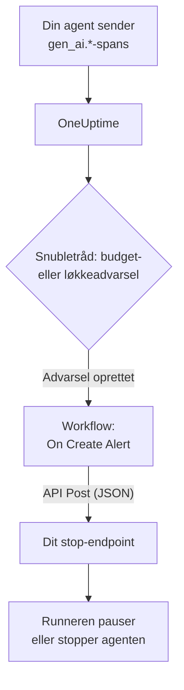

# Circuit breakers til AI-agenter

En AI-agent fejler sjældent ved at gå ned. Den fejler ved at fortsætte: den prøver et ødelagt værktøj igen, planlægger det samme trin en gang til eller starter flere underagenter, mens hver runde koster flere tokens. Denne side bygger en circuit breaker til det af dele, OneUptime allerede har: en advarsel, der opdager den løbske agent, og et workflow, der kalder et endpoint, du ejer, for at stoppe den.

:::cards
- [Vælg en snubletråd](#vælg-en-snubletråd): Advar ved forbrug, eller ved ét værktøj, der kaldes igen og igen.
- [Byg stop-endpointet](#byg-stop-endpointet): Den lille tjeneste, der sætter din agent på pause.
- [Byg workflowet](#byg-workflowet): Fra en ny advarsel til et kald til dit endpoint.
- [Test circuit breakeren](#test-circuit-breakeren): Udløs den manuelt og derefter for alvor.
:::

## Sådan virker det



Circuit breakeren overvåger den OpenTelemetry, din agent allerede sender, direkte eller [gennem en gateway](/docs/telemetry/ai-gateways), og handler ved siden af anmodningernes vej, ikke i den. Intet lægges oven i hvert modelkald, og et skift af udbyder, SDK eller gateway ødelægger den ikke.

Prisen er hastighed: den stopper en løbsk agent på minutter, ikke millisekunder. Behold trinbegrænsninger og timeouts i selve agenten, og lad circuit breakeren fange det, der slipper forbi dem.

| Snubletråd | Fanger | Tid til advarsel |
| --- | --- | --- |
| En budgetadvarsel fra en metrik-monitor | Forbrug, der bliver ved med at stige, uanset årsagen | Op til 15 minutter plus et minut til monitoren |
| En løkkeadvarsel fra en trace-monitor | Det samme værktøj kaldt igen og igen | 1 til 5 minutter |

## Før du begynder

- Din agent sender GenAI-spans til OneUptime. Se [AI- / LLM-observability](/docs/telemetry/ai-llm-observability).
- Et HTTPS-endpoint, der kan pause eller stoppe din agents runner, og som kan nås fra OneUptime. Du bygger det i [Byg stop-endpointet](#byg-stop-endpointet).
- Tilladelse til at oprette monitorer og workflows i projektet.

## Vælg en snubletråd

Begge snubletråde ender på samme måde: en monitor opretter en advarsel, og den nye advarsel starter workflowet. Du kan sætte begge op: workflowet er ligeglad med, hvilken af dem der udløste.

### En budgetadvarsel

Forbrug er det sikreste tegn på en løbsk agent. Et budget lægger dagens AI-forbrug sammen hvert 15. minut og udgiver det som to metrikker, `oneuptime.llm.budget.spend.usd` og `oneuptime.llm.budget.percent.used`, hver med budgettets ID i `oneuptime.llm.budget.id`.

:::steps
1. Åbn **Produkter → AI / LLM → Budgetter**, og klik på **Opret LLM Cost Budget**. Angiv et **Dagligt budget (USD)**, og vælg agentens tjeneste i **Tjeneste (valgfrit)**, så budgettet kun overvåger den agent.
2. Vælg **Vis ID** i rækkemenuen for det nye budget, og kopiér ID'et.
3. Opret en [Metrik-monitor](/docs/monitor/metrics-monitor) på `oneuptime.llm.budget.percent.used`, filtreret på attributten `oneuptime.llm.budget.id` med det ID, du kopierede, og sæt dens **Tidsinterval** til **Past 30 Minutes**.
4. Tilføj et kriterium **Greater Than Or Equal To** `100`, der opretter en advarsel, og giv det en **Advarselstitel**, der nævner agenten, f.eks. `LLM budget exceeded: support-bot`. Både workflowet og dit endpoint læser den titel.
:::

Filtrér på ID'et, ikke på navnet: omdøber du et budget, omdøbes dets serie, og en monitor, der filtrerer på det gamle navn, ville i al stilhed holde op med at matche. Hold tidsintervallet på 30 minutter: et budget udgiver ét punkt hvert 15. minut, så et kortere interval finder intet mellem to punkter, og advarslen åbner og lukker igen og igen.

Et ekstra kriterium ved `80` med lavere alvor advarer først et menneske gennem advarslens vagtpolitik, før circuit breakeren udløses ved `100`.

### En løkkeadvarsel

En agent, der sidder fast, efterlader et spor, du kan genkende: det samme værktøjs-span igen og igen. En sund kørsel kalder ikke ét værktøj dusinvis af gange på få minutter, så en optælling fanger løkken længe før budgettet.

:::steps
1. Åbn **Overvågninger**, klik på **Opret monitor**, og vælg **Spor** under **Flere monitortyper**.
2. Under **Flere felter** sætter du **Filtrér efter telemetritjeneste** til agentens tjeneste og **Filtrér efter attributter** til `gen_ai.tool.name` lig med det værktøj, du forventer, at den går i løkke på, f.eks. `search_web`. Hvis din instrumentering navngiver hvert værktøjs span, så angiv det navn i **Span-navn** i stedet.
3. Sæt **Overvågningsspor i (time)** til **Seneste 5 minutter**.
4. Tilføj et kriterium **Span Count** **Greater Than** et tal, som ingen sund kørsel når på fem minutter, f.eks. `50`, der opretter en advarsel med en titel som `Agent loop: support-bot`.
:::

En ekstra trace-monitor med **Filtrér efter span-status** sat til **Fejl** og en lavere optælling fanger storme af genforsøg: et værktøj, der bliver ved med at fejle, og en agent, der bliver ved med at prøve det igen.

## Byg stop-endpointet

Workflowet sender en `POST` med en JSON-brødtekst til et endpoint, du kører. Hvad "stop" betyder, bestemmer du. Fra den mindste virkning til den største:

| Handling | Virkning |
| --- | --- |
| Stop nyt arbejde | Runneren starter ingen nye kørsler for den agent |
| Annullér dens kørsler | Den agents igangværende kørsler annulleres |
| Sæt puljen på pause | Alle workers tømmes, indtil nogen nulstiller circuit breakeren |

Et minimalt endpoint i Express, der udløser en circuit breaker pr. agent:

```typescript title="circuit-breaker.ts"
import express from "express";

const app = express();
app.use(express.json());

const tripped = new Set<string>(); // agents whose breaker is open

app.post("/circuit-breaker", (req, res) => {
  if (req.headers["authorization"] !== `Bearer ${process.env.KILL_TOKEN}`) {
    return res.status(401).end();
  }

  const alertTitle: string = req.body.alertTitle ?? "";

  // "LLM budget exceeded: support-bot" -> "support-bot"
  const agent: string = alertTitle.split(": ").pop() ?? "unknown";

  tripped.add(agent); // your run loop checks this set
  abortActiveRuns(agent); // cancel that agent's runs in flight

  // Answer fast; do the slow cleanup in the background.
  return res.status(200).json({ tripped: agent });
});
```

Byg det efter disse regler:

- Gør udløsningen idempotent. En advarsel og en overskridelse, eller en budgetadvarsel og en løkkeadvarsel på samme tid, kan udløse den mere end én gang, og en anden udløsning må ikke ændre noget.
- Svar inden for et sekund eller to, og ryd op i baggrunden. Workflowet regner ethvert 2xx-svar som en succes.
- Kræv en hemmelighed. Alle, der kan kalde endpointet, kan stoppe dine agenter, så tjek et bearer-token, som workflowet sender fra en hemmelig global variabel.
- Nulstil den manuelt. En udløst circuit breaker forbliver udløst, indtil nogen har set på kørslen: åbn agentens samtale under **Produkter → AI / LLM → Samtaler** for at læse eller afspille, hvad den gjorde.

Anmodningen sendes fra OneUptime. På OneUptime Cloud skal dit endpoint kunne nås fra internettet. En selvhostet installation afviser private netværksadresser, medmindre en administrator tillader dem: se [Udgående netværksadgang](/docs/workflows/configuration#udgående-netværksadgang).

## Byg workflowet

Gem først endpointets token et sted, hvor workflowet kan bruge det uden at vise det: åbn **Arbejdsgange → Globale variabler**, klik på **Opret Workflow Variabel**, kald den `AGENT_KILL_TOKEN`, læg tokenet i **Indhold**, og slå **Hemmelighed** til. En hemmelig værdi fjernes fra kørslernes logge og trinnenes spor.

:::steps
### Opret workflowet

Åbn **Produkter → Arbejdsgange**, og klik på **Opret arbejdsgang**. Klik på **Start fra bunden**, kald det `AI agent circuit breaker`, og klik på **Opret arbejdsgang**. Det åbner i **Bygger**, slået fra.

### Tilføj udløseren

Klik på den stiplede blok **Choose what starts this workflow**, og vælg **On Create Alert** i panelet **Add Trigger**. Klik på udløseren, markér titlen og beskrivelsen i **Select Fields**, og klik på **Gem**. ID'et på blokken, `alert-on-create-1`, er det, senere blokke bruger til at henvise til den.

### Tjek titlen

Klik på **Tilføj komponent**, vælg **If / Else**, og forbind udløserens punkt **Success** med den. Sæt **Value to check** til advarslens titel (klik på **{ }**, og vælg den), **Comparison** til **indeholder** og **Compare with** til den begyndelse, dine snubletrådes titler har til fælles, f.eks. `LLM budget exceeded`.

### Kald dit endpoint

Tilføj **API Post (JSON)**, og forbind punktet **Yes** på **If / Else** med den. Sæt dens **URL** til dit endpoint, f.eks. `https://agents.example.com/circuit-breaker`, og udfyld headerne og brødteksten nedenfor.

### Rapportér en fejl

Tilføj **Send Message to Slack** eller **Send Email**, og forbind API-blokkens punkt **Error** med den. En circuit breaker, der ikke bliver udløst, er den ene advarsel, et menneske skal se.

### Slå det til

Slå **Aktiveret** til øverst i **Bygger**.
:::

API-blokkens **Request Headers**:

```json title="Request Headers"
{
  "Authorization": "Bearer {{global.variables.AGENT_KILL_TOKEN}}",
  "Content-Type": "application/json"
}
```

Dens **Request Body**:

```json title="Request Body"
{
  "source": "oneuptime-circuit-breaker",
  "alertId": "{{local.components.alert-on-create-1.returnValues.model._id}}",
  "alertTitle": "{{local.components.alert-on-create-1.returnValues.model.title}}",
  "alertDescription": "{{local.components.alert-on-create-1.returnValues.model.description}}"
}
```

For at reagere på flere snubletråde lader du alle deres titler begynde på samme måde, eller du kæder flere **If / Else**-blokke fra punktet **No**. Se [Byg et workflow](/docs/workflows/authoring) for lærredet og [Variabler](/docs/workflows/variables) for `{{…}}`-referencerne.

## Test circuit breakeren

:::steps
1. Udløs den manuelt. Åbn **Advarsler**, klik på **Opret advarsel**, og opret en med titlen `LLM budget exceeded: test`. Kørslen vises under **Arbejdsgange → Protokoller → Kørsler**, og dit endpoint modtager kaldet.
2. Udløs den for alvor. Opret et budget med en meget lille grænse, f.eks. `0.01` USD, på en testagents tjeneste, peg en budgetmonitor på det, og lad agenten køre: procenten passerer 100, advarslen åbner, workflowet kører, og circuit breakeren udløses. Til løkkeadvarslen giver du en testagent et værktøj, der altid fejler.
3. Udløs den to gange. Opret den samme advarsel igen: dit endpoint skal tage den anden udløsning uden at ændre noget.
:::

## Sådan opfører circuit breakeren sig over tid

- Workflowet kører, når en advarsel oprettes, så en snubletråd udløser circuit breakeren én gang pr. advarsel, ikke én gang pr. evaluering.
- Et budget tæller UTC-døgnet, så procenten starter forfra fra 0 ved midnat UTC. En budgetadvarsel kan så blive løst, og den næste dårlige dag åbner en ny advarsel, der udløser circuit breakeren igen.
- En monitor holder sin advarsel åben, så længe dens kriterier er opfyldt. Med **Løs advarsel automatisk** slået til løses advarslen, når de ikke længere er det, og den næste overskridelse åbner en ny advarsel.
- Nulstilling er et menneskes beslutning på begge sider: løs advarslen i OneUptime, og nulstil circuit breakeren i din runner.
- Hver ny advarsel i projektet starter workflowet. Det er **If / Else**, der holder andre advarsler væk fra circuit breakeren: udelad den ikke.

## Fejlfinding

:::details Workflowet kører ikke
Tjek, at **Aktiveret** er slået til øverst i **Bygger**: workflows oprettes slået fra. Tjek derefter, at advarslen blev oprettet, efter du slog workflowet til: udløseren starter kun en kørsel for en ny advarsel.
:::

:::details Workflowet kører, men tager altid grenen No
Titlen er tom eller matcher ikke. Et felt, som udløserens **Select Fields** ikke markerer, kommer tomt frem, så markér titlen. Sammenlign derefter advarslens titel med **Compare with**: **indeholder** skal finde præcis den tekst i den.
:::

:::details Dit endpoint svarer 401
Headeren `Authorization` matcher ikke det token, dit endpoint forventer. Tjek navnet i `{{global.variables.AGENT_KILL_TOKEN}}` og værdien, der er gemt i den globale variabel. En hemmelig variabels værdi kan ikke læses tilbage, så skriv den igen med **Update Content**, hvis du er i tvivl.
:::

:::details Budgetadvarslen åbner og lukker igen og igen
Monitorens **Tidsinterval** er kortere end budgettets 15 minutter mellem to punkter. Sæt det til **Past 30 Minutes**.
:::

:::details Anmodningen når aldrig frem til dit endpoint
Åbn kørslen under **Arbejdsgange → Protokoller → Kørsler** og trinnet **API Post (JSON)**: det fortæller, hvorfor anmodningen mislykkedes. På OneUptime Cloud skal endpointet kunne nås fra internettet; en selvhostet installation afviser private netværksadresser, medmindre en administrator tillader dem.
:::

## Næste trin

:::cards
- [AI- / LLM-observability](/docs/telemetry/ai-llm-observability): Budgetter, omkostninger og de spans, circuit breakeren overvåger.
- [Trace-monitor](/docs/monitor/traces-monitor): Span-filtre og kriterier i detaljer.
- [Workflows](/docs/workflows/index): Udløsere, komponenter, variabler og kørsler.
- [AI-gateways](/docs/telemetry/ai-gateways): Alle agenters modelkald gennem én eksport.
:::
