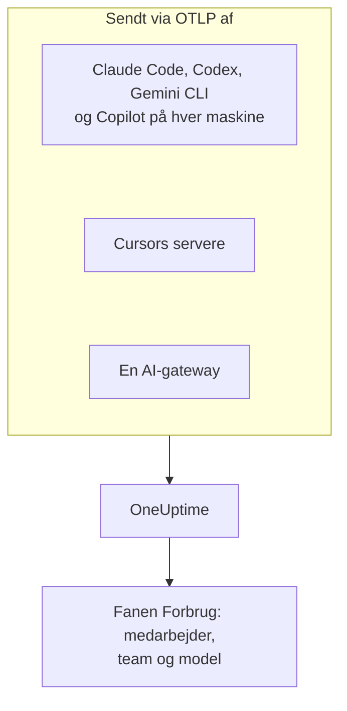

# AI-kodeassistenter

Dine udviklere bruger Claude Code, Cursor, Codex, Gemini CLI og Copilot, og fakturaerne bliver ved med at vokse. Denne side besvarer de spørgsmål, en leder har: **hvem bruger hvilket værktøj, med hvilke modeller, og hvad bruger hver person og hvert team**.

De fleste kodeassistenter eksporterer selv OpenTelemetry, så der er intet at installere på udviklernes maskiner: peg eksporten på OneUptime, så lander tokens, omkostninger og værktøjsbrug ved siden af dine egne apps' AI-kald. Alt her ankommer via OpenTelemetry; OneUptime spørger ikke nogen leverandørs administrations- eller fakturerings-API.

:::cards
- [Supportmatrix](#supportmatrix): Hvad hvert værktøj sender, og om det nævner en person.
- [Tildeling til medarbejdere og teams](#tildeling-til-medarbejdere-og-teams): De nøgler, der sætter et navn og et team på forbruget.
- [Fanen Forbrug](#fanen-forbrug): Hvad forbrugstabellerne kan og ikke kan vise for en kodeassistent.
- [Hvor du starter](#hvor-du-starter): En udrulningsrækkefølge, der viser resultater fra første dag.
:::

## Sådan virker det

Hvert værktøj sender sin telemetri til OneUptimes OTLP-endpoint med din indtagelsesnøgle: fra hver udviklermaskine, fra leverandørens servere (Cursor) eller fra en gateway, som din modeltrafik går igennem.



## Før du begynder

1. Opret en telemetri-indtagelsesnøgle under **Projektindstillinger → Telemetri og APM → Indtagelsesnøgler**.
2. Dit OTLP-endpoint er `https://oneuptime.com/otlp`, eller `https://YOUR-ONEUPTIME-HOST/otlp`, hvis du selv hoster OneUptime.
3. Hver eksport sender nøglen i headeren `x-oneuptime-token`.

Én indtagelsesnøgle til hele flåden er fint. Den ender på hver udviklermaskine, så behandl den som en delt legitimation, der kun kan sende data, og rotér den som enhver anden.

## Supportmatrix

Tre ting afgør, hvad du får fra et værktøj: om det overhovedet sender OpenTelemetry, hvordan dets telemetri når frem til OneUptime, og om noget i den nævner en person.

| Værktøj | Hvad det sender | Hvordan det når OneUptime | Hvem det nævner | Vejledning |
| --- | --- | --- | --- | --- |
| Claude Code | Metrikker og logs; traces i beta | Fra hver maskine; miljøvariabler eller en fil med administrerede indstillinger | `user.email`, når der er logget ind med en Claude-konto | [Claude Code](/docs/telemetry/claude-code) |
| Cursor | Metrikker og logs | Fra Cursors servere, sat op én gang i Cursors dashboard; kun med Enterprise-abonnementet | `cursor.user.id`, et heltal | [Cursor](/docs/telemetry/cursor) |
| OpenAI Codex | Traces, metrikker og logs, hver slået til i `~/.codex/config.toml` | Fra hver maskine, en fuld URL pr. signal | Ingen på spans eller metrikker: du sætter selv `user.id` og `user.email` i `[otel.span_attributes]` | [OpenAI Codex](/docs/telemetry/openai-codex) |
| Gemini CLI | Traces, metrikker og logs | Fra hver maskine, som regel gennem en lokal collector | `user.email`, når der er logget ind | [Gemini CLI og GitHub Copilot](/docs/telemetry/gemini-cli-and-copilot) |
| GitHub Copilot | Traces, metrikker og logs, kun fra dets agentflader | Fra editoren eller agentværten | Ingen: du sætter selv `enduser.id` og `user.email` på hver maskine | [Gemini CLI og GitHub Copilot](/docs/telemetry/gemini-cli-and-copilot) |
| Cline | Metrikker og logs | Konfigureret centralt, i Clines organisationsdashboard | Et anonymiseret `user_id` | — |
| LiteLLM og Portkey | Traces af hvert kald gennem gatewayen | Fra gatewayprocessen | Med LiteLLM ejeren af den virtuelle nøgle | [AI-gateways](/docs/telemetry/ai-gateways) |
| Dine egne apps | Det, din GenAI-instrumentering sender | Fra din app | Den, du sætter som `user.id` | [AI- / LLM-observability](/docs/telemetry/ai-llm-observability) |
| Windsurf, JetBrains AI, Amazon Bedrock, Azure OpenAI | Ingen egen OpenTelemetry | Kun gennem en gateway, du sætter foran | Den, gatewayen nævner | [AI-gateways](/docs/telemetry/ai-gateways) |

En tankestreg betyder, at OneUptime endnu ikke har en vejledning til værktøjet. Dets telemetri modtages alligevel som al anden OpenTelemetry.

:::details Hvad GitHub Copilot præcis eksporterer
Copilot eksporterer kun OpenTelemetry fra sine agentflader: chat og agenttilstand i VS Code, agentværten bag Copilot CLI, Copilot SDK og agent-workflows i JetBrains-IDE'er gennem Copilot-plugin'et. GitHub dokumenterer ingen eksport for inline-forslag, Copilot på github.com eller Copilots kodegennemgang. Copilot sender ingen brugerattribut af nogen art, så sæt `enduser.id` og `user.email` pr. maskine via `resourceAttributes` eller `OTEL_RESOURCE_ATTRIBUTES`.
:::

:::details Amazon Bedrock, Azure OpenAI, Windsurf og JetBrains AI
- **Amazon Bedrock**: API'erne `InvokeModel` og `Converse` sender ingen OpenTelemetry. Bedrock AgentCore er anderledes: AWS dokumenterer metrikker, spans og logs for det, sendt til CloudWatch som standard. Med `DISABLE_ADOT_OBSERVABILITY=true` slår du runtimens standard-ADOT-konfiguration fra, så du kan pege ADOT-SDK'et på OneUptime i stedet.
- **Azure OpenAI**: tjenesten sender intet, og dens Azure Monitor-metrikker har ingen brugerdimension. Instrumentér klienten, eller sæt API Management eller en anden gateway foran.
- **Windsurf**: dokumenterer ingen telemetrieksport. Data pr. bruger ligger i Windsurfs Enterprise-API, som OneUptime ikke spørger.
- **JetBrains AI Assistant og Junie**: eksporterer intet forbrug. JetBrains' OpenTelemetry-plugin modtager din egen apps telemetri inde i IDE'en; det sender intet ud.
:::

## Tildeling til medarbejdere og teams

OneUptime kopierer den person, der foretog et kald, og personens team ind i kolonner, når telemetrien ankommer, så fanen **Forbrug** kan rangere personer og teams uden attributfiltre.

### Attributter, der læses som medarbejderen

På et span vinder den første nøgle, der er til stede, i denne rækkefølge:

| Kolonne | Nøgler, den foretrukne først |
| --- | --- |
| Medarbejder-id | `user.id`, `enduser.id`, `litellm.metadata.user_api_key_user_id`, `metadata.user_api_key_user_id`, `traceloop.association.properties.user_id`, `langfuse.user.id`, `user.account_uuid`, `user.account_id`, `cursor.user.id` |
| Medarbejderens e-mail | `user.email`, `litellm.metadata.user_api_key_user_email`, `metadata.user_api_key_user_email`, `traceloop.association.properties.user_email`, `enduser.email` |
| Team / omkostningssted | `team.id`, `team`, `cost_center`, `department`, `litellm.metadata.user_api_key_team_id`, `litellm.team.id`, `metadata.user_api_key_team_id`, `cursor.team.id` |

På et datapunkt for en metrik er listen kortere og begynder med e-mailen, fordi de kodeassistenter, der sender metrikker, selv sender `user.email`:

| Kolonne | Nøgler, den foretrukne først |
| --- | --- |
| Medarbejder | `user.email`, `user.id`, `user.account_uuid`, `user.account_id`, `cursor.user.id` |
| Team / omkostningssted | `team.id`, `team`, `cost_center`, `department`, `cursor.team.id` |
| Model | `gen_ai.request.model`, `model`, `cursor.model.name` |

Sådan læses disse nøgler:

- **Hver nøgle læses også med præfikset `resource.`.** OTLP-indtagelse gemmer ressourceattributter under det præfiks, så `OTEL_RESOURCE_ATTRIBUTES=team.id=platform` ankommer som `resource.team.id`. Nøglerne uden præfiks prøves først, så en værdi på spannet slår en værdi på hele processen.
- **Fanen Forbrug viser en persons e-mail, når kaldet har en, og ellers id'et.** Rækker med samme e-mail lægges sammen, så én udvikler på to maskiner er én række.
- **Identitet læses kun fra AI-kald.** `user.id`, `user.email` og `team.id` er generiske nøgler, som browser- og backend-spans også bærer; kun spans, der allerede er genkendt som AI-kald, får kolonnerne.
- **Logposter læses ikke for identitet.** Det betyder noget for Codex, som kun sætter `user.email` på sine logs.
- LiteLLM staver disse nøgler på to måder: dets standard-`otel`-callback bruger præfikset `metadata.`, og dets valgfri OpenTelemetry v2-tilstand (`LITELLM_OTEL_V2=true`) navnerummet `litellm.`. OneUptime læser begge, så en standardproxy virker uden ekstra opsætning.

### Teams og omkostningssteder

Ingen instrumentering sender `team.id`, `team`, `cost_center` eller `department`: din organisation sætter dem, som regel via `OTEL_RESOURCE_ATTRIBUTES` på værktøjets proces.

```bash
export OTEL_RESOURCE_ATTRIBUTES="team.id=platform,team=Platform_Engineering,cost_center=eng-123,department=engineering"
```

Sæt den, hvor du allerede klargør udviklermaskiner: en MDM-profil, en fil med administrerede indstillinger eller en shellprofil fra dine dotfiles. Værdier må ikke indeholde mellemrum: brug understregninger eller procentkodning som `%20`. Codex har ingen ressourceattributter, så sæt de samme nøgler i dets `[otel.span_attributes]` i stedet.

For at opdele forbruget efter applikation bruger du tjenestenavnet (`OTEL_SERVICE_NAME` eller værktøjets egen indstilling). Opdelingen **Applikation / Tjeneste** dækker kun værktøjer, der sender GenAI-spans.

### Hvad der bevidst ikke behandles som medarbejderen

Et kald kan bære to forskellige personer: medarbejderen, der foretog det, og kunden, det blev foretaget for. Disse nøgler bærer kunden, og OneUptime læser dem aldrig ind i en identitetskolonne:

- `gen_ai.user` og `llm.user`: sådan gengiver instrumenteringer OpenAIs anmodningsparameter `user`, som OpenAI beskriver som en identifikator for dine slutbrugere.
- `litellm.metadata.user_api_key_end_user_id`, `metadata.user_api_key_end_user_id` og `litellm.end_user.id`: LiteLLMs slutbruger, i modsætning til nøglens ejer, som er medarbejderen.

At læse et kunde-id som en medarbejder ville gøre en supportbot, der betjener 40.000 kunder, til 40.000 fantommedarbejdere, mens udvikleren, der ejer forbruget, ville se ud til ikke at bruge noget. Nøglerne bliver i spannets attributter, og trace-fremviserens **LLM**-fane viser dem som slutbrugeren.

### Privatliv

Medarbejderens e-mailkolonne indeholder personoplysninger. Traces' **Scrub-regler** dækker den præcis, som de dækker den attribut, den blev læst fra, så en regel, der maskerer e-mails, maskerer også kolonnen. Du finder dem under **Spor → Indstillinger**.

## Kodeassistentmetrikker, som OneUptime læser

Kodeassistenterne navngiver deres metrikker med deres eget præfiks i stedet for `gen_ai.*`, så OneUptime kender hver enkelt ved navn:

| Metrik | Værktøj | Enhed |
| --- | --- | --- |
| `claude_code.token.usage` | Claude Code | Tokens |
| `claude_code.cost.usage` | Claude Code | USD |
| `cursor.token.usage` | Cursor | Tokens |
| `cursor.cost.usage` | Cursor | USD, et overslag efter Cursors egen opgørelse |
| `codex.turn.token_usage` | OpenAI Codex | Tokens |
| `codex.turn.cost_microusd` | OpenAI Codex | Milliontedele af en USD: OneUptime omregner dem, så lad være med selv at gøre det |

OneUptime læser også tokens fra `gen_ai.client.token.usage`, `gen_ai.client.token.count`, `llm.token.usage` og `llm.usage.tokens`, og omkostninger fra `gen_ai.client.cost`, `gen_ai.client.cost.usd`, `gen_ai.usage.cost`, `litellm_spend_metric` og `litellm.cost.total`.

To ting, du skal vide, før du læser tallene:

- **`gemini_cli.token.usage` er udeladt med vilje.** Gemini CLI sender sine tokens to gange, som sin egen metrik og som `gen_ai.client.token.usage`, og at læse begge ville fordoble dem. Dets tokens tælles én gang, gennem `gen_ai.client.token.usage`. Gemini CLI sender ingen omkostningsmetrik: slå dets traces til, så hvert kald bliver prissat.
- **Kun input- og outputtokens tælles.** Tokentypen læses fra `gen_ai.token.type`, `llm.token.type`, `type`, `cursor.token.type` eller `token_type`, og kun `input` og `output` (eller de ældre `prompt` og `completion`) tæller. Cachelæsninger og -skrivninger, Codex' `total` (som gentager de andre) og `reasoning_output` (en del af `output`) udelades, så en total fra metrikker er mindre end summen af alt, hvad et værktøj sender.

## Fanen Forbrug

Åbn **Produkter → AI / LLM**, og gå til **Forbrug**. Den rangerer **Medarbejder**, **Team**, **Model**, **Udbyder** og **Applikation / Tjeneste** efter forbrug, over de seneste 7 dage, medmindre du vælger et andet tidsrum. Kald, der ikke nævner nogen, tælles under **Ikke tildelt**: en stor række **Ikke tildelt** fortæller dig, hvilket værktøj der stadig mangler sin identitet.

### Kodeassistentmetrikker er en reserve, ikke et tillæg

GenAI-spans kommer først: metrikkerne læses kun for et tal, som spans ikke rapporterede noget for, og de to lægges aldrig sammen ([hvorfor](/docs/telemetry/ai-llm-observability#spans-kommer-først-metrikker-udfylder-hullerne)). For kodeassistenter har det én klar konsekvens: **hvis det samme projekt modtager GenAI-spans med omkostninger, vises kodeassistenternes forbrug ikke.** Giv kodeassistenterne et projekt for sig selv, med sin egen indtagelsesnøgle.

Når reserven gælder, er det her, hvad hver opdeling kan vise for et værktøj, der kun sender metrikker:

| Opdeling | Fra metrikker |
| --- | --- |
| **Medarbejder** | Ja, fra hver identitetsnøgle ovenfor, med og uden præfikset `resource.` |
| **Team** | Ja, fra teamnøglerne |
| **Model** | Ja: Claude Code og Codex sender et `model` uden præfiks, Cursor `cursor.model.name` |
| **Udbyder** | Nej: kodeassistenternes metrikker nævner ingen udbyder |
| **Applikation / Tjeneste** | Nej: deres metrikker tilhører ingen OneUptime-tjeneste |

En række læst fra metrikker bærer kun omkostninger: dens celler for kald og tokens viser `—`, fordi en forbrugstæller ikke har detaljer pr. kald, og et 0 der ville påstå, at personen ikke foretog nogen kald. Tabellen er markeret med **fra GenAI-metrikker**.

## Ingen OpenTelemetry? Sæt en gateway foran

For Windsurf, JetBrains AI, Bedrocks model-API'er, Azure OpenAI og alt andet uden egen eksport sætter du en AI-gateway foran. Hvert kald går så gennem én proces, der sender OpenTelemetry, og du konfigurerer eksporten én gang.

**Brug LiteLLM med én virtuel nøgle pr. medarbejder.** LiteLLM sætter nøgleejerens id og e-mail på hvert span, som OneUptime læser som medarbejderen, og nøglens team som teamet. Det prissætter også selv hvert kald, med de tilpassede priser, du sætter på proxyen, og den omkostning, det rapporterer, vinder over OneUptimes overslag. Brug ikke dets slutbruger-id til dette: det er kunden. Opsætningen står i [AI-gateways](/docs/telemetry/ai-gateways).

To begrænsninger, før du planlægger omkring en gateway:

- **En gateway ser kun trafik, der sendes gennem den.** Cursors egen tilsidesættelse af basis-URL'en er en indstilling pr. bruger, der kun dækker chatmodeller (Tab-fuldførelse bruger stadig Cursors modeller), så foretræk Cursors indbyggede eksport.
- **En gateway ser modelkaldet, ikke agenten.** Den registrerer prompts og svar, men ikke de værktøjskald, filredigeringer og beslutninger om at acceptere eller afvise, som et værktøjs egen telemetri rapporterer.

## Promptindhold: standarderne er forskellige fra værktøj til værktøj

Prompts og svar er de mest risikable data i denne pipeline: de indeholder rutinemæssigt kildekode, kundedata og indsatte legitimationsoplysninger. Tjek hvert værktøjs standard:

| Værktøj | Promptindhold som standard |
| --- | --- |
| Claude Code | Fra: hver slags indhold har sin egen variabel til at slå det til |
| Cursor | Fra: kun den valgfri familie `conversation_content` sender beskedtekst |
| OpenAI Codex | Fra: `log_user_prompt` er `false` som standard |
| Gemini CLI | **Til**: `logPrompts` er `true` som standard, så sæt det til `false`, når du slår telemetri til |
| GitHub Copilot | Fra: `captureContent`, som administrerede indstillinger kan låse med `lockCaptureContent` |
| LiteLLM | Til med standard-`otel`-callbacken (slå det fra med `turn_off_message_logging`); fra i OpenTelemetry v2-tilstand |

Codex sender også sine metrikker til OpenAI som standard: se [OpenAI Codex](/docs/telemetry/openai-codex). Hvor du bevidst opsamler indhold, gælder traces' **Scrub-regler** og **Drop-filtre** for det som for al anden telemetri.

## Hvad OneUptime endnu ikke gør

- **Ingen administrations- eller faktureringsforbindelser til leverandører.** OneUptime spørger ikke Anthropics Admin API, Cursors Admin API, OpenAIs endpoints for forbrug og omkostninger, GitHubs Copilot-fakturering eller Windsurfs og JetBrains' API'er. Hent tal på fakturaniveau hos leverandøren.
- **Omkostninger er et overslag, medmindre et værktøj rapporterer dem.** En rapporteret omkostning bruges, som den er; ellers prissætter OneUptime tokens til listepriser. Cursors `cursor.cost.usage` er selv et overslag.
- **Identitet på logposter læses ikke.** Codex' `user.email`, som det kun sender på logs, knyttes ikke til forbruget.
- **Cursors `cursor.user.email` læses endnu ikke**, så Cursor-brugere vises som deres heltal `cursor.user.id`.
- **Codex-spans nævner ingen model**, så OneUptime kan ikke prissætte dem: Codex viser tokens pr. person og sine omkostninger kun i totalerne.
- **Værktøjer ændrer sig hurtigt.** Hvis denne side siger, at et værktøj ikke har nogen eksport, så tjek dets aktuelle dokumentation, før du bygger omkring en gateway.

## Hvor du starter

Rul ud i denne rækkefølge; hvert trin er nyttigt i sig selv. Brug et projekt, der ikke allerede modtager GenAI-spans fra dine egne apps, ellers holder [reservereglen](#kodeassistentmetrikker-er-en-reserve-ikke-et-tillæg) kodeassistenternes forbrug væk fra siden.

1. **Gemini CLI**, hvis nogen bruger det. Det sender `user.email` uden opsætning, så det viser tildelingen fungere hele vejen igennem. Slå også dets traces til: det sender ingen omkostningsmetrik.
2. **Claude Code**: én fil med administrerede indstillinger til flåden, `user.email` gratis, en rigtig omkostningsmetrik samt acceptrate, commits, pull requests og kodelinjer pr. udvikler.
3. **Cursor**, med Enterprise-abonnementet: én skærm i Cursors dashboard, ingen udviklermaskine berørt, selv om personer ankommer som heltal.
4. **Copilot og Codex**, som begge kræver en identitet sat på hver maskine. Gør det, når du klargør maskiner: kald, der ankom uden en, kan ikke tildeles bagefter.
5. **En LiteLLM-gateway** til alt det andet, med én virtuel nøgle pr. medarbejder.

## Næste trin

:::cards
- [Claude Code](/docs/telemetry/claude-code): Slå Claude Codes eksport til for én maskine eller hele flåden.
- [Cursor](/docs/telemetry/cursor): Send Cursors teamtelemetri fra Cursors dashboard.
- [OpenAI Codex](/docs/telemetry/openai-codex): Konfigurér Codex' tre eksportører, og sæt en identitet på dets spans.
- [AI- / LLM-observability](/docs/telemetry/ai-llm-observability): Samtaler, advarsler, omkostninger og budgetter for hvert AI-kald.
:::
