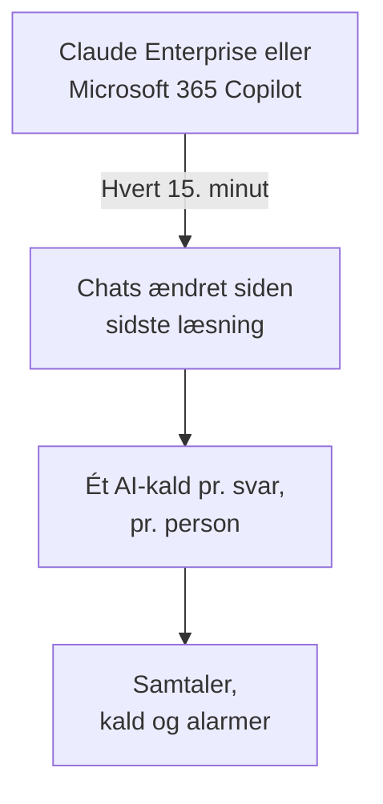

# Virksomhedens AI-værktøjer

Se, hvad dine folk spørger de AI-værktøjer om, som din virksomhed betaler for, som samtaler pr. person. Forbind Claude Enterprise eller Microsoft 365 Copilot med legitimationsoplysninger, der kun kan læse, så henter OneUptime hver ny chat ind i **Samtaler** hvert 15. minut. Kun projektets ejere og administratorer kan læse dem, medmindre du vælger andet.

:::cards
- [Fortæl det først til dine folk](#fortæl-det-først-til-dine-folk): Deres chats er deres egne ord.
- [Forbind et værktøj](#forbind-et-værktøj): Indsæt legitimationsoplysningerne, vælg hvem der må læse, test og forbind.
- [Privatliv](#privatliv): Hvem der må læse samtalerne, og om ordene gemmes.
- [Andre AI-værktøjer](#andre-ai-værktøjer): ChatGPT Enterprise, Gemini, Open WebUI, LibreChat og kodeassistenter.
:::

## Fortæl det først til dine folk

> [!IMPORTANT]
> Det er dine folks egne ord. Før du forbinder et værktøj, så fortæl dem, at deres chats med det gemmes, og hvem der kan læse dem, og tjek med jeres juridiske afdeling eller HR, hvad jeres politikker og lokal lovgivning kræver.

## Sådan virker det

Hvert 15. minut beder OneUptime værktøjet om de chats, der er ændret siden sidste læsning. Hvert svar bliver ét AI-kald fra den person, der spurgte, med de spørgsmål, der er stillet siden forrige svar, og hver chat bliver én samtale.

Chattene kommer ind på samme måde som dine apps' AI-kald, så scrub-regler, drop-filtre, opbevaring og AI-alarmerne gælder for dem. Værktøjerne betales pr. licens, så disse kald har hverken tokens eller omkostninger. Et spørgsmål uden svar i en time kommer ind for sig selv, så også en chat, AI'en aldrig besvarede, vises.

## Før du begynder

- Rollen Project Owner eller Project Admin. Kun de kan forbinde, ændre eller fjerne et værktøj.
- En administrator af værktøjet til at oprette legitimationsoplysningerne: hvert værktøjs afsnit nedenfor fortæller hvem.
- Dine folk informeret og svaret fra jeres juridiske afdeling eller HR.

## Forbind et værktøj

:::steps
### Åbn Forbind

Åbn **Produkter → AI / LLM → Forbind**. Under **Din virksomheds AI-værktøjer** klikker du på værktøjets felt.

### Indsæt legitimationsoplysningerne

Under **Loginoplysninger** udfylder du det, værktøjet beder om. Hemmeligheder gemmes krypteret og vises aldrig igen.

### Vælg, hvem der må læse

Under **Privatliv** indstiller du **Hvem der kan læse samtaler** og **Behold det skrevne**, som [Privatliv](#privatliv) forklarer.

### Test det

Under **Test** klikker du på **Test forbindelse**. OneUptime tæller chattene fra de sidste 7 dage: intet, nogen har skrevet, læses, vises eller gemmes.

### Forbind

Klik på **Forbind**. Den første læsning starter inden for et minut og henter de sidste 7 dage.
:::

## Claude Enterprise

OneUptime læser hver claude.ai-chat i din organisation via Compliance API: hvem der spurgte, hvad Claude blev spurgt om, hvad den svarede, og hvilken model den brugte. En chat, der får en ny besked, læses igen, og de svar, der allerede er hentet, genkendes og springes over.

:::steps
### Slå Compliance API til

Organisationens primære ejer åbner Organization settings, API i claude.ai og slår Compliance API til.

### Opret en compliance-adgangsnøgle

Opret der en nøgle med scopet `read:compliance_user_data`. Den starter med `sk-ant-api01-`.

### Forbind Claude Enterprise

Indsæt nøglen som **Compliance-adgangsnøgle**.
:::

## Microsoft 365 Copilot

OneUptime læser hver persons Copilot-interaktionshistorik fra Microsoft Graph: hvad vedkommende spurgte Copilot om i Teams, Outlook, Word, Excel, PowerPoint, Loop eller Copilot Chat, hvad den svarede, og i hvilken app. En prompt og dens svar bliver ét AI-kald, og en Copilot-session én samtale. En stor tenant læses i dele og fortsætter, hvor den sidste læsning stoppede.

:::steps
### Registrér en app

Registrér en app i Microsoft Entra ID, og opret en klienthemmelighed til den.

### Giv tilladelserne

Giv appen applikationstilladelserne `AiEnterpriseInteraction.Read.All` og `User.Read.All` fra Microsoft Graph, og giv administratorsamtykke.

### Forbind Copilot

Udfyld **Mappe-id (tenant)**, **Program-id (klient)** og **Klienthemmelighed**. Vil du kun læse nogle personer, så sæt en gruppes objekt-id i **Kun personer i denne gruppe** under **Flere felter**, og giv også appen `GroupMember.Read.All`. For Azure Government ændrer du **Cloud** samme sted.
:::

## Privatliv

| Indstilling | Hvad den gør |
| --- | --- |
| **Hvem der kan læse samtaler** | **Projektejere og administratorer**, standarden: ingen andre i projektet ser disse samtaler eller de AI-kald, de består af, nogen steder i OneUptime. **Alle, der må læse AI-kald**: alle, der må læse projektets traces. |
| **Behold det skrevne** | Til, standarden: spørgsmål og svar gemmes. Fra: OneUptime gemmer, hvem der spurgte, hvornår, med hvilken model og i hvilken app, men ikke ordene. |

En ændring af, hvem der må læse, gælder inden for et minut. At slå **Behold det skrevne** fra gælder for de chats, der læses bagefter; det, der blev gemt før, bliver, indtil opbevaringen slutter.

Vil du beholde ordene, men maskere dele af dem, som e-mailadresser eller kortnumre, så brug **Scrub-regler** under **Spor → Indstillinger**: de gælder, før noget gemmes. Samtalerne gemmes, så længe forbindelsens tjeneste gemmer sine traces: se [Dataopbevaring](/docs/telemetry/data-retention). At fjerne en forbindelse stopper dens læsninger; det, den har læst, bliver, læsbart for de samme personer, indtil opbevaringen slutter.

## Andre AI-værktøjer

Disse værktøjer har intet API, som OneUptime kan læse folks chats med, eller kræver en anden vej.

### ChatGPT Enterprise

OpenAI åbner kun sin Compliance API for et workspace efter anmodning og offentliggør ikke, hvad posterne indeholder, så OneUptime kan endnu ikke læse chats fra ChatGPT Enterprise. At forbinde din OpenAI-organisation som en [udbyderkonto](/docs/telemetry/ai-provider-accounts#openai) viser dens API-forbrug og -omkostninger, som ikke omfatter ChatGPT.

### Gemini til Google Workspace

Google tilbyder intet API til at læse folks Gemini-chats. Google Vault opbevarer dem til eDiscovery.

### Kodeassistenter

Claude Code, Codex, Gemini CLI, GitHub Copilot og Cursor sender deres egen OpenTelemetry: se [AI-kodeassistenter](/docs/telemetry/ai-coding-assistants).

### Open WebUI og LibreChat

Selvhostede chatapps kalder modellerne gennem et API, du angiver. Sæt en LiteLLM-proxy foran modellerne, og send dens traces til OneUptime, som [AI-gateways](/docs/telemetry/ai-gateways#litellm-proxy) viser: hver chats prompts og svar kommer ind som AI-kald. En virtuel nøgle pr. person viser, hvem der spurgte; en nøgle, alle deler, nævner ingen. Open WebUIs egen OpenTelemetry-eksport tracer webforespørgsler og databasekald, ikke chattene.

## Fejlfinding

:::details Testen finder ingen chats
Ingen har brugt værktøjet de sidste 7 dage, eller legitimationsoplysningerne tilhører en anden organisation eller tenant. For Copilot tjekker du, at gruppen under **Kun personer i denne gruppe** er den, du mener.
:::

:::details Legitimationsoplysningerne virker, men må ikke læse det, forbindelsen skal bruge
For Copilot giver du administratorsamtykke til appens Graph-tilladelser, og også `GroupMember.Read.All`, når du angiver en gruppe. For Claude Enterprise opretter du nøglen med scopet `read:compliance_user_data`.
:::

:::details Nogen kan ikke se samtalerne
**Hvem der kan læse samtaler** står på **Projektejere og administratorer**. En ejer eller administrator kan ændre det med **Rediger** i forbindelsens række.
:::

:::details Samtalerne viser, hvem der spurgte, men ingen ord
**Behold det skrevne** var slået fra, da de blev læst. At slå det til gælder for de chats, der læses bagefter.
:::

## Næste trin

:::cards
- [AI- / LLM-observability](/docs/telemetry/ai-llm-observability): Læs og afspil samtaler, og få besked, når svarene går galt.
- [AI-udbyderkonti](/docs/telemetry/ai-provider-accounts): Forbrug og omkostninger for dine konti hos OpenAI, Anthropic, Azure, Bedrock og Vertex AI.
- [AI-kodeassistenter](/docs/telemetry/ai-coding-assistants): Forbrug pr. udvikler for kodeværktøjerne.
- [Dataopbevaring](/docs/telemetry/data-retention): Hvor længe samtalerne gemmes.
:::
