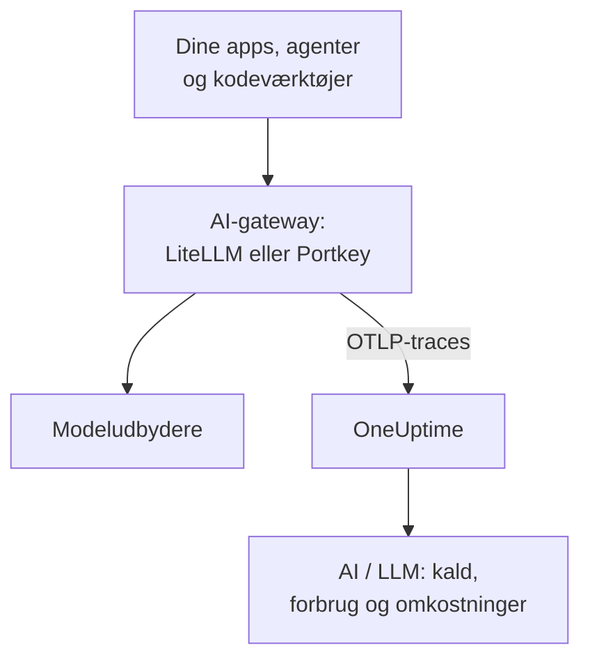

# AI-gateways (LiteLLM, Portkey)

En AI-gateway sidder mellem dine apps og modeludbyderne, så hvert modelkald går igennem den. Send gatewayens OpenTelemetry til OneUptime én gang, og hvert kald bag den ankommer i [AI / LLM](/docs/telemetry/ai-llm-observability) med model, tokens, omkostning og, medmindre du slår det fra, prompten og svaret, uden at du skal instrumentere hver app.

:::cards
- [LiteLLM Proxy](#litellm-proxy): Indbygget eksport, sat op med tre variabler.
- [Hvem brugte hvad](#én-virtuel-nøgle-pr-medarbejder): Én virtuel LiteLLM-nøgle pr. medarbejder navngiver hver person.
- [Portkey](#portkey): Indbygget eksport på selvhostede gateways; andre steder instrumenterer du appen.
- [Tjek, at kaldene ankommer](#tjek-at-kaldene-ankommer): Hvad du bør se, og hvad du gør, hvis du ikke ser det.
:::

## Sådan virker det



| | LiteLLM Proxy | Portkey, selvhostet eller Enterprise | Portkey, open source eller hostet |
| --- | --- | --- | --- |
| Eksport til OneUptime | Indbygget | Indbygget, eksperimentel | Ingen: instrumentér appen i stedet |
| Endpoint, der skal angives | `https://oneuptime.com/otlp/v1/traces` | `https://oneuptime.com/otlp` | Appens egen eksportør |
| Navngiver hver person | Ja, med én virtuel nøgle pr. medarbejder | Nej | Kun det, appen sender |
| Prompts og svar | Sendes, medmindre du slår dem fra | Sendes altid | Afhænger af instrumenteringen |

## Før du begynder

- En ingestion-nøgle: åbn **Projektindstillinger → Telemetri og APM → Indtagelsesnøgler**, og klik på **Opret ingestion-nøgle**.
- Din OTLP-basis-URL: `https://oneuptime.com/otlp`, eller `https://YOUR-ONEUPTIME-HOST/otlp`, hvis du selv hoster OneUptime. OneUptime accepterer OTLP over HTTP, i protobuf og i JSON.
- Nøglen følger med i headeren `x-oneuptime-token` på hver eksportanmodning.

## LiteLLM Proxy

LiteLLM's OpenTelemetry-callback er en del af open source-proxyen, og det officielle Docker-image (`ghcr.io/berriai/litellm`) indeholder de pakker, den har brug for.

:::steps
### Slå otel-callbacken til

Tilføj `otel` til callbacks i proxyens `config.yaml`:

```yaml title="config.yaml"
model_list:
  - model_name: gpt-4o
    litellm_params:
      model: openai/gpt-4o
      api_key: os.environ/OPENAI_API_KEY

litellm_settings:
  callbacks: ["otel"]
```

### Peg eksportøren mod OneUptime

Angiv tre variabler på proxyen:

```bash
export OTEL_EXPORTER="otlp_http"
export OTEL_ENDPOINT="https://oneuptime.com/otlp/v1/traces"
export OTEL_HEADERS="x-oneuptime-token=YOUR_INGESTION_TOKEN"
```

### Start proxyen

:::tabs
@tab Docker
```bash
docker run \
  -v $(pwd)/config.yaml:/app/config.yaml \
  -e OPENAI_API_KEY="sk-..." \
  -e OTEL_EXPORTER="otlp_http" \
  -e OTEL_ENDPOINT="https://oneuptime.com/otlp/v1/traces" \
  -e OTEL_HEADERS="x-oneuptime-token=YOUR_INGESTION_TOKEN" \
  -e OTEL_SERVICE_NAME="litellm-gateway" \
  -p 4000:4000 \
  ghcr.io/berriai/litellm:main-stable \
  --config /app/config.yaml
```
@tab pip
```bash
pip install 'litellm[proxy]' opentelemetry-api opentelemetry-sdk opentelemetry-exporter-otlp
litellm --config config.yaml
```
:::

`litellm[proxy]` alene indeholder ikke OpenTelemetry-pakkerne, så installér dem ved siden af.

### Send en anmodning igennem den

Kald proxyen én gang, og tjek derefter AI / LLM som beskrevet i [Tjek, at kaldene ankommer](#tjek-at-kaldene-ankommer).
:::

| Variabel | Værdi | Bemærkninger |
| --- | --- | --- |
| `OTEL_EXPORTER` | `otlp_http` | Læses også som `OTEL_EXPORTER_OTLP_PROTOCOL` |
| `OTEL_ENDPOINT` | `https://oneuptime.com/otlp/v1/traces` | Den fulde sti `/v1/traces` virker med alle LiteLLM-versioner; læses også som `OTEL_EXPORTER_OTLP_ENDPOINT` |
| `OTEL_HEADERS` | `x-oneuptime-token=YOUR_INGESTION_TOKEN` | Kommaseparerede `key=value`-par; læses også som `OTEL_EXPORTER_OTLP_HEADERS` |
| `OTEL_SERVICE_NAME` | Navnet på din gateway | Den tjeneste, kaldene vises under; `litellm`, hvis du ikke angiver noget |

### Hvad LiteLLM sender

Hvert kald bærer `gen_ai.system`, `gen_ai.request.model`, `gen_ai.response.model`, `gen_ai.usage.input_tokens` og `gen_ai.usage.output_tokens`, sine parametre samt prompten og svaret: alt, hvad OneUptime behøver for at [læse kaldet](/docs/telemetry/ai-llm-observability).

Siden LiteLLM 1.81 ligger disse attributter på anmodningens span `Received Proxy Server Request`, og der er ikke længere et separat span `litellm_request`. Når én anmodning foretager flere modelkald, overskriver hvert kald dér det forriges attributter, så angiv `USE_OTEL_LITELLM_REQUEST_SPAN=true` for at få et span `litellm_request` for hvert kald.

LiteLLM prissætter selv hvert kald, inklusive egne takster, du har sat op på proxyen, og rapporterer prisen som `gen_ai.cost.total_cost`. OneUptime foretrækker en rapporteret pris frem for sit eget skøn og [skønner ud fra tokens](/docs/telemetry/ai-llm-observability) kun, når LiteLLM ikke kunne prissætte kaldet, f.eks. for en egen model uden angivet pris.

### Én virtuel nøgle pr. medarbejder

Giv hver person sin egen virtuelle LiteLLM-nøgle, så ankommer hvert kald, personen foretager, med vedkommendes identitet. LiteLLM skriver ID, e-mail og team for nøglens ejer på spannet, og OneUptime læser dem som medarbejderen og teamet, så fanen **Forbrug** rangerer forbruget pr. person, uden at noget skal sættes op på deres maskiner.

Virtuelle nøgler kræver en database og en masternøgle på proxyen (`DATABASE_URL` og `LITELLM_MASTER_KEY`). Opret en bruger med vedkommendes e-mail og derefter en nøgle til den bruger:

```bash
curl -X POST "http://localhost:4000/user/new" \
  -H "Authorization: Bearer YOUR_MASTER_KEY" \
  -H "Content-Type: application/json" \
  -d '{"user_email": "alice@example.com"}'

curl -X POST "http://localhost:4000/key/generate" \
  -H "Authorization: Bearer YOUR_MASTER_KEY" \
  -H "Content-Type: application/json" \
  -d '{"user_id": "USER_ID_FROM_THE_FIRST_CALL", "team_id": "platform"}'
```

| Span-attribut fra LiteLLM | OneUptime læser det som |
| --- | --- |
| `metadata.user_api_key_user_id` | Medarbejderens ID |
| `metadata.user_api_key_user_email` | Medarbejderens e-mail |
| `metadata.user_api_key_team_id` | Teamet |
| `metadata.user_api_key_end_user_id` | Aldrig medarbejderen: det er den `user`, din app sender for sin egen kunde |

I LiteLLM's OpenTelemetry v2-tilstand ankommer de samme værdier med præfikset `litellm.` (`litellm.metadata.user_api_key_user_email` osv.), som OneUptime også læser.

### Hold prompts ude

Callbacken `otel` sender som standard hele prompts og svar. For at holde dem ude bruger du en af disse muligheder:

:::tabs
@tab Alle callbacks
```yaml title="config.yaml"
litellm_settings:
  callbacks: ["otel"]
  turn_off_message_logging: true
```
@tab Kun OTel-callbacken
```yaml title="config.yaml"
litellm_settings:
  callbacks: ["otel"]

callback_settings:
  otel:
    message_logging: False
```
@tab Miljøvariabel
```bash
export OTEL_INSTRUMENTATION_GENAI_CAPTURE_MESSAGE_CONTENT="NO_CONTENT"
```
:::

`callback_settings` er en nøgle på øverste niveau, ikke en nøgle under `litellm_settings`. For at beholde prompts, men maskere dele af dem, bruger du i stedet rensningsregler under **Spor → Indstillinger**.

:::details LiteLLM's OpenTelemetry v2-tilstand
Nyere LiteLLM-versioner har en valgfri OpenTelemetry v2-tilstand (`LITELLM_OTEL_V2=true`, ingen ændring i `config.yaml`). Den sender én trace pr. anmodning, med HTTP-håndteringen, godkendelsen, guardrails og modelkaldet som GenAI-spans med navne som `chat gpt-4o`. I v2-tilstand er prompts slået fra som standard; slå dem til med `OTEL_INSTRUMENTATION_GENAI_CAPTURE_MESSAGE_CONTENT`. Omkostningen ankommer som `litellm.cost.total`, som OneUptime også læser. Brug den ene tilstand eller den anden, ikke begge.
:::

## Portkey

Hvad Portkey kan sende, afhænger af, hvordan du kører den:

| Udrulning | Eksport til OneUptime |
| --- | --- |
| Selvhostet eller Enterprise-gateway | Indbygget (eksperimentel): angiv variablerne nedenfor |
| Open source-gateway (`portkey-ai/gateway`) | Ingen: instrumentér appen, der kalder den |
| Hostet gateway (portkey.ai) | Ingen på gatewayen: instrumentér appen, der kalder den |

Portkey har også sit eget OpenTelemetry-endpoint (`api.portkey.ai/v1/otel`). Det modtager traces i Portkey, den modsatte retning af denne side.

### Selvhostede og Enterprise-gateways

Angiv disse variabler på gatewayens container:

```yaml title="docker-compose.yml"
services:
  portkey-gateway:
    environment:
      EXPERIMENTAL_GEN_AI_OTEL_TRACES_ENABLED: "true"
      EXPERIMENTAL_GEN_AI_OTEL_EXPORTER_OTLP_ENDPOINT: "https://oneuptime.com/otlp"
      EXPERIMENTAL_GEN_AI_OTEL_EXPORTER_OTLP_HEADERS: "x-oneuptime-token=YOUR_INGESTION_TOKEN"
```

- Angiv OTLP-basis-URL'en: Portkey tilføjer selv `/v1/traces`.
- Headere er kommaseparerede `key=value`-par. `EXPERIMENTAL_GEN_AI_OTEL_RESOURCE_ATTRIBUTES` tilføjer ressourceattributter på samme måde, f.eks. `deployment.environment=production`.
- Portkey sender kun OTLP over HTTP som JSON, hvilket OneUptime accepterer uden en collector imellem.
- Hvert kald er et span med navnet `{operation} {model}`, f.eks. `chat gpt-4o`, under tjenesten `portkey`, med `gen_ai.provider.name`, den ønskede og den leverede model, tokenoptællingerne, `gen_ai.conversation.id` og beskederne i `gen_ai.input.messages` og `gen_ai.output.messages`.
- Hele prompts og svar er altid med. Maskér det nødvendige med rensningsregler under **Spor → Indstillinger**.
- Hvert kald sendes for sig efter svaret, uden batching og uden genforsøg: en mislykket eksport er tabt. Behandl det som observability, ikke som en revisionslog.
- Hvis din `x-portkey-trace-id` er et gyldigt trace-ID (32 hexadecimale tegn), genbruger Portkey det, så gatewayens spans hænger sammen med din egen apps trace.

Portkey markerer denne eksport som eksperimentel. Hvis variablerne ikke har nogen effekt, så sammenhold Portkeys aktuelle dokumentation med din gateways version.

### Open source- og hostede gateways

Open source-gatewayen har ingen eksportør, og på den hostede gateway kan du ikke angive dens variabler. Instrumentér i stedet den app, der kalder Portkey. Portkey taler OpenAI-API'et, så GenAI-instrumenteringerne fra [AI- / LLM-observability](/docs/telemetry/ai-llm-observability) (OpenLLMetry, OpenInference, OpenLIT) sporer din SDK's kald, også når basis-URL'en peger på Portkey:

```python
from traceloop.sdk import Traceloop
from openai import OpenAI

Traceloop.init(
    app_name="my-ai-agent",
    api_endpoint="https://oneuptime.com/otlp",
    headers={"x-oneuptime-token": "YOUR_INGESTION_TOKEN"},
)

client = OpenAI(
    base_url="https://api.portkey.ai/v1",   # or your gateway's URL
    default_headers={"x-portkey-api-key": "PORTKEY_API_KEY"},
)
# Calls through Portkey are now traced to OneUptime.
```

Disse spans beskriver kaldet, som din app foretog det: den model, den bad om, den tid, den ventede, de tokens, den fik tilbage. Det, gatewayen besluttede undervejs, som en fallback, et genforsøg eller et cachehit, bliver i Portkey. For at se det i OneUptime bruger du den selvhostede gateways eksport.

## Tjek, at kaldene ankommer

:::steps
1. Send en anmodning gennem gatewayen, og vent et par sekunder.
2. Åbn **Produkter → AI / LLM → Kald**. Kaldet er på listen med udbyder, model og tokens.
3. Klik på kaldet for at åbne dets trace, og åbn spannets fane **LLM**: modellen, tokens, parametrene og, medmindre du slog dem fra, prompten og svaret.
4. Åbn **Forbrug**: kaldet tæller med i totalerne, med den omkostning, gatewayen rapporterede, eller som OneUptime skønnede.
:::

## Fejlfinding

:::details Intet ankommer fra LiteLLM
Angiv `OTEL_EXPORTER="console"` et øjeblik. Hvis der vises spans i proxyens output, sporer LiteLLM, og problemet ligger i endpointet eller nøglen. `DEBUG_OTEL="true"` viser, hvad eksportøren gør.
:::

:::details Nøglen afvises
OneUptime svarer `401` på en manglende, ukendt eller udløbet nøgle og `422` på en deaktiveret nøgle eller en browsernøgle. Opret en servernøgle under **Projektindstillinger → Telemetri og APM → Indtagelsesnøgler**, og send den i `x-oneuptime-token`.
:::

:::details Endpointet er forkert
LiteLLM tager den fulde sti, `https://oneuptime.com/otlp/v1/traces`. Portkey tager basis-URL'en, `https://oneuptime.com/otlp`, og tilføjer selv `/v1/traces`.
:::

:::details Spans ankommer, men ikke i AI / LLM
Filtrér **Spor** på gatewayens tjeneste (`litellm`, `portkey` eller din `OTEL_SERVICE_NAME`) for at se de rå spans. Et span tæller kun som et modelkald, når det bærer `gen_ai.*`-attributter: tjek, at callbacken er `otel`, og at kaldet gik til en model.
:::

:::details Forbruget vises som ikke tildelt
Kaldene navngiver ingen person. Giv hver medarbejder sin egen virtuelle nøgle, som i [Én virtuel nøgle pr. medarbejder](#én-virtuel-nøgle-pr-medarbejder). Feltet `user`, som din app sender, navngiver dens kunde, ikke medarbejderen, og læses aldrig som medarbejderen.
:::

:::details Af flere kald vises kun det sidste
Siden LiteLLM 1.81 deler en anmodnings modelkald ét span. Angiv `USE_OTEL_LITELLM_REQUEST_SPAN=true` for at få et span for hvert kald.
:::

## Næste trin

:::cards
- [AI- / LLM-observability](/docs/telemetry/ai-llm-observability): Samtaler, advarsler, forbrug og daglige omkostningsbudgetter for disse kald.
- [AI-kodeassistenter](/docs/telemetry/ai-coding-assistants): Sæt en gateway foran værktøjer, der ikke selv sender telemetri.
- [Circuit breakers til AI-agenter](/docs/telemetry/ai-agent-circuit-breaker): Stop en løbsk agent, når dens advarsel går i gang.
- [Trace-monitor](/docs/monitor/traces-monitor): Advar ved span-mønstre, som et værktøj, der kaldes i en løkke.
:::
