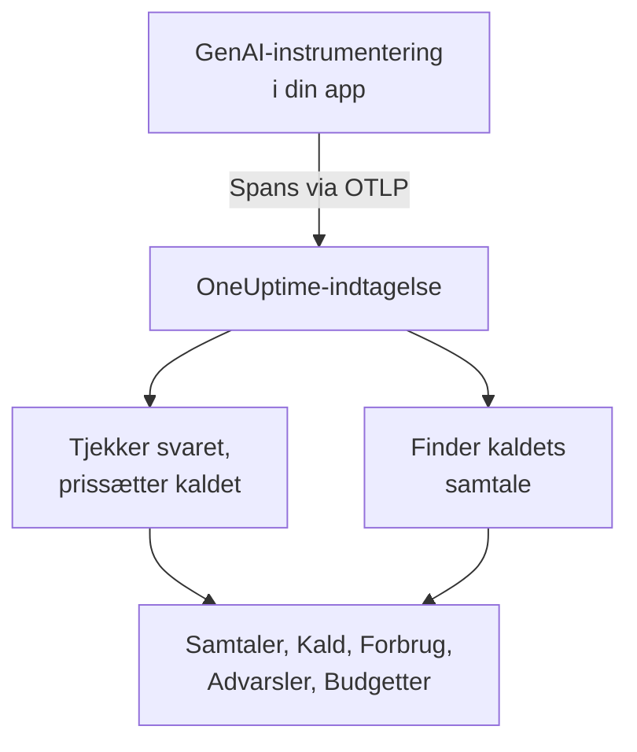
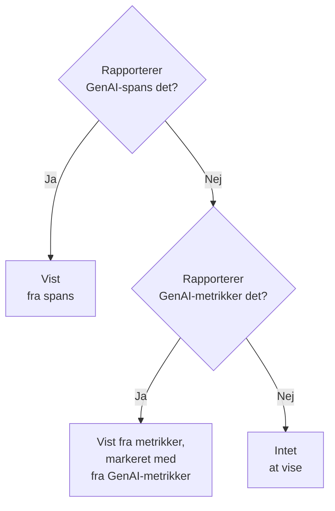

# AI- / LLM-observability

Læs hver samtale, din AI har haft, afspil den, som den skete, og få besked, når den svarer dårligt. OneUptime bygger det hele på standard-OpenTelemetry: Hvis din app sender spans med **GenAI-semantiske konventioner** (`gen_ai.*`), får du samtaler, advarsler, forbrug og omkostninger uden et proprietært SDK.

:::cards
- [Sæt det op](#sæt-det-op-i-fem-trin): Fem trin, fra det første span til markerede svar.
- [Afspil en samtale](#læs-og-afspil-en-samtale): Læs en chat, som personen så den, i det tempo, den skete.
- [Få advarsler](#få-besked-når-aien-svarer-dårligt): Færdige advarsler for svar, der fejler, bliver afvist, afkortet, markeret eller er langsomme.
- [Hold øje med forbruget](#se-hvem-der-bruger-hvad): Omkostninger pr. person, team, model og app, med daglige budgetter.
:::

## Sådan virker det

Din apps GenAI-instrumentering eksporterer hvert kald til modellen som et OpenTelemetry-span. Når spannet ankommer, læser OneUptime dets `gen_ai.*`-attributter, tjekker svaret for problemer, prissætter kaldet og lægger det under den samtale, det hører til.



Åbn **Produkter → AI / LLM** under **Observabilitet**. Produktet har syv faner:

| Fane | Hvad den viser |
| --- | --- |
| **Samtaler** | Hver samtale, din AI har haft, med dem, der kræver opmærksomhed, først. Over listen: samtaler, AI-svar, hvor mange der kræver opmærksomhed, omkostninger og den typiske svartid. |
| **Kald** | Hvert model-, embedding-, agent- og værktøjskald. Filtrér efter tjeneste, udbyder, model, operation, person, team eller samtale; klik på et kald for at åbne det i trace-fremviseren. |
| **Forbrug** | Kald, tokens og omkostninger for et tidsrum, rangeret efter medarbejder, team, model, udbyder eller app. |
| **Advarsler** | Færdige advarsler for, når AI'en svarer dårligt, og dine AI / LLM-monitorer. |
| **Budgetter** | Daglige omkostningsgrænser, offentliggjort som metrikker, du kan advare på. |
| **Priser** | Dine egne priser for modeller, som den indbyggede prisliste ikke kender. |
| **Opsætning** | De fem trin nedenfor, med dit projekts endpoint. |

I trace-fremviseren har spannet for hvert AI-kald også en **LLM**-fane: udbyder, model, tokens, omkostninger, anmodningsparametre samt prompten og svaret.

## Før du begynder

- Et OneUptime-projekt, hvor du kan oprette en telemetri-indtagelsesnøgle.
- En app, der kalder en model, og en GenAI-instrumentering til dens sprog: **OpenLLMetry** (Traceloop), **OpenInference** (Arize), **Vercel AI SDK** eller OpenTelemetry-instrumenteringerne til OpenAI, Anthropic og Gemini.

> [!TIP]
> Modeltrafik, der går gennem en gateway som LiteLLM eller Portkey, kan eksporteres fra gatewayen i stedet for fra hver app: se [AI-gateways](/docs/telemetry/ai-gateways). For de kodeassistenter, dine udviklere bruger, se [AI-kodeassistenter](/docs/telemetry/ai-coding-assistants).

## Sæt det op i fem trin

Det første trin er alt, hvad du behøver for at se kald. Hvert trin derefter viser mere.

:::steps
### Send dine AI-kald

Opret en indtagelsesnøgle under **Projektindstillinger → Telemetri og APM → Indtagelsesnøgler** ([OpenTelemetry-hurtigstarten](/docs/telemetry/open-telemetry#opret-en-indtagelsesnøgle) gennemgår det). Peg derefter din instrumentering på OneUptime:

:::tabs
@tab Python
```bash
pip install traceloop-sdk opentelemetry-exporter-otlp
```

```python
from traceloop.sdk import Traceloop

Traceloop.init(
    app_name="my-ai-agent",
    api_endpoint="https://oneuptime.com/otlp",
    headers={"x-oneuptime-token": "YOUR_INGESTION_TOKEN"},
)
# Your OpenAI, Anthropic and LangChain calls are now traced.
```
@tab Node.js
```bash
npm install @traceloop/node-server-sdk
```

```typescript
import * as traceloop from "@traceloop/node-server-sdk";

traceloop.initialize({
  appName: "my-ai-agent",
  baseUrl: "https://oneuptime.com/otlp",
  headers: { "x-oneuptime-token": "YOUR_INGESTION_TOKEN" },
});
```
@tab OpenTelemetry SDK
```bash
export OTEL_EXPORTER_OTLP_ENDPOINT="https://oneuptime.com/otlp"
export OTEL_EXPORTER_OTLP_HEADERS="x-oneuptime-token=YOUR_INGESTION_TOKEN"
export OTEL_EXPORTER_OTLP_PROTOCOL="http/protobuf"
export OTEL_SERVICE_NAME="my-ai-agent"
```
:::

Hoster du selv OneUptime? Brug `https://YOUR-ONEUPTIME-HOST/otlp` i stedet for `https://oneuptime.com/otlp`. Kald din model én gang, så dukker kaldet op under **Kald**.

### Registrér, hvad der blev sagt

En samtale viser kun, hvad folk spurgte om, og hvad AI'en svarede, når din instrumentering registrerer det. OpenLLMetry registrerer prompts og svar, medmindre du sætter `TRACELOOP_TRACE_CONTENT=false`. OpenTelemetry-instrumenteringerne registrerer dem kun, når du beder om det:

```bash
export OTEL_INSTRUMENTATION_GENAI_CAPTURE_MESSAGE_CONTENT=true
```

Nyere OpenTelemetry-instrumenteringer tager `span_only`, `event_only` eller `span_and_event` i stedet for `true`. Uden registreret indhold viser en samtale stadig sine tider, sine omkostninger og sine problemer. Prompts kan indeholde følsomme data: [Privatliv og maskering](#privatliv-og-maskering) viser, hvordan du maskerer dem, før de gemmes.

### Saml kald i samtaler

En chatapp laver ét modelkald pr. tur. Sæt `gen_ai.conversation.id` (eller `session.id`) til din chats id på hvert AI-kald, så vises hver chat som én samtale, uanset hvor mange kald og traces den tog. Med OpenLLMetry sætter du det én gang pr. anmodning:

```python
from traceloop.sdk import Traceloop

Traceloop.set_association_properties({
    "session_id": chat.id,
    "user_email": user.email,
})
```

Med Vercel AI SDK sender du chattens id som `experimental_telemetry: { metadata: { sessionId } }`. Kald uden samtale-id vises stadig, én anmodning (ét trace) ad gangen.

### Angiv, hvem der spurgte

Sæt `user.id` eller `user.email` på hvert AI-kald (associationsegenskaben ovenfor sætter e-mailen). Så viser hver samtale, hvem den var med, du kan søge i listen efter person, og fanen **Forbrug** rangerer forbruget efter medarbejder. [Tildeling til medarbejdere og teams](/docs/telemetry/ai-coding-assistants#tildeling-til-medarbejdere-og-teams) viser alle de identitetsnøgler, OneUptime læser.

### Markér dårlige svar

OneUptime tjekker hvert svar, når det ankommer, og markerer, hvad der gik galt med det:

| Problem | Hvad det betyder | Fundet ud fra |
| --- | --- | --- |
| Fejlet | Kaldet endte med en fejl, så der kom intet svar | Span-status Error, `error.type` eller en afslutningsårsag `error` |
| Afvist | AI'en nægtede, eller et sikkerhedsfilter blokerede svaret | En afslutningsårsag for afvisning eller sikkerhed (`content_filter`, `refusal`, `SAFETY` og lignende), en afvisning i svaret eller et svar, der starter med en standardafvisning på engelsk |
| Afkortet | Svaret stoppede ved tokengrænsen | En afslutningsårsag `length`, `max_tokens` eller `MAX_TOKENS` |
| Tomt | Ingen tekst og intet værktøjskald | Registreret indhold, der ikke indeholder noget, eller 0 outputtokens |
| Markeret | En evaluering, din app sendte, sagde, at svaret var dårligt | En `gen_ai.evaluation.result`-hændelse |

De første fire kræver intet af dig. For at markere et svar, som din guardrail, din evaluering eller en tommel-ned-knap afviser, tilføjer du en `gen_ai.evaluation.result`-hændelse til svarets span, mens spannet er åbent, med `gen_ai.evaluation.score.label` sat til `fail`:

```python
from opentelemetry import trace

trace.get_current_span().add_event(
    "gen_ai.evaluation.result",
    {
        "gen_ai.evaluation.name": "relevance",
        "gen_ai.evaluation.score.label": "fail",
        "gen_ai.evaluation.explanation": "The answer is about another product.",
    },
)
```

Etiketter som `incorrect`, `wrong`, `unhelpful`, `toxic`, `unsafe` og `hallucination` tæller også som fejlet. OneUptime sender aldrig dine samtaler til en anden AI for at bedømme dem: hvert tjek læser kun det, kaldet selv bærer.
:::

## Læs og afspil en samtale

En samtale åbner i sin helhed, som en chatapp viser sin historik: det, personen sagde, til højre, AI'ens svar til venstre med model, tid, tokens og omkostninger, værktøjskald imellem, og hvad der gik galt, markeret der, hvor det skete. **Detaljer** under et svar viser, hvorfor det stoppede, dets evalueringer og et link til kaldet i Spor.

Bjælken nederst afspiller samtalen, som personen oplevede den:

| Knap | Hvad den gør |
| --- | --- |
| **Afspil igen** | Afspiller samtalen fra den første besked, i det tempo, den skete. "AI'en svarer…" tæller op, mens et svar er på vej. Klik på tidspunktet for en besked for at afspille derfra. |
| **Spring ventetid over** | Slået til som standard: forkorter enhver stilhed på mere end 3 sekunder. |
| `1x` | Ændrer hastigheden: 1x, 2x, 4x eller 8x. |
| **K**, **J** eller **←**, **L** eller **→** | Afspil eller pause, gå en besked tilbage, gå en besked frem. |

Sidens adresse husker den besked, en afspilning stoppede ved (`?step=`), så et link, du deler, åbner på det tidspunkt.

## Få besked, når AI'en svarer dårligt

Fanen **Advarsler** viser de advarsler, de fleste AI-apps har brug for. Når du vælger en, åbner **Opret monitor** udfyldt, og du kan ændre alt, før du gemmer:

| Advarsel | Hvornår den giver besked | Alvorlighed |
| --- | --- | --- |
| Svar går galt | Mere end 5 % af svarene på 15 minutter fejler, bliver afvist, afkortet, er tomme eller markeret | Warning |
| AI-kald fejler | Mere end 10 % af kaldene til modellen på 5 minutter ender med en fejl | Critical |
| AI'en nægter at svare | Mere end 5 % af svarene på 30 minutter er afvisninger | Warning |
| Svar bliver afkortet | 3 eller flere svar på 30 minutter stopper ved tokengrænsen | Warning |
| Svar bliver markeret | En evaluering markerer et svar som dårligt | Warning |
| Svar er langsomme | Mere end 10 % af svarene på 15 minutter tager mere end 30 sekunder | Warning |
| AI'en holder op med at svare | AI'en giver ingen svar i 30 minutter | Critical |

Advarslerne på en andel af svarene venter også på mindst 3 dårlige svar, så ét dårligt svar ud af to tilkalder ingen. En Critical-advarsel får dit projekts højeste advarselsalvorlighed og en Warning-advarsel den næste: High og Low i et nyt projekt.

Hver advarsel er en **AI / LLM**-monitor. Dens indstillinger siger, hvad der tæller som et dårligt svar (**Tæl et svar som dårligt, når det**, **Eller tager længere end (sekunder)**), hvor langt tilbage hvert tjek kigger (**Tidsvindue**, 15 minutter som standard), hvilke **Apps** den overvåger og, under **Flere felter**, hvilken **Model**. En **Forhåndsvisning** viser, hvad monitoren ville tælle lige nu. Dens kriterier sammenligner tre tal: **Dårlige AI-svar (i %)**, **Dårlige AI-svar** og **AI-svar**.

En færdig advarsel opretter en advarsel, der løser sig selv, og viser monitoren som **Degraded**, mens svarene er dårlige. Dens incident er udfyldt, men slået fra: slå den til for at tilkalde nogen.

## Se, hvem der bruger hvad

Fanen **Forbrug** viser kald, tokens og omkostninger for et tidsrum (de seneste 7 dage, medmindre du vælger et andet) og en tabel over de 25 største i én af fem opdelinger: **Medarbejder**, **Team**, **Model**, **Udbyder** og **Applikation / Tjeneste**. Kald, der ikke nævner nogen, tælles under **Ikke tildelt** og smides aldrig væk.

Personer og teams kommer fra identitetsattributter på kaldet: se [Tildeling til medarbejdere og teams](/docs/telemetry/ai-coding-assistants#tildeling-til-medarbejdere-og-teams).

### Spans kommer først, metrikker udfylder hullerne

GenAI-spans bærer modellen, tokens og omkostningerne for ét kald, så hvor de findes, besvarer de alt. Nogle værktøjer udgiver token- og omkostningsmetrikker og ingen GenAI-spans, som de fleste kodeassistenter. OneUptime læser kun de metrikker for et tal, som spans ikke rapporterede noget for, og lægger aldrig de to sammen: mange instrumenteringer sender begge for det samme kald, og at lægge dem sammen ville tælle hver dollar to gange.



| Hvor | Hvad der falder tilbage på metrikker | Hvornår |
| --- | --- | --- |
| Input- og outputtokens | Begge totaler | Spans' tokentotaler er begge 0 |
| Omkostninger (USD) | Omkostningerne, med Codex' omkostninger i mikro-USD omregnet til USD | Spans' omkostningstotal er 0 |
| LLM-kald | Intet: kun spans | — |
| Tabellerne **Medarbejder**, **Team**, **Model** | Kun omkostninger; cellerne for kald og tokens viser `—` | Den tabel fandt ingen rækker fra spans |
| Tabellerne **Udbyder**, **Applikation / Tjeneste** | Intet: kun spans | — |
| Samtaler | Intet: samtaler bygges ud fra spans | — |

Et tal fra metrikker er markeret med **fra GenAI-metrikker**, fordi det ikke har matchende rækker under **Kald**. Så snart dine GenAI-spans rapporterer et tal, vises et værktøj, der kun sender metrikker, altså ikke med sin andel. For at se sådan et værktøjs forbrug for sig sender du det til et projekt for sig selv, hvor der ikke ankommer GenAI-spans.

## Hvad et kald koster

En omkostning, som din instrumentering rapporterer (`gen_ai.usage.cost`), bruges, som den er, også når den er 0. Når der ikke rapporteres nogen, anslår OneUptime en, når spannet ankommer, ud fra antallet af tokens og en indbygget prisliste for almindelige modeller fra OpenAI, Anthropic, Google Gemini, Mistral, DeepSeek, xAI, Cohere, Amazon Nova og Meta Llama. Den leverede model prissættes først, derefter den anmodede model.

Modeller matches på det længste navnepræfiks, så id'er med dato eller leverandørpræfiks som `gpt-4o-2024-08-06` og `us.anthropic.claude-sonnet-4-5-20250929-v1:0` finder deres families pris. En model, som listen ikke kender, også en ny udgivelse, bliver aldrig gættet: dens omkostning forbliver 0, indtil du prissætter den. Overslag bruger listepriser uden rabatter for cache eller batch.

For selv at prissætte en model (en forhandlet pris, en fine-tune eller en model, du selv hoster) tilføjer du den på fanen **Priser** under **Tilpassede LLM-priser**: et **Modelpræfiks**, en **Inputpris (USD pr. 1M tokens)** og en **Outputpris (USD pr. 1M tokens)**. Det længste matchende præfiks vinder på tværs af dine priser og den indbyggede liste; ved uafgjort vinder din pris. En pris gælder for kald, der ankommer omkring et minut efter, at du har gemt den; allerede gemte kald beholder deres omkostning.

## Daglige omkostningsbudgetter

Et budget følger én dags forbrug i USD over UTC-døgnet. Hvert 15. minut lægger OneUptime dagens AI-forbrug sammen (fra spans, eller fra GenAI-omkostningsmetrikker, når intet span rapporterede noget), viser det på budgettet og udgiver to metrikker:

| Metrik | Hvad den er |
| --- | --- |
| `oneuptime.llm.budget.spend.usd` | Dagens forbrug indtil nu, i USD |
| `oneuptime.llm.budget.percent.used` | Forbruget som en procentdel af den daglige grænse |

Begge bærer `oneuptime.llm.budget.id` og `oneuptime.llm.budget.name` samt budgettets omfang, når det har et.

:::steps
### Opret budgettet

På fanen **Budgetter** klikker du på **Opret LLM Cost Budget**. Giv det et navn og et **Dagligt budget (USD)**, og lad omfanget være tomt for hele projektet, eller vælg en **Tjeneste (valgfrit)**, en **LLM-udbyder (valgfri)** eller en **LLM-model (valgfri)**. Flere budgetter kan overvåge forskellige omfang.

### Advar på det

Opret en [metrik-monitor](/docs/monitor/metrics-monitor) på `oneuptime.llm.budget.percent.used`, filtreret på `oneuptime.llm.budget.id` (navnet ændres, når du omdøber budgettet). Tilføj et kriterie `>= 80`, der udløser en advarsel, og et `>= 100`, der udløser en kritisk advarsel.

### Udvid vinduet

Sæt monitorens rullende vindue til 30 minutter. Et budget udgiver ét punkt hvert 15. minut, så standardvinduet på 1 minut ville ikke finde noget mellem to punkter.
:::

En budgetadvarsel kan også køre en workflow, der stopper en løbsk agent: se [Circuit breakers til AI-agenter](/docs/telemetry/ai-agent-circuit-breaker).

## Dashboards og advarsler på metrikker

GenAI-metrikker som `gen_ai.client.token.usage` og `gen_ai.client.operation.duration` ankommer som almindelige OpenTelemetry-metrikker. Vis dem i et [dashboard](/docs/dashboards/index), eller advar på dem med en [metrik-monitor](/docs/monitor/metrics-monitor), for eksempel når p95 for `gen_ai.client.operation.duration` krydser en tærskel, grupperet efter model.

## Privatliv og maskering

AI-kald gemmes som trace-spans, så traces' **Scrub-regler** og **Drop-filtre** gælder for dem: maskér en attribut, eller drop et span, før det gemmes. Du finder begge under **Spor → Indstillinger**. Medarbejderens e-mailkolonne maskeres sammen med den attribut, den blev læst fra, så en regel, der maskerer e-mails, dækker også den.

Samtaler læses med samme tilladelse som traces: den, der kan læse projektets traces, kan læse dets samtaler, og ingen andre.

## Attributter, som OneUptime læser

OneUptime læser OpenTelemetrys GenAI-konventioner og de stavemåder, som OpenLLMetry, OpenInference, Vercel AI SDK og LiteLLM bruger, så de almindelige biblioteker virker, som de er. For hver værdi vinder den første nøgle, et span bærer:

| Værdi | Nøgler, i den rækkefølge de prøves |
| --- | --- |
| Udbyder | `gen_ai.system`, `gen_ai.provider.name`, `llm.system`, `llm.provider` |
| Operation | `gen_ai.operation.name`, `llm.request.type`, `openinference.span.kind` |
| Anmodet model | `gen_ai.request.model`, `llm.model_name`, `llm.request.model` |
| Leveret model | `gen_ai.response.model`, `llm.response.model` |
| Inputtokens | `gen_ai.usage.input_tokens`, `gen_ai.usage.prompt_tokens`, `llm.token_count.prompt`, `llm.usage.prompt_tokens` |
| Outputtokens | `gen_ai.usage.output_tokens`, `gen_ai.usage.completion_tokens`, `llm.token_count.completion`, `llm.usage.completion_tokens` |
| Tokens i alt | `gen_ai.usage.total_tokens`, `llm.token_count.total`, `llm.usage.total_tokens` |
| Omkostninger (USD) | `gen_ai.usage.cost`, `gen_ai.usage.cost_usd`, `gen_ai.usage.total_cost`, `llm.usage.total_cost`, `gen_ai.cost.total_cost`, `litellm.cost.total` |
| Samtale | `gen_ai.conversation.id`, `session.id`, `langfuse.session.id`, `traceloop.association.properties.session_id`, `ai.telemetry.metadata.sessionId` |
| Agent | `gen_ai.agent.name`, `agent.name` |
| Værktøj | `gen_ai.tool.name`, `tool.name`, `ai.toolCall.name` |
| Afslutningsårsag | `gen_ai.response.finish_reasons`, `gen_ai.response.finish_reason`, `llm.response.finish_reason`, `ai.response.finishReason` |
| Fejl | `error.type` |

Et span tæller som et AI-kald, når det bærer en af disse værdier eller en attribut, der begynder med `gen_ai.`, `llm.` eller `traceloop.`. Tokens i alt er input plus output, når der ikke rapporteres en total. Nøglerne `gen_ai.usage.total_tokens` og `gen_ai.usage.cost` er ikke en del af konventionerne, som ikke definerer nogen af dem; OneUptime læser dem, fordi almindelige instrumenteringer sender dem.

Identitetsnøglerne (hvem der foretog kaldet, og deres team) står under [Tildeling til medarbejdere og teams](/docs/telemetry/ai-coding-assistants#tildeling-til-medarbejdere-og-teams).

### Hvor prompts og svar læses fra

Samtalevisningen læser et kalds beskeder fra, i denne rækkefølge:

- hændelsen `gen_ai.client.inference.operation.details`;
- attributterne `gen_ai.input.messages`, `gen_ai.output.messages` og `gen_ai.system_instructions`;
- de ældre hændelser pr. rolle: `gen_ai.system.message`, `gen_ai.user.message`, `gen_ai.assistant.message`, `gen_ai.tool.message` og `gen_ai.choice`;
- de indekserede attributter: OpenLLMetrys `gen_ai.prompt.N.content` og `gen_ai.completion.N.content`, OpenInferences `llm.input_messages.N.message.content` og `llm.output_messages.N.message.content`;
- beskedarrays i `gen_ai.prompt`, `gen_ai.completion`, `ai.prompt.messages`, `ai.response.text`, `input.value` og `output.value`.

## Fejlfinding

:::details Kald ankommer, men ingen samtaler viser tekst
Din instrumentering registrerer ikke indhold. Slå det til, som [Registrér, hvad der blev sagt](#registrér-hvad-der-blev-sagt) viser; kald foretaget før det forbliver uden tekst.
:::

:::details Hvert kald i en chat vises som sin egen samtale
Kaldene bærer intet samtale-id. Sæt `gen_ai.conversation.id` eller `session.id` på hvert kald i chatten, som [Saml kald i samtaler](#saml-kald-i-samtaler) viser.
:::

:::details Kald viser tokens, men koster $0
Modellen er ikke i den indbyggede prisliste, eller spannet nævner ingen model. Tilføj modellens priser på fanen **Priser**; kald, der ankommer derefter, bliver prissat.
:::

:::details Fanen Forbrug siger fra GenAI-metrikker og viser `—` for kald og tokens
Tallene kommer fra et værktøj, der sender metrikker og ingen GenAI-spans, som en kodeassistent. En metrik bærer omkostninger, men ingen detaljer pr. kald, så de celler forbliver tomme. Se [Spans kommer først, metrikker udfylder hullerne](#spans-kommer-først-metrikker-udfylder-hullerne).
:::

:::details En budgetmonitor skifter frem og tilbage mellem to tilstande
Monitorens rullende vindue er kortere end 15 minutter, så nogle gange finder den intet punkt. Sæt det til 30 minutter.
:::

## Næste trin

:::cards
- [AI-kodeassistenter](/docs/telemetry/ai-coding-assistants): Forbrug pr. udvikler for Claude Code, Cursor, Codex, Gemini CLI og Copilot.
- [AI-gateways](/docs/telemetry/ai-gateways): Trace alle apps' modelkald fra én LiteLLM- eller Portkey-gateway.
- [Circuit breakers til AI-agenter](/docs/telemetry/ai-agent-circuit-breaker): Stop en løbsk agent, når en budgetadvarsel udløses.
- [OpenTelemetry](/docs/telemetry/open-telemetry): Endpoints, indtagelsesnøgler og grænser for hvert signal.
:::
