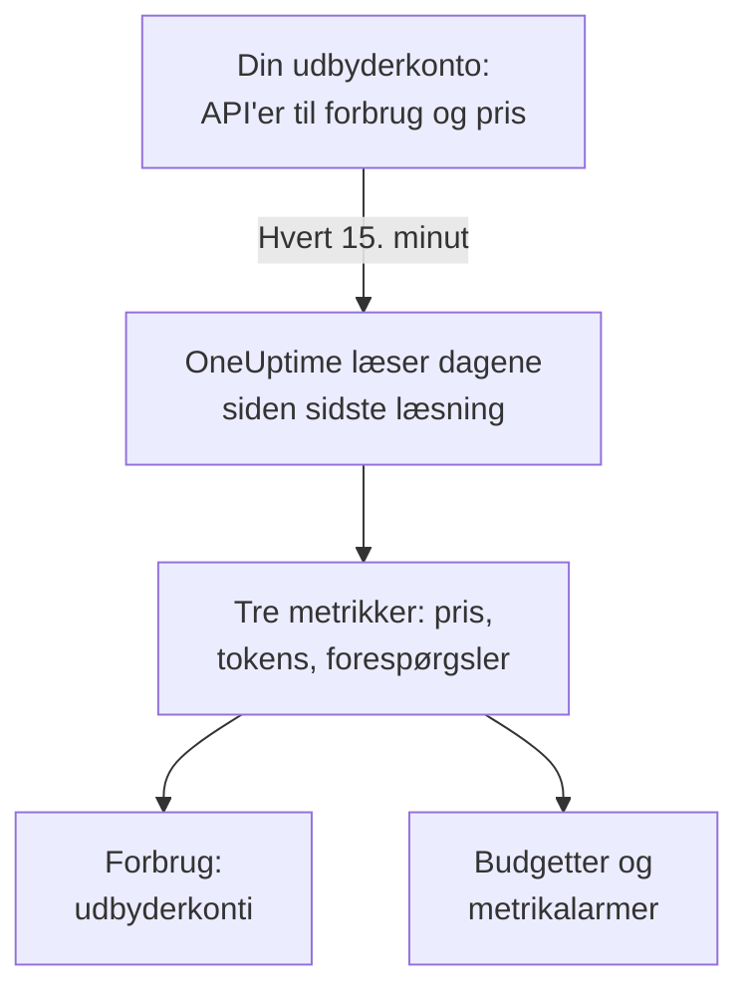

# AI-udbyderkonti

Se, hvad dine konti hos AI-udbydere har brugt, og hvad det har kostet, uden at ændre dine apps. Forbind en konto hos OpenAI, Anthropic, Azure OpenAI og Microsoft Foundry, Amazon Bedrock eller Google Vertex AI med legitimationsoplysninger, der kun kan læse, så læser OneUptime dens forbrug hvert 15. minut ind i **Forbrug**, **Budgetter** og metrikker, du kan alarmere på.

:::cards
- [Forbind en konto](#forbind-en-konto): Vælg udbyderen, indsæt legitimationsoplysningerne, test dem og forbind.
- [Hvad hver udbyder giver](#hvad-hver-udbyder-giver): Omkostninger, tokens og forespørgsler, og hvordan hver udbyder grupperer dem.
- [Se forbruget](#se-forbruget): Efter model, person, projekt eller ressource, API-nøgle og forbindelse.
- [Budgetter og alarmer](#budgetter-og-alarmer): Et dagligt budget på regningen og alarmer på metrikkerne.
:::

## Sådan virker det

Hvert 15. minut beder OneUptime hver forbundet konto om dens forbrug pr. UTC-døgn og gemmer det som tre metrikker i forbindelsens egen tjeneste. Hver læsning tager dagene siden sidste læsning og igen de sidste 3 dage, i dag medregnet, fordi udbyderne bliver ved med at lægge til i dag og retter de netop forløbne dage.

En kontos forbrug er det, den blev faktureret for, én dag ad gangen. Det indeholder ingen samtaler, prompts eller svar: til det skal du sende dine apps' AI-kald, som [AI- / LLM-observability](/docs/telemetry/ai-llm-observability) viser. De to holdes adskilt, så intet tælles to gange.

## Før du begynder

- Rollen Project Owner eller Project Admin. Kun de kan forbinde, ændre eller fjerne en konto; alle, der læser projektets telemetri, ser forbindelserne og forbruget.
- Legitimationsoplysninger til kontoen fra en, der administrerer den. Hver udbyders afsnit nedenfor fortæller hvilke, og hvor de oprettes.
- Intet at installere: OneUptime kalder udbyderens API fra sine egne servere.

## Forbind en konto

:::steps
### Åbn Forbind

Åbn **Produkter → AI / LLM → Forbind**. Under **Dine konti hos AI-udbydere** klikker du på udbyderens felt.

### Indsæt legitimationsoplysningerne

Under **Loginoplysninger** udfylder du det, udbyderen beder om. Hemmeligheder gemmes krypteret og vises aldrig igen, hverken i Dashboardet eller via API'et. **Navn** og de indstillinger, de fleste lader være, ligger under **Flere felter**.

### Test dem

Under **Test** klikker du på **Test forbindelse**. OneUptime læser forbruget for de sidste 7 dage og viser, hvad det fandt: omkostninger, tokens, forespørgsler, modeller, personer, nøgler og projekter. Intet gemmes, før du forbinder.

### Forbind

Klik på **Forbind**. Den første læsning starter inden for et minut og henter de sidste 30 dage.
:::

Forbundne konti står under felterne med deres **Status** og **Senest læst**. **Læs nu** læser med det samme, **Test** tjekker de gemte indstillinger igen, **Slå fra** stopper læsningen og beholder det læste, og **Rediger** ændrer indstillingerne: en hemmelighed, der lades tom, beholder den gemte. **View error** viser, hvorfor en læsning fejlede, uden nogen hemmelighed.

## Hvad hver udbyder giver

| Udbyder | Omkostning | Grupperet efter | Legitimation |
| --- | --- | --- | --- |
| OpenAI | Det, OpenAI rapporterer | Projekt, API-nøgle, person og model | En administratornøgle |
| Anthropic | Det, Anthropic rapporterer | Workspace, API-nøgle, person og model | En administratornøgle |
| Azure OpenAI og Microsoft Foundry | Anslået ud fra tokens | Ressource og model | En app med Monitoring Reader |
| Amazon Bedrock | Anslået ud fra tokens | Region og model | En adgangsnøgle, der læser CloudWatch |
| Google Vertex AI | Anslået ud fra tokens | Region og model | En tjenestekonto med Monitoring Viewer |

Alle udbydere undtagen Anthropic tæller også forespørgsler: Anthropics forbrugsrapport har ingen. En anslået omkostning bruger prislisten fra [Hvad et kald koster](/docs/telemetry/ai-llm-observability#hvad-et-kald-koster) og dine egne priser fra **Priser** og er markeret som et skøn. En model, prislisten ikke kender, har ingen omkostning, før du sætter en pris på den der.

Ingen af disse legitimationsoplysninger kan kalde en model: hver af dem læser forbrug, omkostninger eller metrikker og intet andet.

## OpenAI

OneUptime læser din OpenAI-organisation med en administratornøgle: forbruget af completions og embeddings pr. dag, model, projekt, API-nøgle og person og hver dags omkostninger pr. projekt og post. En omkostningspost fordeles mellem de nøgler og personer, der brugte dens model, så en persons række også har en omkostning. Projekt- og nøglenavne og personernes e-mails erstatter OpenAIs id'er.

:::steps
### Opret en OpenAI-administratornøgle

Åbn Settings, Organization, Admin keys i OpenAIs dashboard, og opret en nøgle. Kun organisationens ejere kan. Den starter med `sk-admin-`.

### Forbind OpenAI

Indsæt nøglen som **Administratornøgle**.
:::

## Anthropic

OneUptime læser din Claude API-organisation med en administratornøgle: forbrugsrapporten for beskeder pr. dag, model, workspace, API-nøgle og person og omkostningsrapporten pr. workspace og post, fordelt på samme måde. Claude Code brugt med organisationens nøgler eller Console-logins står også i disse rapporter, under den person eller nøgle, der brugte det.

:::steps
### Opret en Anthropic-administratornøgle

Åbn Settings, Admin keys i Claude Console, og opret en nøgle. Kun organisationens administratorer kan. Den starter med `sk-ant-admin01-`.

### Forbind Anthropic

Indsæt nøglen som **Administratornøgle**.
:::

## Azure OpenAI og Microsoft Foundry

OneUptime læser hver Azure OpenAI- og Foundry-ressource i et abonnement fra Azure Monitor: tokens og forespørgsler pr. dag, ressource og model. Azure Monitor tæller tokens, ikke penge, og nævner hverken person eller nøgle, så omkostningen er OneUptimes skøn, og person og nøgle forbliver tomme.

:::steps
### Registrér en app

Registrér en app i Microsoft Entra ID, og opret en klienthemmelighed til den.

### Lad den læse metrikkerne

Giv appen rollen Monitoring Reader på abonnementet.

### Forbind Azure

Udfyld **Mappe-id (tenant)**, **Program-id (klient)**, **Abonnements-id** og **Klienthemmelighed**. For Azure Government ændrer du **Cloud** under **Flere felter**.
:::

## Amazon Bedrock

OneUptime læser CloudWatch-metrikkerne `AWS/Bedrock` for hver region, du angiver: input-, output- og cache-tokens og kald pr. dag og model. CloudWatch tæller tokens, ikke penge, og nævner hverken person eller nøgle: omkostningen er OneUptimes skøn, og hver region vises som et projekt.

:::steps
### Opret en adgangsnøgle

Opret en IAM-bruger eller -rolle, hvis politik tillader `cloudwatch:GetMetricData` og `cloudwatch:ListMetrics`, og en adgangsnøgle til den.

### Forbind Bedrock

Udfyld **Adgangsnøgle-id**, **Hemmelig adgangsnøgle** og **Regioner**, adskilt med kommaer: `us-east-1`, medmindre du ændrer det.
:::

## Google Vertex AI

OneUptime læser de Cloud Monitoring-metrikker, som Vertex AI udgiver for sine modeller, Gemini og partnermodeller som Claude: input- og output-tokens og kald pr. dag, region og model. Cloud Monitoring tæller tokens, ikke penge, og nævner hverken person eller nøgle: omkostningen er OneUptimes skøn.

:::steps
### Opret en tjenestekonto

Opret i projektet en tjenestekonto med rollen Monitoring Viewer og en JSON-nøgle til den.

### Forbind Vertex AI

Udfyld **Projekt-ID**, og indsæt hele nøglefilen som **Tjenestekontonøgle (JSON)**.
:::

## Se forbruget

Åbn **Forbrug**, og vælg **Udbyderkonti**. Her ser du de omkostninger, tokens og forespørgsler, dine konti rapporterede for tidsrummet, rangeret efter **Model**, **Person**, **Udbyder**, **Projekt eller ressource**, **API-nøgle** eller **Forbindelse**. Tidsrummet starter ved midnat UTC på sin første dag, fordi udbyderne rapporterer hele dage.

**Udbyderkonti** og **Dine AI-kald** lægges aldrig sammen. Et kald, din app laver med en nøgle fra en forbundet konto, er med i begge, så en sammenlægning ville tælle det to gange.

## Budgetter og alarmer

Et budget tæller det ene eller det andet. Under **Budgetter** opretter du et budget og sætter **Tæl udgifter fra** til **Udbyderkonti**: det tæller, hvad de forbundne konti blev faktureret for UTC-døgnet, afgrænset af **LLM-udbyder (valgfri)** og **LLM-model (valgfri)**, når du angiver dem. Udbyderne rapporterer en dags forbrug minutter til timer senere, så til alarmer inden for minutter bør du i stedet budgettere **Dine AI-kald**.

Hver kontos forbrug gemmes som tre metrikker, som du kan vise på et [dashboard](/docs/dashboards/index) eller overvåge med en [Metrik-monitor](/docs/monitor/metrics-monitor):

| Metrik | Hvad den er |
| --- | --- |
| `oneuptime.llm.provider.cost` | En dags omkostning i USD |
| `oneuptime.llm.provider.tokens` | En dags tokens efter `gen_ai.token.type`: `input` (cachede tokens medregnet), `output`, `cache_read` og `cache_write` |
| `oneuptime.llm.provider.requests` | En dags forespørgsler |

Hvert punkt får tidsstemplet for starten af sit UTC-døgn. Det bærer `oneuptime.llm.connection.id` og `oneuptime.llm.connection.name` og det, udbyderen nævner: `gen_ai.provider.name`, `gen_ai.request.model`, `user.email`, `oneuptime.llm.provider.project` og `oneuptime.llm.provider.api_key`. En anslået omkostning bærer `oneuptime.llm.cost.estimated`.

## Hvornår der læses

| Læsning | Hvornår |
| --- | --- |
| Den første | Inden for et minut efter forbindelsen, 30 dage tilbage |
| De næste | Hvert 15. minut |
| Efter at en nøgle eller tilladelse er afvist | 60 minutter senere |
| Efter enhver anden fejl | 15 minutter senere |
| Slået fra | Ingen, før den slås til igen |

En plan uden telemetrifunktioner læser intet. At fjerne en forbindelse stopper dens læsninger og beholder det, den har læst, indtil tjenestens opbevaring fjerner det.

## Hvorfor OneUptime ikke har sin egen gateway

OneUptime læser dine konti; det står aldrig mellem dine apps og udbyderne. En proxy ville holde dine udbydernøgler og tilføje et ekstra led til hvert modelkald, dine apps laver. Går din modeltrafik allerede gennem LiteLLM, Portkey eller OpenRouter, så send gatewayens traces til OneUptime, som [AI-gateways](/docs/telemetry/ai-gateways) viser, og forbind kontoen for dens regning.

## Fejlfinding

:::details Testen siger, at nøglen eller hemmeligheden ikke blev accepteret
Tjek, at du har kopieret det hele, at den ikke er tilbagekaldt, og at det er den slags, udbyderen beder om: en administratornøgle fra OpenAI eller Anthropic, ikke en projekt- eller API-nøgle.
:::

:::details Legitimationsoplysningerne virker, men må ikke læse det, forbindelsen skal bruge
Giv dem den rolle, denne side nævner for udbyderen: Monitoring Reader på Azure-abonnementet, de to CloudWatch-handlinger i AWS, Monitoring Viewer på Google Cloud-projektet.
:::

:::details Testen lykkes, men der vises intet for i dag
Udbyderne rapporterer en dags forbrug minutter til timer senere og retter det i en dag eller to. De næste læsninger henter det.
:::

:::details Omkostningen afviger fra fakturaen
En rapporteret omkostning er udbyderens tal før skatter, kreditter og rabatter. En anslået omkostning er tokens til listepris eller til dine egne priser fra **Priser**.
:::

## Næste trin

:::cards
- [AI- / LLM-observability](/docs/telemetry/ai-llm-observability): Samtaler, alarmer og omkostninger for dine egne apps' AI-kald.
- [Virksomhedens AI-værktøjer](/docs/telemetry/ai-company-tools): Hvad dine folk spørger Claude Enterprise og Microsoft 365 Copilot om.
- [AI-gateways](/docs/telemetry/ai-gateways): Trace hvert modelkald gennem LiteLLM, Portkey eller OpenRouter.
- [Metrik-monitor](/docs/monitor/metrics-monitor): Alarmér på udbydermetrikkerne.
:::
